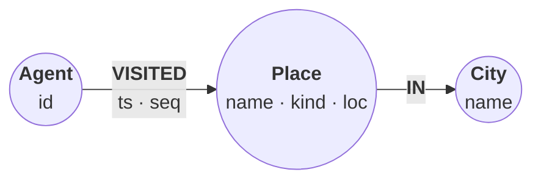

# Relate cookbook

Task-shaped recipes: each one takes a small dataset, walks through the Cypher
that solves a real problem, and shows the result of every step. The same
recipes are published at <https://relatedb.ai/cookbook/>,
where every step runs in your browser on the WASM build of the engine.

Every recipe here is a test: one markdown file holding its prose, its Cypher,
the data it loads, and the recorded result of every step. `npm run
cookbook:check` runs each recipe against the WASM build of the engine the site
ships (`public/wasm/`) and fails if a result drifts from what the file records
(see [Checks](#checks); the format comes from Relate's ADR-0130 and ADR-0132).

## Recipes

<!-- cookbook-index:start -->
### Agent memory

| Recipe | What it does | Level | Runs in the browser |
|---|---|---|---|
| [Agent trajectory timeline](agent-trajectory-timeline.md) | Log every tool call an agent makes as a timestamped step, then read the last N, the next page, and everything since a cutoff, with constraints that keep newest-first reads correct. | Intermediate | Fully |
| [Bi-temporal decisions](bitemporal-decisions.md) | A decision log with two time axes answers both "what was true on this date?" and "what did the agent believe on this date?", through late corrections, a rejection, and a planned change. | Intermediate | Fully |
| [Long-term memory for an agent](agent-memory.md) | One session writes facts and decisions from a chat into a graph; a later session recalls them, with newer decisions superseding older ones and the history kept. | Intermediate | Cypher steps |
| [Tool-call provenance for an agent](tool-call-provenance.md) | Record every memory tool call an agent makes in the graph it touched, then audit which call wrote a fact, who read it since, and what the failed calls left behind. | Advanced | Fully |

### Search and retrieval

| Recipe | What it does | Level | Runs in the browser |
|---|---|---|---|
| [Context graph for a codebase](codebase-context-graph.md) | Answer multi-hop questions about a codebase: IDF-weighted full-text search finds where to start, and bounded graph hops follow supersessions, dependencies, and citations. | Advanced | Fully |
| [Hybrid recall: vector + full-text + RRF](hybrid-recall.md) | Fuse vector and full-text SEARCH by reciprocal rank in one Cypher statement, then hop from each recalled note to its topic's latest decision. | Advanced | Fully |

### Data quality

| Recipe | What it does | Level | Runs in the browser |
|---|---|---|---|
| [Entity resolution in pure Cypher](entity-resolution.md) | Resolve two messy customer exports into companies with normalized keys, bigram typo matching, IDF-weighted scores, and a human review queue, all in Cypher. | Intermediate | Fully |
| [Rehearse a migration against a golden graph](migration-rehearsal.md) | Fingerprint a graph before a migration runs, declare what the migration may change, and catch a bug that node counts and intended-change checks both miss. | Advanced | Fully |

### Graph analytics

| Recipe | What it does | Level | Runs in the browser |
|---|---|---|---|
| [Dependency blast radius](dependency-blast-radius.md) | Trace every known advisory three packages can reach, measure what disappears when a dependency is dropped, and turn the answer into a CI gate. | Advanced | Fully |

### Geospatial

| Recipe | What it does | Level | Runs in the browser |
|---|---|---|---|
| [Nearby places for an agent](nearby-places.md) | A geo-aware memory tool that answers radius, nearest-k, map-box, and recent-visit questions over 80 remembered places. | Beginner | Fully |

<!-- cookbook-index:end -->

## Running a recipe yourself

The Cypher in a recipe runs anywhere Relate does. A recipe's data lives in
its `json data=<name>` blocks: JSON objects whose keys are the parameters a
step uses. Pull a block out of the recipe (here, the `places` block of
`nearby-places.md`, from this directory) and pass a key with `--param`:

```sh
awk '/^```json data=places$/{f=1;next} f&&/^```$/{exit} f' nearby-places.md > places.json
relate --param "places=$(jq -c .places places.json)" places.rl \
  'UNWIND $places AS r CREATE (:Place {name: r.name, loc: point({latitude: r.lat, longitude: r.lon})})'
```

The website also publishes every block beside its page, as
`/cookbook/<slug>/data/<name>.json`. From Python, pass the whole
object:

```python
import json, relate

params = json.load(open("places.json"))
with relate.connect("places.rl") as db:
    db.execute(
        "UNWIND $places AS r "
        "CREATE (:Place {name: r.name, loc: point({latitude: r.lat, longitude: r.lon})})",
        params,
    )
```

## Writing a recipe

A recipe is one file, `src/content/cookbook/<slug>.md`. The file stem is its URL
(`/cookbook/<slug>/`). Everything the recipe needs is in that file:

| Part | Fence | Purpose |
| --- | --- | --- |
| Front matter | `---` block | Title, summary, level, category, data provenance |
| Prose | markdown | What each step does and why |
| Steps | ```` ```cypher cell=<id> ```` | Runnable Cypher, run in document order |
| Data | ```` ```json data=<name> ```` | A JSON object whose keys are a step's parameters |
| Results | ```` ```table ```` or ```` ```gram ```` | The recorded result of the step just above; generated |
| Diagrams | ```` ```mermaid ```` | The data model, and any pipeline worth a picture; rendered for the website |

### Front matter

The file starts with a front-matter block: one `key: value` per line, values
plain, `"quoted"`, or a flow list `[a, b]`. No nesting, no comments.

| Key | Required | Meaning |
| --- | --- | --- |
| `title` | yes | Page title; must equal the first `# ` heading |
| `summary` | yes | One sentence (≤ 200 characters) naming the outcome, shown in the index |
| `level` | yes | `Beginner`, `Intermediate`, or `Advanced` |
| `category` | yes | `Agent memory`, `Search and retrieval`, `Data quality`, `Graph analytics`, or `Geospatial` |
| `features` | yes | List of the Cypher features the recipe teaches |
| `browser` | yes | `full`: every step runs in the page. `partial`: some steps (Python, an LLM call) are shown as code only |
| `dataset` | with a dataset | What the data holds, and its size |
| `source` | with a dataset | Where the data came from |
| `license` | with a dataset | The data's license |

A dataset is any data block larger than 2 KB.

### Steps

A runnable step is a fenced block whose info string starts with
`cypher cell=<id>`:

````markdown
```cypher cell=load setup params=places
UNWIND $places AS r
CREATE (:Place {name: r.name, loc: point({latitude: r.lat, longitude: r.lon})})
```
````

| Option | Meaning |
| --- | --- |
| `cell=<id>` | Required. Unique within the recipe; lowercase letters, digits, `-` |
| `setup` | Collapsed on the website; still runs in order |
| `params=<name>` | The `json data=<name>` block passed as the statement parameters |
| `expect=error` | The step must fail; its result shows the error |

A `cypher` fence without options is prose: shown, highlighted, never run.
Other languages (`python`, `sh`) are prose too.

Steps run in document order against one in-memory database. A step may hold
several statements separated by `;`; they run in order, the step stops at the
first error, and its result is the last statement's result with mutation
counters summed over the step. Put a query whose rows matter in its own step.

### Data

A data block is a JSON object; its keys are the parameters of every step that
names it with `params=<name>`. Every block must be used, and none may exceed
512 KB. Parameters arrive exactly as the block spells them, so `1.0` stays a
float and `1` an integer. Keep vectors as float literals (`[1.0, 0.0]`).

- A small block (up to 2 KB) holds a step's knobs. Put it just above the
  first step that uses it; on the website it is that step's editable
  **Parameters**. It counts toward the 800-line cap.
- A dataset (over 2 KB) goes in a `## Data` section at the end of the file,
  each block inside `<details>` so GitHub shows it collapsed:

  ````markdown
  ## Data

  <details>
  <summary><code>places</code> (10 KB)</summary>

  ```json data=places
  {"places": [{"name": "Hotel Lucia", "lat": 45.5225, "lon": -122.68}]}
  ```

  </details>
  ````

The website never renders data blocks, the `## Data` section, or its
`<details>` wrappers; steps load the blocks from `data/<name>.json` beside
the page. `<details>` and `<summary>` lines are the only raw HTML a recipe may
contain.

### Results

Each step is followed by its recorded result. The harness writes it; do not
edit it by hand. A result without nodes, relationships, or paths is a
`table`: every row, no truncation, values as Cypher literals (strings
quoted, so `"446"` and `446` differ), then the row count and the mutation
counters:

````markdown
```table
| name               | metres |
|--------------------|--------|
| "Blue Star Donuts" | 446    |
| "Stumptown"        | 506    |
2 rows
```
````

A result that holds graph values is [gram](https://github.com/gram-data/tree-sitter-gram):
a `//` summary line, then one line per row. Nodes and relationships carry
their engine ids (`n3`, `r89`), written in full the first time and referenced
after. A row with other columns is `[{column: value} | patterns]`. Labels,
keys, and strings take gram's backslash escapes, and values gram cannot
express (including strings with a control character it has no escape for)
are exact Cypher literals in a `cypher` tagged string (``cypher`[]` ``):

````markdown
```gram
// 2 rows
(n82:Agent {id: "a1"})-[r89:VISITED {seq: 10}]->(n3:Place {name: "Blue Star Donuts"})
(n82)-[r85:VISITED {seq: 6}]->(n4:Place {name: "Stumptown"})
```
````

Write-only steps record `(no rows)` plus their counters; failing steps record
`error: …`. On the website a result fills its step's output pane: a `table`
result as an HTML table (Copy as text gives the recorded form), and a gram
result in the graph view, drawn with NVL
(Relate's ADR-0151). The reader zooms,
pans, drags nodes, inspects an element by hovering or clicking it, and
double-clicks a node to add its neighbours from the page's database (the
earlier steps run first if they have not). A node's caption is its `name`,
`title`, `text`, `id`, `label`, or `key` property, so give the nodes a result
draws one of those. `cookbook:check` (and the site build) expands the first
node of every gram result, as a double-click would, and fails if that goes
wrong.

### Diagrams

Every recipe draws its graph data model, and a recipe with a pipeline worth
a picture draws that too, as a ```` ```mermaid ```` block. GitHub renders the
block as it is; the website shows a rendering of it made ahead of time
(Relate's ADR-0135).

````markdown

````

- Any fence whose language is `mermaid` is a diagram (```` ``` ```` or
  `~~~`). Start the fence at the beginning of a line, not inside a list.
- Start with `accTitle:`: it is the diagram's name for screen readers and
  its caption on the website.
- A data model is a `flowchart` whose nodes are all circles, `((…))`, with
  no subgraphs. The website draws it as a graph, the way Neo4j Bloom and NVL
  draw one: each label a coloured circle holding its properties, each
  relationship type along its arrow, laid out by force. A node's text is
  `<b>Label</b><br/>prop · prop`; the drawing rewraps the properties to fit
  the circle and splits a long label where a word starts. A relationship's
  text is `<b>TYPE</b><br/>prop · prop`. A dotted edge, `-. "…" .->`, is
  drawn dashed (a derived relationship, say).
- Classes `l1` to `l12` give a label one of the graph view's colours (the
  palette Neo4j's graph tools use); a node without one is grey.
- Any other diagram is drawn by mermaid. Stick to `flowchart` and `gantt`,
  which GitHub's mermaid renders too, and prefer rectangles, rounded
  rectangles `(…)`, and cylinders `[(…)]`. In a flow, `accent` marks the
  step it is about, and `good` and `bad` mark outcomes.
- Keep a diagram under about 900 px wide, or it shrinks in the page column:
  a long flow reads better as two rows (two `direction LR` subgraphs linked
  to each other) or as `flowchart TB`.

After changing a diagram, render it:

```sh
npm ci --prefix scripts/cookbook-diagrams   # once
npm run cookbook:diagrams
```

That writes `diagrams/<slug>-<n>-light.svg` and `-dark.svg` beside the
recipes, in the site's colours (the Night/Day tokens in
`src/styles/base.css`) and its Public Sans, and for a data model also
`<slug>-<n>-labels.json`, the colour of each label, which the website's
graph view uses so a result's nodes match the diagram. It needs Chrome
(`CHROME_PATH`, or a usual install location) and no network. For a data
model it tries several layouts and keeps the cleanest; it warns when that
one still has overlapping nodes or captions, a line through a node, or a
caption longer than its line. Then reorder the block's lines or change its
direction (the layout starts from it), and render again. Commit the files
with the recipe: the site build fails when a rendering is missing, is older
than its block, or holds anything beyond the elements, attributes, and CSS
the renderer draws (no scripts, links, event handlers, or external URLs),
since it is inlined into the page.

A rendering is only re-drawn when its block changes. After changing the
site's colours, render every diagram again with
`npm run cookbook:diagrams -- --force`; `--only <slug>[,<slug>…]` limits a
run to some recipes.

Generate the results, and the index above:

```sh
npm run cookbook:record
```

Review the diff: it is the recipe's behavior.

### Checks

Every check runs on the WASM build of the engine the site ships
(`public/wasm/`), in Node 22.18 or later; nothing else is needed. After
refreshing `public/wasm/`, run `npm run cookbook:record` and review what
changed.

| Command | What it checks |
| --- | --- |
| `npm run cookbook:check` | Every recipe parses and validates (the front matter, data blocks, and raw HTML are valid; step code fits in 88 columns; small blocks sit beside their steps and datasets in `## Data`; the recipe runs at most 800 lines before `## Data`; it has a diagram), runs every step in order, reproduces each recorded `table` / `gram` block, and returns at most 200 rows per statement; the index is current |
| `npm run cookbook:test` | The cookbook tooling's unit tests (`src/lib/cookbook/*.test.ts`) |
| `npm run cookbook:browser` | After `npm run build`: every recipe page opens in headless Chrome, "Run all" runs every step, and each must match its recording; the page controls (Run, parameters, JSON view, Edit and Revert, Reset, Stop) are exercised on one recipe. Needs Chrome (`CHROME_PATH`) |

A run stops at the first step that goes other than the recipe says (an error
where none is expected, or success where the step is `expect=error`), in the
check, on the page, and in the playground.

Environment variables honored by `cookbook:check`, `cookbook:record`, and `cookbook:browser`:

| Variable | Effect |
| --- | --- |
| `COOKBOOK_ONLY=<slug>[,<slug>…]` | Run only these recipes, and leave the index alone |

The tooling lives in `src/lib/cookbook/` (parser, validator, runner, index)
and `scripts/cookbook.ts` (the command).

### Style

- Lead with the outcome, in one italic paragraph under the heading. The
  website shows it as the page's introduction; the front-matter `summary` is
  for the index, meta tags, and `llms.txt`.
- Keep step code within 88 columns; `cookbook:check` fails on a wider line,
  which would scroll sideways in the website's code panel.
- Keep results small: `LIMIT` anything that could exceed 200 rows. Every row
  is recorded in the file.
- Bound every variable-length pattern. There is no query timeout; the page's
  Stop button is the only way out of a runaway query.
- Return scalars where a reader compares numbers, and nodes or paths where
  the shape is the point (they record as gram and get a graph view). Put
  scalar columns first in a table result; alias every column.
- Explain surprises where they happen, in a `> **Note**` block next to the
  step.
