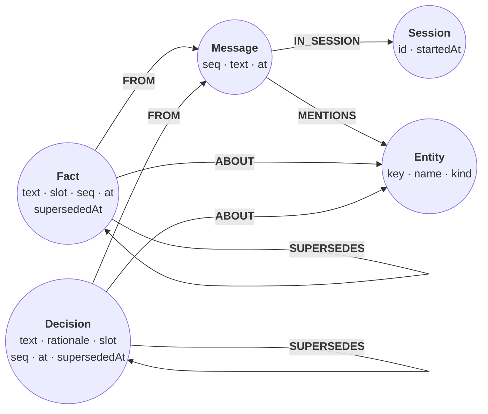
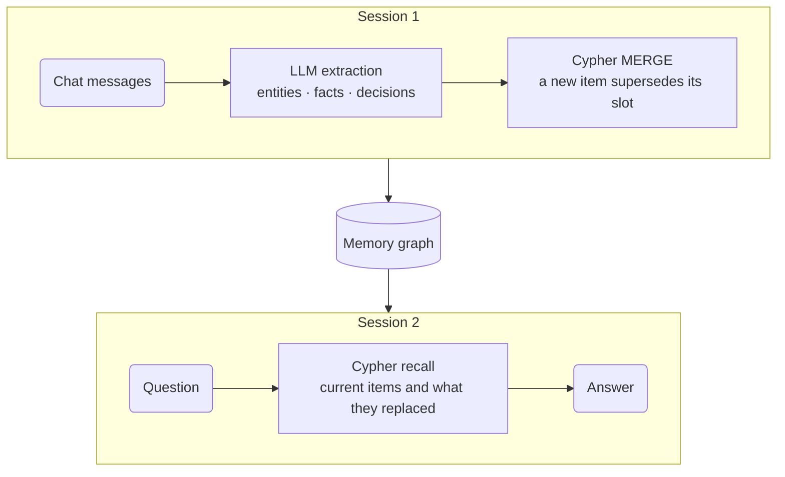

# Long-term memory for an agent

*An agent turns each chat message into entities, facts, and decisions, writes
them to a graph, and exits. A later session starts with an empty prompt and
answers "what do you remember about the orders service?" from the graph
alone. When a decision changes, the new one supersedes the old one, and
recall shows both what is true now and what it replaced.*

The graph looks like this:



A `slot` names what a fact or decision is about, such as
`orders service/owner`. When a new item fills a slot that already holds a
current item, the old one gets a `supersededAt` timestamp and a
`SUPERSEDES` edge from its replacement. Nothing is deleted.

In the real program, session 1 and session 2 are two Python processes that
share one `agent.rl` file. On this page everything runs in one in-memory
database, so the two sessions are consecutive steps against the same graph.



## Set up the schema

Entity keys are unique, so `MERGE` finds the same entity whichever message
mentions it. Session ids are unique too.

```cypher cell=schema setup
CREATE CONSTRAINT entity_key IF NOT EXISTS FOR (e:Entity) REQUIRE e.key IS UNIQUE;
CREATE CONSTRAINT session_id IF NOT EXISTS FOR (s:Session) REQUIRE s.id IS UNIQUE
```

```table
(no rows) · constraints added: 2
```

## Session 1: extract entities, facts, and decisions

Session 1 hears four messages about a new orders service. For each one, the
agent asks an LLM for structured output: the entities mentioned, durable
facts, and decisions with their rationale. Each fact and decision names its
slot and the entities it is `about`.

```python
import json
from openai import OpenAI

SYSTEM_PROMPT = """You maintain an engineering team's long-term memory.
From the user's message extract:
- entities: people, teams, services, technologies, events mentioned (canonical names).
- facts: durable statements. `slot` is a stable key for what the fact is about, e.g.
  "orders service/owner"; reuse an existing slot when the message updates it, else "".
- decisions: choices the team made, with rationale; slot like "orders service/database".
`about` lists entity names each fact/decision concerns. Known slots: {slots}"""

def extract(text: str, slots: list[str]) -> dict:
    reply = OpenAI().chat.completions.create(
        model="gpt-4.1-mini",
        messages=[
            {"role": "system", "content": SYSTEM_PROMPT.replace("{slots}", json.dumps(slots))},
            {"role": "user", "content": text},
        ],
        # EXTRACTION_SCHEMA requires entities [{name, kind}], facts [{text, slot, about}],
        # and decisions [{text, rationale, slot, about}]
        response_format={"type": "json_schema", "json_schema": {
            "name": "memory_extraction", "schema": EXTRACTION_SCHEMA, "strict": True}},
    )
    return json.loads(reply.choices[0].message.content)
```

This page does not call a model. The `session-1` data block (in the Data
section at the end) holds session 1's four messages, each with its extraction and a fixed timestamp. The
extractions are hand-written stand-ins for model output, the same ones the
program replays when it runs offline.

## Session 1: remember

The agent's `remember` step is five statements:

1. Record the session and its messages, and `MERGE` every entity mentioned.
   The key is the lowercased name, so "Postgres" and "postgres" meet.
2. Create each fact, linked `FROM` its message and `ABOUT` its entities.
3. The same for decisions, which also carry a rationale.
4. Supersede. For each new item with a slot, a `CALL` subquery finds the
   newest older item of the same label in that slot. The old item gets
   `supersededAt`, and the new one points at it with `SUPERSEDES`. A fact
   only replaces a fact, and a decision only a decision. Session 1 has
   nothing to replace yet.
5. Report what each message stored.

```cypher cell=session-1 params=session-1
MERGE (s:Session {id: $session}) ON CREATE SET s.startedAt = datetime($startedAt)
WITH s
UNWIND $messages AS msg
CREATE (m:Message {seq: msg.seq, text: msg.text,
                   at: datetime(msg.at)})-[:IN_SESSION]->(s)
WITH m, msg
UNWIND msg.entities AS ent
MERGE (e:Entity {key: toLower(ent.name)})
  ON CREATE SET e.name = ent.name, e.kind = ent.kind
MERGE (m)-[:MENTIONS]->(e);

UNWIND $messages AS msg
MATCH (m:Message {seq: msg.seq})
UNWIND msg.facts AS f
CREATE (x:Fact {text: f.text, slot: f.slot, seq: m.seq, at: m.at})-[:FROM]->(m)
WITH x, f
UNWIND f.about AS name
MATCH (e:Entity {key: toLower(name)})
MERGE (x)-[:ABOUT]->(e);

UNWIND $messages AS msg
MATCH (m:Message {seq: msg.seq})
UNWIND msg.decisions AS d
CREATE (x:Decision {text: d.text, rationale: d.rationale, slot: d.slot,
                    seq: m.seq, at: m.at})-[:FROM]->(m)
WITH x, d
UNWIND d.about AS name
MATCH (e:Entity {key: toLower(name)})
MERGE (x)-[:ABOUT]->(e);

UNWIND $messages AS msg
MATCH (new:Fact|Decision {seq: msg.seq})
WHERE new.slot <> ''
CALL (new) {
  MATCH (old:Fact|Decision {slot: new.slot})
  WHERE old.seq < new.seq AND labels(old) = labels(new)
  RETURN old ORDER BY old.seq DESC LIMIT 1
}
SET old.supersededAt = new.at
CREATE (new)-[:SUPERSEDES]->(old);

UNWIND $messages AS msg
MATCH (m:Message {seq: msg.seq})
RETURN m.seq AS seq,
       COUNT { (m)-[:MENTIONS]->() } AS entities,
       COUNT { (:Fact)-[:FROM]->(m) } AS facts,
       COUNT { (:Decision)-[:FROM]->(m) } AS decisions
ORDER BY seq
```

```table
| seq | entities | facts | decisions |
|-----|----------|-------|-----------|
| 1   | 3        | 2     | 0         |
| 2   | 2        | 0     | 1         |
| 3   | 4        | 2     | 0         |
| 4   | 3        | 2     | 0         |
4 rows · nodes created: 20, relationships created: 39, properties set: 67, labels added: 20
```

Timestamps come from the fixture through `datetime(msg.at)`, so this page's
results never change. The program stamps `datetime()`, the current time,
when it writes.

## What session 1 left behind

```cypher cell=labels
MATCH (n)
UNWIND labels(n) AS label
RETURN label, count(*) AS nodes
ORDER BY label
```

```table
| label      | nodes |
|------------|-------|
| "Decision" | 1     |
| "Entity"   | 8     |
| "Fact"     | 6     |
| "Message"  | 4     |
| "Session"  | 1     |
5 rows
```

In the program, session 1 exits here. Everything it learned is in one file,
and session 2 is a new process that opens it. A path ending in `.rl` is a
single-file database:

```python
import relate

# session1.py
with relate.connect("agent.rl") as db:
    for statement in SCHEMA:
        db.execute(statement)
    for statement in REMEMBER:             # the five statements above
        db.execute(statement, session_1)   # the session-1 data block
# the process exits; agent.rl holds the memory

# session2.py, later, in a new process
with relate.connect("agent.rl") as db:
    rows = db.execute(RECALL, {"question": "What do you remember about the orders service?"}).fetchall()
```

## Session 2: recall

Session 2 starts with nothing in its prompt. It finds the entity the
question names, then reads what the graph says about it. `toLower($question)
CONTAINS e.key` matches every entity named in the question, and the longest
key wins. The path through `FROM` and `IN_SESSION` says which session
learned each item.

```json data=question
{
  "question": "What do you remember about the orders service?"
}
```

```cypher cell=recall params=question
MATCH (e:Entity) WHERE toLower($question) CONTAINS e.key
WITH e ORDER BY size(e.key) DESC LIMIT 1
MATCH (e)<-[:ABOUT]-(x:Fact|Decision)-[:FROM]->(:Message)-[:IN_SESSION]->(s:Session)
WHERE x.supersededAt IS NULL
RETURN labels(x)[0] AS kind, x.text AS memory, x.rationale AS because, s.id AS session,
       COLLECT { MATCH (x)-[:SUPERSEDES]->{1,5}(old)
                 RETURN old.text ORDER BY old.seq DESC } AS replaced
ORDER BY x.seq, memory
```

```table
| kind       | memory                                                                     | because                                        | session     | replaced |
|------------|----------------------------------------------------------------------------|------------------------------------------------|-------------|----------|
| "Fact"     | "Alice owns the orders service."                                           | null                                           | "session-1" | []       |
| "Fact"     | "The orders service is built for the checkout team."                       | null                                           | "session-1" | []       |
| "Decision" | "Use Postgres as the orders service database"                              | "the team already runs Postgres in production" | "session-1" | []       |
| "Fact"     | "The billing service consumes OrderPlaced events from the orders service." | null                                           | "session-1" | []       |
| "Fact"     | "The orders service publishes OrderPlaced events to Kafka."                | null                                           | "session-1" | []       |
5 rows
```

`replaced` is empty for now. It fills in once session 2 hears about
changes.

The memory reaches past the entity itself. Follow `ABOUT` out to an entity
that shares a current fact or decision with the orders service, then back in
to that entity's own facts:

```cypher cell=nearby params=question
MATCH (e:Entity) WHERE toLower($question) CONTAINS e.key
WITH e ORDER BY size(e.key) DESC LIMIT 1
MATCH (e)<-[:ABOUT]-(x)-[:ABOUT]->(o:Entity)
WHERE x.supersededAt IS NULL AND o <> e
MATCH (o)<-[:ABOUT]-(f:Fact)
WHERE f.supersededAt IS NULL AND NOT (f)-[:ABOUT]->(e)
RETURN DISTINCT o.name AS via, f.text AS fact
ORDER BY via, fact
```

```table
| via               | fact                                      |
|-------------------|-------------------------------------------|
| "billing service" | "Bob is on call for the billing service." |
| "checkout team"   | "Bob is on the checkout team."            |
2 rows
```

Nobody told the agent that Bob matters to the orders service. The graph
connects him through the checkout team and the billing service. Try another
question, such as "What do you remember about the billing service?".

## Session 2: new information arrives

Before extracting anything, the agent asks which slots are in use and passes
them to the model (`Known slots: {slots}` in the prompt above):

```cypher cell=slots
MATCH (x:Fact|Decision)
WHERE x.slot <> '' AND x.supersededAt IS NULL
RETURN DISTINCT x.slot AS slot
ORDER BY slot
```

```table
| slot                      |
|---------------------------|
| "billing service/on-call" |
| "orders service/database" |
| "orders service/owner"    |
| "orders service/team"     |
4 rows
```

That is how the model can map "Carol is taking over" onto
`orders service/owner` instead of inventing a new slot. Session 2 then hears
two updates and runs the same `remember` statements on their extractions,
from the `session-2` data block:

```json data=session-2
{
  "session": "session-2",
  "startedAt": "2026-03-16T14:02:00Z",
  "messages": [
    {
      "seq": 5,
      "at": "2026-03-16T14:02:00Z",
      "text": "Update: Postgres failover was too slow in the multi-region test, so the orders service is switching to CockroachDB.",
      "entities": [
        {"name": "orders service", "kind": "service"},
        {"name": "Postgres", "kind": "technology"},
        {"name": "CockroachDB", "kind": "technology"}
      ],
      "facts": [],
      "decisions": [
        {"text": "Use CockroachDB as the orders service database", "rationale": "Postgres failover was too slow in the multi-region test", "slot": "orders service/database", "about": ["orders service", "CockroachDB"]}
      ]
    },
    {
      "seq": 6,
      "at": "2026-03-16T14:07:00Z",
      "text": "Carol is taking over ownership of the orders service from Alice.",
      "entities": [
        {"name": "Carol", "kind": "person"},
        {"name": "orders service", "kind": "service"},
        {"name": "Alice", "kind": "person"}
      ],
      "facts": [
        {"text": "Carol owns the orders service.", "slot": "orders service/owner", "about": ["orders service", "Carol"]}
      ],
      "decisions": []
    }
  ]
}
```

```cypher cell=session-2 params=session-2
MERGE (s:Session {id: $session}) ON CREATE SET s.startedAt = datetime($startedAt)
WITH s
UNWIND $messages AS msg
CREATE (m:Message {seq: msg.seq, text: msg.text,
                   at: datetime(msg.at)})-[:IN_SESSION]->(s)
WITH m, msg
UNWIND msg.entities AS ent
MERGE (e:Entity {key: toLower(ent.name)})
  ON CREATE SET e.name = ent.name, e.kind = ent.kind
MERGE (m)-[:MENTIONS]->(e);

UNWIND $messages AS msg
MATCH (m:Message {seq: msg.seq})
UNWIND msg.facts AS f
CREATE (x:Fact {text: f.text, slot: f.slot, seq: m.seq, at: m.at})-[:FROM]->(m)
WITH x, f
UNWIND f.about AS name
MATCH (e:Entity {key: toLower(name)})
MERGE (x)-[:ABOUT]->(e);

UNWIND $messages AS msg
MATCH (m:Message {seq: msg.seq})
UNWIND msg.decisions AS d
CREATE (x:Decision {text: d.text, rationale: d.rationale, slot: d.slot,
                    seq: m.seq, at: m.at})-[:FROM]->(m)
WITH x, d
UNWIND d.about AS name
MATCH (e:Entity {key: toLower(name)})
MERGE (x)-[:ABOUT]->(e);

UNWIND $messages AS msg
MATCH (new:Fact|Decision {seq: msg.seq})
WHERE new.slot <> ''
CALL (new) {
  MATCH (old:Fact|Decision {slot: new.slot})
  WHERE old.seq < new.seq AND labels(old) = labels(new)
  RETURN old ORDER BY old.seq DESC LIMIT 1
}
SET old.supersededAt = new.at
CREATE (new)-[:SUPERSEDES]->(old);

UNWIND $messages AS msg
MATCH (m:Message {seq: msg.seq})
RETURN m.seq AS seq,
       COUNT { (m)-[:MENTIONS]->() } AS entities,
       COUNT { (:Fact)-[:FROM]->(m) } AS facts,
       COUNT { (:Decision)-[:FROM]->(m) } AS decisions
ORDER BY seq
```

```table
| seq | entities | facts | decisions |
|-----|----------|-------|-----------|
| 5   | 3        | 0     | 1         |
| 6   | 3        | 1     | 0         |
2 rows · nodes created: 7, relationships created: 16, properties set: 25, labels added: 7
```

Both updates landed in a slot that already had a current item, so the
supersede statement linked each one to the item it replaces. The slot is
what makes this work: reset the page, set the `slot` of Carol's fact in
the `session-2` parameters to `""`, and run this step again. The new fact then
sits beside Alice's, and recall reports two owners.

> **Note**
> The program runs `remember` once per message. Replaying a batch, the
> supersede statement still links each new item to its immediate
> predecessor, because the subquery takes the newest older item rather than
> every current one. Two updates to one slot in a batch form a chain, not a
> fan.

## Recall again

The same query, the same question. Carol owns the service now, CockroachDB
is the database, and each replacement lists what it superseded, newest
first. `-[:SUPERSEDES]->{1,5}` follows up to five replacements back.

```cypher cell=recall-again params=question
MATCH (e:Entity) WHERE toLower($question) CONTAINS e.key
WITH e ORDER BY size(e.key) DESC LIMIT 1
MATCH (e)<-[:ABOUT]-(x:Fact|Decision)-[:FROM]->(:Message)-[:IN_SESSION]->(s:Session)
WHERE x.supersededAt IS NULL
RETURN labels(x)[0] AS kind, x.text AS memory, x.rationale AS because, s.id AS session,
       COLLECT { MATCH (x)-[:SUPERSEDES]->{1,5}(old)
                 RETURN old.text ORDER BY old.seq DESC } AS replaced
ORDER BY x.seq, memory
```

```table
| kind       | memory                                                                     | because                                                   | session     | replaced                                        |
|------------|----------------------------------------------------------------------------|-----------------------------------------------------------|-------------|-------------------------------------------------|
| "Fact"     | "The orders service is built for the checkout team."                       | null                                                      | "session-1" | []                                              |
| "Fact"     | "The billing service consumes OrderPlaced events from the orders service." | null                                                      | "session-1" | []                                              |
| "Fact"     | "The orders service publishes OrderPlaced events to Kafka."                | null                                                      | "session-1" | []                                              |
| "Decision" | "Use CockroachDB as the orders service database"                           | "Postgres failover was too slow in the multi-region test" | "session-2" | ["Use Postgres as the orders service database"] |
| "Fact"     | "Carol owns the orders service."                                           | null                                                      | "session-2" | ["Alice owns the orders service."]              |
5 rows
```

To see the shape, return the chains themselves. Open the graph view:

```cypher cell=chains params=question
MATCH (e:Entity) WHERE toLower($question) CONTAINS e.key
WITH e ORDER BY size(e.key) DESC LIMIT 1
MATCH path = (e)<-[:ABOUT]-(x:Fact|Decision)-[:SUPERSEDES]->{1,5}(:Fact|Decision)
WHERE x.supersededAt IS NULL
RETURN path
```

```gram
// 2 rows
(n5:Entity {key: "orders service", kind: "service", name: "orders service"})<-[r51:ABOUT]-(n26:Decision {at: "2026-03-16T14:02:00Z", rationale: "Postgres failover was too slow in the multi-region test", seq: 5, slot: "orders service/database", text: "Use CockroachDB as the orders service database"})-[r53:SUPERSEDES]->(n19:Decision {at: "2026-03-02T09:04:00Z", rationale: "the team already runs Postgres in production", seq: 2, slot: "orders service/database", supersededAt: "2026-03-16T14:02:00Z", text: "Use Postgres as the orders service database"})
(n5)<-[r48:ABOUT]-(n25:Fact {at: "2026-03-16T14:07:00Z", seq: 6, slot: "orders service/owner", text: "Carol owns the orders service."})-[r54:SUPERSEDES]->(n14:Fact {at: "2026-03-02T09:00:00Z", seq: 1, slot: "orders service/owner", supersededAt: "2026-03-16T14:07:00Z", text: "Alice owns the orders service."})
```

## What was true on a given day?

Because nothing is deleted, `at` and `supersededAt` answer point-in-time
questions. On 9 March, a week after session 1, Alice still owned the service
and the team was on Postgres:

```json data=as-of
{
  "question": "What do you remember about the orders service?",
  "asOf": "2026-03-09T12:00:00Z"
}
```

```cypher cell=as-of params=as-of
MATCH (e:Entity) WHERE toLower($question) CONTAINS e.key
WITH e ORDER BY size(e.key) DESC LIMIT 1
WITH e, datetime($asOf) AS t
MATCH (e)<-[:ABOUT]-(x:Fact|Decision)
WHERE x.at <= t AND (x.supersededAt IS NULL OR x.supersededAt > t)
RETURN labels(x)[0] AS kind, x.text AS memory, x.at AS since
ORDER BY x.seq, memory
```

```table
| kind       | memory                                                                     | since                  |
|------------|----------------------------------------------------------------------------|------------------------|
| "Fact"     | "Alice owns the orders service."                                           | "2026-03-02T09:00:00Z" |
| "Fact"     | "The orders service is built for the checkout team."                       | "2026-03-02T09:00:00Z" |
| "Decision" | "Use Postgres as the orders service database"                              | "2026-03-02T09:04:00Z" |
| "Fact"     | "The billing service consumes OrderPlaced events from the orders service." | "2026-03-02T09:11:00Z" |
| "Fact"     | "The orders service publishes OrderPlaced events to Kafka."                | "2026-03-02T09:11:00Z" |
5 rows
```

Edit `asOf` to `2026-03-16T14:05:00Z`, between the two updates: CockroachDB
is in, and Alice still owns the service.

## One query for the recall tool

The agent's `recall` tool wants one document per question, not several
result sets. The program folds the steps above into one query with a
`COLLECT {}` subquery per section: current facts, current decisions,
superseded facts as history, and facts two hops away. The decisions
subquery nests another `COLLECT {}` for the chain each decision replaced.

```cypher cell=recall-tool params=question
MATCH (e:Entity) WHERE toLower($question) CONTAINS e.key
WITH e ORDER BY size(e.key) DESC LIMIT 1
RETURN e.name AS entity, e.kind AS kind,
  COLLECT { MATCH (e)<-[:ABOUT]-(f:Fact) WHERE f.supersededAt IS NULL
            MATCH (f)-[:FROM]->(:Message)-[:IN_SESSION]->(s)
            RETURN {fact: f.text, session: s.id} ORDER BY f.seq, f.text } AS facts,
  COLLECT { MATCH (e)<-[:ABOUT]-(d:Decision) WHERE d.supersededAt IS NULL
            MATCH (d)-[:FROM]->(:Message)-[:IN_SESSION]->(s)
            RETURN {decision: d.text, rationale: d.rationale, session: s.id,
                    replaced: COLLECT { MATCH (d)-[:SUPERSEDES]->{1,5}(old)
                                        RETURN old.text ORDER BY old.seq DESC }}
            ORDER BY d.seq, d.text } AS decisions,
  COLLECT { MATCH (e)<-[:ABOUT]-(f:Fact) WHERE f.supersededAt IS NOT NULL
            RETURN f.text ORDER BY f.seq, f.text } AS history,
  COLLECT { MATCH (e)<-[:ABOUT]-(x)-[:ABOUT]->(o:Entity)
            WHERE x.supersededAt IS NULL AND o <> e
            MATCH (o)<-[:ABOUT]-(f2:Fact) WHERE f2.supersededAt IS NULL
              AND NOT (f2)-[:ABOUT]->(e)
            RETURN DISTINCT {entity: o.name, fact: f2.text} } AS nearby
```

```table
| entity           | kind      | facts                                                                                                                                                                                                                                                                                                                                                     | decisions                                                                                                                                                                                                             | history                            | nearby                                                                                                                                          |
|------------------|-----------|-----------------------------------------------------------------------------------------------------------------------------------------------------------------------------------------------------------------------------------------------------------------------------------------------------------------------------------------------------------|-----------------------------------------------------------------------------------------------------------------------------------------------------------------------------------------------------------------------|------------------------------------|-------------------------------------------------------------------------------------------------------------------------------------------------|
| "orders service" | "service" | [{fact: "The orders service is built for the checkout team.", session: "session-1"}, {fact: "The billing service consumes OrderPlaced events from the orders service.", session: "session-1"}, {fact: "The orders service publishes OrderPlaced events to Kafka.", session: "session-1"}, {fact: "Carol owns the orders service.", session: "session-2"}] | [{decision: "Use CockroachDB as the orders service database", rationale: "Postgres failover was too slow in the multi-region test", replaced: ["Use Postgres as the orders service database"], session: "session-2"}] | ["Alice owns the orders service."] | [{entity: "billing service", fact: "Bob is on call for the billing service."}, {entity: "checkout team", fact: "Bob is on the checkout team."}] |
1 row
```

The table clips long values; the tool gets the whole map, with the same
content as the steps above. The program hands the map to the LLM, which
answers from it and nothing else. Offline, a template turns it into prose
instead: "… Carol owns the orders service. Decision: Use CockroachDB as the
orders service database (Postgres failover was too slow in the multi-region
test); this replaced: Use Postgres as the orders service database. No longer
true: Alice owns the orders service."

## Data

The datasets the steps above load. Each block is a JSON object whose
keys are the query parameters.

<details>
<summary><code>session-1</code> (3 KB)</summary>

```json data=session-1
{
  "session": "session-1",
  "startedAt": "2026-03-02T09:00:00Z",
  "messages": [
    {
      "seq": 1,
      "at": "2026-03-02T09:00:00Z",
      "text": "Kickoff: we're building the orders service for the checkout team. Alice owns the orders service.",
      "entities": [
        {"name": "orders service", "kind": "service"},
        {"name": "checkout team", "kind": "team"},
        {"name": "Alice", "kind": "person"}
      ],
      "facts": [
        {"text": "The orders service is built for the checkout team.", "slot": "orders service/team", "about": ["orders service", "checkout team"]},
        {"text": "Alice owns the orders service.", "slot": "orders service/owner", "about": ["orders service", "Alice"]}
      ],
      "decisions": []
    },
    {
      "seq": 2,
      "at": "2026-03-02T09:04:00Z",
      "text": "Decision: the orders service will use Postgres as its database, because the team already runs Postgres in production.",
      "entities": [
        {"name": "orders service", "kind": "service"},
        {"name": "Postgres", "kind": "technology"}
      ],
      "facts": [],
      "decisions": [
        {"text": "Use Postgres as the orders service database", "rationale": "the team already runs Postgres in production", "slot": "orders service/database", "about": ["orders service", "Postgres"]}
      ]
    },
    {
      "seq": 3,
      "at": "2026-03-02T09:11:00Z",
      "text": "The orders service publishes OrderPlaced events to Kafka, and the billing service consumes them.",
      "entities": [
        {"name": "orders service", "kind": "service"},
        {"name": "OrderPlaced", "kind": "event"},
        {"name": "Kafka", "kind": "technology"},
        {"name": "billing service", "kind": "service"}
      ],
      "facts": [
        {"text": "The orders service publishes OrderPlaced events to Kafka.", "slot": "", "about": ["orders service", "OrderPlaced", "Kafka"]},
        {"text": "The billing service consumes OrderPlaced events from the orders service.", "slot": "", "about": ["billing service", "orders service", "OrderPlaced"]}
      ],
      "decisions": []
    },
    {
      "seq": 4,
      "at": "2026-03-02T09:15:00Z",
      "text": "Bob from the checkout team is on call for the billing service.",
      "entities": [
        {"name": "Bob", "kind": "person"},
        {"name": "checkout team", "kind": "team"},
        {"name": "billing service", "kind": "service"}
      ],
      "facts": [
        {"text": "Bob is on call for the billing service.", "slot": "billing service/on-call", "about": ["billing service", "Bob"]},
        {"text": "Bob is on the checkout team.", "slot": "", "about": ["Bob", "checkout team"]}
      ],
      "decisions": []
    }
  ]
}
```

</details>
