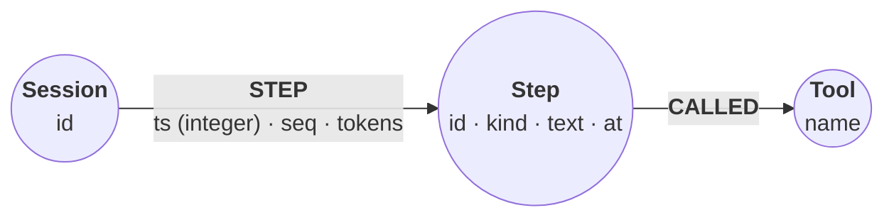

# Agent trajectory timeline

*An agent runtime appends one step per tool call to a session's timeline.
On every turn it asks for the last few steps, the page before those, and
everything since a cutoff; a supervisor asks for the newest steps across all
sessions. Four constraints make those newest-first reads correct by
construction, and one statement migrates a timeline that was written the
other way.*

The graph is
`(:Session {id})-[:STEP {ts, seq, tokens}]->(:Step {id, kind, text, at})-[:CALLED]->(:Tool {name})`.
`ts` is the sort key: epoch milliseconds, stored as an integer. `at` keeps the
same instant as a datetime for display. `tokens` sits on the relationship, so
a budget read never touches the `Step` nodes.



## Lock the timeline down

Four constraints. `session_id` makes the per-session anchor one node, and
`tool_name` lets `MERGE` keep one node per tool, so a read that hops on to the
tool cannot fan out. The last two say that every `STEP` has a `ts`, and that it
is an integer.

```cypher cell=schema
CREATE CONSTRAINT session_id IF NOT EXISTS FOR (s:Session) REQUIRE s.id IS UNIQUE;
CREATE CONSTRAINT tool_name IF NOT EXISTS FOR (t:Tool) REQUIRE t.name IS UNIQUE;
CREATE CONSTRAINT step_ts IF NOT EXISTS FOR ()-[r:STEP]-() REQUIRE r.ts IS :: INTEGER;
CREATE CONSTRAINT step_ts_nn IF NOT EXISTS FOR ()-[r:STEP]-() REQUIRE r.ts IS NOT NULL;
SHOW CONSTRAINTS YIELD name, type, entityType, labelsOrTypes, properties
RETURN name, type, entityType, labelsOrTypes, properties
ORDER BY name
```

```table
| name         | type                              | entityType     | labelsOrTypes | properties |
|--------------|-----------------------------------|----------------|---------------|------------|
| "session_id" | "NODE_PROPERTY_UNIQUENESS"        | "NODE"         | ["Session"]   | ["id"]     |
| "step_ts"    | "RELATIONSHIP_PROPERTY_TYPE"      | "RELATIONSHIP" | ["STEP"]      | ["ts"]     |
| "step_ts_nn" | "RELATIONSHIP_PROPERTY_EXISTENCE" | "RELATIONSHIP" | ["STEP"]      | ["ts"]     |
| "tool_name"  | "NODE_PROPERTY_UNIQUENESS"        | "NODE"         | ["Tool"]      | ["name"]   |
4 rows · constraints added: 4
```

Why an integer? Relate keeps each node's relationships of one type in `ts`
order when `ts` is an integer
(ADR-0035). A read with one anchor node,
one typed hop, and `ORDER BY t.ts DESC LIMIT n` then walks the newest
relationships first and stops after `n`, instead of sorting the whole session.

> **Note**
> Only an integer `ts` is kept in order. Over a `ts` that holds a datetime or
> an ISO string, Relate currently answers the same read with the *first*
> steps ever written, labelled newest-first, and no error. The two `ts`
> constraints make that shape impossible to write.

The type and the presence are two constraints because a property type
constraint cannot carry `NOT NULL`:

```cypher cell=one-constraint expect=error
CREATE CONSTRAINT step_ts_strict IF NOT EXISTS
  FOR ()-[r:STEP]-() REQUIRE r.ts IS :: INTEGER NOT NULL
```

```table
error: syntax error: INTEGER NOT NULL is not supported in property type constraints.
```

## Load three sessions

The fixture is one `steps` list: 40 steps in each of three sessions, plus one
more for `s1`. That last row is `s1`'s step 0, backfilled after a restart: it
is written last but carries the oldest timestamp, so creation order and time
order disagree. `datetime(r.at).epochMillis` turns each ISO timestamp into the
integer sort key. A step's `id` is its session and sequence number.

```cypher cell=load setup params=steps
UNWIND $steps AS r
MERGE (s:Session {id: r.sid})
MERGE (tool:Tool {name: r.tool})
CREATE (s)-[:STEP {ts: datetime(r.at).epochMillis, seq: r.seq, tokens: r.tokens}]->
       (:Step {id: r.sid + ':' + toString(r.seq), kind: r.kind, text: r.text,
               at: datetime(r.at)})-[:CALLED]->(tool);

MATCH (s:Session) WITH count(s) AS sessions
MATCH (t:Tool) WITH sessions, count(t) AS tools
MATCH ()-[t:STEP]->()
RETURN sessions, tools, count(t) AS steps
```

```table
| sessions | tools | steps |
|----------|-------|-------|
| 3        | 6     | 121   |
1 row · nodes created: 130, relationships created: 242, properties set: 856, labels added: 130
```

Six distinct tool names in the fixture, six `Tool` nodes.

## A bad append is refused

A runtime that copies a timestamp as a datetime, instead of converting it,
fails loudly instead of corrupting the order:

```cypher cell=bad-append expect=error
MATCH (s:Session {id: 's1'}), (tool:Tool {name: 'shell'})
CREATE (s)-[:STEP {ts: datetime('2024-01-07T00:42:00Z'), seq: 41, tokens: 10}]->
       (:Step {id: 's1:41', kind: 'answer', text: 'copied a datetime',
               at: datetime('2024-01-07T00:42:00Z')})-[:CALLED]->(tool)
```

```table
error: semantic error: ConstraintValidationFailed: `step_ts` property type
```

A step with no `ts` at all fails the same way, on `step_ts_nn`.

## The last N steps

The agent's per-turn read: one session, newest first.

```json data=latest
{
  "sid": "s1",
  "n": 2
}
```

```cypher cell=latest params=latest
MATCH (s:Session {id: $sid})-[t:STEP]->(x:Step)
RETURN t.seq AS seq, x.kind AS kind, x.text AS text
ORDER BY t.ts DESC
LIMIT $n
```

```table
| seq | kind          | text                                 |
|-----|---------------|--------------------------------------|
| 40  | "answer"      | "answer: run the epochMillis probe"  |
| 39  | "observation" | "observation: ask about epochMillis" |
2 rows
```

## The next page

"Show me more" is the same read with `SKIP`. It stays on the ordered walk: the
walk stops after `skip + n` steps.

```json data=page
{
  "sid": "s1",
  "n": 2,
  "skip": 2
}
```

```cypher cell=page params=page
MATCH (s:Session {id: $sid})-[t:STEP]->(x:Step)
RETURN t.seq AS seq, x.kind AS kind
ORDER BY t.ts DESC
SKIP $skip
LIMIT $n
```

```table
| seq | kind        |
|-----|-------------|
| 38  | "tool_call" |
| 37  | "plan"      |
2 rows
```

## Everything since a cutoff

The caller sends an ISO timestamp. `LET` names the cutoff once, as epoch
milliseconds, and `FILTER` keeps the steps after it (both are Cypher 25; a
`WHERE` says the same). With no `LIMIT`, the read sorts the steps it keeps
instead of walking in order, which is fine for a bounded window.

```json data=since
{
  "sid": "s1",
  "since": "2024-01-07T00:38:00Z"
}
```

```cypher cell=since params=since
MATCH (s:Session {id: $sid})-[t:STEP]->(x:Step)
LET cutoff = datetime($since).epochMillis
FILTER t.ts > cutoff
RETURN t.seq AS seq, x.kind AS kind
ORDER BY t.ts DESC
```

```table
| seq | kind          |
|-----|---------------|
| 40  | "answer"      |
| 39  | "observation" |
| 38  | "tool_call"   |
| 37  | "plan"        |
4 rows
```

## The oldest step

Ascending order finds the backfilled step, even though it was written last.
`datetime.fromEpochMillis` turns the integer back into a datetime inside
Cypher; it equals the `at` stored on the step, so a runtime that keeps only
`ts` loses nothing.

```json data=oldest
{
  "sid": "s1"
}
```

```cypher cell=oldest params=oldest
MATCH (s:Session {id: $sid})-[t:STEP]->(x:Step)
WITH t, x ORDER BY t.ts ASC LIMIT 1
RETURN t.seq AS seq, t.ts AS ts, x.at AS at,
       datetime.fromEpochMillis(t.ts) = x.at AS matches_at, x.text AS text
```

```table
| seq | ts            | at                     | matches_at | text                                                     |
|-----|---------------|------------------------|------------|----------------------------------------------------------|
| 0   | 1704585600000 | "2024-01-07T00:00:00Z" | true       | "system: load task context (backfilled after a restart)" |
1 row
```

> **Note**
> Use `datetime.fromEpochMillis(ms)`. Relate currently returns
> `0000-01-01T00:00Z` for `datetime({epochMillis: ms})` and
> `datetime({epochSeconds: s})` instead of the instant.

## Which tool each step called

One more hop reaches the tool. Tool names are unique, so each step reaches
exactly one `Tool` and the read returns exactly `$n` rows.

```json data=tools
{
  "sid": "s1",
  "n": 3
}
```

```cypher cell=tools params=tools
MATCH (s:Session {id: $sid})-[t:STEP]->(x:Step)-[:CALLED]->(tool:Tool)
RETURN t.seq AS seq, x.kind AS kind, tool.name AS tool
ORDER BY t.ts DESC
LIMIT $n
```

```table
| seq | kind          | tool       |
|-----|---------------|------------|
| 40  | "answer"      | "shell"    |
| 39  | "observation" | "ask_user" |
| 38  | "tool_call"   | "shell"    |
3 rows
```

To see the shape, return the paths. Open the graph view:

```cypher cell=graph params=tools
MATCH p = (s:Session {id: $sid})-[t:STEP]->(x:Step)-[:CALLED]->(tool:Tool)
WITH p, t ORDER BY t.ts DESC LIMIT $n
RETURN p
```

```gram
// 3 rows
(n0:Session {id: "s1"})-[r78:STEP {seq: 40, tokens: 782, ts: 1704588074040}]->(n48:Step {at: "2024-01-07T00:41:14.04Z", id: "s1:40", kind: "answer", text: "answer: run the epochMillis probe"})-[r79:CALLED]->(n3:Tool {name: "shell"})
(n0)-[r76:STEP {seq: 39, tokens: 358, ts: 1704588014073}]->(n47:Step {at: "2024-01-07T00:40:14.073Z", id: "s1:39", kind: "observation", text: "observation: ask about epochMillis"})-[r77:CALLED]->(n8:Tool {name: "ask_user"})
(n0)-[r74:STEP {seq: 38, tokens: 435, ts: 1704587957092}]->(n46:Step {at: "2024-01-07T00:39:17.092Z", id: "s1:38", kind: "tool_call", text: "tool_call: run the epochMillis probe"})-[r75:CALLED]->(n3)
```

## Token budget per session

`count` and `sum` over each session's `STEP` relationships. The tokens are on
the relationship, so the read never loads a `Step` node.

```cypher cell=budget
MATCH (s:Session)-[t:STEP]->()
RETURN s.id AS session, count(t) AS steps, sum(t.tokens) AS tokens
ORDER BY session
```

```table
| session | steps | tokens |
|---------|-------|--------|
| "s1"    | 41    | 18485  |
| "s2"    | 40    | 18201  |
| "s3"    | 40    | 19583  |
3 rows
```

## The newest steps across all sessions

A supervisor wants the newest steps overall. The anchor now matches every
session. Session `s3` ran last, so it owns the newest three.

```json data=global
{
  "n": 3
}
```

```cypher cell=global params=global
MATCH (s:Session)-[t:STEP]->(x:Step)
RETURN s.id AS session, t.seq AS seq, x.kind AS kind
ORDER BY t.ts DESC, t.seq ASC
LIMIT $n
```

```table
| session | seq | kind          |
|---------|-----|---------------|
| "s3"    | 40  | "answer"      |
| "s3"    | 39  | "observation" |
| "s3"    | 38  | "tool_call"   |
3 rows
```

> **Note**
> Keep the second sort key (`t.seq ASC`) when the anchor matches more than
> one node. It also breaks ties between equal timestamps. Without it,
> Relate currently returns the newest steps of the first session it walks
> (here `s1`) instead of the newest overall.

## Append a step

A runtime appends the way the fixture was loaded: find the session, `MERGE`
the tool, create the step. A live runtime passes `datetime().epochMillis` for
now; this step uses a fixed timestamp so its result does not change. The same
step then reads the last three, and the new step comes first.

```json data=append
{
  "sid": "s1",
  "seq": 41,
  "kind": "answer",
  "tool": "shell",
  "text": "answer: the latest-N read is correct",
  "at": "2024-01-07T00:42:30Z",
  "tokens": 240,
  "n": 3
}
```

```cypher cell=append params=append
MATCH (s:Session {id: $sid})
MERGE (tool:Tool {name: $tool})
CREATE (s)-[:STEP {ts: datetime($at).epochMillis, seq: $seq, tokens: $tokens}]->
       (:Step {id: $sid + ':' + toString($seq), kind: $kind, text: $text,
               at: datetime($at)})-[:CALLED]->(tool);

MATCH (s:Session {id: $sid})-[t:STEP]->(x:Step)
RETURN t.seq AS seq, x.kind AS kind, x.text AS text
ORDER BY t.ts DESC
LIMIT $n
```

```table
| seq | kind          | text                                   |
|-----|---------------|----------------------------------------|
| 41  | "answer"      | "answer: the latest-N read is correct" |
| 40  | "answer"      | "answer: run the epochMillis probe"    |
| 39  | "observation" | "observation: ask about epochMillis"   |
3 rows · nodes created: 1, relationships created: 2, properties set: 7, labels added: 1
```

## Migrate a timeline written with datetimes

A timeline written before these constraints existed often has `ts` as a
datetime. To stand in for one, this step drops the two `ts` constraints and
writes session `s2` again as session `legacy`, with `ts: datetime(r.at)`:

```cypher cell=legacy params=steps
DROP CONSTRAINT step_ts;
DROP CONSTRAINT step_ts_nn;

UNWIND $steps AS r
WITH r WHERE r.sid = 's2'
MERGE (s:Session {id: 'legacy'})
MERGE (tool:Tool {name: r.tool})
CREATE (s)-[:STEP {ts: datetime(r.at), seq: r.seq, tokens: r.tokens}]->
       (:Step {id: 'legacy:' + toString(r.seq), kind: r.kind, text: r.text,
               at: datetime(r.at)})-[:CALLED]->(tool);

MATCH ()-[t:STEP]->()
RETURN valueType(t.ts) AS ts_type, count(t) AS steps
ORDER BY ts_type
```

```table
| ts_type                   | steps |
|---------------------------|-------|
| "INTEGER NOT NULL"        | 122   |
| "ZONED DATETIME NOT NULL" | 40    |
2 rows · nodes created: 41, relationships created: 80, properties set: 281, labels added: 41, constraints removed: 2
```

Order matters. `step_ts` checks the relationships that already exist, so it
cannot come back before the data is fixed:

```cypher cell=constrain-first expect=error
CREATE CONSTRAINT step_ts IF NOT EXISTS FOR ()-[r:STEP]-() REQUIRE r.ts IS :: INTEGER
```

```table
error: semantic error: ConstraintValidationFailed: `step_ts` property type
```

The migration rewrites every datetime `ts` as epoch milliseconds. Only
datetimes match the `WHERE`, so a second run migrates nothing. Each `SET`
also moves the relationship to its place in the `ts` order.

```cypher cell=migrate
MATCH ()-[t:STEP]->()
WHERE valueType(t.ts) STARTS WITH 'ZONED DATETIME'
SET t.ts = t.ts.epochMillis
RETURN count(t) AS migrated
```

```table
| migrated |
|----------|
| 40       |
1 row · properties set: 40
```

Then lock it in again, and the latest-N read on the migrated session is
correct:

```cypher cell=relock
CREATE CONSTRAINT step_ts IF NOT EXISTS FOR ()-[r:STEP]-() REQUIRE r.ts IS :: INTEGER;
CREATE CONSTRAINT step_ts_nn IF NOT EXISTS FOR ()-[r:STEP]-() REQUIRE r.ts IS NOT NULL;

MATCH (s:Session {id: 'legacy'})-[t:STEP]->(x:Step)
RETURN t.seq AS seq, x.kind AS kind
ORDER BY t.ts DESC
LIMIT 3
```

```table
| seq | kind          |
|-----|---------------|
| 40  | "answer"      |
| 39  | "observation" |
| 38  | "tool_call"   |
3 rows · constraints added: 2
```

The companion example runs the same reads from the `relate` CLI against a
file, one process per read, and times the ordered walk against a full sort.

## Data

The dataset the steps above load. The block is a JSON object whose key is
the query parameter.

<details>
<summary><code>steps</code> (20 KB)</summary>

```json data=steps
{
  "steps": [
    {"sid": "s1", "seq": 1, "kind": "plan", "tool": "shell", "text": "plan: run the constraint probe", "at": "2024-01-07T00:01:14.647Z", "tokens": 502},
    {"sid": "s1", "seq": 2, "kind": "tool_call", "tool": "shell", "text": "tool_call: run the epochMillis probe", "at": "2024-01-07T00:02:32.928Z", "tokens": 229},
    {"sid": "s1", "seq": 3, "kind": "observation", "tool": "write_file", "text": "observation: write summary of latest steps", "at": "2024-01-07T00:03:51.476Z", "tokens": 668},
    {"sid": "s1", "seq": 4, "kind": "plan", "tool": "search", "text": "plan: search 'constraint'", "at": "2024-01-07T00:04:48.677Z", "tokens": 350},
    {"sid": "s1", "seq": 5, "kind": "tool_call", "tool": "search", "text": "tool_call: search 'trajectory'", "at": "2024-01-07T00:05:42.969Z", "tokens": 869},
    {"sid": "s1", "seq": 6, "kind": "observation", "tool": "shell", "text": "observation: run the constraint probe", "at": "2024-01-07T00:06:30.713Z", "tokens": 503},
    {"sid": "s1", "seq": 7, "kind": "plan", "tool": "shell", "text": "plan: run the ordered expand probe", "at": "2024-01-07T00:07:26.034Z", "tokens": 891},
    {"sid": "s1", "seq": 8, "kind": "tool_call", "tool": "search", "text": "tool_call: search 'ordered expand'", "at": "2024-01-07T00:08:45.661Z", "tokens": 76},
    {"sid": "s1", "seq": 9, "kind": "observation", "tool": "read_file", "text": "observation: read notes/trajectory.md", "at": "2024-01-07T00:09:43.126Z", "tokens": 70},
    {"sid": "s1", "seq": 10, "kind": "plan", "tool": "run_cypher", "text": "plan: MATCH the constraint subgraph", "at": "2024-01-07T00:10:58.530Z", "tokens": 645},
    {"sid": "s1", "seq": 11, "kind": "tool_call", "tool": "shell", "text": "tool_call: run the epochMillis probe", "at": "2024-01-07T00:11:56.330Z", "tokens": 695},
    {"sid": "s1", "seq": 12, "kind": "observation", "tool": "write_file", "text": "observation: write summary of ordered expand", "at": "2024-01-07T00:13:00.607Z", "tokens": 718},
    {"sid": "s1", "seq": 13, "kind": "plan", "tool": "write_file", "text": "plan: write summary of latest steps", "at": "2024-01-07T00:13:51.176Z", "tokens": 324},
    {"sid": "s1", "seq": 14, "kind": "tool_call", "tool": "shell", "text": "tool_call: run the ordered expand probe", "at": "2024-01-07T00:15:02.834Z", "tokens": 764},
    {"sid": "s1", "seq": 15, "kind": "observation", "tool": "run_cypher", "text": "observation: MATCH the epochMillis subgraph", "at": "2024-01-07T00:16:04.479Z", "tokens": 565},
    {"sid": "s1", "seq": 16, "kind": "plan", "tool": "search", "text": "plan: search 'ordered expand'", "at": "2024-01-07T00:17:08.421Z", "tokens": 616},
    {"sid": "s1", "seq": 17, "kind": "tool_call", "tool": "write_file", "text": "tool_call: write summary of ordered expand", "at": "2024-01-07T00:18:00.494Z", "tokens": 337},
    {"sid": "s1", "seq": 18, "kind": "observation", "tool": "search", "text": "observation: search 'ordered expand'", "at": "2024-01-07T00:19:10.824Z", "tokens": 741},
    {"sid": "s1", "seq": 19, "kind": "plan", "tool": "read_file", "text": "plan: read notes/epochMillis.md", "at": "2024-01-07T00:19:55.859Z", "tokens": 93},
    {"sid": "s1", "seq": 20, "kind": "tool_call", "tool": "write_file", "text": "tool_call: write summary of latest steps", "at": "2024-01-07T00:21:11.660Z", "tokens": 446},
    {"sid": "s1", "seq": 21, "kind": "observation", "tool": "search", "text": "observation: search 'trajectory'", "at": "2024-01-07T00:22:24.171Z", "tokens": 684},
    {"sid": "s1", "seq": 22, "kind": "plan", "tool": "ask_user", "text": "plan: ask about checkpoint", "at": "2024-01-07T00:23:22.179Z", "tokens": 384},
    {"sid": "s1", "seq": 23, "kind": "tool_call", "tool": "run_cypher", "text": "tool_call: MATCH the checkpoint subgraph", "at": "2024-01-07T00:24:12.890Z", "tokens": 55},
    {"sid": "s1", "seq": 24, "kind": "observation", "tool": "search", "text": "observation: search 'epochMillis'", "at": "2024-01-07T00:25:24.763Z", "tokens": 292},
    {"sid": "s1", "seq": 25, "kind": "plan", "tool": "search", "text": "plan: search 'ordered expand'", "at": "2024-01-07T00:26:16.385Z", "tokens": 516},
    {"sid": "s1", "seq": 26, "kind": "tool_call", "tool": "read_file", "text": "tool_call: read notes/latest_steps.md", "at": "2024-01-07T00:27:33.289Z", "tokens": 612},
    {"sid": "s1", "seq": 27, "kind": "observation", "tool": "write_file", "text": "observation: write summary of trajectory", "at": "2024-01-07T00:28:30.635Z", "tokens": 235},
    {"sid": "s1", "seq": 28, "kind": "plan", "tool": "write_file", "text": "plan: write summary of latest steps", "at": "2024-01-07T00:29:24.218Z", "tokens": 432},
    {"sid": "s1", "seq": 29, "kind": "tool_call", "tool": "write_file", "text": "tool_call: write summary of constraint", "at": "2024-01-07T00:30:16.853Z", "tokens": 257},
    {"sid": "s1", "seq": 30, "kind": "observation", "tool": "run_cypher", "text": "observation: MATCH the trajectory subgraph", "at": "2024-01-07T00:31:01.883Z", "tokens": 351},
    {"sid": "s1", "seq": 31, "kind": "plan", "tool": "read_file", "text": "plan: read notes/epochMillis.md", "at": "2024-01-07T00:31:48.169Z", "tokens": 443},
    {"sid": "s1", "seq": 32, "kind": "tool_call", "tool": "search", "text": "tool_call: search 'epochMillis'", "at": "2024-01-07T00:32:39.744Z", "tokens": 258},
    {"sid": "s1", "seq": 33, "kind": "observation", "tool": "run_cypher", "text": "observation: MATCH the ordered expand subgraph", "at": "2024-01-07T00:33:53.680Z", "tokens": 831},
    {"sid": "s1", "seq": 34, "kind": "plan", "tool": "run_cypher", "text": "plan: MATCH the constraint subgraph", "at": "2024-01-07T00:35:00.238Z", "tokens": 115},
    {"sid": "s1", "seq": 35, "kind": "tool_call", "tool": "search", "text": "tool_call: search 'epochMillis'", "at": "2024-01-07T00:35:50.106Z", "tokens": 636},
    {"sid": "s1", "seq": 36, "kind": "observation", "tool": "search", "text": "observation: search 'trajectory'", "at": "2024-01-07T00:36:51.032Z", "tokens": 417},
    {"sid": "s1", "seq": 37, "kind": "plan", "tool": "shell", "text": "plan: run the constraint probe", "at": "2024-01-07T00:38:00.391Z", "tokens": 170},
    {"sid": "s1", "seq": 38, "kind": "tool_call", "tool": "shell", "text": "tool_call: run the epochMillis probe", "at": "2024-01-07T00:39:17.092Z", "tokens": 435},
    {"sid": "s1", "seq": 39, "kind": "observation", "tool": "ask_user", "text": "observation: ask about epochMillis", "at": "2024-01-07T00:40:14.073Z", "tokens": 358},
    {"sid": "s1", "seq": 40, "kind": "answer", "tool": "shell", "text": "answer: run the epochMillis probe", "at": "2024-01-07T00:41:14.040Z", "tokens": 782},
    {"sid": "s2", "seq": 1, "kind": "plan", "tool": "read_file", "text": "plan: read notes/latest_steps.md", "at": "2024-01-08T00:00:57.438Z", "tokens": 684},
    {"sid": "s2", "seq": 2, "kind": "tool_call", "tool": "ask_user", "text": "tool_call: ask about constraint", "at": "2024-01-08T00:01:55.321Z", "tokens": 534},
    {"sid": "s2", "seq": 3, "kind": "observation", "tool": "write_file", "text": "observation: write summary of ordered expand", "at": "2024-01-08T00:02:45.465Z", "tokens": 146},
    {"sid": "s2", "seq": 4, "kind": "plan", "tool": "search", "text": "plan: search 'trajectory'", "at": "2024-01-08T00:03:37.611Z", "tokens": 301},
    {"sid": "s2", "seq": 5, "kind": "tool_call", "tool": "ask_user", "text": "tool_call: ask about latest steps", "at": "2024-01-08T00:04:38.235Z", "tokens": 441},
    {"sid": "s2", "seq": 6, "kind": "observation", "tool": "write_file", "text": "observation: write summary of trajectory", "at": "2024-01-08T00:05:40.076Z", "tokens": 542},
    {"sid": "s2", "seq": 7, "kind": "plan", "tool": "shell", "text": "plan: run the epochMillis probe", "at": "2024-01-08T00:06:44.306Z", "tokens": 777},
    {"sid": "s2", "seq": 8, "kind": "tool_call", "tool": "read_file", "text": "tool_call: read notes/epochMillis.md", "at": "2024-01-08T00:07:33.813Z", "tokens": 530},
    {"sid": "s2", "seq": 9, "kind": "observation", "tool": "run_cypher", "text": "observation: MATCH the epochMillis subgraph", "at": "2024-01-08T00:08:23.671Z", "tokens": 248},
    {"sid": "s2", "seq": 10, "kind": "plan", "tool": "search", "text": "plan: search 'checkpoint'", "at": "2024-01-08T00:09:09.757Z", "tokens": 461},
    {"sid": "s2", "seq": 11, "kind": "tool_call", "tool": "read_file", "text": "tool_call: read notes/ordered_expand.md", "at": "2024-01-08T00:10:23.966Z", "tokens": 87},
    {"sid": "s2", "seq": 12, "kind": "observation", "tool": "run_cypher", "text": "observation: MATCH the checkpoint subgraph", "at": "2024-01-08T00:11:20.516Z", "tokens": 583},
    {"sid": "s2", "seq": 13, "kind": "plan", "tool": "search", "text": "plan: search 'checkpoint'", "at": "2024-01-08T00:12:14.139Z", "tokens": 181},
    {"sid": "s2", "seq": 14, "kind": "tool_call", "tool": "run_cypher", "text": "tool_call: MATCH the latest steps subgraph", "at": "2024-01-08T00:13:28.652Z", "tokens": 790},
    {"sid": "s2", "seq": 15, "kind": "observation", "tool": "shell", "text": "observation: run the epochMillis probe", "at": "2024-01-08T00:14:47.857Z", "tokens": 644},
    {"sid": "s2", "seq": 16, "kind": "plan", "tool": "search", "text": "plan: search 'constraint'", "at": "2024-01-08T00:15:35.156Z", "tokens": 406},
    {"sid": "s2", "seq": 17, "kind": "tool_call", "tool": "search", "text": "tool_call: search 'ordered expand'", "at": "2024-01-08T00:16:40.590Z", "tokens": 652},
    {"sid": "s2", "seq": 18, "kind": "observation", "tool": "write_file", "text": "observation: write summary of ordered expand", "at": "2024-01-08T00:17:30.494Z", "tokens": 788},
    {"sid": "s2", "seq": 19, "kind": "plan", "tool": "run_cypher", "text": "plan: MATCH the epochMillis subgraph", "at": "2024-01-08T00:18:35.879Z", "tokens": 114},
    {"sid": "s2", "seq": 20, "kind": "tool_call", "tool": "write_file", "text": "tool_call: write summary of trajectory", "at": "2024-01-08T00:19:25.811Z", "tokens": 416},
    {"sid": "s2", "seq": 21, "kind": "observation", "tool": "ask_user", "text": "observation: ask about latest steps", "at": "2024-01-08T00:20:13.725Z", "tokens": 760},
    {"sid": "s2", "seq": 22, "kind": "plan", "tool": "run_cypher", "text": "plan: MATCH the checkpoint subgraph", "at": "2024-01-08T00:21:07.214Z", "tokens": 126},
    {"sid": "s2", "seq": 23, "kind": "tool_call", "tool": "search", "text": "tool_call: search 'constraint'", "at": "2024-01-08T00:22:23.230Z", "tokens": 849},
    {"sid": "s2", "seq": 24, "kind": "observation", "tool": "write_file", "text": "observation: write summary of trajectory", "at": "2024-01-08T00:23:10.213Z", "tokens": 54},
    {"sid": "s2", "seq": 25, "kind": "plan", "tool": "write_file", "text": "plan: write summary of trajectory", "at": "2024-01-08T00:24:20.269Z", "tokens": 52},
    {"sid": "s2", "seq": 26, "kind": "tool_call", "tool": "search", "text": "tool_call: search 'ordered expand'", "at": "2024-01-08T00:25:10.003Z", "tokens": 694},
    {"sid": "s2", "seq": 27, "kind": "observation", "tool": "run_cypher", "text": "observation: MATCH the constraint subgraph", "at": "2024-01-08T00:26:02.577Z", "tokens": 785},
    {"sid": "s2", "seq": 28, "kind": "plan", "tool": "write_file", "text": "plan: write summary of latest steps", "at": "2024-01-08T00:27:09.213Z", "tokens": 750},
    {"sid": "s2", "seq": 29, "kind": "tool_call", "tool": "write_file", "text": "tool_call: write summary of constraint", "at": "2024-01-08T00:28:24.212Z", "tokens": 898},
    {"sid": "s2", "seq": 30, "kind": "observation", "tool": "shell", "text": "observation: run the trajectory probe", "at": "2024-01-08T00:29:14.702Z", "tokens": 70},
    {"sid": "s2", "seq": 31, "kind": "plan", "tool": "shell", "text": "plan: run the ordered expand probe", "at": "2024-01-08T00:30:20.033Z", "tokens": 532},
    {"sid": "s2", "seq": 32, "kind": "tool_call", "tool": "read_file", "text": "tool_call: read notes/latest_steps.md", "at": "2024-01-08T00:31:06.493Z", "tokens": 155},
    {"sid": "s2", "seq": 33, "kind": "observation", "tool": "shell", "text": "observation: run the latest steps probe", "at": "2024-01-08T00:32:24.080Z", "tokens": 537},
    {"sid": "s2", "seq": 34, "kind": "plan", "tool": "search", "text": "plan: search 'checkpoint'", "at": "2024-01-08T00:33:25.846Z", "tokens": 348},
    {"sid": "s2", "seq": 35, "kind": "tool_call", "tool": "ask_user", "text": "tool_call: ask about trajectory", "at": "2024-01-08T00:34:20.232Z", "tokens": 247},
    {"sid": "s2", "seq": 36, "kind": "observation", "tool": "read_file", "text": "observation: read notes/checkpoint.md", "at": "2024-01-08T00:35:39.205Z", "tokens": 715},
    {"sid": "s2", "seq": 37, "kind": "plan", "tool": "write_file", "text": "plan: write summary of epochMillis", "at": "2024-01-08T00:36:53.167Z", "tokens": 374},
    {"sid": "s2", "seq": 38, "kind": "tool_call", "tool": "ask_user", "text": "tool_call: ask about checkpoint", "at": "2024-01-08T00:38:04.693Z", "tokens": 243},
    {"sid": "s2", "seq": 39, "kind": "observation", "tool": "read_file", "text": "observation: read notes/epochMillis.md", "at": "2024-01-08T00:39:17.932Z", "tokens": 433},
    {"sid": "s2", "seq": 40, "kind": "answer", "tool": "shell", "text": "answer: run the checkpoint probe", "at": "2024-01-08T00:40:17.322Z", "tokens": 254},
    {"sid": "s3", "seq": 1, "kind": "plan", "tool": "read_file", "text": "plan: read notes/constraint.md", "at": "2024-01-09T00:00:53.924Z", "tokens": 399},
    {"sid": "s3", "seq": 2, "kind": "tool_call", "tool": "ask_user", "text": "tool_call: ask about ordered expand", "at": "2024-01-09T00:01:41.582Z", "tokens": 323},
    {"sid": "s3", "seq": 3, "kind": "observation", "tool": "search", "text": "observation: search 'constraint'", "at": "2024-01-09T00:02:37.666Z", "tokens": 522},
    {"sid": "s3", "seq": 4, "kind": "plan", "tool": "read_file", "text": "plan: read notes/constraint.md", "at": "2024-01-09T00:03:40.699Z", "tokens": 431},
    {"sid": "s3", "seq": 5, "kind": "tool_call", "tool": "write_file", "text": "tool_call: write summary of latest steps", "at": "2024-01-09T00:04:59.776Z", "tokens": 362},
    {"sid": "s3", "seq": 6, "kind": "observation", "tool": "run_cypher", "text": "observation: MATCH the ordered expand subgraph", "at": "2024-01-09T00:06:14.429Z", "tokens": 888},
    {"sid": "s3", "seq": 7, "kind": "plan", "tool": "run_cypher", "text": "plan: MATCH the trajectory subgraph", "at": "2024-01-09T00:07:01.492Z", "tokens": 82},
    {"sid": "s3", "seq": 8, "kind": "tool_call", "tool": "shell", "text": "tool_call: run the checkpoint probe", "at": "2024-01-09T00:08:04.912Z", "tokens": 356},
    {"sid": "s3", "seq": 9, "kind": "observation", "tool": "ask_user", "text": "observation: ask about epochMillis", "at": "2024-01-09T00:08:51.164Z", "tokens": 454},
    {"sid": "s3", "seq": 10, "kind": "plan", "tool": "read_file", "text": "plan: read notes/ordered_expand.md", "at": "2024-01-09T00:10:05.971Z", "tokens": 827},
    {"sid": "s3", "seq": 11, "kind": "tool_call", "tool": "read_file", "text": "tool_call: read notes/epochMillis.md", "at": "2024-01-09T00:11:08.430Z", "tokens": 855},
    {"sid": "s3", "seq": 12, "kind": "observation", "tool": "ask_user", "text": "observation: ask about ordered expand", "at": "2024-01-09T00:11:56.506Z", "tokens": 497},
    {"sid": "s3", "seq": 13, "kind": "plan", "tool": "ask_user", "text": "plan: ask about trajectory", "at": "2024-01-09T00:12:48.650Z", "tokens": 710},
    {"sid": "s3", "seq": 14, "kind": "tool_call", "tool": "search", "text": "tool_call: search 'latest steps'", "at": "2024-01-09T00:13:57.812Z", "tokens": 242},
    {"sid": "s3", "seq": 15, "kind": "observation", "tool": "write_file", "text": "observation: write summary of checkpoint", "at": "2024-01-09T00:14:55.876Z", "tokens": 222},
    {"sid": "s3", "seq": 16, "kind": "plan", "tool": "write_file", "text": "plan: write summary of trajectory", "at": "2024-01-09T00:15:41.581Z", "tokens": 771},
    {"sid": "s3", "seq": 17, "kind": "tool_call", "tool": "read_file", "text": "tool_call: read notes/epochMillis.md", "at": "2024-01-09T00:16:28.951Z", "tokens": 318},
    {"sid": "s3", "seq": 18, "kind": "observation", "tool": "shell", "text": "observation: run the latest steps probe", "at": "2024-01-09T00:17:36.609Z", "tokens": 572},
    {"sid": "s3", "seq": 19, "kind": "plan", "tool": "shell", "text": "plan: run the epochMillis probe", "at": "2024-01-09T00:18:54.404Z", "tokens": 442},
    {"sid": "s3", "seq": 20, "kind": "tool_call", "tool": "search", "text": "tool_call: search 'constraint'", "at": "2024-01-09T00:19:54.079Z", "tokens": 779},
    {"sid": "s3", "seq": 21, "kind": "observation", "tool": "read_file", "text": "observation: read notes/constraint.md", "at": "2024-01-09T00:21:04.505Z", "tokens": 504},
    {"sid": "s3", "seq": 22, "kind": "plan", "tool": "ask_user", "text": "plan: ask about ordered expand", "at": "2024-01-09T00:22:02.407Z", "tokens": 425},
    {"sid": "s3", "seq": 23, "kind": "tool_call", "tool": "run_cypher", "text": "tool_call: MATCH the constraint subgraph", "at": "2024-01-09T00:23:20.348Z", "tokens": 374},
    {"sid": "s3", "seq": 24, "kind": "observation", "tool": "search", "text": "observation: search 'latest steps'", "at": "2024-01-09T00:24:18.775Z", "tokens": 877},
    {"sid": "s3", "seq": 25, "kind": "plan", "tool": "read_file", "text": "plan: read notes/epochMillis.md", "at": "2024-01-09T00:25:11.867Z", "tokens": 439},
    {"sid": "s3", "seq": 26, "kind": "tool_call", "tool": "run_cypher", "text": "tool_call: MATCH the trajectory subgraph", "at": "2024-01-09T00:26:02.623Z", "tokens": 849},
    {"sid": "s3", "seq": 27, "kind": "observation", "tool": "run_cypher", "text": "observation: MATCH the latest steps subgraph", "at": "2024-01-09T00:27:08.620Z", "tokens": 56},
    {"sid": "s3", "seq": 28, "kind": "plan", "tool": "shell", "text": "plan: run the ordered expand probe", "at": "2024-01-09T00:28:16.459Z", "tokens": 78},
    {"sid": "s3", "seq": 29, "kind": "tool_call", "tool": "run_cypher", "text": "tool_call: MATCH the trajectory subgraph", "at": "2024-01-09T00:29:30.353Z", "tokens": 471},
    {"sid": "s3", "seq": 30, "kind": "observation", "tool": "write_file", "text": "observation: write summary of ordered expand", "at": "2024-01-09T00:30:33.392Z", "tokens": 263},
    {"sid": "s3", "seq": 31, "kind": "plan", "tool": "write_file", "text": "plan: write summary of ordered expand", "at": "2024-01-09T00:31:22.590Z", "tokens": 217},
    {"sid": "s3", "seq": 32, "kind": "tool_call", "tool": "run_cypher", "text": "tool_call: MATCH the latest steps subgraph", "at": "2024-01-09T00:32:42.528Z", "tokens": 846},
    {"sid": "s3", "seq": 33, "kind": "observation", "tool": "write_file", "text": "observation: write summary of epochMillis", "at": "2024-01-09T00:33:36.735Z", "tokens": 568},
    {"sid": "s3", "seq": 34, "kind": "plan", "tool": "ask_user", "text": "plan: ask about latest steps", "at": "2024-01-09T00:34:55.696Z", "tokens": 490},
    {"sid": "s3", "seq": 35, "kind": "tool_call", "tool": "shell", "text": "tool_call: run the latest steps probe", "at": "2024-01-09T00:36:12.977Z", "tokens": 128},
    {"sid": "s3", "seq": 36, "kind": "observation", "tool": "write_file", "text": "observation: write summary of trajectory", "at": "2024-01-09T00:37:12.487Z", "tokens": 612},
    {"sid": "s3", "seq": 37, "kind": "plan", "tool": "ask_user", "text": "plan: ask about trajectory", "at": "2024-01-09T00:38:16.503Z", "tokens": 694},
    {"sid": "s3", "seq": 38, "kind": "tool_call", "tool": "shell", "text": "tool_call: run the trajectory probe", "at": "2024-01-09T00:39:12.273Z", "tokens": 613},
    {"sid": "s3", "seq": 39, "kind": "observation", "tool": "run_cypher", "text": "observation: MATCH the latest steps subgraph", "at": "2024-01-09T00:40:14.083Z", "tokens": 430},
    {"sid": "s3", "seq": 40, "kind": "answer", "tool": "run_cypher", "text": "answer: MATCH the epochMillis subgraph", "at": "2024-01-09T00:41:12.730Z", "tokens": 597},
    {"sid": "s1", "seq": 0, "kind": "system", "tool": "read_file", "text": "system: load task context (backfilled after a restart)", "at": "2024-01-07T00:00:00.000Z", "tokens": 120}
  ]
}
```

</details>
