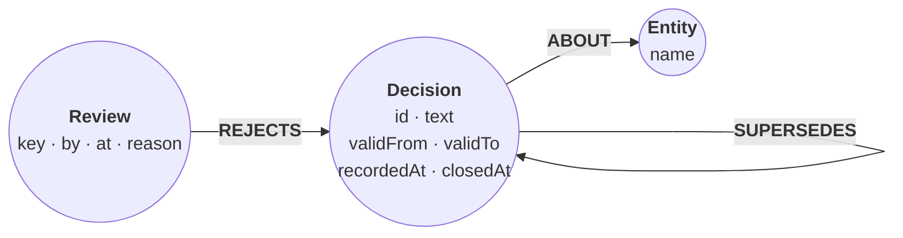

# Bi-temporal decisions

*An agent keeps a log of decisions about the services it runs. Some news
arrives late, a reviewer rejects one decision, and one change is planned
ahead. With two time axes on every decision, one graph answers both "what
was true on 20 January?" and "what did the agent believe on 20 January?",
and they are not the same answer.*

Each decision carries two intervals:

- **Valid time**, `validFrom` to `validTo`: when the decision held in the
  world. An open `validTo` means it still holds.
- **Record time**, `recordedAt` and `closedAt`: when the log wrote the
  decision, and when it wrote the decision's `validTo`.

The graph is `(:Decision)-[:ABOUT]->(:Entity)`, with
`(:Decision)-[:SUPERSEDES]->(:Decision)` when a new decision replaces an old
one, and `(:Review)-[:REJECTS]->(:Decision)` for a reviewer's verdict.
Nothing is ever deleted: a correction closes the old decision instead.



The companion program keeps this log in a directory database whose
checkpoint is one JSON file in git, so each session shows up in a pull
request as a diff. That part needs files and a write-ahead log; this page
keeps the ledger and its queries.

## Set up the schema

Decision ids, entity names, and review keys are unique, so every write below
can `MERGE` and a retried session never duplicates anything. A full-text
index over the decision text lets a reviewer find a decision by its words.

```cypher cell=schema setup
CREATE CONSTRAINT decision_id IF NOT EXISTS FOR (d:Decision) REQUIRE d.id IS UNIQUE;
CREATE CONSTRAINT entity_name IF NOT EXISTS FOR (e:Entity) REQUIRE e.name IS UNIQUE;
CREATE CONSTRAINT review_key IF NOT EXISTS FOR (r:Review) REQUIRE r.key IS UNIQUE;
CREATE FULLTEXT INDEX decision_text IF NOT EXISTS FOR (d:Decision) ON EACH [d.text]
```

```table
(no rows) · indexes added: 1, constraints added: 3
```

## Session 1: the first decisions

On 1 January the agent records three decisions. Each session is one call of
the same write statement: `at` is the session's clock (record time) and each
decision brings its own `validFrom` (valid time).

```json data=session-1
{
  "at": "2024-01-01T09:00:00Z",
  "decisions": [
    {"id": "d1", "text": "orders uses postgres", "validFrom": "2024-01-01T00:00:00Z", "about": ["orders", "eu-west-1"]},
    {"id": "d2", "text": "search uses elasticsearch", "validFrom": "2024-01-01T00:00:00Z", "about": ["search"]},
    {"id": "d3", "text": "payments runs in eu-west-1", "validFrom": "2024-01-01T00:00:00Z", "about": ["payments", "eu-west-1"]}
  ]
}
```

`MERGE … ON CREATE SET` writes a decision once; `FOREACH` links it to each
entity it is about. A decision that names `supersedes` closes the old one:
the old decision stops being valid when the new one starts (`validTo`), and
the log notes when it learned that (`closedAt`). Session 1 supersedes
nothing, so no row gets past `WHERE r.supersedes IS NOT NULL`.

```cypher cell=session-1 params=session-1
UNWIND $decisions AS r
MERGE (d:Decision {id: r.id})
  ON CREATE SET d.text = r.text, d.validFrom = datetime(r.validFrom),
                d.recordedAt = datetime($at)
FOREACH (name IN r.about |
  MERGE (e:Entity {name: name})
  MERGE (d)-[:ABOUT]->(e))
WITH d, r WHERE r.supersedes IS NOT NULL
MATCH (old:Decision {id: r.supersedes})
MERGE (d)-[:SUPERSEDES]->(old)
WITH d, old WHERE old.closedAt IS NULL
SET old.validTo = d.validFrom, old.closedAt = d.recordedAt
```

```table
(no rows) · nodes created: 7, relationships created: 5, properties set: 16, labels added: 7
```

> **Note**
> The `WHERE r.supersedes IS NOT NULL` guard skips decisions that supersede nothing.

All four times are datetimes, and each property keeps one type everywhere.

> **Note**
> Comparing a datetime with an integer is `null`, not an error, so a row
> whose `validTo` was written as epoch milliseconds would silently drop out
> of every query below. The companion program stores three of the four as
> integer epoch milliseconds; either type works if every write uses it.

## Session 2: a late correction

On 1 February the agent learns that orders moved to mysql on 10 January.
The log was wrong for three weeks, and valid time and record time now
disagree: `d4` is valid from 10 January but recorded on 1 February.

The step is session 1's statement with session 2's parameters, so it is
collapsed below. It adds `d4` and `d5`, links each to its entity, and closes
`d1`: 2 nodes and 3 relationships created.

```json data=session-2
{
  "at": "2024-02-01T09:00:00Z",
  "decisions": [
    {"id": "d4", "text": "orders uses mysql", "validFrom": "2024-01-10T00:00:00Z", "about": ["orders"], "supersedes": "d1"},
    {"id": "d5", "text": "payments retries failed charges 3 times", "validFrom": "2024-02-01T00:00:00Z", "about": ["payments"]}
  ]
}
```

```cypher cell=session-2 setup params=session-2
UNWIND $decisions AS r
MERGE (d:Decision {id: r.id})
  ON CREATE SET d.text = r.text, d.validFrom = datetime(r.validFrom),
                d.recordedAt = datetime($at)
FOREACH (name IN r.about |
  MERGE (e:Entity {name: name})
  MERGE (d)-[:ABOUT]->(e))
WITH d, r WHERE r.supersedes IS NOT NULL
MATCH (old:Decision {id: r.supersedes})
MERGE (d)-[:SUPERSEDES]->(old)
WITH d, old WHERE old.closedAt IS NULL
SET old.validTo = d.validFrom, old.closedAt = d.recordedAt
```

```table
(no rows) · nodes created: 2, relationships created: 3, properties set: 10, labels added: 2
```

`d1` is closed, not deleted: it was true from 1 to 10 January, and the log
believed it until 1 February.

```cypher cell=d1
MATCH (d:Decision {id: 'd1'})
RETURN d.id AS id, d.text AS text, d.validFrom AS validFrom, d.validTo AS validTo,
       d.recordedAt AS recordedAt, d.closedAt AS closedAt
```

```table
| id   | text                   | validFrom              | validTo                | recordedAt             | closedAt               |
|------|------------------------|------------------------|------------------------|------------------------|------------------------|
| "d1" | "orders uses postgres" | "2024-01-01T00:00:00Z" | "2024-01-10T00:00:00Z" | "2024-01-01T09:00:00Z" | "2024-02-01T09:00:00Z" |
1 row
```

## A retried session changes nothing

An agent runtime that lost the acknowledgement sends session 2 again. Every
node and relationship is matched instead of created, and `d1` is already
closed, so the retry writes nothing. The step, collapsed below, records no
rows and no counters.

```cypher cell=retry setup params=session-2
UNWIND $decisions AS r
MERGE (d:Decision {id: r.id})
  ON CREATE SET d.text = r.text, d.validFrom = datetime(r.validFrom),
                d.recordedAt = datetime($at)
FOREACH (name IN r.about |
  MERGE (e:Entity {name: name})
  MERGE (d)-[:ABOUT]->(e))
WITH d, r WHERE r.supersedes IS NOT NULL
MATCH (old:Decision {id: r.supersedes})
MERGE (d)-[:SUPERSEDES]->(old)
WITH d, old WHERE old.closedAt IS NULL
SET old.validTo = d.validFrom, old.closedAt = d.recordedAt
```

```table
(no rows)
```

## Session 3: a cache, and a second correction

On 6 February the agent decides to cache order lookups, and learns that
search moved to opensearch on 25 January. The same statement runs with
session 3's parameters (collapsed below): it adds `d6` and `d7`, and closes
`d2`.

```json data=session-3
{
  "at": "2024-02-06T09:00:00Z",
  "decisions": [
    {"id": "d6", "text": "cache order lookups in redis", "validFrom": "2024-02-06T00:00:00Z", "about": ["orders"]},
    {"id": "d7", "text": "search uses opensearch", "validFrom": "2024-01-25T00:00:00Z", "about": ["search"], "supersedes": "d2"}
  ]
}
```

```cypher cell=session-3 setup params=session-3
UNWIND $decisions AS r
MERGE (d:Decision {id: r.id})
  ON CREATE SET d.text = r.text, d.validFrom = datetime(r.validFrom),
                d.recordedAt = datetime($at)
FOREACH (name IN r.about |
  MERGE (e:Entity {name: name})
  MERGE (d)-[:ABOUT]->(e))
WITH d, r WHERE r.supersedes IS NOT NULL
MATCH (old:Decision {id: r.supersedes})
MERGE (d)-[:SUPERSEDES]->(old)
WITH d, old WHERE old.closedAt IS NULL
SET old.validTo = d.validFrom, old.closedAt = d.recordedAt
```

```table
(no rows) · nodes created: 2, relationships created: 3, properties set: 10, labels added: 2
```

## A reviewer rejects a decision

A reviewer reads the new entries and disagrees with the cache. They find it
by its words. Full-text `SEARCH` returns the decisions that contain any of
the query's terms, ranked by BM25 score. The cache decision holds two of
them, `redis` and `cache`, and comes first; the two decisions that hold
only `orders` tie below it:

```json data=find
{
  "q": "redis cache for orders"
}
```

```cypher cell=find params=find
MATCH (d:Decision)
SEARCH d IN (FULLTEXT INDEX decision_text FOR $q LIMIT 5) SCORE AS score
RETURN d.id AS id, score, d.text AS text
ORDER BY score DESC, id
```

```table
| id   | score              | text                           |
|------|--------------------|--------------------------------|
| "d6" | 1.4030438316063143 | "cache order lookups in redis" |
| "d1" | 0.5959606622679284 | "orders uses postgres"         |
| "d4" | 0.5959606622679284 | "orders uses mysql"            |
3 rows
```

The rejection says the decision never took effect. Its valid interval
becomes empty (`validTo = validFrom`), and `closedAt` records when the log
learned that. The `Review` node keeps who rejected it and why; its unique
key makes a repeated rejection a no-op.

```json data=reject
{
  "id": "d6",
  "by": "sam",
  "at": "2024-02-12T09:00:00Z",
  "reason": "order reads are fast enough; a cache adds an invalidation problem"
}
```

```cypher cell=reject params=reject
MATCH (d:Decision {id: $id})
MERGE (r:Review {key: 'rejected:' + d.id})
  ON CREATE SET r.by = $by, r.at = datetime($at), r.reason = $reason
MERGE (r)-[:REJECTS]->(d)
WITH d, r WHERE d.closedAt IS NULL
SET d.validTo = d.validFrom, d.closedAt = r.at
RETURN d.id AS id, d.validFrom AS validFrom, d.validTo AS validTo,
       d.closedAt AS closedAt
```

```table
| id   | validFrom              | validTo                | closedAt               |
|------|------------------------|------------------------|------------------------|
| "d6" | "2024-02-06T00:00:00Z" | "2024-02-06T00:00:00Z" | "2024-02-12T09:00:00Z" |
1 row · nodes created: 1, relationships created: 1, properties set: 6, labels added: 1
```

## Session 4: a planned change

On 20 February the agent records that payments will move to us-east-1 on
1 March. This time record time comes first: the log knows about the change
ten days before it holds. The same statement runs with session 4's
parameters (collapsed below): it adds `d8` and a new `us-east-1` entity, and
closes `d3`.

```json data=session-4
{
  "at": "2024-02-20T09:00:00Z",
  "decisions": [
    {"id": "d8", "text": "payments runs in us-east-1", "validFrom": "2024-03-01T00:00:00Z", "about": ["payments", "us-east-1"], "supersedes": "d3"}
  ]
}
```

```cypher cell=session-4 setup params=session-4
UNWIND $decisions AS r
MERGE (d:Decision {id: r.id})
  ON CREATE SET d.text = r.text, d.validFrom = datetime(r.validFrom),
                d.recordedAt = datetime($at)
FOREACH (name IN r.about |
  MERGE (e:Entity {name: name})
  MERGE (d)-[:ABOUT]->(e))
WITH d, r WHERE r.supersedes IS NOT NULL
MATCH (old:Decision {id: r.supersedes})
MERGE (d)-[:SUPERSEDES]->(old)
WITH d, old WHERE old.closedAt IS NULL
SET old.validTo = d.validFrom, old.closedAt = d.recordedAt
```

```table
(no rows) · nodes created: 2, relationships created: 3, properties set: 7, labels added: 2
```

## The history of one entity

Every decision about orders that nothing has replaced, with the chain of
decisions it replaced, and each rejected decision with its review. The
chain is bounded (`{0,5}`); zero hops is a decision that replaced nothing.
Open the graph view: `d4` points back at `d1`, and the rejected `d6` hangs
off its review.

```json data=history
{
  "entity": "orders"
}
```

```cypher cell=history params=history
MATCH (e:Entity {name: $entity})<-[:ABOUT]-(d:Decision)
WHERE NOT ()-[:SUPERSEDES]->(d) AND NOT ()-[:REJECTS]->(d)
MATCH path = (e)<-[:ABOUT]-(d)-[:SUPERSEDES]->{0,5}(first:Decision)
WHERE NOT (first)-[:SUPERSEDES]->()
RETURN path ORDER BY d.recordedAt, d.id
UNION ALL
MATCH path = (:Entity {name: $entity})<-[:ABOUT]-(d:Decision)<-[:REJECTS]-(:Review)
RETURN path ORDER BY d.recordedAt, d.id
```

```gram
// 2 rows
(n3:Entity {name: "orders"})<-[r5:ABOUT]-(n7:Decision {id: "d4", recordedAt: "2024-02-01T09:00:00Z", text: "orders uses mysql", validFrom: "2024-01-10T00:00:00Z"})-[r7:SUPERSEDES]->(n0:Decision {closedAt: "2024-02-01T09:00:00Z", id: "d1", recordedAt: "2024-01-01T09:00:00Z", text: "orders uses postgres", validFrom: "2024-01-01T00:00:00Z", validTo: "2024-01-10T00:00:00Z"})
(n3)<-[r8:ABOUT]-(n9:Decision {closedAt: "2024-02-12T09:00:00Z", id: "d6", recordedAt: "2024-02-06T09:00:00Z", text: "cache order lookups in redis", validFrom: "2024-02-06T00:00:00Z", validTo: "2024-02-06T00:00:00Z"})<-[r11:REJECTS]-(n11:Review {at: "2024-02-12T09:00:00Z", "by": "sam", key: "rejected:d6", reason: "order reads are fast enough; a cache adds an invalidation problem"})
```

## What was true, and what did the log believe?

Two questions about the same day `t`:

- **True on `t`** asks valid time only, using everything the log knows now:
  `validFrom <= t` and `validTo` open or after `t`.
- **Believed on `t`** asks what the log said on `t`, with only what it knew
  on `t`. The decision must be recorded by `t` and valid on `t`, but a
  `validTo` counts only once it was known: a decision closed after `t`
  still looked open on `t`.

For orders, this step returns each decision with its four times, and the
timeline below draws them on both axes. Mysql held from 10 January, but the
log only believed it from 1 February; the redis cache was believed for six
days and never held at all.

```cypher cell=decisions params=history
MATCH (:Entity {name: $entity})<-[:ABOUT]-(d:Decision)
RETURN d.text AS text, d.validFrom AS validFrom, d.validTo AS validTo,
       d.recordedAt AS recordedAt, d.closedAt AS closedAt
ORDER BY d.recordedAt, d.id
```

```table
| text                           | validFrom              | validTo                | recordedAt             | closedAt               |
|--------------------------------|------------------------|------------------------|------------------------|------------------------|
| "orders uses postgres"         | "2024-01-01T00:00:00Z" | "2024-01-10T00:00:00Z" | "2024-01-01T09:00:00Z" | "2024-02-01T09:00:00Z" |
| "orders uses mysql"            | "2024-01-10T00:00:00Z" | null                   | "2024-02-01T09:00:00Z" | null                   |
| "cache order lookups in redis" | "2024-02-06T00:00:00Z" | "2024-02-06T00:00:00Z" | "2024-02-06T09:00:00Z" | "2024-02-12T09:00:00Z" |
3 rows
```

The timeline's slider runs the `as-of` step below with one date in `dates`:
the decisions it returns in `trueOn` light up on valid time, and those in
`believedOn` on record time.

:::timeline{cell=decisions label=text start=validFrom end=validTo record-start=recordedAt record-end=closedAt asof=as-of param=dates match=trueOn match-record=believedOn}
:::

```json data=as-of
{
  "entity": "orders",
  "dates": ["2024-01-05T00:00:00Z", "2024-01-20T00:00:00Z", "2024-02-03T00:00:00Z",
            "2024-02-10T00:00:00Z", "2024-02-15T00:00:00Z", "2024-02-25T00:00:00Z",
            "2024-03-05T00:00:00Z"]
}
```

```cypher cell=as-of params=as-of
MATCH (e:Entity {name: $entity})
UNWIND $dates AS day
WITH e, datetime(day) AS t
WITH t,
  COLLECT { MATCH (e)<-[:ABOUT]-(d:Decision)
            WHERE d.validFrom <= t AND (d.validTo IS NULL OR d.validTo > t)
            RETURN d.text ORDER BY d.text } AS trueOn,
  COLLECT { MATCH (e)<-[:ABOUT]-(d:Decision)
            WHERE d.recordedAt <= t AND d.validFrom <= t
              AND (d.validTo IS NULL OR d.validTo > t OR d.closedAt > t)
            RETURN d.text ORDER BY d.text } AS believedOn
RETURN date(t) AS asOf, trueOn = believedOn AS agree, trueOn, believedOn
ORDER BY asOf
```

```table
| asOf         | agree | trueOn                   | believedOn                                            |
|--------------|-------|--------------------------|-------------------------------------------------------|
| "2024-01-05" | true  | ["orders uses postgres"] | ["orders uses postgres"]                              |
| "2024-01-20" | false | ["orders uses mysql"]    | ["orders uses postgres"]                              |
| "2024-02-03" | true  | ["orders uses mysql"]    | ["orders uses mysql"]                                 |
| "2024-02-10" | false | ["orders uses mysql"]    | ["cache order lookups in redis", "orders uses mysql"] |
| "2024-02-15" | true  | ["orders uses mysql"]    | ["orders uses mysql"]                                 |
| "2024-02-25" | true  | ["orders uses mysql"]    | ["orders uses mysql"]                                 |
| "2024-03-05" | true  | ["orders uses mysql"]    | ["orders uses mysql"]                                 |
7 rows
```

On 20 January orders already ran on mysql, but the log still said
postgres. On 10 February the log believed in the redis cache, which the
reviewer later struck: it was never true. Edit `entity` to `search` to see
the second late correction, or to `payments` to see the planned move, where
the two axes agree on every date.

## One day, as known on different days

The believed-on predicate takes two datetimes, not one: the day asked about
(`validAt`) and the day of the knowledge (`knownAt`). Fix the day and move
the knowledge forward, and the log's answer about 28 January changes twice:

```json data=known
{
  "validAt": "2024-01-28T00:00:00Z",
  "knownAt": ["2024-01-28T00:00:00Z", "2024-02-03T00:00:00Z", "2024-02-10T00:00:00Z"]
}
```

```cypher cell=known params=known
UNWIND $knownAt AS known
WITH datetime($validAt) AS x, datetime(known) AS k
MATCH (d:Decision)
WHERE d.recordedAt <= k AND d.validFrom <= x
  AND (d.validTo IS NULL OR d.validTo > x OR d.closedAt > k)
WITH k, d ORDER BY d.text
RETURN date(k) AS knownAt, collect(d.text) AS decisions
ORDER BY knownAt
```

```table
| knownAt      | decisions                                                                           |
|--------------|-------------------------------------------------------------------------------------|
| "2024-01-28" | ["orders uses postgres", "payments runs in eu-west-1", "search uses elasticsearch"] |
| "2024-02-03" | ["orders uses mysql", "payments runs in eu-west-1", "search uses elasticsearch"]    |
| "2024-02-10" | ["orders uses mysql", "payments runs in eu-west-1", "search uses opensearch"]       |
3 rows
```

The last row is also the true answer for 28 January: after 6 February the
log learns nothing more about that day.

## How late did the log learn each change?

The gap between valid time and record time, per decision. A positive gap
is a correction that arrived late; a negative one is a plan written ahead.

```cypher cell=late
MATCH (d:Decision)
RETURN d.id AS id,
       duration.inDays(date(d.validFrom), date(d.recordedAt)).days AS daysLate,
       d.text AS text
ORDER BY daysLate DESC, id
```

```table
| id   | daysLate | text                                      |
|------|----------|-------------------------------------------|
| "d4" | 22       | "orders uses mysql"                       |
| "d7" | 12       | "search uses opensearch"                  |
| "d1" | 0        | "orders uses postgres"                    |
| "d2" | 0        | "search uses elasticsearch"               |
| "d3" | 0        | "payments runs in eu-west-1"              |
| "d5" | 0        | "payments retries failed charges 3 times" |
| "d6" | 0        | "cache order lookups in redis"            |
| "d8" | -10      | "payments runs in us-east-1"              |
8 rows
```

## What changed between two reviews?

The reviewer's summary of a period: for each write time in the window,
which decisions were added, which were closed, and which were rejected.
Record time is enough to group writes by session, because a session stamps
everything it writes with its own clock.

```json data=review
{
  "from": "2024-01-15T00:00:00Z",
  "to": "2024-02-15T00:00:00Z"
}
```

```cypher cell=review params=review
MATCH (d:Decision)
UNWIND [d.recordedAt, d.closedAt] AS at
WITH DISTINCT at
WHERE datetime($from) < at <= datetime($to)
RETURN at AS written,
  COLLECT { MATCH (d:Decision) WHERE d.recordedAt = at
            RETURN d.id ORDER BY d.id } AS added,
  COLLECT { MATCH (d:Decision) WHERE d.closedAt = at
            RETURN d.id ORDER BY d.id } AS closed,
  COLLECT { MATCH (:Review)-[:REJECTS]->(d:Decision) WHERE d.closedAt = at
            RETURN d.id ORDER BY d.id } AS rejected
ORDER BY written
```

```table
| written                | added        | closed | rejected |
|------------------------|--------------|--------|----------|
| "2024-02-01T09:00:00Z" | ["d4", "d5"] | ["d1"] | []       |
| "2024-02-06T09:00:00Z" | ["d6", "d7"] | ["d2"] | []       |
| "2024-02-12T09:00:00Z" | []           | ["d6"] | ["d6"]   |
3 rows
```
