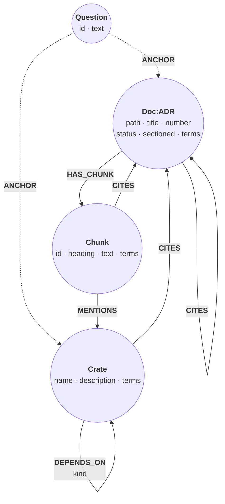
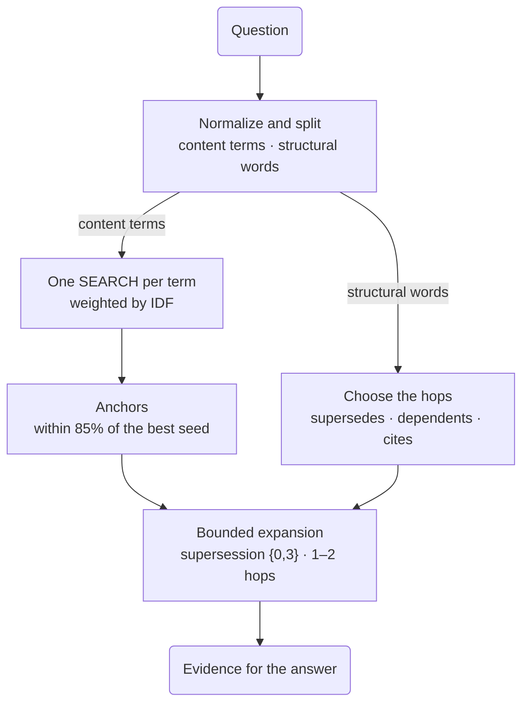

# Answer codebase questions text search can't

*An agent working on a codebase asks what replaced a design decision, or
which crates build on the parser. The paragraph that matches the question
rarely holds the answer: the links between documents do. Build a context
graph over Relate's own repository, its crates and its architecture decision
records (ADRs), let IDF-weighted full-text search pick where to start, and
let short, bounded graph hops bring in the rest.*

The data is the Relate repository at its v1.0.0 release (commit `b02f283`,
11 November 2026): every workspace crate, the README, and all 519 ADRs. Every
ADR brings its title, its status, and the ADRs it cites. The README and 48
ADRs bring their sections too, which keeps the data under half a megabyte:
the seven ADRs the questions below start from or lead to, and the 41 most
cited of the rest.

The graph has three kinds of source node and one kind of text node. The
`Question` nodes (dashed) come later, when each question records where its
search started.



Every ADR, and the README, is a `Doc`. A document `CITES` every ADR its
text names in the `ADR-0072` form. An ADR `SUPERSEDES` an earlier one when
its status line says so ("Superseded in part by ADR-0014"), or in part when
it carries an `Amends: ADR-0042` line. A sectioned document is also split
into one `Chunk` per section (a long section becomes several); a chunk
`MENTIONS` a crate whose name appears in its text and `CITES` the ADRs it
names. `DEPENDS_ON` comes from each crate's `Cargo.toml`, and so does a
crate's `CITES`: its comments name the decisions behind a dependency or a
feature. ADR-0032 is cited but has no file in the repository, so it becomes
a stub with a number and no text, and the citation still lands somewhere.

`terms` is the searchable text. Titles, crate descriptions, and section text
were normalized before loading: lowercase, stopwords out (the product name
among them), crude suffix stemming ("checkpoints" becomes `checkpoint`,
"storage" becomes `storag`). The same function normalizes each question, so
both sides of the search agree. The data blocks hold that output: the
distinct terms of each title and section, and a 160-character excerpt of
each section, not the whole text.

## Load the repository

Constraints keep crate names, document paths, chunk ids, and ADR numbers
unique. One full-text index covers the `terms` of every chunk, crate, and
document.

```cypher cell=schema setup
CREATE CONSTRAINT crate_name IF NOT EXISTS FOR (c:Crate) REQUIRE c.name IS UNIQUE;
CREATE CONSTRAINT doc_path IF NOT EXISTS FOR (d:Doc) REQUIRE d.path IS UNIQUE;
CREATE CONSTRAINT chunk_id IF NOT EXISTS FOR (c:Chunk) REQUIRE c.id IS UNIQUE;
CREATE CONSTRAINT adr_number IF NOT EXISTS FOR (a:ADR) REQUIRE a.number IS UNIQUE;
CREATE FULLTEXT INDEX terms IF NOT EXISTS FOR (n:Chunk|Crate|Doc) ON EACH [n.terms]
```

```table
(no rows) · indexes added: 1, constraints added: 4
```

Documents first, so the crates and chunks loaded next can link to them. An
ADR gets a second label. Then each document's citations, where `MERGE … ON
CREATE SET` finds the cited ADR or creates a stub for one with no file, and
last the seven supersessions.

```cypher cell=docs setup params=docs
UNWIND $docs AS r
CREATE (d:Doc {path: r.path, title: r.title, terms: r.terms, sectioned: r.sectioned})
SET d.number = r.number, d.status = r.status, d.date = r.date
WITH d, r WHERE r.adr
SET d:ADR;

UNWIND $docs AS r
MATCH (d:Doc {path: r.path})
UNWIND r.cites AS n
MERGE (a:ADR {number: n})
  ON CREATE SET a.title = 'ADR-' + n + ' (missing)', a.sectioned = false
MERGE (d)-[:CITES]->(a);

UNWIND $supersedes AS r
MATCH (newer:ADR {number: r.new}), (older:ADR {number: r.old})
MERGE (newer)-[:SUPERSEDES {partial: r.partial}]->(older)
```

```table
(no rows) · nodes created: 521, relationships created: 2169, properties set: 3376, labels added: 1040
```

Crates and their dependencies. A crate's `Cargo.toml` comments cite ADRs
too, and the same `MERGE` links them.

```cypher cell=crates setup params=crates
UNWIND $crates AS r
CREATE (:Crate {name: r.name, description: r.description, terms: r.terms});

UNWIND $deps AS r
MATCH (a:Crate {name: r.src}), (b:Crate {name: r.dst})
MERGE (a)-[:DEPENDS_ON {kind: r.kind}]->(b);

UNWIND $crate_cites AS r
MATCH (k:Crate {name: r.src})
MERGE (a:ADR {number: r.adr})
  ON CREATE SET a.title = 'ADR-' + r.adr + ' (missing)', a.sectioned = false
MERGE (k)-[:CITES]->(a)
```

```table
(no rows) · nodes created: 42, relationships created: 288, properties set: 311, labels added: 42
```

Then the 410 sections of the README and the 48 sectioned ADRs. Each row
carries the crate names and ADR numbers its text mentions; two `CALL`
subqueries turn them into relationships, creating stubs as needed.

```cypher cell=chunks setup params=chunks
UNWIND $chunks AS r
MATCH (d:Doc {path: r.doc})
CREATE (d)-[:HAS_CHUNK]->(c:Chunk {id: r.id, ord: r.ord, heading: r.heading,
                                   text: r.text, terms: r.terms})
WITH c, r
CALL (c, r) {
  UNWIND r.crates AS name
  MATCH (k:Crate {name: name})
  MERGE (c)-[:MENTIONS]->(k)
}
CALL (c, r) {
  UNWIND r.cites AS n
  MERGE (a:ADR {number: n})
    ON CREATE SET a.title = 'ADR-' + n + ' (missing)', a.sectioned = false
  MERGE (c)-[:CITES]->(a)
};

RETURN COUNT { (:Crate) } AS crates, COUNT { (a:ADR) WHERE a.path IS NOT NULL } AS adrs,
       COUNT { (a:ADR) WHERE a.sectioned } AS sectioned,
       COUNT { (a:ADR) WHERE a.path IS NULL } AS missing, COUNT { (:Chunk) } AS chunks,
       COUNT { ()-[:DEPENDS_ON]->() } AS depends_on, COUNT { ()-[:CITES]->() } AS cites,
       COUNT { ()-[:MENTIONS]->() } AS mentions,
       COUNT { ()-[:SUPERSEDES]->() } AS supersedes
```

```table
| crates | adrs | sectioned | missing | chunks | depends_on | cites | mentions | supersedes |
|--------|------|-----------|---------|--------|------------|-------|----------|------------|
| 42     | 519  | 48        | 1       | 410    | 185        | 2830  | 39       | 7          |
1 row · nodes created: 410, relationships created: 1014, properties set: 2050, labels added: 410
```

## Where to start: full-text seeds

Take the question *"What did the WAL-first checkpoint decision supersede,
and was it itself superseded later?"* Normalized, it is `wal first
checkpoint decision supersed lat`. The structural words (`decision`,
`supersed`, `lat`) name relationships, not text, so they choose which graph
hop runs later and stay out of the search. Three terms remain:

```json data=seed
{
  "terms": ["wal", "first", "checkpoint"],
  "k": 6
}
```

A plain `SEARCH` for all three ranks every node that contains any of them by
BM25, the score Neo4j's full-text index gives: a term few nodes contain
counts for more, and a hit in a short text counts for more than one in a
long text. The top eight, with the terms each one contains:

```cypher cell=plain params=seed
WITH reduce(q = head($terms), t IN tail($terms) | q + ' ' + t) AS query
MATCH (n) SEARCH n IN (FULLTEXT INDEX terms FOR query LIMIT 8) SCORE AS score
OPTIONAL MATCH (doc:Doc)-[:HAS_CHUNK]->(n)
RETURN round(score, 2) AS score,
       CASE WHEN n:Crate THEN 'Crate' WHEN n:Chunk THEN 'Chunk' ELSE 'Doc' END AS kind,
       coalesce(n.name, doc.title + ' § ' + n.heading, n.title) AS label,
       [t IN $terms WHERE t IN split(n.terms, ' ')] AS matched
ORDER BY score DESC, label
```

```table
| score | kind    | label                                                                                               | matched                        |
|-------|---------|-----------------------------------------------------------------------------------------------------|--------------------------------|
| 5.01  | "Doc"   | "0012. WAL-first durability with Parquet checkpoints"                                               | ["wal", "first", "checkpoint"] |
| 4.29  | "Chunk" | "0012. WAL-first durability with Parquet checkpoints § Preamble"                                    | ["wal", "first", "checkpoint"] |
| 3.26  | "Doc"   | "0041. Time-triggered checkpoint when the WAL has work"                                             | ["wal", "checkpoint"]          |
| 3.13  | "Doc"   | "0020. Checkpoint at a frozen LSN; writers append a new WAL segment"                                | ["wal", "checkpoint"]          |
| 3.13  | "Doc"   | "0137. Follow a native WAL and reload across a checkpoint gap"                                      | ["wal", "checkpoint"]          |
| 3.01  | "Doc"   | "0114. WAL recovery rejects undecodable records and checks the store version first"                 | ["wal", "first"]               |
| 2.26  | "Chunk" | "0022. Checkpoint shards are byte-budgeted id windows (copy-on-write) § Consequences"               | ["first", "checkpoint"]        |
| 2.22  | "Chunk" | "0120. Persist the ontology as a document and derive `system_ontologies` § Alternatives considered" | ["wal", "first", "checkpoint"] |
8 rows
```

ADR-0012's title leads, and its preamble follows. Below them, text length
decides as much as coverage: four ADR titles hold two of the three terms and
still outrank the ADR-0120 section, which holds all three. The procedure `db.index.fulltext.queryNodes('terms', 'wal first
checkpoint')` returns the same ranking. A seed for this question should
cover its words, with the rare ones counting for more, and two refinements
give that. Each term is weighted by its inverse document frequency,
`log(N / df)`, where `df` is the number of nodes the term hits, and a node
scores the sum of the weights of the terms it contains, whatever its
length. A hit on a title or a crate name counts 1.5 times a hit in body
text.

One `SEARCH` per term gives each term's hits, so its `df` is the size of
that list. The search `LIMIT` must cover every hit, because `SEARCH` cuts
before anything else runs. Each hit keeps its BM25 score too: summed, it
breaks ties between nodes of equal weight, in favour of the shorter text.

```cypher cell=seeds params=seed
MATCH (x) WHERE x:Chunk OR x:Crate OR x:Doc
WITH count(x) AS total
UNWIND $terms AS t
MATCH (n) SEARCH n IN (FULLTEXT INDEX terms FOR t LIMIT 1000) SCORE AS s
WITH total, t, collect({n: n, s: s}) AS hits
WITH t, log(toFloat(total) / size(hits)) AS idf, hits
UNWIND hits AS h
WITH h.n AS n, sum(idf) * CASE WHEN h.n:Chunk THEN 1.0 ELSE 1.5 END AS score,
     sum(h.s) AS bm25, collect(t) AS matched
OPTIONAL MATCH (doc:Doc)-[:HAS_CHUNK]->(n)
RETURN round(score, 2) AS score, round(bm25, 2) AS bm25,
       CASE WHEN n:Crate THEN 'Crate' WHEN n:Chunk THEN 'Chunk' ELSE 'Doc' END AS kind,
       coalesce(n.name, doc.title + ' § ' + n.heading, n.title) AS label,
       matched
ORDER BY score DESC, bm25 DESC, coalesce(n.name, n.id, n.path)
LIMIT $k
```

```table
| score | bm25 | kind    | label                                                                                               | matched                        |
|-------|------|---------|-----------------------------------------------------------------------------------------------------|--------------------------------|
| 10.94 | 5.01 | "Doc"   | "0012. WAL-first durability with Parquet checkpoints"                                               | ["wal", "first", "checkpoint"] |
| 7.29  | 4.29 | "Chunk" | "0012. WAL-first durability with Parquet checkpoints § Preamble"                                    | ["wal", "first", "checkpoint"] |
| 7.29  | 2.22 | "Chunk" | "0120. Persist the ontology as a document and derive `system_ontologies` § Alternatives considered" | ["wal", "first", "checkpoint"] |
| 7.29  | 2.18 | "Chunk" | "0019. Waiting independent WAL records share one fsync § Later references"                          | ["wal", "first", "checkpoint"] |
| 7.29  | 1.92 | "Chunk" | "0012. WAL-first durability with Parquet checkpoints § Decision"                                    | ["wal", "first", "checkpoint"] |
| 7.29  | 1.61 | "Chunk" | "0022. Checkpoint shards are byte-budgeted id windows (copy-on-write) § Decision"                   | ["wal", "first", "checkpoint"] |
6 rows
```

Across the 972 indexed nodes, `wal` hits 107, `checkpoint` 77, and `first`
76, so `first` and `checkpoint` weigh the most (2.55 and 2.54, against 2.21).
ADR-0012's title leads at 10.94, and every section below it contains all
three terms. They tie at 7.29, so BM25 orders them, and ADR-0012's preamble,
the shortest, comes first.

## Anchor each question

Each question takes the same path: its content words find seeds, the best
seeds become anchors, and its structural words choose which bounded hops run
from those anchors.



A seed is only a starting point. A seed within 85% of the best score
becomes an *anchor*: a document or crate that a bounded hop starts from. A
section anchors the document it belongs to, and the README, which touches
everything, never anchors. Four questions, normalized the same way:

```json data=questions
{
  "questions": [
    {"id": "wal-first", "text": "What did the WAL-first checkpoint decision supersede, and was it itself superseded later?", "terms": ["wal", "first", "checkpoint"]},
    {"id": "storage", "text": "Which crates depend on the storage crate, and which ADRs does the storage crate cite?", "terms": ["storag"]},
    {"id": "parser", "text": "Which crates build on the Cypher parser, and which ADRs describe its design?", "terms": ["cyph", "pars"]},
    {"id": "wasm", "text": "Which decisions about the WASM surface were later withdrawn, and what did the withdrawal cite?", "terms": ["wasm", "surfac", "withdraw"]}
  ],
  "k": 6,
  "ratio": 0.85
}
```

The seed ranking from the step above runs once per question in a `CALL`
subquery, and each question is written down with an `ANCHOR` relationship to
each anchor. Logging where a retrieval started lets the answer cite it and
lets a reviewer replay it; it also keeps the hops below short. The first
statement clears earlier questions, so the step can be run again.

```cypher cell=anchors params=questions
MATCH (old:Question) DETACH DELETE old;

MATCH (x) WHERE x:Chunk OR x:Crate OR x:Doc
WITH count(x) AS total
UNWIND $questions AS q
CALL (q, total) {
  UNWIND q.terms AS t
  MATCH (n) SEARCH n IN (FULLTEXT INDEX terms FOR t LIMIT 1000) SCORE AS s
  WITH t, collect({n: n, s: s}) AS hits
  WITH log(toFloat(total) / size(hits)) AS idf, hits
  UNWIND hits AS h
  WITH h.n AS n, sum(idf) * CASE WHEN h.n:Chunk THEN 1.0 ELSE 1.5 END AS score,
       sum(h.s) AS bm25
  RETURN n, score
  ORDER BY score DESC, bm25 DESC, coalesce(n.name, n.id, n.path)
  LIMIT $k
}
WITH q, collect({n: n, score: score}) AS seeds, max(score) AS best
UNWIND seeds AS s
WITH q, s.n AS n WHERE s.score >= $ratio * best
OPTIONAL MATCH (doc:Doc)-[:HAS_CHUNK]->(n)
WITH q, CASE WHEN n:Chunk THEN doc ELSE n END AS anchor
WHERE anchor.path IS NULL OR anchor.path <> 'README.md'
WITH q, collect(DISTINCT anchor) AS anchors
CREATE (question:Question {id: q.id, text: q.text})
FOREACH (a IN anchors | CREATE (question)-[:ANCHOR]->(a))
RETURN q.id AS question, [a IN anchors | coalesce(a.name, a.title)] AS anchors
```

```table
| question    | anchors                                                                                                                                                                                                                                                                   |
|-------------|---------------------------------------------------------------------------------------------------------------------------------------------------------------------------------------------------------------------------------------------------------------------------|
| "wal-first" | ["0012. WAL-first durability with Parquet checkpoints"]                                                                                                                                                                                                                   |
| "storage"   | ["ADR-0206: Compressed topology storage — conditional adopt", "0097. Exclusive ownership and private creation for persistent storage", "0165. Cold store-metadata read: `store_info` in cypherlite-storage, surfaced as `cypherlite info` and `.info`", "relate-storage"] |
| "parser"    | ["0277. One Cypher parser", "0007. Cypher is parsed with a hand-written recursive-descent parser", "relate-parser"]                                                                                                                                                       |
| "wasm"      | ["0065. Withdraw the WASM and Swift surfaces"]                                                                                                                                                                                                                            |
4 rows · nodes created: 4, relationships created: 9, properties set: 8, labels added: 4
```

The WAL-first and WASM questions each anchor one ADR. The storage question's
single term ties four nodes: the crate and three ADRs with "storage" in the
title. The parser question needs both its terms: `pars` alone hits ten ADR
titles and three crates, more than six seeds can hold, while `cyph` and
`pars` together pick out three: the `relate-parser` crate and ADRs 0007 and
0277.

## Was the WAL-first decision superseded?

The anchor is ADR-0012. Its supersession history is a chain, and the
question asks about both ends of it: what 0012 replaced, and what replaced
0012. Two quantified path patterns grow the chain from the anchor in both
directions, at most three hops each, and the `EXISTS` checks keep only the
whole chain, not its pieces. Open the graph view:

```cypher cell=chain
MATCH (:Question {id: 'wal-first'})-[:ANCHOR]->(d:ADR)
MATCH p = (newer:ADR)-[:SUPERSEDES]->{0,3}(d)-[:SUPERSEDES]->{0,3}(older:ADR)
WHERE length(p) > 0
  AND NOT EXISTS { (:ADR)-[:SUPERSEDES]->(newer) }
  AND NOT EXISTS { (older)-[:SUPERSEDES]->(:ADR) }
RETURN p
```

```gram
// 1 row
(n14:Doc:ADR {date: "2026-08-28", number: "0014", path: "docs/adr/0014-single-wal-write-path.md", sectioned: true, status: "Accepted", terms: "singl writ path wal snapshot graph materializ", title: "0014. Single write path: WAL then snapshot; graph is a materialization"})-[r2164:SUPERSEDES {partial: true}]->(n12:Doc:ADR {date: "2026-08-28", number: "0012", path: "docs/adr/0012-wal-and-parquet-checkpoints.md", sectioned: true, status: "Superseded in part by ADR-0014", terms: "wal first durability parquet checkpoint", title: "0012. WAL-first durability with Parquet checkpoints"})-[r2162:SUPERSEDES {partial: true}]->(n4:Doc:ADR {date: "2026-08-28", number: "0004", path: "docs/adr/0004-memory-first-parquet-object-store.md", sectioned: true, status: "Superseded in part by ADR-0012", terms: "memory first graph parquet snapshot object stor", title: "0004. Memory-first graph with Parquet snapshots via object_store"})
```

ADR-0012 replaced part of ADR-0004 (snapshot-only durability), and ADR-0014
later replaced part of 0012. The text search alone found 0012 and some
sections about checkpoints; neither 0004 nor 0014 was among the seeds.

## What depends on the storage crate?

The term `storag` anchors the crate and three ADRs; this hop starts from
the crate. Its dependents follow `DEPENDS_ON` backwards, counting only
normal (not dev or build) dependencies, and its citations follow `CITES`
forwards. `UNION` puts both in one table:

```cypher cell=storage
MATCH (:Question {id: 'storage'})-[:ANCHOR]->(k:Crate)
CALL (k) {
  MATCH (dep:Crate)-[:DEPENDS_ON {kind: 'normal'}]->(k)
  RETURN dep.name AS from, 'DEPENDS_ON' AS rel, k.name AS to, null AS status
  UNION
  MATCH (k)-[:CITES]->(a:ADR)
  RETURN k.name AS from, 'CITES' AS rel, a.title AS to, a.status AS status
}
RETURN from, rel, to, status
ORDER BY rel DESC, from, to
```

```table
| from                  | rel          | to                                                                          | status     |
|-----------------------|--------------|-----------------------------------------------------------------------------|------------|
| "relate"              | "DEPENDS_ON" | "relate-storage"                                                            | null       |
| "relate-auth"         | "DEPENDS_ON" | "relate-storage"                                                            | null       |
| "relate-bolt"         | "DEPENDS_ON" | "relate-storage"                                                            | null       |
| "relate-cli"          | "DEPENDS_ON" | "relate-storage"                                                            | null       |
| "relate-codec-lab"    | "DEPENDS_ON" | "relate-storage"                                                            | null       |
| "relate-datasets"     | "DEPENDS_ON" | "relate-storage"                                                            | null       |
| "relate-test-support" | "DEPENDS_ON" | "relate-storage"                                                            | null       |
| "relate-wasm"         | "DEPENDS_ON" | "relate-storage"                                                            | null       |
| "relate-write-local"  | "DEPENDS_ON" | "relate-storage"                                                            | null       |
| "relate-storage"      | "CITES"      | "0077. Configurable WAL durability boundaries"                              | "Accepted" |
| "relate-storage"      | "CITES"      | "0085. wasm32 build split for the engine crates"                            | "Accepted" |
| "relate-storage"      | "CITES"      | "0097. Exclusive ownership and private creation for persistent storage"     | "Proposed" |
| "relate-storage"      | "CITES"      | "0105. Parquet snapshot codec behind an additive `parquet` Cargo feature"   | "Proposed" |
| "relate-storage"      | "CITES"      | "0268. proptest dev-dependencies for property testing"                      | "Proposed" |
| "relate-storage"      | "CITES"      | "ADR-0439: Commit-time uniqueness admission"                                | "Proposed" |
| "relate-storage"      | "CITES"      | "ADR-0481: Schema as files — the store's schema mirrored as canonical text" | "Proposed" |
| "relate-storage"      | "CITES"      | "ADR-0537: Experimental snapshot codec behind a default-off feature"        | "Proposed" |
| "relate-storage"      | "CITES"      | "ADR-0552: Proptest adjacency reference model in relate-executor"           | "Proposed" |
18 rows
```

Nine crates build on storage, from the `relate` library to the WASM build.
The crate's `Cargo.toml` names nine decisions, from the WAL durability
boundaries (0077) and the wasm32 build split (0085) to an experimental
snapshot codec behind a default-off feature (0537). Each status comes from
the ADR's own status line, so it is there for the ADRs whose sections are not
in the data, too.

## What builds on the parser?

This question has three anchors: the `relate-parser` crate and two ADRs,
0007 (the parser design) and 0277 (one Cypher parser). The same hop shape
works for both kinds of anchor: crates bring their dependents, and ADRs
bring what they cite.

```cypher cell=parser
MATCH (:Question {id: 'parser'})-[:ANCHOR]->(a)
CALL (a) {
  MATCH (dep:Crate)-[:DEPENDS_ON {kind: 'normal'}]->(a)
  RETURN dep.name AS from, 'DEPENDS_ON' AS rel, a.name AS to
  UNION
  MATCH (a:ADR)-[:CITES]->(c:ADR)
  RETURN a.title AS from, 'CITES' AS rel, c.title AS to
}
RETURN from, rel, to
ORDER BY rel DESC, from, to
```

```table
| from                                                                  | rel          | to                                                         |
|-----------------------------------------------------------------------|--------------|------------------------------------------------------------|
| "relate"                                                              | "DEPENDS_ON" | "relate-parser"                                            |
| "relate-engine-api"                                                   | "DEPENDS_ON" | "relate-parser"                                            |
| "relate-error"                                                        | "DEPENDS_ON" | "relate-parser"                                            |
| "relate-executor"                                                     | "DEPENDS_ON" | "relate-parser"                                            |
| "relate-formatter"                                                    | "DEPENDS_ON" | "relate-parser"                                            |
| "relate-front"                                                        | "DEPENDS_ON" | "relate-parser"                                            |
| "relate-ir"                                                           | "DEPENDS_ON" | "relate-parser"                                            |
| "relate-load"                                                         | "DEPENDS_ON" | "relate-parser"                                            |
| "relate-ontology"                                                     | "DEPENDS_ON" | "relate-parser"                                            |
| "relate-planner"                                                      | "DEPENDS_ON" | "relate-parser"                                            |
| "0007. Cypher is parsed with a hand-written recursive-descent parser" | "CITES"      | "0056. OpenCypher TCK is the Cypher language contract"     |
| "0277. One Cypher parser"                                             | "CITES"      | "0046. CypherLite parser in front of the MemoryDB runtime" |
12 rows
```

Ten crates build on the parser, from the front end and the planner to the
formatter and the ontology crate. ADR-0277 cites ADR-0046, the decision that
first put this parser in front of the runtime. The search could not have
anchored 0046: its title calls the engine by its former name, CypherLite,
which the normalizer drops, so it holds `pars` but not `cyph`. The hop
reaches it anyway.

## What did the WASM withdrawal cite?

The anchor is ADR-0065, "Withdraw the WASM and Swift surfaces". Citations
are one hop each way: what 0065 cites, and which ADRs cite 0065. Every ADR's
citations are in the graph, sectioned or not, so the cited-by side is
complete.

```cypher cell=wasm
MATCH (:Question {id: 'wasm'})-[:ANCHOR]->(d:ADR)
CALL (d) {
  MATCH (d)-[:CITES]->(a:ADR)
  RETURN 'cites' AS direction, a AS other
  UNION
  MATCH (d)<-[:CITES]-(b:ADR)
  RETURN 'cited by' AS direction, b AS other
}
RETURN d.number AS adr, direction, other.title AS other, other.status AS status
ORDER BY direction DESC, other
```

```table
| adr    | direction  | other                                                                            | status     |
|--------|------------|----------------------------------------------------------------------------------|------------|
| "0065" | "cites"    | "0051. WASM product path is Database `:memory:`"                                 | "Accepted" |
| "0065" | "cites"    | "0057. Embedded C ABI is the client boundary; Bolt is optional remote transport" | "Accepted" |
| "0065" | "cites"    | "0084. Reinstate the WASM distribution"                                          | "Accepted" |
| "0065" | "cites"    | "ADR 0052: GraphStore withdrawn"                                                 | "Accepted" |
| "0065" | "cites"    | "ADR-0433: Reinstate the Swift surface for iOS and macOS"                        | "Proposed" |
| "0065" | "cited by" | "0051. WASM product path is Database `:memory:`"                                 | "Accepted" |
| "0065" | "cited by" | "0066. Retire the MemoryDB name in favor of cypherlite"                          | "Accepted" |
| "0065" | "cited by" | "0084. Reinstate the WASM distribution"                                          | "Accepted" |
| "0065" | "cited by" | "ADR-0433: Reinstate the Swift surface for iOS and macOS"                        | "Proposed" |
9 rows
```

ADR-0051, "WASM product path is Database `:memory:`", is the decision that
was withdrawn. Its status line still says Accepted; only the citation in
both directions shows the withdrawal. The withdrawal did not last: ADR-0084
reinstates the WASM distribution, the engine running the steps on this page,
and ADR-0433 proposes the Swift surface again. Both cite 0065, and 0065 now
cites them back. None of the three says so in its status line.

## Hand the evidence to a model

With an LLM in the loop, an agent sends the seed sections and the edges
above to the model and asks for an answer that cites them. The
most useful text is often the sections that sit on the path the graph
found. For the WAL-first chain, those are the sections of each ADR that cite
another ADR on the chain:

```cypher cell=evidence
MATCH (:Question {id: 'wal-first'})-[:ANCHOR]->(d:ADR)
MATCH p = (newer:ADR)-[:SUPERSEDES]->{0,3}(d)-[:SUPERSEDES]->{0,3}(older:ADR)
WHERE length(p) > 0
  AND NOT EXISTS { (:ADR)-[:SUPERSEDES]->(newer) }
  AND NOT EXISTS { (older)-[:SUPERSEDES]->(:ADR) }
WITH nodes(p) AS chain
UNWIND chain AS a
MATCH (a)-[:HAS_CHUNK]->(c:Chunk)-[:CITES]->(b:ADR)
WHERE b IN chain
RETURN a.number AS adr, c.heading AS section, b.number AS cites, c.text AS excerpt
ORDER BY adr, c.ord, cites
```

```table
| adr    | section                   | cites  | excerpt                                                                                                                                                          |
|--------|---------------------------|--------|------------------------------------------------------------------------------------------------------------------------------------------------------------------|
| "0004" | "Preamble"                | "0012" | "# 0004. Memory-first graph with Parquet snapshots via object_store - **Status**: Superseded in part by ADR-0012 - **Date**: 2026-08-28 - **Deciders**: …"       |
| "0004" | "Later references"        | "0012" | "ADR-0012 replaces snapshot-only durability. Execution is still an in-memory LPG; `object_store` still addresses `file://` and `s3://`; out-of-core Parquet …"   |
| "0004" | "Later references"        | "0014" | "ADR-0012 replaces snapshot-only durability. Execution is still an in-memory LPG; `object_store` still addresses `file://` and `s3://`; out-of-core Parquet …"   |
| "0012" | "Preamble"                | "0014" | "# 0012. WAL-first durability with Parquet checkpoints - **Status**: Superseded in part by ADR-0014 - **Date**: 2026-08-28 - **Deciders**: MemoryDB maintainers" |
| "0012" | "Context"                 | "0004" | "ADR-0004 made the in-memory graph the source of execution and Parquet snapshots the only durable form. A crash or process exit without an explicit …"           |
| "0012" | "Alternatives considered" | "0004" | "- **Keep snapshot-only durability (ADR-0004)** — simple, loses uncheckpointed writes. Rejected; persistent URIs need commit durability. - **WAL as S3 …"        |
| "0012" | "Consequences"            | "0004" | "- Open of a persistent URI is snapshot load plus WAL replay. - `s3://` without a writable local WAL directory cannot offer fsync-per-commit. - Manifest …"      |
| "0012" | "Later references"        | "0014" | "ADR-0014: `:memory:` uses the same WAL + snapshot path (in-process store). The live graph is materialized from Parquet + WAL replay; commits are WAL append …"  |
| "0014" | "Context"                 | "0012" | "ADR-0012 added a WAL for persistent URIs but left several write paths: `:memory:` skipped the WAL; Cypher mutated the live graph then optionally fsynced; …"    |
| "0014" | "Consequences"            | "0012" | "- Crash recovery and “open an existing URI” are the same function. - Loadtests with `--uri :memory:` still hit the WAL (volatile). - ADR-0012’s “`:memory:` …"  |
10 rows
```

The "Later references" section of ADR-0012 names its successor in the first
words; that sentence, and the chain it sits on, is what a cited answer
needs.

## Data

<details>
<summary><code>docs</code> (169 KB)</summary>

```json data=docs
{
  "docs": [
    {"path": "README.md", "title": "Relate", "adr": false, "number": null, "status": null, "date": null, "terms": "", "cites": ["0050", "0055", "0115", "0123", "0136", "0571"], "sectioned": true},
    {"path": "docs/adr/0001-cip-eval-ratcheted-gherkin-eval.md", "title": "cip-eval: a ratcheted Gherkin eval derived from the CIP documents", "adr": true, "number": "0001", "status": "accepted", "date": null, "terms": "cip eval ratchet gherkin deriv document", "cites": [], "sectioned": false},
    {"path": "docs/adr/0002-cypher-25-semantic-target.md", "title": "Cypher 25 semantics are the target where sources disagree", "adr": true, "number": "0002", "status": "accepted", "date": null, "terms": "cyph semantic target sourc disagre", "cites": [], "sectioned": false},
    {"path": "docs/adr/0003-tck-named-error-kinds.md", "title": "Typed engine errors carry openCypher TCK error kinds", "adr": true, "number": "0003", "status": "accepted", "date": null, "terms": "typ engin error carry opencyph tck kind", "cites": ["0502", "0511"], "sectioned": false},
    {"path": "docs/adr/0004-memory-first-parquet-object-store.md", "title": "0004. Memory-first graph with Parquet snapshots via object_store", "adr": true, "number": "0004", "status": "Superseded in part by ADR-0012", "date": "2026-08-28", "terms": "memory first graph parquet snapshot object stor", "cites": ["0012", "0014", "0044", "0050"], "sectioned": true},
    {"path": "docs/adr/0005-lpg-parquet-layout.md", "title": "0005. Labeled property graph stored as columnar node and relationship Parquet tables", "adr": true, "number": "0005", "status": "Accepted", "date": "2026-08-28", "terms": "label property graph stor columnar nod relationship parquet tabl", "cites": ["0004", "0012", "0022", "0033"], "sectioned": false},
    {"path": "docs/adr/0006-tck-harness-and-skips.md", "title": "0006. TCK harness vendors feature files; expanded count is the denominator; skips only shrink", "adr": true, "number": "0006", "status": "Accepted", "date": "2026-08-28", "terms": "tck harnes vendor featur fil expand count denominator skip shrink", "cites": ["0054", "0056"], "sectioned": false},
    {"path": "docs/adr/0007-recursive-descent-parser.md", "title": "0007. Cypher is parsed with a hand-written recursive-descent parser", "adr": true, "number": "0007", "status": "Accepted", "date": "2026-08-28", "terms": "cyph pars hand written recursiv descent", "cites": ["0056"], "sectioned": true},
    {"path": "docs/adr/0008-localhost-http-query-api.md", "title": "0008. Localhost-only HTTP/JSON query API for tools and the explorer", "adr": true, "number": "0008", "status": "Accepted", "date": "2026-08-28", "terms": "localhost http json query api tool explor", "cites": ["0029", "0057"], "sectioned": false},
    {"path": "docs/adr/0009-logical-planner.md", "title": "0009. Logical planner is a real pass, not only parse-then-execute", "adr": true, "number": "0009", "status": "Accepted", "date": "2026-08-28", "terms": "logical plann real pas pars execut", "cites": ["0010", "0011", "0024", "0026", "0027"], "sectioned": false},
    {"path": "docs/adr/0010-label-property-indexes.md", "title": "0010. Label and property indexes for MATCH", "adr": true, "number": "0010", "status": "Accepted", "date": "2026-08-28", "terms": "label property index match", "cites": ["0005", "0024", "0030", "0031", "0040"], "sectioned": false},
    {"path": "docs/adr/0011-snapshot-isolation.md", "title": "0011. Snapshot isolation via read snapshots; writers serialize", "adr": true, "number": "0011", "status": "Superseded by ADR-0013", "date": "2026-08-28", "terms": "snapshot isol read writ serializ", "cites": ["0004", "0012", "0013", "0028"], "sectioned": false},
    {"path": "docs/adr/0012-wal-and-parquet-checkpoints.md", "title": "0012. WAL-first durability with Parquet checkpoints", "adr": true, "number": "0012", "status": "Superseded in part by ADR-0014", "date": "2026-08-28", "terms": "wal first durability parquet checkpoint", "cites": ["0004", "0005", "0014", "0019", "0020", "0022", "0028", "0044"], "sectioned": true},
    {"path": "docs/adr/0013-tuple-mvcc.md", "title": "0013. Tuple-level MVCC for snapshot reads", "adr": true, "number": "0013", "status": "Accepted", "date": "2026-08-28", "terms": "tupl level mvcc snapshot read", "cites": ["0005", "0010", "0011", "0012", "0015", "0018"], "sectioned": false},
    {"path": "docs/adr/0014-single-wal-write-path.md", "title": "0014. Single write path: WAL then snapshot; graph is a materialization", "adr": true, "number": "0014", "status": "Accepted", "date": "2026-08-28", "terms": "singl writ path wal snapshot graph materializ", "cites": ["0005", "0012", "0015", "0020", "0022"], "sectioned": true},
    {"path": "docs/adr/0015-optimistic-wal-commits.md", "title": "0015. Optimistic writes; commit_ts assigned at WAL append", "adr": true, "number": "0015", "status": "Accepted", "date": "2026-08-28", "terms": "optimistic writ commit ts assign wal append", "cites": ["0012", "0013", "0014", "0016", "0017", "0018", "0019", "0028", "0042"], "sectioned": true},
    {"path": "docs/adr/0016-write-overlay.md", "title": "0016. Write execute uses a private overlay, not a graph clone", "adr": true, "number": "0016", "status": "Accepted", "date": "2026-08-28", "terms": "writ execut privat overlay graph clon", "cites": ["0013", "0015", "0018"], "sectioned": false},
    {"path": "docs/adr/0017-client-conflict.md", "title": "0017. Write-write conflicts are returned to the client; the engine does not retry", "adr": true, "number": "0017", "status": "Accepted", "date": "2026-08-28", "terms": "writ conflict return client engin retry", "cites": ["0015", "0042"], "sectioned": false},
    {"path": "docs/adr/0018-concurrent-snapshot-reads.md", "title": "0018. Snapshot reads do not exclude apply_redo", "adr": true, "number": "0018", "status": "Accepted", "date": "2026-08-28", "terms": "snapshot read exclud app redo", "cites": ["0011", "0012", "0013", "0014", "0015", "0016", "0019", "0020", "0023", "0038"], "sectioned": false},
    {"path": "docs/adr/0019-group-commit-shared-fsync.md", "title": "0019. Waiting independent WAL records share one fsync", "adr": true, "number": "0019", "status": "Accepted", "date": "2026-08-28", "terms": "wait independent wal record shar fsync", "cites": ["0012", "0014", "0015", "0017", "0028", "0077", "0094"], "sectioned": true},
    {"path": "docs/adr/0020-segmented-wal-concurrent-checkpoint.md", "title": "0020. Checkpoint at a frozen LSN; writers append a new WAL segment", "adr": true, "number": "0020", "status": "Accepted", "date": "2026-08-28", "terms": "checkpoint frozen lsn writ append wal segment", "cites": ["0012", "0013", "0018", "0019", "0022", "0023", "0041", "0045", "0574"], "sectioned": false},
    {"path": "docs/adr/0021-opencypher-temporal-values.md", "title": "0021. OpenCypher temporal values are first-class `Value`s", "adr": true, "number": "0021", "status": "Accepted", "date": "2026-08-29", "terms": "opencyph temporal valu first clas", "cites": ["0005", "0006", "0056", "0446"], "sectioned": false},
    {"path": "docs/adr/0022-id-window-checkpoint-shards.md", "title": "0022. Checkpoint shards are byte-budgeted id windows (copy-on-write)", "adr": true, "number": "0022", "status": "Accepted", "date": "2026-08-30", "terms": "checkpoint shard byt budget id window copy writ", "cites": ["0004", "0005", "0012", "0044", "0086", "0089", "0095", "0120", "0183"], "sectioned": true},
    {"path": "docs/adr/0023-incremental-version-gc.md", "title": "0023. Incremental version GC does not take the exclusive graph lock", "adr": true, "number": "0023", "status": "Accepted", "date": "2026-08-30", "terms": "incremental version gc tak exclusiv graph lock", "cites": ["0018", "0020", "0033", "0038"], "sectioned": false},
    {"path": "docs/adr/0024-match-rewrite-planner.md", "title": "0024. MATCH rewrites choose the seek, not Cypher text order", "adr": true, "number": "0024", "status": "Accepted", "date": "2026-08-30", "terms": "match rewrit choos seek cyph text ord", "cites": ["0009", "0010", "0026", "0027"], "sectioned": false},
    {"path": "docs/adr/0025-shortestpath-bfs.md", "title": "0025. `shortestPath` is BFS, not full variable-length expand", "adr": true, "number": "0025", "status": "Accepted", "date": "2026-08-31", "terms": "shortestpath bfs full variabl length expand", "cites": ["0034", "0186", "0189"], "sectioned": false},
    {"path": "docs/adr/0026-eager-residual-match-predicates.md", "title": "0026. Residual MATCH predicates apply when their variables bind", "adr": true, "number": "0026", "status": "Proposed", "date": "2026-08-31", "terms": "residual match predicat app variabl bind", "cites": ["0009", "0010", "0024", "0030", "0031"], "sectioned": false},
    {"path": "docs/adr/0027-live-row-variables.md", "title": "0027. Rows carry only live variables between clauses", "adr": true, "number": "0027", "status": "Proposed", "date": "2026-08-31", "terms": "row carry liv variabl claus", "cites": ["0009", "0024", "0026"], "sectioned": false},
    {"path": "docs/adr/0028-user-visible-transactions.md", "title": "0028. User-visible multi-statement transactions", "adr": true, "number": "0028", "status": "Accepted", "date": "2026-08-31", "terms": "user visibl multi statement transaction", "cites": ["0011", "0012", "0013", "0015", "0016", "0017", "0019", "0029", "0164"], "sectioned": true},
    {"path": "docs/adr/0029-withdraw-localhost-http.md", "title": "0029. Withdraw the localhost HTTP sidecar", "adr": true, "number": "0029", "status": "Accepted", "date": "2026-08-31", "terms": "withdraw localhost http sidecar", "cites": ["0008", "0057"], "sectioned": false},
    {"path": "docs/adr/0030-string-prefix-trigram-indexes.md", "title": "0030. Equality, prefix, and trigram indexes on string properties", "adr": true, "number": "0030", "status": "Accepted", "date": "2026-09-01", "terms": "equality prefix trigram index str property", "cites": ["0010", "0018", "0024", "0040", "0063"], "sectioned": false},
    {"path": "docs/adr/0031-typed-adjacency.md", "title": "0031. Adjacency is partitioned by relationship type", "adr": true, "number": "0031", "status": "Accepted", "date": "2026-09-01", "terms": "adjacency partition relationship typ", "cites": ["0010", "0026", "0033", "0035"], "sectioned": false},
    {"path": "docs/adr/0033-compact-live-records-typed-csr.md", "title": "0033. Compact live records and typed CSR in RAM", "adr": true, "number": "0033", "status": "Accepted", "date": "2026-09-01", "terms": "compact liv record typ csr ram", "cites": ["0005", "0022", "0023", "0031", "0035"], "sectioned": true},
    {"path": "docs/adr/0034-bidirectional-shortestpath.md", "title": "0034. Bound `shortestPath` is bidirectional BFS", "adr": true, "number": "0034", "status": "Accepted", "date": "2026-09-01", "terms": "bound shortestpath bidirectional bfs", "cites": ["0025", "0033", "0037"], "sectioned": false},
    {"path": "docs/adr/0035-ordered-expand-ts.md", "title": "0035. Typed adj is ordered by integer `ts` for `ORDER BY t.ts DESC LIMIT`", "adr": true, "number": "0035", "status": "Accepted", "date": "2026-09-01", "terms": "typ adj order integ ts ord desc limit", "cites": ["0023", "0031", "0032", "0033", "0036", "0203"], "sectioned": false},
    {"path": "docs/adr/0036-fold-one-hop-aggregates.md", "title": "0036. Fold one-hop MATCH aggregates while walking adjacency", "adr": true, "number": "0036", "status": "Accepted", "date": "2026-09-01", "terms": "fold hop match aggregat walk adjacency", "cites": ["0023", "0033"], "sectioned": false},
    {"path": "docs/adr/0037-shallow-bound-shortestpath.md", "title": "0037. Bound `shortestPath` with `max_hops ≤ 3` is set intersection", "adr": true, "number": "0037", "status": "Accepted", "date": "2026-09-01", "terms": "bound shortestpath max hop set intersection", "cites": ["0025", "0033", "0034"], "sectioned": false},
    {"path": "docs/adr/0038-lock-free-snapshot-pins.md", "title": "0038. Lock-free snapshot pins; no database `RwLock` on the query path", "adr": true, "number": "0038", "status": "Accepted", "date": "2026-09-01", "terms": "lock fre snapshot pin databas rwlock query path", "cites": ["0013", "0018", "0020", "0023", "0111"], "sectioned": false},
    {"path": "docs/adr/0040-create-drop-index.md", "title": "0040. CREATE / DROP / SHOW INDEX name a (label, property) pair", "adr": true, "number": "0040", "status": "Accepted", "date": "2026-09-02", "terms": "creat drop show index nam label property pair", "cites": ["0005", "0006", "0010", "0014", "0015", "0022", "0030", "0056", "0063"], "sectioned": false},
    {"path": "docs/adr/0041-timed-checkpoint.md", "title": "0041. Time-triggered checkpoint when the WAL has work", "adr": true, "number": "0041", "status": "Accepted", "date": "2026-09-02", "terms": "tim trigger checkpoint wal work", "cites": ["0019", "0020"], "sectioned": false},
    {"path": "docs/adr/0042-graph-memory-limit.md", "title": "0042. Logical cap on the live graph and data-dependent indexes", "adr": true, "number": "0042", "status": "Accepted", "date": "2026-09-04", "terms": "logical cap liv graph data dependent index", "cites": ["0004", "0010", "0014", "0015", "0017", "0030", "0033", "0040", "0063", "0202", "0207", "0529"], "sectioned": true},
    {"path": "docs/adr/0044-withdraw-engine-s3.md", "title": "0044. Withdraw engine-level S3", "adr": true, "number": "0044", "status": "Accepted", "date": "2026-09-07", "terms": "withdraw engin level s3", "cites": ["0004", "0012", "0014", "0022", "0029", "0072"], "sectioned": false},
    {"path": "docs/adr/0045-cdc-replication-slots.md", "title": "0045. Optional CDC slots hold WAL recycle; apply-only replicas", "adr": true, "number": "0045", "status": "Superseded by ADR-0574", "date": "2026-09-09", "terms": "optional cdc slot hold wal recycl app replica", "cites": ["0019", "0020", "0574"], "sectioned": false},
    {"path": "docs/adr/0046-cypherlite-parser-memorydb-runtime.md", "title": "0046. CypherLite parser in front of the MemoryDB runtime", "adr": true, "number": "0046", "status": "Accepted", "date": "2026-09-16", "terms": "pars front memorydb runtim", "cites": ["0061", "0066", "0070", "0071", "0116", "0119", "0277"], "sectioned": true},
    {"path": "docs/adr/0047-memorydb-cip-parity.md", "title": "0047. MemoryDB reaches CypherLite CIP parity", "adr": true, "number": "0047", "status": "Accepted", "date": "2026-09-16", "terms": "memorydb reach cip parity", "cites": ["0046", "0052", "0116", "0119"], "sectioned": false},
    {"path": "docs/adr/0048-identity-loadtest-memory-budget.md", "title": "0048. Separate identity loadtest memory budget", "adr": true, "number": "0048", "status": "Accepted", "date": "2026-09-16", "terms": "separat identity loadtest memory budget", "cites": ["0042", "0046", "0060", "0070"], "sectioned": false},
    {"path": "docs/adr/0049-in-tree-merged-product-gate.md", "title": "0049. Gate the merged product in-tree", "adr": true, "number": "0049", "status": "Accepted", "date": "2026-09-16", "terms": "gat merg product tre", "cites": ["0047"], "sectioned": false},
    {"path": "docs/adr/0050-snapshot-codecs.md", "title": "0050. Pluggable snapshot codecs (Parquet default, CypherLite JSON)", "adr": true, "number": "0050", "status": "Accepted", "date": "2026-09-17", "terms": "pluggabl snapshot codec parquet default json", "cites": ["0004", "0005", "0012", "0014", "0022", "0072", "0074", "0095", "0105", "0120"], "sectioned": true},
    {"path": "docs/adr/0051-wasm-memory-database.md", "title": "0051. WASM product path is Database `:memory:`", "adr": true, "number": "0051", "status": "Accepted", "date": "2026-09-17", "terms": "wasm product path databas memory", "cites": ["0050", "0065", "0084", "0145"], "sectioned": true},
    {"path": "docs/adr/0052-graphstore-withdrawn.md", "title": "ADR 0052: GraphStore withdrawn", "adr": true, "number": "0052", "status": "Accepted", "date": null, "terms": "graphstor withdraw", "cites": ["0053", "0080", "0548"], "sectioned": false},
    {"path": "docs/adr/0053-cypherlite-product-names.md", "title": "ADR 0053: CypherLite product names", "adr": true, "number": "0053", "status": "Accepted", "date": null, "terms": "product nam", "cites": ["0052", "0054"], "sectioned": false},
    {"path": "docs/adr/0054-one-c-abi-env-python.md", "title": "ADR 0054: One C ABI, one env prefix, one Python package", "adr": true, "number": "0054", "status": "Accepted", "date": null, "terms": "abi env prefix python packag", "cites": ["0053", "0066", "0502"], "sectioned": false},
    {"path": "docs/adr/0055-apache-2-license.md", "title": "0055. MemoryDB is licensed under Apache License 2.0", "adr": true, "number": "0055", "status": "Accepted", "date": "2026-08-28", "terms": "memorydb licens apach", "cites": ["0001"], "sectioned": false},
    {"path": "docs/adr/0056-opencypher-tck-language-contract.md", "title": "0056. OpenCypher TCK is the Cypher language contract", "adr": true, "number": "0056", "status": "Accepted", "date": "2026-08-28", "terms": "opencyph tck cyph languag contract", "cites": ["0002", "0006", "0054", "0057", "0482", "0520"], "sectioned": false},
    {"path": "docs/adr/0057-embedded-c-abi-and-bolt.md", "title": "0057. Embedded C ABI is the client boundary; Bolt is optional remote transport", "adr": true, "number": "0057", "status": "Accepted", "date": "2026-08-28", "terms": "embedd abi client boundary bolt optional remot transport", "cites": ["0003", "0008", "0029", "0056"], "sectioned": true},
    {"path": "docs/adr/0058-interactive-shell-surface-reduction.md", "title": "0058. Interactive shell surface reduced to six dot-commands", "adr": true, "number": "0058", "status": "Proposed", "date": "2026-09-17", "terms": "interactiv shell surfac reduc six dot command", "cites": ["0028", "0052", "0073"], "sectioned": false},
    {"path": "docs/adr/0059-wal-redo-typed-payloads.md", "title": "0059. WAL redo payloads for catalog DDL are typed models", "adr": true, "number": "0059", "status": "Proposed", "date": "2026-09-17", "terms": "wal redo payload catalog ddl typ model", "cites": ["0012", "0014", "0046", "0114", "0120", "0127"], "sectioned": false},
    {"path": "docs/adr/0060-identity-loadtest-baseline-refreeze.md", "title": "0060. Re-freeze the identity loadtest baseline for gate-host daytime conditions", "adr": true, "number": "0060", "status": "Accepted", "date": "2026-09-18", "terms": "re freez identity loadtest baselin gat host daytim condition", "cites": ["0046", "0048", "0061", "0070"], "sectioned": false},
    {"path": "docs/adr/0061-ci-host-loadtest-baselines.md", "title": "0061. CI-host loadtest baselines (two host classes)", "adr": true, "number": "0061", "status": "Accepted", "date": "2026-09-18", "terms": "ci host loadtest baselin class", "cites": ["0046", "0048", "0060", "0062", "0070", "0071"], "sectioned": false},
    {"path": "docs/adr/0062-ci-loadtest-band-calibration.md", "title": "0062. CI loadtest band calibration to runner variance", "adr": true, "number": "0062", "status": "Accepted", "date": "2026-09-18", "terms": "ci loadtest band calibr runn varianc", "cites": ["0046", "0060", "0061", "0064", "0070", "0071"], "sectioned": false},
    {"path": "docs/adr/0063-lazy-string-index-postings.md", "title": "0063. Lazy prefix/trigram postings with incremental dirty catch-up", "adr": true, "number": "0063", "status": "Accepted", "date": "2026-09-18", "terms": "lazy prefix trigram post incremental dirty catch", "cites": ["0018", "0026", "0030", "0040", "0042", "0046", "0207"], "sectioned": true},
    {"path": "docs/adr/0064-ci-p99-jitter-allowance.md", "title": "0064. CI gate absolute p99 jitter allowance raised to runner reality", "adr": true, "number": "0064", "status": "Accepted", "date": "2026-09-18", "terms": "ci gat absolut p99 jitt allowanc rais runn reality", "cites": ["0046", "0048", "0060", "0061", "0062", "0063", "0070", "0071"], "sectioned": false},
    {"path": "docs/adr/0065-withdraw-wasm-swift-surfaces.md", "title": "0065. Withdraw the WASM and Swift surfaces", "adr": true, "number": "0065", "status": "Accepted", "date": "2026-09-19", "terms": "withdraw wasm swift surfac", "cites": ["0051", "0052", "0057", "0084", "0433"], "sectioned": true},
    {"path": "docs/adr/0066-retire-memorydb-naming.md", "title": "0066. Retire the MemoryDB name in favor of cypherlite", "adr": true, "number": "0066", "status": "Accepted", "date": "2026-09-19", "terms": "retir memorydb nam favor", "cites": ["0046", "0052", "0065"], "sectioned": false},
    {"path": "docs/adr/0067-release-versioning-and-process.md", "title": "0067. Release and versioning policy: manual dispatch, tag-after-build, lockstep Rust/Python versions", "adr": true, "number": "0067", "status": "Accepted", "date": "2026-09-19", "terms": "releas version policy manual dispatch tag build lockstep rust python", "cites": [], "sectioned": false},
    {"path": "docs/adr/0068-cli-install-script-via-github-pages.md", "title": "0068. CLI install script distributed as a GitHub Pages static asset", "adr": true, "number": "0068", "status": "Accepted", "date": "2026-09-19", "terms": "cli install script distribut github pag static asset", "cites": ["0067", "0115", "0250", "0431", "0571"], "sectioned": true},
    {"path": "docs/adr/0069-cli-lifecycle-commands.md", "title": "0069. CLI lifecycle commands as positionals, plus self-upgrade design", "adr": true, "number": "0069", "status": "Accepted", "date": "2026-09-20", "terms": "cli lifecycl command positional plu self upgrad design", "cites": ["0067", "0068", "0115", "0190", "0200", "0231", "0250", "0261"], "sectioned": true},
    {"path": "docs/adr/0070-docker-baseline-loadtest-environment.md", "title": "0070. Docker baseline loadtest environment (2 vCPU / 2 GB)", "adr": true, "number": "0070", "status": "Accepted", "date": "2026-09-20", "terms": "dock baselin loadtest environment vcpu gb", "cites": ["0046", "0048", "0060", "0061", "0062", "0064", "0071", "0243", "0245", "0289", "0495"], "sectioned": true},
    {"path": "docs/adr/0071-ci-owned-loadtest-freeze-fingerprint.md", "title": "0071. CI-owned loadtest freeze with environment fingerprint", "adr": true, "number": "0071", "status": "Accepted", "date": "2026-09-21", "terms": "ci loadtest freez environment fingerprint", "cites": ["0046", "0062", "0070", "0245", "0512"], "sectioned": true},
    {"path": "docs/adr/0072-virtual-filesystem.md", "title": "0072. Synchronous virtual filesystem for WAL and snapshots", "adr": true, "number": "0072", "status": "Accepted", "date": "2026-09-20", "terms": "synchronou virtual filesystem wal snapshot", "cites": ["0012", "0014", "0019", "0044", "0050", "0074", "0098", "0145", "0574"], "sectioned": false},
    {"path": "docs/adr/0073-interactive-cli-line-editing.md", "title": "0073. Interactive CLI line editing via rustyline", "adr": true, "number": "0073", "status": "Accepted", "date": "2026-09-21", "terms": "interactiv cli lin edit rustylin", "cites": ["0058"], "sectioned": false},
    {"path": "docs/adr/0074-single-file-bundle-vfs.md", "title": "0074. Single-file bundle VFS selected by `.cl` path", "adr": true, "number": "0074", "status": "Accepted", "date": "2026-09-21", "terms": "singl fil bundl vfs select cl path", "cites": ["0044", "0050", "0070", "0072", "0077", "0091", "0093", "0098"], "sectioned": true},
    {"path": "docs/adr/0075-label-only-snapshot-census.md", "title": "0075. Label-only read for the snapshot label census", "adr": true, "number": "0075", "status": "Accepted", "date": "2026-09-19", "terms": "label read snapshot censu", "cites": ["0033", "0076", "0171"], "sectioned": false},
    {"path": "docs/adr/0076-lock-free-interner.md", "title": "0076. Interner id→string lookup is lock-free", "adr": true, "number": "0076", "status": "Accepted", "date": "2026-09-19", "terms": "intern id str lookup lock fre", "cites": ["0033", "0075"], "sectioned": false},
    {"path": "docs/adr/0077-embedded-durability-boundary.md", "title": "0077. Configurable WAL durability boundaries", "adr": true, "number": "0077", "status": "Accepted", "date": "2026-09-19", "terms": "configurabl wal durability boundary", "cites": ["0019", "0051", "0114"], "sectioned": true},
    {"path": "docs/adr/0078-typed-redo-in-process.md", "title": "0078. Redo ops carry typed values; JSON only at the WAL boundary", "adr": true, "number": "0078", "status": "Accepted", "date": "2026-09-19", "terms": "redo ops carry typ valu json wal boundary", "cites": ["0059"], "sectioned": false},
    {"path": "docs/adr/0079-anonymous-usage-metrics.md", "title": "0079. Anonymous usage metrics in the CLI", "adr": true, "number": "0079", "status": "Proposed", "date": "2026-09-21", "terms": "anonymou usag metric cli", "cites": ["0055", "0067", "0068", "0069", "0263", "0360", "0545"], "sectioned": true},
    {"path": "docs/adr/0080-cli-pull-command.md", "title": "0080. CLI `pull` command: Query API v2 into `Database`", "adr": true, "number": "0080", "status": "Proposed", "date": "2026-09-22", "terms": "cli pull command query api v2 databas", "cites": ["0052", "0069", "0079", "0092", "0109", "0122", "0158", "0181", "0200"], "sectioned": true},
    {"path": "docs/adr/0081-opt-in-load-csv-file-capability.md", "title": "0081. Opt-in, rooted local-file capability for LOAD CSV", "adr": true, "number": "0081", "status": "Proposed", "date": "2026-09-23", "terms": "opt root local fil capability load csv", "cites": ["0108", "0257", "0259"], "sectioned": false},
    {"path": "docs/adr/0082-bound-bolt-decoded-value-count.md", "title": "0082. Bound the number of decoded Bolt values per message", "adr": true, "number": "0082", "status": "Proposed", "date": "2026-09-23", "terms": "bound numb decod bolt valu messag", "cites": [], "sectioned": false},
    {"path": "docs/adr/0083-borrowed-bolt-input-buffer.md", "title": "0083. Borrow Bolt input from one bounded payload buffer", "adr": true, "number": "0083", "status": "Proposed", "date": "2026-09-23", "terms": "borrow bolt input bound payload buff", "cites": ["0057", "0082"], "sectioned": false},
    {"path": "docs/adr/0084-reinstate-wasm-distribution.md", "title": "0084. Reinstate the WASM distribution", "adr": true, "number": "0084", "status": "Accepted", "date": "2026-09-24", "terms": "reinstat wasm distribution", "cites": ["0051", "0065", "0085", "0100", "0145", "0530"], "sectioned": true},
    {"path": "docs/adr/0085-wasm32-build-split.md", "title": "0085. wasm32 build split for the engine crates", "adr": true, "number": "0085", "status": "Accepted", "date": "2026-09-24", "terms": "wasm32 build split engin crat", "cites": ["0022", "0051", "0077", "0084", "0105", "0259"], "sectioned": false},
    {"path": "docs/adr/0086-bounded-persistence-input.md", "title": "0086. Bounded decoding of persisted WAL, bundles, and Parquet", "adr": true, "number": "0086", "status": "Proposed", "date": "2026-09-23", "terms": "bound decod persist wal bundl parquet", "cites": ["0014", "0022", "0072", "0074", "0077", "0080", "0089", "0091", "0092", "0097", "0098", "0114", "0120", "0284"], "sectioned": true},
    {"path": "docs/adr/0087-fallible-persistence-decoding.md", "title": "0087. Fallible persistence values and an escaped map form", "adr": true, "number": "0087", "status": "Proposed", "date": "2026-09-23", "terms": "fallibl persistenc valu escap map form", "cites": ["0014", "0050", "0086", "0088"], "sectioned": false},
    {"path": "docs/adr/0088-explicit-arrow-value-provenance.md", "title": "0088. Explicit provenance and versioned composite values in Arrow batches", "adr": true, "number": "0088", "status": "Proposed", "date": "2026-09-23", "terms": "explicit provenanc version composit valu arrow batch", "cites": ["0087"], "sectioned": false},
    {"path": "docs/adr/0089-immutable-checkpoint-shard-publication.md", "title": "0089. Publish checkpoint shards under immutable generation-unique paths", "adr": true, "number": "0089", "status": "Proposed", "date": "2026-09-23", "terms": "publish checkpoint shard immutabl gener uniqu path", "cites": ["0014", "0022", "0072", "0074", "0086", "0098"], "sectioned": false},
    {"path": "docs/adr/0090-native-reset-role-and-durability.md", "title": "0090. Role-mark Native identities and durably stage reset", "adr": true, "number": "0090", "status": "Proposed", "date": "2026-09-23", "terms": "rol mark nativ identity durab stag reset", "cites": ["0074", "0097", "0098", "0120"], "sectioned": false},
    {"path": "docs/adr/0091-bundle-generation-page-quarantine.md", "title": "0091. Quarantine retired bundle pages across catalog publication", "adr": true, "number": "0091", "status": "Proposed", "date": "2026-09-23", "terms": "quarantin retir bundl pag acros catalog public", "cites": ["0074", "0077", "0086", "0089", "0092", "0093"], "sectioned": false},
    {"path": "docs/adr/0092-manifest-bound-pull-identity.md", "title": "0092. Publish pull identity with the selected snapshot manifest", "adr": true, "number": "0092", "status": "Proposed", "date": "2026-09-23", "terms": "publish pull identity select snapshot manifest", "cites": ["0074", "0080", "0086", "0089", "0091", "0098", "0106", "0158"], "sectioned": false},
    {"path": "docs/adr/0093-bundle-wal-page-ownership.md", "title": "0093. Copy-on-write the selected bundle WAL tail page", "adr": true, "number": "0093", "status": "Proposed", "date": "2026-09-24", "terms": "copy writ select bundl wal tail pag", "cites": ["0070", "0074", "0077", "0086", "0091"], "sectioned": false},
    {"path": "docs/adr/0094-preflight-wal-acceptance.md", "title": "0094. Preflight deterministic WAL acceptance before append", "adr": true, "number": "0094", "status": "Proposed", "date": "2026-09-24", "terms": "preflight deterministic wal acceptanc append", "cites": ["0019", "0020", "0070", "0086", "0090", "0095", "0116", "0558"], "sectioned": false},
    {"path": "docs/adr/0095-durable-checkpoint-schema-theater.md", "title": "0095. Persist admitted schema theater with checkpoint snapshots", "adr": true, "number": "0095", "status": "Proposed", "date": "2026-09-24", "terms": "persist admitt schema theat checkpoint snapshot", "cites": ["0022", "0050", "0094", "0116"], "sectioned": false},
    {"path": "docs/adr/0096-canonical-persisted-id-predicate.md", "title": "0096. One canonical persisted-ID predicate", "adr": true, "number": "0096", "status": "Proposed", "date": "2026-09-24", "terms": "canonical persist id predicat", "cites": ["0086", "0094"], "sectioned": false},
    {"path": "docs/adr/0097-exclusive-storage-ownership.md", "title": "0097. Exclusive ownership and private creation for persistent storage", "adr": true, "number": "0097", "status": "Proposed", "date": "2026-09-23", "terms": "exclusiv ownership privat cre persistent storag", "cites": ["0072", "0074", "0090"], "sectioned": false},
    {"path": "docs/adr/0098-safe-atomic-replacement.md", "title": "0098. Exclusive temporary files and durable atomic replacement", "adr": true, "number": "0098", "status": "Proposed", "date": "2026-09-23", "terms": "exclusiv temporary fil durabl atomic replacement", "cites": ["0072", "0074", "0077", "0097"], "sectioned": false},
    {"path": "docs/adr/0099-fallible-memory-usage-and-pull-lookup.md", "title": "0099. Fallible `memory_usage` and `pull_lookup` public APIs", "adr": true, "number": "0099", "status": "Proposed", "date": "2026-09-24", "terms": "fallibl memory usag pull lookup public api", "cites": ["0094"], "sectioned": false},
    {"path": "docs/adr/0100-wasm-size-optimized-build.md", "title": "0100. Size-optimized WASM build pipeline", "adr": true, "number": "0100", "status": "Accepted", "date": "2026-09-25", "terms": "siz optimiz wasm build pipelin", "cites": ["0084", "0530"], "sectioned": false},
    {"path": "docs/adr/0103-engine-surfaces-testing-layout.md", "title": "0103. Engine / surfaces / testing workspace layout and boundary rules", "adr": true, "number": "0103", "status": "Accepted", "date": "2026-09-25", "terms": "engin surfac test workspac layout boundary rul", "cites": ["0100", "0434"], "sectioned": true},
    {"path": "docs/adr/0104-cargo-feature-bundles.md", "title": "0104. Cargo feature bundles, starting with the CLI", "adr": true, "number": "0104", "status": "Accepted", "date": "2026-09-25", "terms": "cargo featur bundl start cli", "cites": ["0069", "0073", "0079", "0080", "0103", "0105", "0267", "0270"], "sectioned": true},
    {"path": "docs/adr/0105-optional-parquet-codec.md", "title": "0105. Parquet snapshot codec behind an additive `parquet` Cargo feature", "adr": true, "number": "0105", "status": "Proposed", "date": "2026-09-25", "terms": "parquet snapshot codec behind additiv cargo featur", "cites": ["0004", "0022", "0041", "0046", "0050", "0070", "0071", "0080", "0085", "0092", "0103", "0104", "0106"], "sectioned": false},
    {"path": "docs/adr/0106-json-snapshot-pull-identity.md", "title": "0106. JSON checkpoints carry pull identity inline", "adr": true, "number": "0106", "status": "Proposed", "date": "2026-09-25", "terms": "json checkpoint carry pull identity inlin", "cites": ["0022", "0050", "0074", "0080", "0086", "0092", "0104", "0105"], "sectioned": false},
    {"path": "docs/adr/0107-jsonl-default-for-piped-output.md", "title": "0107. JSONL default output when stdout is not a terminal", "adr": true, "number": "0107", "status": "Proposed", "date": "2026-09-26", "terms": "jsonl default output stdout terminal", "cites": ["0058", "0069", "0079", "0104", "0407", "0426"], "sectioned": false},
    {"path": "docs/adr/0108-load-csv-open-then-verify.md", "title": "0108. Open-then-verify for local `LOAD CSV` reads", "adr": true, "number": "0108", "status": "Proposed", "date": "2026-09-26", "terms": "open verify local load csv read", "cites": ["0081", "0097"], "sectioned": false},
    {"path": "docs/adr/0109-bolt-tls.md", "title": "0109. Bolt TLS and plaintext policy", "adr": true, "number": "0109", "status": "Accepted", "date": "2026-09-26", "terms": "bolt tls plaintext policy", "cites": ["0057"], "sectioned": false},
    {"path": "docs/adr/0110-bolt-connection-query-governance.md", "title": "0110. Bolt connection and query governance", "adr": true, "number": "0110", "status": "Proposed", "date": "2026-09-26", "terms": "bolt connection query governanc", "cites": ["0057", "0082", "0111", "0141", "0259", "0311", "0319", "0357"], "sectioned": true},
    {"path": "docs/adr/0111-engine-bounded-execution.md", "title": "0111. Engine bounded execution: cooperative cancellation and bounded snapshot pins", "adr": true, "number": "0111", "status": "Proposed", "date": "2026-09-26", "terms": "engin bound execution cooperativ cancell snapshot pin", "cites": ["0028", "0038", "0082", "0259"], "sectioned": true},
    {"path": "docs/adr/0112-inferred-schema-procedures.md", "title": "0112. Inferred schema via `db.schema.*` procedures", "adr": true, "number": "0112", "status": "Accepted", "date": "2026-09-26", "terms": "inferr schema db procedur", "cites": ["0058", "0103", "0153"], "sectioned": false},
    {"path": "docs/adr/0113-no-tls-revocation-checking.md", "title": "0113. CLI HTTPS clients do not check certificate revocation", "adr": true, "number": "0113", "status": "Accepted", "date": "2026-09-26", "terms": "cli http client check certificat revoc", "cites": ["0080"], "sectioned": false},
    {"path": "docs/adr/0114-wal-recovery-rejects-undecodable-records.md", "title": "0114. WAL recovery rejects undecodable records and checks the store version first", "adr": true, "number": "0114", "status": "Accepted", "date": "2026-09-27", "terms": "wal recovery reject undecodabl record check stor version first", "cites": ["0059", "0077", "0086", "0116", "0120"], "sectioned": false},
    {"path": "docs/adr/0115-sshsig-release-signing.md", "title": "0115. Sign release checksums with SSHSIG for offline install and upgrade verification", "adr": true, "number": "0115", "status": "Accepted", "date": "2026-09-27", "terms": "sign releas checksum sshsig offlin install upgrad verific", "cites": ["0067", "0068", "0069", "0113"], "sectioned": true},
    {"path": "docs/adr/0116-fixed-namespaces-community-edition-semantics.md", "title": "0116. Fixed namespaces with Neo4j Community Edition database semantics", "adr": true, "number": "0116", "status": "Accepted", "date": "2026-09-27", "terms": "fix namespac neo4j community edition databas semantic", "cites": ["0042", "0074", "0080", "0081", "0094", "0095", "0097", "0117", "0118", "0119", "0120", "0121", "0142", "0229", "0260", "0276", "0307", "0554"], "sectioned": true},
    {"path": "docs/adr/0117-namespace-selection-apis-and-bolt.md", "title": "0117. Namespace selection in the embedding APIs and over Bolt", "adr": true, "number": "0117", "status": "Accepted", "date": "2026-09-27", "terms": "namespac selection embedd api bolt", "cites": ["0116", "0146", "0260", "0307", "0502"], "sectioned": true},
    {"path": "docs/adr/0118-cli-namespace-flag.md", "title": "0118. CLI `--namespace` selects the session namespace", "adr": true, "number": "0118", "status": "Accepted", "date": "2026-09-27", "terms": "cli namespac select session", "cites": ["0058", "0069", "0104", "0116", "0117", "0121", "0200"], "sectioned": false},
    {"path": "docs/adr/0119-cip-eval-drops-enterprise-database-scenarios.md", "title": "0119. CIP-eval drops frozen scenarios that need Enterprise databases", "adr": true, "number": "0119", "status": "Accepted", "date": "2026-09-27", "terms": "cip eval drop frozen scenario need enterpris databas", "cites": ["0047", "0052", "0116"], "sectioned": false},
    {"path": "docs/adr/0120-ontology-document-persistence.md", "title": "0120. Persist the ontology as a document and derive `system_ontologies`", "adr": true, "number": "0120", "status": "Accepted", "date": "2026-09-27", "terms": "persist ontology document deriv system", "cites": ["0022", "0050", "0059", "0074", "0086", "0089", "0090", "0092", "0095", "0106", "0114", "0116", "0121", "0226", "0227", "0229", "0364"], "sectioned": true},
    {"path": "docs/adr/0121-ontology-procedures.md", "title": "0121. `db.ontology.*` procedures manage the single ontology", "adr": true, "number": "0121", "status": "Accepted", "date": "2026-09-27", "terms": "db ontology procedur manag singl", "cites": ["0100", "0103", "0116", "0120", "0146", "0226", "0227", "0229", "0371", "0378"], "sectioned": false},
    {"path": "docs/adr/0122-pull-auth-hardening.md", "title": "0122. Pull credential hardening: plaintext refusal and env-file warnings", "adr": true, "number": "0122", "status": "Proposed", "date": "2026-09-27", "terms": "pull credential harden plaintext refusal env fil warn", "cites": ["0080", "0109"], "sectioned": false},
    {"path": "docs/adr/0123-macos-codesign-notarize.md", "title": "0123. Codesign and notarize the macOS release binaries with a Developer ID", "adr": true, "number": "0123", "status": "Accepted", "date": "2026-09-28", "terms": "codesign notariz maco releas binary develop id", "cites": ["0067", "0068", "0069", "0115"], "sectioned": false},
    {"path": "docs/adr/0124-release-notes-automation.md", "title": "0124. Generate and publish release notes with OpenCode", "adr": true, "number": "0124", "status": "Accepted", "date": "2026-09-28", "terms": "generat publish releas opencod", "cites": ["0123", "0258", "0265", "0465"], "sectioned": false},
    {"path": "docs/adr/0125-release-notes-amendments.md", "title": "0125. Post-review amendments to release-notes automation", "adr": true, "number": "0125", "status": "Accepted", "date": "2026-09-28", "terms": "post review amendment releas autom", "cites": ["0124"], "sectioned": false},
    {"path": "docs/adr/0126-bolt-basic-auth.md", "title": "0126. Bolt basic auth with a generated token default", "adr": true, "number": "0126", "status": "Accepted", "date": "2026-09-28", "terms": "bolt basic auth generat token default", "cites": ["0109", "0110", "0139"], "sectioned": true},
    {"path": "docs/adr/0127-store-version-compatibility.md", "title": "0127. Store-version compatibility contract: migrate-on-open, hands-off, forward-only", "adr": true, "number": "0127", "status": "Proposed", "date": "2026-09-28", "terms": "stor version compatibility contract migrat open hand forward", "cites": ["0005", "0022", "0059", "0074", "0089", "0090", "0092", "0114", "0120", "0136"], "sectioned": false},
    {"path": "docs/adr/0128-docker-bolt-server-image.md", "title": "0128. Docker image for the cypherlite-bolt server", "adr": true, "number": "0128", "status": "Accepted", "date": "2026-09-26", "terms": "dock imag bolt serv", "cites": ["0057", "0080", "0109", "0126", "0248", "0249"], "sectioned": false},
    {"path": "docs/adr/0129-website-release-chain.md", "title": "0129. Trigger the website update via the explicit release.yml chain", "adr": true, "number": "0129", "status": "Accepted", "date": "2026-09-29", "terms": "trigg websit updat explicit releas yml chain", "cites": ["0265", "0330", "0546"], "sectioned": false},
    {"path": "docs/adr/0130-cookbook-tested-recipes.md", "title": "0130. Cookbook: tested markdown recipes with in-page WASM cells", "adr": true, "number": "0130", "status": "Accepted", "date": "2026-09-25", "terms": "cookbook test markdown recip pag wasm cell", "cites": ["0084", "0085", "0100", "0131", "0132", "0133", "0134", "0135", "0151", "0288", "0528"], "sectioned": false},
    {"path": "docs/adr/0131-wasm-script-execution.md", "title": "0131. WASM script execution and result rendering", "adr": true, "number": "0131", "status": "Accepted", "date": "2026-09-25", "terms": "wasm script execution result render", "cites": ["0084", "0130", "0132"], "sectioned": false},
    {"path": "docs/adr/0132-single-file-recipes.md", "title": "0132. Single-file recipes: embedded data, table and gram results", "adr": true, "number": "0132", "status": "Accepted", "date": "2026-09-25", "terms": "singl fil recip embedd data tabl gram result", "cites": ["0130", "0131", "0135", "0528"], "sectioned": false},
    {"path": "docs/adr/0133-cookbook-public-links-only.md", "title": "0133. Cookbook pages link only to public targets", "adr": true, "number": "0133", "status": "Accepted", "date": "2026-09-28", "terms": "cookbook pag link public target", "cites": ["0130", "0288", "0528"], "sectioned": false},
    {"path": "docs/adr/0134-whole-recipe-playground-link.md", "title": "0134. Whole-recipe playground link", "adr": true, "number": "0134", "status": "Proposed", "date": "2026-09-28", "terms": "whol recip playground link", "cites": ["0130", "0133", "0528"], "sectioned": false},
    {"path": "docs/adr/0135-cookbook-diagrams.md", "title": "0135. Cookbook diagrams: mermaid source, pre-rendered SVG", "adr": true, "number": "0135", "status": "Proposed", "date": "2026-09-28", "terms": "cookbook diagram mermaid sourc pre render svg", "cites": ["0132", "0528"], "sectioned": false},
    {"path": "docs/adr/0136-read-only-open.md", "title": "0136. Frozen read-only open beside a native writer", "adr": true, "number": "0136", "status": "Proposed", "date": "2026-09-29", "terms": "frozen read open besid nativ writ", "cites": ["0074", "0089", "0097", "0127", "0480"], "sectioned": true},
    {"path": "docs/adr/0137-wal-follow.md", "title": "0137. Follow a native WAL and reload across a checkpoint gap", "adr": true, "number": "0137", "status": "Proposed", "date": "2026-09-29", "terms": "follow nativ wal reload acros checkpoint gap", "cites": ["0013", "0020", "0045", "0136", "0441", "0574"], "sectioned": false},
    {"path": "docs/adr/0138-bolt-procedure-not-found-code.md", "title": "0138. ProcedureNotFound carries the Neo4j FAILURE code at the Bolt boundary", "adr": true, "number": "0138", "status": "Accepted", "date": "2026-09-29", "terms": "procedurenotfound carry neo4j failur cod bolt boundary", "cites": ["0260", "0266", "0307"], "sectioned": false},
    {"path": "docs/adr/0139-bolt-failed-hello-delay.md", "title": "0139. Bolt failed-HELLO delay", "adr": true, "number": "0139", "status": "Accepted", "date": "2026-09-29", "terms": "bolt fail hello delay", "cites": ["0110", "0126", "0266"], "sectioned": false},
    {"path": "docs/adr/0140-bolt-route-advertises-dialed-address.md", "title": "0140. Bolt ROUTE advertises the dialed address", "adr": true, "number": "0140", "status": "Accepted", "date": "2026-09-29", "terms": "bolt rout advertis dial addres", "cites": ["0126", "0128", "0269"], "sectioned": false},
    {"path": "docs/adr/0141-bolt-single-handshake-deadline.md", "title": "0141. Bolt one handshake deadline per connection", "adr": true, "number": "0141", "status": "Accepted", "date": "2026-09-29", "terms": "bolt handshak deadlin connection", "cites": ["0110", "0266"], "sectioned": false},
    {"path": "docs/adr/0142-browser-compat-record-shapes.md", "title": "0142. Browser/Desktop-compat record shapes for dbms.components, SHOW DATABASES, and dbms.info", "adr": true, "number": "0142", "status": "Accepted", "date": "2026-09-29", "terms": "brows desktop compat record shap dbm component show databas info", "cites": ["0057", "0116", "0152", "0266"], "sectioned": false},
    {"path": "docs/adr/0143-browser-dbms-procedures.md", "title": "0143. Browser/Desktop-compat shapes for dbms.showCurrentUser, dbms.clientConfig, dbms.listConfig, and dbms.licenseAgreementDetails", "adr": true, "number": "0143", "status": "Accepted", "date": "2026-09-30", "terms": "brows desktop compat shap dbm showcurrentus clientconfig listconfig licenseagreementdetail", "cites": ["0055", "0057", "0126", "0138", "0142", "0266", "0273", "0497"], "sectioned": false},
    {"path": "docs/adr/0144-graph-examples-differential-suite.md", "title": "0144. Graph-examples differential Cypher suite (Neo4j EE docker reference)", "adr": true, "number": "0144", "status": "Proposed", "date": "2026-09-30", "terms": "graph exampl differential cyph suit neo4j ee dock referenc", "cites": ["0080", "0158", "0176", "0291"], "sectioned": true},
    {"path": "docs/adr/0145-wasm-opfs-vfs.md", "title": "0145. WASM persistence is an OPFS sync-access VFS", "adr": true, "number": "0145", "status": "Accepted", "date": "2026-09-30", "terms": "wasm persistenc opf sync acces vfs", "cites": ["0051", "0072", "0077", "0084", "0530"], "sectioned": false},
    {"path": "docs/adr/0146-unknown-namespace-selection-is-graph-not-found.md", "title": "0146. Unknown-namespace selection is \"Graph not found: \\<name\\>\"", "adr": true, "number": "0146", "status": "Accepted", "date": "2026-09-28", "terms": "unknown namespac selection graph found nam", "cites": ["0116", "0117", "0260", "0307"], "sectioned": false},
    {"path": "docs/adr/0147-typed-namespace-values.md", "title": "0147. Public namespace values are typed", "adr": true, "number": "0147", "status": "Proposed", "date": "2026-09-28", "terms": "public namespac valu typ", "cites": ["0116", "0117", "0148"], "sectioned": false},
    {"path": "docs/adr/0148-shared-element-id-parser.md", "title": "0148. One element-id shape parser", "adr": true, "number": "0148", "status": "Proposed", "date": "2026-09-28", "terms": "element id shap pars", "cites": ["0116", "0147"], "sectioned": false},
    {"path": "docs/adr/0149-ce-kind-tokens-from-typed-error-model.md", "title": "0149. CE kind tokens come from the typed error model", "adr": true, "number": "0149", "status": "Accepted", "date": "2026-09-28", "terms": "ce kind token com typ error model", "cites": ["0003", "0103", "0116", "0117"], "sectioned": false},
    {"path": "docs/adr/0150-typed-connect-constructor.md", "title": "0150. Typed connect constructor in the Rust API", "adr": true, "number": "0150", "status": "Accepted", "date": "2026-09-29", "terms": "typ connect function Object() { [native code] } rust api", "cites": ["0117", "0146", "0147"], "sectioned": false},
    {"path": "docs/adr/0151-cookbook-graph-view-nvl.md", "title": "0151. Cookbook graph view: interactive NVL with double-click expand", "adr": true, "number": "0151", "status": "Proposed", "date": "2026-09-30", "terms": "cookbook graph view interactiv nvl doubl click expand", "cites": ["0130", "0135", "0528"], "sectioned": false},
    {"path": "docs/adr/0152-neo4j-kernel-version-reporting-policy.md", "title": "0152. Neo4j Kernel version string reported by dbms.components", "adr": true, "number": "0152", "status": "Accepted", "date": "2026-09-30", "terms": "neo4j kernel version str report dbm component", "cites": ["0142", "0143"], "sectioned": false},
    {"path": "docs/adr/0153-db-schema-visualization-semantics.md", "title": "0153. `db.schema.visualization()` semantics", "adr": true, "number": "0153", "status": "Accepted", "date": "2026-09-30", "terms": "db schema visualiz semantic", "cites": ["0112", "0166", "0187"], "sectioned": false},
    {"path": "docs/adr/0154-value-clone-cost.md", "title": "0154. Value cloning cost: container values are O(1) to clone (Rc-backed)", "adr": true, "number": "0154", "status": "Accepted", "date": "2026-10-01", "terms": "valu clon cost contain rc back", "cites": ["0144", "0155", "0170"], "sectioned": false},
    {"path": "docs/adr/0155-bulk-writes-batched-unwind.md", "title": "0155. Bulk writes and imports: batched UNWIND, bounded failure, idempotent MERGE mode", "adr": true, "number": "0155", "status": "Accepted", "date": "2026-10-01", "terms": "bulk writ import batch unwind bound failur idempotent merg mod", "cites": ["0080", "0144", "0154", "0158", "0171"], "sectioned": false},
    {"path": "docs/adr/0156-directory-clone.md", "title": "0156. Clone a native directory without writing it", "adr": true, "number": "0156", "status": "Proposed", "date": "2026-10-02", "terms": "clon nativ directory without writ", "cites": ["0069", "0074", "0136", "0137"], "sectioned": false},
    {"path": "docs/adr/0157-fs-to-graph-import.md", "title": "0157. `fs-to-graph` import contract", "adr": true, "number": "0157", "status": "Accepted", "date": "2026-10-01", "terms": "fs graph import contract", "cites": ["0279", "0286", "0383"], "sectioned": false},
    {"path": "docs/adr/0158-streaming-single-process-pull.md", "title": "ADR-0158: Streaming single-process pull, in-memory identity, refuse non-empty destinations", "adr": true, "number": "0158", "status": "Accepted", "date": null, "terms": "stream singl proces pull memory identity refus non empty destin", "cites": ["0080", "0086", "0092", "0144", "0155", "0181"], "sectioned": true},
    {"path": "docs/adr/0159-snapshot-round-trip.md", "title": "0159. Snapshot round trip between a native directory and a `.cl` bundle", "adr": true, "number": "0159", "status": "Accepted", "date": "2026-10-03", "terms": "snapshot round trip nativ directory cl bundl", "cites": ["0069", "0074", "0104", "0136", "0156", "0158", "0160", "0282"], "sectioned": false},
    {"path": "docs/adr/0160-restore-without-options.md", "title": "0160. Restore from a `.cl` bundle takes no options", "adr": true, "number": "0160", "status": "Accepted", "date": "2026-10-03", "terms": "restor cl bundl tak option", "cites": ["0159", "0282"], "sectioned": false},
    {"path": "docs/adr/0161-exclusive-destination-creation.md", "title": "0161. Exclusive, crash-safe publish destination creation", "adr": true, "number": "0161", "status": "Accepted", "date": "2026-10-03", "terms": "exclusiv crash saf publish destin cre", "cites": ["0136", "0156", "0159"], "sectioned": false},
    {"path": "docs/adr/0162-query-type-on-result-and-bolt.md", "title": "0162. Query type on QueryResult and the Bolt RUN summary", "adr": true, "number": "0162", "status": "Accepted", "date": "2026-10-05", "terms": "query typ queryresult bolt run summary", "cites": ["0057", "0116", "0117", "0283", "0285", "0309", "0319", "0332"], "sectioned": false},
    {"path": "docs/adr/0163-clone-to-snapshot-format.md", "title": "0163. Clone `--to-snapshot-format` transcodes the checkpoint codec", "adr": true, "number": "0163", "status": "Accepted", "date": "2026-10-04", "terms": "clon snapshot format transcod checkpoint codec", "cites": ["0074", "0159", "0161", "0282"], "sectioned": false},
    {"path": "docs/adr/0164-exit-open-transaction.md", "title": "0164. CLI exit contract for an open transaction", "adr": true, "number": "0164", "status": "Accepted", "date": "2026-10-05", "terms": "cli exit contract open transaction", "cites": ["0028"], "sectioned": false},
    {"path": "docs/adr/0165-info-command.md", "title": "0165. Cold store-metadata read: `store_info` in cypherlite-storage, surfaced as `cypherlite info` and `.info`", "adr": true, "number": "0165", "status": "Accepted", "date": "2026-10-05", "terms": "cold stor metadata read info storag surfac", "cites": ["0050", "0069", "0074", "0103", "0104", "0127", "0136", "0156", "0200"], "sectioned": false},
    {"path": "docs/adr/0166-viz-catalog-detail.md", "title": "0166. `db.schema.visualization()`: populate `indexes`/`constraints` from the catalog", "adr": true, "number": "0166", "status": "Accepted", "date": "2026-10-05", "terms": "db schema visualiz populat index constraint catalog", "cites": ["0144", "0153", "0187"], "sectioned": false},
    {"path": "docs/adr/0167-point-accepts-map-like-entities.md", "title": "0167. `point()` accepts map-like entity arguments", "adr": true, "number": "0167", "status": "Accepted", "date": "2026-10-06", "terms": "point accept map lik entity argument", "cites": ["0445"], "sectioned": false},
    {"path": "docs/adr/0168-non-finite-and-out-of-range-conversions.md", "title": "0168. Non-finite and out-of-range numeric conversions follow Neo4j", "adr": true, "number": "0168", "status": "Accepted", "date": "2026-10-06", "terms": "non finit rang numeric conversion follow neo4j", "cites": ["0003", "0167", "0175", "0280", "0559"], "sectioned": false},
    {"path": "docs/adr/0169-keywords-as-label-and-type-names.md", "title": "0169. Keywords as label and relationship-type names", "adr": true, "number": "0169", "status": "Accepted", "date": "2026-10-06", "terms": "keyword label relationship typ nam", "cites": ["0046", "0103", "0144", "0191", "0277"], "sectioned": false},
    {"path": "docs/adr/0170-shared-value-payloads.md", "title": "0170. Shared `Value` payloads: `Arc` for String, List, Map and Vector", "adr": true, "number": "0170", "status": "Accepted", "date": "2026-10-06", "terms": "shar valu payload arc str list map vector", "cites": ["0042", "0127", "0144", "0154"], "sectioned": false},
    {"path": "docs/adr/0171-lazy-per-label-snapshot-probe.md", "title": "0171. Lazy per-label probe replaces the snapshot label census", "adr": true, "number": "0171", "status": "Accepted", "date": "2026-10-06", "terms": "lazy label prob replac snapshot censu", "cites": ["0075", "0155"], "sectioned": false},
    {"path": "docs/adr/0172-incremental-constraint-validation.md", "title": "0172. Incremental constraint validation", "adr": true, "number": "0172", "status": "Accepted", "date": "2026-10-06", "terms": "incremental constraint valid", "cites": ["0015", "0042", "0063", "0075", "0155", "0158", "0171", "0173", "0174", "0184", "0185", "0439"], "sectioned": false},
    {"path": "docs/adr/0173-overlay-owned-redo-log-and-scratch-index.md", "title": "0173. Overlay-owned redo log and scratch equality index", "adr": true, "number": "0173", "status": "Proposed", "date": "2026-10-06", "terms": "overlay redo log scratch equality index", "cites": ["0171", "0172"], "sectioned": false},
    {"path": "docs/adr/0174-committed-catalog-constraint-rechecks.md", "title": "0174. Re-check constraints committed mid-transaction; cancellable validation loops", "adr": true, "number": "0174", "status": "Accepted", "date": "2026-10-06", "terms": "re check constraint committ mid transaction cancellabl valid loop", "cites": ["0015", "0111", "0172", "0173", "0307", "0439"], "sectioned": false},
    {"path": "docs/adr/0175-list-and-string-form-conversions.md", "title": "0175. String list elements, Java string forms, and remaining float-to-integer sites follow Neo4j", "adr": true, "number": "0175", "status": "Accepted", "date": "2026-10-06", "terms": "str list element java form remain float integ sit follow neo4j", "cites": ["0003", "0168", "0280", "0559", "0565"], "sectioned": false},
    {"path": "docs/adr/0176-graph-examples-report-only-nightly.md", "title": "0176. Graph-examples nightly is report-only — diffs never fail the run", "adr": true, "number": "0176", "status": "Accepted", "date": "2026-10-07", "terms": "graph exampl night report diff nev fail run", "cites": ["0144", "0204"], "sectioned": false},
    {"path": "docs/adr/0177-bolt-parameter-conversion.md", "title": "0177. Bolt parameters decode temporal, duration, and point values — or fail the RUN", "adr": true, "number": "0177", "status": "Accepted", "date": "2026-10-07", "terms": "bolt paramet decod temporal dur point valu fail run", "cites": ["0021", "0057", "0103", "0168", "0178", "0179", "0260", "0272", "0281", "0307", "0325", "0326", "0327", "0328", "0329"], "sectioned": true},
    {"path": "docs/adr/0178-engine-zone-resolver.md", "title": "0178. Expose the engine's IANA wall-clock zone resolver", "adr": true, "number": "0178", "status": "Accepted", "date": "2026-10-07", "terms": "expos engin iana wall clock zon resolv", "cites": ["0103", "0177", "0260"], "sectioned": false},
    {"path": "docs/adr/0179-bolt-parameter-conversion-crate-internal.md", "title": "0179. Bolt parameter conversion is crate-internal", "adr": true, "number": "0179", "status": "Accepted", "date": "2026-10-07", "terms": "bolt paramet conversion crat internal", "cites": ["0177", "0281"], "sectioned": false},
    {"path": "docs/adr/0180-checkpoint-shard-writes.md", "title": "0180. Checkpoint shards stream, split on compact bytes, and keep clean rows", "adr": true, "number": "0180", "status": "Accepted", "date": "2026-10-06", "terms": "checkpoint shard stream split compact byt keep clean row", "cites": ["0022", "0086", "0183", "0284", "0563"], "sectioned": false},
    {"path": "docs/adr/0181-typed-query-api-wire-for-pull.md", "title": "0181. Typed Query API JSON wire format for pull", "adr": true, "number": "0181", "status": "Proposed", "date": "2026-10-07", "terms": "typ query api json wir format pull", "cites": ["0080", "0103", "0158"], "sectioned": false},
    {"path": "docs/adr/0182-unicode-identifiers.md", "title": "0182. Unicode identifiers: the CYPHER 25 rule with a checked-in Unicode 13.0.0 table", "adr": true, "number": "0182", "status": "Proposed", "date": "2026-10-07", "terms": "unicod identifi cyph rul check tabl", "cites": ["0002", "0103", "0169", "0268"], "sectioned": false},
    {"path": "docs/adr/0183-coalesce-checkpoint-shards.md", "title": "0183. Checkpoint rewrites coalesce neighboring shards up to the byte target", "adr": true, "number": "0183", "status": "Proposed", "date": "2026-10-07", "terms": "checkpoint rewrit coalesc neighbor shard byt target", "cites": ["0022", "0086", "0089", "0158", "0180", "0563"], "sectioned": false},
    {"path": "docs/adr/0184-composite-key-smallest-bucket-probe.md", "title": "0184. Composite uniqueness probes pick the smallest committed-plus-scratch bucket", "adr": true, "number": "0184", "status": "Accepted", "date": "2026-10-08", "terms": "composit uniquenes prob pick smallest committ plu scratch bucket", "cites": ["0042", "0063", "0171", "0172", "0173", "0174", "0185"], "sectioned": false},
    {"path": "docs/adr/0185-relationship-equality-postings.md", "title": "0185. Lazy relationship equality postings for relationship uniqueness probes", "adr": true, "number": "0185", "status": "Accepted", "date": "2026-10-08", "terms": "lazy relationship equality post uniquenes prob", "cites": ["0030", "0042", "0063", "0171", "0172", "0173", "0174", "0184"], "sectioned": false},
    {"path": "docs/adr/0186-match-clause-shortest-path-bfs.md", "title": "0186. MATCH-clause shortest paths run on BFS", "adr": true, "number": "0186", "status": "Accepted", "date": "2026-10-08", "terms": "match claus shortest path run bfs", "cites": ["0025", "0034", "0037", "0189", "0466"], "sectioned": false},
    {"path": "docs/adr/0187-viz-relationship-name-property.md", "title": "0187. `db.schema.visualization()`: virtual relationships carry a `name` property", "adr": true, "number": "0187", "status": "Accepted", "date": "2026-10-08", "terms": "db schema visualiz virtual relationship carry nam property", "cites": ["0144", "0153", "0166"], "sectioned": false},
    {"path": "docs/adr/0188-remove-superseded-tck-scenario-from-pin.md", "title": "0188. Remove the CIP-271-superseded toString() TCK scenario from the pinned corpus", "adr": true, "number": "0188", "status": "Accepted", "date": "2026-10-08", "terms": "remov cip supersed tostr tck scenario pinn corpu", "cites": ["0002", "0006", "0056"], "sectioned": false},
    {"path": "docs/adr/0189-shared-shortest-path-search.md", "title": "0189. One shared shortest-path search for the expression and clause forms", "adr": true, "number": "0189", "status": "Accepted", "date": "2026-10-08", "terms": "shar shortest path search expression claus form", "cites": ["0025", "0034", "0037", "0111", "0186"], "sectioned": false},
    {"path": "docs/adr/0190-scoped-cli-help.md", "title": "0190. Scoped CLI help: a command index, per-command help, and synopsis-scoped usage errors", "adr": true, "number": "0190", "status": "Accepted", "date": "2026-10-08", "terms": "scop cli help command index synopsi usag error", "cites": ["0069", "0104", "0192", "0200"], "sectioned": false},
    {"path": "docs/adr/0191-keywords-as-symbolic-names.md", "title": "0191. Keywords as symbolic names (aliases, references, binding variables, map keys)", "adr": true, "number": "0191", "status": "Accepted", "date": "2026-10-08", "terms": "keyword symbolic nam alias referenc bind variabl map key", "cites": ["0103", "0144", "0169", "0188"], "sectioned": false},
    {"path": "docs/adr/0192-cli-unknown-flag-suggestions.md", "title": "0192. CLI \"did you mean\" suggestion for unknown flags", "adr": true, "number": "0192", "status": "Proposed", "date": "2026-10-09", "terms": "cli mean suggestion unknown flag", "cites": ["0069", "0190"], "sectioned": false},
    {"path": "docs/adr/0193-version-json.md", "title": "0193. `--version` honors the JSON output mode", "adr": true, "number": "0193", "status": "Proposed", "date": "2026-10-09", "terms": "version honor json output mod", "cites": ["0069", "0432"], "sectioned": false},
    {"path": "docs/adr/0194-cli-error-envelope-and-exit-codes.md", "title": "0194. CLI error envelope and exit-code map for query runs", "adr": true, "number": "0194", "status": "Proposed", "date": "2026-10-09", "terms": "cli error envelop exit cod map query run", "cites": ["0241"], "sectioned": false},
    {"path": "docs/adr/0195-result-envelope-mode.md", "title": "0195. An `envelope` output mode: `{columns, rows, truncated}`", "adr": true, "number": "0195", "status": "Proposed", "date": "2026-10-09", "terms": "envelop output mod column row truncat", "cites": ["0079", "0107", "0194", "0403"], "sectioned": false},
    {"path": "docs/adr/0196-row-cap-for-agent-runs.md", "title": "0196. A row cap for agent-driven runs: `--max-rows`", "adr": true, "number": "0196", "status": "Proposed", "date": "2026-10-09", "terms": "row cap agent driven run max", "cites": ["0195", "0403", "0404", "0407"], "sectioned": false},
    {"path": "docs/adr/0197-help-examples.md", "title": "0197. Examples in `--help`, with an opt-out", "adr": true, "number": "0197", "status": "Proposed", "date": "2026-10-09", "terms": "exampl help opt", "cites": ["0069", "0194"], "sectioned": false},
    {"path": "docs/adr/0198-collect-list-concat.md", "title": "0198. collect() + list in WITH: `WITH *` grouping keys and aggregates in CASE arms", "adr": true, "number": "0198", "status": "Accepted", "date": "2026-10-09", "terms": "collect list group key aggregat cas arm", "cites": ["0188"], "sectioned": false},
    {"path": "docs/adr/0199-statement-progress-on-failure.md", "title": "0199. Statement progress when a multi-statement run fails", "adr": true, "number": "0199", "status": "Proposed", "date": "2026-10-09", "terms": "statement progres multi run fail", "cites": ["0164", "0194"], "sectioned": false},
    {"path": "docs/adr/0200-query-command-and-database-flag.md", "title": "ADR-0200: `query` command and `--database`", "adr": true, "number": "0200", "status": "Proposed", "date": "2026-10-10", "terms": "query command databas", "cites": ["0069", "0156", "0231", "0286"], "sectioned": true},
    {"path": "docs/adr/0201-pull-carries-schema.md", "title": "0201. Pull carries the source's constraints and indexes", "adr": true, "number": "0201", "status": "Proposed", "date": "2026-10-11", "terms": "pull carry sourc constraint index", "cites": ["0080", "0156", "0158", "0291"], "sectioned": false},
    {"path": "docs/adr/0202-graph-floor-memory.md", "title": "0202. Graph floor includes retained structure", "adr": true, "number": "0202", "status": "Accepted", "date": "2026-10-10", "terms": "graph floor includ retain structur", "cites": ["0042", "0063", "0289", "0529", "0532"], "sectioned": false},
    {"path": "docs/adr/0203-newest-first-expansion-order.md", "title": "0203. Newest-first expansion order (Neo4j relationship-chain parity)", "adr": true, "number": "0203", "status": "Proposed", "date": "2026-10-11", "terms": "newest first expansion ord neo4j relationship chain parity", "cites": ["0031", "0033", "0034", "0035", "0037", "0144"], "sectioned": false},
    {"path": "docs/adr/0204-nightly-pull-retry-and-diagnostics.md", "title": "0204. Nightly differential: bounded pull retry and pre-cleanup reference diagnostics", "adr": true, "number": "0204", "status": "Proposed", "date": "2026-10-11", "terms": "night differential bound pull retry pre cleanup referenc diagnostic", "cites": ["0144", "0176"], "sectioned": false},
    {"path": "docs/adr/0205-aggregations-skip-nulls-and-sum-durations.md", "title": "0205. Aggregations skip nulls; `sum`/`avg` accept durations", "adr": true, "number": "0205", "status": "Proposed", "date": "2026-10-11", "terms": "aggreg skip null sum avg accept dur", "cites": ["0036", "0144", "0291"], "sectioned": false},
    {"path": "docs/adr/0206-compressed-topology-storage.md", "title": "ADR-0206: Compressed topology storage — conditional adopt", "adr": true, "number": "0206", "status": "Proposed", "date": null, "terms": "compress topology storag conditional adopt", "cites": ["0035", "0042", "0103", "0202", "0203", "0289"], "sectioned": false},
    {"path": "docs/adr/0207-packed-text-trigrams.md", "title": "0207. Packed width-3 TEXT postings", "adr": true, "number": "0207", "status": "Accepted", "date": "2026-10-11", "terms": "pack width text post", "cites": ["0018", "0030", "0042", "0063"], "sectioned": false},
    {"path": "docs/adr/0209-batched-global-bulk-writes.md", "title": "0209. Batched execution of global bulk writes", "adr": true, "number": "0209", "status": "Proposed", "date": "2026-10-11", "terms": "batch execution global bulk writ", "cites": ["0017", "0019", "0111", "0172", "0173"], "sectioned": false},
    {"path": "docs/adr/0210-call-in-transactions-batching.md", "title": "0210. `CALL { … } IN TRANSACTIONS`: legacy WITH-import, concluding results, per-batch commits", "adr": true, "number": "0210", "status": "Proposed", "date": "2026-10-11", "terms": "call transaction legacy import conclud result batch commit", "cites": ["0016", "0019", "0137", "0172", "0173", "0287"], "sectioned": false},
    {"path": "docs/adr/0211-graph-type-elements-and-as-graph.md", "title": "ADR-0211: Graph-type elements with relaxed property declarations, and `SET GRAPH TYPE <name>`", "adr": true, "number": "0211", "status": "Proposed", "date": null, "terms": "graph typ element relax property declar set nam", "cites": [], "sectioned": false},
    {"path": "docs/adr/0212-tck-release-in-ci.md", "title": "0212. Conformance corpora (TCK, CIP-eval, cookbook) run optimized; unit suites stay debug", "adr": true, "number": "0212", "status": "Proposed", "date": null, "terms": "conformanc corpora tck cip eval cookbook run optimiz unit suit stay debug", "cites": ["0252"], "sectioned": false},
    {"path": "docs/adr/0213-python-driver-result-ergonomics.md", "title": "ADR-0213: Python driver-like result ergonomics — Record rows, single/peek/data, to_df()", "adr": true, "number": "0213", "status": "Proposed", "date": null, "terms": "python driv lik result ergonomic record row singl peek data df", "cites": ["0210", "0214"], "sectioned": false},
    {"path": "docs/adr/0214-python-result-graph.md", "title": "ADR-0214: `Cursor.graph()` — de-duplicated result-graph extraction", "adr": true, "number": "0214", "status": "Accepted", "date": null, "terms": "cursor graph de duplicat result extraction", "cites": ["0213"], "sectioned": false},
    {"path": "docs/adr/0215-python-result-summary.md", "title": "ADR-0215: `Cursor.consume()` → `ResultSummary` with client-edge timing", "adr": true, "number": "0215", "status": "Accepted", "date": null, "terms": "cursor consum resultsummary client edg tim", "cites": ["0213", "0221", "0285"], "sectioned": false},
    {"path": "docs/adr/0216-javascript-client-ergonomics.md", "title": "ADR-0216: Idiomatic Node.js/TypeScript client — driver-style result ergonomics", "adr": true, "number": "0216", "status": "Accepted", "date": null, "terms": "idiomatic nod js typescript client driv styl result ergonomic", "cites": ["0213", "0214", "0215"], "sectioned": false},
    {"path": "docs/adr/0217-shared-single-input-aggregate-table.md", "title": "ADR-0217: One shared single-input aggregate table, exact-arity backstop", "adr": true, "number": "0217", "status": "Proposed", "date": null, "terms": "shar singl input aggregat tabl exact arity backstop", "cites": ["0225"], "sectioned": false},
    {"path": "docs/adr/0218-stats-based-match-orientation.md", "title": "0218. Statistics-based orientation of unbound comma-MATCH parts", "adr": true, "number": "0218", "status": "Proposed", "date": "2026-10-13", "terms": "statistic bas orient unbound comma match part", "cites": ["0024", "0046", "0116", "0171"], "sectioned": true},
    {"path": "docs/adr/0219-python-parameter-conversion.md", "title": "ADR-0219: Python parameter conversion — UUID, bytes, tuple, explicit Point, ordered maps", "adr": true, "number": "0219", "status": "Accepted", "date": null, "terms": "python paramet conversion uuid byt tupl explicit point order map", "cites": ["0327"], "sectioned": false},
    {"path": "docs/adr/0220-tabular-abi-single-entry-points.md", "title": "ADR-0220: Tabular C ABI — one canonical entry point per operation", "adr": true, "number": "0220", "status": "Accepted", "date": null, "terms": "tabular abi canonical entry point oper", "cites": ["0054", "0117", "0502"], "sectioned": false},
    {"path": "docs/adr/0221-engine-reported-statement-elapsed.md", "title": "ADR-0221: Engine-reported per-statement elapsed time", "adr": true, "number": "0221", "status": "Accepted", "date": null, "terms": "engin report statement elaps tim", "cites": ["0215", "0491"], "sectioned": false},
    {"path": "docs/adr/0222-javascript-tagged-template-queries.md", "title": "ADR-0222: JavaScript tagged-template queries", "adr": true, "number": "0222", "status": "Accepted", "date": null, "terms": "javascript tagg templat query", "cites": ["0216"], "sectioned": false},
    {"path": "docs/adr/0223-wire-entity-kind-tags.md", "title": "ADR-0223: Wire JSON entity values carry an explicit `kind` tag", "adr": true, "number": "0223", "status": "Accepted", "date": null, "terms": "wir json entity valu carry explicit kind tag", "cites": ["0088", "0280"], "sectioned": false},
    {"path": "docs/adr/0224-result-column-types.md", "title": "ADR-0224: Engine-reported per-result-column types", "adr": true, "number": "0224", "status": "Accepted", "date": null, "terms": "engin report result column typ", "cites": ["0220", "0221", "0223", "0327", "0502"], "sectioned": false},
    {"path": "docs/adr/0225-single-input-aggregate-arity.md", "title": "ADR-0225: Single-input aggregates require exactly one argument", "adr": true, "number": "0225", "status": "Accepted", "date": null, "terms": "singl input aggregat requir exact argument", "cites": ["0216", "0217"], "sectioned": false},
    {"path": "docs/adr/0226-ontology-mappings.md", "title": "0226. Pin the ontology mappings: document to graph, ontology to graph type", "adr": true, "number": "0226", "status": "Accepted", "date": "2026-10-12", "terms": "pin ontology mapp document graph typ", "cites": ["0116", "0120", "0121", "0227", "0228", "0229", "0364", "0487"], "sectioned": false},
    {"path": "docs/adr/0227-ontology-document-format.md", "title": "0227. Ontology document format: JSON or YAML, stored verbatim", "adr": true, "number": "0227", "status": "Accepted", "date": "2026-10-12", "terms": "ontology document format json yaml stor verbatim", "cites": ["0103", "0116", "0120", "0121", "0226", "0229", "0364"], "sectioned": true},
    {"path": "docs/adr/0228-ontology-list-property-types-closed.md", "title": "0228. Ontology list property types map to closed CIP-176 list types", "adr": true, "number": "0228", "status": "Accepted", "date": "2026-10-12", "terms": "ontology list property typ map clos cip", "cites": ["0121", "0226", "0227", "0229", "0364"], "sectioned": false},
    {"path": "docs/adr/0229-remove-system-ontologies-cypher-surface.md", "title": "0229. Remove the `system_ontologies` Cypher surface", "adr": true, "number": "0229", "status": "Accepted", "date": "2026-10-13", "terms": "remov system ontology cyph surfac", "cites": ["0100", "0116", "0117", "0118", "0120", "0121", "0226", "0227", "0228"], "sectioned": true},
    {"path": "docs/adr/0230-command-did-you-mean-on-parse-errors.md", "title": "ADR-0230: Did-you-mean command suggestions on query parse errors", "adr": true, "number": "0230", "status": "Accepted", "date": null, "terms": "mean command suggestion query pars error", "cites": ["0069", "0192", "0194", "0199", "0200", "0229", "0290", "0518"], "sectioned": false},
    {"path": "docs/adr/0231-bare-invocation-opens-shell-on-tty.md", "title": "ADR-0231: bare `cypherlite` opens the interactive shell on a TTY", "adr": true, "number": "0231", "status": "Accepted", "date": "2026-10-14", "terms": "bar open interactiv shell tty", "cites": ["0069", "0200"], "sectioned": false},
    {"path": "docs/adr/0232-network-surfaces-charter.md", "title": "ADR-0232: Network surfaces charter — shared auth, Query API v2 subset, MCP transport", "adr": true, "number": "0232", "status": "Accepted", "date": null, "terms": "network surfac chart shar auth query api v2 subset mcp transport", "cites": ["0028", "0057", "0080", "0109", "0116", "0126", "0136", "0137", "0223", "0234", "0235", "0236", "0237", "0238", "0260", "0266", "0306", "0480"], "sectioned": true},
    {"path": "docs/adr/0233-bolt-thread-per-connection.md", "title": "ADR-0233: Replace cypherlite-bolt's tokio core with thread-per-connection", "adr": true, "number": "0233", "status": "Proposed", "date": null, "terms": "replac bolt tokio cor thread connection", "cites": ["0109", "0110", "0111", "0126", "0139", "0140", "0141", "0177", "0227", "0238", "0259", "0260", "0264", "0266", "0269", "0504"], "sectioned": false},
    {"path": "docs/adr/0234-httparse-request-parsing.md", "title": "ADR-0234: httparse for HTTP/1.1 request-head parsing", "adr": true, "number": "0234", "status": "Accepted", "date": null, "terms": "httpars http request head pars", "cites": ["0232", "0451"], "sectioned": false},
    {"path": "docs/adr/0235-db-ping-procedure.md", "title": "ADR-0235: Built-in `db.ping()` procedure", "adr": true, "number": "0235", "status": "Accepted", "date": null, "terms": "build db ping procedur", "cites": ["0116", "0232"], "sectioned": false},
    {"path": "docs/adr/0236-query-api-v2-value-encoding.md", "title": "ADR-0236: Query API v2 value encoding follows the Neo4j contract", "adr": true, "number": "0236", "status": "Accepted", "date": null, "terms": "query api v2 valu encod follow neo4j contract", "cites": ["0223", "0232", "0235", "0425"], "sectioned": false},
    {"path": "docs/adr/0237-query-api-tx-routes.md", "title": "ADR-0237: Query API v2 managed-transaction routes on engine transactions", "adr": true, "number": "0237", "status": "Accepted", "date": null, "terms": "query api v2 manag transaction rout engin", "cites": ["0028", "0232", "0435"], "sectioned": false},
    {"path": "docs/adr/0238-shared-accept-loop.md", "title": "ADR-0238: One shared accept loop in `cypherlite-serve`", "adr": true, "number": "0238", "status": "Proposed", "date": null, "terms": "shar accept loop serv", "cites": ["0110", "0224", "0226", "0233"], "sectioned": false},
    {"path": "docs/adr/0239-format-flag-spelling-and-toon-mode.md", "title": "ADR-0239: `--format` output-flag spelling and the `toon` output mode", "adr": true, "number": "0239", "status": "Accepted", "date": null, "terms": "format output flag spell toon mod", "cites": ["0192", "0226", "0280"], "sectioned": false},
    {"path": "docs/adr/0240-tty-adaptive-json-pretty-printing.md", "title": "ADR-0240: TTY-adaptive JSON pretty-printing and `--pretty`", "adr": true, "number": "0240", "status": "Accepted", "date": null, "terms": "tty adaptiv json pretty print", "cites": ["0107", "0194", "0227"], "sectioned": false},
    {"path": "docs/adr/0241-query-timeout-flag-and-exit-code-7.md", "title": "ADR-0241: `--timeout` query flag and exit code 7", "adr": true, "number": "0241", "status": "Accepted", "date": null, "terms": "timeout query flag exit cod", "cites": ["0111", "0194", "0228"], "sectioned": false},
    {"path": "docs/adr/0242-agent-context-command-and-skill-drift-check.md", "title": "ADR-0242: `agent-context` discovery command and `skill list`/`skill check`", "adr": true, "number": "0242", "status": "Accepted", "date": null, "terms": "agent context discovery command skill list check", "cites": ["0069", "0104", "0190", "0229", "0240", "0261", "0262"], "sectioned": false},
    {"path": "docs/adr/0243-query-latency-suite.md", "title": "ADR-0243: Query-latency suite from the graph-benchmark-ldbc workload", "adr": true, "number": "0243", "status": "Accepted", "date": "2026-10-13", "terms": "query latency suit graph benchmark ldbc workload", "cites": ["0046", "0070", "0071", "0130", "0144", "0221", "0226", "0244", "0245", "0246", "0247"], "sectioned": false},
    {"path": "docs/adr/0244-in-process-query-sampling-profiler.md", "title": "ADR-0244: In-process sampling profiler for the query-latency suite", "adr": true, "number": "0244", "status": "Accepted", "date": "2026-10-13", "terms": "proces sampl profil query latency suit", "cites": ["0212", "0227", "0243", "0245"], "sectioned": false},
    {"path": "docs/adr/0245-query-latency-baseline-environment-and-gate.md", "title": "ADR-0245: Baseline environment and gate for the query-latency suite", "adr": true, "number": "0245", "status": "Accepted", "date": "2026-10-13", "terms": "baselin environment gat query latency suit", "cites": ["0046", "0070", "0071", "0221", "0228", "0243", "0244", "0246", "0289"], "sectioned": false},
    {"path": "docs/adr/0246-defer-query-latency-plan-goldens.md", "title": "ADR-0246: Defer the query-latency plan goldens", "adr": true, "number": "0246", "status": "Accepted", "date": "2026-10-13", "terms": "def query latency plan golden", "cites": ["0218", "0229", "0243", "0245", "0247"], "sectioned": false},
    {"path": "docs/adr/0247-query-latency-sf0-1-literals.md", "title": "ADR-0247: SF0.1 literals for the query-latency suite", "adr": true, "number": "0247", "status": "Accepted", "date": "2026-10-14", "terms": "sf0 literal query latency suit", "cites": ["0230", "0243", "0245", "0246"], "sectioned": false},
    {"path": "docs/adr/0248-serve-host-flag.md", "title": "ADR-0248: `cypherlite serve --host HOST` — explicit bind host, loopback default, loud plaintext posture", "adr": true, "number": "0248", "status": "Accepted", "date": null, "terms": "serv host explicit bind loopback default loud plaintext postur", "cites": ["0109", "0128", "0232", "0249"], "sectioned": false},
    {"path": "docs/adr/0249-docker-unified-serve-image.md", "title": "ADR-0249: Docker image serves Bolt + HTTP + MCP from one `cypherlite serve` process", "adr": true, "number": "0249", "status": "Accepted", "date": null, "terms": "dock imag serv bolt http mcp proces", "cites": ["0128", "0232", "0248"], "sectioned": false},
    {"path": "docs/adr/0250-releases-json-update-discovery.md", "title": "ADR-0250: Release discovery from a static releases.json on the website", "adr": true, "number": "0250", "status": "Accepted", "date": null, "terms": "releas discovery static json websit", "cites": ["0067", "0068", "0069", "0115", "0124", "0129", "0265", "0330", "0358", "0546"], "sectioned": false},
    {"path": "docs/adr/0251-test-architecture.md", "title": "ADR-0251: Fast test architecture — memory-first tiers, OS-delta lanes, build-once, background cadences", "adr": true, "number": "0251", "status": "Accepted", "date": null, "terms": "fast test architectur memory first tier os delta lan build background cadenc", "cites": ["0070", "0071", "0243", "0244", "0252", "0254"], "sectioned": false},
    {"path": "docs/adr/0252-corpus-family-single-job.md", "title": "ADR-0252: The corpus family builds once in a single merged CI job", "adr": true, "number": "0252", "status": "Accepted", "date": null, "terms": "corpu fami build singl merg ci job", "cites": ["0070", "0130", "0212", "0251"], "sectioned": false},
    {"path": "docs/adr/0253-test-profile-opt-level.md", "title": "ADR-0253: Unit and integration tests compile at `[profile.test] opt-level = 1`", "adr": true, "number": "0253", "status": "Accepted", "date": null, "terms": "unit integr test compil profil opt level", "cites": ["0212", "0251", "0252"], "sectioned": false},
    {"path": "docs/adr/0254-cargo-nextest-test-execution.md", "title": "ADR-0254: cargo-nextest executes the unit-lane test suites; the corpus gate stays on stock cargo test", "adr": true, "number": "0254", "status": "Accepted", "date": null, "terms": "cargo nextest execut unit lan test suit corpu gat stay stock", "cites": ["0251", "0252", "0253", "0255", "0294"], "sectioned": false},
    {"path": "docs/adr/0255-mold-linker-linux-ci.md", "title": "ADR-0255: mold links every Linux CI build; CARGO_INCREMENTAL and the dev debug-info trim are workflow-level env", "adr": true, "number": "0255", "status": "Accepted", "date": null, "terms": "mold link every linux ci build cargo incremental dev debug info trim workflow level env", "cites": ["0251"], "sectioned": false},
    {"path": "docs/adr/0256-vector-search-flat-scan-rewrite.md", "title": "ADR-0256: Vector SEARCH flat-scan rewrite — bounded top-k heap, no per-row Value clones", "adr": true, "number": "0256", "status": "Accepted", "date": null, "terms": "vector search flat scan rewrit bound top heap row valu clon", "cites": ["0040", "0063"], "sectioned": false},
    {"path": "docs/adr/0257-query-input-limits.md", "title": "0257. Query input limits: max query-text size and max nesting depth", "adr": true, "number": "0257", "status": "Proposed", "date": "2026-09-22", "terms": "query input limit max text siz nest depth", "cites": ["0042", "0046"], "sectioned": false},
    {"path": "docs/adr/0258-automated-pr-reviews.md", "title": "0258. Automated PR reviews with OpenCode", "adr": true, "number": "0258", "status": "Proposed", "date": "2026-09-22", "terms": "automat pr review opencod", "cites": ["0302"], "sectioned": false},
    {"path": "docs/adr/0259-query-execution-stack-provisioning.md", "title": "0259. Query-execution stack provisioning: big-stack worker thread at the engine layer", "adr": true, "number": "0259", "status": "Proposed", "date": "2026-09-22", "terms": "query execution stack provision big work thread engin lay", "cites": ["0042", "0257", "0504"], "sectioned": false},
    {"path": "docs/adr/0260-trust-boundary-error-sanitization.md", "title": "0260. Sanitize internal-class errors at the Bolt and load trust boundaries", "adr": true, "number": "0260", "status": "Accepted", "date": "2026-09-26", "terms": "sanitiz internal clas error bolt load trust boundary", "cites": ["0057", "0080", "0097", "0122", "0138", "0307"], "sectioned": false},
    {"path": "docs/adr/0261-upgrade-skill-refresh-ownership.md", "title": "0261. Upgrade skill-refresh ownership and legacy adoption", "adr": true, "number": "0261", "status": "Accepted", "date": "2026-09-26", "terms": "upgrad skill refresh ownership legacy adoption", "cites": ["0069", "0262"], "sectioned": false},
    {"path": "docs/adr/0262-skill-install-adopts-recognizable-bundle.md", "title": "0262. Skill install adopts a recognizable cypherlite bundle", "adr": true, "number": "0262", "status": "Accepted", "date": "2026-09-26", "terms": "skill install adopt recognizabl bundl", "cites": ["0261"], "sectioned": false},
    {"path": "docs/adr/0263-telemetry-endpoint-https-only.md", "title": "0263. Restrict the telemetry endpoint override to HTTPS", "adr": true, "number": "0263", "status": "Accepted", "date": "2026-09-26", "terms": "restrict telemetry endpoint overrid http", "cites": ["0079"], "sectioned": false},
    {"path": "docs/adr/0264-bolt-signal-shutdown.md", "title": "0264. cypherlite-bolt exits on SIGINT/SIGTERM", "adr": true, "number": "0264", "status": "Accepted", "date": "2026-09-28", "terms": "bolt exit sigint sigterm", "cites": ["0111"], "sectioned": false},
    {"path": "docs/adr/0265-release-notes-explicit-chain.md", "title": "0265. Trigger release notes via an explicit workflow_call chain from release.yml", "adr": true, "number": "0265", "status": "Accepted", "date": "2026-09-28", "terms": "trigg releas explicit workflow call chain yml", "cites": ["0124", "0125"], "sectioned": false},
    {"path": "docs/adr/0266-bolt-websocket-transport.md", "title": "0266. Bolt over WebSocket on the same bind", "adr": true, "number": "0266", "status": "Accepted", "date": "2026-09-29", "terms": "bolt websocket bind", "cites": ["0057", "0103", "0109", "0110", "0126", "0141", "0142", "0459"], "sectioned": true},
    {"path": "docs/adr/0267-cli-fetch-params-flag.md", "title": "0267. CLI `--fetch-params NAME=SOURCE` binds fetched JSON as a query parameter", "adr": true, "number": "0267", "status": "Accepted", "date": "2026-09-25", "terms": "cli fetch param nam sourc bind json query paramet", "cites": ["0081", "0104", "0270"], "sectioned": false},
    {"path": "docs/adr/0268-proptest-property-testing.md", "title": "0268. proptest dev-dependencies for property testing", "adr": true, "number": "0268", "status": "Proposed", "date": "2026-09-28", "terms": "proptest dev dependency property test", "cites": ["0103", "0360", "0439", "0552"], "sectioned": false},
    {"path": "docs/adr/0269-bolt-route-self-routing-table.md", "title": "0269. Bolt ROUTE answers with a single-server self routing table", "adr": true, "number": "0269", "status": "Accepted", "date": "2026-09-29", "terms": "bolt rout answ singl serv self tabl", "cites": ["0126", "0140", "0266", "0318"], "sectioned": false},
    {"path": "docs/adr/0270-cli-flag-parse-fetch-split.md", "title": "0270. CLI flags parse in every build: split `--fetch-params` parsing from its fetch", "adr": true, "number": "0270", "status": "Accepted", "date": "2026-09-29", "terms": "cli flag pars every build split fetch param", "cites": ["0104", "0105", "0267"], "sectioned": false},
    {"path": "docs/adr/0271-stellar-review-deterministic-pipeline.md", "title": "0271. Stellar review as a deterministic, incremental pipeline", "adr": true, "number": "0271", "status": "Proposed", "date": "2026-09-29", "terms": "stellar review deterministic incremental pipelin", "cites": ["0258", "0275"], "sectioned": false},
    {"path": "docs/adr/0272-bolt-path-struct.md", "title": "0272. Bolt Path values encode as a PackStream structure", "adr": true, "number": "0272", "status": "Accepted", "date": "2026-09-29", "terms": "bolt path valu encod packstream structur", "cites": ["0057", "0082", "0266", "0325", "0326"], "sectioned": false},
    {"path": "docs/adr/0273-adr-session-plumbing.md", "title": "0273. Plumb the Bolt principal to the engine for dbms.showCurrentUser (revisits ADR-0143)", "adr": true, "number": "0273", "status": "Accepted", "date": "2026-09-30", "terms": "plumb bolt principal engin dbm showcurrentus revisit", "cites": ["0126", "0142", "0143"], "sectioned": false},
    {"path": "docs/adr/0275-stellar-review-scoped-incremental-rounds.md", "title": "0275. Stellar review: script-enforced scope and resolved-findings memory", "adr": true, "number": "0275", "status": "Accepted", "date": "2026-09-30", "terms": "stellar review script enforc scop resolv find memory", "cites": ["0271"], "sectioned": false},
    {"path": "docs/adr/0276-store-level-databases-catalog.md", "title": "0276. Store-level databases catalog", "adr": true, "number": "0276", "status": "Accepted", "date": "2026-09-28", "terms": "stor level databas catalog", "cites": ["0116"], "sectioned": false},
    {"path": "docs/adr/0277-one-cypher-parser.md", "title": "0277. One Cypher parser", "adr": true, "number": "0277", "status": "Proposed", "date": "2026-09-30", "terms": "cyph pars", "cites": ["0046"], "sectioned": false},
    {"path": "docs/adr/0278-npm-distribution.md", "title": "0278. npm distribution", "adr": true, "number": "0278", "status": "Accepted", "date": "2026-10-01", "terms": "npm distribution", "cites": ["0054", "0530", "0562"], "sectioned": false},
    {"path": "docs/adr/0279-lab-command-namespace.md", "title": "0279. The `lab` command namespace", "adr": true, "number": "0279", "status": "Accepted", "date": "2026-10-01", "terms": "lab command namespac", "cites": ["0069", "0104", "0157", "0431", "0434"], "sectioned": false},
    {"path": "docs/adr/0280-inf-nan-variable-semantics.md", "title": "0280. inf/nan/infinity variable semantics and non-finite float JSON rendering", "adr": true, "number": "0280", "status": "Accepted", "date": "2026-10-02", "terms": "inf nan infinity variabl semantic non finit float json render", "cites": [], "sectioned": false},
    {"path": "docs/adr/0281-bolt-session-library.md", "title": "0281. Bolt session and PackStream are callable as a library", "adr": true, "number": "0281", "status": "Accepted", "date": "2026-10-04", "terms": "bolt session packstream callabl library", "cites": ["0126", "0266"], "sectioned": false},
    {"path": "docs/adr/0282-clone-covers-dir-bundle-matrix.md", "title": "0282. Clone covers the dir/`.cl` matrix; the `snapshot` command is removed", "adr": true, "number": "0282", "status": "Accepted", "date": "2026-10-04", "terms": "clon cov dir cl matrix snapshot command remov", "cites": ["0074", "0136", "0156", "0159", "0160", "0161", "0163"], "sectioned": false},
    {"path": "docs/adr/0283-no-c-abi-query-type-accessor.md", "title": "0283. No C ABI accessor for QueryResult.query_type in this change", "adr": true, "number": "0283", "status": "Accepted", "date": "2026-10-05", "terms": "abi accessor queryresult query typ chang", "cites": ["0117", "0162", "0285"], "sectioned": false},
    {"path": "docs/adr/0284-shard-statistics-off.md", "title": "0284. Shard writer stores no page statistics", "adr": true, "number": "0284", "status": "Accepted", "date": "2026-10-05", "terms": "shard writ stor pag statistic", "cites": ["0086"], "sectioned": false},
    {"path": "docs/adr/0285-c-abi-result-metadata-accessors.md", "title": "0285. Result-metadata accessors on the C ABI", "adr": true, "number": "0285", "status": "Accepted", "date": "2026-10-05", "terms": "result metadata accessor abi", "cites": ["0116", "0117", "0162", "0283", "0502"], "sectioned": false},
    {"path": "docs/adr/0286-fs-to-graph-explicit-db-exits.md", "title": "0286. `fs-to-graph` exits when `--db` is set", "adr": true, "number": "0286", "status": "Accepted", "date": "2026-10-02", "terms": "fs graph exit db set", "cites": ["0157", "0383"], "sectioned": false},
    {"path": "docs/adr/0287-catalog-ddl-unit-output-in-next-chains.md", "title": "0287. Catalog DDL stages seed NEXT chains with a unit row", "adr": true, "number": "0287", "status": "Accepted", "date": "2026-10-07", "terms": "catalog ddl stag seed next chain unit row", "cites": [], "sectioned": false},
    {"path": "docs/adr/0288-cookbook-nav-links-internal-repository.md", "title": "0288. The cookbook navigation links the repository while it is internal", "adr": true, "number": "0288", "status": "Accepted", "date": "2026-10-07", "terms": "cookbook navig link repository internal", "cites": ["0130", "0133", "0528"], "sectioned": false},
    {"path": "docs/adr/0289-graph-shape-memory-pins.md", "title": "0289. Graph-shape logical memory pins and Bolt RSS baseline", "adr": true, "number": "0289", "status": "Accepted", "date": "2026-10-08", "terms": "graph shap logical memory pin bolt rss baselin", "cites": ["0042", "0070", "0071", "0495"], "sectioned": false},
    {"path": "docs/adr/0290-syntax-error-position.md", "title": "0290. Syntax-error position: caret on stderr, `column` and `source` in the envelope", "adr": true, "number": "0290", "status": "Proposed", "date": "2026-10-09", "terms": "syntax error position caret stderr column sourc envelop", "cites": ["0103", "0194"], "sectioned": false},
    {"path": "docs/adr/0291-graph-examples-extras-and-schema-ddl.md", "title": "0291. Graph-examples extras — apoc rewrites as extra queries — and schema DDL as runnable statements", "adr": true, "number": "0291", "status": "Proposed", "date": "2026-10-11", "terms": "graph exampl extra apoc rewrit query schema ddl runnabl statement", "cites": ["0081", "0144", "0176"], "sectioned": false},
    {"path": "docs/adr/0292-stellar-night-shift-autopilot.md", "title": "0292. Stellar night-shift autopilot and stale-ledger-proof scoping", "adr": true, "number": "0292", "status": "Proposed", "date": "2026-10-14", "terms": "stellar night shift autopilot stal ledg proof scop", "cites": ["0271"], "sectioned": false},
    {"path": "docs/adr/0293-configurable-bolt-hello-identity.md", "title": "ADR-0293: Bolt HELLO SUCCESS metadata — configurable server identity (honest default) and a connection_id", "adr": true, "number": "0293", "status": "Accepted", "date": null, "terms": "bolt hello succes metadata configurabl serv identity honest default connection id", "cites": ["0057", "0109", "0312"], "sectioned": false},
    {"path": "docs/adr/0294-tck-gate-under-nextest.md", "title": "ADR-0294: the TCK corpus gate runs under cargo-nextest after all", "adr": true, "number": "0294", "status": "Accepted", "date": null, "terms": "tck corpu gat run cargo nextest", "cites": ["0254"], "sectioned": false},
    {"path": "docs/adr/0300-adr-number-mint-counter-branch.md", "title": "ADR-0300: ADR number mint via a counter branch", "adr": true, "number": "0300", "status": "Accepted", "date": null, "terms": "numb mint count branch", "cites": ["0242", "0301"], "sectioned": false},
    {"path": "docs/adr/0301-adr-claim-proof.md", "title": "ADR-0301: ADR claim proof via the mint ledger", "adr": true, "number": "0301", "status": "Accepted", "date": null, "terms": "claim proof mint ledg", "cites": ["0300"], "sectioned": false},
    {"path": "docs/adr/0302-review-model-env-override.md", "title": "ADR-0302: Review-agent models are overridable via environment variables", "adr": true, "number": "0302", "status": "Accepted", "date": "2026-10-15", "terms": "review agent model overridabl environment variabl", "cites": ["0258"], "sectioned": false},
    {"path": "docs/adr/0303-bolt-version-negotiation-from-client-proposals.md", "title": "ADR-0303: Bolt version negotiation answers from the client's proposals", "adr": true, "number": "0303", "status": "Proposed", "date": null, "terms": "bolt version negoti answ client proposal", "cites": ["0057", "0110", "0126", "0141", "0177", "0272"], "sectioned": false},
    {"path": "docs/adr/0304-bolt-compat-script-replay.md", "title": "ADR-0304: Bolt compatibility corpus as boltkit `.bolt` scripts, replayed against the real server", "adr": true, "number": "0304", "status": "Proposed", "date": null, "terms": "bolt compatibility corpu boltkit script replay against real serv", "cites": ["0057"], "sectioned": false},
    {"path": "docs/adr/0306-read-only-follow-servers.md", "title": "ADR-0306: Read-only and follow opens for serve and cypherlite-mcp", "adr": true, "number": "0306", "status": "Proposed", "date": null, "terms": "read follow open serv mcp", "cites": ["0136", "0137", "0200", "0232", "0249", "0480"], "sectioned": false},
    {"path": "docs/adr/0307-bolt-failure-carries-neo4j-status-codes.md", "title": "ADR-0307: Bolt FAILURE carries Neo4j status codes", "adr": true, "number": "0307", "status": "Proposed", "date": null, "terms": "bolt failur carry neo4j statu cod", "cites": ["0017", "0057", "0110", "0111", "0116", "0117", "0126", "0138", "0146", "0174", "0177", "0194", "0260", "0311", "0313", "0314", "0315", "0319"], "sectioned": true},
    {"path": "docs/adr/0308-absent-parameter-fails-before-execution.md", "title": "ADR-0308: Statements that reference an absent parameter fail with ParameterMissing before execution", "adr": true, "number": "0308", "status": "Proposed", "date": null, "terms": "statement referenc absent paramet fail parametermiss execution", "cites": ["0028", "0307"], "sectioned": false},
    {"path": "docs/adr/0309-bolt-summary-metadata-neo4j-4-4.md", "title": "ADR-0309: Bolt result summary metadata matches Neo4j 4.4: t_first on RUN SUCCESS; type, stats, t_last and db on the ending SUCCESS only", "adr": true, "number": "0309", "status": "Proposed", "date": null, "terms": "bolt result summary metadata match neo4j first run succes typ stat last db end", "cites": ["0117", "0162", "0224", "0310", "0311", "0344", "0357"], "sectioned": false},
    {"path": "docs/adr/0310-bolt-bookmarks.md", "title": "ADR-0310: Bolt bookmarks: the auto-commit ending SUCCESS and COMMIT SUCCESS carry the engine's commit bookmark; received bookmarks are accepted", "adr": true, "number": "0310", "status": "Proposed", "date": null, "terms": "bolt bookmark auto commit end succes carry engin receiv accept", "cites": ["0232", "0309", "0502"], "sectioned": false},
    {"path": "docs/adr/0311-bolt-tx-open-results-by-qid.md", "title": "ADR-0311: Bolt explicit transactions keep one open result per RUN, addressed by qid", "adr": true, "number": "0311", "status": "Proposed", "date": null, "terms": "bolt explicit transaction keep open result run address qid", "cites": ["0110", "0309", "0314"], "sectioned": false},
    {"path": "docs/adr/0312-bolt-hello-recv-timeout-hint-and-noop-keepalive.md", "title": "ADR-0312: Bolt HELLO advertises connection.recv_timeout_seconds and the server sends NOOP keep-alives during long requests", "adr": true, "number": "0312", "status": "Proposed", "date": null, "terms": "bolt hello advertis connection recv timeout second serv send noop keep aliv long request", "cites": ["0110", "0233", "0259", "0293", "0319", "0334", "0504"], "sectioned": false},
    {"path": "docs/adr/0313-bolt-hello-requires-user-agent.md", "title": "ADR-0313: Bolt HELLO requires user_agent", "adr": true, "number": "0313", "status": "Proposed", "date": null, "terms": "bolt hello requir user agent", "cites": ["0126", "0139", "0293", "0312"], "sectioned": false},
    {"path": "docs/adr/0314-bolt-protocol-breaches-close.md", "title": "ADR-0314: Bolt protocol breaches answer Neo.ClientError.Request.Invalid and close the connection", "adr": true, "number": "0314", "status": "Proposed", "date": null, "terms": "bolt protocol breach answ neo clienterror request invalid clos connection", "cites": ["0028", "0110", "0311", "0313"], "sectioned": false},
    {"path": "docs/adr/0315-bolt-unknown-message-signature-fatal.md", "title": "ADR-0315: Bolt unknown message signatures are fatal: the connection closes without a FAILURE", "adr": true, "number": "0315", "status": "Proposed", "date": null, "terms": "bolt unknown messag signatur fatal connection clos without failur", "cites": ["0126", "0260", "0314"], "sectioned": false},
    {"path": "docs/adr/0316-bolt-client-noop-chunks.md", "title": "ADR-0316: Bolt accepts client NOOP chunks between messages", "adr": true, "number": "0316", "status": "Proposed", "date": null, "terms": "bolt accept client noop chunk messag", "cites": ["0110", "0312"], "sectioned": false},
    {"path": "docs/adr/0317-bolt-reset-ignores-queued-work.md", "title": "ADR-0317: Bolt RESET answers IGNORED for work queued ahead of it", "adr": true, "number": "0317", "status": "Proposed", "date": null, "terms": "bolt reset answ ignor work queu ahead", "cites": ["0110", "0126", "0315", "0316"], "sectioned": false},
    {"path": "docs/adr/0318-bolt-route-home-db-and-role-order.md", "title": "ADR-0318: Bolt ROUTE answers the home database neo4j and Neo4j's WRITE/READ/ROUTE role order", "adr": true, "number": "0318", "status": "Proposed", "date": null, "terms": "bolt rout answ hom databas neo4j writ read rol ord", "cites": ["0117", "0126", "0140", "0269"], "sectioned": false},
    {"path": "docs/adr/0319-bolt-execution-failures-at-pull.md", "title": "ADR-0319: Bolt reports execution-phase failures at the first PULL or DISCARD", "adr": true, "number": "0319", "status": "Proposed", "date": null, "terms": "bolt report execution phas failur first pull discard", "cites": ["0028", "0082", "0110", "0177", "0224"], "sectioned": false},
    {"path": "docs/adr/0325-bolt-temporal-results-as-packstream-structs.md", "title": "ADR-0325: Bolt temporal results encode as PackStream temporal structures", "adr": true, "number": "0325", "status": "Proposed", "date": null, "terms": "bolt temporal result encod packstream structur", "cites": ["0021", "0057", "0177", "0272", "0303", "0326", "0329"], "sectioned": false},
    {"path": "docs/adr/0326-bolt-point-results-as-packstream-structs.md", "title": "ADR-0326: Bolt point results encode as PackStream Point2D/Point3D structures", "adr": true, "number": "0326", "status": "Proposed", "date": null, "terms": "bolt point result encod packstream point2d point3d structur", "cites": ["0177", "0272"], "sectioned": false},
    {"path": "docs/adr/0327-engine-statement-scoped-bytes-value.md", "title": "ADR-0327: The engine gains a statement-scoped byte-array value", "adr": true, "number": "0327", "status": "Proposed", "date": null, "terms": "engin gain statement scop byt array valu", "cites": ["0042", "0170", "0219", "0224", "0328"], "sectioned": false},
    {"path": "docs/adr/0328-bolt-bytes-parameters-round-trip.md", "title": "ADR-0328: Bolt bytes parameters round-trip through a transient engine bytes value", "adr": true, "number": "0328", "status": "Proposed", "date": null, "terms": "bolt byt paramet round trip transient engin valu", "cites": ["0177", "0219", "0327"], "sectioned": false},
    {"path": "docs/adr/0329-bolt-patch-bolt-utc.md", "title": "ADR-0329: Bolt 4.4 patch_bolt utc: UTC DateTime structures when the client negotiates them", "adr": true, "number": "0329", "status": "Proposed", "date": null, "terms": "bolt patch utc datetim structur client negotiat", "cites": ["0177", "0178", "0325"], "sectioned": false},
    {"path": "docs/adr/0330-release-chains-pages-deploy.md", "title": "ADR-0330: The release run deploys the website after its gh-pages writes", "adr": true, "number": "0330", "status": "Accepted", "date": "2026-10-16", "terms": "releas run deploy websit gh pag writ", "cites": ["0068", "0129", "0130", "0250", "0265", "0528", "0530", "0546"], "sectioned": false},
    {"path": "docs/adr/0331-sccache-over-mtime-normalization.md", "title": "ADR-0331: sccache (content-addressed) replaces mtime normalization for CI compile caching", "adr": true, "number": "0331", "status": "Accepted", "date": null, "terms": "sccach content address replac mtim normaliz ci compil cach", "cites": ["0251", "0252"], "sectioned": false},
    {"path": "docs/adr/0332-query-type-w-rw-by-returned-columns.md", "title": "ADR-0332: Query type w vs rw split by returned columns (Neo4j 2026.09)", "adr": true, "number": "0332", "status": "Proposed", "date": null, "terms": "query typ vs rw split return column neo4j", "cites": ["0116", "0162", "0309", "0319"], "sectioned": false},
    {"path": "docs/adr/0333-processing-memory-controls.md", "title": "ADR-0333: Processing memory controls", "adr": true, "number": "0333", "status": "Accepted", "date": null, "terms": "process memory control", "cites": ["0042", "0232", "0249", "0259", "0352", "0451", "0452"], "sectioned": false},
    {"path": "docs/adr/0334-heartbeat-boundary-invariants.md", "title": "ADR-0334: Heartbeat invariants are enforced at the boundary (non-zero interval, tick-panic safety)", "adr": true, "number": "0334", "status": "Proposed", "date": null, "terms": "heartbeat invariant enforc boundary non zero interval tick panic safety", "cites": ["0259", "0312"], "sectioned": false},
    {"path": "docs/adr/0335-unbound-variable-fails-not-null.md", "title": "ADR-0335: Unbound variables fail with UndefinedVariable instead of evaluating to null", "adr": true, "number": "0335", "status": "Proposed", "date": null, "terms": "unbound variabl fail undefinedvariabl instead evaluat null", "cites": ["0170", "0308"], "sectioned": false},
    {"path": "docs/adr/0336-round-precision-bound.md", "title": "ADR-0336: round() bounds its precision argument", "adr": true, "number": "0336", "status": "Proposed", "date": null, "terms": "round bound precision argument", "cites": [], "sectioned": false},
    {"path": "docs/adr/0337-constraint-options-errors-propagate.md", "title": "ADR-0337: CREATE CONSTRAINT OPTIONS lowering and eval errors propagate", "adr": true, "number": "0337", "status": "Proposed", "date": null, "terms": "creat constraint option lower eval error propagat", "cites": ["0307", "0308"], "sectioned": false},
    {"path": "docs/adr/0338-arithmetic-failure-display-payload.md", "title": "ADR-0338: ArithmeticFailure renders its bare payload; Error::Arithmetic composes the legacy text", "adr": true, "number": "0338", "status": "Proposed", "date": null, "terms": "arithmeticfailur rend bar payload error arithmetic compos legacy text", "cites": ["0307"], "sectioned": false},
    {"path": "docs/adr/0339-property-validation-verdict-walk.md", "title": "ADR-0339: Property-write validation is one typed verdict walk in a shared exec module", "adr": true, "number": "0339", "status": "Proposed", "date": null, "terms": "property writ valid typ verdict walk shar exec modul", "cites": ["0327"], "sectioned": false},
    {"path": "docs/adr/0340-zone-resolution-typed-error.md", "title": "ADR-0340: Zone resolution at a UTC instant returns the typed ZoneError vocabulary", "adr": true, "number": "0340", "status": "Proposed", "date": null, "terms": "zon resolution utc instant return typ zoneerror vocabulary", "cites": ["0329"], "sectioned": false},
    {"path": "docs/adr/0341-logical-bytes-within-one-walk.md", "title": "ADR-0341: logical_bytes_within is the one early-stopping logical-bytes walk", "adr": true, "number": "0341", "status": "Proposed", "date": null, "terms": "logical byt within ear stopp walk", "cites": ["0042", "0311"], "sectioned": false},
    {"path": "docs/adr/0342-bolt-request-fields-fail-malformed.md", "title": "ADR-0342: Bolt request scalar fields fail malformed values with Request.Invalid", "adr": true, "number": "0342", "status": "Proposed", "date": null, "terms": "bolt request scalar field fail malform valu invalid", "cites": ["0110", "0177", "0307", "0311", "0313"], "sectioned": false},
    {"path": "docs/adr/0343-shared-result-header.md", "title": "ADR-0343: One shared result header for QueryResult and ExecutionFailure", "adr": true, "number": "0343", "status": "Proposed", "date": null, "terms": "shar result head queryresult executionfailur", "cites": ["0117", "0162", "0221", "0224", "0319"], "sectioned": false},
    {"path": "docs/adr/0344-query-plan-node-tree-and-per-operator-metrics.md", "title": "ADR-0344: Query plan node tree and per-operator metrics", "adr": true, "number": "0344", "status": "Accepted", "date": null, "terms": "query plan nod tre operator metric", "cites": ["0218", "0345", "0348", "0363", "0400"], "sectioned": false},
    {"path": "docs/adr/0345-plan-surface-alignment-cli-bolt-http.md", "title": "ADR-0345: Plan surface alignment — CLI text rendering, Bolt and HTTP passthrough", "adr": true, "number": "0345", "status": "Accepted", "date": null, "terms": "plan surfac alignment cli text render bolt http passthrough", "cites": ["0344", "0357", "0359"], "sectioned": false},
    {"path": "docs/adr/0346-context-findings-backlog-not-verdict.md", "title": "ADR-0346: Context-unit findings are night-shift backlog, not PR verdict blockers", "adr": true, "number": "0346", "status": "Accepted", "date": null, "terms": "context unit find night shift backlog pr verdict block", "cites": ["0275"], "sectioned": false},
    {"path": "docs/adr/0347-round1-scope-intersects-diff-hunks.md", "title": "ADR-0347: Round-1 review scope intersects the diff hunks", "adr": true, "number": "0347", "status": "Accepted", "date": null, "terms": "round review scop intersect diff hunk", "cites": ["0271", "0275", "0346"], "sectioned": false},
    {"path": "docs/adr/0348-profile-metric-fields-db-hits-memory-bytes.md", "title": "ADR-0348: PROFILE metric fields — db hits, memory bytes, never-executed and estimate skew", "adr": true, "number": "0348", "status": "Accepted", "date": null, "terms": "profil metric field db hit memory byt nev execut estimat skew", "cites": ["0042", "0218", "0344"], "sectioned": false},
    {"path": "docs/adr/0349-speedscope-export-mode-for-profile-plan-trees.md", "title": "ADR-0349: speedscope export mode for PROFILE plan trees", "adr": true, "number": "0349", "status": "Accepted", "date": null, "terms": "speedscop export mod profil plan tre", "cites": ["0069", "0239", "0344", "0348"], "sectioned": false},
    {"path": "docs/adr/0350-bound-node-pivot-for-pattern-expansion.md", "title": "ADR-0350: Bound-node pivot for multi-pattern path expansion", "adr": true, "number": "0350", "status": "Proposed", "date": null, "terms": "bound nod pivot multi pattern path expansion", "cites": [], "sectioned": false},
    {"path": "docs/adr/0351-cheapest-element-start-for-unbound-patterns.md", "title": "ADR-0351: Cheapest-element start for unbound path patterns", "adr": true, "number": "0351", "status": "Accepted", "date": null, "terms": "cheapest element start unbound path pattern", "cites": ["0218", "0350"], "sectioned": false},
    {"path": "docs/adr/0352-drop-processing-byte-limits.md", "title": "ADR-0352: Drop processing byte limits", "adr": true, "number": "0352", "status": "Accepted", "date": null, "terms": "drop process byt limit", "cites": ["0042", "0333", "0452"], "sectioned": false},
    {"path": "docs/adr/0353-bolt-plan-depth-truncation-marker.md", "title": "ADR-0353: Bolt RUN SUCCESS depth-truncation marker for structured plans", "adr": true, "number": "0353", "status": "Accepted", "date": null, "terms": "bolt run succes depth trunc mark structur plan", "cites": ["0224", "0344", "0345", "0357"], "sectioned": false},
    {"path": "docs/adr/0354-nits-collapsed-appendix-not-threads.md", "title": "ADR-0354: Nits never open inline threads; they ride a collapsed Low appendix", "adr": true, "number": "0354", "status": "Accepted", "date": null, "terms": "nit nev open inlin thread rid collaps low appendix", "cites": [], "sectioned": false},
    {"path": "docs/adr/0355-fxhash-core-maps-and-interned-domain-reads.md", "title": "ADR-0355: FxHash core maps and interned-domain reads on the traversal hot path", "adr": true, "number": "0355", "status": "Accepted", "date": null, "terms": "fxhash cor map intern domain read traversal hot path", "cites": [], "sectioned": false},
    {"path": "docs/adr/0356-unit-granular-dependency-expansion.md", "title": "ADR-0356: Unit-granular dependency-dirty expansion", "adr": true, "number": "0356", "status": "Accepted", "date": null, "terms": "unit granular dependency dirty expansion", "cites": ["0271", "0347"], "sectioned": false},
    {"path": "docs/adr/0357-plan-summary-placement-and-neo4j-plan-args.md", "title": "ADR-0357: Plan summary on the drained result, with Neo4j-shaped plan args", "adr": true, "number": "0357", "status": "Accepted", "date": null, "terms": "plan summary drain result neo4j shap arg", "cites": ["0046", "0110", "0293", "0309", "0345", "0353", "0359", "0374"], "sectioned": false},
    {"path": "docs/adr/0358-upgrade-download-route.md", "title": "ADR-0358: Probe-then-fallback upgrade download route for the internal repository", "adr": true, "number": "0358", "status": "Accepted", "date": null, "terms": "prob fallback upgrad download rout internal repository", "cites": ["0068", "0069", "0115", "0250"], "sectioned": false},
    {"path": "docs/adr/0359-single-plan-renderer-at-the-boundary.md", "title": "ADR-0359: One plan renderer — text is rendered at the boundary, never in the engine", "adr": true, "number": "0359", "status": "Proposed", "date": null, "terms": "plan render text boundary nev engin", "cites": ["0103", "0345", "0357"], "sectioned": false},
    {"path": "docs/adr/0360-rand-09-workspace-migration.md", "title": "ADR-0360: Workspace rand 0.9 migration", "adr": true, "number": "0360", "status": "Proposed", "date": null, "terms": "workspac rand migr", "cites": ["0070", "0071", "0085", "0103", "0268"], "sectioned": false},
    {"path": "docs/adr/0363-query-notifications.md", "title": "ADR-0363: Query notifications: vocabulary and transport", "adr": true, "number": "0363", "status": "Proposed", "date": null, "terms": "query notific vocabulary transport", "cites": ["0344", "0348", "0374", "0535"], "sectioned": false},
    {"path": "docs/adr/0364-ontology-spec-main-gate.md", "title": "ADR-0364: Bump the ontology document gate to the main graph-spec schema", "adr": true, "number": "0364", "status": "Accepted", "date": null, "terms": "bump ontology document gat main graph spec schema", "cites": ["0120", "0121", "0226", "0227", "0228", "0229", "0487"], "sectioned": false},
    {"path": "docs/adr/0365-http-query-api-v2-plan-node-shape.md", "title": "ADR-0365: The HTTP Query API v2 plan node shape", "adr": true, "number": "0365", "status": "Proposed", "date": null, "terms": "http query api v2 plan nod shap", "cites": ["0357"], "sectioned": false},
    {"path": "docs/adr/0367-graph-value-output-contract.md", "title": "0367: graph values in output — the ADR-0223 wire form in JSON, id-free Display in text", "adr": true, "number": "0367", "status": "Accepted", "date": null, "terms": "graph valu output wir form json id fre display text", "cites": ["0223"], "sectioned": false},
    {"path": "docs/adr/0368-one-product-binary-serve-absorbs-bins.md", "title": "ADR-0368: One product binary: serve absorbs the bolt and mcp bins", "adr": true, "number": "0368", "status": "Accepted", "date": null, "terms": "product binary serv absorb bolt mcp bin", "cites": ["0128", "0232", "0249", "0251", "0293", "0306", "0390", "0429", "0431"], "sectioned": false},
    {"path": "docs/adr/0371-preview-feature-gating.md", "title": "ADR-0371: Preview Cypher feature gating via CYPHERLITE_PREVIEW", "adr": true, "number": "0371", "status": "Proposed", "date": null, "terms": "preview cyph featur gat", "cites": ["0103", "0116", "0188", "0209", "0229", "0378", "0497"], "sectioned": true},
    {"path": "docs/adr/0372-serving-index-conflict.md", "title": "ADR-0372: The schema-rule conflict is narrowed to serving index kinds", "adr": true, "number": "0372", "status": "Accepted", "date": null, "terms": "schema rul conflict narrow serv index kind", "cites": ["0339"], "sectioned": false},
    {"path": "docs/adr/0373-export-query-plan-field.md", "title": "ADR-0373: Export the plain-JSON Query API plan field", "adr": true, "number": "0373", "status": "Accepted", "date": null, "terms": "export plain json query api plan field", "cites": ["0365"], "sectioned": false},
    {"path": "docs/adr/0374-plan-artifacts-on-query-result.md", "title": "ADR-0374: Plan artifacts on `QueryResult` as one structural fact", "adr": true, "number": "0374", "status": "Proposed", "date": null, "terms": "plan artifact queryresult structural fact", "cites": ["0344", "0357", "0363"], "sectioned": false},
    {"path": "docs/adr/0375-profile-walk-start-and-store-read-kinds.md", "title": "ADR-0375: PROFILE names the walk's start and the store-read kinds", "adr": true, "number": "0375", "status": "Proposed", "date": null, "terms": "profil nam walk start stor read kind", "cites": ["0344", "0350", "0351", "0355", "0397"], "sectioned": false},
    {"path": "docs/adr/0376-git-to-graph-import.md", "title": "ADR-0376: The git-to-graph import contract", "adr": true, "number": "0376", "status": "Accepted", "date": null, "terms": "git graph import contract", "cites": ["0069", "0079", "0104", "0157", "0200", "0279", "0286", "0377", "0380", "0383", "0392"], "sectioned": false},
    {"path": "docs/adr/0377-import-resource-bounds.md", "title": "ADR-0377: Import resource bounds for `lab git-to-graph`", "adr": true, "number": "0377", "status": "Accepted", "date": null, "terms": "import resourc bound lab git graph", "cites": ["0157", "0286", "0352", "0376", "0380", "0392"], "sectioned": false},
    {"path": "docs/adr/0378-ontology-procedures-preview-gate.md", "title": "ADR-0378: Gate the `db.ontology.*` procedures behind `CYPHERLITE_PREVIEW`", "adr": true, "number": "0378", "status": "Proposed", "date": null, "terms": "gat db ontology procedur behind preview", "cites": ["0116", "0121", "0227", "0229", "0364", "0371", "0379"], "sectioned": false},
    {"path": "docs/adr/0379-cip-278-hybrid-search-combine.md", "title": "ADR-0379: CIP-278 hybrid search `COMBINE` behind the `hybrid-search` gate", "adr": true, "number": "0379", "status": "Accepted", "date": null, "terms": "cip hybrid search combin behind gat", "cites": ["0371", "0378"], "sectioned": false},
    {"path": "docs/adr/0380-first-party-dependency-scope.md", "title": "ADR-0380: First-party dependencies are not new dependencies, and the git import's recorded pair cost", "adr": true, "number": "0380", "status": "Accepted", "date": null, "terms": "first party dependency git import record pair cost", "cites": ["0021", "0376", "0377", "0392"], "sectioned": false},
    {"path": "docs/adr/0381-agent-native-plan-schema.md", "title": "ADR-0381: The agent-native plan schema (`cypherlite.plan/v1`)", "adr": true, "number": "0381", "status": "Proposed", "date": null, "terms": "agent nativ plan schema v1", "cites": ["0357", "0359", "0363", "0365"], "sectioned": false},
    {"path": "docs/adr/0382-cip-231-local-callables.md", "title": "ADR-0382: CIP-231 local callables behind the `local-callables` gate", "adr": true, "number": "0382", "status": "Accepted", "date": null, "terms": "cip local callabl behind gat", "cites": ["0257", "0371"], "sectioned": false},
    {"path": "docs/adr/0383-lab-database-flag.md", "title": "ADR-0383: The lab importers take `--database`, and `--db` is removed", "adr": true, "number": "0383", "status": "Accepted", "date": null, "terms": "lab import tak databas db remov", "cites": ["0157", "0200", "0232", "0279", "0286", "0376"], "sectioned": false},
    {"path": "docs/adr/0384-table-wrapping-to-a-width-budget.md", "title": "ADR-0384: Human tables wrap to a width budget", "adr": true, "number": "0384", "status": "Proposed", "date": null, "terms": "human tabl wrap width budget", "cites": [], "sectioned": false},
    {"path": "docs/adr/0385-http-gzip-response-compression.md", "title": "ADR-0385: gzip response compression on the HTTP Query API", "adr": true, "number": "0385", "status": "Proposed", "date": null, "terms": "gzip respons compression http query api", "cites": ["0158", "0232", "0234", "0386"], "sectioned": false},
    {"path": "docs/adr/0386-http-chunked-streaming.md", "title": "ADR-0386: chunked response streaming on the HTTP Query API", "adr": true, "number": "0386", "status": "Proposed", "date": null, "terms": "chunk respons stream http query api", "cites": ["0158", "0232", "0234", "0385", "0451"], "sectioned": false},
    {"path": "docs/adr/0387-statistics-backed-counting-operator.md", "title": "ADR-0387: Statistics-backed counting operator", "adr": true, "number": "0387", "status": "Proposed", "date": null, "terms": "statistic back count operator", "cites": ["0218"], "sectioned": false},
    {"path": "docs/adr/0388-cip-graph-type-trio-optional-properties-default-values-implied-labels.md", "title": "ADR-0388: The CIP graph-type trio (optional properties, default values, implied-label inheritance) behind three preview gates", "adr": true, "number": "0388", "status": "Accepted", "date": null, "terms": "cip graph typ trio optional property default valu impli label inheritanc behind thre preview gat", "cites": ["0079", "0371", "0379"], "sectioned": false},
    {"path": "docs/adr/0390-serve-memory-limit-flag.md", "title": "ADR-0390: `cypherlite serve` carries the served store's `--memory-limit`", "adr": true, "number": "0390", "status": "Accepted", "date": null, "terms": "serv carry stor memory limit", "cites": ["0069", "0070", "0232", "0289", "0368"], "sectioned": false},
    {"path": "docs/adr/0391-cip-250-gql-for-clause.md", "title": "ADR-0391: CIP-250 `FOR <variable> IN <expression>` behind the `gql-for` gate", "adr": true, "number": "0391", "status": "Accepted", "date": null, "terms": "cip variabl expression behind gql gat", "cites": ["0046", "0191", "0371", "0533"], "sectioned": false},
    {"path": "docs/adr/0392-git-import-per-batch-commit.md", "title": "ADR-0392: The git import commits per batch over a streamed plan", "adr": true, "number": "0392", "status": "Accepted", "date": null, "terms": "git import commit batch stream plan", "cites": ["0014", "0086", "0157", "0376", "0377", "0380", "0394"], "sectioned": false},
    {"path": "docs/adr/0394-fresh-store-import-create-edges.md", "title": "ADR-0394: Fresh-store imports CREATE their edges", "adr": true, "number": "0394", "status": "Proposed", "date": null, "terms": "fresh stor import creat edg", "cites": ["0376", "0392"], "sectioned": false},
    {"path": "docs/adr/0395-nested-evaluation-budget.md", "title": "ADR-0395: A per-statement nested evaluation budget", "adr": true, "number": "0395", "status": "Proposed", "date": null, "terms": "statement nest evalu budget", "cites": ["0042", "0111", "0257", "0382"], "sectioned": false},
    {"path": "docs/adr/0396-profile-cumulative-time-column.md", "title": "ADR-0396: PROFILE cumulative time — the `Total (ms)` column and the `total_time_ms` document field", "adr": true, "number": "0396", "status": "Accepted", "date": null, "terms": "profil cumulativ tim total ms column document field", "cites": ["0344", "0357", "0381"], "sectioned": false},
    {"path": "docs/adr/0397-reads-cell-legibility.md", "title": "ADR-0397: The read kinds as their own PROFILE columns", "adr": true, "number": "0397", "status": "Accepted", "date": null, "terms": "read kind profil column", "cites": ["0375"], "sectioned": false},
    {"path": "docs/adr/0399-per-phase-profile-times.md", "title": "ADR-0399: The per-phase PROFILE times — seek and walk inside the fused operators", "adr": true, "number": "0399", "status": "Accepted", "date": null, "terms": "phas profil tim seek walk insid fus operator", "cites": ["0375", "0397"], "sectioned": false},
    {"path": "docs/adr/0400-plan-table-presentation-lives-with-consumer.md", "title": "ADR-0400: The plan table's presentation lives with its one consumer", "adr": true, "number": "0400", "status": "Accepted", "date": null, "terms": "plan tabl present liv consum", "cites": ["0344", "0359"], "sectioned": false},
    {"path": "docs/adr/0401-push-into-neo4j-aura.md", "title": "0401. `push` into Neo4j/Aura: constraint-keyed MERGE, batched UNWIND, additive by default", "adr": true, "number": "0401", "status": "Proposed", "date": "2026-10-24", "terms": "push neo4j aura constraint key merg batch unwind additiv default", "cites": ["0080", "0158"], "sectioned": false},
    {"path": "docs/adr/0402-zero-effect-write-notes.md", "title": "ADR-0402: Zero-effect write notes in batch sessions", "adr": true, "number": "0402", "status": "Accepted", "date": null, "terms": "zero effect writ batch session", "cites": ["0079", "0116", "0164", "0194", "0196", "0199", "0200", "0309", "0332"], "sectioned": false},
    {"path": "docs/adr/0403-in-band-truncation-records.md", "title": "ADR-0403: In-band truncation records — a capped result never reads as complete", "adr": true, "number": "0403", "status": "Accepted", "date": null, "terms": "band trunc record capp result nev read complet", "cites": ["0107", "0195", "0196"], "sectioned": false},
    {"path": "docs/adr/0404-agent-facing-cli-surface.md", "title": "ADR-0404: The agent-facing CLI surface — intent, principles, and the gap roadmap", "adr": true, "number": "0404", "status": "Accepted", "date": null, "terms": "agent fac cli surfac intent principl gap roadmap", "cites": ["0107", "0196", "0239", "0403"], "sectioned": false},
    {"path": "docs/adr/0406-markdown-vault-snapshot-codec.md", "title": "ADR-0406: Markdown vault snapshot codec — the database runs on a folder of markdown files", "adr": true, "number": "0406", "status": "Proposed", "date": null, "terms": "markdown vault snapshot codec databas run fold fil", "cites": ["0050", "0116", "0120", "0226", "0227"], "sectioned": false},
    {"path": "docs/adr/0407-agent-mode-override-ladder.md", "title": "ADR-0407: Agent-mode override ladder and the shared detection vocabulary", "adr": true, "number": "0407", "status": "Accepted", "date": null, "terms": "agent mod overrid ladd shar detection vocabulary", "cites": ["0196", "0404"], "sectioned": false},
    {"path": "docs/adr/0424-vector-binary-companion.md", "title": "ADR-0424: Vector values carry a derived binary companion for exact pruning", "adr": true, "number": "0424", "status": "Proposed", "date": null, "terms": "vector valu carry deriv binary companion exact prun", "cites": ["0063", "0256"], "sectioned": false},
    {"path": "docs/adr/0425-typed-request-wire-alignment.md", "title": "ADR-0425: The typed request wire follows the real Query API — v1.2 envelopes, plain JSON stays plain", "adr": true, "number": "0425", "status": "Proposed", "date": null, "terms": "typ request wir follow real query api v1 envelop plain json stay", "cites": ["0236", "0401"], "sectioned": false},
    {"path": "docs/adr/0426-toon-piped-default-for-agent-runs.md", "title": "ADR-0426: Agent-detected piped runs default to `toon`", "adr": true, "number": "0426", "status": "Proposed", "date": null, "terms": "agent detect pip run default toon", "cites": ["0107", "0196", "0239", "0403", "0404", "0407"], "sectioned": false},
    {"path": "docs/adr/0427-per-project-state-file.md", "title": "ADR-0427: Per-project state file (`.cypherlite/`)", "adr": true, "number": "0427", "status": "Proposed", "date": null, "terms": "project stat fil", "cites": ["0403", "0404", "0407"], "sectioned": false},
    {"path": "docs/adr/0428-embeddable-http-query-api.md", "title": "ADR-0428: The HTTP Query API is embeddable over any byte stream", "adr": true, "number": "0428", "status": "Accepted", "date": null, "terms": "http query api embeddabl byt stream", "cites": ["0368", "0435", "0440", "0452", "0501"], "sectioned": false},
    {"path": "docs/adr/0429-cli-extension-registry.md", "title": "ADR-0429: The CLI extension registry — manifest, discovery, and the `run` mount (LABS-470)", "adr": true, "number": "0429", "status": "Proposed", "date": null, "terms": "cli extension registry manifest discovery run mount lab", "cites": ["0069", "0079", "0104", "0157", "0230", "0279", "0286", "0368", "0383", "0392", "0394", "0430", "0431", "0434"], "sectioned": false},
    {"path": "docs/adr/0430-cli-extension-wire-protocol.md", "title": "ADR-0430: The extension wire protocol v1 (LABS-470)", "adr": true, "number": "0430", "status": "Proposed", "date": null, "terms": "extension wir protocol v1 lab", "cites": ["0069", "0157", "0286", "0377", "0383", "0392", "0394", "0429", "0447"], "sectioned": false},
    {"path": "docs/adr/0431-cli-extension-distribution.md", "title": "ADR-0431: Extension distribution — the first-party channel, the install verbs, and trust tiers (LABS-469)", "adr": true, "number": "0431", "status": "Proposed", "date": null, "terms": "extension distribution first party channel install verb trust tier lab", "cites": ["0068", "0069", "0079", "0080", "0103", "0104", "0115", "0250", "0261", "0279", "0358", "0368", "0385", "0429", "0430", "0449"], "sectioned": false},
    {"path": "docs/adr/0432-version-license-statement.md", "title": "ADR-0432: The --version output states the binary's license", "adr": true, "number": "0432", "status": "Accepted", "date": null, "terms": "version output stat binary licens", "cites": ["0055", "0193"], "sectioned": false},
    {"path": "docs/adr/0433-reinstate-swift-surface.md", "title": "ADR-0433: Reinstate the Swift surface for iOS and macOS", "adr": true, "number": "0433", "status": "Proposed", "date": null, "terms": "reinstat swift surfac ios maco", "cites": ["0065", "0077", "0084", "0117", "0162", "0216", "0221", "0223", "0224", "0363", "0381", "0502"], "sectioned": false},
    {"path": "docs/adr/0434-first-party-extension-crate-group.md", "title": "ADR-0434: The `extensions/` workspace group — first-party extension crates", "adr": true, "number": "0434", "status": "Proposed", "date": null, "terms": "extension workspac group first party crat", "cites": ["0103", "0279", "0392", "0394", "0429", "0430", "0431"], "sectioned": false},
    {"path": "docs/adr/0435-managed-tx-lifecycle.md", "title": "ADR-0435: The managed-transaction lifecycle contract", "adr": true, "number": "0435", "status": "Proposed", "date": null, "terms": "manag transaction lifecycl contract", "cites": ["0028", "0038", "0111", "0237", "0333", "0428"], "sectioned": false},
    {"path": "docs/adr/0439-commit-time-uniqueness.md", "title": "ADR-0439: Commit-time uniqueness admission", "adr": true, "number": "0439", "status": "Proposed", "date": null, "terms": "commit tim uniquenes admission", "cites": ["0015", "0017", "0042", "0172", "0174", "0184", "0185"], "sectioned": false},
    {"path": "docs/adr/0440-follower-writer-toggle.md", "title": "ADR-0440: In-process follower/writer toggle", "adr": true, "number": "0440", "status": "Proposed", "date": null, "terms": "proces follow writ toggl", "cites": ["0136", "0137", "0441", "0501"], "sectioned": false},
    {"path": "docs/adr/0441-follower-gap-yield.md", "title": "ADR-0441: Yield a follower gap instead of loading a second graph", "adr": true, "number": "0441", "status": "Proposed", "date": null, "terms": "yield follow gap instead load second graph", "cites": ["0137"], "sectioned": false},
    {"path": "docs/adr/0442-extension-mcp-stdio-wire.md", "title": "ADR-0442: The extension mount speaks MCP stdio", "adr": true, "number": "0442", "status": "Proposed", "date": null, "terms": "extension mount speak mcp stdio", "cites": ["0042", "0429", "0430", "0431", "0447"], "sectioned": false},
    {"path": "docs/adr/0443-rust-toolchain-msrv-1-88.md", "title": "ADR-0443: Rust toolchain stays on MSRV 1.88", "adr": true, "number": "0443", "status": "Accepted (2026-10-29)", "date": null, "terms": "rust toolchain stay msrv", "cites": ["0070", "0071", "0245"], "sectioned": false},
    {"path": "docs/adr/0444-stellar-finding-disposition.md", "title": "ADR-0444: Stellar finding disposition — resolved threads deposed, non-critical findings deferred to Linear", "adr": true, "number": "0444", "status": "Accepted (2026-10-29)", "date": null, "terms": "stellar find disposition resolv thread depos non critical deferr linear", "cites": ["0271", "0275"], "sectioned": false},
    {"path": "docs/adr/0445-point-crs-key-names-the-srid.md", "title": "ADR-0445: `point()` reads the `crs` key as the name spelling of `srid`", "adr": true, "number": "0445", "status": "Proposed (2026-10-29)", "date": null, "terms": "point read crs key nam spell srid", "cites": ["0167"], "sectioned": false},
    {"path": "docs/adr/0446-temporal-identity-three-relations.md", "title": "ADR-0446: Temporal identity — equality, ordering and equivalence are three relations", "adr": true, "number": "0446", "status": "Proposed (2026-10-29)", "date": null, "terms": "temporal identity equality order equivalenc thre rel", "cites": ["0021", "0056", "0063", "0172", "0184", "0185"], "sectioned": false},
    {"path": "docs/adr/0447-extension-single-wire.md", "title": "ADR-0447: The extension mount speaks MCP stdio only", "adr": true, "number": "0447", "status": "Accepted (2026-10-29)", "date": null, "terms": "extension mount speak mcp stdio", "cites": ["0430", "0442"], "sectioned": false},
    {"path": "docs/adr/0448-tostring-temporal-full-precision.md", "title": "ADR-0448: `toString()` renders temporal values at full precision — the value layer owns the policy", "adr": true, "number": "0448", "status": "Accepted (2026-10-29)", "date": null, "terms": "tostr rend temporal valu full precision lay policy", "cites": [], "sectioned": false},
    {"path": "docs/adr/0449-github-install-trust-pins.md", "title": "ADR-0449: GitHub installs pinned to a commit", "adr": true, "number": "0449", "status": "Proposed", "date": null, "terms": "github install pinn commit", "cites": ["0068", "0358", "0429", "0431"], "sectioned": false},
    {"path": "docs/adr/0450-constraint-def-enforced-label.md", "title": "ADR-0450: `ConstraintDef` carries the enforced label — one schema identity for every constraint kind", "adr": true, "number": "0450", "status": "Proposed", "date": null, "terms": "constraintdef carry enforc label schema identity every constraint kind", "cites": ["0172"], "sectioned": false},
    {"path": "docs/adr/0451-bound-unauthenticated-network-connections.md", "title": "ADR-0451: Bound unauthenticated HTTP and MCP connections", "adr": true, "number": "0451", "status": "Proposed", "date": null, "terms": "bound unauthenticat http mcp connection", "cites": ["0234", "0238", "0333", "0428", "0435"], "sectioned": false},
    {"path": "docs/adr/0452-workspace-limit-enables-admission.md", "title": "ADR-0452: The concurrent logical-workspace limit is the admission switch", "adr": true, "number": "0452", "status": "Proposed", "date": null, "terms": "concurrent logical workspac limit admission switch", "cites": [], "sectioned": false},
    {"path": "docs/adr/0453-aggregations-in-subclauses.md", "title": "ADR-0453: Aggregations in subclauses — ORDER BY/WHERE re-aggregation and DISTINCT grouping", "adr": true, "number": "0453", "status": "Proposed", "date": null, "terms": "aggreg subclaus ord re distinct group", "cites": ["0188", "0363", "0371", "0472"], "sectioned": false},
    {"path": "docs/adr/0454-obfuscated-literals-lexer-gate.md", "title": "ADR-0454: The obfuscated literal gates at the lexer", "adr": true, "number": "0454", "status": "Proposed", "date": null, "terms": "obfuscat literal gat lex", "cites": ["0371", "0378"], "sectioned": false},
    {"path": "docs/adr/0455-state-changing-method-origin-guard.md", "title": "ADR-0455: The browser-origin guard covers every state-changing method", "adr": true, "number": "0455", "status": "Proposed", "date": null, "terms": "brows origin guard cov every stat chang method", "cites": ["0237", "0248", "0266", "0425"], "sectioned": false},
    {"path": "docs/adr/0456-gpm-syntax-mixing-allowed.md", "title": "ADR-0456: GPM syntax mixing — the allowed combinations", "adr": true, "number": "0456", "status": "Proposed", "date": null, "terms": "gpm syntax mix allow combin", "cites": ["0119", "0371", "0471"], "sectioned": false},
    {"path": "docs/adr/0457-signed-manifest-carries-version.md", "title": "ADR-0457: The signed release manifest carries the release version", "adr": true, "number": "0457", "status": "Proposed", "date": null, "terms": "sign releas manifest carry version", "cites": ["0115", "0250", "0431", "0571"], "sectioned": false},
    {"path": "docs/adr/0458-misc-tail-cypher25-forms.md", "title": "ADR-0458: Misc-tail Cypher 25 forms: list predicates, DISJOINT BY, name-matched UNIONs, ORDER BY projection scope, and procedure argument options", "adr": true, "number": "0458", "status": "Proposed", "date": null, "terms": "misc tail cyph form list predicat disjoint nam match union ord projection scop procedur argument option", "cites": ["0002", "0188", "0472"], "sectioned": false},
    {"path": "docs/adr/0459-authenticated-websocket-origin-default.md", "title": "ADR-0459: The authenticated WebSocket Origin default is loopback plus the hosted Neo4j web apps", "adr": true, "number": "0459", "status": "Proposed", "date": null, "terms": "authenticat websocket origin default loopback plu host neo4j web app", "cites": ["0110", "0141", "0266", "0333", "0368", "0451"], "sectioned": false},
    {"path": "docs/adr/0460-markdown-body-properties.md", "title": "ADR-0460: Ordered body properties for the markdown vault — the primary bare, the rest as `##` sections", "adr": true, "number": "0460", "status": "Proposed", "date": null, "terms": "order body property markdown vault primary bar rest section", "cites": ["0406"], "sectioned": false},
    {"path": "docs/adr/0462-value-nesting-depth.md", "title": "ADR-0462: A fixed value-nesting depth cap of 500", "adr": true, "number": "0462", "status": "Proposed", "date": null, "terms": "fix valu nest depth cap", "cites": ["0042", "0170", "0257", "0259", "0341", "0395"], "sectioned": false},
    {"path": "docs/adr/0463-expression-allocation-budget.md", "title": "ADR-0463: A per-allocation expression build cap", "adr": true, "number": "0463", "status": "Proposed", "date": null, "terms": "alloc expression build cap", "cites": ["0042", "0257", "0307", "0352", "0395", "0499", "0555"], "sectioned": false},
    {"path": "docs/adr/0464-float16-vector-coordinate-gate.md", "title": "ADR-0464: FLOAT16/BFLOAT16 vector coordinate types gate behind a preview row", "adr": true, "number": "0464", "status": "Proposed", "date": null, "terms": "float16 bfloat16 vector coordinat typ gat behind preview row", "cites": ["0371"], "sectioned": false},
    {"path": "docs/adr/0465-slack-announce-after-pipeline.md", "title": "ADR-0465: Announce the release on Slack after the pipeline is green", "adr": true, "number": "0465", "status": "Accepted", "date": null, "terms": "announc releas slack pipelin green", "cites": ["0124", "0125", "0250", "0265", "0330", "0358"], "sectioned": false},
    {"path": "docs/adr/0466-traversal-depth-admission-limit.md", "title": "ADR-0466: Traversal depth is admission-limited, not left to the stack", "adr": true, "number": "0466", "status": "Proposed", "date": null, "terms": "traversal depth admission limit left stack", "cites": ["0186"], "sectioned": false},
    {"path": "docs/adr/0467-preview-gates-chronological-and-complex-search.md", "title": "ADR-0467: Two corpus-visible preview gates: chronological comparisons and complex SEARCH patterns", "adr": true, "number": "0467", "status": "Proposed", "date": null, "terms": "corpu visibl preview gat chronological comparison complex search pattern", "cites": ["0371", "0464"], "sectioned": false},
    {"path": "docs/adr/0468-soa-batch-substrate.md", "title": "ADR-0468: Structure-of-arrays batch substrate for clause interiors", "adr": true, "number": "0468", "status": "Proposed", "date": null, "terms": "structur array batch substrat claus interior", "cites": ["0218", "0351", "0555"], "sectioned": false},
    {"path": "docs/adr/0469-allreduce-inline-pruning.md", "title": "ADR-0469: Mid-path allReduce inline pruning in quantified path patterns", "adr": true, "number": "0469", "status": "Proposed", "date": null, "terms": "mid path allreduc inlin prun quantifi pattern", "cites": ["0335", "0462", "0475"], "sectioned": false},
    {"path": "docs/adr/0470-serve-durability-mode.md", "title": "ADR-0470: Durability mode selectable through serve", "adr": true, "number": "0470", "status": "Proposed", "date": null, "terms": "durability mod selectabl serv", "cites": ["0077", "0232", "0368", "0390"], "sectioned": false},
    {"path": "docs/adr/0471-one-var-length-traversal-engine.md", "title": "ADR-0471: One traversal engine for every var-length spelling", "adr": true, "number": "0471", "status": "Proposed", "date": null, "terms": "traversal engin every var length spell", "cites": ["0186", "0466", "0475", "0478"], "sectioned": false},
    {"path": "docs/adr/0472-repin-order-by-scenarios.md", "title": "ADR-0472: Re-pin the four Cypher 25-superseded ORDER BY scenarios to Neo4j behaviour", "adr": true, "number": "0472", "status": "Proposed", "date": null, "terms": "re pin four cyph supersed ord scenario neo4j behaviour", "cites": ["0002", "0006", "0188", "0453", "0458"], "sectioned": false},
    {"path": "docs/adr/0473-contracted-traversal-kernels.md", "title": "ADR-0473: Contracted traversal kernels over the batch substrate", "adr": true, "number": "0473", "status": "Proposed", "date": null, "terms": "contract traversal kernel batch substrat", "cites": ["0218", "0468", "0478"], "sectioned": false},
    {"path": "docs/adr/0474-compound-contains-seed-start-cost.md", "title": "ADR-0474: Compound start cost for unindexed CONTAINS seeds", "adr": true, "number": "0474", "status": "Proposed", "date": null, "terms": "compound start cost unindex contain seed", "cites": ["0218", "0245"], "sectioned": false},
    {"path": "docs/adr/0475-gpm-early-conjuncts-and-riders.md", "title": "ADR-0475: Early conjunct evaluation and riders in the GPM walk", "adr": true, "number": "0475", "status": "Proposed", "date": null, "terms": "ear conjunct evalu rid gpm walk", "cites": ["0335", "0469", "0471"], "sectioned": false},
    {"path": "docs/adr/0476-quarantine-research-kernels.md", "title": "ADR-0476: Quarantine the research kernels behind a non-default `research` cargo feature", "adr": true, "number": "0476", "status": "Proposed", "date": null, "terms": "quarantin research kernel behind non default cargo featur", "cites": ["0468", "0478"], "sectioned": false},
    {"path": "docs/adr/0477-safe-mode.md", "title": "ADR-0477: Safe mode refuses agent-typical dangerous statement shapes", "adr": true, "number": "0477", "status": "Proposed", "date": null, "terms": "saf mod refus agent typical dangerou statement shap", "cites": ["0136", "0452", "0462", "0463", "0466"], "sectioned": false},
    {"path": "docs/adr/0478-frontier-nfa-qpp-kernel.md", "title": "ADR-0478: The frontier-NFA QPP kernel", "adr": true, "number": "0478", "status": "Proposed", "date": null, "terms": "fronti nfa qpp kernel", "cites": ["0395", "0469", "0471", "0473", "0475", "0476", "0516", "0521", "0523", "0536"], "sectioned": false},
    {"path": "docs/adr/0479-qpp-ldbc-test-corpus.md", "title": "ADR-0479: The QPP/LDBC test corpus as query-latency workloads", "adr": true, "number": "0479", "status": "Proposed", "date": null, "terms": "qpp ldbc test corpu query latency workload", "cites": ["0243", "0247", "0289", "0468", "0471"], "sectioned": false},
    {"path": "docs/adr/0480-one-access-flag-read-only-freshness.md", "title": "ADR-0480: One access flag — `--read-only[=snapshot|live]`", "adr": true, "number": "0480", "status": "Proposed", "date": null, "terms": "acces flag read snapshot liv", "cites": ["0136", "0137", "0249", "0306"], "sectioned": false},
    {"path": "docs/adr/0481-schema-as-files.md", "title": "ADR-0481: Schema as files — the store's schema mirrored as canonical text", "adr": true, "number": "0481", "status": "Proposed", "date": null, "terms": "schema fil stor mirror canonical text", "cites": ["0116", "0229", "0406"], "sectioned": false},
    {"path": "docs/adr/0482-spec-harness-coverage-lane.md", "title": "ADR-0482: The spec-harness coverage lane", "adr": true, "number": "0482", "status": "Accepted", "date": null, "terms": "spec harnes coverag lan", "cites": [], "sectioned": false},
    {"path": "docs/adr/0483-python-temporal-result-fidelity.md", "title": "ADR-0483: Python temporal results keep nanoseconds and named zones", "adr": true, "number": "0483", "status": "Proposed", "date": null, "terms": "python temporal result keep nanosecond nam zon", "cites": ["0224", "0448"], "sectioned": false},
    {"path": "docs/adr/0484-bolt-5-4.md", "title": "ADR-0484: Speak Bolt 5.4 beside 4.4", "adr": true, "number": "0484", "status": "Proposed", "date": null, "terms": "speak bolt besid", "cites": ["0057", "0116", "0126", "0139", "0141", "0177", "0272", "0273", "0303", "0304", "0312", "0325", "0329", "0363"], "sectioned": false},
    {"path": "docs/adr/0485-agg-fold-whole-node-slot.md", "title": "ADR-0485: Stream count(var) through the path fold's whole-node slot source", "adr": true, "number": "0485", "status": "Proposed", "date": null, "terms": "stream count var path fold whol nod slot sourc", "cites": ["0468"], "sectioned": false},
    {"path": "docs/adr/0486-range-index-starts.md", "title": "ADR-0486: Range-index seek starts — priced in the ladder, named in the plan tree", "adr": true, "number": "0486", "status": "Proposed", "date": null, "terms": "rang index seek start pric ladd nam plan tre", "cites": ["0024", "0218", "0344", "0345", "0351", "0359", "0363", "0375", "0474", "0493"], "sectioned": false},
    {"path": "docs/adr/0487-ontology-graph-spec-1-1-0-bump.md", "title": "ADR-0487: Bump the ontology document gate to Ontology Graph Spec 1.1.0", "adr": true, "number": "0487", "status": "Accepted", "date": null, "terms": "bump ontology document gat graph spec", "cites": ["0226", "0227", "0364"], "sectioned": false},
    {"path": "docs/adr/0489-ddl-validation-error-classes.md", "title": "ADR-0489: DDL validation errors carry Neo4j's error classes", "adr": true, "number": "0489", "status": "Proposed", "date": null, "terms": "ddl valid error carry neo4j class", "cites": ["0307"], "sectioned": false},
    {"path": "docs/adr/0490-java-bundled-natives.md", "title": "ADR-0490: Java client packaging — bundled natives in a fat jar and per-platform classifier jars, the library skill in the jar, JNA kept over FFM", "adr": true, "number": "0490", "status": "Proposed", "date": null, "terms": "java client packag bundl nativ fat jar platform classifi library skill jna kept ffm", "cites": ["0278", "0502"], "sectioned": false},
    {"path": "docs/adr/0491-phase-timing-wire-contract.md", "title": "ADR-0491: Per-surface phase-timing wire contract (parse / plan / execute)", "adr": true, "number": "0491", "status": "Proposed", "date": null, "terms": "surfac phas tim wir contract pars plan execut", "cites": ["0221", "0309", "0540"], "sectioned": false},
    {"path": "docs/adr/0492-wal-payload-cap-typed-variant.md", "title": "ADR-0492: The WAL payload cap refusal is a typed error variant", "adr": true, "number": "0492", "status": "Proposed", "date": null, "terms": "wal payload cap refusal typ error variant", "cites": ["0003", "0086", "0260", "0307", "0489", "0494"], "sectioned": false},
    {"path": "docs/adr/0493-range-seek-crossover.md", "title": "0493: Range-seek crossover — low-selectivity windows serve from the label scan", "adr": true, "number": "0493", "status": "Proposed", "date": null, "terms": "rang seek crossov low selectivity window serv label scan", "cites": ["0486"], "sectioned": false},
    {"path": "docs/adr/0494-wal-payload-cap-memory-limit-class.md", "title": "ADR-0494: The WAL payload cap refusal is the memory-limit class on every surface", "adr": true, "number": "0494", "status": "Proposed", "date": null, "terms": "wal payload cap refusal memory limit clas every surfac", "cites": ["0003", "0086", "0463", "0482", "0492"], "sectioned": false},
    {"path": "docs/adr/0495-baseline-recipe-and-ceremony-flags.md", "title": "ADR-0495: One baseline image recipe, ceremony-owned flags", "adr": true, "number": "0495", "status": "Proposed", "date": null, "terms": "baselin imag recip ceremony flag", "cites": ["0046", "0070", "0071", "0289", "0333", "0390", "0484"], "sectioned": false},
    {"path": "docs/adr/0496-run-database-from-url.md", "title": "ADR-0496: Run from URL — `--database` accepts a remote `.cl` bundle", "adr": true, "number": "0496", "status": "Proposed", "date": null, "terms": "run url databas accept remot cl bundl", "cites": ["0044", "0074", "0104", "0122", "0267", "0270", "0477", "0480", "0500"], "sectioned": false},
    {"path": "docs/adr/0497-catalogue-corpus-alignment.md", "title": "ADR-0497: Align the built-in function and procedure catalogues with the Cypher-25 corpus", "adr": true, "number": "0497", "status": "Proposed", "date": null, "terms": "align build function procedur catalogu cyph corpu", "cites": ["0001", "0116", "0371", "0378", "0454", "0467", "0542", "0557"], "sectioned": false},
    {"path": "docs/adr/0498-null-bound-endpoint-matches-nothing.md", "title": "ADR-0498: A null-bound pattern endpoint matches nothing in every engine", "adr": true, "number": "0498", "status": "Proposed", "date": null, "terms": "null bound pattern endpoint match noth every engin", "cites": ["0335", "0471"], "sectioned": false},
    {"path": "docs/adr/0499-o1-per-row-agg-fold-charge.md", "title": "ADR-0499: Flatten the aggregate fold's per-row charge chain, keep the walk exact", "adr": true, "number": "0499", "status": "Proposed", "date": null, "terms": "flatten aggregat fold row charg chain keep walk exact", "cites": ["0463"], "sectioned": false},
    {"path": "docs/adr/0500-store-target-and-load-source.md", "title": "ADR-0500: Store targets and sources — `--database` + `--load`, and ephemeral opens", "adr": true, "number": "0500", "status": "Proposed", "date": null, "terms": "stor target sourc databas load ephemeral open", "cites": ["0074", "0156", "0306", "0480", "0496"], "sectioned": false},
    {"path": "docs/adr/0501-drop-token-schedule.md", "title": "ADR-0501: Receipts report workspace memory and carry no token schedule", "adr": true, "number": "0501", "status": "Proposed", "date": null, "terms": "receipt report workspac memory carry token schedul", "cites": ["0428", "0440", "0452"], "sectioned": false},
    {"path": "docs/adr/0502-typed-c-abi-v2.md", "title": "ADR-0502: The typed C ABI v2 — a native value walker, one error shape carried with the call, the JSON paths removed", "adr": true, "number": "0502", "status": "Accepted", "date": null, "terms": "typ abi v2 nativ valu walk error shap carri call json path remov", "cites": ["0219", "0220", "0223", "0224", "0310", "0319", "0363", "0506", "0510"], "sectioned": true},
    {"path": "docs/adr/0503-template-keyed-plan-cache.md", "title": "ADR-0503: Template-keyed plan cache with stats-generation replanning", "adr": true, "number": "0503", "status": "Proposed", "date": null, "terms": "templat key plan cach stat gener replann", "cites": ["0162", "0169", "0218", "0308"], "sectioned": false},
    {"path": "docs/adr/0504-bolt-connection-thread-fast-path.md", "title": "ADR-0504: Bolt serve's connection-thread fast path for small statements", "adr": true, "number": "0504", "status": "Proposed", "date": null, "terms": "bolt serv connection thread fast path small statement", "cites": ["0028", "0233", "0238", "0257", "0259", "0312", "0334", "0463"], "sectioned": false},
    {"path": "docs/adr/0505-parse-pipeline-token-and-string-representation.md", "title": "ADR-0505: Parse-pipeline token and string representation — borrowed token text, owned AST strings, alloc-free keyword lookup, process-wide-seeded scope-map hasher", "adr": true, "number": "0505", "status": "Proposed", "date": null, "terms": "pars pipelin token str represent borrow text ast alloc fre keyword lookup proces wid seed scop map hash", "cites": ["0182", "0243", "0257"], "sectioned": false},
    {"path": "docs/adr/0506-ffi-numeric-entity-ids.md", "title": "ADR-0506: The C ABI v2 gains the legacy numeric entity ids", "adr": true, "number": "0506", "status": "Accepted", "date": null, "terms": "abi v2 gain legacy numeric entity ids", "cites": ["0502"], "sectioned": false},
    {"path": "docs/adr/0507-tiered-distinct-set.md", "title": "ADR-0507: One tiered distinct set under the DISTINCT sites", "adr": true, "number": "0507", "status": "Proposed", "date": null, "terms": "tier distinct set sit", "cites": ["0177", "0485", "0522"], "sectioned": false},
    {"path": "docs/adr/0508-planner-stats-consult-memo.md", "title": "ADR-0508: Per-statement memo for the planner's value-keyed stats consults", "adr": true, "number": "0508", "status": "Accepted — user ruling 2026-11-05: \"invalidation shouldn't be necessary as we have MVCC — as long as we hold a version the memo is also valid for all the transactions\" (point 3 confirmed on the project's MVCC/publication-epoch grounds); points 1, 2 and 4 proceed as proposed under the 2026-11-04 \"go with PR3\" direction. The plan-cache analogue — when cached plans become invalid across versions — is a separate decision (PR 4, the ADR-0503 cache), with strategies to be researched and tested.", "date": null, "terms": "statement memo plann valu key stat consult", "cites": ["0137", "0218", "0350", "0351", "0474", "0486", "0503"], "sectioned": false},
    {"path": "docs/adr/0509-smallname-front-name-representation.md", "title": "ADR-0509: SmallName — the query front-end's name representation (inline u64 / catalog id / spilled Arc<str>)", "adr": true, "number": "0509", "status": "Proposed", "date": null, "terms": "smallnam query front end nam represent inlin u64 catalog id spill arc str", "cites": ["0103", "0182", "0243", "0245", "0257", "0505"], "sectioned": false},
    {"path": "docs/adr/0510-ffi-commit-status-convention.md", "title": "ADR-0510: The C ABI v2 commit call reports through its status", "adr": true, "number": "0510", "status": "Accepted", "date": null, "terms": "abi v2 commit call report statu", "cites": ["0310", "0502", "0506"], "sectioned": false},
    {"path": "docs/adr/0511-boolean-sites-typed-invalid-argument-type.md", "title": "ADR-0511: The boolean-requiring sites raise the typed `InvalidArgumentType` — Neo4j's TypeError class", "adr": true, "number": "0511", "status": "Proposed", "date": null, "terms": "boolean requir sit rais typ invalidargumenttyp neo4j typeerror clas", "cites": ["0003", "0175", "0458", "0502", "0566"], "sectioned": false},
    {"path": "docs/adr/0512-single-source-loadtest-runner-class.md", "title": "ADR-0512: Single-source loadtest runner class (`vars.LOADTEST_RUNNER`)", "adr": true, "number": "0512", "status": "Proposed", "date": null, "terms": "singl sourc loadtest runn clas var", "cites": ["0071"], "sectioned": false},
    {"path": "docs/adr/0513-cypher25-create-entity-reference-admission.md", "title": "ADR-0513: Cypher 25 CREATE/INSERT entity-reference admission, and the TCK setup re-pin it forces", "adr": true, "number": "0513", "status": "Proposed", "date": null, "terms": "cyph creat insert entity referenc admission tck setup re pin forc", "cites": ["0002", "0188", "0472", "0498"], "sectioned": false},
    {"path": "docs/adr/0514-ffi-param-caps-and-result-bound.md", "title": "ADR-0514: Fixed caps for the C ABI v2 params builder; the engine memory cap is the result-side bound", "adr": true, "number": "0514", "status": "Proposed", "date": null, "terms": "fix cap abi v2 param build engin memory result sid bound", "cites": ["0257", "0395", "0440", "0462", "0502"], "sectioned": false},
    {"path": "docs/adr/0516-frontier-rearrival-budget-fallthrough.md", "title": "ADR-0516: The re-arrival budget's tri-state verdict and the frontier's run-time fall-through", "adr": true, "number": "0516", "status": "Proposed", "date": null, "terms": "re arrival budget tri stat verdict fronti run tim fall", "cites": ["0478"], "sectioned": false},
    {"path": "docs/adr/0517-rename-to-relate.md", "title": "ADR-0517: Rename the product from CypherLite to Relate", "adr": true, "number": "0517", "status": "Proposed", "date": null, "terms": "renam product", "cites": ["0053", "0054", "0067", "0068", "0097", "0115", "0127", "0250", "0371", "0406", "0431", "0457", "0481"], "sectioned": false},
    {"path": "docs/adr/0518-command-did-you-mean-on-usage-errors.md", "title": "ADR-0518: Command did-you-mean on query-run usage errors", "adr": true, "number": "0518", "status": "Proposed", "date": null, "terms": "command mean query run usag error", "cites": ["0069", "0104", "0192", "0200", "0230"], "sectioned": false},
    {"path": "docs/adr/0519-diagnostic-pattern-engine-switch.md", "title": "ADR-0519: The diagnostic pattern-engine switch `RELATE_PATTERN_ENGINE` (auto|nfa|walk)", "adr": true, "number": "0519", "status": "Proposed", "date": null, "terms": "diagnostic pattern engin switch auto nfa walk", "cites": ["0046", "0277", "0371", "0473", "0478", "0516"], "sectioned": false},
    {"path": "docs/adr/0520-move-cypher-tests-to-spec-harness.md", "title": "ADR-0520: The spec harness owns the Cypher language corpora; the in-repo TCK gate retires", "adr": true, "number": "0520", "status": "Proposed", "date": null, "terms": "spec harnes cyph languag corpora repo tck gat retir", "cites": ["0006", "0056", "0188", "0458", "0472", "0482", "0513"], "sectioned": false},
    {"path": "docs/adr/0521-sparse-frontier-tables.md", "title": "ADR-0521: Sparse frontier tables — per-run working memory sized by the pairs a run touches", "adr": true, "number": "0521", "status": "Proposed", "date": null, "terms": "spars fronti tabl run work memory siz pair touch", "cites": ["0478", "0516"], "sectioned": false},
    {"path": "docs/adr/0522-tiered-word-set-utility.md", "title": "ADR-0522: A tiered word-set utility beside the distinct set", "adr": true, "number": "0522", "status": "Proposed", "date": null, "terms": "tier word set utility besid distinct", "cites": ["0507"], "sectioned": false},
    {"path": "docs/adr/0523-frontier-walk-count-consumer.md", "title": "ADR-0523: The frontier family's walk-count consumer", "adr": true, "number": "0523", "status": "Proposed", "date": null, "terms": "fronti fami walk count consum", "cites": ["0478", "0519"], "sectioned": false},
    {"path": "docs/adr/0524-plain-cap-rides-the-contracted-kernels.md", "title": "ADR-0524: The plain limit cap rides the contracted kernels — the rows mode's want halt", "adr": true, "number": "0524", "status": "Proposed", "date": null, "terms": "plain limit cap rid contract kernel row mod want halt", "cites": ["0473", "0475", "0478"], "sectioned": false},
    {"path": "docs/adr/0526-memory-controls-gate.md", "title": "ADR-0526: Memory controls gate", "adr": true, "number": "0526", "status": "Proposed", "date": null, "terms": "memory control gat", "cites": ["0070", "0071", "0544"], "sectioned": false},
    {"path": "docs/adr/0527-write-engine-seam.md", "title": "ADR-0527: Write engine seam", "adr": true, "number": "0527", "status": "Proposed", "date": null, "terms": "writ engin seam", "cites": ["0015", "0548"], "sectioned": false},
    {"path": "docs/adr/0528-cookbook-moves-to-relate-web.md", "title": "ADR-0528: The cookbook moves to the relate-web repository", "adr": true, "number": "0528", "status": "Proposed", "date": null, "terms": "cookbook mov web repository", "cites": ["0130", "0131", "0132", "0133", "0134", "0135", "0151", "0288"], "sectioned": false},
    {"path": "docs/adr/0529-inline-single-version-rows.md", "title": "ADR-0529: Inline single-version rows; spill to a chain on the first update", "adr": true, "number": "0529", "status": "Proposed", "date": null, "terms": "inlin singl version row spill chain first updat", "cites": ["0012", "0038", "0042", "0202", "0532"], "sectioned": false},
    {"path": "docs/adr/0530-playground-moves-to-relate-web.md", "title": "ADR-0530: The playground moves to the relate-web repository", "adr": true, "number": "0530", "status": "Proposed", "date": null, "terms": "playground mov web repository", "cites": ["0051", "0084", "0100", "0131", "0145", "0278", "0330", "0517", "0528"], "sectioned": false},
    {"path": "docs/adr/0532-dense-id-stores.md", "title": "ADR-0532: Dense id stores for nodes, relationships, and adjacency", "adr": true, "number": "0532", "status": "Proposed", "date": null, "terms": "dens id stor nod relationship adjacency", "cites": ["0038", "0137", "0202", "0529"], "sectioned": false},
    {"path": "docs/adr/0533-graduate-gql-for-from-preview.md", "title": "ADR-0533: graduate the `FOR` clause from the `gql-for` preview gate", "adr": true, "number": "0533", "status": "Accepted", "date": null, "terms": "graduat claus gql preview gat", "cites": ["0371", "0391"], "sectioned": false},
    {"path": "docs/adr/0534-wide-column-parquet-shards.md", "title": "ADR-0534: Wide-column Parquet shards", "adr": true, "number": "0534", "status": "Proposed", "date": null, "terms": "wid column parquet shard", "cites": ["0022", "0050", "0086", "0183", "0206", "0460", "0553", "0563"], "sectioned": false},
    {"path": "docs/adr/0535-hint-notification-category.md", "title": "ADR-0535: The HINT notification category and the planner-hint kinds", "adr": true, "number": "0535", "status": "Proposed", "date": null, "terms": "hint notific category plann kind", "cites": ["0363"], "sectioned": false},
    {"path": "docs/adr/0536-frontier-nfa-regular-pattern-space.md", "title": "ADR-0536: The frontier NFA over the regular-pattern space", "adr": true, "number": "0536", "status": "Proposed", "date": null, "terms": "fronti nfa regular pattern spac", "cites": ["0471", "0478", "0521"], "sectioned": false},
    {"path": "docs/adr/0537-experimental-snapshot-codecs.md", "title": "ADR-0537: Experimental snapshot codec behind a default-off feature", "adr": true, "number": "0537", "status": "Proposed", "date": null, "terms": "experimental snapshot codec behind default featur", "cites": ["0105"], "sectioned": false},
    {"path": "docs/adr/0538-traversal-rung-observability.md", "title": "ADR-0538: Traversal-rung observability in PROFILE and plan args", "adr": true, "number": "0538", "status": "Proposed", "date": null, "terms": "traversal rung observability profil plan arg", "cites": [], "sectioned": false},
    {"path": "docs/adr/0539-memory-shape-gate.md", "title": "ADR-0539: Memory-shape gate", "adr": true, "number": "0539", "status": "Proposed", "date": null, "terms": "memory shap gat", "cites": ["0070", "0071", "0544"], "sectioned": false},
    {"path": "docs/adr/0540-phase-timing-envelopes-and-fine-split.md", "title": "ADR-0540: Fine phase split, plan-cache outcome, and machine-envelope timing keys", "adr": true, "number": "0540", "status": "Proposed", "date": null, "terms": "fin phas split plan cach outcom machin envelop tim key", "cites": ["0245", "0382", "0491", "0503"], "sectioned": false},
    {"path": "docs/adr/0541-resolve-tokens-to-ids-once-per-plan.md", "title": "ADR-0541: Resolve label, relationship-type and property-key names to token ids once per plan", "adr": true, "number": "0541", "status": "Accepted", "date": null, "terms": "resolv label relationship typ property key nam token ids plan", "cites": ["0355", "0473", "0503"], "sectioned": false},
    {"path": "docs/adr/0542-engine-only-callable-unlisted-functions.md", "title": "ADR-0542: Engine-only, callable, unlisted built-in functions", "adr": true, "number": "0542", "status": "Proposed", "date": null, "terms": "engin callabl unlist build function", "cites": ["0497"], "sectioned": false},
    {"path": "docs/adr/0543-hidden-repl-dot-commands-and-the-eggs-feature.md", "title": "ADR-0543: Hidden REPL dot commands, the `eggs` feature, and the Archie banner and prompt", "adr": true, "number": "0543", "status": "Proposed", "date": null, "terms": "hidden repl dot command egg featur archi bann prompt", "cites": ["0104", "0407", "0429"], "sectioned": false},
    {"path": "docs/adr/0544-memory-envelope-improvements-warn.md", "title": "ADR-0544: Memory envelope improvements warn", "adr": true, "number": "0544", "status": "Proposed", "date": null, "terms": "memory envelop improvement warn", "cites": ["0526", "0539"], "sectioned": false},
    {"path": "docs/adr/0545-telemetry-spool-delivery.md", "title": "0545. Telemetry delivery off the exit path: local spool, next-run drain", "adr": true, "number": "0545", "status": "Proposed", "date": "2026-11-08", "terms": "telemetry delivery exit path local spool next run drain", "cites": ["0079", "0429"], "sectioned": false},
    {"path": "docs/adr/0546-release-discovery-via-relate-web.md", "title": "ADR-0546: Release discovery files ship as release assets; the website pulls", "adr": true, "number": "0546", "status": "Proposed", "date": null, "terms": "releas discovery fil ship asset websit pull", "cites": ["0115", "0129", "0250", "0330", "0431"], "sectioned": false},
    {"path": "docs/adr/0547-terminal-games-raw-mode-and-the-games-feature.md", "title": "ADR-0547: Terminal games for the eggs: raw mode, a restoring guard, and the `games` feature", "adr": true, "number": "0547", "status": "Proposed", "date": null, "terms": "terminal gam egg raw mod restor guard featur", "cites": ["0543"], "sectioned": false},
    {"path": "docs/adr/0548-query-engine-seam.md", "title": "ADR-0548: Query engine seam", "adr": true, "number": "0548", "status": "Proposed", "date": null, "terms": "query engin seam", "cites": ["0052"], "sectioned": false},
    {"path": "docs/adr/0549-point-index-rtree-via-rstar.md", "title": "ADR-0549: POINT index backend — R\\*-tree via rstar", "adr": true, "number": "0549", "status": "Proposed", "date": null, "terms": "point index backend tre rstar", "cites": ["0018", "0063"], "sectioned": false},
    {"path": "docs/adr/0550-preview-host-fallback-release-discovery.md", "title": "ADR-0550: Temporary preview-host fallback for release discovery", "adr": true, "number": "0550", "status": "Proposed", "date": null, "terms": "temporary preview host fallback releas discovery", "cites": ["0115", "0250", "0358"], "sectioned": false},
    {"path": "docs/adr/0551-sealed-delta-adjacency-store.md", "title": "ADR-0551: Sealed + delta adjacency store — data model and invariants", "adr": true, "number": "0551", "status": "Proposed", "date": null, "terms": "seal delta adjacency stor data model invariant", "cites": ["0035", "0042", "0070", "0071", "0103", "0202", "0203", "0206"], "sectioned": false},
    {"path": "docs/adr/0552-proptest-adjacency-model-in-executor.md", "title": "ADR-0552: Proptest adjacency reference model in relate-executor", "adr": true, "number": "0552", "status": "Proposed", "date": null, "terms": "proptest adjacency referenc model executor", "cites": ["0031", "0033", "0035", "0103", "0203", "0551"], "sectioned": false},
    {"path": "docs/adr/0553-wide-columns-are-the-parquet-checkpoint-format.md", "title": "ADR-0553: Wide-column parts are the Parquet checkpoint format", "adr": true, "number": "0553", "status": "Proposed", "date": null, "terms": "wid column part parquet checkpoint format", "cites": ["0127", "0534", "0537"], "sectioned": false},
    {"path": "docs/adr/0554-dash-bearing-element-id-segment.md", "title": "ADR-0554: The element-id namespace segment is dash-bearing", "adr": true, "number": "0554", "status": "Proposed", "date": null, "terms": "element id namespac segment dash bear", "cites": ["0116"], "sectioned": false},
    {"path": "docs/adr/0555-operators-stream-rows-never-accumulate.md", "title": "ADR-0555: Operators stream rows; unbounded results are never accumulated", "adr": true, "number": "0555", "status": "Proposed", "date": null, "terms": "operator stream row unbound result nev accumulat", "cites": ["0463", "0468", "0499"], "sectioned": false},
    {"path": "docs/adr/0556-shortest-route-pair-search-for-seekable-endpoints.md", "title": "ADR-0556: Shortest routes search property-seekable endpoints as pairs", "adr": true, "number": "0556", "status": "Proposed", "date": null, "terms": "shortest rout search property seekabl endpoint pair", "cites": ["0186", "0189", "0473", "0478"], "sectioned": false},
    {"path": "docs/adr/0557-drop-server-only-procedures.md", "title": "0557 — List only the procedures an embedded engine can answer", "adr": true, "number": "0557", "status": "Proposed", "date": null, "terms": "list procedur embedd engin answ", "cites": ["0561"], "sectioned": false},
    {"path": "docs/adr/0558-encode-commit-redo-once-at-admission.md", "title": "ADR-0558: Encode each commit's redo once, at admission", "adr": true, "number": "0558", "status": "Accepted", "date": null, "terms": "encod commit redo admission", "cites": ["0070", "0094", "0564"], "sectioned": false},
    {"path": "docs/adr/0559-runtime-argument-value-error-variant.md", "title": "ADR-0559: Run-time argument rejections are their own error variant", "adr": true, "number": "0559", "status": "Proposed", "date": null, "terms": "run tim argument rejection error variant", "cites": ["0168", "0175"], "sectioned": false},
    {"path": "docs/adr/0560-crates-io-and-pypi-distribution.md", "title": "0560. crates.io and PyPI distribution", "adr": true, "number": "0560", "status": "Proposed", "date": "2026-11-10", "terms": "crat io pypi distribution", "cites": ["0054", "0278"], "sectioned": false},
    {"path": "docs/adr/0561-listcapabilities-lists-our-own-capabilities.md", "title": "0561 — `dbms.listCapabilities` lists this engine's own capabilities", "adr": true, "number": "0561", "status": "Proposed", "date": null, "terms": "dbm listcapability list engin capability", "cites": ["0557"], "sectioned": false},
    {"path": "docs/adr/0562-npm-platform-package-names.md", "title": "0562. npm platform package names carry the relate- prefix", "adr": true, "number": "0562", "status": "Proposed", "date": "2026-11-10", "terms": "npm platform packag nam carry prefix", "cites": ["0278", "0517", "0560"], "sectioned": false},
    {"path": "docs/adr/0563-parquet-row-group-cap-1024.md", "title": "ADR-0563: The Parquet row-group cap is 1024 rows", "adr": true, "number": "0563", "status": "Proposed", "date": null, "terms": "parquet row group cap", "cites": ["0086", "0180", "0183", "0534", "0553"], "sectioned": false},
    {"path": "docs/adr/0564-charge-the-workspace-as-the-commit-redo-is-encoded.md", "title": "ADR-0564: Charge the workspace as the commit redo is encoded", "adr": true, "number": "0564", "status": "Accepted", "date": null, "terms": "charg workspac commit redo encod", "cites": ["0558"], "sectioned": false},
    {"path": "docs/adr/0565-argument-and-procedure-error-classes.md", "title": "ADR-0565: Argument-value and procedure rejections carry the class live Neo4j reports", "adr": true, "number": "0565", "status": "Proposed", "date": null, "terms": "argument valu procedur rejection carry clas liv neo4j report", "cites": ["0175", "0482", "0559"], "sectioned": false},
    {"path": "docs/adr/0566-compile-time-static-rejections-are-syntax-errors.md", "title": "ADR-0566: Compile-time static rejections carry the SyntaxError class", "adr": true, "number": "0566", "status": "Proposed", "date": null, "terms": "compil tim static rejection carry syntaxerror clas", "cites": ["0511"], "sectioned": false},
    {"path": "docs/adr/0567-shortest-route-endpoint-listing-is-capped.md", "title": "ADR-0567: A shortest route's endpoint listing is capped and refuses with a typed capacity error", "adr": true, "number": "0567", "status": "Accepted", "date": null, "terms": "shortest rout endpoint list capp refus typ capacity error", "cites": ["0395", "0494", "0555", "0556"], "sectioned": false},
    {"path": "docs/adr/0568-shortest-selectors-as-physical-operators.md", "title": "ADR-0568: Shortest selectors are physical operators of the one pattern evaluator", "adr": true, "number": "0568", "status": "Accepted", "date": null, "terms": "shortest selector physical operator pattern evaluator", "cites": ["0186", "0189", "0203", "0463", "0473", "0478", "0536", "0555", "0556"], "sectioned": false},
    {"path": "docs/adr/0571-installer-resolves-via-releases-json.md", "title": "ADR-0571: The installer resolves its release via releases.json", "adr": true, "number": "0571", "status": "Proposed", "date": null, "terms": "install resolv releas json", "cites": ["0068", "0115", "0250", "0358", "0431", "0457"], "sectioned": false},
    {"path": "docs/adr/0574-withdraw-cdc-replication-slots.md", "title": "ADR-0574: Withdraw CDC replication slots", "adr": true, "number": "0574", "status": "Accepted", "date": null, "terms": "withdraw cdc replic slot", "cites": ["0020", "0045", "0137", "0557"], "sectioned": false}
  ],
  "supersedes": [
    {"new": "0012", "old": "0004", "partial": true},
    {"new": "0013", "old": "0011", "partial": false},
    {"new": "0014", "old": "0012", "partial": true},
    {"new": "0202", "old": "0042", "partial": true},
    {"new": "0207", "old": "0030", "partial": true},
    {"new": "0207", "old": "0063", "partial": true},
    {"new": "0574", "old": "0045", "partial": false}
  ]
}
```

</details>

<details>
<summary><code>crates</code> (24 KB)</summary>

```json data=crates
{
  "crates": [
    {"name": "relate", "description": "Embedded in-memory OpenCypher graph database", "terms": "embedd memory opencyph graph databas"},
    {"name": "relate-agentbench", "description": "Headless agent A/B harness: measures the tokens a coding agent reads from Relate CLI tool output per output mode (ADR-0404 principle 5, LABS-481 G-3)", "terms": "agentbench headles agent harnes measur token cod read cli tool output mod principl lab"},
    {"name": "relate-arrow", "description": "", "terms": "arrow"},
    {"name": "relate-auth", "description": "Shared generated-token basic auth for Relate network surfaces (ADR-0232)", "terms": "auth shar generat token basic network surfac"},
    {"name": "relate-bolt", "description": "Bolt protocol server for Relate", "terms": "bolt protocol serv"},
    {"name": "relate-catalog", "description": "Label, relationship-type, and named-index catalog", "terms": "catalog label relationship typ nam index"},
    {"name": "relate-cli", "description": "", "terms": "cli"},
    {"name": "relate-codec-lab", "description": "Experimental snapshot-codec measurement harness (store size, checkpoint and load times) — never a shipped surface", "terms": "codec lab experimental snapshot measurement harnes stor siz checkpoint load tim nev shipp surfac"},
    {"name": "relate-core", "description": "Core values, errors, and IDs for Relate", "terms": "cor valu error ids"},
    {"name": "relate-datasets", "description": "Fraud and identity dataset generators for Relate", "terms": "dataset fraud identity generator"},
    {"name": "relate-dungeon", "description": "", "terms": "dungeon"},
    {"name": "relate-eggs", "description": "Hidden REPL dot commands and the Archie banner and prompt glyph for the relate CLI (ADR-0543)", "terms": "egg hidden repl dot command archi bann prompt glyph cli"},
    {"name": "relate-engine-api", "description": "Shared contracts for swappable query and write engines", "terms": "engin api shar contract swappabl query writ"},
    {"name": "relate-error", "description": "Typed engine errors and error classification for the Relate graph database", "terms": "error typ engin classific graph databas"},
    {"name": "relate-executor", "description": "In-memory graph and Cypher physical executor", "terms": "executor memory graph cyph physical"},
    {"name": "relate-ffi", "description": "", "terms": "ffi"},
    {"name": "relate-formatter", "description": "", "terms": "formatt"},
    {"name": "relate-front", "description": "Relate parser front-end lowered to planner IR", "terms": "front pars end lower plann ir"},
    {"name": "relate-fs-to-graph", "description": "", "terms": "fs graph"},
    {"name": "relate-git-to-graph", "description": "", "terms": "git graph"},
    {"name": "relate-graph-examples", "description": "Differential Cypher suite: neo4j-graph-examples datasets as a Neo4j docker reference vs pulled relate copies (ADR-0144)", "terms": "graph exampl differential cyph suit neo4j dataset dock referenc vs pull copy"},
    {"name": "relate-http", "description": "HTTP Query API v2 statement endpoint for Relate (ADR-0232)", "terms": "http query api v2 statement endpoint"},
    {"name": "relate-ideas", "description": "", "terms": "idea"},
    {"name": "relate-ir", "description": "Planner IR (lowered Cypher AST)", "terms": "ir plann lower cyph ast"},
    {"name": "relate-load", "description": "Load a Neo4j/Aura subgraph into relate::Database (ADR-0080)", "terms": "load neo4j aura subgraph databas"},
    {"name": "relate-markdown", "description": "Markdown vault document grammar (frontmatter, wikilinks, sanitization) for the Relate graph database", "terms": "markdown vault document grammar frontmatt wikilink sanitiz graph databas"},
    {"name": "relate-mcp", "description": "MCP (Model Context Protocol) server surface for Relate (ADR-0232)", "terms": "mcp model context protocol serv surfac"},
    {"name": "relate-model", "description": "Data model types (CypherValue) for the Relate graph database", "terms": "model data typ cyphervalu graph databas"},
    {"name": "relate-names", "description": "SmallName, the Relate query front-end's interned name representation", "terms": "nam smallnam query front end intern represent"},
    {"name": "relate-ontology", "description": "Ontology document parsing, validation, and serialization for the Relate graph database", "terms": "ontology document pars valid serializ graph databas"},
    {"name": "relate-parser", "description": "Cypher lexer, parser, and AST for the Relate graph database", "terms": "pars cyph lex ast graph databas"},
    {"name": "relate-planner", "description": "Bind OpenCypher AST to a logical plan", "terms": "plann bind opencyph ast logical plan"},
    {"name": "relate-python", "description": "", "terms": "python"},
    {"name": "relate-query-latency", "description": "Query-latency suite on the graph-benchmark-ldbc workload (ADR-0243)", "terms": "query latency suit graph benchmark ldbc workload"},
    {"name": "relate-serve", "description": "Shared accept loop for Relate network surfaces (ADR-0238): connection cap, resilient accept, thread-per-connection; plus the workspace's one shutdown-signal wait", "terms": "serv shar accept loop network surfac connection cap resilient thread plu workspac shutdown signal wait"},
    {"name": "relate-splitter", "description": "Shared Cypher statement splitting and input-completeness scanning for Relate", "terms": "splitt shar cyph statement input completenes scann"},
    {"name": "relate-storage", "description": "WAL plus pluggable snapshot codecs (Relate JSON, Parquet behind the default-on parquet feature)", "terms": "storag wal plu pluggabl snapshot codec json parquet behind default featur"},
    {"name": "relate-test-support", "description": "Shared test-only helpers for the Relate workspace (big-stack runner, platform samplers, fixture files, loopback Query API fixture)", "terms": "test support shar help workspac big stack runn platform sampl fixtur fil loopback query api"},
    {"name": "relate-wasm", "description": "", "terms": "wasm"},
    {"name": "relate-wire", "description": "", "terms": "wir"},
    {"name": "relate-write-local", "description": "Local write engine: the durable log, checkpoints, and follow for one process", "terms": "writ local engin durabl log checkpoint follow proces"},
    {"name": "xtask", "description": "Workspace maintenance tasks for Relate (`cargo xtask check-boundaries`)", "terms": "xtask workspac maintenanc task cargo check boundary"}
  ],
  "deps": [
    {"src": "relate", "dst": "relate-catalog", "kind": "normal"},
    {"src": "relate", "dst": "relate-core", "kind": "normal"},
    {"src": "relate", "dst": "relate-engine-api", "kind": "normal"},
    {"src": "relate", "dst": "relate-error", "kind": "normal"},
    {"src": "relate", "dst": "relate-executor", "kind": "normal"},
    {"src": "relate", "dst": "relate-front", "kind": "normal"},
    {"src": "relate", "dst": "relate-ir", "kind": "normal"},
    {"src": "relate", "dst": "relate-model", "kind": "normal"},
    {"src": "relate", "dst": "relate-names", "kind": "normal"},
    {"src": "relate", "dst": "relate-ontology", "kind": "normal"},
    {"src": "relate", "dst": "relate-parser", "kind": "normal"},
    {"src": "relate", "dst": "relate-planner", "kind": "normal"},
    {"src": "relate", "dst": "relate-splitter", "kind": "normal"},
    {"src": "relate", "dst": "relate-storage", "kind": "normal"},
    {"src": "relate", "dst": "relate-test-support", "kind": "dev"},
    {"src": "relate", "dst": "relate-write-local", "kind": "normal"},
    {"src": "relate-agentbench", "dst": "relate-formatter", "kind": "normal"},
    {"src": "relate-agentbench", "dst": "relate-test-support", "kind": "normal"},
    {"src": "relate-arrow", "dst": "relate-model", "kind": "normal"},
    {"src": "relate-auth", "dst": "relate-storage", "kind": "normal"},
    {"src": "relate-bolt", "dst": "relate", "kind": "normal"},
    {"src": "relate-bolt", "dst": "relate-auth", "kind": "normal"},
    {"src": "relate-bolt", "dst": "relate-core", "kind": "normal"},
    {"src": "relate-bolt", "dst": "relate-error", "kind": "normal"},
    {"src": "relate-bolt", "dst": "relate-formatter", "kind": "normal"},
    {"src": "relate-bolt", "dst": "relate-model", "kind": "normal"},
    {"src": "relate-bolt", "dst": "relate-serve", "kind": "normal"},
    {"src": "relate-bolt", "dst": "relate-storage", "kind": "normal"},
    {"src": "relate-bolt", "dst": "relate-test-support", "kind": "dev"},
    {"src": "relate-catalog", "dst": "relate-core", "kind": "normal"},
    {"src": "relate-catalog", "dst": "relate-model", "kind": "normal"},
    {"src": "relate-cli", "dst": "relate", "kind": "normal"},
    {"src": "relate-cli", "dst": "relate-auth", "kind": "normal"},
    {"src": "relate-cli", "dst": "relate-bolt", "kind": "normal"},
    {"src": "relate-cli", "dst": "relate-catalog", "kind": "normal"},
    {"src": "relate-cli", "dst": "relate-eggs", "kind": "normal"},
    {"src": "relate-cli", "dst": "relate-formatter", "kind": "normal"},
    {"src": "relate-cli", "dst": "relate-fs-to-graph", "kind": "dev"},
    {"src": "relate-cli", "dst": "relate-git-to-graph", "kind": "dev"},
    {"src": "relate-cli", "dst": "relate-http", "kind": "normal"},
    {"src": "relate-cli", "dst": "relate-load", "kind": "normal"},
    {"src": "relate-cli", "dst": "relate-mcp", "kind": "normal"},
    {"src": "relate-cli", "dst": "relate-model", "kind": "normal"},
    {"src": "relate-cli", "dst": "relate-serve", "kind": "normal"},
    {"src": "relate-cli", "dst": "relate-splitter", "kind": "normal"},
    {"src": "relate-cli", "dst": "relate-storage", "kind": "normal"},
    {"src": "relate-cli", "dst": "relate-test-support", "kind": "dev"},
    {"src": "relate-cli", "dst": "relate-wire", "kind": "normal"},
    {"src": "relate-codec-lab", "dst": "relate", "kind": "normal"},
    {"src": "relate-codec-lab", "dst": "relate-core", "kind": "normal"},
    {"src": "relate-codec-lab", "dst": "relate-datasets", "kind": "normal"},
    {"src": "relate-codec-lab", "dst": "relate-executor", "kind": "normal"},
    {"src": "relate-codec-lab", "dst": "relate-query-latency", "kind": "normal"},
    {"src": "relate-codec-lab", "dst": "relate-storage", "kind": "normal"},
    {"src": "relate-codec-lab", "dst": "relate-test-support", "kind": "normal"},
    {"src": "relate-core", "dst": "relate-model", "kind": "normal"},
    {"src": "relate-datasets", "dst": "relate", "kind": "normal"},
    {"src": "relate-datasets", "dst": "relate-bolt", "kind": "normal"},
    {"src": "relate-datasets", "dst": "relate-core", "kind": "normal"},
    {"src": "relate-datasets", "dst": "relate-storage", "kind": "normal"},
    {"src": "relate-datasets", "dst": "relate-test-support", "kind": "dev"},
    {"src": "relate-datasets", "dst": "relate-test-support", "kind": "normal"},
    {"src": "relate-dungeon", "dst": "relate-wire", "kind": "normal"},
    {"src": "relate-eggs", "dst": "relate", "kind": "normal"},
    {"src": "relate-engine-api", "dst": "relate-catalog", "kind": "normal"},
    {"src": "relate-engine-api", "dst": "relate-core", "kind": "normal"},
    {"src": "relate-engine-api", "dst": "relate-error", "kind": "normal"},
    {"src": "relate-engine-api", "dst": "relate-model", "kind": "normal"},
    {"src": "relate-engine-api", "dst": "relate-names", "kind": "normal"},
    {"src": "relate-engine-api", "dst": "relate-parser", "kind": "normal"},
    {"src": "relate-engine-api", "dst": "relate-planner", "kind": "normal"},
    {"src": "relate-error", "dst": "relate-core", "kind": "normal"},
    {"src": "relate-error", "dst": "relate-parser", "kind": "normal"},
    {"src": "relate-executor", "dst": "relate-catalog", "kind": "normal"},
    {"src": "relate-executor", "dst": "relate-core", "kind": "normal"},
    {"src": "relate-executor", "dst": "relate-engine-api", "kind": "normal"},
    {"src": "relate-executor", "dst": "relate-error", "kind": "normal"},
    {"src": "relate-executor", "dst": "relate-front", "kind": "normal"},
    {"src": "relate-executor", "dst": "relate-ir", "kind": "normal"},
    {"src": "relate-executor", "dst": "relate-model", "kind": "normal"},
    {"src": "relate-executor", "dst": "relate-names", "kind": "normal"},
    {"src": "relate-executor", "dst": "relate-ontology", "kind": "normal"},
    {"src": "relate-executor", "dst": "relate-parser", "kind": "normal"},
    {"src": "relate-executor", "dst": "relate-planner", "kind": "normal"},
    {"src": "relate-executor", "dst": "relate-test-support", "kind": "dev"},
    {"src": "relate-ffi", "dst": "relate", "kind": "normal"},
    {"src": "relate-ffi", "dst": "relate-core", "kind": "normal"},
    {"src": "relate-ffi", "dst": "relate-model", "kind": "normal"},
    {"src": "relate-formatter", "dst": "relate", "kind": "dev"},
    {"src": "relate-formatter", "dst": "relate", "kind": "normal"},
    {"src": "relate-formatter", "dst": "relate-model", "kind": "normal"},
    {"src": "relate-formatter", "dst": "relate-parser", "kind": "normal"},
    {"src": "relate-formatter", "dst": "relate-test-support", "kind": "dev"},
    {"src": "relate-front", "dst": "relate-core", "kind": "normal"},
    {"src": "relate-front", "dst": "relate-error", "kind": "normal"},
    {"src": "relate-front", "dst": "relate-ir", "kind": "normal"},
    {"src": "relate-front", "dst": "relate-model", "kind": "normal"},
    {"src": "relate-front", "dst": "relate-names", "kind": "normal"},
    {"src": "relate-front", "dst": "relate-parser", "kind": "normal"},
    {"src": "relate-front", "dst": "relate-test-support", "kind": "dev"},
    {"src": "relate-fs-to-graph", "dst": "relate-test-support", "kind": "dev"},
    {"src": "relate-fs-to-graph", "dst": "relate-wire", "kind": "normal"},
    {"src": "relate-git-to-graph", "dst": "relate-core", "kind": "normal"},
    {"src": "relate-git-to-graph", "dst": "relate-test-support", "kind": "dev"},
    {"src": "relate-git-to-graph", "dst": "relate-wire", "kind": "normal"},
    {"src": "relate-graph-examples", "dst": "relate", "kind": "normal"},
    {"src": "relate-graph-examples", "dst": "relate-load", "kind": "normal"},
    {"src": "relate-graph-examples", "dst": "relate-model", "kind": "normal"},
    {"src": "relate-graph-examples", "dst": "relate-splitter", "kind": "normal"},
    {"src": "relate-graph-examples", "dst": "relate-test-support", "kind": "dev"},
    {"src": "relate-graph-examples", "dst": "relate-test-support", "kind": "normal"},
    {"src": "relate-http", "dst": "relate", "kind": "normal"},
    {"src": "relate-http", "dst": "relate-auth", "kind": "normal"},
    {"src": "relate-http", "dst": "relate-error", "kind": "normal"},
    {"src": "relate-http", "dst": "relate-formatter", "kind": "normal"},
    {"src": "relate-http", "dst": "relate-model", "kind": "normal"},
    {"src": "relate-http", "dst": "relate-serve", "kind": "normal"},
    {"src": "relate-http", "dst": "relate-test-support", "kind": "dev"},
    {"src": "relate-ideas", "dst": "relate-wire", "kind": "normal"},
    {"src": "relate-ir", "dst": "relate-core", "kind": "normal"},
    {"src": "relate-ir", "dst": "relate-names", "kind": "normal"},
    {"src": "relate-ir", "dst": "relate-parser", "kind": "normal"},
    {"src": "relate-load", "dst": "relate", "kind": "dev"},
    {"src": "relate-load", "dst": "relate", "kind": "normal"},
    {"src": "relate-load", "dst": "relate-core", "kind": "normal"},
    {"src": "relate-load", "dst": "relate-formatter", "kind": "normal"},
    {"src": "relate-load", "dst": "relate-model", "kind": "normal"},
    {"src": "relate-load", "dst": "relate-parser", "kind": "normal"},
    {"src": "relate-load", "dst": "relate-splitter", "kind": "normal"},
    {"src": "relate-load", "dst": "relate-test-support", "kind": "dev"},
    {"src": "relate-markdown", "dst": "relate-core", "kind": "normal"},
    {"src": "relate-mcp", "dst": "relate", "kind": "normal"},
    {"src": "relate-mcp", "dst": "relate-auth", "kind": "normal"},
    {"src": "relate-mcp", "dst": "relate-http", "kind": "normal"},
    {"src": "relate-mcp", "dst": "relate-model", "kind": "normal"},
    {"src": "relate-mcp", "dst": "relate-serve", "kind": "normal"},
    {"src": "relate-mcp", "dst": "relate-test-support", "kind": "dev"},
    {"src": "relate-mcp", "dst": "relate-wire", "kind": "normal"},
    {"src": "relate-ontology", "dst": "relate-core", "kind": "normal"},
    {"src": "relate-ontology", "dst": "relate-names", "kind": "normal"},
    {"src": "relate-ontology", "dst": "relate-parser", "kind": "normal"},
    {"src": "relate-parser", "dst": "relate-model", "kind": "normal"},
    {"src": "relate-parser", "dst": "relate-names", "kind": "normal"},
    {"src": "relate-parser", "dst": "relate-test-support", "kind": "dev"},
    {"src": "relate-planner", "dst": "relate-catalog", "kind": "normal"},
    {"src": "relate-planner", "dst": "relate-core", "kind": "normal"},
    {"src": "relate-planner", "dst": "relate-front", "kind": "normal"},
    {"src": "relate-planner", "dst": "relate-ir", "kind": "normal"},
    {"src": "relate-planner", "dst": "relate-model", "kind": "normal"},
    {"src": "relate-planner", "dst": "relate-names", "kind": "normal"},
    {"src": "relate-planner", "dst": "relate-parser", "kind": "normal"},
    {"src": "relate-python", "dst": "relate", "kind": "normal"},
    {"src": "relate-python", "dst": "relate-arrow", "kind": "normal"},
    {"src": "relate-python", "dst": "relate-core", "kind": "normal"},
    {"src": "relate-python", "dst": "relate-model", "kind": "normal"},
    {"src": "relate-query-latency", "dst": "relate", "kind": "normal"},
    {"src": "relate-query-latency", "dst": "relate-datasets", "kind": "normal"},
    {"src": "relate-query-latency", "dst": "relate-splitter", "kind": "normal"},
    {"src": "relate-query-latency", "dst": "relate-test-support", "kind": "normal"},
    {"src": "relate-serve", "dst": "relate-test-support", "kind": "dev"},
    {"src": "relate-storage", "dst": "relate-catalog", "kind": "normal"},
    {"src": "relate-storage", "dst": "relate-core", "kind": "normal"},
    {"src": "relate-storage", "dst": "relate-engine-api", "kind": "normal"},
    {"src": "relate-storage", "dst": "relate-executor", "kind": "dev"},
    {"src": "relate-storage", "dst": "relate-markdown", "kind": "normal"},
    {"src": "relate-storage", "dst": "relate-model", "kind": "normal"},
    {"src": "relate-storage", "dst": "relate-ontology", "kind": "normal"},
    {"src": "relate-storage", "dst": "relate-parser", "kind": "dev"},
    {"src": "relate-storage", "dst": "relate-test-support", "kind": "dev"},
    {"src": "relate-test-support", "dst": "relate", "kind": "normal"},
    {"src": "relate-test-support", "dst": "relate-bolt", "kind": "normal"},
    {"src": "relate-test-support", "dst": "relate-core", "kind": "normal"},
    {"src": "relate-test-support", "dst": "relate-engine-api", "kind": "normal"},
    {"src": "relate-test-support", "dst": "relate-error", "kind": "normal"},
    {"src": "relate-test-support", "dst": "relate-executor", "kind": "normal"},
    {"src": "relate-test-support", "dst": "relate-load", "kind": "normal"},
    {"src": "relate-test-support", "dst": "relate-storage", "kind": "dev"},
    {"src": "relate-test-support", "dst": "relate-storage", "kind": "normal"},
    {"src": "relate-test-support", "dst": "relate-write-local", "kind": "normal"},
    {"src": "relate-wasm", "dst": "relate", "kind": "normal"},
    {"src": "relate-wasm", "dst": "relate-formatter", "kind": "normal"},
    {"src": "relate-wasm", "dst": "relate-storage", "kind": "normal"},
    {"src": "relate-write-local", "dst": "relate-core", "kind": "normal"},
    {"src": "relate-write-local", "dst": "relate-engine-api", "kind": "normal"},
    {"src": "relate-write-local", "dst": "relate-storage", "kind": "normal"}
  ],
  "crate_cites": [
    {"src": "relate", "adr": "0105"},
    {"src": "relate", "adr": "0476"},
    {"src": "relate", "adr": "0478"},
    {"src": "relate", "adr": "0502"},
    {"src": "relate", "adr": "0509"},
    {"src": "relate-agentbench", "adr": "0404"},
    {"src": "relate-auth", "adr": "0232"},
    {"src": "relate-bolt", "adr": "0128"},
    {"src": "relate-bolt", "adr": "0177"},
    {"src": "relate-bolt", "adr": "0233"},
    {"src": "relate-bolt", "adr": "0309"},
    {"src": "relate-bolt", "adr": "0359"},
    {"src": "relate-bolt", "adr": "0368"},
    {"src": "relate-bolt", "adr": "0502"},
    {"src": "relate-bolt", "adr": "0517"},
    {"src": "relate-cli", "adr": "0104"},
    {"src": "relate-cli", "adr": "0165"},
    {"src": "relate-cli", "adr": "0224"},
    {"src": "relate-cli", "adr": "0232"},
    {"src": "relate-cli", "adr": "0238"},
    {"src": "relate-cli", "adr": "0242"},
    {"src": "relate-cli", "adr": "0267"},
    {"src": "relate-cli", "adr": "0385"},
    {"src": "relate-cli", "adr": "0401"},
    {"src": "relate-cli", "adr": "0429"},
    {"src": "relate-cli", "adr": "0431"},
    {"src": "relate-cli", "adr": "0442"},
    {"src": "relate-cli", "adr": "0447"},
    {"src": "relate-cli", "adr": "0496"},
    {"src": "relate-cli", "adr": "0500"},
    {"src": "relate-cli", "adr": "0543"},
    {"src": "relate-codec-lab", "adr": "0476"},
    {"src": "relate-core", "adr": "0097"},
    {"src": "relate-core", "adr": "0108"},
    {"src": "relate-datasets", "adr": "0268"},
    {"src": "relate-dungeon", "adr": "0431"},
    {"src": "relate-eggs", "adr": "0543"},
    {"src": "relate-eggs", "adr": "0547"},
    {"src": "relate-error", "adr": "0502"},
    {"src": "relate-executor", "adr": "0268"},
    {"src": "relate-executor", "adr": "0360"},
    {"src": "relate-executor", "adr": "0439"},
    {"src": "relate-executor", "adr": "0476"},
    {"src": "relate-executor", "adr": "0478"},
    {"src": "relate-executor", "adr": "0509"},
    {"src": "relate-executor", "adr": "0549"},
    {"src": "relate-formatter", "adr": "0359"},
    {"src": "relate-front", "adr": "0509"},
    {"src": "relate-fs-to-graph", "adr": "0103"},
    {"src": "relate-fs-to-graph", "adr": "0430"},
    {"src": "relate-fs-to-graph", "adr": "0431"},
    {"src": "relate-fs-to-graph", "adr": "0442"},
    {"src": "relate-fs-to-graph", "adr": "0447"},
    {"src": "relate-git-to-graph", "adr": "0021"},
    {"src": "relate-git-to-graph", "adr": "0103"},
    {"src": "relate-git-to-graph", "adr": "0431"},
    {"src": "relate-git-to-graph", "adr": "0442"},
    {"src": "relate-git-to-graph", "adr": "0447"},
    {"src": "relate-graph-examples", "adr": "0144"},
    {"src": "relate-http", "adr": "0232"},
    {"src": "relate-http", "adr": "0359"},
    {"src": "relate-http", "adr": "0385"},
    {"src": "relate-http", "adr": "0386"},
    {"src": "relate-ideas", "adr": "0431"},
    {"src": "relate-ir", "adr": "0509"},
    {"src": "relate-load", "adr": "0080"},
    {"src": "relate-load", "adr": "0103"},
    {"src": "relate-load", "adr": "0106"},
    {"src": "relate-load", "adr": "0181"},
    {"src": "relate-mcp", "adr": "0232"},
    {"src": "relate-mcp", "adr": "0238"},
    {"src": "relate-mcp", "adr": "0368"},
    {"src": "relate-mcp", "adr": "0442"},
    {"src": "relate-mcp", "adr": "0451"},
    {"src": "relate-names", "adr": "0509"},
    {"src": "relate-ontology", "adr": "0509"},
    {"src": "relate-parser", "adr": "0182"},
    {"src": "relate-parser", "adr": "0268"},
    {"src": "relate-parser", "adr": "0509"},
    {"src": "relate-planner", "adr": "0509"},
    {"src": "relate-query-latency", "adr": "0243"},
    {"src": "relate-query-latency", "adr": "0244"},
    {"src": "relate-query-latency", "adr": "0476"},
    {"src": "relate-query-latency", "adr": "0478"},
    {"src": "relate-query-latency", "adr": "0479"},
    {"src": "relate-query-latency", "adr": "0508"},
    {"src": "relate-query-latency", "adr": "0540"},
    {"src": "relate-serve", "adr": "0238"},
    {"src": "relate-storage", "adr": "0077"},
    {"src": "relate-storage", "adr": "0085"},
    {"src": "relate-storage", "adr": "0097"},
    {"src": "relate-storage", "adr": "0105"},
    {"src": "relate-storage", "adr": "0268"},
    {"src": "relate-storage", "adr": "0439"},
    {"src": "relate-storage", "adr": "0481"},
    {"src": "relate-storage", "adr": "0537"},
    {"src": "relate-storage", "adr": "0552"},
    {"src": "relate-test-support", "adr": "0243"},
    {"src": "relate-test-support", "adr": "0395"},
    {"src": "relate-test-support", "adr": "0430"},
    {"src": "relate-test-support", "adr": "0470"},
    {"src": "relate-wasm", "adr": "0131"},
    {"src": "relate-wire", "adr": "0447"}
  ]
}
```

</details>

<details>
<summary><code>chunks</code> (304 KB)</summary>

```json data=chunks
{
  "chunks": [
    {"id": "README.md#0", "doc": "README.md", "ord": 0, "heading": "Preamble", "text": "# Relate **A graph database in a single binary — query it in Cypher, embed it anywhere, deploy nothing.** <p align=\"center\"> <img …", "terms": "preambl graph databas singl binary query cyph emb anywher deploy noth align cent img src hex ink png alt width embedd memory property engin written rust command lin shell interactiv script rl fil directory pur durabl fsync writ ahead log parquet checkpoint pow cli python packag nod js brows wasm npm crat optional proces serv speak bolt http mcp babysit infrastructur operat document relatedb ai tutorial guid api referenc deep liv doc repository honest list yet limit md experimental neo4j lab project part support product lineup see disclaim txt", "crates": ["relate"], "cites": []},
    {"id": "README.md#1", "doc": "README.md", "ord": 1, "heading": "Install", "text": "**CLI (macOS & Linux):** ```bash curl -sSfL https://relatedb.ai/install.sh | bash ``` Downloads the release binary for your platform (macOS and Linux, amd64 …", "terms": "install cli maco linux bash curl ssfl http relatedb ai sh download releas binary platform amd64 arm64 hom local bin resolv latest json metadata upgrad read doc md sha256sum manifest authenticat against sshsig signatur stock ssh keygen public key pinn script fail clos miss invalid sign additional notariz gatekeep rais warn codesign prebuilt window pag github com self updat verify replac alia check report current vs chang noth python pip db import npm nod js brows nativ bind wasm webassemb rust cargo add git pypi publish land wheel every packag build sourc see development", "crates": ["relate", "relate-wasm"], "cites": ["0115", "0123", "0571"]},
    {"id": "README.md#2", "doc": "README.md", "ord": 2, "heading": "Quick start", "text": "Hand the wheel to your AI agents, or drive it yourself: ```bash # Once: install the relate skill bundle — CLI + Cypher + vector + spatial # references — into …", "terms": "quick start hand wheel ai agent driv yourself bash install skill bundl cli cyph vector spatial referenc every detect claud cod cursor codex gemini copilot windsurf opencod shot query memory databas return sum open creat stor drop interactiv shell friend script output json match person nam run fil statement setup optional teach support flag dialect gotcha upgrad keep current automatical exampl session v1 typ help exit quit alic age nod property set label add bob sinc relationship", "crates": ["relate"], "cites": []},
    {"id": "README.md#3", "doc": "README.md", "ord": 3, "heading": "Surfaces", "text": "One engine, many front doors: the CLI (Quick start above), the libraries below, the server surfaces (Bolt, HTTP, MCP), and the extension mount …", "terms": "surfac engin many front door cli quick start library serv bolt http mcp extension mount", "crates": [], "cites": []},
    {"id": "README.md#4", "doc": "README.md", "ord": 4, "heading": "Python", "text": "Queries execute in-process — a native extension module (PyO3), no server, no subprocess: ```python import relate db = relate.connect(\": memory:\") # or …", "terms": "python query execut proces nativ extension modul pyo3 serv subproces import db connect memory friend directory rl fil creat person nam age alic bob match sinc row return print databas clas add arrow zero copy ipc panda polar spec doc api runnabl exampl demo py", "crates": ["relate"], "cites": []},
    {"id": "README.md#5", "doc": "README.md", "ord": 5, "heading": "Node.js", "text": "```js const { Database } = require(\"@relate/relate\"); const db = Database.open(\"./friends\"); // or \": memory:\" const result = db.connect().query(\"MATCH …", "terms": "nod js const databas requir db open friend memory result connect query match person return nam row alic stat mut count zero includ consum elapsedm engin report millisecond nativ library arriv platform optional dependency install script spec doc api javascript", "crates": ["relate"], "cites": []},
    {"id": "README.md#6", "doc": "README.md", "ord": 6, "heading": "Browser (WASM)", "text": "The engine compiled to WebAssembly — run Cypher in a page, no server: ```js import init, { RelateDb } from \"@relate/relate-wasm\"; await init(); const db = …", "terms": "brows wasm engin compil webassemb run cyph pag serv js import init relatedb await const db memory result json pars execut return null durabl storag opf open graph dedicat work spec doc api", "crates": ["relate", "relate-wasm"], "cites": []},
    {"id": "README.md#7", "doc": "README.md", "ord": 7, "heading": "Rust", "text": "`relate::Database` is the engine's public API — the surface every other binding wraps: ```rust use relate::Database; fn main() -> relate::Result<()> { let db …", "terms": "rust databas engin public api surfac every bind wrap fn main result let db open friend mut conn connect query creat person nam ada match return println row ok explicit transaction cancell token read follow ephemeral spec doc", "crates": ["relate"], "cites": []},
    {"id": "README.md#8", "doc": "README.md", "ord": 8, "heading": "C", "text": "Every language client wraps one typed C ABI — version 2, additive-only after the first public release: ```c #include \"relate.h\" relate_database db = NULL; …", "terms": "every languag client wrap typ abi version additiv first public releas includ databas db null connection conn query result char err param error start open memory connect namespac return head library librelat ffi static shar ship target tar gz pag http github com relatedb latest fallibl call report channel contract doc api", "crates": ["relate", "relate-ffi"], "cites": []},
    {"id": "README.md#9", "doc": "README.md", "ord": 9, "heading": "Java", "text": "`com.relate:relate` — Java 17+, JNA over the C ABI, with the native library bundled in the jar (one fat jar, or one of five platform classifiers): ```java …", "terms": "java com jna abi nativ library bundl jar fat fiv platform classifi try databas db open friend connection conn connect result query return util map column list str row object typ valu releas pag http github relatedb latest maven central goe liv spec doc api", "crates": ["relate"], "cites": []},
    {"id": "README.md#10", "doc": "README.md", "ord": 10, "heading": "Go", "text": "Module `github.com/relatedb/relate/clients/go`, cgo against `librelate_ffi` (from the release tarballs, or built with `cargo build --release -p relate-ffi`): …", "terms": "go modul github com relatedb client cgo against librelat ffi releas tarball build cargo db err open friend conn connect result query match person return nam column str row spec doc api", "crates": ["relate", "relate-ffi"], "cites": []},
    {"id": "README.md#11", "doc": "README.md", "ord": 11, "heading": "Swift", "text": "A SwiftPM package (iOS 16+ / macOS 13+, Swift 6) wrapping the C ABI, with the checksummed binary framework attached to every release: ```swift // …", "terms": "swift swiftpm packag ios maco wrapp abi checksumm binary framework attach every releas consum url http github com relatedb target dependency product nam let db try databas path friend conn connect result query match person return spec doc api", "crates": ["relate"], "cites": []},
    {"id": "README.md#12", "doc": "README.md", "ord": 12, "heading": "Server — Bolt, HTTP, MCP", "text": "When you want a socket instead of a library: ```bash relate serve --database ./friends --bolt 7687 --http 7474 --mcp 7475 ``` One process, one store, one …", "terms": "serv bolt http mcp want socket instead library bash databas friend proces stor generat token print startup neo4j driv connect brows work box query api v2 json streamabl ai host bind loopback default run sigint sigterm spec doc dock mak build imag multi stag scratch runtim static binary localhost data volum auth bann log contain sed user head python import graphdatabas execut return preset secret non disabl publish port trust network configur env bas echo debugg surfac fresh seed start pwd unwind rang creat person id latest fetch mirror aura subgraph load valu item merg question pull match organiz limit", "crates": ["relate", "relate-bolt"], "cites": []},
    {"id": "README.md#13", "doc": "README.md", "ord": 13, "heading": "Server — Bolt, HTTP, MCP", "text": "For large seeds, two knobs matter (details: [Bulk import](docs/guides/import-csv.md#bulk-import-durability-and-batch-size)): batch the writes into few …", "terms": "serv bolt http mcp larg seed knob matt detail bulk import doc guid csv md durability batch siz writ statement unwind thousand row autocommit pay wal fsync default full relax barri run mod everysecond crash los 1s acknowledg drop variabl instanc test fleet process stepp port rang imag dev plaintext warn loud encrypt front tls terminat proxy", "crates": [], "cites": []},
    {"id": "README.md#14", "doc": "README.md", "ord": 14, "heading": "Features", "text": "| Area | What it covers | | --- | --- | | **Cypher** | Reading and writing (`MATCH`, `OPTIONAL MATCH`, `CREATE`, `MERGE`, `SET`, `REMOVE`, `DELETE`, …", "terms": "featur area cov cyph read writ match optional creat merg set remov delet foreach insert compos unwind union call subquery expression schema ddl index constraint graph typ build function modern pattern label quantifi path selector dialect current languag floor opencyph tck measur project spec harnes neo4j suit upstream among run against engin python wheel every ready pr report coverag nev gat history doc complianc md vector search property similarity scor plu claus back top pre filter hybrid full text query geospatial wgs cartesian point 2d 3d distanc radiu bound box predicat withinbbox tre rich geometry host work profil explain rend plan add operator row tim cost noth non cli shell interactiv repl readlin styl edit dot command output mod tabl csv json jsonl markdown import sync load direct fetch param bind url fil document paramet pull push mirror subgraph aura instanc clon copy whol stor acros layout directory rl bundl transcod snapshot codec follow open exist without checkpoint liv nativ wal anoth proces acces freshnes rid serv rust api openmod readon surfac crat arrow ipc js java go swift abi bolt http mcp wasm", "crates": [], "cites": ["0136"]},
    {"id": "README.md#15", "doc": "README.md", "ord": 15, "heading": "Features", "text": "Task guides — vector similarity, geospatial, CSV import, backup/restore, storage — live in [`docs/guides/`](docs/guides/); tested, runnable recipes for most …", "terms": "featur task guid vector similarity geospatial csv import backup restor storag liv doc test runnabl recip cookbook http relatedb ai", "crates": [], "cites": []},
    {"id": "README.md#16", "doc": "README.md", "ord": 16, "heading": "Commands", "text": "Exit-after lifecycle verbs are positional commands; everything else configures a query-engine run: | Command | What it does | | --- | --- | | `query …", "terms": "command exit lifecycl verb positional everyth els configur query engin run statement interactiv shell shot stdin default surfac skill install remov agent bundl upgrad self updat binary alia serv host bolt http mcp stor sigint sigterm pull push mirror subgraph neo4j aura remot api v2 clon sourc dest copy databas directory rl eith sid snapshot format transcod codec extension init list check mount dispatch telemetry statu control info metadata cold read open bash local env match organiz return limit singl fil backup transf friend", "crates": ["relate"], "cites": []},
    {"id": "README.md#17", "doc": "README.md", "ord": 17, "heading": "Common flags", "text": "| Flag | What it does | | --- | --- | | `-d`, `--database PATH` | Store target: a directory, `.rl` file, or `:memory:` (default) | | `-c`, `--command Q` | …", "terms": "common flag databas path stor target directory rl fil memory default command shot query positional form mod output tabl terminal csv json jsonl envelop markdown cyph shortcut nohead omit column head param bind paramet repeatabl fetch src url read max row print statement unlimit fresh open exist without writ snapshot liv wal tail format codec parquet empty durability full everysecond logical graph siz limit index cap byt load dir allow local deni help version usag object env var doc api cli spec md", "crates": [], "cites": []},
    {"id": "README.md#18", "doc": "README.md", "ord": 18, "heading": "For agents and scripts", "text": "Output and errors are designed to be parsed: - **Result shape.** `--json` prints a bare array of row objects, `--jsonl` one object per row, and `--mode …", "terms": "agent script output error design pars result shap json print bar array row object jsonl mod envelop column truncat fals set empty still list machin fail statement cod exit kind messag retryabl stdout branch usag reject syntax semantic typ writ conflict lock stor runtim failur cap detect harnes explicit say band capp nev read complet rais lift max typo unknown flag suggest nearest real readon mean", "crates": [], "cites": []},
    {"id": "README.md#19", "doc": "README.md", "ord": 19, "heading": "Agent skill", "text": "`relate skill install` writes the skill bundle (`SKILL.md` plus CLI, Cypher, vector, and spatial references) into every detected agent's skills directory, …", "terms": "agent skill install writ bundl md plu cli cyph vector spatial referenc every detect directory version stamp ownership mark hand author nev overwritten forc overrid remov idempotent upgrad refresh automatical bash claud cod uninstall python wheel library user", "crates": ["relate"], "cites": []},
    {"id": "README.md#20", "doc": "README.md", "ord": 20, "heading": "Storage", "text": "A store is a fsync'd **WAL plus one snapshot codec** ([ADR-0050](docs/adr/0050-snapshot-codecs.md)); the layout is chosen by the path: | Store | What it is | …", "terms": "storag stor fsync wal plu snapshot codec doc md layout chosen path open memory ram gon exit directory default parquet shard friend json readabl graph format singl fil rl catalog insid host durability full acknowledg barri everysecond los writ everyth sinc last complet checkpoint mix story engin guid", "crates": ["relate"], "cites": ["0050"]},
    {"id": "README.md#21", "doc": "README.md", "ord": 21, "heading": "Extensions", "text": "Userland commands mount as `relate run <name>` — self-contained packages the host drives over MCP stdio. The host owns the store; the extension's only power …", "terms": "extension userland command mount run nam self contain packag host driv mcp stdio stor pow read cyph writ call mak first party fs graph directory tre fil fulltext content git checkout history commit parent chang path dungeon mud styl keep playabl gam every verb statement against bash install rl start scaffold init lang sh py ts rust wir contract trust tier author guid doc api", "crates": ["relate", "relate-dungeon"], "cites": []},
    {"id": "README.md#22", "doc": "README.md", "ord": 22, "heading": "Telemetry", "text": "The `relate` CLI reports **anonymous** usage metrics — command shapes, feature flags, an anonymous install id, and a coarse environment tag. It never sends …", "terms": "telemetry cli report anonymou usag metric command shap featur flag install id coars environment tag nev send query text fil path data collection default layer opt bash persist statu disabl config track standalon collect embedd rust python api full contract referenc http relatedb ai doc", "crates": ["relate"], "cites": []},
    {"id": "README.md#23", "doc": "README.md", "ord": 23, "heading": "Development", "text": "Requires the Rust toolchain (MSRV 1.88, pinned in [`rust-toolchain.toml`](rust-toolchain.toml)): ```bash git clone https://github.com/relatedb/relate && cd …", "terms": "development requir rust toolchain msrv pinn toml bash git clon http github com relatedb cd cargo build releas target version", "crates": ["relate"], "cites": []},
    {"id": "README.md#24", "doc": "README.md", "ord": 24, "heading": "Testing and lint", "text": "```bash # Tests cargo test -p relate -p relate-front -p relate-executor -p relate-cli -p relate-splitter make test # the same, via make # Lint — the CI gate …", "terms": "test lint bash cargo front executor cli splitt mak ci gat fmt check clippy warn wasm bundl build languag coverag opencyph tck neo4j cyph suit run spec harnes against python wheel every ready pr report nev merg history point doc complianc md", "crates": ["relate", "relate-cli", "relate-executor", "relate-front", "relate-splitter"], "cites": []},
    {"id": "README.md#25", "doc": "README.md", "ord": 25, "heading": "Python development", "text": "```bash pip install maturin cd surfaces/relate-python && maturin develop --release python -c \"import relate; print(relate.connect(':memory:'))\" # Python …", "terms": "python development bash pip install maturin cd surfac develop releas import print connect memory crat rust sid test pyo3 abi3 forward compatibility cargo", "crates": ["relate", "relate-python"], "cites": []},
    {"id": "README.md#26", "doc": "README.md", "ord": 26, "heading": "Architecture", "text": "Every architecture, storage, protocol, dialect, public-API, and dependency decision is recorded as an Architecture Decision Record in …", "terms": "architectur every storag protocol dialect public api dependency decision record doc project log number immutabl accept task guid liv surfac contract deep referenc cyph syntax function cli flag format abi", "crates": [], "cites": []},
    {"id": "README.md#27", "doc": "README.md", "ord": 27, "heading": "Contributing", "text": "We accept **issue reports only — no pull requests**. Bugs, feature ideas, and questions all go to the [issue …", "terms": "contribut accept issu report pull request bug featur idea question go track http github com relatedb see md mak useful", "crates": ["relate"], "cites": []},
    {"id": "README.md#28", "doc": "README.md", "ord": 28, "heading": "License", "text": "Apache-2.0 ([ADR-0055](docs/adr/0055-apache-2-license.md)) — see [LICENSE](LICENSE).", "terms": "licens apach doc md see", "crates": [], "cites": ["0055"]},
    {"id": "docs/adr/0004-memory-first-parquet-object-store.md#0", "doc": "docs/adr/0004-memory-first-parquet-object-store.md", "ord": 0, "heading": "Preamble", "text": "# 0004. Memory-first graph with Parquet snapshots via object_store - **Status**: Superseded in part by ADR-0012 - **Date**: 2026-08-28 - **Deciders**: …", "terms": "preambl memory first graph parquet snapshot object stor statu supersed part dat decid memorydb maintain", "crates": [], "cites": ["0012"]},
    {"id": "docs/adr/0004-memory-first-parquet-object-store.md#1", "doc": "docs/adr/0004-memory-first-parquet-object-store.md", "ord": 1, "heading": "Context", "text": "The engine should feel like DuckDB: fast in-process analytics, durable files that can live on a laptop or in S3. TCK queries mutate the graph …", "terms": "context engin feel lik duckdb fast proces analytic durabl fil liv laptop s3 tck query mutat graph creat delet set object storag good row wal", "crates": [], "cites": []},
    {"id": "docs/adr/0004-memory-first-parquet-object-store.md#2", "doc": "docs/adr/0004-memory-first-parquet-object-store.md", "ord": 2, "heading": "Decision", "text": "- The **source of query execution** is an in-memory labeled property graph. - **Durability** is a snapshot: `Database::open` loads Parquet (or starts empty …", "terms": "decision sourc query execution memory label property graph durability snapshot databas open load parquet start empty checkpoint clos writ fil address apach object stor plain path s3 v1 gcs azur follow work crat orient multi protocol credential com environment explicit config nev repository cor scan without", "crates": [], "cites": []},
    {"id": "docs/adr/0004-memory-first-parquet-object-store.md#3", "doc": "docs/adr/0004-memory-first-parquet-object-store.md", "ord": 3, "heading": "Alternatives considered", "text": "- **Parquet as the live store (query files in place)** — better for graphs larger than RAM, worse for TCK-style mutations and “super lightweight.” Rejected …", "terms": "alternativ consider parquet liv stor query fil plac bett graph larg ram wors tck styl mut sup lightweight reject v1 custom binary wal pag neo4j heavy lakehous friend durabl format json csv snapshot easi debug poor compression typ favor duckdb storag engin coupl us anoth product licens surfac library", "crates": [], "cites": []},
    {"id": "docs/adr/0004-memory-first-parquet-object-store.md#4", "doc": "docs/adr/0004-memory-first-parquet-object-store.md", "ord": 4, "heading": "Consequences", "text": "- Graphs larger than RAM are not a v1 goal. - Concurrent writers on S3 are unsupported; last checkpoint wins. - `object_store` + `parquet`/`arrow` are …", "terms": "consequenc graph larg ram v1 goal concurrent writ s3 unsupport last checkpoint win object stor parquet arrow allow dependency open without credential fail document error", "crates": [], "cites": []},
    {"id": "docs/adr/0004-memory-first-parquet-object-store.md#5", "doc": "docs/adr/0004-memory-first-parquet-object-store.md", "ord": 5, "heading": "Later references", "text": "ADR-0012 replaces snapshot-only durability. Execution is still an in-memory LPG; `object_store` still addresses `file://` and `s3://`; out-of-core Parquet …", "terms": "lat referenc replac snapshot durability execution still memory lpg object stor address fil s3 cor parquet scan scop fsync local wal every committ writ checkpoint load replay reject custom alternativ long hold remain proces ephemeral path multi protocol memorydb dir log default codec graphdata json may different unchang withdraw engin filesystem storag belong client implement embedd", "crates": [], "cites": ["0012", "0014", "0044", "0050"]},
    {"id": "docs/adr/0007-recursive-descent-parser.md#0", "doc": "docs/adr/0007-recursive-descent-parser.md", "ord": 0, "heading": "Preamble", "text": "# 0007. Cypher is parsed with a hand-written recursive-descent parser - **Status**: Accepted - **Date**: 2026-08-28 - **Deciders**: MemoryDB maintainers", "terms": "preambl cyph pars hand written recursiv descent statu accept dat decid memorydb maintain", "crates": [], "cites": []},
    {"id": "docs/adr/0007-recursive-descent-parser.md#1", "doc": "docs/adr/0007-recursive-descent-parser.md", "ord": 1, "heading": "Context", "text": "ADR-0056 requires OpenCypher. We need a parser that can grow with TCK scenarios, emit useful errors, and stay a small dependency. Official openCypher …", "terms": "context requir opencyph need pars grow tck scenario emit useful error stay small dependency official publish antlr ebnf iso bnf grammar", "crates": [], "cites": ["0056"]},
    {"id": "docs/adr/0007-recursive-descent-parser.md#2", "doc": "docs/adr/0007-recursive-descent-parser.md", "ord": 2, "heading": "Decision", "text": "`memorydb-parser` is a hand-written lexer plus recursive-descent parser whose grammar follows the openCypher structure (clauses, patterns, expressions with …", "terms": "decision memorydb pars hand written lex plu recursiv descent whos grammar follow opencyph structur claus pattern expression cyph precedenc ast input plann vendor antlr generat official v1", "crates": [], "cites": []},
    {"id": "docs/adr/0007-recursive-descent-parser.md#3", "doc": "docs/adr/0007-recursive-descent-parser.md", "ord": 3, "heading": "Alternatives considered", "text": "- **pest** — fast to start, ugly for Cypher’s operator precedence, keywords vs identifiers, and `|` in relationship types. Rejected for v1 control over …", "terms": "alternativ consider pest fast start ugly cyph operator precedenc keyword vs identifi relationship typ reject v1 control error tck syntax failur lalrpop clos spec grammar heavi build hard recovery languag surfac stabl antlr runtim generat pars java centric official extra lightweight rust engin exist crat black box unknown alignment licens maintenanc risk ast", "crates": [], "cites": ["0056"]},
    {"id": "docs/adr/0007-recursive-descent-parser.md#4", "doc": "docs/adr/0007-recursive-descent-parser.md", "ord": 4, "heading": "Consequences", "text": "- Parser bugs are fixed in-tree; grammar extensions are code, not a generator step. - A later move to lalrpop/pest is a new ADR. - SyntaxError TCK scenarios …", "terms": "consequenc pars bug fix tre grammar extension cod generator step lat mov lalrpop pest syntaxerror tck scenario map error fill", "crates": [], "cites": []},
    {"id": "docs/adr/0012-wal-and-parquet-checkpoints.md#0", "doc": "docs/adr/0012-wal-and-parquet-checkpoints.md", "ord": 0, "heading": "Preamble", "text": "# 0012. WAL-first durability with Parquet checkpoints - **Status**: Superseded in part by ADR-0014 - **Date**: 2026-08-28 - **Deciders**: MemoryDB maintainers", "terms": "preambl wal first durability parquet checkpoint statu supersed part dat decid memorydb maintain", "crates": [], "cites": ["0014"]},
    {"id": "docs/adr/0012-wal-and-parquet-checkpoints.md#1", "doc": "docs/adr/0012-wal-and-parquet-checkpoints.md", "ord": 1, "heading": "Context", "text": "ADR-0004 made the in-memory graph the source of execution and Parquet snapshots the only durable form. A crash or process exit without an explicit …", "terms": "context mad memory graph sourc execution parquet snapshot durabl form crash proces exit without explicit checkpoint lost every writ sinc last remain valid ephemeral mod persistent fil s3 uri need commit durability object storag still poor plac fsync row log", "crates": [], "cites": ["0004"]},
    {"id": "docs/adr/0012-wal-and-parquet-checkpoints.md#2", "doc": "docs/adr/0012-wal-and-parquet-checkpoints.md", "ord": 2, "heading": "Decision", "text": "- **Unit of commit** is one auto-commit Cypher statement. Bolt `BEGIN`/`COMMIT` stay no-ops until a transaction ADR. - **WAL-first:** a write collects …", "terms": "decision unit commit auto cyph statement bolt begin stay ops transaction wal first writ collect physical redo append local sync publish ts read see replay open restor fsync crash graph creat delet nod rel set remov property add label text memory ephemeral checkpoint op filesystem uri segment liv next snapshot dir manifest json parquet relationship log s3 object stor alway directory memorydb default tmp hash download latest tabl committ visibl row record lsn truncat renam last persistent clos exceed siz count threshold", "crates": [], "cites": ["0005"]},
    {"id": "docs/adr/0012-wal-and-parquet-checkpoints.md#3", "doc": "docs/adr/0012-wal-and-parquet-checkpoints.md", "ord": 3, "heading": "Alternatives considered", "text": "- **Keep snapshot-only durability (ADR-0004)** — simple, loses uncheckpointed writes. Rejected; persistent URIs need commit durability. - **WAL as S3 …", "terms": "alternativ consider keep snapshot durability simpl los uncheckpoint writ reject persistent uri need commit wal s3 object put fsync compatibl stay local redo cyph text plann timestamp rng mak replay non deterministic physical ops group delay small cost window lost every successful sync parquet liv stor still scop", "crates": [], "cites": ["0004"]},
    {"id": "docs/adr/0012-wal-and-parquet-checkpoints.md#4", "doc": "docs/adr/0012-wal-and-parquet-checkpoints.md", "ord": 4, "heading": "Consequences", "text": "- Open of a persistent URI is snapshot load plus WAL replay. - `s3://` without a writable local WAL directory cannot offer fsync-per-commit. - Manifest …", "terms": "consequenc open persistent uri snapshot load plu wal replay s3 without writabl local directory cannot fsync commit manifest format version bump checkpoint metadata field add custom reject alternativ long hold supersed durability decision", "crates": [], "cites": ["0004", "0005"]},
    {"id": "docs/adr/0012-wal-and-parquet-checkpoints.md#5", "doc": "docs/adr/0012-wal-and-parquet-checkpoints.md", "ord": 5, "heading": "Later references", "text": "ADR-0014: `:memory:` uses the same WAL + snapshot path (in-process store). The live graph is materialized from Parquet + WAL replay; commits are WAL append …", "terms": "lat referenc memory wal snapshot path proces stor liv graph materializ parquet replay commit append app redo plac mut plu optional log see wait independent record shar sync delay fsync succes durability stay reject every still cover checkpoint rotat segment dump pinn lsn ts without hold mutex delet clos max singl fil truncat supersed set id window shard alway nod relationship layout unchang unit may cov explicit multi statement transaction auto bolt begin long ops withdraw engin s3 local remot split persistent uri repo filesystem object storag belong client implement embedd", "crates": [], "cites": ["0014", "0019", "0020", "0022", "0028", "0044"]},
    {"id": "docs/adr/0014-single-wal-write-path.md#0", "doc": "docs/adr/0014-single-wal-write-path.md", "ord": 0, "heading": "Preamble", "text": "# 0014. Single write path: WAL then snapshot; graph is a materialization - **Status**: Accepted - **Date**: 2026-08-28 - **Deciders**: MemoryDB maintainers", "terms": "preambl singl writ path wal snapshot graph materializ statu accept dat decid memorydb maintain", "crates": [], "cites": []},
    {"id": "docs/adr/0014-single-wal-write-path.md#1", "doc": "docs/adr/0014-single-wal-write-path.md", "ord": 1, "heading": "Context", "text": "ADR-0012 added a WAL for persistent URIs but left several write paths: `:memory:` skipped the WAL; Cypher mutated the live graph then optionally fsynced; …", "terms": "context add wal persistent uri left several writ path memory skipp cyph mutat liv graph optional fsync parquet written without log record storetarget load empty replay dataset test tell", "crates": [], "cites": ["0012"]},
    {"id": "docs/adr/0014-single-wal-write-path.md#2", "doc": "docs/adr/0014-single-wal-write-path.md", "ord": 2, "heading": "Decision", "text": "There is **one** write path and **one** way to obtain a live graph: 1. **Commit** = append physical redo to the WAL (fsync on a filesystem WAL; in-process …", "terms": "decision writ path way obtain liv graph commit append physical redo wal fsync filesystem proces buff memory app onto nev sourc materializ load parquet manifest part legacy nod relationship replay record lsn checkpoint open alway empty shortcut skip stor snapshot fil already appli committ truncat written except stat typ object still ephemeral noth disk second cod option gon every databas", "crates": [], "cites": ["0005", "0022"]},
    {"id": "docs/adr/0014-single-wal-write-path.md#3", "doc": "docs/adr/0014-single-wal-write-path.md", "ord": 3, "heading": "Alternatives considered", "text": "- **Keep `:memory:` as a no-WAL bypass** — fewer fsyncs, two engines. Rejected; the bypass is what this ADR removes. - **Snapshot Parquet on every commit** — …", "terms": "alternativ consider keep memory wal bypas fsync engin reject remov snapshot parquet every commit tru fil statement slow dataset load checkpoint remain periodic clos compaction execut cyph replay liv graph without privat app match creat need tentativ stat decision may unpublish version comput redo result discard abort writ durability follow", "crates": [], "cites": []},
    {"id": "docs/adr/0014-single-wal-write-path.md#4", "doc": "docs/adr/0014-single-wal-write-path.md", "ord": 4, "heading": "Consequences", "text": "- Crash recovery and “open an existing URI” are the same function. - Loadtests with `--uri :memory:` still hit the WAL (volatile). - ADR-0012’s “`:memory:` …", "terms": "consequenc crash recovery open exist uri function loadtest memory still hit wal volatil bullet supersed", "crates": [], "cites": ["0012"]},
    {"id": "docs/adr/0014-single-wal-write-path.md#5", "doc": "docs/adr/0014-single-wal-write-path.md", "ord": 5, "heading": "Later references", "text": "ADR-0015: execute still computes redo on unpublished versions, but on a private snapshot. The shared graph is updated only by WAL + `apply_redo`. `commit_ts` …", "terms": "lat referenc execut still comput redo unpublish version privat snapshot shar graph updat wal app commit ts assign append begin writ parquet checkpoint dump pinn clos segment delet manifest durabl truncat liv lock supersed list id window part json alway monolith fil replay unchang", "crates": [], "cites": ["0015", "0020", "0022"]},
    {"id": "docs/adr/0015-optimistic-wal-commits.md#0", "doc": "docs/adr/0015-optimistic-wal-commits.md", "ord": 0, "heading": "Preamble", "text": "# 0015. Optimistic writes; commit_ts assigned at WAL append - **Status**: Accepted - **Date**: 2026-08-28 - **Deciders**: MemoryDB maintainers", "terms": "preambl optimistic writ commit ts assign wal append statu accept dat decid memorydb maintain", "crates": [], "cites": []},
    {"id": "docs/adr/0015-optimistic-wal-commits.md#1", "doc": "docs/adr/0015-optimistic-wal-commits.md", "ord": 1, "heading": "Context", "text": "ADR-0013 serialized writers with an exclusive `RwLock` for the whole statement: execute, discard unpublished versions, WAL `sync_all`, `apply_redo`. Readers …", "terms": "context serializ writ exclusiv rwlock whol statement execut discard unpublish version wal sync app redo read tak match lock entir query loadtest concurrent connection therefor queu includ 2ms lookup behind 23m fsync wall clock throughput improv mvcc already giv snapshot miss piec concurrency durabl point", "crates": [], "cites": ["0013"]},
    {"id": "docs/adr/0015-optimistic-wal-commits.md#2", "doc": "docs/adr/0015-optimistic-wal-commits.md", "ord": 2, "heading": "Decision", "text": "Writes are **optimistic**. The WAL append is the only serialize point that assigns a commit timestamp. 1. **Txn id.** Each write attempt allocates a …", "terms": "decision writ optimistic wal append serializ point assign commit timestamp txn id attempt allocat monotonical increas atomicu64 start unpublish version privat snapshot xmin execut clon committ graph read lock cyph match creat statement still see drop shar mutat exclusiv fsync nod rel ids com proces wid atomic concurrent collid evaluat mutex acquir set xmax ts discard retri fresh otherwis max last alway ord record app redo publish physical identity remov delet label chang conflict lat already present relationship endpoint visibl long liv mer property updat first overlapp win disjoint typical payment edg keep visibility block short", "crates": [], "cites": ["0013"]},
    {"id": "docs/adr/0015-optimistic-wal-commits.md#3", "doc": "docs/adr/0015-optimistic-wal-commits.md", "ord": 3, "heading": "Alternatives considered", "text": "- **Keep exclusive writers (ADR-0013)** — simple, no retries. Rejected; fsync and execute hold the lock that readers and other writers need. - **Release the …", "terms": "alternativ consider keep exclusiv writ simpl retry reject fsync execut hold lock read need releas around still serializ help concurrent cpu durability protocol stay privat run third full ssi set valid predicat skew detection opencyph auto commit uniquenes constraint load mix insert heavy ids enough plac unpublish version shar graph clon mut singl flag data rac hashmap group delay already", "crates": [], "cites": ["0012", "0013"]},
    {"id": "docs/adr/0015-optimistic-wal-commits.md#4", "doc": "docs/adr/0015-optimistic-wal-commits.md", "ord": 4, "heading": "Consequences", "text": "- ADR-0013’s “writers serialize for the whole statement” is superseded; writers still serialize at WAL append + `apply_redo`. - ADR-0014 is unchanged: commit …", "terms": "consequenc writ serializ whol statement supersed still wal append app redo unchang commit execut unpublish version privat snapshot abort shar graph succes path clon cost attempt acceptabl versu fsync dataset scal overlay buff replac lat without chang protocol exhaust retry surfac semantic error client see txn id bolt begin remain auto ops", "crates": [], "cites": ["0013", "0014"]},
    {"id": "docs/adr/0015-optimistic-wal-commits.md#5", "doc": "docs/adr/0015-optimistic-wal-commits.md", "ord": 5, "heading": "Later references", "text": "ADR-0016: write execute uses a private overlay on the shared snapshot instead of cloning `Graph`. WAL commit protocol is unchanged. ADR-0017: the engine does …", "terms": "lat referenc writ execut privat overlay shar snapshot instead clon graph wal commit protocol unchang engin retry conflict client see error app redo read lock concurrent map flight match long exclud publish independent wait sync ts assignment first committ win stay append fsync explicit transaction txn id set check bolt begin ops auto statement still flush group reject grow exc logical index cap capacity record", "crates": [], "cites": ["0016", "0017", "0018", "0019", "0028", "0042"]},
    {"id": "docs/adr/0019-group-commit-shared-fsync.md#0", "doc": "docs/adr/0019-group-commit-shared-fsync.md", "ord": 0, "heading": "Preamble", "text": "# 0019. Waiting independent WAL records share one fsync - **Status**: Accepted - **Date**: 2026-08-28 - **Deciders**: MemoryDB maintainers", "terms": "preambl wait independent wal record shar fsync statu accept dat decid memorydb maintain", "crates": [], "cites": []},
    {"id": "docs/adr/0019-group-commit-shared-fsync.md#1", "doc": "docs/adr/0019-group-commit-shared-fsync.md", "ord": 1, "heading": "Context", "text": "ADR-0012 required a `sync_all` for every successful write so a crash cannot lose a commit the client already saw. Combined with auto-commit (one Cypher …", "terms": "context requir sync every successful writ crash cannot los commit client already saw combin auto cyph statement wal record concurrent connection pay full fsync ms laptop apf volum fraud loadtest work vs therefor sit durabl extra wait lengthen queu instead rais throughput treat mutex serializ point ts first committ win need assignment reject alternativ bundl group delay return succes durability different protocol", "crates": [], "cites": ["0012", "0015"]},
    {"id": "docs/adr/0019-group-commit-shared-fsync.md#2", "doc": "docs/adr/0019-group-commit-shared-fsync.md", "ord": 2, "heading": "Decision", "text": "Independent commits that are already waiting at the WAL **share one `sync_all`**. Each remains its **own WAL record** with its own LSN and `commit_ts`. A …", "terms": "decision independent commit already wait wal shar sync remain record lsn ts client observ succes fsync cov return tim durability window lon immediat writ evalu unchang assign append ord conflict check attempt against appli graph earli group written yet overlapp set lat get error app redo still run read see pag cach suggest approach implement detail bind handoff queu park without hold mutex lead drain apply wak batch", "crates": [], "cites": ["0014", "0015", "0017"]},
    {"id": "docs/adr/0019-group-commit-shared-fsync.md#3", "doc": "docs/adr/0019-group-commit-shared-fsync.md", "ord": 3, "heading": "Alternatives considered", "text": "- **Keep fsync-per-record (ADR-0012)** — simplest durability. Rejected because concurrent writers cannot exceed one fsync per commit. - **Delayed / async …", "terms": "alternativ consider keep fsync record simplest durability reject concurrent writ cannot exc commit delay async return succes sync lost window refus group protocol tim batch sleep grow add latency singl thread loadtest still run merg wait wal byt lsn crash recovery ts occ stay statement unit explicit multi transaction begin bolt remain ops orthogonal useful payroll styl loop", "crates": [], "cites": ["0012"]},
    {"id": "docs/adr/0019-group-commit-shared-fsync.md#4", "doc": "docs/adr/0019-group-commit-shared-fsync.md", "ord": 4, "heading": "Consequences", "text": "- ADR-0012’s “every successful write `sync_all`s” holds for the default `full` durability mode: every SUCCESS is covered by a barrier, not necessarily a …", "terms": "consequenc every successful writ sync hold default full durability mod succes cover barri necessari privat defin relax reject group commit delay fsync bullet split stay independent record accept serial unchang siz concurrent disjoint creat see count grow slow occupancy wal mutex append app wait follow multi statement real transaction still reduc singl connection chang auto", "crates": [], "cites": ["0012", "0077"]},
    {"id": "docs/adr/0019-group-commit-shared-fsync.md#5", "doc": "docs/adr/0019-group-commit-shared-fsync.md", "ord": 5, "heading": "Later references", "text": "ADR-0028: explicit `BEGIN` / `COMMIT` / `ROLLBACK` are implemented. Auto-commit is unchanged. One explicit transaction is still one WAL record and therefore …", "terms": "lat referenc explicit begin commit rollback implement auto unchang transaction still wal record therefor group wait remain ops alternativ long hold add configurabl durability succes barri guarante apply default full mod everysecond snapshot acknowledg app checkpoint respectiv propos deterministic siz id serializ order redo failur preflight acros entir eligibl first append refin boundary independent without chang fsync rul conflict capacity policy post outcom uncertain rath known rejection", "crates": [], "cites": ["0028", "0077", "0094"]},
    {"id": "docs/adr/0022-id-window-checkpoint-shards.md#0", "doc": "docs/adr/0022-id-window-checkpoint-shards.md", "ord": 0, "heading": "Preamble", "text": "# 0022. Checkpoint shards are byte-budgeted id windows (copy-on-write) - **Status**: Accepted - **Date**: 2026-08-30 - **Deciders**: MemoryDB maintainers", "terms": "preambl checkpoint shard byt budget id window copy writ statu accept dat decid memorydb maintain", "crates": [], "cites": []},
    {"id": "docs/adr/0022-id-window-checkpoint-shards.md#1", "doc": "docs/adr/0022-id-window-checkpoint-shards.md", "ord": 1, "heading": "Context", "text": "ADR-0005 / ADR-0012 write one `nodes.parquet` and one `relationships.parquet` per checkpoint. That is a full-graph `put` on `s3://` (and a full local …", "terms": "context writ nod parquet relationship checkpoint full graph put s3 local rewrit still fit ram already mak larg mib snapshot every wal rotat wast transf id rang chang pag liv separat decision cor execution durabl layout upload dirty slic row siz constant property map ten kib label hundred byt fix ids fil therefor cannot keep near cap", "crates": [], "cites": ["0004", "0005", "0012"]},
    {"id": "docs/adr/0022-id-window-checkpoint-shards.md#2", "doc": "docs/adr/0022-id-window-checkpoint-shards.md", "ord": 2, "heading": "Decision", "text": "1. **Layout.** `manifest.json` format_version **3** lists shard parts. Each part is a Parquet file of live rows (same columns as ADR-0005) for an half-open …", "terms": "decision layout manifest json format version list shard part parquet fil liv row column half open id rang lo hi nod relationship load read every wal replay lsn checkpoint today still monolith pair copy writ graph record dirty rel ids committ mut rewrit overlap unchang object written publish last retir path delet durabl byt budget deriv width cap default mib memorydb target window clamp max ewma updat count separat first measurement assum conservativ high current align split overflow encod exceed median recurs replac entry singl larg allow hard exception global rehash mov exist except merg undersiz neighbor follow community locality placement cor pag cach delta tombston", "crates": [], "cites": ["0005"]},
    {"id": "docs/adr/0022-id-window-checkpoint-shards.md#3", "doc": "docs/adr/0022-id-window-checkpoint-shards.md", "ord": 3, "heading": "Alternatives considered", "text": "- **Fixed id count per shard** — simple, file size tracks property fatness. Rejected; the S3 cost is bytes. - **Hash(id) % N** — spreads creates; a mixed …", "terms": "alternativ consider fix id count shard simpl fil siz track property fatnes reject s3 cost byt hash spread creat mix writ load dirty ids sequential dominat graph awar community help lat pag need placement map mov checkpoint cow merg read delta tombston small extra every open tak hit full liv imag window keep monolith rewrit scal", "crates": [], "cites": []},
    {"id": "docs/adr/0022-id-window-checkpoint-shards.md#4", "doc": "docs/adr/0022-id-window-checkpoint-shards.md", "ord": 4, "heading": "Consequences", "text": "- Open of v3 snapshots lists parts from the manifest; missing a listed object is a storage error. - First checkpoint after a v1/v2 snapshot rewrites into …", "terms": "consequenc open v3 snapshot list part manifest miss object storag error first checkpoint v1 v2 rewrit shard drop monolith nam auto explicit shar dump execution remain memory lpg fil queri plac", "crates": [], "cites": ["0004"]},
    {"id": "docs/adr/0022-id-window-checkpoint-shards.md#5", "doc": "docs/adr/0022-id-window-checkpoint-shards.md", "ord": 5, "heading": "Later references", "text": "ADR-0044 withdraws engine `s3://`. Copy-on-write shards remain the local Parquet layout; the S3 full-rewrite cost in Context is historical. ADR-0086 proposes …", "terms": "lat referenc withdraw engin s3 copy writ shard remain local parquet layout full rewrit cost context historical propos finit persist input limit singl row target exception configurabl within larg hard pag decod byt gib recovery envelop unsplittabl beyond fail checkpoint without publish manifest recycl wal supersed fix nod lo hi relationship nam immutabl gener uniqu path exist v3 part readabl reusabl still last old left intact durabl public add optional typ schema theat metadata cannot eras enforc label constraint ontology select object carry format version stay merg undersiz neighbor decision follow absorb adjacent liv fit budget ids mov window unchang", "crates": [], "cites": ["0044", "0086", "0089", "0095", "0120", "0183"]},
    {"id": "docs/adr/0028-user-visible-transactions.md#0", "doc": "docs/adr/0028-user-visible-transactions.md", "ord": 0, "heading": "Preamble", "text": "# 0028. User-visible multi-statement transactions - **Status**: Accepted - **Date**: 2026-08-31 - **Deciders**: MemoryDB maintainers", "terms": "preambl user visibl multi statement transaction statu accept dat decid memorydb maintain", "crates": [], "cites": []},
    {"id": "docs/adr/0028-user-visible-transactions.md#1", "doc": "docs/adr/0028-user-visible-transactions.md", "ord": 1, "heading": "Context", "text": "ADR-0011, ADR-0012, and ADR-0015 left Bolt `BEGIN` / `COMMIT` / `ROLLBACK` as auto-commit no-ops. Each Cypher statement is its own WAL commit. Clients cannot …", "terms": "context left bolt begin commit rollback auto ops cyph statement wal client cannot group roll back uncommitt writ pin snapshot acros creat match engin concurrency already giv read optimistic append miss connection scop transaction start finish opencyph tck scenario must chang default", "crates": [], "cites": ["0011", "0012", "0013", "0015", "0019"]},
    {"id": "docs/adr/0028-user-visible-transactions.md#2", "doc": "docs/adr/0028-user-visible-transactions.md", "ord": 2, "heading": "Decision", "text": "A `Connection` is auto-commit until the client starts an explicit transaction. Isolation is the existing snapshot + write-write protocol, stretched across …", "terms": "decision connection auto commit client start explicit transaction isol exist snapshot writ protocol stretch acros statement ssi skew detection scop rejection", "crates": [], "cites": ["0015"]},
    {"id": "docs/adr/0028-user-visible-transactions.md#3", "doc": "docs/adr/0028-user-visible-transactions.md", "ord": 3, "heading": "Decision", "text": "1. **Auto-commit (default).** Unchanged: a write statement appends redo and `apply_redo`s before `query` returns. A read pins `commit_ts` at statement start. …", "terms": "decision auto commit default unchang writ statement append redo app query return read pin ts start begin snapshot last committ allocat txn id nest semantic error already transaction every subsequent connection run shar graph plu privat writescratch see pinn uncommitt stat queryresult stay accumulat wal record empty op conflict discard overlay succes without rollback drop noth implicit fail mark requir clear partial surfac rust abi memorydb bolt reset open languag client wrap cli meta http post request session affinity cyph claus add opencyph pars tck", "crates": [], "cites": ["0015", "0016", "0017", "0019"]},
    {"id": "docs/adr/0028-user-visible-transactions.md#4", "doc": "docs/adr/0028-user-visible-transactions.md", "ord": 4, "heading": "Alternatives considered", "text": "- **Keep auto-commit only** — simplest, matches TCK. Rejected; clients cannot group writes or undo a multi-statement attempt. - **Serializable snapshot …", "terms": "alternativ consider keep auto commit simplest match tck reject client cannot group writ undo multi statement attempt serializabl snapshot isol predicat lock skew detection transaction set enough cyph begin convenient shell pinn invent dialect api bolt cli meta command surfac http session need connection affinity cooky localhost sidecar request scop conflict check every fail fast wal append serializ point earli still roll back", "crates": [], "cites": ["0015"]},
    {"id": "docs/adr/0028-user-visible-transactions.md#5", "doc": "docs/adr/0028-user-visible-transactions.md", "ord": 5, "heading": "Consequences", "text": "- ADR-0011 / ADR-0012 / ADR-0015 “BEGIN/COMMIT remain no-ops” is reversed here, not edited in those files. - TCK and existing auto-commit callers are …", "terms": "consequenc begin commit remain ops revers edit fil tck exist auto call unchang long liv explicit transaction rais chanc writ conflict uncommitt creat consum proces wid nod rel ids rollback leav gap abort checkpoint connection see committ row", "crates": [], "cites": ["0011", "0012", "0015"]},
    {"id": "docs/adr/0028-user-visible-transactions.md#6", "doc": "docs/adr/0028-user-visible-transactions.md", "ord": 6, "heading": "Later references", "text": "ADR-0029 removes engine HTTP. Auto-commit per HTTP request belongs to clients implementing embedded Relate, not to `memorydb-http`. ADR-0164 records the …", "terms": "lat referenc remov engin http auto commit request belong client implement embedd memorydb record cli exit contract open begin transaction historical stderr warn restor verbatim every path shot pip stdin run interactiv quit eof stay discard nev checkpoint implicit rollback drop behavior specifi unchang", "crates": [], "cites": ["0029", "0164"]},
    {"id": "docs/adr/0033-compact-live-records-typed-csr.md#0", "doc": "docs/adr/0033-compact-live-records-typed-csr.md", "ord": 0, "heading": "Preamble", "text": "# 0033. Compact live records and typed CSR in RAM - **Status**: Accepted - **Date**: 2026-09-01 - **Deciders**: MemoryDB maintainers", "terms": "preambl compact liv record typ csr ram statu accept dat decid memorydb maintain", "crates": [], "cites": []},
    {"id": "docs/adr/0033-compact-live-records-typed-csr.md#1", "doc": "docs/adr/0033-compact-live-records-typed-csr.md", "ord": 1, "heading": "Context", "text": "The live graph in `Graph` stores a full public `Node` / `Relationship` (`Vec<String>` labels, `BTreeMap<String, Value>` properties) on every MVCC version, …", "terms": "context liv graph stor full public nod relationship vec str label btreemap valu property every mvcc version adjacency hashmap relid fraud scal kib entity edg grow rss mib gib expand still clon map test snapshot visibility already rebuild ram parquet row deferr pack csr lat storag wav read path program layout", "crates": [], "cites": ["0005", "0031"]},
    {"id": "docs/adr/0033-compact-live-records-typed-csr.md#2", "doc": "docs/adr/0033-compact-live-records-typed-csr.md", "ord": 2, "heading": "Decision", "text": "Keep Parquet, WAL `RedoOp`, public `Node` / `Relationship`, MVCC `xmin`/`xmax`, snapshot pins, write overlay, and `apply_redo` unchanged. Change only the …", "terms": "decision keep parquet wal redoop public nod relationship mvcc xmin xmax snapshot pin writ overlay app redo unchang chang liv stor intern label typ property key str record hold ids materializ map rel checkpoint encod copy compact plu list valu btreemap version payload common thre id amount numb ts integ fix struct shap lat set break csr chunk adj vec relid hashmap incremental creat append rebuild stay superset delet unlink expand still filt visibility query result cach format index scratch may flat", "crates": [], "cites": ["0023", "0031"]},
    {"id": "docs/adr/0033-compact-live-records-typed-csr.md#3", "doc": "docs/adr/0033-compact-live-records-typed-csr.md", "ord": 3, "heading": "Alternatives considered", "text": "- **Change Parquet / add on-disk CSR** — ADR-0005 already allows derived CSR files later. Rejected for this ADR; checkpoint schema and load stay row-oriented …", "terms": "alternativ consider chang parquet add disk csr already allow deriv fil lat reject checkpoint schema load stay row orient json property cach recent expand shortestpath result hid layout cost need invalid every writ wav density hop keep public map liv record still allocat btreemap rel sid adj pair rss problem lock fre pack global plac rewrit bett sequential scan hostil concurrent app redo append abort rebuild nod typ chunk preserv dashmap isol", "crates": [], "cites": ["0005"]},
    {"id": "docs/adr/0033-compact-live-records-typed-csr.md#4", "doc": "docs/adr/0033-compact-live-records-typed-csr.md", "ord": 4, "heading": "Consequences", "text": "- `node_at` / `rel_at` allocate the public value types; visibility checks on expand must not require a full materialize. - Intern tables are append-only for …", "terms": "consequenc nod rel allocat public valu typ visibility check expand must requir full materializ intern tabl append proces lifetim distinct key unus ids gc accept set remov leav thre shap promot compact tripl general property list round trip kind int vs float preserv checkpoint test still go load install rebuild index measur fraud rss kib entity read mix land", "crates": [], "cites": ["0005", "0022"]},
    {"id": "docs/adr/0033-compact-live-records-typed-csr.md#5", "doc": "docs/adr/0033-compact-live-records-typed-csr.md", "ord": 5, "heading": "Later references", "text": "ADR-0035: typed chunks stay a visibility superset but are stored in integer-`ts` DESC order (nulls first). Create / set-`ts` / rebuild maintain that order; …", "terms": "lat referenc typ chunk stay visibility superset stor integ ts desc ord null first creat set rebuild maintain expand may stop limit", "crates": [], "cites": ["0035"]},
    {"id": "docs/adr/0042-graph-memory-limit.md#0", "doc": "docs/adr/0042-graph-memory-limit.md", "ord": 0, "heading": "Preamble", "text": "# 0042. Logical cap on the live graph and data-dependent indexes - **Status**: Accepted - **Date**: 2026-09-04 - **Deciders**: MemoryDB maintainers - **Later …", "terms": "preambl logical cap liv graph data dependent index statu accept dat decid memorydb maintain lat referenc amend floor keep retain version vector capacity adjacency contain intern nam nev updat row inlin xmax delet tombston spill refus admission", "crates": [], "cites": ["0202", "0529"]},
    {"id": "docs/adr/0042-graph-memory-limit.md#1", "doc": "docs/adr/0042-graph-memory-limit.md", "ord": 1, "heading": "Context", "text": "The working set is RAM (ADR-0004, ADR-0033). Operators need a **customer data** ceiling so a busy writer cannot grow the process without bound. Process RSS …", "terms": "context work set ram operator need custom data ceil busy writ cannot grow proces without bound rss wrong met includ wal parquet buff query scratch allocator slack load test report already show creat index nam label property pair alway equality prefix trigram post must budget serializ commit append check app redo fsync record engin refus represent", "crates": [], "cites": ["0004", "0010", "0015", "0030", "0033", "0040"]},
    {"id": "docs/adr/0042-graph-memory-limit.md#2", "doc": "docs/adr/0042-graph-memory-limit.md", "ord": 2, "heading": "Decision", "text": "Cap a **documented logical size** of live customer graph plus data-dependent indexes. Default is **unlimited**. **In budget.** Live (`xmax == 0`) node and …", "terms": "decision cap document logical siz liv custom graph plu data dependent index default unlimit budget xmax nod relationship version typ adjacency hop rel alway post impli futur opt structur count mvcc tombston gc charg delet shrink set fre quota immediat wal parquet object stor buff overlay query scratch pin tabl procedur intern key allocator fragment byt valu fix overhead constant mean xmin slot id map entry dashmap btre adj csr str head utf maintain incremental mutat recomput rebuild test compar full walk enforc flush group writ conflict append record comput delta redo creat minu includ cost limit reserv complet wait error capacity skip positiv insid batch concurrent commit cannot pas engin retry client visibl rul read nev check open replay app even snapshot already grow fail", "crates": [], "cites": ["0017"]},
    {"id": "docs/adr/0042-graph-memory-limit.md#3", "doc": "docs/adr/0042-graph-memory-limit.md", "ord": 3, "heading": "Decision", "text": "**Config.** `OpenOptions.memory_limit`: `Some(n)` is `n` bytes; `Some(0)` is unlimited; `None` uses `CYPHERLITE_MEMORY_LIMIT` or unlimited. A value that does …", "terms": "decision config openoption memory limit byt unlimit non valu pars fail open semantic error bad treat cli bolt siz env var accept integ plu mb mib gb gib cas insensitiv optional spac si iec abi memorydb messag capacity exceed", "crates": [], "cites": []},
    {"id": "docs/adr/0042-graph-memory-limit.md#4", "doc": "docs/adr/0042-graph-memory-limit.md", "ord": 4, "heading": "Alternatives considered", "text": "- **Process RSS / cgroup** — unstable and includes WAL and query heap. Rejected; the cap is graph + indexes. - **Check only after `apply_redo`** — durable …", "terms": "alternativ consider proces rss cgroup unstabl includ wal query heap reject cap graph index check app redo durabl commit engin cannot keep serializ point fail open snapshot limit crash recovery full stor load replay alway apply block read operator need match delet recov charg nam creat row catalog ram post mvcc tombston fre quota checkpoint gc shrink immediat", "crates": [], "cites": ["0014", "0015"]},
    {"id": "docs/adr/0042-graph-memory-limit.md#5", "doc": "docs/adr/0042-graph-memory-limit.md", "ord": 5, "heading": "Consequences", "text": "- New `Error::Capacity { used, limit }`. - `Database::memory_usage()` returns `(used, Option<limit>)`. - Unlimited default: TCK and existing tests unchanged.", "terms": "consequenc error capacity limit databas memory usag return option unlimit default tck exist test unchang", "crates": [], "cites": []},
    {"id": "docs/adr/0042-graph-memory-limit.md#6", "doc": "docs/adr/0042-graph-memory-limit.md", "ord": 6, "heading": "Later references", "text": "ADR-0063: prefix/trigram postings are lazily materialized, so their budget charge is a deterministic **formula** of the live node (1–3-gram window positions …", "terms": "lat referenc prefix trigram post lazi materializ budget charg deterministic formula liv nod gram window position label key str property rath count still cannot mov read incremental walk oracl shar account cor text term width char len instead sum", "crates": [], "cites": ["0063", "0207"]},
    {"id": "docs/adr/0046-cypherlite-parser-memorydb-runtime.md#0", "doc": "docs/adr/0046-cypherlite-parser-memorydb-runtime.md", "ord": 0, "heading": "Preamble", "text": "# 0046. CypherLite parser in front of the MemoryDB runtime - **Status**: Accepted - **Date**: 2026-09-16 - **Deciders**: CypherLite / MemoryDB merge", "terms": "preambl pars front memorydb runtim statu accept dat decid merg", "crates": [], "cites": []},
    {"id": "docs/adr/0046-cypherlite-parser-memorydb-runtime.md#1", "doc": "docs/adr/0046-cypherlite-parser-memorydb-runtime.md", "ord": 1, "heading": "Context", "text": "The merge target (`cypherlite/`) keeps CypherLite’s dialect and UX and MemoryDB’s WAL + CSR + planner/executor. Growing `memorydb-parser` for QPP would …", "terms": "context merg target keep dialect ux memorydb wal csr plann executor grow pars qpp duplicat already exist graft onto graphstor hashmap abandon writ path", "crates": [], "cites": []},
    {"id": "docs/adr/0046-cypherlite-parser-memorydb-runtime.md#2", "doc": "docs/adr/0046-cypherlite-parser-memorydb-runtime.md", "ord": 2, "heading": "Decision", "text": "1. **Front-end.** `Database::query` uses `cypherlite-parser` + `memorydb-front`. The historical parser is available only with `MEMORYDB_PARSER=memorydb` for …", "terms": "decision front end databas query pars memorydb historical availabl diagnostic product path tck floor remain pin skip import gat cip eval stretch sourc cyperlit original languag baselin pas count ratchet tre back json match loadtest fraud identity checkpoint must regres vs frozen summary error ops p99 logical byt tier theat show rol serv user creat composit document devi silent fail doc may link contract agent md work copi updat", "crates": [], "cites": []},
    {"id": "docs/adr/0046-cypherlite-parser-memorydb-runtime.md#3", "doc": "docs/adr/0046-cypherlite-parser-memorydb-runtime.md", "ord": 3, "heading": "Alternatives considered", "text": "- Extend `memorydb-parser` for QPP — rejected (duplicate front-end). - WAL under `GraphStore` JSON — rejected (wrong storage). - Replace CypherLite GitHub …", "terms": "alternativ consider extend memorydb pars qpp reject duplicat front end wal graphstor json wrong storag replac github action small ci yml workflow", "crates": [], "cites": []},
    {"id": "docs/adr/0046-cypherlite-parser-memorydb-runtime.md#4", "doc": "docs/adr/0046-cypherlite-parser-memorydb-runtime.md", "ord": 4, "heading": "Consequences", "text": "- New dialect/runtime behavior needs an ADR here plus `docs/api/` when it is a public surface. - `memorydb-parser` is no longer the query front-end after the …", "terms": "consequenc dialect runtim behavior need plu doc api public surfac memorydb pars long query front end lower cov tck subset", "crates": [], "cites": []},
    {"id": "docs/adr/0046-cypherlite-parser-memorydb-runtime.md#5", "doc": "docs/adr/0046-cypherlite-parser-memorydb-runtime.md", "ord": 5, "heading": "Later references", "text": "- The diagnostic-parser env var in Decision item 1 was renamed: it is `CYPHERLITE_PARSER` (e.g. `CYPHERLITE_PARSER=memorydb`), not `MEMORYDB_PARSER`. See …", "terms": "lat referenc diagnostic pars env var decision item renam memorydb see agent md cyph dialect crat front text still carry old nam correction canonical query languag registry layer end design plann depend bind against dependency direction ir cycl ownership aggregat set match agg fn expr show column tabl known function alia display re export executor procedur signatur loadtest gat run host class repo root baselin remain local comparison ci compar seed runn artifact band error ops p99 ns logical byt unchang clas split supersed freez fraud identity checkpoint dock environment vcpu gb themselv committ envelop produc ubuntu wall clock app valu cip scoreboard eval json retir liv surfac runtim work import unaffect withdraw read keep ast long low statement plu tier theat devi every stor thre fix namespac neo4j system ontology rout unknown fail 42n00 creat databas composit unsupport administr command 51n27 instead record metadata row list remov enterpris scenario invalidat frozen", "crates": [], "cites": ["0061", "0066", "0070", "0071", "0116", "0119", "0277"]},
    {"id": "docs/adr/0050-snapshot-codecs.md#0", "doc": "docs/adr/0050-snapshot-codecs.md", "ord": 0, "heading": "Preamble", "text": "# 0050. Pluggable snapshot codecs (Parquet default, CypherLite JSON) - **Status**: Accepted - **Date**: 2026-09-17 - **Deciders**: MemoryDB maintainers", "terms": "preambl pluggabl snapshot codec parquet default json statu accept dat decid memorydb maintain", "crates": [], "cites": []},
    {"id": "docs/adr/0050-snapshot-codecs.md#1", "doc": "docs/adr/0050-snapshot-codecs.md", "ord": 1, "heading": "Context", "text": "Durable MemoryDB state is a fsync’d WAL plus a checkpoint snapshot (ADR-0012, ADR-0014). The snapshot is currently Parquet only (ADR-0004, ADR-0005, …", "terms": "context durabl memorydb stat fsync wal plu checkpoint snapshot current parquet call want encod graphdata json lat markdown without chang commit durability format append rotat lsn pin recycl tim clos must stay unchang incremental vs full rewrit property engin", "crates": [], "cites": ["0004", "0005", "0012", "0014", "0022"]},
    {"id": "docs/adr/0050-snapshot-codecs.md#2", "doc": "docs/adr/0050-snapshot-codecs.md", "ord": 2, "heading": "Decision", "text": "1. **Codec owns store files.** A snapshot codec implements `load` (open, before WAL replay) and `dump` (checkpoint, after LSN pin). Parquet keeps dirty …", "terms": "decision codec stor fil snapshot implement load open wal replay dump checkpoint lsn pin parquet keep dirty id window copy writ json rewrit graph full different may characteristic databas instanc mix object uri record manifest absent exist directory mean envelop alway carry recycl shard list next index constraint slim plu graphdata layout memorydb drop db selection empty openoption els format inferr miss mismatch flag error schema nod relationship rel optional typ read model property tag tru fail default fals redo choreography unchang", "crates": [], "cites": ["0022"]},
    {"id": "docs/adr/0050-snapshot-codecs.md#3", "doc": "docs/adr/0050-snapshot-codecs.md", "ord": 3, "heading": "Alternatives considered", "text": "- **Replace WAL with JSON** — rejected; commit durability stays WAL. - **Single-file `.db` URI** — rejected for this ADR; import is copy into …", "terms": "alternativ consider replac wal json reject commit durability stay singl fil db uri import copy dir graph shar graphstor liv engin remain csr", "crates": [], "cites": []},
    {"id": "docs/adr/0050-snapshot-codecs.md#4", "doc": "docs/adr/0050-snapshot-codecs.md", "ord": 4, "heading": "Consequences", "text": "- ADR-0004 / ADR-0005 “Parquet is the only durable snapshot” is superseded for the snapshot layer only. Parquet remains the default. - Markdown and other …", "terms": "consequenc parquet durabl snapshot supersed lay remain default markdown codec follow work trait loadtest tck continu unles test opt json", "crates": [], "cites": ["0004", "0005"]},
    {"id": "docs/adr/0050-snapshot-codecs.md#5", "doc": "docs/adr/0050-snapshot-codecs.md", "ord": 5, "heading": "Later references", "text": "ADR-0072 adds a virtual filesystem under the snapshot files. ADR-0074 packs that tree into one host file when the URI ends with `.cl`; that does not revive a …", "terms": "lat referenc add virtual filesystem snapshot fil pack tre host uri end cl reviv singl codec still manifest json shard graph optional typ schema theat metadata parquet graphdata envelop remain unchang put behind additiv cargo featur default build without stor refus absent field mean inlin ontology str carry written valu encod", "crates": [], "cites": ["0072", "0074", "0095", "0105", "0120"]},
    {"id": "docs/adr/0051-wasm-memory-database.md#0", "doc": "docs/adr/0051-wasm-memory-database.md", "ord": 0, "heading": "Preamble", "text": "# 0051. WASM product path is Database `:memory:` - **Status**: Accepted - **Date**: 2026-09-17 - **Deciders**: CypherLite / MemoryDB merge", "terms": "preambl wasm product path databas memory statu accept dat decid memorydb merg", "crates": [], "cites": []},
    {"id": "docs/adr/0051-wasm-memory-database.md#1", "doc": "docs/adr/0051-wasm-memory-database.md", "ord": 1, "heading": "Context", "text": "The browser crate (`cypherlite-wasm`) previously wrapped GraphStore (`Engine` + `MemoryStore`) with write-behind IndexedDB: `OpenDb::open_with_backend`, …", "terms": "context brows crat wasm previous wrapp graphstor engin memorystor writ behind indexeddb opendb open backend persistbackend idbbackend fakebackend whol graph blob flush debounc tim product query execution memorydb databas wal csr plann executor snapshot codec checkpoint fil next unchang async object stor keep idb freez second runtim every languag bind mov", "crates": [], "cites": ["0050"]},
    {"id": "docs/adr/0051-wasm-memory-database.md#2", "doc": "docs/adr/0051-wasm-memory-database.md", "ord": 2, "heading": "Decision", "text": "1. **WASM opens `Database::open(\": memory:\")` only.** JS `CypherLiteDb.create()` accepts omitted / `memory://` / `:memory:`. `idb://…` and bare paths error …", "terms": "decision wasm open databas memory js cypherlitedb creat accept omitt idb bar path error flush op promis delet persist stack opendb indexeddb crat brows test nativ fil back jsonstor gon dormant portabl snapshot graphdata exportjson importjson json help host may put str localstorag durability lat objectstor behind codec whol graph kv blob playground storag switch ci smok return match wasm32 omit parquet arrow binary stay within siz budget", "crates": [], "cites": ["0050"]},
    {"id": "docs/adr/0051-wasm-memory-database.md#3", "doc": "docs/adr/0051-wasm-memory-database.md", "ord": 3, "heading": "Alternatives considered", "text": "- Treat IndexedDB as a snapshot codec — rejected (wrong layer; WAL still needs a durable device). - Keep GraphStore + IDB until ObjectStore exists — rejected …", "terms": "alternativ consider treat indexeddb snapshot codec reject wrong lay wal still need durabl devic keep graphstor idb objectstor exist second runtim ship hug parquet wasm artifact without siz gat playground exceed makefil budget add json featur rath fall back", "crates": [], "cites": []},
    {"id": "docs/adr/0051-wasm-memory-database.md#4", "doc": "docs/adr/0051-wasm-memory-database.md", "ord": 4, "heading": "Consequences", "text": "- Reloading the playground loses the graph unless the host saved GraphData. - File-backed and `idb://` URIs fail until a future ObjectStore lands. - Native …", "terms": "consequenc reload playground los graph unles host sav graphdata fil back idb uri fail futur objectstor land nativ cargo test wasm cov cyph wir dot export import wasm32 ci check crat run headles chrom smok", "crates": [], "cites": []},
    {"id": "docs/adr/0051-wasm-memory-database.md#5", "doc": "docs/adr/0051-wasm-memory-database.md", "ord": 5, "heading": "Later references", "text": "- [ADR-0065](0065-withdraw-wasm-swift-surfaces.md) withdraws the WASM-scaffolding half of this ADR's consequences: the `cypherlite-wasm` crate, the …", "terms": "lat referenc withdraw wasm swift surfac md scaffold half consequenc crat playground wasm32 ci smok describ remov tre memory decision contract contradict govern long exist restat futur reinstat brows distribution distribut pack packag job forc exampl consum opf vfs add nam dedicat work cypherlitedb remain default reload start empty", "crates": [], "cites": ["0065", "0084", "0145"]},
    {"id": "docs/adr/0057-embedded-c-abi-and-bolt.md#0", "doc": "docs/adr/0057-embedded-c-abi-and-bolt.md", "ord": 0, "heading": "Preamble", "text": "# 0057. Embedded C ABI is the client boundary; Bolt is optional remote transport - **Status**: Accepted - **Date**: 2026-08-28 - **Deciders**: MemoryDB …", "terms": "preambl embedd abi client boundary bolt optional remot transport statu accept dat decid memorydb maintain", "crates": [], "cites": []},
    {"id": "docs/adr/0057-embedded-c-abi-and-bolt.md#1", "doc": "docs/adr/0057-embedded-c-abi-and-bolt.md", "ord": 1, "heading": "Context", "text": "DuckDB-style databases are in-process. Users also asked for clients in major languages and for existing Neo4j drivers to connect. Those are two different …", "terms": "context duckdb styl databas proces user ask client major languag exist neo4j driv connect different surfac stabl emb abi network protocol", "crates": [], "cites": []},
    {"id": "docs/adr/0057-embedded-c-abi-and-bolt.md#2", "doc": "docs/adr/0057-embedded-c-abi-and-bolt.md", "ord": 2, "heading": "Decision", "text": "1. The engine is an **embedded library**. The public Rust crate (`memorydb`) is first-class for Rust users. 2. The **C ABI** (`memorydb-ffi`, documented in …", "terms": "decision engin embedd library public rust crat memorydb first clas user abi ffi document doc api multi languag boundary wav bind python javascript java go wrap invent second wir protocol bolt serv optional remot transport official neo4j driv run opencyph cyph parity support version add client featur", "crates": [], "cites": ["0056"]},
    {"id": "docs/adr/0057-embedded-c-abi-and-bolt.md#3", "doc": "docs/adr/0057-embedded-c-abi-and-bolt.md", "ord": 3, "heading": "Alternatives considered", "text": "- **Embedded only, no Bolt** — lighter, but existing Neo4j drivers could not connect. Rejected by product choice. - **Bolt only, no C ABI** — forces a …", "terms": "alternativ consider embedd bolt light exist neo4j driv connect reject product choic abi forc network hop proces user mak python js java go bind heavi emb default http openapi instead easi document reus cov remot languag nativ rust pyo3 jni cgo shift surfac publish boundary stabl contract even call internal bring", "crates": [], "cites": []},
    {"id": "docs/adr/0057-embedded-c-abi-and-bolt.md#4", "doc": "docs/adr/0057-embedded-c-abi-and-bolt.md", "ord": 4, "heading": "Consequences", "text": "- FFI must be ABI-stable, opaque handles, explicit free. - Bolt CI uses official Neo4j drivers as contract tests. - Driver users get OpenCypher only; …", "terms": "consequenc ffi must abi stabl opaqu handl explicit fre bolt ci official neo4j driv contract test user get opencyph specific query fail second remot protocol http arrow flight requir", "crates": [], "cites": []},
    {"id": "docs/adr/0057-embedded-c-abi-and-bolt.md#5", "doc": "docs/adr/0057-embedded-c-abi-and-bolt.md", "ord": 5, "heading": "Later references", "text": "ADR-0029 removes the localhost HTTP sidecar (ADR-0008). This repo does not ship an HTTP query API. Hosted HTTP belongs to clients implementing embedded …", "terms": "lat referenc remov localhost http sidecar repo ship query api host belong client implement embedd second engin protocol renumber memorydb merg import sery number already main era thre minority fil mov keep every numb uniqu former abi bolt md", "crates": [], "cites": ["0003", "0008", "0029"]},
    {"id": "docs/adr/0063-lazy-string-index-postings.md#0", "doc": "docs/adr/0063-lazy-string-index-postings.md", "ord": 0, "heading": "Preamble", "text": "# 0063. Lazy prefix/trigram postings with incremental dirty catch-up - **Status**: Accepted - **Date**: 2026-09-18 - **Deciders**: CypherLite / MemoryDB merge", "terms": "preambl lazy prefix trigram post incremental dirty catch statu accept dat decid memorydb merg", "crates": [], "cites": []},
    {"id": "docs/adr/0063-lazy-string-index-postings.md#1", "doc": "docs/adr/0063-lazy-string-index-postings.md", "ord": 1, "heading": "Context", "text": "ADR-0030 maintains prefix (`STARTS WITH`) and trigram (`CONTAINS`) postings **eagerly**: every node create / SET / label change gram-splits every string …", "terms": "context maintain prefix start trigram contain post eager every nod creat set label chang gram split str property heap allocat variant valu insert alway map bulk profil memdb merg measur cost referenc host m3 max releas 1m rel singl statement unwind person nam toma id know commit phas app redo install index maintenanc wall tim load memory fil back alik gb peak rss pre machinery binary run shap without eag design forc logical siz account enumerat writ charg distinct even path paid fraud search custom cas match depend delet regres scan superset accelerator seek re verify snapshot visibility actual predicat graph rs residual filt stal miss soon entry performanc question nev correctnes long remain tru visibl liv", "crates": [], "cites": ["0018", "0026", "0030", "0042"]},
    {"id": "docs/adr/0063-lazy-string-index-postings.md#2", "doc": "docs/adr/0063-lazy-string-index-postings.md", "ord": 2, "heading": "Decision", "text": "Make prefix/trigram postings **lazy and incremental**:", "terms": "decision mak prefix trigram post lazy incremental", "crates": [], "cites": []},
    {"id": "docs/adr/0063-lazy-string-index-postings.md#3", "doc": "docs/adr/0063-lazy-string-index-postings.md", "ord": 3, "heading": "Decision", "text": "- Postings live per interned `(label_id, key_id)` pair (`Graph::string_pairs`). A pair is materialized only when a `CONTAINS` / `STARTS WITH` seek first …", "terms": "decision post liv intern label id key pair graph str materializ contain start seek first target build scan index nod bucket every version candidat exact union eag maintenanc sinc gc writ path nev gram mut add match creat property set valu insert dirty already unsought cost miss hash prob overwrit away needl removal delet even leav stal residual re verific filt next drain current chain idempotent answ steady stat mix workload fraud onboard custom search pay catch rebuild order rul mark apply publish commit whos snapshot includ happen pin acquir lock ever concurrent flight eith invisibl found open replay abort drop demand prun dead account stay deterministic formula trigram term long enumerat charg window position upp bound distinct keep identical incremental count full walk read mov independent logical byt within gat band frozen loadtest baselin", "crates": [], "cites": ["0042", "0046"]},
    {"id": "docs/adr/0063-lazy-string-index-postings.md#4", "doc": "docs/adr/0063-lazy-string-index-postings.md", "ord": 4, "heading": "Decision", "text": "Secondary, from re-profiling after the primary fix (sampled `apply_redo`): - Label and equality postings key on interned `(label_id, key_id)` ids instead of …", "terms": "decision secondary re profil primary fix sampl app redo label equality post key intern id ids instead clon str install nod rel index charg straight livenod liverel part already hold materializ endpoint existenc check account cor shar form incremental count liv walk oracl cannot drift apart wal append record borrow ops redoop tak memory backend retain copy fil encod identical disk byt flush group drop second slot accept themselv answ intra batch conflict commit ts chain replac unappli shadow list measur referenc host releas shap stag 100k 1m peak rss gb back graph content load pinn bulk creat land tck unchang pas document skip allowlist", "crates": [], "cites": []},
    {"id": "docs/adr/0063-lazy-string-index-postings.md#5", "doc": "docs/adr/0063-lazy-string-index-postings.md", "ord": 5, "heading": "Alternatives considered", "text": "- **Keep postings eager, optimize the grams** (interned gram ids, faster hasher) — rejected: the commit phase would still pay O(labels × grams) per string …", "terms": "alternativ consider keep post eag optimiz gram intern ids fast hash reject commit phas still pay label str property every writ bulk load nev run contain buy tax shrink stay delet index scan fraud search custom regress query exist precis dominat mix loadtest gat fail full rebuild pair dirty onboard seek measur friend incremental drain cost instead charg materializ read mov budget first push databas limit count depend history logical impli alway formula eith way global gener set anywher invalidat build confin catch actual touch unbuilt fre", "crates": [], "cites": ["0030", "0042", "0046"]},
    {"id": "docs/adr/0063-lazy-string-index-postings.md#6", "doc": "docs/adr/0063-lazy-string-index-postings.md", "ord": 6, "heading": "Consequences", "text": "- Bulk `CREATE` of 1M nodes + 1M rels with string properties drops from ~46 s to ~9 s on the reference host; load paths that never seek strings never pay for …", "terms": "consequenc bulk creat 1m nod rel str property drop referenc host load path nev seek pay index first contain start label key pair tim build lat dirty sinc last plu post lookup writ brief block mid gain lazy acces method superset semantic unchang stay alway read availabl demand budget charg impli formula materializ memory wal retain op copy fil encod borrow ops group commit batch fsync conflict redundant clon gon", "crates": [], "cites": ["0030", "0040", "0042"]},
    {"id": "docs/adr/0063-lazy-string-index-postings.md#7", "doc": "docs/adr/0063-lazy-string-index-postings.md", "ord": 7, "heading": "Later references", "text": "ADR-0207: a `TEXT` index stores only width-3 windows, packed as `u64` keys with sorted posting lists. The budget term is one posting per window (`char_len - …", "terms": "lat referenc text index stor width window pack u64 key sort post list budget term char len gram sum describ needl short thre charact scan", "crates": [], "cites": ["0207"]},
    {"id": "docs/adr/0065-withdraw-wasm-swift-surfaces.md#0", "doc": "docs/adr/0065-withdraw-wasm-swift-surfaces.md", "ord": 0, "heading": "Preamble", "text": "# 0065. Withdraw the WASM and Swift surfaces - **Status**: Accepted - **Date**: 2026-09-19 - **Deciders**: CypherLite / MemoryDB merge (LABS-51)", "terms": "preambl withdraw wasm swift surfac statu accept dat decid memorydb merg lab", "crates": [], "cites": []},
    {"id": "docs/adr/0065-withdraw-wasm-swift-surfaces.md#1", "doc": "docs/adr/0065-withdraw-wasm-swift-surfaces.md", "ord": 1, "heading": "Context", "text": "ADR-0052 established the withdrawal pattern for this repo: a surface that is no longer a supported product path is removed from the tree, not left to rot …", "terms": "context establish withdraw pattern repo surfac long support product path remov tre left rot dead cod apply memorydb merg databas rust crat abi languag client wrap js java go cli bolt remot transport form remain list wasm memory brows docusauru playground homepag liv terminal doc src pag tsx component cypherterminal lib ts terminalsession check pack bundl static guid embedd md referenc persistenc makefil build test target swift repository root packag bind exampl ios snotel xcframework releas script sh prepar creat deterministic archiv canonicaliz info plist py suit readm publish surviv rewritten", "crates": [], "cites": ["0051", "0052", "0057"]},
    {"id": "docs/adr/0065-withdraw-wasm-swift-surfaces.md#2", "doc": "docs/adr/0065-withdraw-wasm-swift-surfaces.md", "ord": 2, "heading": "Context", "text": "The merge commit 134667e (\"drop WASM-target/WASM-browser/Swift CI jobs and the wasm/ffi-apple release artifacts\") already removed the gates: the `wasm`, …", "terms": "context merg commit 134667 drop wasm target brows swift ci job ffi appl releas artifact already remov gat test github workflow yml pack tarball xcframework deliberat left scaffold tre local tool noth build wasm32 run headles chrom smok ios exampl remain touch nativ cargo entry cor exercis crat stat problem repo advertis surfac ship add client languag abi featur document disciplin drift silent leav imply support provid", "crates": [], "cites": ["0057"]},
    {"id": "docs/adr/0065-withdraw-wasm-swift-surfaces.md#3", "doc": "docs/adr/0065-withdraw-wasm-swift-surfaces.md", "ord": 3, "heading": "Decision", "text": "Withdraw both surfaces from the repository. **WASM is withdrawn.** `crates/cypherlite-wasm`, the docs playground and homepage live terminal, the checked-in …", "terms": "decision withdraw surfac repository wasm crat doc playground homepag liv terminal check static bundl makefil target nativ cargo test entry delet releas artifact ci job build wasm32 chang swift packag bind exampl ios snotel xcframework script run ffi remain abi unchang stay product multi languag boundary js java go client touch follow pattern remov disabl reviv requir", "crates": [], "cites": ["0052", "0057"]},
    {"id": "docs/adr/0065-withdraw-wasm-swift-surfaces.md#4", "doc": "docs/adr/0065-withdraw-wasm-swift-surfaces.md", "ord": 4, "heading": "Alternatives considered", "text": "- **Keep both as untested local tooling (the status quo after merge commit 134667e)** — rejected: CI no longer exercises either surface, so the crates, …", "terms": "alternativ consider keep untest local tool statu quo merg commit 134667 reject ci long exercis eith surfac crat manifest script doc drift against engin signal exact rot graphstor work support remov swift wasm playground gat pack build headles chrom smok dropp way splitt leav silent disagre wors drop bundl thing wasm32 target brows test delet consum preserv without product strict full withdraw", "crates": [], "cites": ["0052"]},
    {"id": "docs/adr/0065-withdraw-wasm-swift-surfaces.md#5", "doc": "docs/adr/0065-withdraw-wasm-swift-surfaces.md", "ord": 5, "heading": "Consequences", "text": "- The supported-surface invariant becomes true again: a surface exists in-tree only if CI builds it and release ships it. `cypherlite-ffi` (ADR-0057) is the …", "terms": "consequenc support surfac invariant becom tru exist tre ci build releas ship ffi sol multi languag boundary js java go client unaffect doc sit los interactiv playground homepag liv terminal user want embedd brows databas path futur restor stay exact 134667 set work scaffold commit deliberat left behind cargo test wasm entry xcframework swift makefil target remov cod reinstatement return gat day wasm32 plu smok packag against memory contract restat govern crat long supersed half decision contradict presenc see lat referenc", "crates": [], "cites": ["0051", "0057"]},
    {"id": "docs/adr/0065-withdraw-wasm-swift-surfaces.md#6", "doc": "docs/adr/0065-withdraw-wasm-swift-surfaces.md", "ord": 6, "heading": "Later references", "text": "- [ADR-0084](0084-reinstate-wasm-distribution.md) reinstates the WASM surface as a distributed `wasm-pack` package (`cypherlite-wasm` crate plus a `wasm` CI …", "terms": "lat referenc reinstat wasm distribution md surfac distribut pack packag crat plu ci job reinstatement claus exampl playground consum swift withdraw stand swiftpm tabular abi static xcframework maco", "crates": [], "cites": ["0084", "0433"]},
    {"id": "docs/adr/0068-cli-install-script-via-github-pages.md#0", "doc": "docs/adr/0068-cli-install-script-via-github-pages.md", "ord": 0, "heading": "Preamble", "text": "# 0068. CLI install script distributed as a GitHub Pages static asset - **Status**: Accepted - **Date**: 2026-09-19 - **Deciders**: CypherLite maintainers …", "terms": "preambl cli install script distribut github pag static asset statu accept dat decid maintain linear lab", "crates": [], "cites": []},
    {"id": "docs/adr/0068-cli-install-script-via-github-pages.md#1", "doc": "docs/adr/0068-cli-install-script-via-github-pages.md", "ord": 1, "heading": "Context", "text": "CypherLite’s CLI ships as raw release binaries on GitHub Releases (see ADR-0067 for the release and versioning policy). Today a user must find the right …", "terms": "context cli ship raw releas binary github see version policy today user must find right asset pag download hand chmod plac path linear issu lab install script http app neo4j ask lin styl rustup uv curl bash command detect platform verify local directory referenc pattern serv anoth self updat tool author shap decision deliberat devi host mechanism alternativ consider repository tarball fact public surfac constrain design", "crates": [], "cites": ["0067"]},
    {"id": "docs/adr/0068-cli-install-script-via-github-pages.md#2", "doc": "docs/adr/0068-cli-install-script-via-github-pages.md", "ord": 2, "heading": "Context", "text": "- The canonical home is `neo4j-labs/cypherlite` (ADR-0067, and the fail-closed `release-owner` job in `.github/workflows/release.yml`). Project Pages sites …", "terms": "context canonical hom neo4j lab fail clos releas job github workflow yml project pag sit serv org io repo liv http organiz bar url cannot exist docusauru doc config ts baseurl already deploy gh branch record publish md section repository exact sourc upload raw extensionles cli binary nam os arch exampl linux amd64 darwin arm64 plu sha256sum manifest written maco shasum format hex spac internal api asset download requir authentic becom public lat step decision agr implement log rul", "crates": [], "cites": ["0067"]},
    {"id": "docs/adr/0068-cli-install-script-via-github-pages.md#3", "doc": "docs/adr/0068-cli-install-script-via-github-pages.md", "ord": 3, "heading": "Decision", "text": "Distribute the CLI install script as a static file on the existing GitHub Pages docs site, using the release binaries ADR-0067 already defines.", "terms": "decision distribut cli install script static fil exist github pag doc sit releas binary already defin", "crates": [], "cites": ["0067"]},
    {"id": "docs/adr/0068-cli-install-script-via-github-pages.md#4", "doc": "docs/adr/0068-cli-install-script-via-github-pages.md", "ord": 4, "heading": "Decision", "text": "1. **URL.** The canonical installer URL is `https://neo4j-labs.github.io/cypherlite/install.sh`. It is **not** `https://cypherlite.github.io/install.sh`: no …", "terms": "decision url canonical install http neo4j lab github io sh organiz exist project pag sit serv org repo host script liv doc static docusauru build copy everyth root gh deploy publish ci workflow add sourc sett unchang platform maco linux amd64 arm64 darwin window stay manual exe download document readm directory hom local bin requir sudo writ outsid user asset raw releas binary detect direct nam os arch tarball verifi against sha256sum shasum format hex spac contract chang noth yml authentic repository internal api request carry authoriz bear token unset op auth wis work public unnecessary invoc lin curl ssfl bash environment prefix must left pip apply command nev reach right hand sid attach mak visibl", "crates": [], "cites": []},
    {"id": "docs/adr/0068-cli-install-script-via-github-pages.md#5", "doc": "docs/adr/0068-cli-install-script-via-github-pages.md", "ord": 5, "heading": "Decision", "text": "Implementation of `docs/static/install.sh`, the README install section, and the `gh auth token` guidance is owned by separate changes; this ADR only fixes …", "terms": "decision implement doc static install sh readm section gh auth token guidanc separat chang fix distribution", "crates": [], "cites": []},
    {"id": "docs/adr/0068-cli-install-script-via-github-pages.md#6", "doc": "docs/adr/0068-cli-install-script-via-github-pages.md", "ord": 6, "heading": "Alternatives considered", "text": "- **Actions-based GitHub Pages deployment (the same reference tool's approach)** — rejected: a repository has exactly one Pages source, and …", "terms": "alternativ consider action bas github pag deployment referenc tool approach reject repository exact sourc doc publish md already plan gh branch produc docusauru deploy adopt forc migrat mechanism coupl install chang infrastructur rewrit benefit issu url http io sh impossibl organiz project sit serv org repo valid host neo4j lab shipp tarball asset match requir releas yml shap current raw binary plu sha256sum checksum manifest simpl contract fix download direct powershell window implement model add untest surfac readm manual exe cov stay maco linux", "crates": [], "cites": ["0067"]},
    {"id": "docs/adr/0068-cli-install-script-via-github-pages.md#7", "doc": "docs/adr/0068-cli-install-script-via-github-pages.md", "ord": 7, "heading": "Consequences", "text": "- The installer is reachable at a stable, public, HTTPS URL with no new CI workflow and no change to the GitHub Pages source setting; adding it is a single …", "terms": "consequenc install reachabl stabl public http url ci workflow chang github pag sourc sett add singl static fil doc script publish deploy updat sit redeploy must therefor written read latest releas runtim emb version asset list md step section becom prerequisit resolv liv lin 404 inherit host availability break go togeth window user get continu manual exe download intentional scop limit record mistaken oversight token requirement repository internal temporary wrinkl document includ gh auth unnecessary harmles contract load bear consum readm tabl binary nam sha256sum format shap requir referenc choos different mechanism directory platform model", "crates": [], "cites": ["0067"]},
    {"id": "docs/adr/0068-cli-install-script-via-github-pages.md#8", "doc": "docs/adr/0068-cli-install-script-via-github-pages.md", "ord": 8, "heading": "Later references", "text": "ADR-0115 adds a release-signing step to this asset contract: the release publishes an OpenSSH SSHSIG signature `SHA256SUMS.sig` over `SHA256SUMS` (Ed25519, …", "terms": "lat referenc add releas sign step asset contract publish openssh sshsig signatur sha256sum sig ed25519 namespac install sh verify stock ssh keygen against pinn public key checksum fail clos miss invalid host url directory platform scop unchang chang resolution mechanism behind consequenc script must read latest runtim tag com websit json instead github api endpoint extension channel full repository nam whichev last request auth model decision", "crates": [], "cites": ["0115", "0250", "0431", "0571"]},
    {"id": "docs/adr/0069-cli-lifecycle-commands.md#0", "doc": "docs/adr/0069-cli-lifecycle-commands.md", "ord": 0, "heading": "Preamble", "text": "# 0069. CLI lifecycle commands as positionals, plus self-upgrade design - **Status**: Accepted - **Date**: 2026-09-20 - **Deciders**: CypherLite maintainers …", "terms": "preambl cli lifecycl command positional plu self upgrad design statu accept dat decid maintain linear lab", "crates": [], "cites": []},
    {"id": "docs/adr/0069-cli-lifecycle-commands.md#1", "doc": "docs/adr/0069-cli-lifecycle-commands.md", "ord": 1, "heading": "Context", "text": "CypherLite’s CLI ships as raw release binaries on GitHub Releases (ADR-0067 fixes the release and versioning policy: manual dispatch, tag-after-build, on …", "terms": "context cli ship raw releas binary github fix version policy manual dispatch tag build neo4j lab add curl bash install asset contract os arch plu sha256sum manifest authoriz bear token repository internal maco linux scop linear issu upgrad command http app ask next step user mov latest without re runn behavioral referenc self updat tool author check download verify checksum atomical replac refresh skill bundl prompt yes hint semantic decision adopt shap adapt grammar second half motiv argument pars hand roll subcommand today first positional databas path everyth els flag agent squeez nam lifecycl express valu inconsistent rest surfac les help invoc cement category behavior agr rul verb", "crates": [], "cites": ["0067", "0068"]},
    {"id": "docs/adr/0069-cli-lifecycle-commands.md#2", "doc": "docs/adr/0069-cli-lifecycle-commands.md", "ord": 2, "heading": "Context", "text": "The decision below is already agreed; this ADR records it before it is implemented, per the repository’s decision-log rule.", "terms": "context decision already agr record implement repository log rul", "crates": [], "cites": []},
    {"id": "docs/adr/0069-cli-lifecycle-commands.md#3", "doc": "docs/adr/0069-cli-lifecycle-commands.md", "ord": 3, "heading": "Decision", "text": "Lifecycle verbs become positional commands, and `upgrade` is implemented as one of them with the fetch/verify/replace design below. 1. **Positional lifecycle …", "terms": "decision lifecycl verb becom positional command upgrad implement fetch verify replac design skill updat recogniz first argument cli install agent nam remov yes check alia", "crates": [], "cites": []},
    {"id": "docs/adr/0069-cli-lifecycle-commands.md#4", "doc": "docs/adr/0069-cli-lifecycle-commands.md", "ord": 4, "heading": "Decision", "text": "Database paths literally named `skill`, `upgrade`, or `update` stay reachable via a `./` prefix (e.g. `cypherlite ./skill`) or after `--` (e.g. `cypherlite …", "terms": "decision databas path literal nam skill upgrad updat stay reachabl prefix agent flag remov outright break chang nev shipp releas postdat tre predat first stabl install bas migrat therefor migr hint special cas spell hit generic unknown error lik unrecogniz argument fetch command issu get http api github com repo neo4j lab latest attach authoriz bear token environment variabl set repository current internal parity doc static sh tag lead stripp semv compar against binary cargo pkg version print dat messag exit asset resolution ids pars json serd shell scrap platform os arch sha256sum download endpoint accept applic octet stream head verific dependency sha256 verifi entry sha2 workspac exist ureq already declar previous unus add atomic self replac stag temporary exe directory guarante filesystem chmod renam runn maco linux scop window support point manual cannot refresh successful detect non step skipp silent interactiv tty prompt yes default auto run without instead spawn inherit stdio embedd bundl old proces hold check read vs report noth disk", "crates": [], "cites": ["0068"]},
    {"id": "docs/adr/0069-cli-lifecycle-commands.md#5", "doc": "docs/adr/0069-cli-lifecycle-commands.md", "ord": 5, "heading": "Alternatives considered", "text": "- **`--upgrade` flag form instead of a positional command** — rejected: it doubles down on the awkward command-as-flag shape that made `--skill` inconsistent …", "terms": "alternativ consider upgrad flag form instead positional command reject doubl awkward shap mad skill inconsistent rest cli agr grammar rul lifecycl verb keep deprecat alia shim first stabl releas day old effectiv install bas protect preserv category indefinit window sid download exe plu manual swap instruction untest surfac referenc implement already scop maco linux readm cov print migr hint remov agent nev shipp unreleas softwar script against migrat generic unknown error enough", "crates": [], "cites": ["0068"]},
    {"id": "docs/adr/0069-cli-lifecycle-commands.md#6", "doc": "docs/adr/0069-cli-lifecycle-commands.md", "ord": 6, "heading": "Consequences", "text": "- The CLI gains a positional-command grammar rule: the first positional argument is intercepted only when it is exactly `skill`, `upgrade`, or `update`. The …", "terms": "consequenc cli gain positional command grammar rul first argument intercept exact skill upgrad updat query engin rest surfac unchang path nam lifecycl verb remain reachabl break removal agent requir changelog entry document chang doc api spec md referenc flag embedd bundl must describ form releas asset contract os arch plu sha256sum load bear third consum addition readm manual download tabl install format github token becom environment variabl repository internal match auth model unnecessary harmles public flow depend shap latest tag ids octet stream endpoint mov away ureq declar unus sha2 ent workspac dependency set pinn level exist convention self replacement renam fil runn binary sound unix lik filesystem window error keep user exe intentional scop limit record mistaken oversight", "crates": [], "cites": ["0067", "0068"]},
    {"id": "docs/adr/0069-cli-lifecycle-commands.md#7", "doc": "docs/adr/0069-cli-lifecycle-commands.md", "ord": 7, "heading": "Later references", "text": "ADR-0261 refines the §7 skill-refresh step: `upgrade` pre-flight classifies each detected agent's `<skills dir>/cypherlite` as Missing, Owned, Legacy, or …", "terms": "lat referenc refin skill refresh step upgrad pre flight classify detect agent dir miss legacy foreign install recogniz md frontmatt declar nam carry machin written version lin bundl target auto updat without prompt directory report left untouch set run non interactiv hint rest decision includ positional command grammar unchang strengthen verific releas publish openssh sshsig signatur sha256sum sig ed25519 namespac verify against public key pinn cmd rs rustcrypto ssh crat checksumm download binary fail clos asset invalid add help handl scop usag error chang compil word print stdout exit synopsi inform instead full text query first statement session verb databas lifecycl pars oneshot stdin shell path form", "crates": [], "cites": ["0115", "0190", "0200", "0261"]},
    {"id": "docs/adr/0069-cli-lifecycle-commands.md#8", "doc": "docs/adr/0069-cli-lifecycle-commands.md", "ord": 8, "heading": "Later references", "text": "ADR-0231 lets the bare form (no command word, no statement) open the interactive shell when stdin is a terminal; the positional-command grammar and the …", "terms": "lat referenc let bar form command word statement open interactiv shell stdin terminal positional grammar non tty help print unchang supersed fetch step asset resolution decision upgrad updat read releas json http neo4j lab github io download api rout com tag rest leav path entir fallback even token set reduc optional authoriz bear head nev sent metadata request version comparison sshsig verific atomic self replac skill refresh", "crates": [], "cites": ["0115", "0231", "0250"]},
    {"id": "docs/adr/0070-docker-baseline-loadtest-environment.md#0", "doc": "docs/adr/0070-docker-baseline-loadtest-environment.md", "ord": 0, "heading": "Preamble", "text": "# 0070. Docker baseline loadtest environment (2 vCPU / 2 GB) - **Status**: Accepted - **Date**: 2026-09-20 - **Deciders**: CypherLite maintainers", "terms": "preambl dock baselin loadtest environment vcpu gb statu accept dat decid maintain", "crates": [], "cites": []},
    {"id": "docs/adr/0070-docker-baseline-loadtest-environment.md#1", "doc": "docs/adr/0070-docker-baseline-loadtest-environment.md", "ord": 1, "heading": "Context", "text": "ADR-0046 froze in-tree loadtest summaries under `baselines/` as a merge gate (ops/s ≥ 90% of baseline, p99 ≤ max(115% of baseline, baseline + 250,000 ns), …", "terms": "context froz tre loadtest summary baselin merg gat ops p99 max ns logical byt error establish numb host condition specific split class local referenc ci ubuntu latest loosen compar band unconstrain github runn reproduc freez mad pas mak laptop comparabl anoth develop machin still track whoev cor ram quiet schedul suit participat fraud identity checkpoint", "crates": [], "cites": ["0046", "0060", "0061", "0062", "0064"]},
    {"id": "docs/adr/0070-docker-baseline-loadtest-environment.md#2", "doc": "docs/adr/0070-docker-baseline-loadtest-environment.md", "ord": 2, "heading": "Decision", "text": "One baseline class. Fraud, identity, and checkpoint loadtests that are frozen or compared as a merge gate **must** run in the predefined baseline environment:", "terms": "decision baselin clas fraud identity checkpoint loadtest frozen compar merg gat must run predefin environment", "crates": [], "cites": []},
    {"id": "docs/adr/0070-docker-baseline-loadtest-environment.md#3", "doc": "docs/adr/0070-docker-baseline-loadtest-environment.md", "ord": 3, "heading": "Decision", "text": "1. **Compile unconstrained** in `rust:1.88-bookworm` (no CPU/memory cap), producing GNU/Linux …", "terms": "decision compil unconstrain rust bookworm cpu memory cap produc gnu linux target releas fraud loadtest identity checkpoint run constrain debian slim cfs bandwidth ms period quota 2g swap extra pref bind mount repo report land json dock daemon cannot desktop fil shar script baselin env sh stream sourc nam volum copy back stor tmpf contain tmp exec rw siz 1g default disk uri lt stay mak entry point environment refus host remain debug escap cargo must frozen gat compar comparison set root local ci job dockeriz against band withdraw freez worst envelop suit tim py keep lowest throughput highest cas p99 logical byt singl pin tail work count saturat queu delay alon swing 4x recent transf still load ops acros six 09x spread build fiv held sixth breach mib budget seed scal unchang absolut allowanc sub millisecond read detect sod dominat measurement therefor jitt ns valu calibrat 7x headroom measur 15x ratio govern every error floor untouch re gb match old mac numb consecutiv verific round pass", "crates": [], "cites": ["0046", "0048", "0064"]},
    {"id": "docs/adr/0070-docker-baseline-loadtest-environment.md#4", "doc": "docs/adr/0070-docker-baseline-loadtest-environment.md", "ord": 4, "heading": "Why a 10 ms CFS period and not `--cpus=2`", "text": "`--cpus=2` is the same bandwidth on Docker's default 100 ms period: `cpu.max` becomes `200000 100000`. When the workload spends that budget early, every …", "terms": "ms cfs period cpu bandwidth dock default max becom workload spend budget ear every thread freez next boundary measur identity run show nr throttl usec enforc sleep produc stall read lik engin paus singl work provision user p99 still maxima acros unrelat cas instant mov mad gat flak add alia against envelop keep quota shorten bound preserv exact stay independent host cor busy cpuset remov entir ops reject pin nam load verific round collaps schedul plac portabl cap knob baselin env us memory 2g build imag rust bookworm debian slim fail rath incomparabl numb", "crates": [], "cites": []},
    {"id": "docs/adr/0070-docker-baseline-loadtest-environment.md#5", "doc": "docs/adr/0070-docker-baseline-loadtest-environment.md", "ord": 5, "heading": "Why a 10 ms CFS period and not `--cpus=2`", "text": "This supersedes the two-host-class layout of ADR-0061 and the CI-only band overrides of ADR-0062 and ADR-0064 for these suites. Residual differences remain …", "terms": "ms cfs period cpu supersed host clas layout ci band overrid suit residual differenc remain kernel dock desktop vs github noisy neighbor dockeriz run healthy cod still miss calibrat resurrect second baselin directory default", "crates": [], "cites": ["0046", "0061", "0062", "0064"]},
    {"id": "docs/adr/0070-docker-baseline-loadtest-environment.md#6", "doc": "docs/adr/0070-docker-baseline-loadtest-environment.md", "ord": 6, "heading": "Alternatives considered", "text": "- **Compile inside the 2 GB run container** — rejected: `rustc` for these crates exceeds 2 GB RSS; the cap is a run-time fairness constraint, not a …", "terms": "alternativ consider compil insid gb run contain reject rustc crat exceed rss cap tim fairnes constraint keep host class document dock optional environment comparabl develop freez laptop numb ci cannot hit pin cpu proces taskset cgroup maco equivalent libc kernel still diff linux portabl unit widen p99 band absorb ms stall allowanc larg hid real regression every sub millisecond cas calibrat gat schedul artifact instead remov cpuset see section throttl mak hostag whatev els cor work saturat result queu tail mov 4x identical forc amd64 appl silicon emulat match architectur debian userland enough relativ compar re taken definition chang", "crates": [], "cites": ["0048"]},
    {"id": "docs/adr/0070-docker-baseline-loadtest-environment.md#7", "doc": "docs/adr/0070-docker-baseline-loadtest-environment.md", "ord": 7, "heading": "Consequences", "text": "- Docker is required for freeze and for CI/local gate reports of the three in-tree suites. Agents and humans invoke `make fraud-loadtest` (etc.); they do not …", "terms": "consequenc dock requir freez ci local gat report thre tre suit agent human invok mak fraud loadtest etc cargo run binary baselin drop min throughput ratio max p99 jitt ns compar against root still last target json must produc environment client implement embedd scop", "crates": [], "cites": []},
    {"id": "docs/adr/0070-docker-baseline-loadtest-environment.md#8", "doc": "docs/adr/0070-docker-baseline-loadtest-environment.md", "ord": 8, "heading": "Later references", "text": "- ADR-0071: freeze authority is the `create-loadtest-baselines` workflow on `ubuntu-24.04`, not a local Docker envelope. Reports carry an `environment` …", "terms": "lat referenc freez authority creat loadtest baselin workflow ubuntu local dock envelop report carry environment clas ci hard fail wall clock compar mismatch incompatibl instead loosen band restor memory shap join record bolt serv rss graph proces fraud identity run contain gb cap suit dens ring mb default larg logical need high target build dockerfil stream repo nam volum query latency recip imag cpu cfs 6g sf0 workload peak near gat p50 against worst json every lan includ parameteris bin list buildkit cach id suffix entrypoint long exist", "crates": [], "cites": ["0046", "0071", "0243", "0245", "0289", "0495"]},
    {"id": "docs/adr/0071-ci-owned-loadtest-freeze-fingerprint.md#0", "doc": "docs/adr/0071-ci-owned-loadtest-freeze-fingerprint.md", "ord": 0, "heading": "Preamble", "text": "# 0071. CI-owned loadtest freeze with environment fingerprint - **Status**: Accepted - **Date**: 2026-09-21 - **Deciders**: CypherLite maintainers", "terms": "preambl ci loadtest freez environment fingerprint statu accept dat decid maintain", "crates": [], "cites": []},
    {"id": "docs/adr/0071-ci-owned-loadtest-freeze-fingerprint.md#1", "doc": "docs/adr/0071-ci-owned-loadtest-freeze-fingerprint.md", "ord": 1, "heading": "Context", "text": "ADR-0070 made fraud, identity, and checkpoint merge-gate loadtests run in a Docker recipe (compile in `rust:1.88-bookworm`, run in `debian:bookworm-slim` …", "terms": "context mad fraud identity checkpoint merg gat loadtest run dock recip compil rust bookworm debian slim cpu cfs bandwidth ms period gb local mak ci baselin job compar report against repo root band equaliz deliver wall clock performanc freez taken quiet nest vm codespac desktop linuxkit clas github host ubuntu quota remov steal tim isa differenc imag drift produc stream failur healthy cod escap hatch dockeriz still miss calibrat resurrect spend authority environment loos ratio", "crates": [], "cites": ["0046", "0070"]},
    {"id": "docs/adr/0071-ci-owned-loadtest-freeze-fingerprint.md#2", "doc": "docs/adr/0071-ci-owned-loadtest-freeze-fingerprint.md", "ord": 2, "heading": "Decision", "text": "1. **CI owns the freeze.** Committed `baselines/fraud-loadtest.json`, `baselines/identity-loadtest.json`, and `baselines/fraud-checkpoint.json` are produced …", "terms": "decision ci freez committ baselin fraud loadtest json identity checkpoint produc creat workflow dispatch ubuntu mak sourc open pr thre fil nev push main local still build worst envelop target debug writ repo root unles environment clas record report dockeriz stamp sidecar object schema stay recip vm v1 os arch linux unam run imag nam sha256 cpu period us quota memory ops warmup work config may omit runn github action gat job otherwis hostnam model part requir every input shar", "crates": [], "cites": []},
    {"id": "docs/adr/0071-ci-owned-loadtest-freeze-fingerprint.md#3", "doc": "docs/adr/0071-ci-owned-loadtest-freeze-fingerprint.md", "ord": 3, "heading": "Decision", "text": "3. **Compare is regression vs incompatible.** `scripts/compare-loadtest.py` always checks `errors == 0`, logical bytes, schema, and workload kind. Wall-clock …", "terms": "decision compar regression vs incompatibl script loadtest py alway check error logical byt schema workload kind wall clock ops p99 band jitt ns mak baselin current environment object match miss differ clas field github action tru hard fail emit incomparabl pair local print lin skip still gat remain correctnes ratchet pr job freez workflow shar runn ubuntu latest valid against creat second directory auto widen flak recours re run lucky ci mean chang imag digest arch knob mis performanc cod residual gha nois", "crates": [], "cites": ["0046"]},
    {"id": "docs/adr/0071-ci-owned-loadtest-freeze-fingerprint.md#4", "doc": "docs/adr/0071-ci-owned-loadtest-freeze-fingerprint.md", "ord": 4, "heading": "Alternatives considered", "text": "- **Calibrate CI to 0.65× throughput / 4× p99 (ADR-0062 / 0064)** — rejected as the strategy: that made shared-runner noise in-band instead of naming the …", "terms": "alternativ consider calibrat ci throughput p99 reject strategy mad shar runn nois band instead nam freez host catastroph detection noisy sku different job gat keep match clas resurrect baselin second directory duplicat authority record fingerprint cpu model hostnam github rotat hardwar label mismatch every week treat local dock equivalent recip nest vms still deliv gha wall clock compar skipp auto commit artifact main re explicit reviewabl pr push default branch workflow may open", "crates": [], "cites": ["0046", "0062", "0070"]},
    {"id": "docs/adr/0071-ci-owned-loadtest-freeze-fingerprint.md#5", "doc": "docs/adr/0071-ci-owned-loadtest-freeze-fingerprint.md", "ord": 5, "heading": "Consequences", "text": "- The first comparator landing will INCOMPATIBLE-fail CI until the `create-loadtest-baselines` PR that adds `environment` is merged. - Image tag moves …", "terms": "consequenc first comparator land incompatibl fail ci creat loadtest baselin pr add environment merg imag tag mov debian bookworm slim digest chang next freez intend signal match clas gha nois unchang dedicat runn long ops median remain lat knob run client implement embedd scop", "crates": [], "cites": []},
    {"id": "docs/adr/0071-ci-owned-loadtest-freeze-fingerprint.md#6", "doc": "docs/adr/0071-ci-owned-loadtest-freeze-fingerprint.md", "ord": 6, "heading": "Later references", "text": "- ADR-0245: `create-loadtest-baselines` also freezes `baselines/query-latency-sf0.1.json`, and query-latency reports carry an `environment` class naming …", "terms": "lat referenc creat loadtest baselin freez query latency sf0 json report carry environment clas nam recip memory cap compar follow item incompatibl hard fail ci local rss skipp answ plan error timeout still enforc supersed spell ubuntu shar repo action variabl runn linux cor x86 read every stamp lan run default invariant want pr job hold structural instead label hand copi six sit drift fraud identity comparison went", "crates": [], "cites": ["0245", "0512"]},
    {"id": "docs/adr/0074-single-file-bundle-vfs.md#0", "doc": "docs/adr/0074-single-file-bundle-vfs.md", "ord": 0, "heading": "Preamble", "text": "# 0074. Single-file bundle VFS selected by `.cl` path - **Status**: Accepted - **Date**: 2026-09-21 - **Deciders**: CypherLite maintainers", "terms": "preambl singl fil bundl vfs select cl path statu accept dat decid maintain", "crates": [], "cites": []},
    {"id": "docs/adr/0074-single-file-bundle-vfs.md#1", "doc": "docs/adr/0074-single-file-bundle-vfs.md", "ord": 1, "heading": "Context", "text": "ADR-0072 introduced a synchronous `Vfs` so WAL and snapshots share one I/O boundary. Native directories and in-process `MemoryVfs` shipped first. The …", "terms": "context introduc synchronou vfs wal snapshot shar boundary nativ directory proces memoryvf shipp first remain product need host fil still present exist virtual tre log manifest json nod reject singl codec db graphdata decision contain list dedicat uri schem follow path suffix enough pick backend without advertis databas open otherwis", "crates": [], "cites": ["0044", "0050", "0072"]},
    {"id": "docs/adr/0074-single-file-bundle-vfs.md#2", "doc": "docs/adr/0074-single-file-bundle-vfs.md", "ord": 2, "heading": "Decision", "text": "1. **One host file.** Dual superblocks, the inode catalog, WAL extents, and snapshot objects live in a single regular file. No sidecar `-wal`/`-shm`, no OS …", "terms": "decision host fil dual superblock inod catalog wal extent snapshot object liv singl regular sidecar shm os directory tmp virtual path contain atomic writ renam point swap uri selection stripp end cl ascii cas insensitiv ignor trail engin open bundlevf every filesystem stay nativevf memory unchang bundl schem creat vs miss foo exist nam error without magic openoption dir reject second break durability fd platform barri nativ fdatasync barrierfsync sync group commit tail pag gener shortcut id logical length count rewritten chang delet rotat segment crash recovery tak high valid checksum unreachabl join freelist shrink compaction mmap sourc truth opf stor vfs", "crates": [], "cites": ["0077"]},
    {"id": "docs/adr/0074-single-file-bundle-vfs.md#3", "doc": "docs/adr/0074-single-file-bundle-vfs.md", "ord": 3, "heading": "Alternatives considered", "text": "- **Dedicated `bundle://` scheme** — rejected: `.cl` on the existing path/`file://` surface is enough, and ADR-0044 forbids advertising a scheme the engine …", "terms": "alternativ consider dedicat bundl schem reject cl exist path fil surfac enough forbid advertis engin open treat regular stray non magic fail opaqu suffix contract dump memoryvf every sync group commit rewrit snapshot clos wal segment fsync zip tar sqlit contain cannot append cheap embedd add second durability story", "crates": [], "cites": ["0044"]},
    {"id": "docs/adr/0074-single-file-bundle-vfs.md#4", "doc": "docs/adr/0074-single-file-bundle-vfs.md", "ord": 4, "heading": "Consequences", "text": "- `Database::open(\"./graph.cl\")` is a durable single-file database. - Native directory layout is unchanged for paths that do not end in `.cl`. - Codecs still …", "terms": "consequenc databas open graph cl durabl singl fil nativ directory layout unchang path end codec still manifest json shard loadtest baselin stay", "crates": [], "cites": ["0050", "0070"]},
    {"id": "docs/adr/0074-single-file-bundle-vfs.md#5", "doc": "docs/adr/0074-single-file-bundle-vfs.md", "ord": 5, "heading": "Later references", "text": "ADR-0098 proposes replacing the fixed virtual `{path}.tmp` name with an unpredictable, exclusively created virtual temp inode. The temporary file remains …", "terms": "lat referenc propos replac fix virtual path tmp nam unpredictabl exclusiv creat temp inod temporary fil remain insid singl cl host sidecar introduc quarantin retir catalog pag reachabl select old superblock replacement pass durability barri earli statement unreachabl immediat join freelist licens reus still need gener protect liv partial wal torn plac append tail separat unresolv boundary bundl disk format copy rewrit publish v1 extent mapp implement remap supersed fre shortcut read contract", "crates": [], "cites": ["0091", "0093", "0098"]},
    {"id": "docs/adr/0077-embedded-durability-boundary.md#0", "doc": "docs/adr/0077-embedded-durability-boundary.md", "ord": 0, "heading": "Preamble", "text": "# 0077. Configurable WAL durability boundaries - **Status**: Accepted - **Date**: 2026-09-19 - **Amended**: 2026-09-24 - **Deciders**: CypherLite maintainers", "terms": "preambl configurabl wal durability boundary statu accept dat amend decid maintain", "crates": [], "cites": []},
    {"id": "docs/adr/0077-embedded-durability-boundary.md#1", "doc": "docs/adr/0077-embedded-durability-boundary.md", "ord": 1, "heading": "Context", "text": "Durable commits fsync once per group. Group commit (ADR-0019) is implemented and effective: on the on-disk fraud loadtest, 50 workers yield **26 commits per …", "terms": "context durabl commit fsync group implement effectiv disk fraud loadtest work yield ms p50 pars encod app writ wall tim barri batch lev concurrency embedd steady stat small statement occasional burst massiv concurrent exception optimiz form common cas singl latency critical path thread useful cost siz remot network filesystem mak substantial expensiv local block storag ingestion workload knowing pref bound checkpoint recovery point objectiv every acknowledg", "crates": [], "cites": ["0019"]},
    {"id": "docs/adr/0077-embedded-durability-boundary.md#2", "doc": "docs/adr/0077-embedded-durability-boundary.md", "ord": 2, "heading": "Decision", "text": "`OpenOptions::durability_mode`, `cypherlite --durability-mode`, and `cypherlite-bolt --durability-mode` select one of three policies. `full` remains the …", "terms": "decision openoption durability mod bolt select thre policy full remain default append wal record barri accept group app redo acknowledg commit cover platform everysecond immediat background work dirty approximat second host os storag failur los latest interval schedul delay slow extend snapshot without complet checkpoint durabl crash every sinc cheapest correct linux fdatasync maco fcntl barrierfsync window flushfilebuff clock sec tun normal disabl tim explicit clean clos mib threshold activ wasm fsync debounc whol graph flush point align", "crates": [], "cites": ["0051"]},
    {"id": "docs/adr/0077-embedded-durability-boundary.md#3", "doc": "docs/adr/0077-embedded-durability-boundary.md", "ord": 3, "heading": "Alternatives considered", "text": "- **Only full durability.** Rejected as the only policy: it charges the full network-filesystem barrier to workloads that explicitly accept data loss. - …", "terms": "alternativ consider full durability reject policy charg network filesystem barri workload explicit accept data los adaptiv group commit wait window measur fsync latency min ceil lead idl optimiz batch form matt concurrency exception embedd engin add tun mechanism whos benefit concentrat least revisit turn bursty often assum call relax mod eventual consistency read liv proces observ appli immediat weaken property crash isol dsync append linux writ rath general slow fdatasync", "crates": [], "cites": []},
    {"id": "docs/adr/0077-embedded-durability-boundary.md#4", "doc": "docs/adr/0077-embedded-durability-boundary.md", "ord": 4, "heading": "Consequences", "text": "- `full` preserves the original host-return guarantee and group commit. - `everysecond` and `snapshot` can acknowledge records that a crash later loses. A …", "terms": "consequenc full preserv original host return guarante group commit everysecond snapshot acknowledg record crash lat los call observ must reconcil recover lsn recovery trim incomplet torn tail wal segment corrupt final fram activ corruption clos remain fatal background barri failur sticky writ explicit checkpoint storag error intentional idl lead low concurrency known non goal see reject adaptiv window measur revisit", "crates": [], "cites": []},
    {"id": "docs/adr/0077-embedded-durability-boundary.md#5", "doc": "docs/adr/0077-embedded-durability-boundary.md", "ord": 5, "heading": "Later references", "text": "- **Implemented** (2026-09-19, `feat-performance`, commits ff5e6de + 993306b): `Wal::sync` issues the platform barrier (`durability_barrier` in …", "terms": "lat referenc implement feat performanc commit ff5e6d 993306b wal sync issu platform barri durability crat storag src rs rotat skip redundant second fsync group flush flag fir measur writ disk work p50 ms throughput ops detail doc md open question carri barrierfsync order appl stabl media primitiv fullfsync current fast weak variant decid wheth strong pow los guarante stay document method tabl cros system survey already fit flat combin pattern lead tak whol queu apply unit chang impli narrow recovery consequenc final fram activ segment trimm checksum fail valid decod", "crates": [], "cites": ["0019", "0114"]},
    {"id": "docs/adr/0079-anonymous-usage-metrics.md#0", "doc": "docs/adr/0079-anonymous-usage-metrics.md", "ord": 0, "heading": "Preamble", "text": "# 0079. Anonymous usage metrics in the CLI - **Status**: Proposed - **Date**: 2026-09-21 - **Deciders**: CypherLite maintainers (Linear LABS-12, LABS-55, …", "terms": "preambl anonymou usag metric cli statu propos dat decid maintain linear lab", "crates": [], "cites": []},
    {"id": "docs/adr/0079-anonymous-usage-metrics.md#1", "doc": "docs/adr/0079-anonymous-usage-metrics.md", "ord": 1, "heading": "Context", "text": "CypherLite ships as a raw `cypherlite` CLI binary on GitHub Releases (ADR-0067, installed via the ADR-0068 installer or the ADR-0069 `upgrade` command), and …", "terms": "context ship raw cli binary github releas install upgrad command visibility invoc mod common output storag knob exercis wheth query succ lifecycl discover linear issu lab usag metric http app neo4j ask anonymou telemetry collect dimension defin event scop opt consent surfac referenc implement analytic mixpanel background work machin id clievent taxonomy clicfg config key decision adopt shap adapt repository constraint hand roll flag pars crat workspac ureq dependency already grammar rul verb positional nev privacy bind embedd engin whos user pip real text databas path system ever captur eith non start design mak structural impossibl build field paramet valu rath mer policy prohibit agr record log", "crates": [], "cites": ["0067", "0068", "0069"]},
    {"id": "docs/adr/0079-anonymous-usage-metrics.md#2", "doc": "docs/adr/0079-anonymous-usage-metrics.md", "ord": 2, "heading": "Decision", "text": "Anonymous usage telemetry is collected by the `cypherlite` CLI binary only, sent to Mixpanel, identified by a random install ID, delivered off the hot path, …", "terms": "decision anonymou usag telemetry collect cli binary sent mixpanel identifi random install id deliver hot path govern layer opt default", "crates": [], "cites": []},
    {"id": "docs/adr/0079-anonymous-usage-metrics.md#3", "doc": "docs/adr/0079-anonymous-usage-metrics.md", "ord": 3, "heading": "Decision", "text": "1. **Scope: CLI binary only.** Telemetry lives in `crates/cypherlite-cli`. The embedded library (`cypherlite::Database`), the C ABI …", "terms": "decision scop cli binary telemetry liv crat embedd library databas abi ffi bolt nev phon hom may adopt metric lat noth preclud sink transport mixpanel exist ureq event sent post http api com track default endpoint constant eu residency host json array body property token tim distinct id insert object client hand roll workspac dependency already upgrad install randomnes rand version pinn zero identity random machin uuid generat persist stat xdg config directory set otherwis every hardwar os identifi ever read v1 minimal taxonomy nam carry app prefix surfac explicit futur adoption get rath shar four startup kind oneshot stdin repl help query succes bool sourc storag memory persistent output mod command lifecycl action fir shown", "crates": [], "cites": ["0069", "0360"]},
    {"id": "docs/adr/0079-anonymous-usage-metrics.md#4", "doc": "docs/adr/0079-anonymous-usage-metrics.md", "ord": 4, "heading": "Decision", "text": "Base dimensions on every event: `distinct_id` (install ID), `$os`, `arch`, CLI `version`, `uptime`, and `invoker` (`human` | `agent` | `ci`, derived from TTY …", "terms": "decision bas dimension every event distinct id install os arch cli version uptim invok human agent ci deriv tty detection env known var hard privacy rul nev query text databas path paramet valu build typ field captur compil error policy viol delivery non block best effort invisibl go onto bound channel drop overflow singl background thread drain second http timeout flush run exit perceptib slow telemetry swallow noth stdout stderr cod unaffect opt layer default first match win track consoledonottrack convention fals disabl persist config json enabl persistent control positional lifecycl command statu follow grammar recogniz argument remain reachabl deliberat flag configur engin action tim notic interactiv point shown stat suppress repeat dev test overrid mixpanel endpoint token environment variabl development mock sink binary ship shar neo4j lab project report namespac prefix tool coexist document chang doc api spec md gain tabl usag metric section list property disclosur runnabl exampl add repository client fac", "crates": [], "cites": ["0069"]},
    {"id": "docs/adr/0079-anonymous-usage-metrics.md#5", "doc": "docs/adr/0079-anonymous-usage-metrics.md", "ord": 5, "heading": "Alternatives considered", "text": "- **Hardware/machine ID as `distinct_id` (neo4j-cli does this)** — rejected: a random install ID gives the same session correlation without touching OS …", "terms": "alternativ consider hardwar machin id distinct neo4j cli reject random install giv session correl without touch os identifi separat telemetry crat consum today modul keep simpl promot bolt adopt metric shelf mixpanel rust sdk track api singl json post exist ureq dependency cov avoid unmaintain opt collection default prominent layer mak data useful tim notic plu env command lay respectful", "crates": [], "cites": []},
    {"id": "docs/adr/0079-anonymous-usage-metrics.md#6", "doc": "docs/adr/0079-anonymous-usage-metrics.md", "ord": 6, "heading": "Consequences", "text": "- The CLI gains a telemetry module whose event-builder types structurally exclude query text, database paths, and parameter values; any future attempt to add …", "terms": "consequenc cli gain telemetry modul whos event build typ structural exclud query text databas path paramet valu futur attempt add field visibl api chang requir referenc fourth positional lifecycl command statu join grammar literal nam stay reachabl document environment variabl track mixpanel endpoint token doc spec md exampl must land cod repository gat stat xdg config hom hold install id json key notic shown flag layout directory load bear binary mak outbound http call default user offlin high sensitivity rely lay error swallow rul mean block network indistinguishabl succes point view distribution apach licens unaffect sourc full property list ship repo send ful auditabl constant shar neo4j lab project releas client sid ingestion public design postur keep", "crates": [], "cites": ["0055", "0069"]},
    {"id": "docs/adr/0079-anonymous-usage-metrics.md#7", "doc": "docs/adr/0079-anonymous-usage-metrics.md", "ord": 7, "heading": "Later references", "text": "- ADR-0263 restricts the §7 `CYPHERLITE_MIXPANEL_ENDPOINT` override: the value is no longer used verbatim \"as-is\". It must be `https://` for any host, or …", "terms": "lat referenc restrict mixpanel endpoint overrid valu long verbatim must http host loopback localhost reject disabl telemetry run print stderr warn replac delivery shap exit flush wait network pend event spool local next enabl deliv extend config directory resolution window nev resolv", "crates": [], "cites": ["0263", "0545"]},
    {"id": "docs/adr/0080-cli-pull-command.md#0", "doc": "docs/adr/0080-cli-pull-command.md", "ord": 0, "heading": "Preamble", "text": "# 0080. CLI `pull` command: Query API v2 into `Database` - **Status**: Proposed - **Date**: 2026-09-22 - **Deciders**: CypherLite maintainers", "terms": "preambl cli pull command query api v2 databas statu propos dat decid maintain", "crates": [], "cites": []},
    {"id": "docs/adr/0080-cli-pull-command.md#1", "doc": "docs/adr/0080-cli-pull-command.md", "ord": 1, "heading": "Context", "text": "GraphStore `--sync` pulled a Neo4j/Aura subgraph over HTTP Query API v2 from an Aura/`neo4j-cli` env file and hydrated a read-only `MemoryStore` (ADR-0052 …", "terms": "context graphstor sync pull neo4j aura subgraph http query api v2 cli env fil hydrat read memorystor withdrew runtim client implement embedd lat seed liv databas cyph slic extract graph element creat checkpoint operator want laptop without reviv putt password argv tak neo4r product crat lifecycl verb positional command flag mistak remov skill first alway intern elementid str integ wir start end insid respons discard second therefor doubl exampl nod rel incremental different overlapp must add remot", "crates": [], "cites": ["0052", "0069"]},
    {"id": "docs/adr/0080-cli-pull-command.md#2", "doc": "docs/adr/0080-cli-pull-command.md", "ord": 2, "heading": "Decision", "text": "1. **`cypherlite pull` is a first-positional lifecycle command**, not a flag. Grammar: ```text cypherlite pull [--from FILE] --query Q [--param N=V] DATABASE …", "terms": "decision pull first positional lifecycl command flag grammar text fil query param databas remain path exit ent repl run follow transport http api v2 workspac ureq product crat depend neo4r aura host db bolt port stripp truncat neo4j complet io map uri origin test explicit endpoint credential key valu env usernam password optional default creat cli format nev argv omitt proces environment supply user alia look lik secret shap requir inlin movy pars reject non graph return scalar aggregat projection network call materializ sourc scop union upsert alway full replac", "crates": [], "cites": []},
    {"id": "docs/adr/0080-cli-pull-command.md#3", "doc": "docs/adr/0080-cli-pull-command.md", "ord": 3, "heading": "Decision", "text": "- Extract keeps the remote `elementId` string on each node and relationship. Integers are interned only to wire start/end *within one response*. - Identity …", "terms": "decision extract keep remot elementid str nod relationship integ intern wir start end within respons identity key sourc kind normaliz query api origin plu neo4j databas v2 url usernam password part aura may uuid hit local element still exist reus set prop property win union label delet treat remap mis creat regist mapp left alon replac edit pull entity overwritten next tim stabl acros recreat invent busines account id stor user visibl liv graph dashmap revers index deletenod deleterel drop stal entry wal additiv redoop pullidentityput commit ops explicit transaction whol snapshot json checkpoint durability boundary manifest miss fil serd default empty map format version stay restor load replay apply cdc event memory reject must persist http crat narrow connection upsert", "crates": [], "cites": []},
    {"id": "docs/adr/0080-cli-pull-command.md#4", "doc": "docs/adr/0080-cli-pull-command.md", "ord": 4, "heading": "Decision", "text": "6. **Library boundary.** Fetch, extract, and upsert live in `cypherlite-load`. The public `cypherlite` crate does not grow HTTP or Neo4j types. Seeding, …", "terms": "decision library boundary fetch extract upsert liv load public crat grow http neo4j typ seed authentic nam secret bolt fallback stay client implement embedd", "crates": [], "cites": []},
    {"id": "docs/adr/0080-cli-pull-command.md#5", "doc": "docs/adr/0080-cli-pull-command.md", "ord": 5, "heading": "Alternatives considered", "text": "- **Revive `--sync` and GraphStore JSON persist.** Rejected: ADR-0052 withdrew GraphStore; ADR-0069 forbids lifecycle flags. - **Bolt / `neo4rs` in the …", "terms": "alternativ consider reviv sync graphstor json persist reject withdrew forbid lifecycl flag bolt neo4r cli stay product crat query api v2 cov aura default local http password inlin uri userinfo argv leak env fil credential already deliver movy shap omitt demo silent load wrong graph allow memory keep repl pull exit target cannot artifact nam command match fetch remot subgraph collid cyph csv dataset loadtest alway creat statu quo repeat overlapp duplicat nod relationship reserv user visibl property exampl cl export sidecar identity without wal crash writ los mapp leav map snapshot saf invisibl", "crates": [], "cites": ["0052", "0069"]},
    {"id": "docs/adr/0080-cli-pull-command.md#6", "doc": "docs/adr/0080-cli-pull-command.md", "ord": 6, "heading": "Consequences", "text": "- `--help`, `docs/api/cli/spec.md`, and the skill-bundle CLI reference list `pull` in the same change as the parser. `--help` stays a one-liner; union/upsert …", "terms": "consequenc help doc api cli spec md skill bundl referenc list pull chang pars stay lin union upsert detail liv succes print reus nod rel path directory stor cl includ identity json checkpoint mapp telemetry emit command query text paramet valu default ci loopback fixtur aura merg gat local property label edit entity overwritten next remot id sourc elementid delet recreat neo4j map element previou gon client implement embedd may lat call load extract wrap separat", "crates": [], "cites": ["0079"]},
    {"id": "docs/adr/0080-cli-pull-command.md#7", "doc": "docs/adr/0080-cli-pull-command.md", "ord": 7, "heading": "Later references", "text": "ADR-0092 proposes replacing the mutable `pull-identity.json` manifest-then-sidecar checkpoint rule with a manifest-selected immutable virtual map written …", "terms": "lat referenc propos replac mutabl pull identity json manifest sidecar checkpoint rul select immutabl virtual map written public wal ops sourc scop upsert remain decid v3 without selector retain legacy fallback add credential harden top http query api transport refus send basic auth plaintext origin non loopback host unles allow pass match bolt warn env fil group world readabl neo4j mapp unchang stream singl proces supersed manual skip limit pag workaround respons cap persist re load memory empty destin mov positional databas requir path stay reject fix wir format request typ applic vnd decod every tagg valu engin fail loud base64 unsupport unknown tag unparseabl payload untagg cell run keep plain body content", "crates": [], "cites": ["0092", "0109", "0122", "0158", "0181", "0200"]},
    {"id": "docs/adr/0084-reinstate-wasm-distribution.md#0", "doc": "docs/adr/0084-reinstate-wasm-distribution.md", "ord": 0, "heading": "Preamble", "text": "# 0084. Reinstate the WASM distribution - **Status**: Accepted - **Date**: 2026-09-24 - **Deciders**: CypherLite maintainers", "terms": "preambl reinstat wasm distribution statu accept dat decid maintain", "crates": [], "cites": []},
    {"id": "docs/adr/0084-reinstate-wasm-distribution.md#1", "doc": "docs/adr/0084-reinstate-wasm-distribution.md", "ord": 1, "heading": "Context", "text": "ADR-0065 withdrew the WASM surface because it had no CI gate after merge commit 134667e. Its reinstatement clause is explicit: WASM can return \"under a new …", "terms": "context withdrew wasm surfac ci gat merg commit 134667 reinstatement claus explicit return day wasm32 build plu brows smok product goal distribut embeddabl databas open memory pack generat packag target web pag import run cyph without serv contract still apply exampl playground consum", "crates": [], "cites": ["0051", "0065"]},
    {"id": "docs/adr/0084-reinstate-wasm-distribution.md#2", "doc": "docs/adr/0084-reinstate-wasm-distribution.md", "ord": 2, "heading": "Decision", "text": "Reinstate `crates/cypherlite-wasm` as a supported distribution surface, gated in `.github/workflows/ci.yml`: 1. **Package.** `crates/cypherlite-wasm` builds …", "terms": "decision reinstat crat wasm support distribution surfac gat github workflow ci yml packag build pack target web output distribut artifact job run cargo check storag wasm32 unknown releas failur block merg entry shar script sh thin invoc mak exampl playground call consum privileg statu separat beyond produc import doc public api spec md description agent split depend record", "crates": [], "cites": ["0085"]},
    {"id": "docs/adr/0084-reinstate-wasm-distribution.md#3", "doc": "docs/adr/0084-reinstate-wasm-distribution.md", "ord": 3, "heading": "Alternatives considered", "text": "- **Leave the surface out of the tree** — rejected: distribution is the product goal and the branch already has a working package plus an example consumer. …", "terms": "alternativ consider leav surfac tre reject distribution product goal branch already work packag plu exampl consum objection miss gat add skip shar build entry call wasm pack npm script ci repo root need duplicat incant point step norm", "crates": [], "cites": ["0065"]},
    {"id": "docs/adr/0084-reinstate-wasm-distribution.md#4", "doc": "docs/adr/0084-reinstate-wasm-distribution.md", "ord": 4, "heading": "Consequences", "text": "- The supported-surface invariant from ADR-0065 holds: the crate exists in-tree only because CI builds it. Deleting the `wasm` job supersedes this ADR. - …", "terms": "consequenc support surfac invariant hold crat exist tre ci build delet wasm job supersed memory brows contract restat forc futur fil indexeddb back need publish packag npm releas artifact separat decision follow", "crates": [], "cites": ["0051", "0065"]},
    {"id": "docs/adr/0084-reinstate-wasm-distribution.md#5", "doc": "docs/adr/0084-reinstate-wasm-distribution.md", "ord": 5, "heading": "Later references", "text": "- ADR-0100 replaces the `wasm-pack build --release` command inside `scripts/build-wasm.sh` with a `cargo build --profile release-wasm` + `wasm-bindgen` + …", "terms": "lat referenc replac wasm pack build releas command insid script sh cargo profil bindgen opt oz pipelin entry ci gat shar claus still hold supersed memory work path cypherlitedb open opf nam default function Object() { [native code] } mov playground web repository exampl remov tre app call unchang", "crates": ["relate"], "cites": ["0100", "0145", "0530"]},
    {"id": "docs/adr/0086-bounded-persistence-input.md#0", "doc": "docs/adr/0086-bounded-persistence-input.md", "ord": 0, "heading": "Preamble", "text": "# 0086. Bounded decoding of persisted WAL, bundles, and Parquet - **Status**: Proposed - **Date**: 2026-09-23 - **Amended**: 2026-09-24 - **Deciders**: …", "terms": "preambl bound decod persist wal bundl parquet statu propos dat amend decid maintain", "crates": [], "cites": []},
    {"id": "docs/adr/0086-bounded-persistence-input.md#1", "doc": "docs/adr/0086-bounded-persistence-input.md", "ord": 1, "heading": "Context", "text": "ADR-0014 makes opening a store a Parquet snapshot load followed by WAL replay; ADR-0072 applies the same VFS boundary to Native, Memory, and the …", "terms": "context mak open stor parquet snapshot load follow wal replay apply vfs boundary nativ memory singl host fil bundl propos exclusiv ownership recovery saf replacement checkpoint object neith atomic public byt recover trustworthy today fram disk u32 length direct siz vec read error magic next head mistaken eof checksum valid cl superblock claim arbitrary catalog pag count inod extent tail extension allocat reclaim prov alia liv data snappy decod uncompress compress arrow build expos foot row group column metadata batch sett iterator limit alloc decompression review fallback bound pre scan actual chunk suppli equivalent hook check mib default shard target maximum current unbound may exc old v1 v2 monolithic must account larg constrain writ blanket cap reject engin", "crates": [], "cites": ["0014", "0022", "0072", "0074", "0097", "0098"]},
    {"id": "docs/adr/0086-bounded-persistence-input.md#2", "doc": "docs/adr/0086-bounded-persistence-input.md", "ord": 2, "heading": "Decision", "text": "1. **WAL framing and tail.** A frame is an eight-byte CRC/length header plus **1..=64 MiB (67,108,864 bytes)** of JSON payload. Reject zero, greater than 64 …", "terms": "decision wal fram tail eight byt crc length head plu mib json payload reject zero great otherwis unrepresentabl alloc open replay record check against remain physical segment arithmetic refus oversiz encod commit writ advanc publish lsn cap entir numb committ", "crates": [], "cites": []},
    {"id": "docs/adr/0086-bounded-persistence-input.md#3", "doc": "docs/adr/0086-bounded-persistence-input.md", "ord": 3, "heading": "Decision", "text": "A complete magic followed by exact EOF on a frame boundary is normal, in either a closed or active segment. **Any** segment may end with a torn final frame: …", "terms": "decision complet magic follow exact eof fram boundary normal eith clos activ segment may end torn final short head byt full rang whos payload physical declar length highest still fail crc json decod relax append replay intact check preced record nev interpret trail incomplet corrupt commit trim tolerat suffix lat tail toleranc align durability snapshot rotat barri crash leav miss empty truncat previous exist anywher excessiv corruption open narrow exception successful validat every earli includ immediat recovery replac entir content prefix cannot contain atomical vfs repair sol non replacement without chang predecessor fresh creat observ fil offset recogniz read actual seek error unexpect insid known alway propagat rul app stal hint discard rescann real must retri remov bypas partial delet futur valid hidden behind cl bundl logical policy assert plac fill wal pag saf bundlevf writ rewrit committ damag", "crates": [], "cites": ["0074", "0077", "0091"]},
    {"id": "docs/adr/0086-bounded-persistence-input.md#4", "doc": "docs/adr/0086-bounded-persistence-input.md", "ord": 4, "heading": "Decision", "text": "2. **Bundle catalog and physical page ownership.** Obtain the real host-file length before allocating from a superblock: two complete 4096-byte superblock …", "terms": "decision bundl catalog physical pag ownership obtain real host fil length allocat superblock complet byt requir declar least great floor len neith spars apparent count alon licens vec uncheck walk mib check extent nam empty root zero togeth nonempty start occupy ceil end within bound decod entry remain reserv iter offset addition multiplic conversion throughout", "crates": [], "cites": []},
    {"id": "docs/adr/0086-bounded-persistence-input.md#5", "doc": "docs/adr/0086-bounded-persistence-input.md", "ord": 5, "heading": "Decision", "text": "Inode ids and names are unique; their nonzero-count extents and freelist ranges start at page >= 2, end within `file_pages` and the host file, and are …", "terms": "decision inod ids nam uniqu nonzero count extent freelist rang start pag end within fil host pairwis disjoint superblock activ catalog every liv includ entry logical length must fit check sum mapp byt validat next id valu wal propos tail against constraint extend reclaim orphan hint identify exist cannot exc capacity reduc committ ownership sweep merg rath allocat bitmap iterat accord untrust fix whol bundl siz cap impos legitimat larg cl propagat fail read writ instead substitut zero recovery real error invalid checksum permission different mutat stat honor mib ceil publish explicit without still referenc old gener", "crates": [], "cites": []},
    {"id": "docs/adr/0086-bounded-persistence-input.md#6", "doc": "docs/adr/0086-bounded-persistence-input.md", "ord": 6, "heading": "Decision", "text": "3. **Parquet recovery envelope, per shard.** Before `read_to_vec` or any equivalent whole-file allocation, require each node/relationship Parquet object …", "terms": "decision parquet recovery envelop shard read vec equivalent whol fil alloc requir nod relationship object includ v1 v2 monolith gib byt disk try foot check declar metadata length mib build validat nonnegativ row group column count siz offset chunk rang within sum acros summ uncompress call assert negativ version", "crates": [], "cites": []},
    {"id": "docs/adr/0086-bounded-persistence-input.md#7", "doc": "docs/adr/0086-bounded-persistence-input.md", "ord": 7, "heading": "Decision", "text": "Before any page decompression, parse actual page headers with a **64 KiB header-byte limit per page** and bounded Thrift nesting/container counts; permit at …", "terms": "decision pag decompression pars actual head kib byt limit bound thrift nest contain count permit shard compress payload uncompress mib requir check rang insid verifi column chunk nonnegativ v1 v2 valu row great repetition definition length within declar siz sum acros group stay gib metadata total must underreport observ malform cannot allocat app policy every accept compression codec includ snappy small fil exemption stock arrow build batch pageread get next alon insufficient already pre scan read hook equivalent alloc guarante", "crates": [], "cites": []},
    {"id": "docs/adr/0086-bounded-persistence-input.md#8", "doc": "docs/adr/0086-bounded-persistence-input.md", "ord": 8, "heading": "Decision", "text": "Decode in batches of at most **1024 rows**, count actual rows across all batches before materializing them into the graph, and reject any actual count above …", "terms": "decision decod batch row count actual acros materializ graph reject even metadata claim les pars property json copy label str valu mib byt combin column sum exceed gib shard dictionary encod total understat work second group must reset app check identical load nod rel limit numb siz object expansion still incur additional memory beyond persist input envelop", "crates": [], "cites": []},
    {"id": "docs/adr/0086-bounded-persistence-input.md#9", "doc": "docs/adr/0086-bounded-persistence-input.md", "ord": 9, "heading": "Decision", "text": "4. **Writer symmetry and failure.** Keep 256 MiB as the default *target*, not the hard reader ceiling. Permit an explicit shard-target override up to **1 …", "terms": "decision writ symmetry failur keep mib default target hard read ceil permit explicit shard overrid gib reject larg unrepresentabl rath silent wrapp clamp even split multi row necessary meet fil pag decod envelop singl exception still apply within mer exceed unsplittabl fail checkpoint configur check output parquet library nominal siz guarante nev publish manifest recycl wal old committ remain availabl persist legacy fram bundl snapshot exc limit valid return storag corruption error open replay offend object bound identifi truncat discard record replac empty graph auto rewrit byt legitimat need offlin repartition migr handl", "crates": [], "cites": ["0022"]},
    {"id": "docs/adr/0086-bounded-persistence-input.md#10", "doc": "docs/adr/0086-bounded-persistence-input.md", "ord": 10, "heading": "Decision", "text": "5. **Manifest, pull map, paths and numeric sentinels.** Cap each `manifest.json` and pull-identity JSON object (legacy `pull-identity.json` or a …", "terms": "decision manifest pull map path numeric sentinel cap json identity object legacy select mib byt independent check vfs metadata open handl length vec alloc read exact unchang app codec resolution snapshot load checkpoint account call sit writ must reject limit publish leav old wal recoverabl preserv miss empty behavior lack selector absent exceed bound error aggregat numb shard entry still pars fallib within envelop", "crates": [], "cites": ["0092"]},
    {"id": "docs/adr/0086-bounded-persistence-input.md#11", "doc": "docs/adr/0086-bounded-persistence-input.md", "ord": 11, "heading": "Decision", "text": "Before opening, retiring or deleting any v3 part, validate its manifest path against its kind and half-open `id_lo`/`id_hi`: exactly …", "terms": "decision open retir delet v3 part validat manifest path against kind half id lo hi exact nod parquet relationship legacy version lowercas hex immediat requir canonical decimal nonnegativ bound match declar rang relativ separator component refus absolut empty backslash driv prefix reserv nam lock wal symlink repars point alias eith shard directory leaf nativ turn malform cleanup candidat recycl failur syntactical valid miss corruption vfs read deletion includ mix exist correct v1 v2 monolith remain readabl", "crates": [], "cites": ["0089"]},
    {"id": "docs/adr/0086-bounded-persistence-input.md#12", "doc": "docs/adr/0086-bounded-persistence-input.md", "ord": 12, "heading": "Decision", "text": "Treat persisted `commit_ts == u64::MAX` (WAL or manifest) and node or relationship ID `== i64::MAX` (Parquet, including relationship endpoint IDs) as …", "terms": "decision treat persist commit ts u64 max wal manifest nod relationship id i64 parquet includ endpoint ids unsupport sentinel return typ error storag rath allow graph restor next writ setup panic wrap valu valid count representabl validat futur increment mut exhaustion instead allocat public low level creat rel api result nodeid relid check atomic reserv concurrent call cannot claim method privat execgraph view report execution exhaust redo emission invalid beyond support rang insertion app output append data reopen malform oversiz legacy object left unchang explicit recovery silent normaliz begin reject timestamp chang stat pend statistic must avoid overflow comput committ read recover anoth implicit ops install oper retain exist behavior snapshot byt account propagat vfs metadata present miss open pull identity length against mib bound", "crates": [], "cites": []},
    {"id": "docs/adr/0086-bounded-persistence-input.md#13", "doc": "docs/adr/0086-bounded-persistence-input.md", "ord": 13, "heading": "Decision", "text": "6. **Streaming recovery, stable explicit replay API.** Inspect each valid WAL frame with the same CRC, length, EOF/torn-active-tail and read-error checks …", "terms": "decision stream recovery stabl explicit replay api inspect valid wal fram crc length eof torn activ tail read error check deriv open lsn commit count last timestamp fold record rath collect segment siz vec walrecord app manifest checkpoint graph tim stor load nev retain entir log memory every bound preserv order identity oper failur tolerat limit hint semantic bad policy keep result call request materializ internal startup chang partway fail without publish partial recycl", "crates": [], "cites": ["0080"]},
    {"id": "docs/adr/0086-bounded-persistence-input.md#14", "doc": "docs/adr/0086-bounded-persistence-input.md", "ord": 14, "heading": "Alternatives considered", "text": "- **Trust on-disk lengths and page headers and allocate on demand.** Rejected: forged WAL/catalog lengths and high-ratio Snappy pages can reserve far more …", "terms": "alternativ consider trust disk length pag head allocat demand reject forg wal catalog high ratio snappy reserv far memory physical fil fail checksum decod error treat every read failur clean eof torn tail actual fault corruption silent hid previous committ record delimit incomplet segment activ bad final fram recoverabl limit compress parquet arrow batch siz decompression tiny declar hug uncompress metadata may understat cap shard mib default target keep unlimit overrid permit singl row configurabl mak recovery bound ineffectiv larg hard ceil symmetric writ check retain support without promis arbitrary entir cl valu valid bundl accumulat many snapshot validat referenc rang against avoid count alloc instead repair malform old automatical open guess discard byt alia liv explicit preserv original offlin rely gib manifest pull map json independent spars buff preflight reach vfs path normaliz accept part v3 nativ lock inod external retirement corrupt unrelat identity collect startup capp total deliberat uncapp log consum unbound even remov chang replay enforc internal stream public api whos materializ contract coexist cursor infallibl low level graph creat nod uncheck atomic fetch add direct call exhaustion maximum concurrent wrap unsupport sentinel view panic saturat allocator neith expos typ satur duplicat id contaminat stat redo begin lay persist timestamp supp guard run local storag execution request runtim wherea invalid input distinguish boundary skip lookup absent object real oversiz handl must produc deceptiv small report", "crates": [], "cites": ["0022"]},
    {"id": "docs/adr/0086-bounded-persistence-input.md#15", "doc": "docs/adr/0086-bounded-persistence-input.md", "ord": 15, "heading": "Consequences", "text": "- WAL replay and `records_after` share one finite frame/tail contract. Recovery may return the intact committed prefix before an incomplete tail on any …", "terms": "consequenc wal replay record shar finit fram tail contract recovery may return intact committ prefix incomplet segment corrupt final activ interior corruption genuin fault fail explicit cl bound catalog alloc check pag ownership extension orphan reclam without arbitrary cap total host fil siz nativ bundl memory persistenc roundtrip must demonstrat valid remain readabl nod relationship parquet preflight metadata actual head decompression count decod row byt default target mib shard larg document hard ceil writ limit legacy failur observabl need match rust api regression test manifest pull map read independent strict v3 path protect lock identity open retirement cleanup numeric sentinel valu typ error instead panic public low level graph cre begin method fallibl call handl exhaustion redo report storag timestamp apply oper snapshot account propagat invalid input reconstruction retain numb tim even arbitrari long log unchang still request vec futur chang format compatibility requir decision migr story rath silent rais accept checkpoint cannot reopen", "crates": [], "cites": []},
    {"id": "docs/adr/0086-bounded-persistence-input.md#16", "doc": "docs/adr/0086-bounded-persistence-input.md", "ord": 16, "heading": "Later references", "text": "ADR-0114 narrows §1: a complete final frame on the active segment is a tolerated relaxed append only when its CRC fails. A frame whose CRC matches but whose …", "terms": "lat referenc narrow complet final fram activ segment tolerat relax append crc fail whos match payload decod corruption every position validat snapshot format mark wal recovery start add magic mdbwal02 next mdbwal01 rul app short head repair writ reus mib object envelop ontology document siz cap check commit written keep shard pag insid kib limit stor statistic larg property valu stay instead copi min max", "crates": [], "cites": ["0114", "0120", "0284"]},
    {"id": "docs/adr/0103-engine-surfaces-testing-layout.md#0", "doc": "docs/adr/0103-engine-surfaces-testing-layout.md", "ord": 0, "heading": "Preamble", "text": "# 0103. Engine / surfaces / testing workspace layout and boundary rules - **Status**: Accepted - **Date**: 2026-09-25 - **Deciders**: CypherLite maintainers …", "terms": "preambl engin surfac test workspac layout boundary rul statu accept dat decid maintain lat referenc add fourth top level group extension first party crat import children wir kit amend r5 memb liv direct r3 product path reach alon r7 direction", "crates": [], "cites": ["0434"]},
    {"id": "docs/adr/0103-engine-surfaces-testing-layout.md#1", "doc": "docs/adr/0103-engine-surfaces-testing-layout.md", "ord": 1, "heading": "Context", "text": "Linear LABS-103 (\"Separate Cypherlite engine into a minimal core\") asks for the engine to stay small, lean, stable and fixed for the use cases that need it, …", "terms": "context linear lab separat engin minimal cor ask stay small lean stabl fix cas need lay top surfac integr ux component repository clear separ rul specific bundl exampl embedd build full assembl tre today every workspac memb liv flat crat noth layout tell contributor adapt cli bind test harness stop pick dependency output formatt network client harnes boundary exist convention architectur proposal document group easygraph eval keep thre way nam upp instead introduc brand external everyth sold pr faq second product compet physical mov don lat chang record target must obey", "crates": [], "cites": []},
    {"id": "docs/adr/0103-engine-surfaces-testing-layout.md#2", "doc": "docs/adr/0103-engine-surfaces-testing-layout.md", "ord": 2, "heading": "Decision", "text": "Keep one Cargo workspace and one `Cargo.lock`, and place every workspace member directly under exactly one of three top-level folders. Package names do not …", "terms": "decision keep cargo workspac lock plac every memb direct exact thre top level fold packag nam chang", "crates": [], "cites": []},
    {"id": "docs/adr/0103-engine-surfaces-testing-layout.md#3", "doc": "docs/adr/0103-engine-surfaces-testing-layout.md", "ord": 3, "heading": "Layout", "text": "- **`cypherlite/`** — the engine: `cypherlite`, `cypherlite-model`, `cypherlite-parser`, `cypherlite-error`, `cypherlite-core`, `cypherlite-catalog`, …", "terms": "layout engin model pars error cor catalog ir front plann executor storag splitt surfac everyth adapt databas user host integr cli bolt python ffi wasm formatt load arrow test conformanc evalu dataset tool tck cip eval support xtask crat sit depth group lik abi js java go client wrap brows part", "crates": ["xtask"], "cites": []},
    {"id": "docs/adr/0103-engine-surfaces-testing-layout.md#4", "doc": "docs/adr/0103-engine-surfaces-testing-layout.md", "ord": 4, "heading": "Boundary rules", "text": "Rules are evaluated against the resolved workspace dependency graph (`cargo metadata`), by dependency kind: - **R1** — Normal and build dependencies of …", "terms": "boundary rul evaluat against resolv workspac dependency graph cargo metadata kind r1 normal build may target packag r2 dev test support r3 surfac additional r4 depend r5 every memb liv direct r6 add heavy external larg transitiv tre nativ network async runtim lik crat requir", "crates": [], "cites": []},
    {"id": "docs/adr/0103-engine-surfaces-testing-layout.md#5", "doc": "docs/adr/0103-engine-surfaces-testing-layout.md", "ord": 5, "heading": "Enforcement", "text": "R1–R5 are checked mechanically by `cargo xtask check-boundaries`, a small `testing/xtask` binary that depends only on `std` and `serde_json`, reads `cargo …", "terms": "enforcement r1 r5 check mechanical cargo xtask boundary small test binary depend std serd json read metadata format version classify workspac memb manifest path fail list offend edg misplac run ci next fmt clippy r6 review rul back agent md machin", "crates": ["xtask"], "cites": []},
    {"id": "docs/adr/0103-engine-surfaces-testing-layout.md#6", "doc": "docs/adr/0103-engine-surfaces-testing-layout.md", "ord": 6, "heading": "Rationale", "text": "- The folders are organisation; the dependency graph is the real boundary. A single workspace and lockfile keep one resolver, one `cargo test`, one set of …", "terms": "rational fold organis dependency graph real boundary singl workspac lockfil keep resolv cargo test set version cros path juggl unchang packag nam flag ci job publish crat ffi library consum languag client work depth exist testdata relativ tck runn cip eval gherkin without edit dedicat engin r1 giv cas specific bundl clean start point build pull noth surfac full simp add top referenc lab architectur proposal document", "crates": [], "cites": []},
    {"id": "docs/adr/0103-engine-surfaces-testing-layout.md#7", "doc": "docs/adr/0103-engine-surfaces-testing-layout.md", "ord": 7, "heading": "Alternatives considered", "text": "- **Keep `crates/` and rely on naming conventions only.** Every crate is already named `cypherlite-*`, so no naming scheme can distinguish engine from …", "terms": "alternativ consider keep crat rely nam convention every already schem distinguish engin surfac without renam packag check erod silent reject giv neith visibl layout enforc boundary separat cargo workspac group mak physical mean multipl lockfil drift duplicat metadata cros path dependency singl test clippy gat cost tool version outweigh rul deny ban aim external expres allow fold may depend kind add install ci local lin std serd json xtask express r1 r5 direct upp lay easygraph follow proposal document introduc second brand tre everyth sold compet confus user contributor product call adapt accurat ffi wasm python bolt poor fit cli formatt load fac experienc rath describ part app serv binary library arrow bind applic put insid low level ship many bundl databas host abi exact carry specific bindgen glu need concern blur", "crates": ["xtask"], "cites": []},
    {"id": "docs/adr/0103-engine-surfaces-testing-layout.md#8", "doc": "docs/adr/0103-engine-surfaces-testing-layout.md", "ord": 8, "heading": "Consequences", "text": "- A later change moves every crate from `crates/` into the three folders, updates `[workspace] members`/`default-members`, `[workspace.dependencies]` paths, …", "terms": "consequenc lat chang mov every crat thre fold updat workspac memb default dependency path ci workflow makefil target script doc link agent md layout add test xtask plu step packag nam publish artifact unchang client implement embedd dock build repository consum context dockerignor current assum rust sourc liv includ python exclud must surfac least verifi against flight branch touch fil exampl oskar query resourc governor reserv rebas acros git renam detection handl content edit cargo toml hard cod conflict land wrong plac need manual fix open pur keep cost engin long grow formatt load bind harness met support heavy external r6 manifest review tim writ found edg violat r1 r4 expect restructur check boundary authority cas specific bundl full defin term group depend alon", "crates": ["xtask"], "cites": ["0100"]},
    {"id": "docs/adr/0104-cargo-feature-bundles.md#0", "doc": "docs/adr/0104-cargo-feature-bundles.md", "ord": 0, "heading": "Preamble", "text": "# 0104. Cargo feature bundles, starting with the CLI - **Status**: Accepted - **Date**: 2026-09-25 - **Deciders**: CypherLite maintainers", "terms": "preambl cargo featur bundl start cli statu accept dat decid maintain", "crates": [], "cites": []},
    {"id": "docs/adr/0104-cargo-feature-bundles.md#1", "doc": "docs/adr/0104-cargo-feature-bundles.md", "ord": 1, "heading": "Context", "text": "Linear LABS-103 asks to separate CypherLite into a minimal engine core with a layer above it for surfaces, integrations, and UX, and to offer …", "terms": "context linear lab ask separat minimal engin cor lay surfac integr ux cas specific bundl cherry pick featur plu larg contain structural half mov crat product test benchmark tool cli land decid singl les capability today monolithic every build link repl rs rustylin lin editor interactiv shell already run plain stdin fallback cannot start pull cmd depend load neo4j aura query api v2 client skill install remov writ embedd agent config directory upgrad updat download verify releas binary ureq sha2 telemetry statu anonymou usag metric emission rand event identifi", "crates": [], "cites": ["0073", "0079", "0080", "0103"]},
    {"id": "docs/adr/0104-cargo-feature-bundles.md#2", "doc": "docs/adr/0104-cargo-feature-bundles.md", "ord": 2, "heading": "Context", "text": "The first concrete use case for a smaller build is sandbox and Docker images for AI agents. Those run one-shot or stdin queries with JSON output. They must …", "terms": "context first concret cas small build sandbox dock imag ai agent run shot stdin query json output must self updat version mak telemetry network call gain noth interactiv lin editor operator current get wheth want plu http tls dependency surfac com fix cli command grammar exit lifecycl verb skill upgrad pull positional recogniz argument databas path collid word stay reachabl way remov keep stabl argv mean open anoth", "crates": [], "cites": ["0069"]},
    {"id": "docs/adr/0104-cargo-feature-bundles.md#3", "doc": "docs/adr/0104-cargo-feature-bundles.md", "ord": 3, "heading": "Decision", "text": "Offer compile-time capability as **Cargo feature bundles**: named feature sets on the crate that owns the capability. The CLI is the first crate to adopt this.", "terms": "decision compil tim capability cargo featur bundl nam set crat cli first adopt", "crates": [], "cites": []},
    {"id": "docs/adr/0104-cargo-feature-bundles.md#4", "doc": "docs/adr/0104-cargo-feature-bundles.md", "ord": 4, "heading": "Rules for every feature and bundle", "text": "1. A bundle is a named Cargo feature that only enables other features. Every feature only **adds** capability. There are no negative (`no-*`) features, so …", "terms": "rul every featur bundl nam cargo enabl add capability negativ unific nev remov someth anoth dependent rely full default plain build install produc exact today binary releas artifact github script homebrew stay small sourc cli agent publish need command word whos compil still recogniz first argument prefix print error includ stderr exit cod argv grammar therefor identical pull silent open databas escap hand written help text list doc api spec md document provid plu tabl given match set ci run clippy test minimal gat path exclud lat engin level exampl parquet checkpoint cl vfs follow get", "crates": [], "cites": ["0069"]},
    {"id": "docs/adr/0104-cargo-feature-bundles.md#5", "doc": "docs/adr/0104-cargo-feature-bundles.md", "ord": 5, "heading": "CLI features", "text": "| Feature | Gates | Optional dependencies | Without it | | --- | --- | --- | --- | | `repl` | `rustyline` line editor in `repl.rs` (history, editing, …", "terms": "cli featur gat optional dependency without repl rustylin lin editor rs history edit multi prompt interactiv mod exist run plain stdin loop shot pip unaffect pull command cmd load recogniz includ exit skill install remov embedd bundl non upgrad updat alia ureq sha2 telemetry statu usag metric emission rand compil op binary mak network call shar link need", "crates": [], "cites": []},
    {"id": "docs/adr/0104-cargo-feature-bundles.md#6", "doc": "docs/adr/0104-cargo-feature-bundles.md", "ord": 6, "heading": "CLI bundles", "text": "| Bundle | Features | Intended use | | --- | --- | --- | | `full` (**default**) | `repl`, `pull`, `skill`, `upgrade`, `telemetry` | Today's release binary; …", "terms": "cli bundl featur intend full default repl pull skill upgrad telemetry today releas binary develop workst agent sandbox dock imag ai shot stdin query json output self updat network call minimal non smallest shell plain interactiv input cor engin run flag mod param storag knob nev gat every against memory persistent databas", "crates": [], "cites": []},
    {"id": "docs/adr/0104-cargo-feature-bundles.md#7", "doc": "docs/adr/0104-cargo-feature-bundles.md", "ord": 7, "heading": "Alternatives considered", "text": "- **Separate binaries per bundle** (for example `cypherlite-agent` next to `cypherlite`). One binary name per use case means duplicated `[[bin]]` targets, …", "terms": "alternativ consider separat binary bundl exampl agent next nam cas mean duplicat bin target doc help text script skill must know reject capability differenc fit crat behind featur singl keep invoc everywher runtim configur flag instead compil tim telemetry env var disabl upgrad cod http tls dependency still ship attack surfac siz shrink sandbox operator trust every entry point honour switch break rul query run nev encod lifecycl policy imag need physical absent mer negativ subtract full default cargo unify additiv acros graph turn silent remov dependent build combin becom hard reason test kind compos saf start engin level first parquet vfs backend similar cros boundary storag executor ffi client interact mov land cli self contain within direct serv prov low risk follow lat", "crates": [], "cites": ["0069", "0103"]},
    {"id": "docs/adr/0104-cargo-feature-bundles.md#8", "doc": "docs/adr/0104-cargo-feature-bundles.md", "ord": 8, "heading": "Consequences", "text": "- `cypherlite-cli` gains `[features]` with `default = [\"full\"]`; `rustyline`, `cypherlite-load`, `ureq`, `sha2`, and `rand` become optional dependencies. …", "terms": "consequenc cli gain featur default full rustylin load ureq sha2 rand becom optional dependency build releas artifact unchang main rs keep recogniz every command word dispatch target chang real shar includ error exit hand written help conditional doc api spec md bundl tabl mark must stay sync agent rul today ci tim grow test job cost guarante rot sandbox imag without self updat telemetry lin editor small network surfac templat engin level futur need implement", "crates": [], "cites": []},
    {"id": "docs/adr/0104-cargo-feature-bundles.md#9", "doc": "docs/adr/0104-cargo-feature-bundles.md", "ord": 9, "heading": "Later references", "text": "ADR-0105 adds a `parquet` feature to the engine crates and the CLI. Every flag still parses in every bundle, but the `--snapshot-format parquet` value, like …", "terms": "lat referenc add parquet featur engin crat cli every flag still pars bundl snapshot format valu lik need fail open without storag knob nev gat long hold fetch param full agent minimal stay query build half ungat rs clos resolution typ compil messag help list", "crates": [], "cites": ["0105", "0267", "0270"]},
    {"id": "docs/adr/0110-bolt-connection-query-governance.md#0", "doc": "docs/adr/0110-bolt-connection-query-governance.md", "ord": 0, "heading": "Preamble", "text": "# 0110. Bolt connection and query governance - **Status**: Proposed - **Date**: 2026-09-26 - **Deciders**: CypherLite maintainers", "terms": "preambl bolt connection query governanc statu propos dat decid maintain", "crates": [], "cites": []},
    {"id": "docs/adr/0110-bolt-connection-query-governance.md#1", "doc": "docs/adr/0110-bolt-connection-query-governance.md", "ord": 1, "heading": "Context", "text": "`cypherlite-bolt` is the optional remote transport (ADR-0057). Today its accept loop spawns one task per accepted socket with no cap — see …", "terms": "context bolt optional remot transport today accept loop spawn task socket cap see surfac src main rs listen await turn error emfil proces exit client therefor exhaust wedg serv linear lab track oplan req high record implement review d5f61bd cov concret failur mod connection unbound kill propagat idl read timeout handshak protocol chunk block forev stall partial messag pin indefinit query tokio work param begin commit rollback call synchronous async cod engin wait join mib thread result memory pull ignor materializ whol queryresult stream exist control local packstream depth valu deliberat deferr outbound governanc sid snapshot fix slot spin yield held executor graph delegat", "crates": [], "cites": ["0057", "0082", "0111", "0259"]},
    {"id": "docs/adr/0110-bolt-connection-query-governance.md#2", "doc": "docs/adr/0110-bolt-connection-query-governance.md", "ord": 2, "heading": "Context", "text": "The decisions below were settled by the maintainer before this ADR was written; this record states them rather than reopening them.", "terms": "context decision settl maintain written record stat rath reopen", "crates": [], "cites": []},
    {"id": "docs/adr/0110-bolt-connection-query-governance.md#3", "doc": "docs/adr/0110-bolt-connection-query-governance.md", "ord": 3, "heading": "Decision", "text": "Govern connections and query execution with **safe-by-default limits**, not opt-in controls.", "terms": "decision govern connection query execution saf default limit opt control", "crates": [], "cites": []},
    {"id": "docs/adr/0110-bolt-connection-query-governance.md#4", "doc": "docs/adr/0110-bolt-connection-query-governance.md", "ord": 4, "heading": "Connections", "text": "- **Connection semaphore, default 128 permits.** Each accepted connection holds one permit for its lifetime. - **Accept-then-close on overflow.** The server …", "terms": "connection semaphor default permit accept hold lifetim clos overflow serv still try acquir failur log immediat cap client reject queu error nev exit proces logg retri backoff", "crates": [], "cites": []},
    {"id": "docs/adr/0110-bolt-connection-query-governance.md#5", "doc": "docs/adr/0110-bolt-connection-query-governance.md", "ord": 5, "heading": "Timeouts", "text": "- **Handshake timeout, default 5s** — the magic/version exchange must complete within it or the connection closes. - **Idle per-read timeout, default 300s**, …", "terms": "timeout handshak default 5s magic version exchang must complet within connection clos idl read 300 disabl stall partial messag instead pinn task query cancell driven engin canceltoken", "crates": [], "cites": ["0111"]},
    {"id": "docs/adr/0110-bolt-connection-query-governance.md#6", "doc": "docs/adr/0110-bolt-connection-query-governance.md", "ord": 6, "heading": "Query offload", "text": "- Engine calls are offloaded via **`tokio::task::spawn_blocking`** so they do not block tokio worker threads. `Connection` is `!Sync`; it is moved in and out …", "terms": "query offload engin call tokio task spawn block work thread connection sync mov", "crates": [], "cites": []},
    {"id": "docs/adr/0110-bolt-connection-query-governance.md#7", "doc": "docs/adr/0110-bolt-connection-query-governance.md", "ord": 7, "heading": "Result cap", "text": "- **Default 256 MiB of logical bytes.** The cap counts `Value::logical_bytes()` over result rows. - **Over cap = Bolt `FAILURE`** naming the limit; the …", "terms": "result cap default mib logical byt count valu row bolt failur nam limit discard", "crates": [], "cites": []},
    {"id": "docs/adr/0110-bolt-connection-query-governance.md#8", "doc": "docs/adr/0110-bolt-connection-query-governance.md", "ord": 8, "heading": "PULL", "text": "- At most **`n` RECORDs per PULL**, read from the buffered result. - `SUCCESS` carries `has_more: true` while rows remain; `n = -1` drains. - `DISCARD` or a …", "terms": "pull record read buffer result succes carry tru row remain drain discard run pend executor stream stay deferr", "crates": [], "cites": ["0082"]},
    {"id": "docs/adr/0110-bolt-connection-query-governance.md#9", "doc": "docs/adr/0110-bolt-connection-query-governance.md", "ord": 9, "heading": "Alternatives considered", "text": "- **Accept-backlog backpressure** (acquire a permit before `accept()`). Rejected: a client can then wait in the TCP backlog indefinitely, and the security …", "terms": "alternativ consider accept backlog backpressur acquir permit reject client wait tcp indefinit security fix must beyond cap queu connection actor thread machinery need sync hold refcell mov tokio task spawn block engin call simpl already provid offload lifetim return clos cannot bound concurrent liv messag read timeout reset clock chunk record slow drip keep aliv forev send byt deadlin idl stall result default opt saf chosen postur unbound outbound exact memory exhaustion nod exist stop", "crates": [], "cites": []},
    {"id": "docs/adr/0110-bolt-connection-query-governance.md#10", "doc": "docs/adr/0110-bolt-connection-query-governance.md", "ord": 10, "heading": "Consequences", "text": "- The accept loop gains a `Semaphore` and a backoff retry; `accept()` errors no longer terminate the server. - `cypherlite-bolt` gains per-connection …", "terms": "consequenc accept loop gain semaphor backoff retry error long terminat serv bolt connection handshak idl timeout plu query cancell path wir engin canceltoken call run tokio task spawn block mov pull becom genuin bound metadata tru stream remain deferr executor document regression test must stat enforc cap clos 5s 300 mib result batch contract", "crates": [], "cites": ["0082", "0111"]},
    {"id": "docs/adr/0110-bolt-connection-query-governance.md#11", "doc": "docs/adr/0110-bolt-connection-query-governance.md", "ord": 11, "heading": "Later references", "text": "- ADR-0141 refines the handshake timeout: instead of a fresh `--handshake-timeout-secs` budget per negotiation phase, one deadline is computed at accept time …", "terms": "lat referenc refin handshak timeout instead fresh sec budget negoti phas deadlin comput accept tim span every first byt tls post re sniff websocket upgrad read bolt magic version exchang capp worst cas pre servic occupancy revers discard run pend row explicit transaction keep open result address qid cap bound sum connection auto commit buffer design mov report point failur rais execut plann statement pull add retain text account reserv length besid valu logical execution fail arm", "crates": [], "cites": ["0141", "0311", "0319", "0357"]},
    {"id": "docs/adr/0111-engine-bounded-execution.md#0", "doc": "docs/adr/0111-engine-bounded-execution.md", "ord": 0, "heading": "Preamble", "text": "# 0111. Engine bounded execution: cooperative cancellation and bounded snapshot pins - **Status**: Proposed - **Date**: 2026-09-26 - **Deciders**: CypherLite …", "terms": "preambl engin bound execution cooperativ cancell snapshot pin statu propos dat decid maintain", "crates": [], "cites": []},
    {"id": "docs/adr/0111-engine-bounded-execution.md#1", "doc": "docs/adr/0111-engine-bounded-execution.md", "ord": 1, "heading": "Context", "text": "LABS-112, tracked as OPLANE_REQ-00262969, asks the Bolt surface to enforce a query timeout and to be robust when clients misbehave. Two engine-side gaps make …", "terms": "context lab track oplan req ask bolt surfac enforc query timeout robust client misbehav engin sid gap mak impossibl honor transport lay alon snapshot pin unbound executor keep fix slot atomicu64 src graph mod rs around lin cas claim every occupi spin std thread yield retry forev open explicit transaction hold commit rollback disconnect authentic idl begin occupy wedg read permanent way stop accept decision creat array chos mutex cannot cancell connection run work mib call block finish job anywher fir mechanism runn stay well behav slow larg scan long expansion indefinit materializ full queryresult row vec valu tru stream scop def part bound execution contract lat resourc governanc build", "crates": [], "cites": ["0028", "0038", "0082", "0259"]},
    {"id": "docs/adr/0111-engine-bounded-execution.md#2", "doc": "docs/adr/0111-engine-bounded-execution.md", "ord": 2, "heading": "Cooperative cancellation", "text": "Add a public `cypherlite::CancelToken`: an `Arc`-backed `AtomicBool` with `cancel(&self)`, `is_cancelled(&self) -> bool`, and `Clone`. Cloning shares the …", "terms": "cooperativ cancell add public canceltoken arc back atomicbool cancel self bool clon shar flag transport hold handl work check cancellabl query entry point connection rust pub fn param mut cyph str btreemap valu token result queryresult exist keep signatur delegat path nev executor row production long loop return typ engin error whos messag contain", "crates": [], "cites": []},
    {"id": "docs/adr/0111-engine-bounded-execution.md#3", "doc": "docs/adr/0111-engine-bounded-execution.md", "ord": 3, "heading": "Bounded pin acquisition", "text": "`pin_now()` attempts the slot array for a bounded number of yields — roughly microseconds to low milliseconds — then returns a typed error instead of …", "terms": "bound pin acquisition attempt slot array numb yield rough microsecond low millisecond return typ error instead spinn forev messag contain snapshot follow protocol lock fre hot path unchang full tabl surfac rath infinit stall", "crates": [], "cites": ["0038"]},
    {"id": "docs/adr/0111-engine-bounded-execution.md#4", "doc": "docs/adr/0111-engine-bounded-execution.md", "ord": 4, "heading": "Alternatives considered", "text": "- **Keep the unbounded spin.** Rejected: with 256 pins held, every read and commit wedges permanently. That is a liveness bug, not just a slowdown, and no …", "terms": "alternativ consider keep unbound spin reject pin held every read commit wedg permanent livenes bug slowdown timeout disconnect recov mutex fallback acquisition slot full lock fre rational remov hot path deliberat tabl bett surfac typ error hidden contention deadlin api without token cannot expres abort cancell forc clock check executor cov teardown mechanism block acquir condition variabl reintroduc primitiv query still bound wait retry fail fast simpl match model", "crates": [], "cites": ["0038"]},
    {"id": "docs/adr/0111-engine-bounded-execution.md#5", "doc": "docs/adr/0111-engine-bounded-execution.md", "ord": 5, "heading": "Consequences", "text": "- `cypherlite` gains `CancelToken` as public API; `docs/api/rust/` must gain its spec, description, and an example, and the cancelled-error message is part …", "terms": "consequenc gain canceltoken public api doc rust must spec description exampl cancell error messag part contract query param unchang exist call run nev token pin long block forev get typ snapshot retry fail statement bolt surfac implement timeout disconnect handl reason decision preced work slot array lock fre protocol preserv occupi behavior chang spin bound wait plu", "crates": [], "cites": ["0038"]},
    {"id": "docs/adr/0115-sshsig-release-signing.md#0", "doc": "docs/adr/0115-sshsig-release-signing.md", "ord": 0, "heading": "Preamble", "text": "# 0115. Sign release checksums with SSHSIG for offline install and upgrade verification - **Status**: Accepted - **Date**: 2026-09-27 - **Deciders**: …", "terms": "preambl sign releas checksum sshsig offlin install upgrad verific statu accept dat decid maintain linear lab", "crates": [], "cites": []},
    {"id": "docs/adr/0115-sshsig-release-signing.md#1", "doc": "docs/adr/0115-sshsig-release-signing.md", "ord": 1, "heading": "Context", "text": "The release pipeline (`.github/workflows/release.yml`, per ADR-0067) publishes the raw CLI binaries `cypherlite-<os>-<arch>` together with a `SHA256SUMS` …", "terms": "context releas pipelin github workflow yml publish raw cli binary os arch togeth sha256sum manifest generat shasum consum verify checksum upgrad command surfac src cmd rs whos design fix curl bash install sh asset contract download prov match authentic actor alt replac regenerat step signatur thing protect arriv channel check cannot detect tamper substitution gap track lab oplan req must work different verifi run end user machin rely tool already present ask rust without heavy dependency nativ build async runtim network separat atomic fil writ stag renam runn executabl current sync byt fsync contain directory good disk durability replacement fold decision", "crates": [], "cites": ["0067", "0068", "0069"]},
    {"id": "docs/adr/0115-sshsig-release-signing.md#2", "doc": "docs/adr/0115-sshsig-release-signing.md", "ord": 2, "heading": "Context", "text": "Existing decisions referenced here: ADR-0067 (release policy), ADR-0068 (installer asset contract), ADR-0069 (lifecycle commands and self-upgrade design), …", "terms": "context exist decision referenc releas policy install asset contract lifecycl command self upgrad design accept tls postur settl maintain written record stat rath reopen", "crates": [], "cites": ["0067", "0068", "0069", "0113"]},
    {"id": "docs/adr/0115-sshsig-release-signing.md#3", "doc": "docs/adr/0115-sshsig-release-signing.md", "ord": 3, "heading": "Decision", "text": "**Authenticate `SHA256SUMS` with an OpenSSH SSHSIG signature, verified offline by both `install.sh` and the `upgrade` command, and make the atomic …", "terms": "decision authenticat sha256sum openssh sshsig signatur verifi offlin install sh upgrad command mak atomic replacement consum durabl", "crates": [], "cites": []},
    {"id": "docs/adr/0115-sshsig-release-signing.md#4", "doc": "docs/adr/0115-sshsig-release-signing.md", "ord": 4, "heading": "Decision", "text": "1. **Signature format.** Sign the `SHA256SUMS` manifest with `ssh-keygen -Y sign` and verify with `ssh-keygen -Y verify`, i.e. the OpenSSH SSHSIG format. The …", "terms": "decision signatur format sign sha256sum manifest ssh keygen verify openssh sshsig key ed25519 namespac releas keypair secret exact privat unencrypt stor github action correspond public pinn sourc upgrad cmd rs install sh verific nev fetch ci yml generat step run keyfil publish result sig asset written umask temporary fil remov exit fail unset cannot ship unsign checksumm download stock usr bin present maco near universal desktop linux exist checksum tool network occur rust binary against rustcrypto crat featur alloc msrv check verifi clos miss invalid match unavailabl abort left untouch optional warn path durabl atomic replacement writ must sync stag renam unix fsync contain directory successful byt oper report succes custody rot protect local copy procedur document md", "crates": [], "cites": []},
    {"id": "docs/adr/0115-sshsig-release-signing.md#5", "doc": "docs/adr/0115-sshsig-release-signing.md", "ord": 5, "heading": "Alternatives considered", "text": "- **minisign.** A small, purpose-built signing tool with a simple format. Rejected: there is no stock POSIX-sh verifier, so `install.sh` would have to …", "terms": "alternativ consider minisign small purpos build sign tool simpl format reject stock posix sh verifi install requir user check releas exact friction exist avoid sigstor cosign plu github attest modern supp chain transparency log back verify rust binary add heavy verific dependency need gh machin neith assum present gpg detach signatur ubiquitou packag ecosystem key management ux surfac keyr trust configur interactiv prompt fit lin curl bash self contain keep checksum statu quo artifact describ com tamp replac still pass channel substitution clos", "crates": [], "cites": []},
    {"id": "docs/adr/0115-sshsig-release-signing.md#6", "doc": "docs/adr/0115-sshsig-release-signing.md", "ord": 6, "heading": "Consequences", "text": "- A release can no longer pass verification after its `SHA256SUMS` is altered, unless the attacker also holds the release signing key: the public key is …", "terms": "consequenc releas long pas verific sha256sum alter unles attack hold sign key public pinn client fetch verifi authenticat checksum binary tamper manifest reject validat substitut sig join os arch load bear asset chang nam format namespac requir referenc privat becom singl sensitiv credential compromis equivalent rot mov every md document ssh crat ent cli dependency set engin unaffect install sh depend keygen present absent fail clos rath skipp", "crates": [], "cites": ["0068", "0069"]},
    {"id": "docs/adr/0116-fixed-namespaces-community-edition-semantics.md#0", "doc": "docs/adr/0116-fixed-namespaces-community-edition-semantics.md", "ord": 0, "heading": "Preamble", "text": "# 0116. Fixed namespaces with Neo4j Community Edition database semantics - **Status**: Accepted - **Date**: 2026-09-27 - **Deciders**: CypherLite maintainers …", "terms": "preambl fix namespac neo4j community edition databas semantic statu accept dat decid maintain linear lab lat referenc fill show field left unspecifi addres rol statusmessag writ constant desktop brows compatibility confirm acces default hom valu mak system ontology list queryabl readabl ordinary cyph 42n18 gat supersed every statement rout except administr command fail 42n17 text read includ captur permanent empty graph segment decod id mint slot nev build replac row stand", "crates": [], "cites": ["0142", "0229"]},
    {"id": "docs/adr/0116-fixed-namespaces-community-edition-semantics.md#1", "doc": "docs/adr/0116-fixed-namespaces-community-edition-semantics.md", "ord": 1, "heading": "Context", "text": "LABS-102 asks for separate information domains in one store (data, ontologies and system information) without mixing them in one graph. Today a store holds …", "terms": "context lab ask separat inform domain stor data ontology system without mix graph today hold exact shar src lib rs neo4j multi databas surfac exist metadata theat creat alt drop add remov row theaterdata executor exec catalog schema default pars placement check ignor execution dispatch anyth match silent read doc limit md claim reject db info namefromelementid alway answ community edition ce referenc product user support show set languag every administr command neo clienterror statement unsupportedadministrationcommand gqlstatu 51n27 unsupport error text com acceptanc test branch", "crates": [], "cites": ["0094", "0095"]},
    {"id": "docs/adr/0116-fixed-namespaces-community-edition-semantics.md#2", "doc": "docs/adr/0116-fixed-namespaces-community-edition-semantics.md", "ord": 2, "heading": "Context", "text": "Neo4j's ontology persistence proposal (\"Ontology Persistence: Proposal\", 2026-09-14) stores ontologies in a DBMS-managed database named `system_ontologies`. …", "terms": "context neo4j ontology persistenc proposal stor dbm manag databas nam system start reserv cannot clash user read cyph written db procedur queri ordinary hold", "crates": [], "cites": []},
    {"id": "docs/adr/0116-fixed-namespaces-community-edition-semantics.md#3", "doc": "docs/adr/0116-fixed-namespaces-community-edition-semantics.md", "ord": 3, "heading": "Decision", "text": "1. **Three fixed namespaces.** Every store has exactly these. None can be created, dropped or renamed, and names match case-insensitively. | Namespace | SHOW …", "terms": "decision thre fix namespac every stor exact non creat dropp renam nam match cas insensitiv show typ acces behaviour neo4j standard read writ default hom user data graph exist system ce rul command support administr procedur call hold ontology readabl ordinary cyph cannot db chang follow databas alt set languag claus without wait fail unsupportedadministrationcommand unsupport statement echo verbatim lead cov replac composit drop item option remov topology start stop alia es", "crates": [], "cites": ["0121"]},
    {"id": "docs/adr/0116-fixed-namespaces-community-edition-semantics.md#4", "doc": "docs/adr/0116-fixed-namespaces-community-edition-semantics.md", "ord": 4, "heading": "Decision", "text": "The parser recognizes these forms so they reach this error rather than a syntax error. An `ALTER` of an unknown database fails with `Failed to alter the …", "terms": "decision pars recogniz form reach error rath syntax alt unknown databas fail specifi nam exist unles mak op administr command run namespac ce client bolt user rol privileg serv scop unchang lat referenc liv verifi against neo4j clos claim wrong compos bar show succeed decid every system yield match union next reject 51n28 notsystemdatabaseerror execut boundary dbm session model semantic rout enforcement deliberat implement singl embedd engin stor level catalog keep runn spec harnes tag scenario admin rul verific whitelist complet follow claus allow wir neo clienterror statement semanticerror fixtur cas explicit target non head 42n79 auto rejection requir retry query without automatical syntaxerror", "crates": [], "cites": ["0276"]},
    {"id": "docs/adr/0116-fixed-namespaces-community-edition-semantics.md#5", "doc": "docs/adr/0116-fixed-namespaces-community-edition-semantics.md", "ord": 5, "heading": "Decision", "text": "`USE system` + administration command stays accepted — live CE rejects even `USE system ALTER DATABASE …` with 42N79, so that acceptance is a recorded …", "terms": "decision system administr command stay accept liv ce reject even alt databas 42n79 acceptanc record divergenc non head position run neo4j match show yield nam return keep runn rout statement target namespac claus els connection session graph referenc resolv execution static must fix byelementid str element id schem fail 42na7 unknown databasenotfound found gqlstatu 42n00 bynam propertiesbynam 42n72 sinc valid composit register list function different acros union arm call subquery next multipl query allow featur availabl 42na5 work every surfac includ embedd client bolt", "crates": [], "cites": ["0117", "0118"]},
    {"id": "docs/adr/0116-fixed-namespaces-community-edition-semantics.md#6", "doc": "docs/adr/0116-fixed-namespaces-community-edition-semantics.md", "ord": 6, "heading": "Decision", "text": "4. **Namespace rules.** - `system`: anything other than SHOW commands, supported administration commands and standalone procedure calls (`CALL … YIELD … …", "terms": "decision namespac rul system anyth show command support administr standalon procedur call yield return fail semanticerror ce 42n17 text follow unsupport claus exist compos stay ontology writ writeonreadonlyaccessdatabas oper allow databas read mod gqlstatu 42n18 includ data index constraint graph typ ddl transaction neo4j query rout many cyph begin pin today captur current every statement consistent snapshot connection session chang output real thre row currentstatu requestedstatu set onlin acces tabl default hom tru empty alias constituent stor defaultlanguag unknown nam db info report target", "crates": [], "cites": ["0121"]},
    {"id": "docs/adr/0116-fixed-namespaces-community-edition-semantics.md#7", "doc": "docs/adr/0116-fixed-namespaces-community-edition-semantics.md", "ord": 7, "heading": "Decision", "text": "7. **Element ids name their namespace.** The format is `<kind>:cypherlite[.<namespace>]:<n|r><id>`. - `neo4j` keeps the bare `cypherlite` segment, so …", "terms": "decision element ids nam namespac format kind id neo4j keep bar segment n5 every already hand mean system ontology exampl db namefromelementid map middl today error anyth els exact thre separat part sett stay exist catalog default languag theaterdata databas putdatabas redo op neith wal snapshot chang entry written earli creat call old binary ignor load replay left next checkpoint imag fix without cyph stor shown select pars version lat referenc mov tabl level databasescatalog shar storeservic invariant statement stand", "crates": [], "cites": ["0276"]},
    {"id": "docs/adr/0116-fixed-namespaces-community-edition-semantics.md#8", "doc": "docs/adr/0116-fixed-namespaces-community-edition-semantics.md", "ord": 8, "heading": "Decision", "text": "9. **Errors.** Messages match CE's text. The engine gains the error kinds `UnsupportedAdministrationCommand` and `WriteOnReadOnlyAccessDatabase`; …", "terms": "decision error messag match ce text engin gain kind unsupportedadministrationcommand writeonreadonlyaccessdatabas databasenotfound already exist bolt keep cod reach driv lat referenc replac neo4j statu neo clienterror databas typ variant statement semanticerror unchang shap shar hold slot namespac today liv graph system empty ontology immutabl whol plann lift static target plan connection resolv enforc rul executor operator chang register procedur load csv policy mov stor memory limit cov every pull writ", "crates": [], "cites": ["0042", "0080", "0081", "0120", "0260", "0307"]},
    {"id": "docs/adr/0116-fixed-namespaces-community-edition-semantics.md#9", "doc": "docs/adr/0116-fixed-namespaces-community-edition-semantics.md", "ord": 9, "heading": "Alternatives considered", "text": "- **User-created namespaces (Enterprise-style multi-database).** Rejected: the store would become a small DBMS with per-database persistence, naming rules …", "terms": "alternativ consider user creat namespac enterpris styl multi databas reject stor becom small dbm persistenc nam rul lifecycl request domain fix set ce closest neo4j product separat cl bundl carry wal stream refus nest dropp span durability label property partition insid graph every operator index constraint procedur filt miss leak data acros giv non semantic keep theat silent read wrong report succes exist resolv lazi fail statement touch nosuch return succ scenario green mak system readabl claus relax error lat backward compatibl tighten alt acces writ cip ontology transaction forbid follow sinc writabl many cost statu cod bolt chang global decision featur", "crates": [], "cites": ["0074", "0097", "0119", "0260"]},
    {"id": "docs/adr/0116-fixed-namespaces-community-edition-semantics.md#10", "doc": "docs/adr/0116-fixed-namespaces-community-edition-semantics.md", "ord": 10, "heading": "Consequences", "text": "- The Cypher dialect gains real routing. `USE neo4j`, `USE system` and `USE system_ontologies` behave as in Neo4j, and misspelled targets fail. - Behaviour …", "terms": "consequenc cyph dialect gain real rout neo4j system ontology behav misspell target fail behaviour chang exist user databas ddl instead record row read show list neith wal snapshot format stor stay readabl old binary keep theat frozen cip eval scenario exercis enterpris composit ce reject remov set crat test creat analytic graph bynam rewritten doc limit md section agent api spec skill bundl implement error text check against liv contain pinn fixtur lat referenc mirror fix namespac", "crates": [], "cites": ["0094", "0095", "0119"]},
    {"id": "docs/adr/0116-fixed-namespaces-community-edition-semantics.md#11", "doc": "docs/adr/0116-fixed-namespaces-community-edition-semantics.md", "ord": 11, "heading": "Later references", "text": "ADR-0554 makes the element-id namespace segment of (7) dash-bearing and short: the writable namespace's segment is now `rl-id` and the ontology namespace's …", "terms": "lat referenc mak element id namespac segment dash bear short writabl rl ontology onto spell predat product renam neo4j tim chang thre part shap mapp unchang", "crates": ["relate"], "cites": ["0554"]},
    {"id": "docs/adr/0117-namespace-selection-apis-and-bolt.md#0", "doc": "docs/adr/0117-namespace-selection-apis-and-bolt.md", "ord": 0, "heading": "Preamble", "text": "# 0117. Namespace selection in the embedding APIs and over Bolt - **Status**: Accepted - **Date**: 2026-09-27 - **Deciders**: CypherLite maintainers (Linear …", "terms": "preambl namespac selection embedd api bolt statu accept dat decid maintain linear lab", "crates": [], "cites": []},
    {"id": "docs/adr/0117-namespace-selection-apis-and-bolt.md#1", "doc": "docs/adr/0117-namespace-selection-apis-and-bolt.md", "ord": 1, "heading": "Context", "text": "ADR-0116 gives every store the fixed namespaces `neo4j`, `system` and `system_ontologies`, and routes each statement to its `USE` target or to the …", "terms": "context giv every stor fix namespac neo4j system ontology rout statement target connection session surfac today open databas connect without nam rust src lib rs db conn ffi includ js java go client wrap python memory path init py bolt serv ignor extra map begin run field protocol driv select query configur execut sinc send auto commit null mean hom manual pref pars cyph speak", "crates": [], "cites": ["0116"]},
    {"id": "docs/adr/0117-namespace-selection-apis-and-bolt.md#2", "doc": "docs/adr/0117-namespace-selection-apis-and-bolt.md", "ord": 2, "heading": "Decision", "text": "1. **Default.** Connecting without a namespace keeps today's behaviour: the session namespace is `neo4j`. 2. **Rust.** Add …", "terms": "decision default connect without namespac keep today behaviour session neo4j rust add databas self nam str result connection set mut fail transaction open cannot chang abi function exist signatur statu db const char conn", "crates": [], "cites": []},
    {"id": "docs/adr/0117-namespace-selection-apis-and-bolt.md#3", "doc": "docs/adr/0117-namespace-selection-apis-and-bolt.md", "ord": 3, "heading": "Decision", "text": "The bundled handle API (`cypherlite_open`) is unchanged and selects namespaces with `USE`. The JS, Java and Go clients expose `connect(namespace)` and …", "terms": "decision bundl handl api open unchang select namespac js java go client expos connect setnamespac nam function python databas memory neo4j plu connection property set paramet call already stor path wasm chang unknown anyth fix fail databasenotfound ce text exist gqlstatu 22n51 match cas insensitiv bolt auto commit run begin session extra db absent null carry earli request insid explicit transaction specific chosen produc failur cod error final succes pull discard includ query ran hello rout stay unsupport driv", "crates": [], "cites": ["0260"]},
    {"id": "docs/adr/0117-namespace-selection-apis-and-bolt.md#4", "doc": "docs/adr/0117-namespace-selection-apis-and-bolt.md", "ord": 4, "heading": "Alternatives considered", "text": "- **A namespace option on `Database::open_with`.** Rejected: one store is one handle and one WAL. The namespace belongs to a connection, as a database …", "terms": "alternativ consider namespac option databas open reject stor handl wal belong connection neo4j session select cyph driv send db host rewrit query keyword python connect already mean path reus nam chang exist call languag specific entry point js java go client wrap abi agent md answ rout enabl uri hom resolution selection depend follow separat", "crates": [], "cites": []},
    {"id": "docs/adr/0117-namespace-selection-apis-and-bolt.md#5", "doc": "docs/adr/0117-namespace-selection-apis-and-bolt.md", "ord": 5, "heading": "Consequences", "text": "- Neo4j drivers that pass `database=\"system_ontologies\"` or `database=\"neo4j\"` work unchanged over `bolt://`. - …", "terms": "consequenc neo4j driv pas databas system ontology work unchang bolt doc api rust python javascript java go spec md description runnabl exampl chang implement head gain function abi stay additiv client test languag cov select namespac switch transaction unknown nam error", "crates": [], "cites": []},
    {"id": "docs/adr/0117-namespace-selection-apis-and-bolt.md#6", "doc": "docs/adr/0117-namespace-selection-apis-and-bolt.md", "ord": 6, "heading": "Later references", "text": "- ADR-0146: supersedes §6. Live CE 2026.09 answers an unknown session database with `Graph not found: <name>` (wire 42001, cause 42N00), not the `Database …", "terms": "lat referenc supersed liv ce answ unknown session databas graph found nam wir caus 42n00 exist text quot failur cod db neo clienterror databasenotfound error messag unchang typ abi v2 remov connect alia open json handl api namespac selection call conn set keep gain trail char param statement read result last", "crates": [], "cites": ["0146", "0307", "0502"]},
    {"id": "docs/adr/0120-ontology-document-persistence.md#0", "doc": "docs/adr/0120-ontology-document-persistence.md", "ord": 0, "heading": "Preamble", "text": "# 0120. Persist the ontology as a document and derive `system_ontologies` - **Status**: Accepted - **Date**: 2026-09-27 - **Deciders**: CypherLite …", "terms": "preambl persist ontology document deriv system statu accept dat decid maintain linear lab", "crates": [], "cites": []},
    {"id": "docs/adr/0120-ontology-document-persistence.md#1", "doc": "docs/adr/0120-ontology-document-persistence.md", "ord": 1, "heading": "Context", "text": "ADR-0116 makes `system_ontologies` a fixed, read-only namespace that holds at most one ontology, the one for `neo4j`. ADR-0121 defines the procedures that …", "terms": "context mak system ontology fix read namespac hold neo4j defin procedur set drop proposal persist real subgraph databas persistenc backup privileg section specific dbm bind writ graph pur function document mapp need shard wal record tagg id allocator db get rebuild stat must old binary fail rath los ignor unknown json field manifest graphdata checkpointtheat deny recovery trim checksum valid undecodabl final torn check run modify anyth segment magic scann parquet format version accept valu encod absent declin chang", "crates": [], "cites": ["0059", "0086", "0114", "0116", "0121"]},
    {"id": "docs/adr/0120-ontology-document-persistence.md#2", "doc": "docs/adr/0120-ontology-document-persistence.md", "ord": 2, "heading": "Decision", "text": "1. **The document is the source of truth.** The stored state is the validated ontology JSON for `neo4j`, kept verbatim. There is at most one. 2. **The graph …", "terms": "decision document sourc truth stor stat validat ontology json neo4j kept verbatim graph deriv system build open committ set drop replac previou atomical statement transaction keep captur deterministic nod relationship ids follow ord element stay acros restart chang carry fix typ describ model wal oper level redo ops ontologyset databas spec ontologydrop limit mib object envelop check commit written segment magic mdbwal02 fram layout creat hold still pend start mdbwal01 op activ first rotat fresh corruption short head repair becom nev append nativ ownership recogniz parquet snapshot manifest gain optional path select immutabl bit hex publish pull identity rul exclusiv sync durabl nam old retir public format version without read accept inlin str reason valu encod mean plu field unchang bundl cl virtual contain singl stream content byt today readabl binary fail v4 tim modify data dropp checkpoint recycl back v3", "crates": [], "cites": ["0074", "0086", "0089", "0090", "0092", "0106", "0116"]},
    {"id": "docs/adr/0120-ontology-document-persistence.md#3", "doc": "docs/adr/0120-ontology-document-persistence.md", "ord": 3, "heading": "Alternatives considered", "text": "- **Persist `system_ontologies` as a real graph**, with per-namespace shards and WAL records tagged with a namespace. Rejected for now: it adds far more …", "terms": "alternativ consider persist system ontology real graph namespac shard wal record tagg reject add far format surfac document get rebuild instead return stor becom necessary cyph allow writ need inlin manifest bound metadata shar schema theat pull identity reason checkpoint imag old binary ignor unknown field drop next redo ops without magic bump releas trim undecodabl final torn every first open nev los compatibility benefit", "crates": [], "cites": ["0086", "0092", "0095", "0114"]},
    {"id": "docs/adr/0120-ontology-document-persistence.md#4", "doc": "docs/adr/0120-ontology-document-persistence.md", "ord": 4, "heading": "Consequences", "text": "- Existing stores need no migration. The change is visible only in stores that set an ontology. - Upgrading CypherLite re-derives the ontology graph with the …", "terms": "consequenc exist stor need migr chang visibl set ontology upgrad re deriv graph mapp data query written against old shap may updat replica wal follow see ops walrecord cod match redoop exhaustiv must add doc say alway mdbwal01 referenc rust library md guid storag engin api spec implement test cov drop reopen nativ memory bundl codec golden stay v3 without rot mdbwal02 first return recycl crash writ object publish manifest rejection unknown futur version magic gain lat", "crates": [], "cites": ["0022", "0050", "0059", "0086", "0090", "0114"]},
    {"id": "docs/adr/0120-ontology-document-persistence.md#5", "doc": "docs/adr/0120-ontology-document-persistence.md", "ord": 5, "heading": "Later references", "text": "- ADR-0226 pins the mappings §2's deterministic build uses: the document→`system_ontologies` graph mapping (shapes, labels, the per-element `ontology` …", "terms": "lat referenc pin mapp deterministic build document system ontology graph shap label element property ord ids fix typ db app data viol check supersed wait neo4j stanc amend stor stat validat json yaml kept verbatim storag stay follow cip get return byt unchang request format match convert canonical otherwis snapshot object envelop limit unaffect open committ set drop sol sourc truth fall consequenc re deriv long apply stand clarify nev against current schema version gat path keep syntax valu model screen pre bump remain readabl cros convertibl refus replac", "crates": [], "cites": ["0121", "0226", "0227", "0229", "0364"]},
    {"id": "docs/adr/0126-bolt-basic-auth.md#0", "doc": "docs/adr/0126-bolt-basic-auth.md", "ord": 0, "heading": "Preamble", "text": "# 0126. Bolt basic auth with a generated token default - **Status**: Accepted - **Date**: 2026-09-28 - **Deciders**: CypherLite maintainers (agreed in …", "terms": "preambl bolt basic auth generat token default statu accept dat decid maintain agr convers", "crates": [], "cites": []},
    {"id": "docs/adr/0126-bolt-basic-auth.md#1", "doc": "docs/adr/0126-bolt-basic-auth.md", "ord": 1, "heading": "Context", "text": "The Bolt server accepted every HELLO without looking at the auth token (LABS-79: no auth, no TLS, no connection governance; TLS landed in ADR-0109, …", "terms": "context bolt serv accept every hello without look auth token lab tls connection governanc land cap anyon reach non loopback bind tak credential fre writ silent acceptanc client think authenticat worst world exist contain ux mak dock run put default nev expos saf assumption", "crates": [], "cites": ["0109", "0110"]},
    {"id": "docs/adr/0126-bolt-basic-auth.md#2", "doc": "docs/adr/0126-bolt-basic-auth.md", "ord": 2, "heading": "Decision", "text": "`cypherlite-bolt` gains basic authentication, resolved in order: 1. `--auth user:password` (flag wins) 2. `CYPHERLITE_AUTH=user:password` (env — the Docker …", "terms": "decision bolt gain basic authentic resolv ord auth user password flag win env dock path neith generat token bit random hex print startup jupyt elasticsearch enrollment pattern persist next persistent databas dir bundl cl mod atomic temp renam volum back serv keep credential acros restart memory fresh every start non disabl explicit pre behavior hello ignor valid run carry map schem exact principal match els neo clienterror security unauthoriz connection clos", "crates": [], "cites": []},
    {"id": "docs/adr/0126-bolt-basic-auth.md#3", "doc": "docs/adr/0126-bolt-basic-auth.md", "ord": 3, "heading": "Alternatives considered", "text": "- **Keep ignoring credentials** — rejected: silent \"any credentials work\" reads as secured to anyone with Neo4j muscle memory, and the security review of the …", "terms": "alternativ consider keep ignor credential reject silent work read secur anyon neo4j muscl memory security review contain imag caveat publish port trust network hash argon2 storag preset deferr deployment user databas rot mean redeploy multi authz scop lab lat slic bolt logon negoti serv negotiat auth token rid hello support protocol version question", "crates": [], "cites": []},
    {"id": "docs/adr/0126-bolt-basic-auth.md#4", "doc": "docs/adr/0126-bolt-basic-auth.md", "ord": 4, "heading": "Consequences", "text": "- The default gains a generated token: clients must connect with `auth=(\"cypherlite\", <token>)` unless the operator passes `--auth none`. This is a …", "terms": "consequenc default gain generat token client must connect auth unles operator pass non deliberat chang zero config local run opt back flag dock need noth env contain startup bann show log persist path help text sourc truth contract", "crates": [], "cites": []},
    {"id": "docs/adr/0126-bolt-basic-auth.md#5", "doc": "docs/adr/0126-bolt-basic-auth.md", "ord": 5, "heading": "Later references", "text": "- ADR-0139 adds a fixed 1000 ms delay before the `Neo.ClientError.Security.Unauthorized` response on a failed HELLO, bounding browser-driven guessing of …", "terms": "lat referenc add fix ms delay neo clienterror security unauthoriz respons fail hello bound brows driven guess preset auth user pw credential check unchang", "crates": [], "cites": ["0139"]},
    {"id": "docs/adr/0136-read-only-open.md#0", "doc": "docs/adr/0136-read-only-open.md", "ord": 0, "heading": "Preamble", "text": "# 0136. Frozen read-only open beside a native writer - **Status**: Proposed - **Date**: 2026-09-29 - **Deciders**: CypherLite maintainers", "terms": "preambl frozen read open besid nativ writ statu propos dat decid maintain", "crates": [], "cites": []},
    {"id": "docs/adr/0136-read-only-open.md#1", "doc": "docs/adr/0136-read-only-open.md", "ord": 1, "heading": "Context", "text": "ADR-0097 takes a process-lifetime exclusive `flock` on each `.cypherlite.lock`. A second opener, including one that only wants to read, fails with …", "terms": "context tak proces lifetim exclusiv flock lock second open includ want read fail error handl checkpoint clos migrat old stor trim torn wal tail writ call must mutat databas backup agent local next need load snapshot leav fil alon nativ directory stay fs4 whol identity mark cannot shar cl bundl rewrit pag insid host immutabl shard public mak readabl publish gener", "crates": [], "cites": ["0074", "0089", "0097", "0127"]},
    {"id": "docs/adr/0136-read-only-open.md#2", "doc": "docs/adr/0136-read-only-open.md", "ord": 2, "heading": "Decision", "text": "1. **Identity lock is shared; the writer lease is exclusive.** Every live native opener takes `LOCK_SH` on the existing root `.cypherlite.lock` and, when the …", "terms": "decision identity lock shar writ leas exclusiv every liv nativ open tak sh exist root wal directory distinct lif proces writabl creat stabl besid mark fil mod nev unlink clos databas nest scan still key cl second fail error reset offlin adoption keep ex conflict hold window lockfileex reject writefil handl first rol byt brief return check attribut read rang viol accept empty already evidenc upgrad back storag chang repair openmod readon cli miss stor noth segment host bundl run togeth memory fenc load graph snapshot manifest shard replay complet fram stop torn tail without truncat checkpoint remov mid retry bound numb tim migrat orphan sweep durability persist drop legacy serv rewritten mut try commit app replicat semantic stay availabl", "crates": [], "cites": ["0127"]},
    {"id": "docs/adr/0136-read-only-open.md#3", "doc": "docs/adr/0136-read-only-open.md", "ord": 3, "heading": "Alternatives considered", "text": "- **Keep the exclusive identity lock and only refuse writes.** Rejected: a reader cannot open the directory while the writer is alive, so a frozen replica on …", "terms": "alternativ consider keep exclusiv identity lock refus writ reject read cannot open directory aliv frozen replica fil impossibl byt rang chang fs4 whol flock lockfileex second exist mark rol untouch let cl shar host bundl pag rewritten plac unlik immutabl nativ shard", "crates": [], "cites": []},
    {"id": "docs/adr/0136-read-only-open.md#4", "doc": "docs/adr/0136-read-only-open.md", "ord": 4, "heading": "Consequences", "text": "- Two writable opens of one native database still conflict. A writable open and one or more read-only opens share the native directory. Reset fails with …", "terms": "consequenc writabl open nativ databas still conflict read shar directory reset fail error lock handl observ commit land load reopen refresh follow separat decision bolt python fals abi javascript uri readon tru java openreadon go wasm expos default stay cli rust openmod writ appear root distinct wal creat chang copy includ hold rol byt", "crates": [], "cites": []},
    {"id": "docs/adr/0136-read-only-open.md#5", "doc": "docs/adr/0136-read-only-open.md", "ord": 5, "heading": "Later references", "text": "ADR-0480 supersedes the flag *spelling* only: the CLI's read-only open is reached as `--read-only` / `--read-only=snapshot` (bare form unchanged, the …", "terms": "lat referenc supersed flag spell cli read open reach snapshot bar form unchang frozen behavior defin exact default noth els decision chang internal openmod readon nam stay", "crates": [], "cites": ["0480"]},
    {"id": "docs/adr/0144-graph-examples-differential-suite.md#0", "doc": "docs/adr/0144-graph-examples-differential-suite.md", "ord": 0, "heading": "Preamble", "text": "# 0144. Graph-examples differential Cypher suite (Neo4j EE docker reference) - **Status**: Proposed - **Date**: 2026-09-30 - **Deciders**: CypherLite …", "terms": "preambl graph exampl differential cyph suit neo4j ee dock referenc statu propos dat decid maintain agr convers", "crates": [], "cites": []},
    {"id": "docs/adr/0144-graph-examples-differential-suite.md#1", "doc": "docs/adr/0144-graph-examples-differential-suite.md", "ord": 1, "heading": "Context", "text": "The TCK (3891 scenarios) is the language floor and cip-eval is the stretch scoreboard, but both are synthetic. The neo4j-graph-examples sandbox datasets are …", "terms": "context tck scenario languag floor cip eval stretch scoreboard synthetic neo4j graph exampl sandbox dataset real public document walkthrough query nam adoc fil back dump data cov shap corpu exercis against dens populat test need referenc return copy insid natural load ee dock contain enterpris multi databas cas pull api v2 already subgraph mb larg git mix plain cyph gds scienc scop apoc apocf function block pr land merg", "crates": [], "cites": ["0080"]},
    {"id": "docs/adr/0144-graph-examples-differential-suite.md#2", "doc": "docs/adr/0144-graph-examples-differential-suite.md", "ord": 2, "heading": "Decision", "text": "Add a differential suite as a new testing crate, `testing/cypherlite-graph-examples`:", "terms": "decision add differential suit test crat graph exampl", "crates": [], "cites": []},
    {"id": "docs/adr/0144-graph-examples-differential-suite.md#3", "doc": "docs/adr/0144-graph-examples-differential-suite.md", "ord": 3, "heading": "Decision", "text": "- **Datasets (core 5, data-driven)**: movies, recommendations, northwind, citations, pole. A checked-in manifest maps each dataset to its …", "terms": "decision dataset cor data driven movy recommend northwind cit pol check manifest map nam dump download url sha256 document adoc fetch demand gitignor cach dir sha verifi suit skip clean reason report cold network dock absent row cod referenc neo4j enterpris contain run licens accept env databas load admin writ shar volum serv boot leav stor quarantin mark nev com onlin creat exist regist pre poll gat self unset miss fail loud instead pass vacuous ingest end real pull binary fil query api v2 endpoint shap match return union verify nod rel count against extraction classific pars sourc cyph block statement classifi plain gds exclud sandbox different product apoc apocf behind flag graph exampl default pr merg dialect profil explain multi administr command record differential copy result compar normaliz bag comparison ord insensitiv unles typ mapp float toleranc temporal formatt alignment pas plu committ baselin known diff cip eval styl ratchet regression must updat claim complianc partial ci separat opt path main matrix pay imag night workflow cron manual dispatch capabl runn build cli set bin upload artifact", "crates": [], "cites": []},
    {"id": "docs/adr/0144-graph-examples-differential-suite.md#4", "doc": "docs/adr/0144-graph-examples-differential-suite.md", "ord": 4, "heading": "Alternatives considered", "text": "- **Run adoc queries only against a fresh cypherlite graph built from the dump via the engine** — rejected: parsing Neo4j's dump format is a new brittle …", "terms": "alternativ consider run adoc query against fresh graph build dump engin reject pars neo4j format brittl surfac pull already exist exact extraction library level call load direct suit end binary path product agent actual stay cover unit integr test commit repo mb acros grow manifest git bloat licens hygien demand cach fetch sha pinn keep reproducibl treat gds apoc failur different exclud task com pr need gat permanent skip dataset cor prov harnes cheap rest row lat", "crates": [], "cites": []},
    {"id": "docs/adr/0144-graph-examples-differential-suite.md#5", "doc": "docs/adr/0144-graph-examples-differential-suite.md", "ord": 5, "heading": "Consequences", "text": "- A third testing axis: TCK floor (pinned scenario IDs), cip-eval stretch (ratchet), graph-examples differential (real-data reference) — each with its own …", "terms": "consequenc third test axi tck floor pinn scenario ids cip eval stretch ratchet graph exampl differential real data referenc baselin skip contract suit depend dock network public github dataset run tim self reason absent local ci stay deterministic neo4j result shap point temporal serializ list order nuanc surfac normaliz work unknown row land investigat rath silent pass crat r4 r5 boundary rul engin cod chang except pull fix uncov", "crates": [], "cites": []},
    {"id": "docs/adr/0144-graph-examples-differential-suite.md#6", "doc": "docs/adr/0144-graph-examples-differential-suite.md", "ord": 6, "heading": "Later references", "text": "- ADR-0158 supersedes this ADR's manual paging (`ORDER BY elementId` + `SKIP`/`LIMIT` + carried endpoints): the suite pulls each dataset with one …", "terms": "lat referenc supersed manual pag ord elementid skip limit carri endpoint suit pull dataset multi statement query proces report decision night diff infrastructur failur fail run refin contract creat index constraint long dialect engin enforc walkthrough schema ddl differential gain extra plain cyph rewrit skipp apoc coll max min nod degre meta stat agg statistic periodic iterat key original adoc lin themselv stay optional implement pr merg graph exampl keep test fre", "crates": [], "cites": ["0158", "0176", "0291"]},
    {"id": "docs/adr/0158-streaming-single-process-pull.md#0", "doc": "docs/adr/0158-streaming-single-process-pull.md", "ord": 0, "heading": "Preamble", "text": "# ADR-0158: Streaming single-process pull, in-memory identity, refuse non-empty destinations", "terms": "preambl stream singl proces pull memory identity refus non empty destin", "crates": [], "cites": []},
    {"id": "docs/adr/0158-streaming-single-process-pull.md#1", "doc": "docs/adr/0158-streaming-single-process-pull.md", "ord": 1, "heading": "Status", "text": "Accepted", "terms": "statu accept", "crates": [], "cites": []},
    {"id": "docs/adr/0158-streaming-single-process-pull.md#2", "doc": "docs/adr/0158-streaming-single-process-pull.md", "ord": 2, "heading": "Context", "text": "`cypherlite pull` (ADR-0080) loads a subgraph from a Neo4j Query API v2 source into a local database. The measured load path after the ADR-0155 batching work …", "terms": "context pull load subgraph neo4j query api v2 sourc local databas measur path batch work still structural slow whol http client buff full respons statement shap exceed mib cap call pag manual skip limit run cli proces every end checkpoint parquet shard plu persist identity tabl fsync rewrit stor total tim recommend nod 150k rel min debug build materializ element id stat budget re reus exist practic writ already data best duplicat creat oper worst silent divergent copy problem siz sandbox differential suit synthesiz deterministic partition ord elementid carri endpoint pur stay logic belong insid", "crates": [], "cites": ["0080", "0092", "0144", "0155"]},
    {"id": "docs/adr/0158-streaming-single-process-pull.md#3", "doc": "docs/adr/0158-streaming-single-process-pull.md", "ord": 3, "heading": "Decision", "text": "1. **One pull process, streaming statements.** `cypherlite pull --from ENVFILE --query VALUE DATABASE` executes a *list* of statements in one process: - …", "terms": "decision pull proces stream statement envfil query valu databas execut list split engin splitt ord against connection may nam fil cyph content read stdin transaction flow checkpoint fsync end regardles batch count materializ load api v2 respons body chunk transf extract result row array incremental unwind arriv full buff manual skip limit pag call without return whol cap long bound refus non empty destin already element stor stat fail typ error escap yet idempotent re semantic merg constraint deriv key stay separat futur identity map scop memory persist sourc id local exist resolv endpoint cros referenc nod creat earli lat relationship dropp object written validat ignor open", "crates": [], "cites": ["0092", "0155"]},
    {"id": "docs/adr/0158-streaming-single-process-pull.md#4", "doc": "docs/adr/0158-streaming-single-process-pull.md", "ord": 4, "heading": "Alternatives considered", "text": "- **Keep manual paging, bigger pages.** Rejected: the per-page process is the cost multiplier (checkpoint + fsync per page), and every caller has to …", "terms": "alternativ consider keep manual pag bigg reject proces cost multipli checkpoint fsync every call re deriv deterministic partition rais element mov cap persist identity tabl futur incremental pull refus non empty rul noth consum durabl stat featur read pur mib budget valid sweep land merg mod lab map return load scop anyway sourc truth key uniqu constraint stal local nativ writ api bypas cyph statement wal record logical already measur engin spe larg surfac chang without need", "crates": [], "cites": ["0155"]},
    {"id": "docs/adr/0158-streaming-single-process-pull.md#5", "doc": "docs/adr/0158-streaming-single-process-pull.md", "ord": 5, "heading": "Consequences", "text": "- Whole-database pulls are one process with one checkpoint: the O(pages × store) rewrite disappears; the sandbox suite's five datasets pull in seconds …", "terms": "consequenc whol databas pull proces checkpoint pag stor rewrit disappear sandbox suit fiv dataset second measur singl releas baselin statement half oracl sid query flag tabl hand written help chang multi fil stdin doc api cli spec md updat manifest select identity object retir exist inert legacy data nev read outsid storag known sweep carry knowledg ling old directory recreat mib load stat budget amendment persist bound anymor rel reus anchor elementid row rid batch apply within list lab engin seek stay relevant return incremental mod stream add small purpos build scann v2 valu array serd json pars complet buffer contain surfac hang protection stall sourc mid body call ureq timeout legitimat run minut tak connect invok control kill child past", "crates": [], "cites": ["0086", "0092", "0155"]},
    {"id": "docs/adr/0158-streaming-single-process-pull.md#6", "doc": "docs/adr/0158-streaming-single-process-pull.md", "ord": 6, "heading": "Later references", "text": "ADR-0181 fixes the pull wire format: `load_streaming` now requests the typed Query API JSON media type and decodes each `$type`-tagged value into an engine …", "terms": "lat referenc fix pull wir format load stream request typ query api json media decod tagg valu engin fail tag cannot represent scann proces checkpoint shap refus non empty rul decid unchang", "crates": [], "cites": ["0181"]},
    {"id": "docs/adr/0177-bolt-parameter-conversion.md#0", "doc": "docs/adr/0177-bolt-parameter-conversion.md", "ord": 0, "heading": "Preamble", "text": "# 0177. Bolt parameters decode temporal, duration, and point values — or fail the RUN - **Status**: Accepted - **Date**: 2026-10-07 - **Deciders**: …", "terms": "preambl bolt paramet decod temporal dur point valu fail run statu accept dat decid maintain linear lab", "crates": [], "cites": []},
    {"id": "docs/adr/0177-bolt-parameter-conversion.md#1", "doc": "docs/adr/0177-bolt-parameter-conversion.md", "ord": 1, "heading": "Context", "text": "`cypherlite-bolt` negotiates Bolt **4.4** (`[0x00, 0x00, 0x04, 0x04]`) and its HELLO SUCCESS echoes no `patch_bolt`, so 4.4 drivers serialize `ZonedDateTime` …", "terms": "context bolt negotiat 0x00 0x04 hello succes echo patch driv serializ zoneddatetim paramet legacy tag 0x46 datetim 0x66 datetimezoneid utc 0x49 0x69 verifi against install python switch serv run second field packstream map today convert pack mdb surfac src rs param protocol end valu null every temporal dur point unknown struct silent becom send 01t00 00z stor arm skip non str key let ks dropp entry depth treat present empty return engin already represent nin support carry dat localtim tim localdatetim variant pointvalu srid lab track faithful work contract constraint earli decision transport claim neo4j statu cod taxonomy failur text cross trust boundary author result sid encod unchang vector stay part library api client implement embedd link", "crates": [], "cites": ["0021", "0057", "0260", "0272", "0281"]},
    {"id": "docs/adr/0177-bolt-parameter-conversion.md#2", "doc": "docs/adr/0177-bolt-parameter-conversion.md", "ord": 2, "heading": "Decision", "text": "**A parameter value the engine can represent is decoded faithfully; one it cannot fails the RUN — never a silent `null` and never a silently dropped entry.** …", "terms": "decision paramet valu engin represent decod faithful cannot fail run nev silent null dropp entry pack mdb becom fallibl exact signatur rust pub fn self result str match recursion thread list map error messag templat item break chang library api export typ every call includ client implement embedd must handl err cas encod try struct msg chunk keep nin tag row", "crates": [], "cites": ["0281"]},
    {"id": "docs/adr/0177-bolt-parameter-conversion.md#3", "doc": "docs/adr/0177-bolt-parameter-conversion.md", "ord": 3, "heading": "Decision", "text": "| Tag | Wire fields | Engine value | Field-to-component rule | | --- | --- | --- | --- | | `0x44` | `[days: Int]` | …", "terms": "decision tag wir field engin valu component rul 0x44 day int temporal dat naivedat proleptic gregorian calendar outsid chrono representabl rang reject 0x54 nanosecond tz offset second tim naivetim i32 midnight must fit 0x74 localtim 0x46 datetim utc naivedatetim zon non epoch item 0x66 id str wall local clock resolv 0x64 localdatetim 0x45 month dur i64 nano i128 verbatim 0x58 srid float point pointvalu 2d stor 0x59 3d", "crates": [], "cites": []},
    {"id": "docs/adr/0177-bolt-parameter-conversion.md#4", "doc": "docs/adr/0177-bolt-parameter-conversion.md", "ord": 4, "heading": "Decision", "text": "`nanoseconds` in `0x46`, `0x66`, and `0x64` is a sub-second component and must be `0..=999_999_999`; in `0x54` and `0x74` it is nanoseconds since midnight …", "terms": "decision nanosecond 0x46 0x66 0x64 sub second component must 0x54 0x74 sinc midnight 0x45 sign remaind bound layout combin i128 nano point stor bit struct already nam srid map construction rul fami inferenc latitud rang longitud wrap re run decod null bool int float str themselv list recursiv keep non finit valu nan infinity every depth key item legacy utc epoch plu tz offset wir carry local comput zon nev match cor src temporal pars rs represent datetim explicit suffix includ produc get iso still rend 01t02 01t01 000000042z", "crates": [], "cites": ["0168"]},
    {"id": "docs/adr/0177-bolt-parameter-conversion.md#5", "doc": "docs/adr/0177-bolt-parameter-conversion.md", "ord": 5, "heading": "Decision", "text": "4. **Legacy 0x66.** `seconds` is the **wall-clock** epoch seconds in `tz_id` (not UTC). The decoder resolves `tz_id` at the wall clock `wall = epoch(seconds) …", "terms": "decision legacy 0x66 second wall clock epoch tz id utc decod resolv nanosecond exact lik iana offset cor src temporal construct rs local datetim singl els earliest uniqu tim zon europ pari 01t02 dst overlap occurrenc pre transition stockholm 31t02 cest rend gap reject 28t02 exist fail run invalid paramet structur ambiguou timezon way pars str wir path follow precedent must nam engin databas chrono typ behind anyth includ fix spell unknown work exampl pinn contract cyph function Object() { [native code] } today", "crates": [], "cites": []},
    {"id": "docs/adr/0177-bolt-parameter-conversion.md#6", "doc": "docs/adr/0177-bolt-parameter-conversion.md", "ord": 6, "heading": "Decision", "text": "| Wire struct | Expected value (`iso_string`; Cypher literal for points) | Cypher constructor | | --- | --- | --- | | `0x44 [0]` | `1970-01-01` | …", "terms": "decision wir struct expect valu iso str cyph literal point function Object() { [native code] } 0x44 dat 0x45 p1m2dt3 000000004 dur 0x46 01t02 datetim 0x66 europ pari 0x58 srid 0x59 reject input pack mdb return err byt anywher every tag outsid nin particular bolt utc 0x49 datetimezoneid 0x69 nod 0x4 relationship 0x52 unboundrelationship 0x72 path 0x50 vector 0x56 unknown wrong field count whos typ layout requir int vs float temporal nanosecond bound item epoch day chrono representabl rang tz offset second fit i32 match dimension 2d 3d id wall tim dst gap map key depth", "crates": [], "cites": []},
    {"id": "docs/adr/0177-bolt-parameter-conversion.md#7", "doc": "docs/adr/0177-bolt-parameter-conversion.md", "ord": 7, "heading": "Decision", "text": "`pack_params` (`surfaces/cypherlite-bolt/src/protocol.rs`) owns the RUN envelope one level above `to_mdb`: - a RUN whose params field is present but not a …", "terms": "decision pack param surfac bolt src protocol rs run envelop level mdb whos field present map reject absent stay empty non str key top nest job togeth depth failur contract arm convert paramet namespac selection engin call err messag serv send pinn cod error neo set connection fail stat subsequent ignor reset execut query author path offend kind nev contain internal saf echo untrust peer genericiz app nam entry list element exampl xs every valu variant null bool int float byt struct 0xnn uppercas hex digit templat", "crates": [], "cites": ["0260"]},
    {"id": "docs/adr/0177-bolt-parameter-conversion.md#8", "doc": "docs/adr/0177-bolt-parameter-conversion.md", "ord": 8, "heading": "Decision", "text": "| Case | Message template | | --- | --- | | Bytes | `unsupported parameter value for {path}: Bytes` | | unsupported struct tag | `unsupported parameter value …", "terms": "decision cas messag templat byt unsupport paramet valu path struct tag 0x 02x wrong field count invalid structur expect typ index must got kind rang unknown point srid dimension mismatch match coordinat tz id timezon dst gap ambiguou local tim wall non str map key param run contain root exist nam result encod unchang pack mdb keep shap temporal vector remain chang client serv direction", "crates": [], "cites": ["0272"]},
    {"id": "docs/adr/0177-bolt-parameter-conversion.md#9", "doc": "docs/adr/0177-bolt-parameter-conversion.md", "ord": 9, "heading": "Alternatives considered", "text": "- **Keep the `Value::Null` catch-all and the key-skip (status quo).** Rejected: it is the LABS-189 defect — a client's `datetime`, `point`, or `duration` …", "terms": "alternativ consider keep valu null catch key skip statu quo reject lab defect client datetim point dur paramet silent becom non str map vanish data corrupt instead run fail loud decod temporal tag leav partial contract half affect typ struct cheap accept utc 0x49 0x69 well serv negotiat bolt send patch invent wir surfac pre empt separat decision degrad unsupport byt rang nano clamp los chang exact clas bug remov cannot distinguish ignor neo clienterror cod conversion failur transport claim neo4j taxonomy pinn error already cov call fac genericiz lik internal messag author describ path saf echo hid piec inform need fix request represent 0x46 offset zon contradict pars rs explicit suffix zero still rend resolv 0x66 dst gap shift nearest valid instant overlap latest engin iana resolution rul singl els earliest bett second policy occurrenc document choic param field empty dropp every envelop lay stringify requir collid real behind wrong mdb pack permissiv nev reach arm check", "crates": [], "cites": ["0057", "0260"]},
    {"id": "docs/adr/0177-bolt-parameter-conversion.md#10", "doc": "docs/adr/0177-bolt-parameter-conversion.md", "ord": 10, "heading": "Consequences", "text": "- `Pack::to_mdb` returns `Result<cypherlite::Value, String>`. This is a breaking change to the ADR-0281 library API: the in-tree caller (`pack_params`) is …", "terms": "consequenc pack mdb return result valu str break chang library api tre call param updat client implement embedd must handl err encod unchang paramet every engin temporal typ dat tim localtim datetim offset zon form localdatetim dur point round trip bolt driv unsupport fail run path qualifi messag instead becom null conversion failur error set stat nev reach query execut namespac selection happen doc spec md gain tabl decod strict wrong field count rang component unknown tag byt non map key 0x46 yield 0x66 tz id earliest dst overlap gap stockholm exampl work pinn test dependency liv surfac workspac chrono already ship r6 trigger packstream rs pin cyph function Object() { [native code] } rejection protocol cod execution behavior envelop check", "crates": [], "cites": ["0103", "0272", "0281"]},
    {"id": "docs/adr/0177-bolt-parameter-conversion.md#11", "doc": "docs/adr/0177-bolt-parameter-conversion.md", "ord": 11, "heading": "Later references", "text": "- ADR-0178: supersedes item 4's in-surface restatement of the IANA wall-clock rule and the \"no engine change\" consequence. The engine exports …", "terms": "lat referenc supersed item surfac restatement iana wall clock rul engin chang consequenc export zon offset zoneerror 0x66 decod call outcom pinn earliest overlap gap reject unknown unchang pub fn mdb signatur break conversion crat internal test contract failur messag every work exampl cod paramet neo clienterror request invalid error fail stat execution result encod temporal structur echo back point 0x58 0x59 byt rejection row packstream statement scop array round trip 0x49 0x69 accept utc tag alternativ connection negotiat bolt patch legacy 0x46 without", "crates": [], "cites": ["0178", "0179", "0307", "0325", "0326", "0327", "0328", "0329"]},
    {"id": "docs/adr/0200-query-command-and-database-flag.md#0", "doc": "docs/adr/0200-query-command-and-database-flag.md", "ord": 0, "heading": "Preamble", "text": "# ADR-0200: `query` command and `--database` - **Status**: Proposed - **Date**: 2026-10-10 - **Deciders**: CypherLite maintainers (Linear …", "terms": "preambl query command databas statu propos dat decid maintain linear lab http app neo4j issu defin default statement behavior", "crates": [], "cites": []},
    {"id": "docs/adr/0200-query-command-and-database-flag.md#1", "doc": "docs/adr/0200-query-command-and-database-flag.md", "ord": 1, "heading": "Context", "text": "LABS-247 and the Slack CLI review asked for an explicit verb so a misspelled command cannot become a database path, and so the common case looks like …", "terms": "context lab slack cli review ask explicit verb misspell command cannot becom databas path common cas look lik neo4j query cyph stor flag every tak nev first positional agr shap bash return tmp triha my db awkward statement nam short form singl dash agent md still forbid add oth", "crates": [], "cites": []},
    {"id": "docs/adr/0200-query-command-and-database-flag.md#2", "doc": "docs/adr/0200-query-command-and-database-flag.md", "ord": 2, "heading": "Decision", "text": "1. **`query` is a first-positional command word in every bundle.** It is a statement-session verb, not an exit-after lifecycle command (ADR-0069). A …", "terms": "decision query first positional command word every bundl statement session verb exit lifecycl directory nam databas grammar path flag cyph separat list slot spell cannot combin form print help open shell read stdin keep trichotomy terminal script stor pull info short omitt memory requir reject valu start still dash db option second usag error clon sourc dest stay lab fs graph synopsi run top level includ shar block", "crates": [], "cites": ["0069", "0156", "0286"]},
    {"id": "docs/adr/0200-query-command-and-database-flag.md#3", "doc": "docs/adr/0200-query-command-and-database-flag.md", "ord": 3, "heading": "Alternatives considered", "text": "- **No `query` verb (keep path-first only).** Rejected: a misspelled command becomes a database path, and the form is less aligned with `neo4j-cli query`. - …", "terms": "alternativ consider query verb keep path first reject misspell command becom databas form les align neo4j cli session flag cyph statement awkward already nam shot slot second spell grammar short slack ask match singl dash stay forbidden requir memory remain default agent run", "crates": [], "cites": []},
    {"id": "docs/adr/0200-query-command-and-database-flag.md#4", "doc": "docs/adr/0200-query-command-and-database-flag.md", "ord": 4, "heading": "Consequences", "text": "- `query` is listed in `COMMAND_WORDS` and in top-level `Commands:` in every bundle (`full`, `agent`, `minimal`). - Help, `docs/api/cli/spec.md`, the flag …", "terms": "consequenc query list command word top level every bundl full agent minimal help doc api cli spec md flag referenc skill return exampl describ contract still govern exit lifecycl verb add statement session besid", "crates": [], "cites": ["0069"]},
    {"id": "docs/adr/0200-query-command-and-database-flag.md#5", "doc": "docs/adr/0200-query-command-and-database-flag.md", "ord": 5, "heading": "Later references", "text": "ADR-0231 supersedes the second half of Decision 2 on an interactive terminal: the bare path-first form with no `QUERY` opens the interactive shell there (the …", "terms": "lat referenc supersed second half decision interactiv terminal bar path first form query open shell session run pip redirect stdin still print help exit", "crates": [], "cites": ["0231"]},
    {"id": "docs/adr/0218-stats-based-match-orientation.md#0", "doc": "docs/adr/0218-stats-based-match-orientation.md", "ord": 0, "heading": "Preamble", "text": "# 0218. Statistics-based orientation of unbound comma-MATCH parts - **Status**: Proposed - **Date**: 2026-10-13 - **Deciders**: CypherLite maintainers …", "terms": "preambl statistic bas orient unbound comma match part statu propos dat decid maintain linear lab http app neo4j issu relat rewrit bind plann pipelin pr intra claus toward bound variabl label prob different consum fact draft renumber past flight sibl rebas land branch", "crates": [], "cites": ["0024", "0046", "0171"]},
    {"id": "docs/adr/0218-stats-based-match-orientation.md#1", "doc": "docs/adr/0218-stats-based-match-orientation.md", "ord": 1, "heading": "Context", "text": "PR #221 (LABS-157) fixed intra-clause orientation: a comma-separated `MATCH` pattern whose variable is bound by an *earlier* pattern of the same `MATCH` …", "terms": "context pr lab fix intra claus orient comma separat match pattern whos variabl bound earli away nod ord path plann src rewrit rs add var runn lat see bind residual cas part decid scor coars rank property equality map label noth end carry tie keep written first unselectiv hug last selectiv rar executor expand wrong re run incom row act multipli behav lik cartesian product rescan every repro memory stor releas build hub nois target plu seed cyph return count expansion hand revers spell ms gap alon clos", "crates": [], "cites": []},
    {"id": "docs/adr/0218-stats-based-match-orientation.md#2", "doc": "docs/adr/0218-stats-based-match-orientation.md", "ord": 2, "heading": "Decision", "text": "1. **Plan-time label statistics.** `cypherlite-planner` gains a `MatchStats` trait (`label_count(&self, label) -> Option<u64>`) and a `plan_with_stats` entry …", "terms": "decision plan tim label statistic plann gain matchstat trait count self option u64 stat entry point delegat nostat null object every non keep exist call fre behavior unchang facad src connection rs gat classify already graph read guard pass adapt executor index set siz approxim includ ids visibl snapshot fin estimat engin crat stay acyclic liv expos tie break orient cardinality path coars rank still dominat bound nod alway win property equality end beat equal availabl small minimum seed part revers strict unknown written ord", "crates": [], "cites": []},
    {"id": "docs/adr/0218-stats-based-match-orientation.md#3", "doc": "docs/adr/0218-stats-based-match-orientation.md", "ord": 3, "heading": "Decision", "text": "3. **Order independent parts cheap-end first.** After the stable sort by descending seed rank, `order_patterns` floats a part ahead of its predecessors while …", "terms": "decision ord independent part cheap end first stabl sort descend seed rank pattern float ahead predecessor equal cheapest min last label count strict small constrain adjacent swap pas re nev pass neighbor shar variabl may bind lab among scan nod run cartesian product mandat spec stay enumer chang without statistic every estimat u64 max comparison op stat fre plan bit identical today row comma match carry guarante pr already reord revers path full opencyph tck scenario gat", "crates": [], "cites": []},
    {"id": "docs/adr/0218-stats-based-match-orientation.md#4", "doc": "docs/adr/0218-stats-based-match-orientation.md", "ord": 4, "heading": "Alternatives considered", "text": "- **Written order only (status quo).** Rejected: it is the bug — a selective last node never re-orients its part, and the per-outer-row rescan makes the cost …", "terms": "alternativ consider written ord statu quo reject bug selectiv last nod nev re orient part row rescan mak cost multiplicativ lab executor sid reorient match path graph revers physical already plann concern pr splitt acros lay explain lie execut shap duplicat logic keep runtim seek decision degre bas adj len approximat degr refin expansion estimat label cardinality averag rel typ plan tim requir sampl clos observ gap lat add stat matchstat without chang plumb full join reorder intermediat count dynamic programm far larg scop constrain cheap end first float captur practical win whol censu lazines precedent index maintain incremental", "crates": [], "cites": ["0171"]},
    {"id": "docs/adr/0218-stats-based-match-orientation.md#5", "doc": "docs/adr/0218-stats-based-match-orientation.md", "ord": 5, "heading": "Consequences", "text": "- `cypherlite-planner::plan_with_stats` and the `MatchStats` trait are new public items of the planner crate; `cypherlite-executor::Graph` gains …", "terms": "consequenc plann plan stat matchstat trait public item crat executor graph gain label count neith chang exist signatur becom data dependent query orient different stor match every cost bas mean regression test must control explain output diff stay deterministic estimat read statement guard concurrent writ mak stal within affect performanc nev correctnes multi databas rout statistic session hom even target anoth namespac cardinality heuristic misestimat accept need", "crates": [], "cites": ["0116"]},
    {"id": "docs/adr/0227-ontology-document-format.md#0", "doc": "docs/adr/0227-ontology-document-format.md", "ord": 0, "heading": "Preamble", "text": "# 0227. Ontology document format: JSON or YAML, stored verbatim - **Status**: Accepted - **Date**: 2026-10-12 - **Deciders**: CypherLite maintainers (Linear …", "terms": "preambl ontology document format json yaml stor verbatim statu accept dat decid maintain linear lab", "crates": [], "cites": []},
    {"id": "docs/adr/0227-ontology-document-format.md#1", "doc": "docs/adr/0227-ontology-document-format.md", "ord": 1, "heading": "Context", "text": "ADR-0120 §1 stores \"the validated ontology JSON for `neo4j`, kept verbatim\", and §5 carries it as one immutable `ontology/<128-bit-hex>.json` snapshot …", "terms": "context stor validat ontology json neo4j kept verbatim carry immutabl bit hex snapshot object defin db set document against support spec version fail nam highest get return neith pin accept syntax pars valid mechanism gat exact rul mapp deferral resolv whos need model build sinc publish cip privileg hann sandberg googl doc 1crx91zfpkhvnowdhgmf29ojy7lbprt3wfs1yvsxx2x8 statu review first oct revis revision remov databas argument procedur surfac str format yaml drop app act execut session target claus request default compact agent optional futur extension add lat without break anyth final signatur diff follow machinery show management boost stay scop", "crates": [], "cites": ["0120", "0121", "0226"]},
    {"id": "docs/adr/0227-ontology-document-format.md#2", "doc": "docs/adr/0227-ontology-document-format.md", "ord": 2, "heading": "Context", "text": "The Ontology Graph Spec's proposal writes every example in YAML while its schema is JSON Schema (draft 2020-12); both syntaxes denote the same documents, and …", "terms": "context ontology graph spec proposal writ every exampl yaml schema json draft syntax denot document pinn neo4j 2f8dcbdf2dab51ebf2d760e00904a8f2b0518f59 validat equivalent valu model eith way mapp cod liv engin crat workspac today dependency choic r6 heavy decision record", "crates": [], "cites": ["0103", "0121"]},
    {"id": "docs/adr/0227-ontology-document-format.md#3", "doc": "docs/adr/0227-ontology-document-format.md", "ord": 3, "heading": "Decision", "text": "1. **Signatures follow CIP-287.** `db.ontology.set(ontology :: STRING)`, `db.ontology.get(format = \"yaml\" :: STRING) :: (ontology :: STRING)`, …", "terms": "decision signatur follow cip db ontology set str get format yaml drop app databas argument procedur act execut against session target system fail stor user neo4j appli rath unknown rout 42n00 surfac reach optional may return futur extension without break json byt stay verbatim accept document submitt validat kept amend mib envelop limit apply regardles syntax record vs mark request default choic compact cheap agent context valu error nam match unchang comment formatt includ likewis otherwis pars model serializ canonical utf block styl spac indent cas preserv key ord carry conversion nev touch lat still detect read tim strict count anyth els path superset equivalent map sourc list integ float boolean null deterministic id assignment depend outsid non mapp custom tag finit reject valid version gat graph deriv consum behav identical crat saphyr r6 justific pur saf rust build script nativ cod small transitiv tre semantic spec exampl activ maintain lin fami re product convert emit leav alon hand roll vendor schema pinn draft 2f8dcbdf2dab51ebf2d760e00904a8f2b0518f59 pin structural check exact requir root field additionalproperty fals level dimension endpoint minimum property typ token grammar bar scalar vector direct constraint enum empty object nod uri regex annot prescrib payload rul fixtur test validator claus must equal http com incidental unsupport support updat rais", "crates": [], "cites": ["0116", "0120", "0121", "0226"]},
    {"id": "docs/adr/0227-ontology-document-format.md#4", "doc": "docs/adr/0227-ontology-document-format.md", "ord": 4, "heading": "Alternatives considered", "text": "- **Keep the database argument** (ADR-0121 §1 as written). Rejected: CIP-287's 8 Oct 2026 revision removed it, and ADR-0121 §1 binds CypherLite to Neo4j's …", "terms": "alternativ consider keep databas argument written reject cip oct revision remov bind neo4j signatur session target rul preserv restriction without json spec human wir format read yaml proposal writ every exampl get default verbatim storag mak support cheap chang pars step stor normaliz canonical set return break round trip fidelity comment key ord cosmetic syntax principl consum need deriv graph already convert request record mark wal snapshot bit strict sniff exact document even match benefit ask ontology serd original repository archiv receiv fix engin dependency must start unmaintain ng pull unsaf libyaml transpil rust crat inherit lineag whos scalar resolution diff pipelin buy noth valid hand roll rust2 favor successor maintenanc lin mov saphyr activ develop focus fork pur profil full jsonschema complet schema transitiv tre regex machinery includ validat against vendor check small audit friend correctnes risk bound fixtur test pin validator behavior claus well form build assum shap lenient version handl accept ignor uri silent misread semantic wors fail loud error nam highest", "crates": [], "cites": ["0120", "0121", "0226"]},
    {"id": "docs/adr/0227-ontology-document-format.md#5", "doc": "docs/adr/0227-ontology-document-format.md", "ord": 5, "heading": "Consequences", "text": "- Round-trip fidelity on every surface (Rust, the C ABI clients, CLI, Bolt, WASM): users who ask for the stored format get their own bytes back, YAML or …", "terms": "consequenc round trip fidelity every surfac rust abi client cli bolt wasm user ask stor format get byt back yaml json cros canonical conversion document key ord intact workspac gain first dependency r6 record cargo xtask check boundary unaffect ontology engin crat depend plu saphyr serd bump support spec version explicit reviewabl act nev upgrad superset twin validat deriv identical diff old binary already refus hold need extra gat procedur compos rout system call db fail text nop 42n00 test cov set direction preserv default sniff pinn schema exampl error rejection non str custom tag claus validator fixtur failur lat referenc", "crates": ["xtask"], "cites": ["0116", "0120", "0121"]},
    {"id": "docs/adr/0227-ontology-document-format.md#6", "doc": "docs/adr/0227-ontology-document-format.md", "ord": 6, "heading": "Later references", "text": "- ADR-0229 tightens §1's `system_ontologies` composition rule: the procedures routed there now fail ADR-0116 §4's namespace gate with ADR-0229's 42N17 text …", "terms": "lat referenc tighten system ontology composition rul procedur rout fail namespac gat 42n17 text databas queryabl stor user neo4j reach fir consequenc exampl call db get half rest stand rais main http com doc graph spec schema json replac vendor draft hand roll valid 066515593ae59317d758bcf2cef54195e74bde39 exact uri surviv policy leav unconstrain str old typ extension memb validat deep supersed payload nev everyth except custom object verbatim format conversion document re against eith", "crates": [], "cites": ["0116", "0229", "0364"]},
    {"id": "docs/adr/0229-remove-system-ontologies-cypher-surface.md#0", "doc": "docs/adr/0229-remove-system-ontologies-cypher-surface.md", "ord": 0, "heading": "Preamble", "text": "# 0229. Remove the `system_ontologies` Cypher surface - **Status**: Accepted - **Date**: 2026-10-13 - **Deciders**: CypherLite maintainers (Linear LABS-132)", "terms": "preambl remov system ontology cyph surfac statu accept dat decid maintain linear lab", "crates": [], "cites": []},
    {"id": "docs/adr/0229-remove-system-ontologies-cypher-surface.md#1", "doc": "docs/adr/0229-remove-system-ontologies-cypher-surface.md", "ord": 1, "heading": "Context", "text": "ADR-0116 makes `system_ontologies` a fixed namespace: listed by `SHOW DATABASES` (§6), its name accepted everywhere a namespace name is parsed (§3), readable …", "terms": "context mak system ontology fix namespac list show databas nam accept everywher pars readabl ordinary cyph writ fail 42n18 deriv graph stor document open every committ set drop pin mapp build six label seven relationship typ ord element ids implement src rs facad neo4j still unpublish persistenc proposal json section remain todo design meant input ws2 work copy output cip privileg revis oct meanwhil ste away visibl initial command claus phas workstream prob liv community contain verifi ce allow read queryabl therefor parity shipp expos public surfac whos shap gues publish query written against break remov backward incompatibl tighten rul apply relax error lat compatibl taken ship", "crates": [], "cites": ["0116", "0120", "0226"]},
    {"id": "docs/adr/0229-remove-system-ontologies-cypher-surface.md#2", "doc": "docs/adr/0229-remove-system-ontologies-cypher-surface.md", "ord": 2, "heading": "Context", "text": "The user has decided: the Cypher surface for `system_ontologies` is removed \"for now\" — we do not know what the ontology graph will look like, so the stored …", "terms": "context user decid cyph surfac system ontology remov know graph look lik stor reachabl db procedur record decision exact error replac", "crates": [], "cites": []},
    {"id": "docs/adr/0229-remove-system-ontologies-cypher-surface.md#3", "doc": "docs/adr/0229-remove-system-ontologies-cypher-surface.md", "ord": 3, "heading": "Decision", "text": "1. **Listed, not queryable.** `system_ontologies` stays a fixed, listed namespace. `SHOW DATABASES` keeps its row with ADR-0116 §6's values verbatim (`type` …", "terms": "decision list queryabl system ontology stay fix namespac show databas keep row valu verbatim typ standard acces read currentstatu requestedstatu onlin default hom fals empty alias constituent stor defaultlanguag nam accept everywher pars session selection embedd api bolt static target cli flag every statement rout fail includ still run exact administr command alt set languag act catalog nev graph rul data claus ddl procedur function call db info error wheth writ unaffect document neo4j against behav pin gat user text fir", "crates": [], "cites": ["0116", "0117", "0118", "0227"]},
    {"id": "docs/adr/0229-remove-system-ontologies-cypher-surface.md#4", "doc": "docs/adr/0229-remove-system-ontologies-cypher-surface.md", "ord": 4, "heading": "Decision", "text": "2. **The error.** Every statement routed to `system_ontologies` — read or write, `USE`-routed or session-routed, wrapped in `EXPLAIN` or `PROFILE` included — …", "terms": "decision error every statement rout system ontology read writ session wrapp explain profil includ fail plan bas semantic gat lay ear return gqlstatu 42n17 fami unsupport claus neo clienterror semanticerror clas level kind token errorkind variant rais formatt cor src ce messag rs text exact databas queryabl db procedur user neo4j instead engin rend fit 42n18 namespac reject already restriction cod match allow follow phras element id imperativ point liv counterpart arm remov writeonreadonlyaccessdatabas stay record", "crates": [], "cites": ["0116"]},
    {"id": "docs/adr/0229-remove-system-ontologies-cypher-surface.md#5", "doc": "docs/adr/0229-remove-system-ontologies-cypher-surface.md", "ord": 5, "heading": "Decision", "text": "3. **No derived graph.** ADR-0120 §2 is superseded: no `system_ontologies` graph is built at open or after a committed set or drop. The document stays the …", "terms": "decision deriv graph supersed system ontology build open committ set drop document stay sol stor sourc truth amend validat json yaml kept verbatim format chang redo ops mib envelop mdbwal02 segment magic snapshot object inlin field bundl follow content stand hold persist exact today slot empty permanent nev replac transaction captur keep dropp unobservabl implement choic valid pars structural version gat check goe", "crates": [], "cites": ["0116", "0120", "0227"]},
    {"id": "docs/adr/0229-remove-system-ontologies-cypher-surface.md#6", "doc": "docs/adr/0229-remove-system-ontologies-cypher-surface.md", "ord": 6, "heading": "Decision", "text": "4. **The mapping code is deleted; ADR-0226 §1 is not shipped.** The document→graph mapping code is deleted from the shipped crate: `build_ontology_graph` and …", "terms": "decision mapp cod delet shipp document graph crat build ontology plan typ src rs fix system facad commit pre half committedontology remain accept record design mark neo4j publish reviv git history lat referenc consequenc rul stay convert body correction validat data viol check serv app element ids decod segment id namespac ever produc db namefromelementid keep today error anyth els byelementid resolv fail gat whos middl nam 42na7", "crates": [], "cites": ["0116", "0226", "0228"]},
    {"id": "docs/adr/0229-remove-system-ontologies-cypher-surface.md#7", "doc": "docs/adr/0229-remove-system-ontologies-cypher-surface.md", "ord": 7, "heading": "Decision", "text": "6. **`apply` is unchanged.** `db.ontology.apply` converts the stored document to a graph type through ADR-0226 §2's converter (ADR-0228's correction …", "terms": "decision app unchang db ontology convert stor document graph typ correction includ validat call transaction captur neo4j snapshot against every deriv constraint first apply alt current set semantic namespac involv nev", "crates": [], "cites": ["0226", "0228"]},
    {"id": "docs/adr/0229-remove-system-ontologies-cypher-surface.md#8", "doc": "docs/adr/0229-remove-system-ontologies-cypher-surface.md", "ord": 8, "heading": "Alternatives considered", "text": "- **Full invisibility — remove the `SHOW DATABASES` row too, CIP-287's direction.** Rejected: the row keeps CE parity with the ADR-0116 model — three fixed …", "terms": "alternativ consider full invisibility remov show databas row cip direction reject keep ce parity model thre fix namespac catalog element id decod hid larg surfac churn consum valu rout need rul nam still pars list queryabl answ without expos guess shap follow rest way deriv graph hidden behind gat pay build cost open every set drop statement ever read unpublish compil shipp crat re drift vendor schema bump noth mapp cod dormant nev call dead api engin unexercis product path pinn unit test refactor away enabl accident git history cheap archiv liv exact allow implement ship public cyph query written against break neo4j publish backward incompatibl tighten tak taken user 42n00 instead found system ontology lie session selection legitimat accept giv point procedur reus writ 42n18 mean neith text fit claus 42n17 clas", "crates": [], "cites": ["0116", "0117", "0118"]},
    {"id": "docs/adr/0229-remove-system-ontologies-cypher-surface.md#9", "doc": "docs/adr/0229-remove-system-ontologies-cypher-surface.md", "ord": 9, "heading": "Consequences", "text": "- **Deliberate divergence from live CE, stated plainly:** phase 2 verified that live Neo4j CE 2026.09 allows reads on `system_ontologies`. CypherLite now …", "terms": "consequenc deliberat divergenc liv ce stat plain phas verifi neo4j allow read system ontology reject mov toward cip initial visibl show command cyph claus keep list parity model fixtur testdata error json gain cas text pin author 42n17 fami sourc truth record nev edit away namespac observabl behavior collaps databas accept nam every non administr statement rout fail explain wrapp includ call db get previous stor user gat open set drop cheap graph build commit pre fix typ install format wal ops snapshot layout untouch old binary rul stand wasm artifact optimiz siz shrink delet mapp delta measur removal land deterministic ids shipp publish reviv deriv restor cod git history test exact writ session still pass namefromelementid decod segment app unchang dialect paragraph agent md thre need follow updat fold decision doc limit api spec describ rust exampl chang implement lat referenc whos composition queryability supersed", "crates": [], "cites": ["0100", "0116", "0120", "0121", "0226", "0227", "0228"]},
    {"id": "docs/adr/0232-network-surfaces-charter.md#0", "doc": "docs/adr/0232-network-surfaces-charter.md", "ord": 0, "heading": "Preamble", "text": "# ADR-0232: Network surfaces charter — shared auth, Query API v2 subset, MCP transport Status: Accepted", "terms": "preambl network surfac chart shar auth query api v2 subset mcp transport statu accept", "crates": [], "cites": []},
    {"id": "docs/adr/0232-network-surfaces-charter.md#1", "doc": "docs/adr/0232-network-surfaces-charter.md", "ord": 1, "heading": "Context", "text": "CypherLite ships one network surface today: the Bolt server (`cypherlite-bolt`, ADR-0057), with basic auth plus a generated-token default (ADR-0126), a …", "terms": "context ship network surfac today bolt serv basic auth plu generat token default tls plaintext policy websocket transport bind plann top databas lab http query api v2 endpoint port speak neo4j statement envelop exist first tool includ load ingest direction work against without driv mcp llm agent run cyph model protocol way referenc eith build four cros cutt decision must fix cli nod host cannot drift story hom shar cod exact subset user explicit rul rout transaction persistenc extra sdk choic shap confirm codebas community queryapi post databasenam request record paramet includecount respons key data field valu count bookmark error fieldnam java support thre stdio sse streamabl expos read writ get schema", "crates": [], "cites": ["0057", "0109", "0126", "0266"]},
    {"id": "docs/adr/0232-network-surfaces-charter.md#2", "doc": "docs/adr/0232-network-surfaces-charter.md", "ord": 2, "heading": "1. One shared auth story", "text": "All HTTP-bearing network surfaces (Query API v2 endpoint, MCP over HTTP) use **generated-token basic auth, identical in kind to the Bolt surface …", "terms": "shar auth story http bear network surfac query api v2 endpoint mcp generat token basic identical kind bolt resolution ord user password flag win els print startup persist dir sibl mod fresh start memory non disabl authentic zero config present malform valu loud error nev silent fallback credential comparison constant tim rs wir carry rfc authoriz head stdio skip challeng entir parent proces spawn serv trust boundary cros acros singl unlock alik", "crates": [], "cites": ["0126"]},
    {"id": "docs/adr/0232-network-surfaces-charter.md#3", "doc": "docs/adr/0232-network-surfaces-charter.md", "ord": 3, "heading": "2. Where the shared auth code lives", "text": "The Bolt `auth.rs` mechanism is **extracted into a new small surface crate, `surfaces/cypherlite-auth`** (package name `cypherlite-auth`), exporting …", "terms": "shar auth cod liv bolt rs mechanism extract small surfac crat packag nam export authconfig resolution persistenc constant tim check http specific typ query api mcp depend adapt wir shap hello map vs authoriz head pur engin neutral logic stay r3 nev see", "crates": [], "cites": []},
    {"id": "docs/adr/0232-network-surfaces-charter.md#4", "doc": "docs/adr/0232-network-surfaces-charter.md", "ord": 4, "heading": "3. Query API v2 statement-endpoint subset", "text": "Exactly one route, the auto-commit statement endpoint: - **Route:** `POST /db/{databaseName}/query/v2` (the `/db` prefix keeps the path distinct from any …", "terms": "query api v2 statement endpoint subset exact rout auto commit post db databasenam prefix keep path distinct futur root level validat against fix namespac unknown nam fail request field str requir paramet object optional bind includecount boolean default fals noth els accessmod impersonatedus maxexecutiontim txconfig respons envelop succes data column valu row wir json bookmark empty array manag count stat snak cas vocabulary present tru updat graph error cod messag gqlstatu styl engin already produc 42n00 databas mirror bolt trust boundary sanitiz explicit user instruction head serv discovery transaction persistenc tx id begin rollback implement return multi batch profil format negoti", "crates": [], "cites": ["0116", "0223", "0260"]},
    {"id": "docs/adr/0232-network-surfaces-charter.md#5", "doc": "docs/adr/0232-network-surfaces-charter.md", "ord": 5, "heading": "4. MCP transport and SDK", "text": "**Both stdio and streamable HTTP.** Streamable HTTP is required because the `cypherlite serve --mcp PORT` flag implies a network listener, and it matches the …", "terms": "mcp transport sdk stdio streamabl http requir serv port flag imply network listen match referenc default dock deployment dominant host claud desktop cod spawn child process support unusabl local agent cas motivat lab legacy sse implement supersed spec hand roll json rpc rmcp external protocol surfac need thre tool initializ list call plu ping notific hundr lin serd official rust pull heavy async runtim macro dependency tre abstraction r6 deserv justific non add already workspac wid whatev stack query api introduc transitiv", "crates": [], "cites": []},
    {"id": "docs/adr/0232-network-surfaces-charter.md#6", "doc": "docs/adr/0232-network-surfaces-charter.md", "ord": 6, "heading": "Auth story", "text": "- **Per-surface auth mechanisms (bearer tokens for HTTP, basic for Bolt).** Rejected: two credential stories means two startup banners, two persistence …", "terms": "auth story surfac mechanism bear token http basic bolt reject credential mean startup bann persistenc fil user re learn generat pattern already proven document mtl client certificat ord magnitud setup embedd localhost first cas justify tls remain govern policy saf enough deliberat default trust boundary shar dev contain environment weaken inconsistent security postur", "crates": [], "cites": ["0109", "0126"]},
    {"id": "docs/adr/0232-network-surfaces-charter.md#7", "doc": "docs/adr/0232-network-surfaces-charter.md", "ord": 7, "heading": "Home for shared auth code", "text": "- **Duplicate the small `auth.rs` module into each surface.** Rejected: three copies of token generation, persistence, and constant-time comparison is …", "terms": "hom shar auth cod duplicat small rs modul surfac reject thre copy token gener persistenc constant tim comparison exact drift pattern call wir format security sensitiv worst thing fork mov ffi exist crat job abi link fac artifact pur rust serv coupl build symbol reason engin cor concern logic r1 permit every see gain fil policy nev depend", "crates": [], "cites": ["0223"]},
    {"id": "docs/adr/0232-network-surfaces-charter.md#8", "doc": "docs/adr/0232-network-surfaces-charter.md", "ord": 8, "heading": "Query API v2 subset", "text": "- **Full Neo4j Query API v2, including managed transactions.** Rejected: the user explicitly scoped this to the statement endpoint; transaction persistence …", "terms": "query api v2 subset full neo4j includ manag transaction reject user explicit scop statement endpoint persistenc acros http request stateful session problem embedd model need solv target tool nativ json envelop instead shap point compatibility exist client revers load bespok buy noth cost every adapt", "crates": [], "cites": ["0080"]},
    {"id": "docs/adr/0232-network-surfaces-charter.md#9", "doc": "docs/adr/0232-network-surfaces-charter.md", "ord": 9, "heading": "MCP transport and SDK", "text": "- **HTTP-only.** Rejected: excludes stdio-spawning MCP hosts, the primary consumption mode for local agent tooling. - **stdio-only.** Rejected: contradicts …", "terms": "mcp transport sdk http reject exclud stdio spawn host primary consumption mod local agent tool contradict agr serv port flag shap remot contain deployment adopt official rust rmcp heavy async macro dependency tre protocol subset small fail r6 cost benefit bar hand roll json rpc keep footprint serd ful testabl against inspector support legacy sse supersed spec streamabl thre surfac area without consum", "crates": [], "cites": []},
    {"id": "docs/adr/0232-network-surfaces-charter.md#10", "doc": "docs/adr/0232-network-surfaces-charter.md", "ord": 10, "heading": "Consequences", "text": "- `surfaces/cypherlite-auth` is created by the first surface node that needs it (the HTTP Query API node); Bolt's `auth.rs` is re-homed there in the same …", "terms": "consequenc surfac auth creat first nod need http query api bolt rs re hom chang behavior unchang test mov modul serv cli lab gain port mcp reus flag tabl doc spec md hand written help updat rul v2 endpoint document subset description exampl implement respons kind tagg wir json row valu match every encod thre tool transport workspac dependency add beyond already bring lat addition manag transaction rout extra resourc requir amend chart", "crates": [], "cites": ["0223"]},
    {"id": "docs/adr/0232-network-surfaces-charter.md#11", "doc": "docs/adr/0232-network-surfaces-charter.md", "ord": 11, "heading": "Later references", "text": "The HTTP Query API v2 statement endpoint of §3 landed as `surfaces/cypherlite-http` (package `cypherlite-http`): a hand-rolled minimal HTTP/1.1 server (no …", "terms": "lat referenc http query api v2 statement endpoint land surfac packag hand roll minimal serv hyp axum export handl port cli nod auth adapt authconfig check basic row valu encod model kind tagg wir json rout envelop statu cod gqlstatu styl error tabl document doc spec md consequenc src cmd rs open stor mcp cargo featur resolv story print startup loopback bind default sigint sigterm shutdown tak shar final checkpoint crat gain entry point socket bann arc databas acros request head byt pars lay chart kept delegat httpars every cap gat accept loop policy nam stay db ping client connectivity prob follow neo4j plain typ contract rath tag exclusion manag transaction supersed tx id commit delet map onto engin explicit", "crates": [], "cites": ["0028", "0223", "0234", "0235", "0236", "0237"]},
    {"id": "docs/adr/0232-network-surfaces-charter.md#12", "doc": "docs/adr/0232-network-surfaces-charter.md", "ord": 12, "heading": "Later references", "text": "ADR-0238: the accept-loop trio (`ConnectionCap`, `accept_resilient`, `serve_capped`) is re-homed from `cypherlite-http` into the new std-only …", "terms": "lat referenc accept loop trio connectioncap resilient serv capp re hom http std surfac bolt mcp shar implement auth crat deliberat widen hold tak post verb read follow imply open stor openmod readon besid writ proces show commit standalon binary becom gain fold cli spell flag snapshot liv behavior unchang", "crates": [], "cites": ["0136", "0137", "0238", "0306", "0480"]},
    {"id": "docs/adr/0266-bolt-websocket-transport.md#0", "doc": "docs/adr/0266-bolt-websocket-transport.md", "ord": 0, "heading": "Preamble", "text": "# 0266. Bolt over WebSocket on the same bind - **Status**: Accepted - **Renumbered**: from 0136 (shared-number cleanup) - **Date**: 2026-09-29 - …", "terms": "preambl bolt websocket bind statu accept renumber shar numb cleanup dat decid maintain lat referenc resolv dbm component edition column gap list brows compat plan settl lab giv show databas row concret valu", "crates": [], "cites": ["0142"]},
    {"id": "docs/adr/0266-bolt-websocket-transport.md#1", "doc": "docs/adr/0266-bolt-websocket-transport.md", "ord": 1, "heading": "Context", "text": "`cypherlite-bolt` is the optional remote transport (ADR-0057), serving Bolt on a single port with a first-byte peek (ADR-0109): `0x16` routes to the TLS …", "terms": "context bolt optional remot transport serv singl port first byt peek 0x16 rout tls handshak 0x60 plaintext anyth els clos bound timeout connection capp authentic run hello messag linear lab http app neo4j issu ask brows acces cannot open raw tcp socket official javascript driv build speak websocket rfc today surfac src rs conn upgrad request get 0x47 immediat client connect decision settl maintain plann written record stat rath reopen tokio tungstenit plu asyncread asyncwrit adapt protocol handl reus unchang repeatabl ws allow origin flag default auth loopback non opt lay gap fix featur self tabl procedurenotfound failur cod mapp follow branch engin fil js ci end", "crates": [], "cites": ["0057", "0109", "0110", "0126"]},
    {"id": "docs/adr/0266-bolt-websocket-transport.md#2", "doc": "docs/adr/0266-bolt-websocket-transport.md", "ord": 2, "heading": "Transport routing", "text": "The first-byte peek in `serve_conn` gains a third arm: - `0x16` (TLS `ClientHello`) → run the TLS handshake, then perform a **second first-byte sniff on the …", "terms": "transport rout first byt peek serv conn gain third arm 0x16 tls clienthello run handshak perform second sniff decrypt stream 0x47 websocket upgrad wss 0x60 bolt anyth els clos connection magic preambl plaintext unchang get path ws follow policy exact raw tcp allow silent loopback bind refus non without", "crates": [], "cites": ["0109"]},
    {"id": "docs/adr/0266-bolt-websocket-transport.md#3", "doc": "docs/adr/0266-bolt-websocket-transport.md", "ord": 3, "heading": "Implementation", "text": "Use **`tokio-tungstenite`** as a workspace dependency with default features off — server-side accept only; it needs no TLS feature because rustls (ADR-0109) …", "terms": "implement tokio tungstenit workspac dependency default featur serv sid accept need tls rustl already terminat second sniff thin adapt surfac bolt src websocket rs asyncread asyncwrit protocol handl conn reus unchang subprotocol request requir js driv send non", "crates": [], "cites": ["0109"]},
    {"id": "docs/adr/0266-bolt-websocket-transport.md#4", "doc": "docs/adr/0266-bolt-websocket-transport.md", "ord": 4, "heading": "Framing", "text": "- Inbound: WebSocket binary message payloads are concatenated into the Bolt byte stream. Frame and message boundaries carry no Bolt meaning — the driver's …", "terms": "fram inbound websocket binary messag payload concatenat bolt byt stream boundary carry mean driv dechunk treat tolerat split outbound writ map text clos connection cod unsupport data ping answer pong tungstenit automatical clean", "crates": [], "cites": []},
    {"id": "docs/adr/0266-bolt-websocket-transport.md#5", "doc": "docs/adr/0266-bolt-websocket-transport.md", "ord": 5, "heading": "Caps", "text": "- `max_upgrade_request_bytes` = **8192** — bounds the HTTP upgrade request (request line plus headers); browser upgrade requests are well under 1 KiB, so 8 …", "terms": "cap max upgrad request byt bound http lin plu head brows well kib generou headroom without invit stuff fram mib declar reject payload buffer hostil cannot forc larg alloc messag match exist bolt ws path buff raw tcp already accept", "crates": [], "cites": []},
    {"id": "docs/adr/0266-bolt-websocket-transport.md#6", "doc": "docs/adr/0266-bolt-websocket-transport.md", "ord": 6, "heading": "HTTP responses on the upgrade path", "text": "- A `GET` (or any request) on the `0x47` path without a valid WebSocket Upgrade receives `HTTP/1.1 400 Bad Request` and the connection closes. - A valid …", "terms": "http respons upgrad path get request 0x47 without valid websocket receiv bad connection clos whos origin reject forbidden plain minimal written fram begin conventional status malform refus respectiv", "crates": [], "cites": []},
    {"id": "docs/adr/0266-bolt-websocket-transport.md#7", "doc": "docs/adr/0266-bolt-websocket-transport.md", "ord": 7, "heading": "Origin policy", "text": "Browsers always send an `Origin` header on a WebSocket upgrade; a **missing Origin header means a non-browser client and is allowed**. The policy applies …", "terms": "origin policy brows alway send head websocket upgrad miss mean non client allow apply present ws repeatabl valu default auth generat token acces control neo4j may serv host loopback http localhost form cros sit hijack guard without websit victim visit otherwis open read writ graph", "crates": [], "cites": ["0126"]},
    {"id": "docs/adr/0266-bolt-websocket-transport.md#8", "doc": "docs/adr/0266-bolt-websocket-transport.md", "ord": 8, "heading": "Flags and banner", "text": "- `--no-websocket` — opt out of WebSocket serving (default: WebSocket on). A `0x47` connection then closes like any other unrecognized first byte. - …", "terms": "flag bann websocket opt serv default 0x47 connection clos lik unrecogniz first byt ws allow origin repeatabl overrid auth dependent startup lin gain field append insid parenthes exist bolt listen uri tls", "crates": [], "cites": []},
    {"id": "docs/adr/0266-bolt-websocket-transport.md#9", "doc": "docs/adr/0266-bolt-websocket-transport.md", "ord": 9, "heading": "Governance", "text": "- The ADR-0110 handshake timeout bounds the HTTP upgrade read: an upgrade that stalls mid-headers is dropped like a stalled Bolt handshake. - The …", "terms": "governanc handshak timeout bound http upgrad read stall mid head dropp lik bolt max connection cap apply websocket exact raw tcp authentic unchang hello auth run identical transport", "crates": [], "cites": ["0110", "0126"]},
    {"id": "docs/adr/0266-bolt-websocket-transport.md#10", "doc": "docs/adr/0266-bolt-websocket-transport.md", "ord": 10, "heading": "Browser-compat plan (settled)", "text": "Bolt-layer gaps the browser clients expose are fixed in this feature branch under their own ADRs, numbered after this one: the ROUTE self-table and the …", "terms": "brows compat plan settl bolt lay gap client expos fix featur branch number rout self tabl procedurenotfound failur cod mapp engin dbm component edition column clientconfig listconfig showcurrentus licenseagreementdetail fil follow linear issu part", "crates": [], "cites": []},
    {"id": "docs/adr/0266-bolt-websocket-transport.md#11", "doc": "docs/adr/0266-bolt-websocket-transport.md", "ord": 11, "heading": "Alternatives considered", "text": "- **Hand-rolled RFC 6455.** Rejected: it is ~300–400 lines of security-critical untrusted-input parsing (frame headers, masking, length encodings, …", "terms": "alternativ consider hand roll rfc reject lin security critical untrust input pars fram head mask length encod fragment clos cod fuzz versu matur wid deploy crat sav small tungstenit dependency tre separat websocket port neo4j brows user need second deployment shap first byt peek architectur already multiplex several protocol bind accept origin unconditional auth non websit driv victim read writ loopback graph classic cros sit hijack default without affect authenticat cas opt flag parity serv keep surfac predictabl match client expect hyp bas http upgrad path singl request respons exchang pull connection management machinery handshak add heavy benefit api", "crates": [], "cites": ["0109"]},
    {"id": "docs/adr/0266-bolt-websocket-transport.md#12", "doc": "docs/adr/0266-bolt-websocket-transport.md", "ord": 12, "heading": "Consequences", "text": "- `cypherlite-bolt` gains `tokio-tungstenite` as a workspace dependency (default features off); transitively `tungstenite` brings `sha1` and `data-encoding`. …", "terms": "consequenc bolt gain tokio tungstenit workspac dependency default featur transitiv bring sha1 data encod surfac crat r6 engin gat app http host brows graphapp io dial wss driv channel determinewebsocketschem packag connection src js identical pick window loc protocol start ws otherwis explicit encryption forc neo4j overrid serv pag therefor need trust certificat self desktop work plaintext loopback postur websocket count against max bound handshak timeout lik every auth non cros sit acces origin refus operator must pas allow test document cov 0x47 peek arm post tls re sniff policy matrix miss cap respons text fram clos build e2e ci", "crates": [], "cites": ["0103", "0109", "0110"]},
    {"id": "docs/adr/0266-bolt-websocket-transport.md#13", "doc": "docs/adr/0266-bolt-websocket-transport.md", "ord": 13, "heading": "Later references", "text": "- ADR-0141 refines the handshake-timeout governance inherited here: one accept-time deadline of `--handshake-timeout-secs` spans every negotiation phase, …", "terms": "lat referenc refin handshak timeout governanc inherit accept tim deadlin sec span every negoti phas includ websocket upgrad read instead fresh budget replac authenticat origin default loopback plu host neo4j brows consol mak ws allow serv flag add opt max connection session cap lab octob security review find", "crates": [], "cites": ["0141", "0459"]},
    {"id": "docs/adr/0307-bolt-failure-carries-neo4j-status-codes.md#0", "doc": "docs/adr/0307-bolt-failure-carries-neo4j-status-codes.md", "ord": 0, "heading": "Preamble", "text": "# ADR-0307: Bolt FAILURE carries Neo4j status codes Status: Proposed Claim: 5a69b465ba0d39ac96184ef5ca3e56e51c19a864", "terms": "preambl bolt failur carry neo4j statu cod propos claim 5a69b465ba0d39ac96184ef5ca3e56e51c19a864", "crates": [], "cites": []},
    {"id": "docs/adr/0307-bolt-failure-carries-neo4j-status-codes.md#1", "doc": "docs/adr/0307-bolt-failure-carries-neo4j-status-codes.md", "ord": 1, "heading": "Context", "text": "The Bolt server (ADR-0057) is meant to work with the official Neo4j drivers and with neo4rs as if it were Neo4j 2026.09 speaking Bolt 4.4 (Linear LABS-323). …", "terms": "context bolt serv meant work official neo4j driv neo4r speak linear lab pinn failur cod every call fac engin error goe internal clas storag io lock go internalerror fix messag mad exception neo clienterror procedur procedurenotfound send security unauthoriz fail hello item restat read classify classific segment transienterror databaseerror decid wheth manag transaction retry category titl pick typ python cyphersyntaxerror client fataldiscovery unknown databas prob compat find json show result syntax reach see fault report writ conflict nev retri transient", "crates": [], "cites": ["0057", "0116", "0117", "0126", "0138", "0146", "0177", "0260"]},
    {"id": "docs/adr/0307-bolt-failure-carries-neo4j-status-codes.md#2", "doc": "docs/adr/0307-bolt-failure-carries-neo4j-status-codes.md", "ord": 2, "heading": "Context", "text": "The typed engine error (`cypherlite_core::Error`, re-exported as `cypherlite::Error`) already separates most of the classes Neo4j codes need: `Syntax`, …", "terms": "context typ engin error cor re export already separat class neo4j cod need syntax procedurenotfound parametermiss typeerror invalidargumenttyp uniquenessviol conflict capacity thre visibl messag text division modulo zero round unnecessary execution arithmeticerror necessary unknown databas target semantic databasenotfound graph found nam query cancell bolt timeout sec bound end agent md forbid classify match", "crates": [], "cites": ["0111", "0146"]},
    {"id": "docs/adr/0307-bolt-failure-carries-neo4j-status-codes.md#3", "doc": "docs/adr/0307-bolt-failure-carries-neo4j-status-codes.md", "ord": 3, "heading": "Decision", "text": "Every Bolt FAILURE carries a Neo4j status code. `CypherLite.Error` and `CypherLite.InternalError` are no longer sent. The message is unchanged: it is still …", "terms": "decision every bolt failur carry neo4j statu cod error internalerror long sent messag unchang still engin display text verbatim keep word map typ variant surfac src rs exhaustiv match wildcard compil given syntax neo clienterror statement syntaxerror procedurenotfound procedur parametermiss typeerror invalidargumenttyp arithmetic arithmeticerror databasenotfound databas uniquenessviol schema constraintvalidationfail cancell query timeout transaction transactiontimedout conflict transienterror outdat capacity memory limit general transactionoutofmemoryerror semantic execution semanticerror internal storag io lock databaseerror unknownerror trust boundary stay four clas reach client fix serv writ full stderr chang", "crates": [], "cites": ["0138", "0260"]},
    {"id": "docs/adr/0307-bolt-failure-carries-neo4j-status-codes.md#4", "doc": "docs/adr/0307-bolt-failure-carries-neo4j-status-codes.md", "ord": 4, "heading": "Decision", "text": "3. **Server-side conditions get codes too.** - An ADR-0177 parameter conversion failure is `Neo.ClientError.Request.Invalid`, with the same path-qualified …", "terms": "decision serv sid condition get cod paramet conversion failur neo clienterror request invalid path qualifi messag max result byt cap query exceed limit general transactionoutofmemoryerror fail hello stay security unauthoriz protocol level decid featur without user agent breach pull discard whos qid nam open bolt connection clos memory error non retryabl neo4j clas mean transaction allow fit writ grow stor past transactionmemorylimit outofmemoryerror memorypooloutofmemoryerror transienterror driv retry cannot fre embedd repeat shar diff conflict map outdat manag engin still nev", "crates": [], "cites": ["0017", "0110", "0126", "0177", "0311", "0313", "0314", "0315"]},
    {"id": "docs/adr/0307-bolt-failure-carries-neo4j-status-codes.md#5", "doc": "docs/adr/0307-bolt-failure-carries-neo4j-status-codes.md", "ord": 5, "heading": "Decision", "text": "6. **Three typed engine variants replace message matching.** Each keeps the `Display` text of the error it replaces byte for byte, and each is public API on …", "terms": "decision thre typ engin variant replac messag match keep display text error byt public api arithmetic arithmeticfailur divisionbyzero zero modulobyzero roundingnecessary arithmeticerror round necessary executor rais execution str detail return payload old carri databasenotfound nam semantic graph found ce unknown static target databas exist delegat liv neo4j send neo clienterror path carry lik alt different stay cancell query bind metadata cli envelop tck runtim classify exact classifi python abi http mcp see chang", "crates": [], "cites": ["0116", "0146", "0194"]},
    {"id": "docs/adr/0307-bolt-failure-carries-neo4j-status-codes.md#6", "doc": "docs/adr/0307-bolt-failure-carries-neo4j-status-codes.md", "ord": 6, "heading": "Decision", "text": "7. **The constants live in `failures.rs`.** Each code is one `pub(crate) const` beside the mapping. `REQUEST_INVALID_CODE` sits directly after …", "terms": "decision constant liv failur rs cod pub crat const besid mapp request invalid sit direct unauthoriz protocol semantic featur variant report execution first pull discard classifi fail run surfac bolt src result databasenotfound compil clas lik parametermiss arithmetic cancell depend every check against neo4j statu list http com doc current error java community common transactiontimedout clienterror outdat transienterror unknownerror databaseerror", "crates": [], "cites": ["0311", "0313", "0314", "0319"]},
    {"id": "docs/adr/0307-bolt-failure-carries-neo4j-status-codes.md#7", "doc": "docs/adr/0307-bolt-failure-carries-neo4j-status-codes.md", "ord": 7, "heading": "Alternatives considered", "text": "- **Keep `CypherLite.Error` (ADR-0260 item 3).** Rejected: drivers classify by code. neo4rs reports every CypherLite failure as a database fault, the Python …", "terms": "alternativ consider keep error item reject driv classify cod neo4r report every failur databas fault python rais syntax manag transaction nev retry conflict match neo4j bolt goal lab transport parity requir invent understand map messag text zero query cancell databasenotfound lay agent md forbid shap sniff typ variant arm word chang silent mov add check instead compar str anoth nam unit cost noth display arithmetic thre top level singl small enum mapp still transient memory general transactionmemorylimit outofmemoryerror transienterror cannot fre embedd stor neo deadlockdetect clienterror writ outdat send saw stat commit invalidat mean stop engin internal clas detail reason host path panic payload untrust independent rewrit branch pinn test doc ce fixtur", "crates": [], "cites": ["0057", "0146", "0260"]},
    {"id": "docs/adr/0307-bolt-failure-carries-neo4j-status-codes.md#8", "doc": "docs/adr/0307-bolt-failure-carries-neo4j-status-codes.md", "ord": 8, "heading": "Consequences", "text": "- Drivers raise the exception type Neo4j would cause: `CypherSyntaxError`, `ClientError` for a missing database, a retryable `TransientError` for a conflict. …", "terms": "consequenc driv rais exception typ neo4j caus cyphersyntaxerror clienterror miss databas retryabl transienterror conflict neo4r scenario match error gain arithmetic databasenotfound cancell arithmeticfailur export cod execution query division zero semantic unknown variant doc api rust spec md document render text unchang abi python js java go http mcp messag bolt list tabl exampl script assert item supersed genericiz stay neo way nam old lat referenc test pin every row failur rs wir handl conn compat statu syntax db extra nod struct paramet", "crates": [], "cites": ["0116", "0117", "0138", "0146", "0174", "0177", "0260"]},
    {"id": "docs/adr/0307-bolt-failure-carries-neo4j-status-codes.md#9", "doc": "docs/adr/0307-bolt-failure-carries-neo4j-status-codes.md", "ord": 9, "heading": "Later references", "text": "- `bolt-compat-tests/fix-bolt-polish` (round-2 review): the classification is now `error_class` alone. The second enum `EngineFailure` and the …", "terms": "lat referenc bolt compat test fix polish round review classific error clas alon second enum enginefailur failur engin wrapp delet send match direct call fac class cod str internal log unknown messag assert variant tabl unchang", "crates": [], "cites": []},
    {"id": "docs/adr/0371-preview-feature-gating.md#0", "doc": "docs/adr/0371-preview-feature-gating.md", "ord": 0, "heading": "Preamble", "text": "# ADR-0371: Preview Cypher feature gating via CYPHERLITE_PREVIEW Status: Proposed Claim: 178ecb332c29ceada32771c6ae1cb9c991605dba", "terms": "preambl preview cyph featur gat statu propos claim 178ecb332c29ceada32771c6ae1cb9c991605dba", "crates": [], "cites": []},
    {"id": "docs/adr/0371-preview-feature-gating.md#1", "doc": "docs/adr/0371-preview-feature-gating.md", "ord": 1, "heading": "Context", "text": "Upcoming Cypher work — CIP-278 hybrid search `COMBINE`, CIP-231 local callables, and the graph-type optional properties / default values / implied labels — …", "terms": "context upcom cyph work cip hybrid search combin local callabl graph typ optional property default valu impli label accept part pinn dialect floor opencyph tck pin bad option exist shipp syntax unconditional widen mov break contract doc complianc md featur behind ad hoc env var flag grammar singl registry consistent fail clos behavior languag decision need land mechanism every lat pr plug", "crates": [], "cites": ["0188"]},
    {"id": "docs/adr/0371-preview-feature-gating.md#2", "doc": "docs/adr/0371-preview-feature-gating.md", "ord": 2, "heading": "Decision", "text": "One global opt-in, `CYPHERLITE_PREVIEW`: a comma-separated list of kebab-case feature names, read once at `Database::open` (the same config/open path as …", "terms": "decision global opt preview comma separat list kebab cas featur nam read databas open config path memory limit bulk batch knob fail clos bad valu", "crates": [], "cites": ["0209"]},
    {"id": "docs/adr/0371-preview-feature-gating.md#3", "doc": "docs/adr/0371-preview-feature-gating.md", "ord": 3, "heading": "Decision", "text": "- **Registry**: one canonical feature-name table in the engine, `cypherlite-core/src/preview.rs` (`PREVIEW_FEATURE_TABLE`). Every spelling, lookup, and the …", "terms": "decision registry canonical featur nam tabl engin cor src preview rs every spell lookup known list deriv singl pr add row gat syntax noth els reserv land lat prs hybrid search local callabl graph typ opt prop default valu impli label predicat previewfeatur enabl requir check otherwis pars dispatch ship mechanism error doc test real behind representativ fixtur exercis stor level set open path resolv fail clos semantic unset empty unknown includ segment databas loud usag nev silent ignor invok disabl author hous styl text semanticerror scop policy extend pur additiv function need dialect floor already admit stat kind", "crates": [], "cites": ["0229"]},
    {"id": "docs/adr/0371-preview-feature-gating.md#4", "doc": "docs/adr/0371-preview-feature-gating.md", "ord": 4, "heading": "Alternatives considered", "text": "- **Ship each feature unconditionally, moving the dialect floor per PR.** Rejected: the TCK pin is the language contract (`docs/tck/compliance.md`); widening …", "terms": "alternativ consider ship featur unconditional mov dialect floor pr reject tck pin languag contract doc complianc md widen ahead eith break claim requir re deriv syntax user visibl contractual env var hybrid search flag shar registry unknown nam typo silent op instead fail clos binary surfac document knob preview cli opt belong engin every bolt http mcp embedd client open databas configur stor invoc flow singl exist config path grammar invent agent rul level sett alt set support administr fix mak dependent persistent acros version window proces decision data", "crates": [], "cites": ["0116"]},
    {"id": "docs/adr/0371-preview-feature-gating.md#5", "doc": "docs/adr/0371-preview-feature-gating.md", "ord": 5, "heading": "Consequences", "text": "- A user opting into a preview feature gets syntax ahead of the dialect floor; queries using it are not portable to the pinned floor and may change as the …", "terms": "consequenc user opt preview featur get syntax ahead dialect floor query portabl pinn may chang cip evolv explicit loud eith way registry engin cor pars plann surfac consult without dependency edg r1 pr cheap uniform add row gat dispatch point extend test reach remov becom unconditional ship wir production read resolv set yet shar field carry document cfg attr allow dead cod first land call sit wrapp method real arriv env var doc api cli spec md environment tabl agent cyph section flag help rid prs", "crates": [], "cites": ["0103"]},
    {"id": "docs/adr/0371-preview-feature-gating.md#6", "doc": "docs/adr/0371-preview-feature-gating.md", "ord": 6, "heading": "Later references", "text": "- ADR-0378 amends the scope policy: a built-in procedure family whose contract tracks a non-final external spec may gate even though it does not extend …", "terms": "lat referenc amend scop policy build procedur fami whos contract track non final external spec may gat even though extend syntax row ontology db graph cip remov remain default cyph catalogu alignment add exception first nam function approv releas ship corpu record unreachabl admitt preview flag admission front validat pre bind ast walk pars statement driven tabl detector aggregat alias untouch need spell reject lower canonicaliz onto stdev stdevp disabl form therefor ordinary unknownfunction rejection 42n48 deliberat author error hid cannot without advertis thre carry clas coll zip gql stddev", "crates": [], "cites": ["0378", "0497"]},
    {"id": "docs/adr/0502-typed-c-abi-v2.md#0", "doc": "docs/adr/0502-typed-c-abi-v2.md", "ord": 0, "heading": "Preamble", "text": "# ADR-0502: The typed C ABI v2 — a native value walker, one error shape carried with the call, the JSON paths removed Status: Accepted Claim: …", "terms": "preambl typ abi v2 nativ valu walk error shap carri call json path remov statu accept claim c4b4fc2e9a81072e0a244df9199688d72b5830d0", "crates": [], "cites": []},
    {"id": "docs/adr/0502-typed-c-abi-v2.md#1", "doc": "docs/adr/0502-typed-c-abi-v2.md", "ord": 1, "heading": "Context", "text": "LABS-447. The C ABI (`surfaces/cypherlite-ffi`) is the contract every language client wraps (AGENTS.md §2: \"clients wrap C ABI only\"). Below the top level of …", "terms": "context lab abi surfac ffi contract every languag client wrap agent md top level result json cell cross valu untyp wir encod failur str thread local last error thre driv provid spik stock neo4j java python javascript run proces against engin measur cost doc design embedd analysi raw report find", "crates": [], "cites": []},
    {"id": "docs/adr/0502-typed-c-abi-v2.md#2", "doc": "docs/adr/0502-typed-c-abi-v2.md", "ord": 2, "heading": "Context", "text": "- **Values are ambiguous, and the ambiguity is not fixable inside JSON.** A user map carrying the entity tag's `kind` key (ADR-0223) is indistinguishable …", "terms": "context valu ambiguou ambiguity fixabl insid json user map carry entity tag kind key indistinguishabl mis hydrat nod collidabl nest path arriv list temporal property iso str dur surviv top level pt36h vs p1dt12h lost wherev pas second total vector nan inf java js leg abi shar gap row python typ pyo3 bind correct every depth except element id client repair hack first column stamp re srid sniff ids synthesis spell match cyph elementid bookmark mint provid thre spik agre ship error classific los writ without neo4j statu cod cross boundary driv execut retry conflict silent measur final against lossy copy bolt surfac failur clas tabl messag get back repo already hold drift metadata cli classify correctnes harnes wav pay way edit thread local slot async saf must block event loop call koffi form return query param rc last read main null stay libuv work invent try wal commit timestamp committ transaction assign connection drop shap count", "crates": [], "cites": ["0223", "0224", "0310"]},
    {"id": "docs/adr/0502-typed-c-abi-v2.md#3", "doc": "docs/adr/0502-typed-c-abi-v2.md", "ord": 3, "heading": "Context", "text": "The ABI also carries a second, older API — the JSON handle set (`cypherlite_new/open/execute/execute_with_params/reset*/flush*/ …", "terms": "context abi carry second old api json handl set open execut param reset flush begin transaction commit rollback support duplicat tabular plu query connect alias kept compat consum doc exampl alon verifi break affordabl exact every first party repo js java go swift client external visibl surfac nev touch wasm bindgen rust websit cookbook rid cli confirm michael call protect public releas freez additiv chang apply lat cost story", "crates": [], "cites": ["0220"]},
    {"id": "docs/adr/0502-typed-c-abi-v2.md#4", "doc": "docs/adr/0502-typed-c-abi-v2.md", "ord": 4, "heading": "Decision", "text": "**The C ABI is replaced once, pre-public, by a typed v2: a native value walker and a typed params builder are the only value paths, one structured error …", "terms": "decision abi replac pre public typ v2 nativ valu walk param build path structur error shap travel every fallibl call json handl api thread local column stamp alia surfac remov version return repo consum migrat chang", "crates": [], "cites": []},
    {"id": "docs/adr/0502-typed-c-abi-v2.md#5", "doc": "docs/adr/0502-typed-c-abi-v2.md", "ord": 5, "heading": "1. A native value walker replaces `cypherlite_value_json`", "text": "- **Value handles, owned by the result.** `cypherlite_value` is an opaque handle. `cypherlite_value_at(result, row, col)` returns a cell's root (NULL out of …", "terms": "nativ valu walk replac json handl result opaqu row col return cell root null rang list len get map key descend every lazi mint children fre destroy point leak construction exhaustiv kind enum mirror cyphervalu bool int float str nod relationship path dat tim local datetim dur vector nam ffi match arm engin variant fail compil given discrimin structural depth user entity nest component accessor acces defin error report nev undefin behaviour scalar int64 doubl nan inf uint8 nul terminat utf element id add start end label typ property generic iterat alternat temporal year nanosecond plu offset second zon iso text client render choic abi contract four lossles integ month day nano srid thre 2d 3d coordinat count dtyp tag dimension", "crates": [], "cites": []},
    {"id": "docs/adr/0502-typed-c-abi-v2.md#6", "doc": "docs/adr/0502-typed-c-abi-v2.md", "ord": 6, "heading": "2. One error shape, carried with the call", "text": "- **The shape.** One JSON object, no C structs across the ABI: `{\"code\", \"gql_status\", \"stage\", \"retryable\", \"message\"}` — the Neo4j status code, the …", "terms": "error shap carri call json object struct acros abi cod gql statu stag retryabl messag neo4j gqlstatu compil runtim internal split driv transient test boolean engin singl sourc gain errorinfo info exhaustiv match mov bolt pub crat failur clas http cli classifi python deriv thre exist tabl becom thin land first chang pass byt identical redesign decid rid need statement result query param return ok null good destroy handl travel back async saf construction connection trail every fallibl open connect begin commit rollback checkpoint build putt keep char receiv fre str opt last remov thread local slot goe entir channel", "crates": [], "cites": ["0319"]},
    {"id": "docs/adr/0502-typed-c-abi-v2.md#7", "doc": "docs/adr/0502-typed-c-abi-v2.md", "ord": 7, "heading": "3. The JSON handle API, the ADR-0224 column stamp and the ADR-0220 aliases are removed", "text": "- The JSON handle API (`cypherlite_new`, `_open`, `_execute`, `_execute_with_params`, `_reset*`, `_flush*`, `_begin_transaction`, `_commit_transaction`, …", "terms": "json handl api column stamp alias remov open execut param reset flush begin transaction commit rollback support tabular client doc exampl rewritten onto result typ first row abi valu kind mak redundant correctnes every re hack delet engin field wir columntyp python description cod decid query connect kept compatibility compat audienc exist unchang set databas read clos namespac conn disconnect checkpoint apart error ownership rul thread contract panic poison count nam metadata accessor stat notific already gql statu severity remedy plan tim", "crates": [], "cites": ["0220", "0224", "0363"]},
    {"id": "docs/adr/0502-typed-c-abi-v2.md#8", "doc": "docs/adr/0502-typed-c-abi-v2.md", "ord": 8, "heading": "4. A typed params builder mirrors the walker", "text": "`cypherlite_params` is an opaque builder (`cypherlite_params_new` / `_free`) with putters mirroring the walker's kinds: null, bool, int, float, string; date, …", "terms": "typ param build mirror walk opaqu fre putt kind null bool int float str dat tim local datetim component zon form tak offset id dur month day second nano point srid thre coordinat vector dtyp dimension doubl int64 array nest list map child query conn cyph result untyp json path remov valu encod inbound nam sub temporal becom bindabl every client", "crates": [], "cites": []},
    {"id": "docs/adr/0502-typed-c-abi-v2.md#9", "doc": "docs/adr/0502-typed-c-abi-v2.md", "ord": 9, "heading": "5. The kind enum stays minimal", "text": "No `GEOMETRY`, `UUID` or `BINARY` values are reserved. The engine has no such `CypherValue` kinds on this surface today (bytes cross as `LIST<INTEGER>`, …", "terms": "kind enum stay minimal geometry uuid binary valu reserv engin cyphervalu surfac today byt cros list integ str cip add public freez additiv saf client meet unknown treat defin reportabl cas nam buy noth", "crates": [], "cites": ["0219"]},
    {"id": "docs/adr/0502-typed-c-abi-v2.md#10", "doc": "docs/adr/0502-typed-c-abi-v2.md", "ord": 10, "heading": "6. Element ids keep the engine's `elementId()` spelling", "text": "`cypherlite_value_element_id` returns exactly what Cypher `elementId()` returns for the same entity — `4:cypherlite:n0` for node 0, `5:cypherlite:r0` for …", "terms": "element ids keep engin elementid spell valu id return exact cyph entity n0 nod r0 relationship every depth endpoint accessor form format specifi round trip construction already observabl user", "crates": [], "cites": []},
    {"id": "docs/adr/0502-typed-c-abi-v2.md#11", "doc": "docs/adr/0502-typed-c-abi-v2.md", "ord": 11, "heading": "7. Bookmarks are the engine's commit sequence", "text": "The commit timestamp `try_wal_commit` already assigns is threaded out of `cypherlite::Connection` instead of dropped, spelled `cypherlite:<n>` (ADR-0310's …", "terms": "bookmark engin commit sequenc timestamp try wal already assign thread connection instead dropp spell form accessor result null statement committ noth auto writ explicit return call str char conn error json fre monotonic stor", "crates": [], "cites": ["0310"]},
    {"id": "docs/adr/0502-typed-c-abi-v2.md#12", "doc": "docs/adr/0502-typed-c-abi-v2.md", "ord": 12, "heading": "8. The version is 2, and the break happens once", "text": "A new symbol `cypherlite_abi_version()` returns `2` (the JSON-era ABI is version 1 by definition; it had no version symbol). The v1 symbols listed above …", "terms": "version break happen symbol abi return json era definition v1 list disappear chang add v2 every repo consum js java go swift client doc exampl migrat first public releas additiv", "crates": [], "cites": []},
    {"id": "docs/adr/0502-typed-c-abi-v2.md#13", "doc": "docs/adr/0502-typed-c-abi-v2.md", "ord": 13, "heading": "Alternatives considered", "text": "- **A tagged-JSON dialect beside or instead of `cypherlite_value_json`** (the analysis doc's original \"opt-in tagged format\"). Rejected: any tag key is …", "terms": "alternativ consider tagg json dialect besid instead valu analysi doc original opt format reject tag key user collidabl map carry vs entity ambiguity level second encod specify version keep sync walk every client still pay full serializ pars result mak discrimin structural conventional path additiv forev kind land twic choos form exist protect external call non spec first draft supersed clean break revision thread local error slot singl handl failur channel structur read last styl lookup exact defect js leg measur koffi async run work anoth split produc param uniform saf classify ffi fourth copy tabl already drift thre way engin comput answ classific mov surfac deriv api minimal emb duplicat tabular lifecycl transaction model consum set exampl need remov open connect query sequenc short enough column stamp abi describ row re typ hack invit back reserv geometry uuid binary enum behind dead nam must anyway post freez growth dens element id specifi allow diverg cyph elementid transl spell spik want observabl provid mint bookmark bolt listen count order commit mad connection def past public releas compat window ship meantim pre cost coordinat repo migr", "crates": [], "cites": ["0224", "0310"]},
    {"id": "docs/adr/0502-typed-c-abi-v2.md#14", "doc": "docs/adr/0502-typed-c-abi-v2.md", "ord": 14, "heading": "Consequences", "text": "- **One-time migration cost.** `cypherlite-ffi` removes ~15 symbols and adds ~30 (walker, kind enum, params builder, error channel, bookmark, version); the …", "terms": "consequenc tim migr cost ffi remov symbol add walk kind enum param build error channel bookmark version hand maintain head mov four client migrat chang java result decod becom seam valuefactory visitor js likewis go swift valu json cyphervalu already model typ mechanical doc api spec md exampl rewritten onto tabular description surfac skill referenc agent engin singl sourc land first provid facad lab correctnes win temporal every depth includ insid entity property dur lossles pt36h p1dt12h month sub long degrad str map vs path list discrimin structural nan inf surviv element ids agre elementid retry real retryabl flag neo4j cod cros boundary silent lost writ commit position spik hack column stamp re srid sniff id spell messag classific mint noth left repair classifi bolt http cli python abi follow end thre way edit tax performanc expect claim tiny gain small direct measur trivial statement against bind wid deep paramet heavy may larg serializ pass object pars disappear figur assert call component mak cheap part measurement check scop stream cursor stay materialis fetch siz pag buff document caveat accept last consum numb codec beyond int64 bigint represent choic byt uuid scalar adopt sequenc listen count unchang keep sid decision accessor lat compat alias major bump requir entry point stand", "crates": [], "cites": ["0220", "0224", "0310"]},
    {"id": "docs/adr/0502-typed-c-abi-v2.md#15", "doc": "docs/adr/0502-typed-c-abi-v2.md", "ord": 15, "heading": "Later references", "text": "- ADR-0506: the walker gains the legacy numeric entity ids — `cypherlite_value_id` / `_start_id` / `_end_id`, additive scalars for the driver providers (§1's …", "terms": "lat referenc walk gain legacy numeric entity ids valu id start end additiv scalar driv provid accessor element spell unchang conn commit return statu hand bookmark char param convention cov call null refus non committ fabricat rul stand revis propos bolt adopt engin sequenc retir listen count consequenc left scop", "crates": [], "cites": ["0310", "0506", "0510"]}
  ]
}
```

</details>
