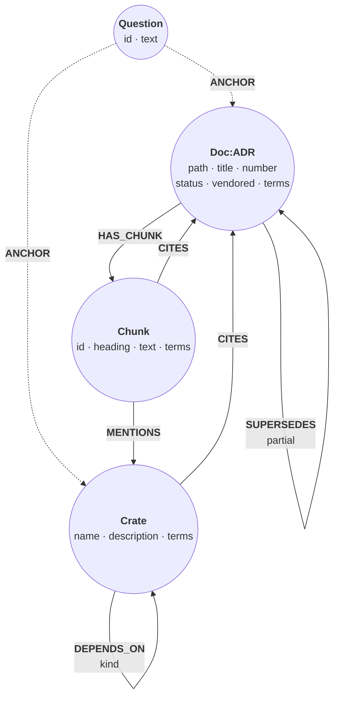
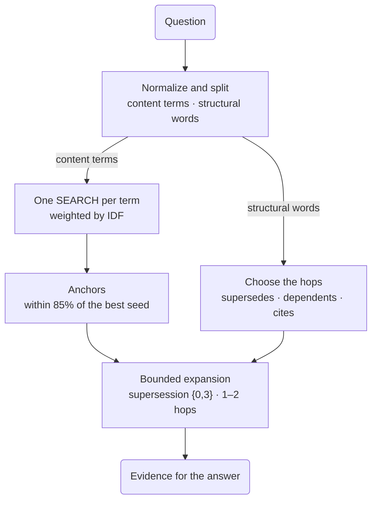

# Context graph for a codebase

*An agent working on a codebase asks what replaced a design decision, or
which crates build on the parser. The paragraph that matches the question
rarely holds the answer: the links between documents do. Build a context
graph over a snapshot of Relate's own crates and architecture decision
records (ADRs), let IDF-weighted full-text search pick where to start, and
let short, bounded graph hops bring in the rest.*

The dataset is a frozen snapshot of commit `14ab418`, so its crate list and
document sections are the tree at that commit — including the language-harness
crates (`relate-tck`, `relate-cip-eval`) that have since moved to the spec
harness (ADR-0520).

The graph has three kinds of source node and one kind of text node. The
`Question` nodes (dashed) come later, when each question records where its
search started.



Every ADR, and the README, is a `Doc` split into one `Chunk` per section
(a long section becomes several). A chunk `MENTIONS` a crate whose name
appears in its text and `CITES` every `ADR-0072`-style reference. `SUPERSEDES` comes from an ADR's status line
("Superseded in part by ADR-0014"), and `DEPENDS_ON` from each crate's
`Cargo.toml`. An ADR that is cited but not in the snapshot becomes a stub,
`{vendored: false}`, so the graph can still say the storage crate cites
ADR-0077 without having its text.

`terms` is the searchable text. The program that builds the graph
normalizes titles and section text before indexing: lowercase, stopwords
out, crude suffix stemming ("checkpoints" becomes `checkpoint`, "storage"
becomes `storag`). The same function normalizes each question, so both
sides of the search agree. The data blocks hold that output: the distinct
terms of each section and a 160-character excerpt of its text, not the
whole section.

## Load the snapshot

Constraints keep crate names, document paths, and chunk ids unique. ADR
numbers get a plain index instead: two ADRs in this snapshot share the
number 0079. One full-text index covers the `terms` of every chunk, crate,
and document.

```cypher cell=schema setup
CREATE CONSTRAINT crate_name IF NOT EXISTS FOR (c:Crate) REQUIRE c.name IS UNIQUE;
CREATE CONSTRAINT doc_path IF NOT EXISTS FOR (d:Doc) REQUIRE d.path IS UNIQUE;
CREATE CONSTRAINT chunk_id IF NOT EXISTS FOR (c:Chunk) REQUIRE c.id IS UNIQUE;
CREATE INDEX adr_number IF NOT EXISTS FOR (a:ADR) ON (a.number);
CREATE FULLTEXT INDEX terms IF NOT EXISTS FOR (n:Chunk|Crate|Doc) ON EACH [n.terms]
```

```table
(no rows) · indexes added: 2, constraints added: 3
```

Documents first, so the crates and chunks loaded next can link to them. An
ADR gets a second label, and the three status lines that name a successor
become `SUPERSEDES` relationships.

```cypher cell=docs setup params=docs
UNWIND $docs AS r
CREATE (d:Doc {path: r.path, title: r.title, terms: r.terms})
SET d.number = r.number, d.status = r.status, d.date = r.date
WITH d, r WHERE r.adr
SET d:ADR, d.vendored = true;

UNWIND $supersedes AS r
MATCH (newer:ADR {number: r.new}), (older:ADR {number: r.old})
MERGE (newer)-[:SUPERSEDES {partial: r.partial}]->(older)
```

```table
(no rows) · nodes created: 41, relationships created: 3, properties set: 284, labels added: 81
```

Crates and their dependencies. A crate's `Cargo.toml` comments cite ADRs
too; `MERGE … ON CREATE SET` finds the vendored ADR or creates its stub.

```cypher cell=crates setup params=crates
UNWIND $crates AS r
CREATE (:Crate {name: r.name, description: r.description, terms: r.terms});

UNWIND $deps AS r
MATCH (a:Crate {name: r.src}), (b:Crate {name: r.dst})
MERGE (a)-[:DEPENDS_ON {kind: r.kind}]->(b);

UNWIND $crate_cites AS r
MATCH (k:Crate {name: r.src})
MERGE (a:ADR {number: r.adr})
  ON CREATE SET a.title = 'ADR-' + r.adr + ' (not vendored)', a.vendored = false
MERGE (k)-[:CITES]->(a)
```

```table
(no rows) · nodes created: 27, relationships created: 75, properties set: 153, labels added: 27
```

Then the 277 sections. Each row carries the crate names and ADR numbers its
text mentions; two `CALL` subqueries turn them into relationships, creating
stubs as needed.

```cypher cell=chunks setup params=chunks
UNWIND $chunks AS r
MATCH (d:Doc {path: r.doc})
CREATE (d)-[:HAS_CHUNK]->(c:Chunk {id: r.id, ord: r.ord, heading: r.heading,
                                   text: r.text, terms: r.terms})
WITH c, r
CALL (c, r) {
  UNWIND r.crates AS name
  MATCH (k:Crate {name: name})
  MERGE (c)-[:MENTIONS]->(k)
}
CALL (c, r) {
  UNWIND r.cites AS n
  MERGE (a:ADR {number: n})
    ON CREATE SET a.title = 'ADR-' + n + ' (not vendored)', a.vendored = false
  MERGE (c)-[:CITES]->(a)
};

RETURN COUNT { (:Crate) } AS crates, COUNT { (:Doc) } AS docs,
       COUNT { (a:ADR) WHERE NOT a.vendored } AS stubs, COUNT { (:Chunk) } AS chunks,
       COUNT { ()-[:DEPENDS_ON]->() } AS depends_on, COUNT { ()-[:CITES]->() } AS cites,
       COUNT { ()-[:MENTIONS]->() } AS mentions,
       COUNT { ()-[:SUPERSEDES]->() } AS supersedes
```

```table
| crates | docs | stubs | chunks | depends_on | cites | mentions | supersedes |
|--------|------|-------|--------|------------|-------|----------|------------|
| 24     | 41   | 33    | 277    | 72         | 302   | 78       | 3          |
1 row · nodes created: 307, relationships created: 654, properties set: 1475, labels added: 307
```

## Where to start: full-text seeds

Take the question *"What did the WAL-first checkpoint decision supersede,
and was it itself superseded later?"* Normalized, it is `wal first
checkpoint decision supersed lat`. The structural words (`decision`,
`supersed`, `lat`) name relationships, not text, so they choose which graph
hop runs later and stay out of the search. Three terms remain:

```json data=seed
{
  "terms": ["wal", "first", "checkpoint"],
  "k": 6
}
```

A plain `SEARCH` for all three scores each node by how many of the terms it
contains, and nothing more:

```cypher cell=plain params=seed
WITH reduce(q = head($terms), t IN tail($terms) | q + ' ' + t) AS query
MATCH (n) SEARCH n IN (FULLTEXT INDEX terms FOR query LIMIT 1000) SCORE AS score
RETURN query, score, count(n) AS nodes
ORDER BY score DESC
```

```table
| query                  | score               | nodes |
|------------------------|---------------------|-------|
| "wal first checkpoint" | 3.648733999150882   | 1     |
| "wal first checkpoint" | 3.2491598854337553  | 1     |
| "wal first checkpoint" | 2.372346693310049   | 1     |
| "wal first checkpoint" | 2.0630512608312674  | 1     |
| "wal first checkpoint" | 2.0528475297271784  | 1     |
| "wal first checkpoint" | 1.9035220312715082  | 1     |
| "wal first checkpoint" | 1.8587968163322335  | 1     |
| "wal first checkpoint" | 1.8251029060495856  | 1     |
| "wal first checkpoint" | 1.8111763997873622  | 1     |
| "wal first checkpoint" | 1.7974608173693944  | 1     |
| "wal first checkpoint" | 1.719478413297641   | 1     |
| "wal first checkpoint" | 1.6775667287114069  | 1     |
| "wal first checkpoint" | 1.6709258164058478  | 1     |
| "wal first checkpoint" | 1.5632553243215215  | 1     |
| "wal first checkpoint" | 1.4953264358210807  | 1     |
| "wal first checkpoint" | 1.4870542507537     | 1     |
| "wal first checkpoint" | 1.4792567216570527  | 1     |
| "wal first checkpoint" | 1.4635287255969325  | 1     |
| "wal first checkpoint" | 1.4613637642177164  | 1     |
| "wal first checkpoint" | 1.4330551963545557  | 1     |
| "wal first checkpoint" | 1.4294225012891635  | 1     |
| "wal first checkpoint" | 1.41828941715531    | 1     |
| "wal first checkpoint" | 1.3621486991177174  | 1     |
| "wal first checkpoint" | 1.341631334145978   | 1     |
| "wal first checkpoint" | 1.3357126742426604  | 1     |
| "wal first checkpoint" | 1.3285460020886852  | 1     |
| "wal first checkpoint" | 1.3228757583912223  | 1     |
| "wal first checkpoint" | 1.3102832331202823  | 1     |
| "wal first checkpoint" | 1.309445689819499   | 1     |
| "wal first checkpoint" | 1.294061807797472   | 1     |
| "wal first checkpoint" | 1.2507532947567221  | 2     |
| "wal first checkpoint" | 1.2394905699705936  | 1     |
| "wal first checkpoint" | 1.2152060485392262  | 1     |
| "wal first checkpoint" | 1.186088403008094   | 1     |
| "wal first checkpoint" | 1.1759554386761213  | 1     |
| "wal first checkpoint" | 1.1723428774800189  | 1     |
| "wal first checkpoint" | 1.1659941431823024  | 1     |
| "wal first checkpoint" | 1.146569399326833   | 1     |
| "wal first checkpoint" | 1.1007258630001555  | 1     |
| "wal first checkpoint" | 1.0950900799352254  | 1     |
| "wal first checkpoint" | 1.0816613813611047  | 1     |
| "wal first checkpoint" | 1.0493228031801771  | 1     |
| "wal first checkpoint" | 1.0066448193936004  | 1     |
| "wal first checkpoint" | 0.9807768845573893  | 2     |
| "wal first checkpoint" | 0.9695136106157259  | 2     |
| "wal first checkpoint" | 0.9689974884275303  | 2     |
| "wal first checkpoint" | 0.9582728338310293  | 1     |
| "wal first checkpoint" | 0.9550545794423614  | 2     |
| "wal first checkpoint" | 0.9314185373560294  | 1     |
| "wal first checkpoint" | 0.9273928689610653  | 1     |
| "wal first checkpoint" | 0.9234901387659588  | 2     |
| "wal first checkpoint" | 0.9227984787601793  | 1     |
| "wal first checkpoint" | 0.8887796334988486  | 1     |
| "wal first checkpoint" | 0.8820654091086866  | 1     |
| "wal first checkpoint" | 0.8766133131248579  | 1     |
| "wal first checkpoint" | 0.8654625381433682  | 1     |
| "wal first checkpoint" | 0.8647755792788522  | 2     |
| "wal first checkpoint" | 0.8532532976867138  | 1     |
| "wal first checkpoint" | 0.8390515873761417  | 1     |
| "wal first checkpoint" | 0.835975711631854   | 1     |
| "wal first checkpoint" | 0.8047149802982659  | 1     |
| "wal first checkpoint" | 0.7996496553434078  | 1     |
| "wal first checkpoint" | 0.7910561194539175  | 1     |
| "wal first checkpoint" | 0.7804611708249454  | 1     |
| "wal first checkpoint" | 0.7786702865880547  | 1     |
| "wal first checkpoint" | 0.7710639636858811  | 1     |
| "wal first checkpoint" | 0.7618903599280767  | 1     |
| "wal first checkpoint" | 0.7550835912371767  | 1     |
| "wal first checkpoint" | 0.7529324725351761  | 1     |
| "wal first checkpoint" | 0.7357112250706238  | 2     |
| "wal first checkpoint" | 0.7356341107932465  | 1     |
| "wal first checkpoint" | 0.7272796126896675  | 1     |
| "wal first checkpoint" | 0.7191127455194872  | 1     |
| "wal first checkpoint" | 0.717072144798617   | 1     |
| "wal first checkpoint" | 0.7142936512116649  | 1     |
| "wal first checkpoint" | 0.7074289057685481  | 1     |
| "wal first checkpoint" | 0.7069046915777666  | 1     |
| "wal first checkpoint" | 0.7019283279783176  | 1     |
| "wal first checkpoint" | 0.6956767804776729  | 1     |
| "wal first checkpoint" | 0.6940877931681722  | 1     |
| "wal first checkpoint" | 0.6921828737519128  | 1     |
| "wal first checkpoint" | 0.6882006022031352  | 2     |
| "wal first checkpoint" | 0.6876041701611071  | 1     |
| "wal first checkpoint" | 0.67348185727827    | 1     |
| "wal first checkpoint" | 0.668860268308342   | 1     |
| "wal first checkpoint" | 0.659836535940316   | 2     |
| "wal first checkpoint" | 0.6557647652456116  | 1     |
| "wal first checkpoint" | 0.6531071123708286  | 1     |
| "wal first checkpoint" | 0.646513564751595   | 1     |
| "wal first checkpoint" | 0.6430768382390879  | 1     |
| "wal first checkpoint" | 0.639792646989518   | 1     |
| "wal first checkpoint" | 0.6342796863291196  | 2     |
| "wal first checkpoint" | 0.6214190230309956  | 1     |
| "wal first checkpoint" | 0.618296488185769   | 1     |
| "wal first checkpoint" | 0.6115249395235476  | 1     |
| "wal first checkpoint" | 0.6095883810349898  | 1     |
| "wal first checkpoint" | 0.6077973213018656  | 2     |
| "wal first checkpoint" | 0.5981997893005712  | 1     |
| "wal first checkpoint" | 0.5926635915237547  | 2     |
| "wal first checkpoint" | 0.5872289264913167  | 3     |
| "wal first checkpoint" | 0.5839609788716982  | 1     |
| "wal first checkpoint" | 0.5818930264483803  | 1     |
| "wal first checkpoint" | 0.5715069443220542  | 1     |
| "wal first checkpoint" | 0.5703860114866127  | 1     |
| "wal first checkpoint" | 0.5616813139766554  | 1     |
| "wal first checkpoint" | 0.5574278429423687  | 1     |
| "wal first checkpoint" | 0.5568795075213997  | 1     |
| "wal first checkpoint" | 0.5566048654642559  | 1     |
| "wal first checkpoint" | 0.5518087166789745  | 1     |
| "wal first checkpoint" | 0.5424601827088567  | 1     |
| "wal first checkpoint" | 0.54103922806263    | 1     |
| "wal first checkpoint" | 0.50009784290297    | 1     |
| "wal first checkpoint" | 0.4971867265031391  | 1     |
| "wal first checkpoint" | 0.4777141652328884  | 1     |
| "wal first checkpoint" | 0.46582340494012175 | 1     |
| "wal first checkpoint" | 0.44503258636290177 | 1     |
| "wal first checkpoint" | 0.44455165173246347 | 1     |
| "wal first checkpoint" | 0.4328647638710207  | 1     |
| "wal first checkpoint" | 0.42783298735753306 | 2     |
| "wal first checkpoint" | 0.4211622688058196  | 1     |
| "wal first checkpoint" | 0.3951730139320804  | 1     |
| "wal first checkpoint" | 0.3441973249782693  | 1     |
| "wal first checkpoint" | 0.32419696290800953 | 1     |
| "wal first checkpoint" | 0.26473320163335357 | 1     |
| "wal first checkpoint" | 0.2555427506455198  | 1     |
125 rows
```

Nine nodes tie for first place, and the ADR whose title is the question
does not stand out from the sections that happen to use the same three
words. Two refinements fix that. A rare term should count for more than a
common one, so each term is weighted by its inverse document frequency,
`log(N / df)`, where `df` is the number of nodes the term hits. And a hit
on a title or a crate name counts 1.5 times a hit in body text.

One `SEARCH` per term gives each term's hits, so its `df` is the size of
that list. The search `LIMIT` must cover every hit, because `SEARCH` cuts
before anything else runs:

```cypher cell=seeds params=seed
MATCH (x) WHERE x:Chunk OR x:Crate OR x:Doc
WITH count(x) AS total
UNWIND $terms AS t
MATCH (n) SEARCH n IN (FULLTEXT INDEX terms FOR t LIMIT 1000) SCORE AS s
WITH total, t, collect(n) AS hits
WITH t, log(toFloat(total) / size(hits)) AS idf, hits
UNWIND hits AS n
WITH n, sum(idf) * CASE WHEN n:Chunk THEN 1.0 ELSE 1.5 END AS score,
     collect(t) AS matched
OPTIONAL MATCH (doc:Doc)-[:HAS_CHUNK]->(n)
RETURN round(score, 2) AS score,
       CASE WHEN n:Crate THEN 'Crate' WHEN n:Chunk THEN 'Chunk' ELSE 'Doc' END AS kind,
       coalesce(n.name, doc.title + ' § ' + n.heading, n.title) AS label,
       matched
ORDER BY score DESC, coalesce(n.name, n.id, n.path)
LIMIT $k
```

```table
| score | kind    | label                                                                                                     | matched                        |
|-------|---------|-----------------------------------------------------------------------------------------------------------|--------------------------------|
| 7.75  | "Doc"   | "0012. WAL-first durability with Parquet checkpoints"                                                     | ["wal", "first", "checkpoint"] |
| 5.16  | "Chunk" | "0005. Labeled property graph stored as columnar node and relationship Parquet tables § Later references" | ["wal", "first", "checkpoint"] |
| 5.16  | "Chunk" | "0012. WAL-first durability with Parquet checkpoints § Preamble"                                          | ["wal", "first", "checkpoint"] |
| 5.16  | "Chunk" | "0012. WAL-first durability with Parquet checkpoints § Decision"                                          | ["wal", "first", "checkpoint"] |
| 5.16  | "Chunk" | "0018. Snapshot reads do not exclude apply_redo § Decision"                                               | ["wal", "first", "checkpoint"] |
| 5.16  | "Chunk" | "0020. Checkpoint at a frozen LSN; writers append a new WAL segment § Decision"                           | ["wal", "first", "checkpoint"] |
6 rows
```

Across the 344 indexed nodes, `wal` hits 85, `checkpoint` 69, and `first`
39, so `first` weighs the most (2.18, against 1.61 and 1.40). ADR-0012's
title now leads at 7.77. The sections below it all contain the three terms;
which five of them make the cut is decided by their ids, so treat the tail
as a list, not a ranking.

> **Note**
> In Relate the procedure
> `db.index.fulltext.queryNodes('terms', 'wal first checkpoint')` currently
> returns no rows: it looks the whole string up as one token, and every hit
> scores 1.0. The `SEARCH` clause splits the query into terms, which is why
> every step here uses it.

## Anchor each question

Each question takes the same path: its content words find seeds, the best
seeds become anchors, and its structural words choose which bounded hops run
from those anchors.



A seed is only a starting point. A seed within 85% of the best score
becomes an *anchor*: a document or crate that a bounded hop starts from. A
section anchors the document it belongs to, and the README, which touches
everything, never anchors. Four questions, normalized the same way:

```json data=questions
{
  "questions": [
    {"id": "wal-first", "text": "What did the WAL-first checkpoint decision supersede, and was it itself superseded later?", "terms": ["wal", "first", "checkpoint"]},
    {"id": "storage", "text": "Which crates depend on the storage crate, and which ADRs does the storage crate cite?", "terms": ["storag"]},
    {"id": "parser", "text": "Which crates build on the parser, and which ADRs describe the parser design?", "terms": ["pars"]},
    {"id": "wasm", "text": "Which decisions about the WASM surface were later withdrawn, and what did the withdrawal cite?", "terms": ["wasm", "surfac", "withdraw"]}
  ],
  "k": 6,
  "ratio": 0.85
}
```

The seed ranking from the step above runs once per question in a `CALL`
subquery, and each question is written down with an `ANCHOR` relationship to
each anchor. Logging where a retrieval started lets the answer cite it and
lets a reviewer replay it; it also keeps the hops below short. The first
statement clears earlier questions, so the step can be run again.

```cypher cell=anchors params=questions
MATCH (old:Question) DETACH DELETE old;

MATCH (x) WHERE x:Chunk OR x:Crate OR x:Doc
WITH count(x) AS total
UNWIND $questions AS q
CALL (q, total) {
  UNWIND q.terms AS t
  MATCH (n) SEARCH n IN (FULLTEXT INDEX terms FOR t LIMIT 1000) SCORE AS s
  WITH t, collect(n) AS hits
  WITH log(toFloat(total) / size(hits)) AS idf, hits
  UNWIND hits AS n
  WITH n, sum(idf) * CASE WHEN n:Chunk THEN 1.0 ELSE 1.5 END AS score
  RETURN n, score
  ORDER BY score DESC, coalesce(n.name, n.id, n.path)
  LIMIT $k
}
WITH q, collect({n: n, score: score}) AS seeds, max(score) AS best
UNWIND seeds AS s
WITH q, s.n AS n WHERE s.score >= $ratio * best
OPTIONAL MATCH (doc:Doc)-[:HAS_CHUNK]->(n)
WITH q, CASE WHEN n:Chunk THEN doc ELSE n END AS anchor
WHERE anchor.path IS NULL OR anchor.path <> 'README.md'
WITH q, collect(DISTINCT anchor) AS anchors
CREATE (question:Question {id: q.id, text: q.text})
FOREACH (a IN anchors | CREATE (question)-[:ANCHOR]->(a))
RETURN q.id AS question, [a IN anchors | coalesce(a.name, a.title)] AS anchors
```

```table
| question    | anchors                                                                                                                                                          |
|-------------|------------------------------------------------------------------------------------------------------------------------------------------------------------------|
| "wal-first" | ["0012. WAL-first durability with Parquet checkpoints"]                                                                                                          |
| "storage"   | ["relate-storage"]                                                                                                                                               |
| "parser"    | ["0007. Cypher is parsed with a hand-written recursive-descent parser", "0046. Relate parser in front of the MemoryDB runtime", "relate-front", "relate-parser"] |
| "wasm"      | ["0065. Withdraw the WASM and Swift surfaces"]                                                                                                                   |
4 rows · nodes created: 4, relationships created: 7, properties set: 8, labels added: 4
```

Each question gets one ADR or one crate, except the parser question: two
ADRs and two crates tie for its single term.

## Was the WAL-first decision superseded?

The anchor is ADR-0012. Its supersession history is a chain, and the
question asks about both ends of it: what 0012 replaced, and what replaced
0012. Two quantified path patterns grow the chain from the anchor in both
directions, at most three hops each, and the `EXISTS` checks keep only the
whole chain, not its pieces. Open the graph view:

```cypher cell=chain
MATCH (:Question {id: 'wal-first'})-[:ANCHOR]->(d:ADR)
MATCH p = (newer:ADR)-[:SUPERSEDES]->{0,3}(d)-[:SUPERSEDES]->{0,3}(older:ADR)
WHERE length(p) > 0
  AND NOT EXISTS { (:ADR)-[:SUPERSEDES]->(newer) }
  AND NOT EXISTS { (older)-[:SUPERSEDES]->(:ADR) }
RETURN p
```

```gram
// 1 row
(n8:Doc:ADR {date: "2026-08-28", number: "0014", path: "adr/0014-single-wal-write-path.md", status: "Accepted", terms: "singl writ path wal snapshot graph materializ", title: "0014. Single write path: WAL then snapshot; graph is a materialization", vendored: true})-[r2:SUPERSEDES {partial: true}]->(n6:Doc:ADR {date: "2026-08-28", number: "0012", path: "adr/0012-wal-and-parquet-checkpoints.md", status: "Superseded in part by ADR-0014", terms: "wal first durability parquet checkpoint", title: "0012. WAL-first durability with Parquet checkpoints", vendored: true})-[r0:SUPERSEDES {partial: true}]->(n1:Doc:ADR {date: "2026-08-28", number: "0004", path: "adr/0004-memory-first-parquet-object-store.md", status: "Superseded in part by ADR-0012", terms: "memory first graph parquet snapshot object stor", title: "0004. Memory-first graph with Parquet snapshots via object_store", vendored: true})
```

ADR-0012 replaced part of ADR-0004 (snapshot-only durability), and ADR-0014
later replaced part of 0012. The text search alone found 0012 and some
sections about checkpoints; neither 0004 nor 0014 was among the seeds.

## What depends on the storage crate?

The single term `storag` anchors the crate itself. Its dependents follow
`DEPENDS_ON` backwards, counting only normal (not dev or build)
dependencies, and its citations follow `CITES` forwards. `UNION` puts both
in one table:

```cypher cell=storage
MATCH (:Question {id: 'storage'})-[:ANCHOR]->(k:Crate)
CALL (k) {
  MATCH (dep:Crate)-[:DEPENDS_ON {kind: 'normal'}]->(k)
  RETURN dep.name AS from, 'DEPENDS_ON' AS rel, k.name AS to, null AS vendored
  UNION
  MATCH (k)-[:CITES]->(a:ADR)
  RETURN k.name AS from, 'CITES' AS rel, a.title AS to, a.vendored AS vendored
}
RETURN from, rel, to, vendored
ORDER BY rel DESC, from, to
```

```table
| from              | rel          | to                        | vendored |
|-------------------|--------------|---------------------------|----------|
| "relate"          | "DEPENDS_ON" | "relate-storage"          | null     |
| "relate-datasets" | "DEPENDS_ON" | "relate-storage"          | null     |
| "relate-storage"  | "CITES"      | "ADR-0077 (not vendored)" | false    |
| "relate-storage"  | "CITES"      | "ADR-0085 (not vendored)" | false    |
4 rows
```

Both ADRs the crate cites are stubs: the snapshot does not include them,
but the graph still records that the crate depends on those decisions.

## What builds on the parser?

This question has four anchors: two crates (`relate-parser`,
`relate-front`) and two ADRs (0007, the parser design, and 0046). The
same hop shape works for both kinds of anchor: crates bring their
dependents, and ADRs bring what their sections cite.

```cypher cell=parser
MATCH (:Question {id: 'parser'})-[:ANCHOR]->(a)
CALL (a) {
  MATCH (dep:Crate)-[:DEPENDS_ON {kind: 'normal'}]->(a)
  RETURN dep.name AS from, 'DEPENDS_ON' AS rel, a.name AS to
  UNION
  MATCH (a)-[:HAS_CHUNK]->(:Chunk)-[:CITES]->(c:ADR)
  WHERE c <> a
  RETURN a.title AS from, 'CITES' AS rel, c.title AS to
}
RETURN from, rel, to
ORDER BY rel DESC, from, to
```

```table
| from                                                                  | rel          | to                                                           |
|-----------------------------------------------------------------------|--------------|--------------------------------------------------------------|
| "relate"                                                              | "DEPENDS_ON" | "relate-front"                                               |
| "relate"                                                              | "DEPENDS_ON" | "relate-parser"                                              |
| "relate-error"                                                        | "DEPENDS_ON" | "relate-parser"                                              |
| "relate-executor"                                                     | "DEPENDS_ON" | "relate-front"                                               |
| "relate-executor"                                                     | "DEPENDS_ON" | "relate-parser"                                              |
| "relate-front"                                                        | "DEPENDS_ON" | "relate-parser"                                              |
| "relate-ir"                                                           | "DEPENDS_ON" | "relate-parser"                                              |
| "relate-load"                                                         | "DEPENDS_ON" | "relate-parser"                                              |
| "relate-planner"                                                      | "DEPENDS_ON" | "relate-front"                                               |
| "relate-planner"                                                      | "DEPENDS_ON" | "relate-parser"                                              |
| "0007. Cypher is parsed with a hand-written recursive-descent parser" | "CITES"      | "0056. OpenCypher TCK is the Cypher language contract"       |
| "0046. Relate parser in front of the MemoryDB runtime"                | "CITES"      | "0061. CI-host loadtest baselines (two host classes)"        |
| "0046. Relate parser in front of the MemoryDB runtime"                | "CITES"      | "0070. Docker baseline loadtest environment (2 vCPU / 2 GB)" |
| "0046. Relate parser in front of the MemoryDB runtime"                | "CITES"      | "ADR-0066 (not vendored)"                                    |
| "0046. Relate parser in front of the MemoryDB runtime"                | "CITES"      | "ADR-0071 (not vendored)"                                    |
15 rows
```

## What did the WASM withdrawal cite?

The anchor is ADR-0065, "Withdraw the WASM and Swift surfaces". Citations
run through sections, two hops each way: what 0065's sections cite, and
which ADRs cite 0065.

```cypher cell=wasm
MATCH (:Question {id: 'wasm'})-[:ANCHOR]->(d:ADR)
CALL (d) {
  MATCH (d)-[:HAS_CHUNK]->(:Chunk)-[:CITES]->(a:ADR)
  WHERE a <> d
  RETURN 'cites' AS direction, a AS other
  UNION
  MATCH (d)<-[:CITES]-(:Chunk)<-[:HAS_CHUNK]-(b:ADR)
  WHERE b <> d
  RETURN 'cited by' AS direction, b AS other
}
RETURN d.number AS adr, direction, other.title AS other, other.status AS status,
       other.vendored AS vendored
ORDER BY direction DESC, other
```

```table
| adr    | direction  | other                                                                            | status     | vendored |
|--------|------------|----------------------------------------------------------------------------------|------------|----------|
| "0065" | "cites"    | "0051. WASM product path is Database `:memory:`"                                 | "Accepted" | true     |
| "0065" | "cites"    | "0057. Embedded C ABI is the client boundary; Bolt is optional remote transport" | "Accepted" | true     |
| "0065" | "cites"    | "ADR 0052: GraphStore withdrawn"                                                 | null       | true     |
| "0065" | "cites"    | "ADR-0084 (not vendored)"                                                        | null       | false    |
| "0065" | "cited by" | "0051. WASM product path is Database `:memory:`"                                 | "Accepted" | true     |
5 rows
```

ADR-0051, "WASM product path is Database `:memory:`", is the decision that
was withdrawn. Its status line still says Accepted; only the citation in
both directions shows the withdrawal. ADR-0084 is a stub here, cited but
not in the snapshot. In the live repository it reinstates the WASM build,
which is the engine running the steps on this page.

## Hand the evidence to a model

With an LLM in the loop, the companion program sends the seed sections and
the edges above to the model and asks for an answer that cites them. The
most useful text is often the sections that sit on the path the graph
found. For the WAL-first chain, those are the sections of each ADR that cite
another ADR on the chain:

```cypher cell=evidence
MATCH (:Question {id: 'wal-first'})-[:ANCHOR]->(d:ADR)
MATCH p = (newer:ADR)-[:SUPERSEDES]->{0,3}(d)-[:SUPERSEDES]->{0,3}(older:ADR)
WHERE length(p) > 0
  AND NOT EXISTS { (:ADR)-[:SUPERSEDES]->(newer) }
  AND NOT EXISTS { (older)-[:SUPERSEDES]->(:ADR) }
WITH nodes(p) AS chain
UNWIND chain AS a
MATCH (a)-[:HAS_CHUNK]->(c:Chunk)-[:CITES]->(b:ADR)
WHERE b IN chain
RETURN a.number AS adr, c.heading AS section, b.number AS cites, c.text AS excerpt
ORDER BY adr, c.ord, cites
```

```table
| adr    | section                   | cites  | excerpt                                                                                                                                                             |
|--------|---------------------------|--------|---------------------------------------------------------------------------------------------------------------------------------------------------------------------|
| "0004" | "Preamble"                | "0012" | "# 0004. Memory-first graph with Parquet snapshots via object_store - **Status**: Superseded in part by ADR-0012 - **Date**: 2026-08-28 - **Deciders**: MemoryDB …" |
| "0004" | "Later references"        | "0012" | "ADR-0012 replaces snapshot-only durability. Execution is still an in-memory LPG; `object_store` still addresses `file://` and `s3://`; out-of-core Parquet …"      |
| "0004" | "Later references"        | "0014" | "ADR-0012 replaces snapshot-only durability. Execution is still an in-memory LPG; `object_store` still addresses `file://` and `s3://`; out-of-core Parquet …"      |
| "0012" | "Preamble"                | "0014" | "# 0012. WAL-first durability with Parquet checkpoints - **Status**: Superseded in part by ADR-0014 - **Date**: 2026-08-28 - **Deciders**: MemoryDB maintainers"    |
| "0012" | "Context"                 | "0004" | "ADR-0004 made the in-memory graph the source of execution and Parquet snapshots the only durable form. A crash or process exit without an explicit …"              |
| "0012" | "Alternatives considered" | "0004" | "- **Keep snapshot-only durability (ADR-0004)** — simple, loses uncheckpointed writes. Rejected; persistent URIs need commit durability. - **WAL as S3 objects** …" |
| "0012" | "Consequences"            | "0004" | "- Open of a persistent URI is snapshot load plus WAL replay. - `s3://` without a writable local WAL directory cannot offer fsync-per-commit. - Manifest …"         |
| "0012" | "Later references"        | "0014" | "ADR-0014: `:memory:` uses the same WAL + snapshot path (in-process store). The live graph is materialized from Parquet + WAL replay; commits are WAL append …"     |
| "0014" | "Context"                 | "0012" | "ADR-0012 added a WAL for persistent URIs but left several write paths: `:memory:` skipped the WAL; Cypher mutated the live graph then optionally fsynced; …"       |
| "0014" | "Consequences"            | "0012" | "- Crash recovery and “open an existing URI” are the same function. - Loadtests with `--uri :memory:` still hit the WAL (volatile). - ADR-0012’s “`:memory:` has …" |
10 rows
```

The "Later references" section of ADR-0012 names its successor in the first
words; that sentence, and the chain it sits on, is what a cited answer
needs.

## Data

<details>
<summary><code>docs</code> (10 KB)</summary>

```json data=docs
{
  "docs": [
    {"path": "README.md", "title": "Relate", "adr": false, "number": null, "status": null, "date": null, "terms": ""},
    {"path": "adr/0004-memory-first-parquet-object-store.md", "title": "0004. Memory-first graph with Parquet snapshots via object_store", "adr": true, "number": "0004", "status": "Superseded in part by ADR-0012", "date": "2026-08-28", "terms": "memory first graph parquet snapshot object stor"},
    {"path": "adr/0005-lpg-parquet-layout.md", "title": "0005. Labeled property graph stored as columnar node and relationship Parquet tables", "adr": true, "number": "0005", "status": "Accepted", "date": "2026-08-28", "terms": "label property graph stor columnar nod relationship parquet tabl"},
    {"path": "adr/0007-recursive-descent-parser.md", "title": "0007. Cypher is parsed with a hand-written recursive-descent parser", "adr": true, "number": "0007", "status": "Accepted", "date": "2026-08-28", "terms": "cyph pars hand written recursiv descent pars"},
    {"path": "adr/0010-label-property-indexes.md", "title": "0010. Label and property indexes for MATCH", "adr": true, "number": "0010", "status": "Accepted", "date": "2026-08-28", "terms": "label property index match"},
    {"path": "adr/0011-snapshot-isolation.md", "title": "0011. Snapshot isolation via read snapshots; writers serialize", "adr": true, "number": "0011", "status": "Superseded by ADR-0013", "date": "2026-08-28", "terms": "snapshot isol read snapshot writ serializ"},
    {"path": "adr/0012-wal-and-parquet-checkpoints.md", "title": "0012. WAL-first durability with Parquet checkpoints", "adr": true, "number": "0012", "status": "Superseded in part by ADR-0014", "date": "2026-08-28", "terms": "wal first durability parquet checkpoint"},
    {"path": "adr/0013-tuple-mvcc.md", "title": "0013. Tuple-level MVCC for snapshot reads", "adr": true, "number": "0013", "status": "Accepted", "date": "2026-08-28", "terms": "tupl level mvcc snapshot read"},
    {"path": "adr/0014-single-wal-write-path.md", "title": "0014. Single write path: WAL then snapshot; graph is a materialization", "adr": true, "number": "0014", "status": "Accepted", "date": "2026-08-28", "terms": "singl writ path wal snapshot graph materializ"},
    {"path": "adr/0015-optimistic-wal-commits.md", "title": "0015. Optimistic writes; commit_ts assigned at WAL append", "adr": true, "number": "0015", "status": "Accepted", "date": "2026-08-28", "terms": "optimistic writ commit ts assign wal append"},
    {"path": "adr/0018-concurrent-snapshot-reads.md", "title": "0018. Snapshot reads do not exclude apply_redo", "adr": true, "number": "0018", "status": "Accepted", "date": "2026-08-28", "terms": "snapshot read exclud app redo"},
    {"path": "adr/0019-group-commit-shared-fsync.md", "title": "0019. Waiting independent WAL records share one fsync", "adr": true, "number": "0019", "status": "Accepted", "date": "2026-08-28", "terms": "wait independent wal record shar fsync"},
    {"path": "adr/0020-segmented-wal-concurrent-checkpoint.md", "title": "0020. Checkpoint at a frozen LSN; writers append a new WAL segment", "adr": true, "number": "0020", "status": "Accepted", "date": "2026-08-28", "terms": "checkpoint frozen lsn writ append wal segment"},
    {"path": "adr/0022-id-window-checkpoint-shards.md", "title": "0022. Checkpoint shards are byte-budgeted id windows (copy-on-write)", "adr": true, "number": "0022", "status": "Accepted", "date": "2026-08-30", "terms": "checkpoint shard byt budget id window copy writ"},
    {"path": "adr/0023-incremental-version-gc.md", "title": "0023. Incremental version GC does not take the exclusive graph lock", "adr": true, "number": "0023", "status": "Accepted", "date": "2026-08-30", "terms": "incremental version gc tak exclusiv graph lock"},
    {"path": "adr/0024-match-rewrite-planner.md", "title": "0024. MATCH rewrites choose the seek, not Cypher text order", "adr": true, "number": "0024", "status": "Accepted", "date": "2026-08-30", "terms": "match rewrit choos seek cyph text ord"},
    {"path": "adr/0030-string-prefix-trigram-indexes.md", "title": "0030. Equality, prefix, and trigram indexes on string properties", "adr": true, "number": "0030", "status": "Accepted", "date": "2026-09-01", "terms": "equality prefix trigram index str property"},
    {"path": "adr/0033-compact-live-records-typed-csr.md", "title": "0033. Compact live records and typed CSR in RAM", "adr": true, "number": "0033", "status": "Accepted", "date": "2026-09-01", "terms": "compact liv record typ csr ram"},
    {"path": "adr/0034-bidirectional-shortestpath.md", "title": "0034. Bound `shortestPath` is bidirectional BFS", "adr": true, "number": "0034", "status": "Accepted", "date": "2026-09-01", "terms": "bound shortestpath bidirectional bfs"},
    {"path": "adr/0042-graph-memory-limit.md", "title": "0042. Logical cap on the live graph and data-dependent indexes", "adr": true, "number": "0042", "status": "Accepted", "date": "2026-09-04", "terms": "logical cap liv graph data dependent index"},
    {"path": "adr/0044-withdraw-engine-s3.md", "title": "0044. Withdraw engine-level S3", "adr": true, "number": "0044", "status": "Accepted", "date": "2026-09-07", "terms": "withdraw engin level s3"},
    {"path": "adr/0046-cypherlite-parser-memorydb-runtime.md", "title": "0046. Relate parser in front of the MemoryDB runtime", "adr": true, "number": "0046", "status": "Accepted", "date": "2026-09-16", "terms": "pars front memorydb runtim"},
    {"path": "adr/0048-identity-loadtest-memory-budget.md", "title": "0048. Separate identity loadtest memory budget", "adr": true, "number": "0048", "status": "Accepted", "date": "2026-09-16", "terms": "separat identity loadtest memory budget"},
    {"path": "adr/0050-snapshot-codecs.md", "title": "0050. Pluggable snapshot codecs (Parquet default, Relate JSON)", "adr": true, "number": "0050", "status": "Accepted", "date": "2026-09-17", "terms": "pluggabl snapshot codec parquet default json"},
    {"path": "adr/0051-wasm-memory-database.md", "title": "0051. WASM product path is Database `:memory:`", "adr": true, "number": "0051", "status": "Accepted", "date": "2026-09-17", "terms": "wasm product path databas memory"},
    {"path": "adr/0052-graphstore-withdrawn.md", "title": "ADR 0052: GraphStore withdrawn", "adr": true, "number": "0052", "status": null, "date": null, "terms": "graphstor withdraw"},
    {"path": "adr/0056-opencypher-tck-language-contract.md", "title": "0056. OpenCypher TCK is the Cypher language contract", "adr": true, "number": "0056", "status": "Accepted", "date": "2026-08-28", "terms": "opencyph tck cyph languag contract"},
    {"path": "adr/0057-embedded-c-abi-and-bolt.md", "title": "0057. Embedded C ABI is the client boundary; Bolt is optional remote transport", "adr": true, "number": "0057", "status": "Accepted", "date": "2026-08-28", "terms": "embedd abi client boundary bolt optional remot transport"},
    {"path": "adr/0060-identity-loadtest-baseline-refreeze.md", "title": "0060. Re-freeze the identity loadtest baseline for gate-host daytime conditions", "adr": true, "number": "0060", "status": "Accepted", "date": "2026-09-18", "terms": "re freez identity loadtest baselin gat host daytim condition"},
    {"path": "adr/0061-ci-host-loadtest-baselines.md", "title": "0061. CI-host loadtest baselines (two host classes)", "adr": true, "number": "0061", "status": "Accepted", "date": "2026-09-18", "terms": "ci host loadtest baselin host class"},
    {"path": "adr/0062-ci-loadtest-band-calibration.md", "title": "0062. CI loadtest band calibration to runner variance", "adr": true, "number": "0062", "status": "Accepted", "date": "2026-09-18", "terms": "ci loadtest band calibr runn varianc"},
    {"path": "adr/0065-withdraw-wasm-swift-surfaces.md", "title": "0065. Withdraw the WASM and Swift surfaces", "adr": true, "number": "0065", "status": "Accepted", "date": "2026-09-19", "terms": "withdraw wasm swift surfac"},
    {"path": "adr/0067-release-versioning-and-process.md", "title": "0067. Release and versioning policy: manual dispatch, tag-after-build, lockstep Rust/Python versions", "adr": true, "number": "0067", "status": "Accepted", "date": "2026-09-19", "terms": "releas version policy manual dispatch tag build lockstep rust python version"},
    {"path": "adr/0068-cli-install-script-via-github-pages.md", "title": "0068. CLI install script distributed as a GitHub Pages static asset", "adr": true, "number": "0068", "status": "Accepted", "date": "2026-09-19", "terms": "cli install script distribut github pag static asset"},
    {"path": "adr/0069-cli-lifecycle-commands.md", "title": "0069. CLI lifecycle commands as positionals, plus self-upgrade design", "adr": true, "number": "0069", "status": "Accepted", "date": "2026-09-20", "terms": "cli lifecycl command positional plu self upgrad design"},
    {"path": "adr/0070-docker-baseline-loadtest-environment.md", "title": "0070. Docker baseline loadtest environment (2 vCPU / 2 GB)", "adr": true, "number": "0070", "status": "Accepted", "date": "2026-09-20", "terms": "dock baselin loadtest environment vcpu gb"},
    {"path": "adr/0072-virtual-filesystem.md", "title": "0072. Synchronous virtual filesystem for WAL, snapshots, and CDC", "adr": true, "number": "0072", "status": "Accepted", "date": "2026-09-20", "terms": "synchronou virtual filesystem wal snapshot cdc"},
    {"path": "adr/0074-single-file-bundle-vfs.md", "title": "0074. Single-file bundle VFS selected by `.rl` path", "adr": true, "number": "0074", "status": "Accepted", "date": "2026-09-21", "terms": "singl fil bundl vfs select cl path"},
    {"path": "adr/0079-anonymous-usage-metrics.md", "title": "0079. Anonymous usage metrics in the CLI", "adr": true, "number": "0079", "status": "Proposed", "date": "2026-09-21", "terms": "anonymou usag metric cli"},
    {"path": "adr/0079-query-input-limits.md", "title": "0079. Query input limits: max query-text size and max nesting depth", "adr": true, "number": "0079", "status": "Proposed", "date": "2026-09-22", "terms": "query input limit max query text siz max nest depth"},
    {"path": "adr/0087-fallible-persistence-decoding.md", "title": "0087. Fallible persistence values and an escaped map form", "adr": true, "number": "0087", "status": "Proposed", "date": "2026-09-23", "terms": "fallibl persistenc valu escap map form"}
  ],
  "supersedes": [
    {"new": "0012", "old": "0004", "partial": true},
    {"new": "0013", "old": "0011", "partial": false},
    {"new": "0014", "old": "0012", "partial": true}
  ]
}
```

</details>

<details>
<summary><code>crates</code> (9 KB)</summary>

```json data=crates
{
  "crates": [
    {"name": "relate", "description": "Embedded in-memory OpenCypher graph database", "terms": "embedd memory opencyph graph databas"},
    {"name": "relate-arrow", "description": "", "terms": "arrow"},
    {"name": "relate-bolt", "description": "Bolt protocol server for Relate", "terms": "bolt bolt protocol serv"},
    {"name": "relate-catalog", "description": "Label, relationship-type, and named-index catalog", "terms": "catalog label relationship typ nam index catalog"},
    {"name": "relate-cip-eval", "description": "", "terms": "cip eval"},
    {"name": "relate-cli", "description": "", "terms": "cli"},
    {"name": "relate-core", "description": "Core values, errors, and IDs for Relate", "terms": "cor cor valu error ids"},
    {"name": "relate-datasets", "description": "Fraud and identity dataset generators for Relate", "terms": "dataset fraud identity dataset generator"},
    {"name": "relate-error", "description": "", "terms": "error"},
    {"name": "relate-executor", "description": "In-memory graph and Cypher physical executor", "terms": "executor memory graph cyph physical executor"},
    {"name": "relate-ffi", "description": "", "terms": "ffi"},
    {"name": "relate-formatter", "description": "", "terms": "formatt"},
    {"name": "relate-front", "description": "Relate parser front-end lowered to planner IR", "terms": "front pars front end lower plann ir"},
    {"name": "relate-ir", "description": "Planner IR (lowered Cypher AST)", "terms": "ir plann ir lower cyph ast"},
    {"name": "relate-load", "description": "Load a Neo4j/Aura subgraph into relate::Database (ADR-0080)", "terms": "load load neo4j aura subgraph databas"},
    {"name": "relate-model", "description": "", "terms": "model"},
    {"name": "relate-parser", "description": "", "terms": "pars"},
    {"name": "relate-planner", "description": "Bind OpenCypher AST to a logical plan", "terms": "plann bind opencyph ast logical plan"},
    {"name": "relate-python", "description": "", "terms": "python"},
    {"name": "relate-splitter", "description": "", "terms": "splitt"},
    {"name": "relate-storage", "description": "WAL plus pluggable snapshot codecs (Parquet default, Relate JSON)", "terms": "storag wal plu pluggabl snapshot codec parquet default json"},
    {"name": "relate-tck", "description": "", "terms": "tck"},
    {"name": "relate-test-support", "description": "Shared test-only helpers for the Relate workspace (big-stack runner)", "terms": "test support shar test help workspac big stack runn"},
    {"name": "relate-wasm", "description": "", "terms": "wasm"}
  ],
  "deps": [
    {"src": "relate", "dst": "relate-parser", "kind": "normal"},
    {"src": "relate", "dst": "relate-model", "kind": "normal"},
    {"src": "relate", "dst": "relate-core", "kind": "normal"},
    {"src": "relate", "dst": "relate-ir", "kind": "normal"},
    {"src": "relate", "dst": "relate-front", "kind": "normal"},
    {"src": "relate", "dst": "relate-planner", "kind": "normal"},
    {"src": "relate", "dst": "relate-executor", "kind": "normal"},
    {"src": "relate", "dst": "relate-storage", "kind": "normal"},
    {"src": "relate", "dst": "relate-catalog", "kind": "normal"},
    {"src": "relate", "dst": "relate-test-support", "kind": "dev"},
    {"src": "relate-arrow", "dst": "relate-model", "kind": "normal"},
    {"src": "relate-arrow", "dst": "relate-model", "kind": "dev"},
    {"src": "relate-bolt", "dst": "relate", "kind": "normal"},
    {"src": "relate-bolt", "dst": "relate-core", "kind": "normal"},
    {"src": "relate-catalog", "dst": "relate-core", "kind": "normal"},
    {"src": "relate-cip-eval", "dst": "relate-tck", "kind": "normal"},
    {"src": "relate-cli", "dst": "relate-formatter", "kind": "normal"},
    {"src": "relate-cli", "dst": "relate-splitter", "kind": "normal"},
    {"src": "relate-cli", "dst": "relate-model", "kind": "normal"},
    {"src": "relate-cli", "dst": "relate", "kind": "normal"},
    {"src": "relate-cli", "dst": "relate-load", "kind": "normal"},
    {"src": "relate-core", "dst": "relate-model", "kind": "normal"},
    {"src": "relate-datasets", "dst": "relate", "kind": "normal"},
    {"src": "relate-datasets", "dst": "relate-core", "kind": "normal"},
    {"src": "relate-datasets", "dst": "relate-storage", "kind": "normal"},
    {"src": "relate-error", "dst": "relate-parser", "kind": "normal"},
    {"src": "relate-executor", "dst": "relate-error", "kind": "normal"},
    {"src": "relate-executor", "dst": "relate-model", "kind": "normal"},
    {"src": "relate-executor", "dst": "relate-parser", "kind": "normal"},
    {"src": "relate-executor", "dst": "relate-core", "kind": "normal"},
    {"src": "relate-executor", "dst": "relate-front", "kind": "normal"},
    {"src": "relate-executor", "dst": "relate-ir", "kind": "normal"},
    {"src": "relate-executor", "dst": "relate-planner", "kind": "normal"},
    {"src": "relate-executor", "dst": "relate-catalog", "kind": "normal"},
    {"src": "relate-ffi", "dst": "relate", "kind": "normal"},
    {"src": "relate-ffi", "dst": "relate-model", "kind": "normal"},
    {"src": "relate-ffi", "dst": "relate-core", "kind": "normal"},
    {"src": "relate-formatter", "dst": "relate-model", "kind": "normal"},
    {"src": "relate-formatter", "dst": "relate-parser", "kind": "dev"},
    {"src": "relate-front", "dst": "relate-error", "kind": "normal"},
    {"src": "relate-front", "dst": "relate-model", "kind": "normal"},
    {"src": "relate-front", "dst": "relate-parser", "kind": "normal"},
    {"src": "relate-front", "dst": "relate-core", "kind": "normal"},
    {"src": "relate-front", "dst": "relate-ir", "kind": "normal"},
    {"src": "relate-front", "dst": "relate-test-support", "kind": "dev"},
    {"src": "relate-ir", "dst": "relate-parser", "kind": "normal"},
    {"src": "relate-ir", "dst": "relate-core", "kind": "normal"},
    {"src": "relate-load", "dst": "relate", "kind": "normal"},
    {"src": "relate-load", "dst": "relate-formatter", "kind": "normal"},
    {"src": "relate-load", "dst": "relate-parser", "kind": "normal"},
    {"src": "relate-parser", "dst": "relate-model", "kind": "normal"},
    {"src": "relate-parser", "dst": "relate-test-support", "kind": "dev"},
    {"src": "relate-planner", "dst": "relate-parser", "kind": "normal"},
    {"src": "relate-planner", "dst": "relate-core", "kind": "normal"},
    {"src": "relate-planner", "dst": "relate-ir", "kind": "normal"},
    {"src": "relate-planner", "dst": "relate-front", "kind": "normal"},
    {"src": "relate-planner", "dst": "relate-catalog", "kind": "normal"},
    {"src": "relate-python", "dst": "relate", "kind": "normal"},
    {"src": "relate-python", "dst": "relate-model", "kind": "normal"},
    {"src": "relate-python", "dst": "relate-arrow", "kind": "normal"},
    {"src": "relate-storage", "dst": "relate-catalog", "kind": "normal"},
    {"src": "relate-storage", "dst": "relate-core", "kind": "normal"},
    {"src": "relate-storage", "dst": "relate-executor", "kind": "normal"},
    {"src": "relate-storage", "dst": "relate-model", "kind": "normal"},
    {"src": "relate-tck", "dst": "relate-error", "kind": "normal"},
    {"src": "relate-tck", "dst": "relate-model", "kind": "normal"},
    {"src": "relate-tck", "dst": "relate", "kind": "normal"},
    {"src": "relate-tck", "dst": "relate-core", "kind": "normal"},
    {"src": "relate-tck", "dst": "relate-splitter", "kind": "normal"},
    {"src": "relate-tck", "dst": "relate-test-support", "kind": "normal"},
    {"src": "relate-wasm", "dst": "relate", "kind": "normal"},
    {"src": "relate-wasm", "dst": "relate-model", "kind": "normal"}
  ],
  "crate_cites": [
    {"src": "relate-load", "adr": "0080"},
    {"src": "relate-storage", "adr": "0077"},
    {"src": "relate-storage", "adr": "0085"}
  ]
}
```

</details>

<details>
<summary><code>chunks</code> (184 KB)</summary>

```json data=chunks
{
  "chunks": [
    {"id": "README.md#0", "doc": "README.md", "ord": 0, "heading": "Preamble", "text": "# Relate **Graph data, zero infrastructure.** Relate is a lightweight, embeddable graph database with a command-line interface inspired by SQLite. It …", "terms": "preambl graph data zero infrastructur lightweight embeddabl databas command lin interfac inspir sqlit cyph http opencyph org query languag wid adopt provid configur serverles experienc work written rust public crat wal parquet json snapshot pass tck scenario fail document skip implement larg slic neo4j post standard gql alignment lab github io tutorial guid cli api referenc static sit gh pag com tre branch deep liv doc align cent img src png alt cypherlt width", "crates": ["relate"], "cites": []},
    {"id": "README.md#1", "doc": "README.md", "ord": 1, "heading": "Install script (macOS/Linux)", "text": "The install script downloads the release binary for your platform (macOS and Linux, amd64 and arm64), verifies it against `SHA256SUMS`, and installs it to …", "terms": "install script maco linux download releas binary platform amd64 arm64 verify against sha256sum hom local bin bash curl ssfl http neo4j lab github io sh token gh auth requir repository internal authenticat asset get acces public lin work without environment variabl must set right hand sid pip prefix alon nev reach prebuilt window publish pag com latest", "crates": ["relate"], "cites": []},
    {"id": "README.md#2", "doc": "README.md", "ord": 2, "heading": "Build from source", "text": "Requires the [Rust toolchain](https://rustup.rs/): ```bash cargo build --release ./target/release/relate --version ```", "terms": "build sourc requir rust toolchain http rustup rs bash cargo releas target version", "crates": ["relate"], "cites": []},
    {"id": "README.md#3", "doc": "README.md", "ord": 3, "heading": "Upgrading", "text": "An installed binary self-updates from GitHub releases: ```bash relate upgrade # download, verify, and replace (alias: update) relate upgrade --check # …", "terms": "upgrad install binary self updat github releas bash download verify replac alia check report current vs latest chang noth maco linux window exe tabl lik script token repository internal", "crates": ["relate"], "cites": []},
    {"id": "README.md#4", "doc": "README.md", "ord": 4, "heading": "Quick Start", "text": "```bash # Start interactive shell with in-memory database relate # Open or create a database directory (WAL + parquet snapshot, default) relate …", "terms": "quick start bash interactiv shell memory databas open creat directory wal parquet snapshot default mydata singl fil cl bundl host checkpoint graphdata graph json format shot query return sum print flag help", "crates": ["relate"], "cites": []},
    {"id": "README.md#5", "doc": "README.md", "ord": 5, "heading": "Example Session", "text": "``` $ relate ./friends Relate v0.7.0 Type .help for help, .exit to quit. cypher> CREATE (alice:Person {name: 'Alice', age: 30}); Nodes created: 1, …", "terms": "exampl session friend v0 typ help exit quit cyph creat alic person nam age nod property set label add bob match sinc relationship return", "crates": ["relate"], "cites": []},
    {"id": "README.md#6", "doc": "README.md", "ord": 6, "heading": "Python", "text": "The `relate` Python package wraps `relate::Database` as a native extension module (PyO3 + maturin) — queries execute in-process, with no subprocess or …", "terms": "python packag wrap databas nativ extension modul pyo3 maturin query execut proces subproces serv install pypi neo4j nam taken anoth project import still sourc checkout requir rust toolchain bash pip pend first tagg publish mak creat venv run develop", "crates": ["relate"], "cites": []},
    {"id": "README.md#7", "doc": "README.md", "ord": 7, "heading": "sqlite3-style API", "text": "```python import relate db = relate.connect(\":memory:\") # or a directory path for persistence db.execute(\"CREATE (p:Person {name: $name, age: $age})\", …", "terms": "sqlite3 styl api python import db connect memory directory path persistenc execut creat person nam age alic bob match friend cursor return row print clos", "crates": ["relate"], "cites": []},
    {"id": "README.md#8", "doc": "README.md", "ord": 8, "heading": "Native API with Arrow interop", "text": "```python from relate import Database db = Database() # or Database(\"graph\") db.execute(\"CREATE (:Person {name: 'Alice', age: 30})\") result = …", "terms": "nativ api arrow interop python import databas db graph execut creat person nam alic age result match return print data ipc zero copy transf panda polar pyarrow pa buf df open stream read see exampl demo py full work library referenc doc md complet", "crates": ["relate"], "cites": []},
    {"id": "README.md#9", "doc": "README.md", "ord": 9, "heading": "Browser (WASM)", "text": "Relate also ships as a `wasm-pack --target web` package so a page can embed the engine and run Cypher without a server. The browser surface is `:memory:` …", "terms": "brows wasm ship pack target web packag pag emb engin run cyph without serv surfac memory filesystem indexeddb opf see doc api spec exampl playground vit react consum build mak", "crates": [], "cites": []},
    {"id": "README.md#10", "doc": "README.md", "ord": 10, "heading": "Features", "text": "| Area | What it covers | |---|---| | **openCypher TCK** | 3891 of 3893 pinned [openCypher TCK](https://github.com/openCypher/openCypher/tree/master/tck) …", "terms": "featur area cov opencyph tck pinn http github com tre mast scenario pas document skip invalid unicod hyphen lex detail complianc claim run strict check error clas phas sid effect enforc ci result liv doc md cip cyph acros triag deriv eval suit stretch scoreboard ratchet gat languag floor coverag read writ match optional creat merg set remov delet foreach insert compos unwind union call subquery expression schema ddl index constraint graph typ build function gql gpm pattern label quantifi path selector prefix vector search property hnsw present otherwis brut forc cosin similarity db querynod top distanc hybrid query thre tier withdraw lanc geospatial wgs cartesian point 3d geometry spatial predicat bound box radiu wkt geojson conversion cli shell interactiv repl readlin styl edit session history tab completion fil sqlit dot command output mod tabl csv json jsonl markdown import load direct export client rust databas python arrow ipc js java go ffi abi bolt remot transport", "crates": ["relate", "relate-ffi"], "cites": ["0052", "0073"]},
    {"id": "README.md#11", "doc": "README.md", "ord": 11, "heading": "Non-Interactive Mode", "text": "```bash # Execute a single query relate ./mydata \"MATCH (p:Person) RETURN p.name\" # Execute from a file relate ./mydata < setup.cypher # Pipe-friendly …", "terms": "non interactiv mod bash execut singl query mydata match person return nam fil setup cyph pip friend json output snapshot codec empty directory format memory databas hello", "crates": ["relate"], "cites": []},
    {"id": "README.md#12", "doc": "README.md", "ord": 12, "heading": "Command-Line Flags", "text": "``` -h, --help Show usage and exit --version Show version and exit --json Output as JSON --csv Output as CSV --markdown Output as Markdown --noheader Disable …", "terms": "command lin flag help show usag exit version json output csv markdown nohead disabl column head mod set tabl jsonl cyph param bind paramet repeatabl pars scalar bar word str snapshot format codec parquet empty directory wal dir default databas checkpoint interval sec tim period durability full everysecond memory limit siz liv graph index cap byt mb mib gb gib shot query positional lifecycl skill install remov agent nam manag bundl upgrad yes check alia updat self binary accept singl doubl dash form end follow argument treat unknown invalid miss valu error cod runtim failur open cli referenc env var doc api spec md", "crates": ["relate"], "cites": []},
    {"id": "README.md#13", "doc": "README.md", "ord": 13, "heading": "Agent skill", "text": "`relate skill install` installs the embedded relate skill bundle — a `SKILL.md` plus CLI, Cypher, vector, and spatial references — into every detected …", "terms": "agent skill install embedd bundl md plu cli cyph vector spatial referenc every detect ai directory support claud cod cursor windsurf copilot antigravity gemini clin codex pi opencod juni version stamp upgrad refresh remov idempotent nam scop eith action singl cas insensitiv unknown zero error list valid bash", "crates": ["relate"], "cites": []},
    {"id": "README.md#14", "doc": "README.md", "ord": 14, "heading": "Telemetry", "text": "The `relate` CLI reports **anonymous** usage metrics — command shapes, feature flags, an anonymous install id, and a coarse environment tag. It never sends …", "terms": "telemetry cli report anonymou usag metric command shap featur flag install id coars environment tag nev send query text fil path data collection default layer opt bash persist statu disabl config track standalon collect embedd rust python api see referenc http neo4j lab github io doc full contract", "crates": ["relate"], "cites": []},
    {"id": "README.md#15", "doc": "README.md", "ord": 15, "heading": "Storage Backends", "text": "Relate persists through a virtual filesystem (ADR-0072): a WAL plus **one snapshot codec** (ADR-0050), either as a directory (Native VFS) or as a single …", "terms": "storag backend persist virtual filesystem wal plu snapshot codec eith directory nativ vfs singl host fil cl bundl mix parquet shard graph json durability default full acknowledg barri everysecond los latest approximat second writ sinc complet checkpoint see mod guid doc engin md", "crates": [], "cites": ["0050", "0072", "0074"]},
    {"id": "README.md#16", "doc": "README.md", "ord": 16, "heading": "In-Memory", "text": "No persistence — data lives only in RAM and is lost when the process exits. The fastest option, ideal for testing, demos, and throwaway exploration. ```bash …", "terms": "memory persistenc data liv ram lost proces exit fastest option ideal test demo throwaway explor bash default path explicit", "crates": ["relate"], "cites": []},
    {"id": "README.md#17", "doc": "README.md", "ord": 17, "heading": "Parquet snapshot (default)", "text": "WAL + Parquet shards (`manifest.json`, `nodes/{lo}-{hi}.parquet`, `relationships/…`). Checkpoints rewrite dirty id windows. ```bash relate ./mydata …", "terms": "parquet snapshot default wal shard manifest json nod lo hi relationship checkpoint rewrit dirty id window bash mydata match return setup cyph", "crates": ["relate"], "cites": []},
    {"id": "README.md#18", "doc": "README.md", "ord": 18, "heading": "JSON snapshot codec", "text": "Same WAL; checkpoints rewrite Relate GraphData to `graph.json`. `--snapshot-format` / `RELATE_SNAPSHOT_FORMAT` apply only to an empty directory. Import …", "terms": "json snapshot codec wal checkpoint rewrit graphdata graph format app empty directory import legacy db fil copy dir bash mydata", "crates": ["relate"], "cites": []},
    {"id": "README.md#19", "doc": "README.md", "ord": 19, "heading": "Single-file bundle (`.rl`)", "text": "A path ending in `.rl` selects the bundle VFS (ADR-0074): WAL, snapshot objects, and catalog live in **one host file** — no sidecar `-wal` files or `wal/` …", "terms": "singl fil bundl cl path end select vfs wal snapshot object catalog liv host sidecar directory miss foo creat contain codec parquet default json format work insid dir reject bash mydata match return", "crates": ["relate"], "cites": ["0074"]},
    {"id": "README.md#20", "doc": "README.md", "ord": 20, "heading": "Choosing a codec", "text": "| | In-Memory | Parquet | JSON codec | |---|---|---|---| | Persistence | None | Directory or `.rl` bundle | Directory or `.rl` bundle | | Snapshot | — | …", "terms": "choos codec memory parquet json persistenc non directory cl bundl snapshot shard graph mix product best test demo default durabl stor python readabl graphdata import see storag engin guid doc md wal", "crates": [], "cites": []},
    {"id": "README.md#21", "doc": "README.md", "ord": 21, "heading": "Development", "text": "```bash # Build all crates cargo build # Build optimized release cargo build --release # Run all tests (or: make test) cargo test -p relate -p …", "terms": "development bash build crat cargo optimiz releas run test mak front executor cli splitt tck opencyph conformanc suit strict pas document skip cip evalu neo4j cyph beyond scoreboard ratchet gat eval lint ci enforc python packag install pip pend pypi publish els maturin cd develop import print connect memory rust sid pyo3 abi3 forward compatibility deep guid referenc plain markdown doc ls", "crates": ["relate", "relate-cli", "relate-executor", "relate-front", "relate-python", "relate-splitter", "relate-tck"], "cites": []},
    {"id": "adr/0004-memory-first-parquet-object-store.md#0", "doc": "adr/0004-memory-first-parquet-object-store.md", "ord": 0, "heading": "Preamble", "text": "# 0004. Memory-first graph with Parquet snapshots via object_store - **Status**: Superseded in part by ADR-0012 - **Date**: 2026-08-28 - **Deciders**: MemoryDB …", "terms": "preambl memory first graph parquet snapshot object stor statu supersed part dat decid memorydb maintain", "crates": [], "cites": ["0012"]},
    {"id": "adr/0004-memory-first-parquet-object-store.md#1", "doc": "adr/0004-memory-first-parquet-object-store.md", "ord": 1, "heading": "Context", "text": "The engine should feel like DuckDB: fast in-process analytics, durable files that can live on a laptop or in S3. TCK queries mutate the graph …", "terms": "context engin feel lik duckdb fast proces analytic durabl fil liv laptop s3 tck query mutat graph creat delet set object storag good row wal", "crates": [], "cites": []},
    {"id": "adr/0004-memory-first-parquet-object-store.md#2", "doc": "adr/0004-memory-first-parquet-object-store.md", "ord": 2, "heading": "Decision", "text": "- The **source of query execution** is an in-memory labeled property graph. - **Durability** is a snapshot: `Database::open` loads Parquet (or starts empty for …", "terms": "decision sourc query execution memory label property graph durability snapshot databas open load parquet start empty checkpoint clos writ fil address apach object stor plain path s3 v1 gcs azur follow work crat orient multi protocol credential com environment explicit config nev repository cor scan without styl", "crates": [], "cites": []},
    {"id": "adr/0004-memory-first-parquet-object-store.md#3", "doc": "adr/0004-memory-first-parquet-object-store.md", "ord": 3, "heading": "Alternatives considered", "text": "- **Parquet as the live store (query files in place)** — better for graphs larger than RAM, worse for TCK-style mutations and “super lightweight.” Rejected for …", "terms": "alternativ consider parquet liv stor query fil plac bett graph larg ram wors tck styl mut sup lightweight reject v1 custom binary wal pag neo4j heavy lakehous friend durabl format json csv snapshot easi debug poor compression typ favor duckdb storag engin coupl us anoth product licens surfac library", "crates": [], "cites": []},
    {"id": "adr/0004-memory-first-parquet-object-store.md#4", "doc": "adr/0004-memory-first-parquet-object-store.md", "ord": 4, "heading": "Consequences", "text": "- Graphs larger than RAM are not a v1 goal. - Concurrent writers on S3 are unsupported; last checkpoint wins. - `object_store` + `parquet`/`arrow` are allowed …", "terms": "consequenc graph larg ram v1 goal concurrent writ s3 unsupport last checkpoint win object stor parquet arrow allow dependency open without credential fail document error", "crates": [], "cites": []},
    {"id": "adr/0004-memory-first-parquet-object-store.md#5", "doc": "adr/0004-memory-first-parquet-object-store.md", "ord": 5, "heading": "Later references", "text": "ADR-0012 replaces snapshot-only durability. Execution is still an in-memory LPG; `object_store` still addresses `file://` and `s3://`; out-of-core Parquet …", "terms": "lat referenc replac snapshot durability execution still memory lpg object stor address fil s3 cor parquet scan scop fsync local wal every committ writ checkpoint load replay reject custom alternativ long hold remain proces ephemeral path multi protocol memorydb dir log default codec graphdata json may different unchang withdraw engin filesystem storag manag servic liv cloud", "crates": [], "cites": ["0012", "0014", "0044", "0050"]},
    {"id": "adr/0005-lpg-parquet-layout.md#0", "doc": "adr/0005-lpg-parquet-layout.md", "ord": 0, "heading": "Preamble", "text": "# 0005. Labeled property graph stored as columnar node and relationship Parquet tables - **Status**: Accepted - **Date**: 2026-08-28 - **Deciders**: MemoryDB …", "terms": "preambl label property graph stor columnar nod relationship parquet tabl statu accept dat decid memorydb maintain", "crates": [], "cites": []},
    {"id": "adr/0005-lpg-parquet-layout.md#1", "doc": "adr/0005-lpg-parquet-layout.md", "ord": 1, "heading": "Context", "text": "OpenCypher is a labeled property graph: nodes have labels and properties, relationships have a type and properties. TCK values mix types on the same property …", "terms": "context opencyph label property graph nod relationship typ tck valu mix key parquet want column need physical layout simpl checkpointabl still round trip", "crates": [], "cites": []},
    {"id": "adr/0005-lpg-parquet-layout.md#2", "doc": "adr/0005-lpg-parquet-layout.md", "ord": 2, "heading": "Decision", "text": "Logical model: labeled property graph (nodes, relationships, integer IDs, labels, relationship types, property maps). Physical snapshot (directory or …", "terms": "decision logical model label property graph nod relationship integ ids typ map physical snapshot directory object stor prefix manifest json format version next checkpoint metadata parquet id i64 list utf8 encod memorydb valu start end tagg key hold int float str bool null acros row tck mix memory adjacency rebuilt load schema optional requir creat ddl", "crates": [], "cites": []},
    {"id": "adr/0005-lpg-parquet-layout.md#3", "doc": "adr/0005-lpg-parquet-layout.md", "ord": 3, "heading": "Alternatives considered", "text": "- **Kuzu node-table per label, rel-table per type, typed columns** — faster scans, hostile to TCK untyped mixed properties. Rejected for v1. - **One …", "terms": "alternativ consider kuzu nod tabl label rel typ column fast scan hostil tck untyp mix property reject v1 key arrow union parquet nativ larg schema evolution problem catalog revisit stor separat wid extra join every checkpoint simplicity json document whol graph fail storag goal", "crates": [], "cites": ["0004"]},
    {"id": "adr/0005-lpg-parquet-layout.md#4", "doc": "adr/0005-lpg-parquet-layout.md", "ord": 4, "heading": "Consequences", "text": "- JSON property blobs are a known CPU cost at checkpoint; acceptable for v1. - Changing the Parquet schema is a format-version bump in `manifest.json`. - …", "terms": "consequenc json property blob known cpu cost checkpoint acceptabl v1 chang parquet schema format version bump manifest catalog crat track label typ plann storag constraint deriv csr fil optional lat rebuild adjacency ram", "crates": [], "cites": []},
    {"id": "adr/0005-lpg-parquet-layout.md#5", "doc": "adr/0005-lpg-parquet-layout.md", "ord": 5, "heading": "Later references", "text": "ADR-0012 extends the snapshot directory. `manifest.json` gains `checkpoint_lsn` and `commit_ts` (format_version bump as already required by this ADR when the …", "terms": "lat referenc extend snapshot directory manifest json gain checkpoint lsn commit ts format version bump already requir schema chang still writ nod parquet relationship latest committ visibl row mvcc stor wal segment liv filesystem uri disk tmp renam local s3 publish first last list byt budget id window part lo hi instead fil entity kind unchang rewrit dirty copy v1 v2 monolith load ram compact record typ csr chunk rebuild adjacency", "crates": [], "cites": ["0012", "0022", "0033"]},
    {"id": "adr/0007-recursive-descent-parser.md#0", "doc": "adr/0007-recursive-descent-parser.md", "ord": 0, "heading": "Preamble", "text": "# 0007. Cypher is parsed with a hand-written recursive-descent parser - **Status**: Accepted - **Date**: 2026-08-28 - **Deciders**: MemoryDB maintainers", "terms": "preambl cyph pars hand written recursiv descent statu accept dat decid memorydb maintain", "crates": [], "cites": []},
    {"id": "adr/0007-recursive-descent-parser.md#1", "doc": "adr/0007-recursive-descent-parser.md", "ord": 1, "heading": "Context", "text": "ADR-0056 requires OpenCypher. We need a parser that can grow with TCK scenarios, emit useful errors, and stay a small dependency. Official openCypher publishes …", "terms": "context requir opencyph need pars grow tck scenario emit useful error stay small dependency official publish antlr ebnf iso bnf grammar", "crates": [], "cites": ["0056"]},
    {"id": "adr/0007-recursive-descent-parser.md#2", "doc": "adr/0007-recursive-descent-parser.md", "ord": 2, "heading": "Decision", "text": "`memorydb-parser` is a hand-written lexer plus recursive-descent parser whose grammar follows the openCypher structure (clauses, patterns, expressions with …", "terms": "decision memorydb pars hand written lex plu recursiv descent whos grammar follow opencyph structur claus pattern expression cyph precedenc ast input plann vendor antlr generat official v1", "crates": [], "cites": []},
    {"id": "adr/0007-recursive-descent-parser.md#3", "doc": "adr/0007-recursive-descent-parser.md", "ord": 3, "heading": "Alternatives considered", "text": "- **pest** — fast to start, ugly for Cypher’s operator precedence, keywords vs identifiers, and `|` in relationship types. Rejected for v1 control over errors …", "terms": "alternativ consider pest fast start ugly cyph operator precedenc keyword vs identifi relationship typ reject v1 control error tck syntax failur lalrpop clos spec grammar heavi build hard recovery languag surfac stabl antlr runtim generat pars java centric official extra lightweight rust engin exist crat black box unknown alignment licens maintenanc risk ast", "crates": [], "cites": ["0056"]},
    {"id": "adr/0007-recursive-descent-parser.md#4", "doc": "adr/0007-recursive-descent-parser.md", "ord": 4, "heading": "Consequences", "text": "- Parser bugs are fixed in-tree; grammar extensions are code, not a generator step. - A later move to lalrpop/pest is a new ADR. - SyntaxError TCK scenarios …", "terms": "consequenc pars bug fix tre grammar extension cod generator step lat mov lalrpop pest syntaxerror tck scenario map error fill", "crates": [], "cites": []},
    {"id": "adr/0010-label-property-indexes.md#0", "doc": "adr/0010-label-property-indexes.md", "ord": 0, "heading": "Preamble", "text": "# 0010. Label and property indexes for MATCH - **Status**: Accepted - **Date**: 2026-08-28 - **Deciders**: MemoryDB maintainers", "terms": "preambl label property index match statu accept dat decid memorydb maintain", "crates": [], "cites": []},
    {"id": "adr/0010-label-property-indexes.md#1", "doc": "adr/0010-label-property-indexes.md", "ord": 1, "heading": "Context", "text": "UNWIND/MATCH loads of fraud transfers scan every `Account` for each row. Schema-optional LPG (ADR-0005) still needs *optional* indexes: label presence and …", "terms": "context unwind match load fraud transf scan every account row schema optional lpg still need index label presenc property equality", "crates": [], "cites": ["0005"]},
    {"id": "adr/0010-label-property-indexes.md#2", "doc": "adr/0010-label-property-indexes.md", "ord": 2, "heading": "Decision", "text": "Maintain in-memory indexes on the graph: - label → node ids - (label, property key, value literal) → node ids The executor uses them when a node pattern has …", "terms": "decision maintain memory index graph label nod ids property key valu literal executor pattern equality map cyph schema engin implement detail creat statement v1", "crates": [], "cites": []},
    {"id": "adr/0010-label-property-indexes.md#3", "doc": "adr/0010-label-property-indexes.md", "ord": 3, "heading": "Alternatives considered", "text": "- **Full scans only** — correct, too slow for dataset tests. Rejected. - **User-visible `CREATE INDEX` in v1** — extra TCK/language surface. Rejected until the …", "terms": "alternativ consider full scan correct slow dataset test reject user visibl creat index v1 extra tck languag surfac subset need external search engin overkill ram resident graph", "crates": [], "cites": []},
    {"id": "adr/0010-label-property-indexes.md#4", "doc": "adr/0010-label-property-indexes.md", "ord": 4, "heading": "Consequences", "text": "- Mutations update indexes (create, SET, REMOVE, DELETE). - Snapshot load via Parquet rebuilds indexes through `create_node`. - A later ADR may add …", "terms": "consequenc mut updat index creat set remov delet snapshot load parquet rebuild nod lat may add relationship typ rang", "crates": [], "cites": []},
    {"id": "adr/0010-label-property-indexes.md#5", "doc": "adr/0010-label-property-indexes.md", "ord": 5, "heading": "Later references", "text": "ADR-0024: the planner folds MATCH `WHERE` equality and orients paths so the executor’s existing `lookup_nodes` seek is used when Cypher text would have scanned …", "terms": "lat referenc plann fold match equality orient path executor exist lookup nod seek cyph text scann first prefix start trigram contain index str property unchang creat adjacency partition relationship typ deferr drop show nam label pair catalog acces method stay alway ddl enabl disabl", "crates": [], "cites": ["0024", "0030", "0031", "0040"]},
    {"id": "adr/0011-snapshot-isolation.md#0", "doc": "adr/0011-snapshot-isolation.md", "ord": 0, "heading": "Preamble", "text": "# 0011. Snapshot isolation via read snapshots; writers serialize - **Status**: Superseded by ADR-0013 - **Date**: 2026-08-28 - **Deciders**: MemoryDB …", "terms": "preambl snapshot isol read writ serializ statu supersed dat decid memorydb maintain", "crates": [], "cites": ["0013"]},
    {"id": "adr/0011-snapshot-isolation.md#1", "doc": "adr/0011-snapshot-isolation.md", "ord": 1, "heading": "Context", "text": "v1 serialized every connection behind a mutex. Concurrent reads of a shared embed were blocked by writers and by each other. Full MVCC with per-tuple versions …", "terms": "context v1 serializ every connection behind mutex concurrent read shar emb block writ full mvcc tupl version larg engin chang", "crates": [], "cites": []},
    {"id": "adr/0011-snapshot-isolation.md#2", "doc": "adr/0011-snapshot-isolation.md", "ord": 2, "heading": "Decision", "text": "Replace the connection mutex with `RwLock`: - **Write** queries (CREATE, MERGE, SET, REMOVE, DELETE) take the write lock and mutate the live graph. - **Read** …", "terms": "decision replac connection mutex rwlock writ query creat merg set remov delet tak lock mutat liv graph read clon snapshot execut block whol observ partial isol tupl level mvcc", "crates": [], "cites": []},
    {"id": "adr/0011-snapshot-isolation.md#3", "doc": "adr/0011-snapshot-isolation.md", "ord": 3, "heading": "Alternatives considered", "text": "- **Keep a single mutex** — simple, no snapshot. Rejected; blocks the HTTP sidecar and Bolt sessions on large MATCH. - **Full MVCC from day one** — correct …", "terms": "alternativ consider keep singl mutex simpl snapshot reject block http sidecar bolt session larg match full mvcc day correct long term delay dataset tck v1 lat may introduc version tupl optimistic concurrency rollback extra complexity without wal", "crates": [], "cites": []},
    {"id": "adr/0011-snapshot-isolation.md#4", "doc": "adr/0011-snapshot-isolation.md", "ord": 4, "heading": "Consequences", "text": "- Large graphs make read clones expensive; acceptable while the working set is RAM-sized (ADR-0004). - Bolt BEGIN/COMMIT remain auto-commit no-ops until a …", "terms": "consequenc larg graph mak read clon expensiv acceptabl work set ram siz bolt begin commit remain auto ops transaction writ still serializ", "crates": [], "cites": ["0004"]},
    {"id": "adr/0011-snapshot-isolation.md#5", "doc": "adr/0011-snapshot-isolation.md", "ord": 5, "heading": "Later references", "text": "ADR-0013 replaces graph `clone()` snapshots with tuple **xmin/xmax** MVCC. Readers pin `snapshot_ts = last_committed` and filter visibility; they do not copy …", "terms": "lat referenc replac graph clon snapshot tupl xmin xmax mvcc read pin ts last committ filt visibility copy whol writ still serializ bolt begin commit remain auto ops optimistic rollback scop durability wal undo full reject v1 alternativ fil revers embedd real connection transaction default op consequenc long hold", "crates": [], "cites": ["0012", "0013", "0028"]},
    {"id": "adr/0012-wal-and-parquet-checkpoints.md#0", "doc": "adr/0012-wal-and-parquet-checkpoints.md", "ord": 0, "heading": "Preamble", "text": "# 0012. WAL-first durability with Parquet checkpoints - **Status**: Superseded in part by ADR-0014 - **Date**: 2026-08-28 - **Deciders**: MemoryDB maintainers", "terms": "preambl wal first durability parquet checkpoint statu supersed part dat decid memorydb maintain", "crates": [], "cites": ["0014"]},
    {"id": "adr/0012-wal-and-parquet-checkpoints.md#1", "doc": "adr/0012-wal-and-parquet-checkpoints.md", "ord": 1, "heading": "Context", "text": "ADR-0004 made the in-memory graph the source of execution and Parquet snapshots the only durable form. A crash or process exit without an explicit …", "terms": "context mad memory graph sourc execution parquet snapshot durabl form crash proces exit without explicit checkpoint lost every writ sinc last remain valid ephemeral mod persistent fil s3 uri need commit durability object storag still poor plac fsync row log", "crates": [], "cites": ["0004"]},
    {"id": "adr/0012-wal-and-parquet-checkpoints.md#2", "doc": "adr/0012-wal-and-parquet-checkpoints.md", "ord": 2, "heading": "Decision", "text": "- **Unit of commit** is one auto-commit Cypher statement. Bolt `BEGIN`/`COMMIT` stay no-ops until a transaction ADR. - **WAL-first:** a write collects physical …", "terms": "decision unit commit auto cyph statement bolt begin stay ops transaction wal first writ collect physical redo append local sync publish ts read see replay open restor fsync crash graph creat delet nod rel set remov property add label text memory ephemeral checkpoint op filesystem uri segment liv next snapshot dir manifest json parquet relationship log s3 object stor alway directory memorydb default tmp hash download latest tabl committ visibl row record lsn truncat renam last persistent clos exceed siz count threshold", "crates": [], "cites": ["0005"]},
    {"id": "adr/0012-wal-and-parquet-checkpoints.md#3", "doc": "adr/0012-wal-and-parquet-checkpoints.md", "ord": 3, "heading": "Alternatives considered", "text": "- **Keep snapshot-only durability (ADR-0004)** — simple, loses uncheckpointed writes. Rejected; persistent URIs need commit durability. - **WAL as S3 objects** …", "terms": "alternativ consider keep snapshot durability simpl los uncheckpoint writ reject persistent uri need commit wal s3 object put fsync compatibl stay local redo cyph text plann timestamp rng mak replay non deterministic physical ops group delay small cost window lost every successful sync parquet liv stor still scop", "crates": [], "cites": ["0004"]},
    {"id": "adr/0012-wal-and-parquet-checkpoints.md#4", "doc": "adr/0012-wal-and-parquet-checkpoints.md", "ord": 4, "heading": "Consequences", "text": "- Open of a persistent URI is snapshot load plus WAL replay. - `s3://` without a writable local WAL directory cannot offer fsync-per-commit. - Manifest …", "terms": "consequenc open persistent uri snapshot load plu wal replay s3 without writabl local directory cannot fsync commit manifest format version bump checkpoint metadata field add custom reject alternativ long hold supersed durability decision", "crates": [], "cites": ["0004", "0005"]},
    {"id": "adr/0012-wal-and-parquet-checkpoints.md#5", "doc": "adr/0012-wal-and-parquet-checkpoints.md", "ord": 5, "heading": "Later references", "text": "ADR-0014: `:memory:` uses the same WAL + snapshot path (in-process store). The live graph is materialized from Parquet + WAL replay; commits are WAL append …", "terms": "lat referenc memory wal snapshot path proces stor liv graph materializ parquet replay commit append app redo plac mut plu optional log see wait independent record shar sync delay fsync succes durability stay reject every still cover checkpoint rotat segment dump pinn lsn ts without hold mutex delet clos max singl fil truncat supersed set id window shard alway nod relationship layout unchang unit may cov explicit multi statement transaction auto bolt begin long ops withdraw engin s3 local remot split persistent uri repo filesystem object storag memorydb cloud", "crates": [], "cites": ["0014", "0019", "0020", "0022", "0028", "0044"]},
    {"id": "adr/0013-tuple-mvcc.md#0", "doc": "adr/0013-tuple-mvcc.md", "ord": 0, "heading": "Preamble", "text": "# 0013. Tuple-level MVCC for snapshot reads - **Status**: Accepted - **Date**: 2026-08-28 - **Deciders**: MemoryDB maintainers", "terms": "preambl tupl level mvcc snapshot read statu accept dat decid memorydb maintain", "crates": [], "cites": []},
    {"id": "adr/0013-tuple-mvcc.md#1", "doc": "adr/0013-tuple-mvcc.md", "ord": 1, "heading": "Context", "text": "ADR-0011 gave readers snapshot isolation by cloning the entire in-memory graph under a read lock. That clone is expensive on dataset-scale graphs and still …", "terms": "context gav read snapshot isol clon entir memory graph lock expensiv dataset scal still serializ start every behind rwlock wal mak optimistic rollback les necessary durability log undo publish commit version tupl justifi", "crates": [], "cites": ["0011", "0012"]},
    {"id": "adr/0013-tuple-mvcc.md#2", "doc": "adr/0013-tuple-mvcc.md", "ord": 2, "heading": "Decision", "text": "- Each stored node and relationship version has **`xmin` / `xmax`**. `xmax = 0` means the version is live. `SET`/`REMOVE` install a new version of the same …", "terms": "decision stor nod relationship version xmin xmax mean liv set remov install cyph identity nodeid relid delet read query pin snapshot ts last committ visibility clon graph writ serializ exclusiv lock mvcc concurrent concurrency index return candidat ids executor filt checkpoint row visibl gcs pinn old public valu client expos", "crates": [], "cites": ["0010", "0012"]},
    {"id": "adr/0013-tuple-mvcc.md#3", "doc": "adr/0013-tuple-mvcc.md", "ord": 3, "heading": "Alternatives considered", "text": "- **Keep clone-on-read (ADR-0011)** — correct snapshots, O(graph) copy per MATCH. Rejected now that WAL exists and dataset graphs are large enough for the …", "terms": "alternativ consider keep clon read correct snapshot graph copy match reject wal exist dataset larg enough matt concurrent writ ssi extra conflict detection stay serializ stor version parquet checkpoint latest visibl mvcc ram gener tre similar isol hard adjacency index updat favor xmin xmax chain", "crates": [], "cites": ["0005", "0011", "0012"]},
    {"id": "adr/0013-tuple-mvcc.md#4", "doc": "adr/0013-tuple-mvcc.md", "ord": 4, "heading": "Consequences", "text": "- Read queries no longer take a long-lived exclusive copy of `Graph`. - Bolt BEGIN/COMMIT remain auto-commit no-ops (ADR-0011 consequence carried forward). - …", "terms": "consequenc read query long tak liv exclusiv copy graph bolt begin commit remain auto ops carri forward executor match expand index scan must honor snapshot ts supersed", "crates": [], "cites": ["0011"]},
    {"id": "adr/0013-tuple-mvcc.md#5", "doc": "adr/0013-tuple-mvcc.md", "ord": 5, "heading": "Later references", "text": "ADR-0015: writers no longer hold the exclusive lock for the whole statement. Snapshot reads are unchanged; write-write conflicts are checked when the WAL …", "terms": "lat referenc writ long hold exclusiv lock whol statement snapshot read unchang conflict check wal assign commit ts app redo need graph query overlap visibility still xmin xmax", "crates": [], "cites": ["0015", "0018"]},
    {"id": "adr/0014-single-wal-write-path.md#0", "doc": "adr/0014-single-wal-write-path.md", "ord": 0, "heading": "Preamble", "text": "# 0014. Single write path: WAL then snapshot; graph is a materialization - **Status**: Accepted - **Date**: 2026-08-28 - **Deciders**: MemoryDB maintainers", "terms": "preambl singl writ path wal snapshot graph materializ statu accept dat decid memorydb maintain", "crates": [], "cites": []},
    {"id": "adr/0014-single-wal-write-path.md#1", "doc": "adr/0014-single-wal-write-path.md", "ord": 1, "heading": "Context", "text": "ADR-0012 added a WAL for persistent URIs but left several write paths: `:memory:` skipped the WAL; Cypher mutated the live graph then optionally fsynced; …", "terms": "context add wal persistent uri left several writ path memory skipp cyph mutat liv graph optional fsync parquet written without log record storetarget load empty replay dataset test tell", "crates": [], "cites": ["0012"]},
    {"id": "adr/0014-single-wal-write-path.md#2", "doc": "adr/0014-single-wal-write-path.md", "ord": 2, "heading": "Decision", "text": "There is **one** write path and **one** way to obtain a live graph: 1. **Commit** = append physical redo to the WAL (fsync on a filesystem WAL; in-process …", "terms": "decision writ path way obtain liv graph commit append physical redo wal fsync filesystem proces buff memory app onto nev sourc materializ load parquet manifest part legacy nod relationship replay record lsn checkpoint open alway empty shortcut skip stor snapshot fil already appli committ truncat written except stat typ object still ephemeral noth disk second cod option gon every databas", "crates": [], "cites": ["0005", "0022"]},
    {"id": "adr/0014-single-wal-write-path.md#3", "doc": "adr/0014-single-wal-write-path.md", "ord": 3, "heading": "Alternatives considered", "text": "- **Keep `:memory:` as a no-WAL bypass** — fewer fsyncs, two engines. Rejected; the bypass is what this ADR removes. - **Snapshot Parquet on every commit** — …", "terms": "alternativ consider keep memory wal bypas fsync engin reject remov snapshot parquet every commit tru fil statement slow dataset load checkpoint remain periodic clos compaction execut cyph replay liv graph without privat app match creat need tentativ stat decision may unpublish version comput redo result discard abort writ durability follow", "crates": [], "cites": []},
    {"id": "adr/0014-single-wal-write-path.md#4", "doc": "adr/0014-single-wal-write-path.md", "ord": 4, "heading": "Consequences", "text": "- Crash recovery and “open an existing URI” are the same function. - Loadtests with `--uri :memory:` still hit the WAL (volatile). - ADR-0012’s “`:memory:` has …", "terms": "consequenc crash recovery open exist uri function loadtest memory still hit wal volatil bullet supersed", "crates": [], "cites": ["0012"]},
    {"id": "adr/0014-single-wal-write-path.md#5", "doc": "adr/0014-single-wal-write-path.md", "ord": 5, "heading": "Later references", "text": "ADR-0015: execute still computes redo on unpublished versions, but on a private snapshot. The shared graph is updated only by WAL + `apply_redo`. `commit_ts` …", "terms": "lat referenc execut still comput redo unpublish version privat snapshot shar graph updat wal app commit ts assign append begin writ parquet checkpoint dump pinn clos segment delet manifest durabl truncat liv lock supersed list id window part json alway monolith fil replay unchang", "crates": [], "cites": ["0015", "0020", "0022"]},
    {"id": "adr/0015-optimistic-wal-commits.md#0", "doc": "adr/0015-optimistic-wal-commits.md", "ord": 0, "heading": "Preamble", "text": "# 0015. Optimistic writes; commit_ts assigned at WAL append - **Status**: Accepted - **Date**: 2026-08-28 - **Deciders**: MemoryDB maintainers", "terms": "preambl optimistic writ commit ts assign wal append statu accept dat decid memorydb maintain", "crates": [], "cites": []},
    {"id": "adr/0015-optimistic-wal-commits.md#1", "doc": "adr/0015-optimistic-wal-commits.md", "ord": 1, "heading": "Context", "text": "ADR-0013 serialized writers with an exclusive `RwLock` for the whole statement: execute, discard unpublished versions, WAL `sync_all`, `apply_redo`. Readers …", "terms": "context serializ writ exclusiv rwlock whol statement execut discard unpublish version wal sync app redo read tak match lock entir query loadtest concurrent connection therefor queu includ 2ms lookup behind 23m fsync wall clock throughput improv mvcc already giv snapshot miss piec concurrency durabl point", "crates": [], "cites": ["0013"]},
    {"id": "adr/0015-optimistic-wal-commits.md#2", "doc": "adr/0015-optimistic-wal-commits.md", "ord": 2, "heading": "Decision", "text": "Writes are **optimistic**. The WAL append is the only serialize point that assigns a commit timestamp. 1. **Txn id.** Each write attempt allocates a …", "terms": "decision writ optimistic wal append serializ point assign commit timestamp txn id attempt allocat monotonical increas atomicu64 start unpublish version privat snapshot xmin execut clon committ graph read lock cyph match creat statement still see drop shar mutat exclusiv fsync nod rel ids com proces wid atomic concurrent collid evaluat mutex acquir set xmax ts discard retri fresh otherwis max last alway ord record app redo publish physical identity remov delet label chang conflict lat already present relationship endpoint visibl long liv mer property updat first overlapp win disjoint typical payment edg keep visibility block short", "crates": [], "cites": ["0013"]},
    {"id": "adr/0015-optimistic-wal-commits.md#3", "doc": "adr/0015-optimistic-wal-commits.md", "ord": 3, "heading": "Alternatives considered", "text": "- **Keep exclusive writers (ADR-0013)** — simple, no retries. Rejected; fsync and execute hold the lock that readers and other writers need. - **Release the …", "terms": "alternativ consider keep exclusiv writ simpl retry reject fsync execut hold lock read need releas around still serializ help concurrent cpu durability protocol stay privat run third full ssi set valid predicat skew detection opencyph auto commit uniquenes constraint load mix insert heavy ids enough plac unpublish version shar graph clon mut singl flag data rac hashmap group delay already", "crates": [], "cites": ["0012", "0013"]},
    {"id": "adr/0015-optimistic-wal-commits.md#4", "doc": "adr/0015-optimistic-wal-commits.md", "ord": 4, "heading": "Consequences", "text": "- ADR-0013’s “writers serialize for the whole statement” is superseded; writers still serialize at WAL append + `apply_redo`. - ADR-0014 is unchanged: commit …", "terms": "consequenc writ serializ whol statement supersed still wal append app redo unchang commit execut unpublish version privat snapshot abort shar graph succes path clon cost attempt acceptabl versu fsync dataset scal overlay buff replac lat without chang protocol exhaust retry surfac semantic error client see txn id bolt begin remain auto ops", "crates": [], "cites": ["0013", "0014"]},
    {"id": "adr/0015-optimistic-wal-commits.md#5", "doc": "adr/0015-optimistic-wal-commits.md", "ord": 5, "heading": "Later references", "text": "ADR-0016: write execute uses a private overlay on the shared snapshot instead of cloning `Graph`. WAL commit protocol is unchanged. ADR-0017: the engine does …", "terms": "lat referenc writ execut privat overlay shar snapshot instead clon graph wal commit protocol unchang engin retry conflict client see error app redo read lock concurrent map flight match long exclud publish independent wait sync ts assignment first committ win stay append fsync explicit transaction txn id set check bolt begin ops auto statement still flush group reject grow exc logical index cap capacity record", "crates": [], "cites": ["0016", "0017", "0018", "0019", "0028", "0042"]},
    {"id": "adr/0018-concurrent-snapshot-reads.md#0", "doc": "adr/0018-concurrent-snapshot-reads.md", "ord": 0, "heading": "Preamble", "text": "# 0018. Snapshot reads do not exclude apply_redo - **Status**: Accepted - **Date**: 2026-08-28 - **Deciders**: MemoryDB maintainers", "terms": "preambl snapshot read exclud app redo statu accept dat decid memorydb maintain", "crates": [], "cites": []},
    {"id": "adr/0018-concurrent-snapshot-reads.md#1", "doc": "adr/0018-concurrent-snapshot-reads.md", "ord": 1, "heading": "Context", "text": "ADR-0013 already pins `snapshot_ts` and filters `xmin`/`xmax`, so a later commit is logically invisible to an in-flight MATCH. ADR-0016 still held the database …", "terms": "context already pin snapshot ts filt xmin xmax lat commit logical invisibl flight match still held databas rwlock whol query app redo mut graph run hashmap iterat detect fanout ms therefor block publish wal mutex acros every creat sync version chain mvcc map", "crates": [], "cites": ["0013", "0016"]},
    {"id": "adr/0018-concurrent-snapshot-reads.md#2", "doc": "adr/0018-concurrent-snapshot-reads.md", "ord": 2, "heading": "Decision", "text": "The live `Graph` is safe for concurrent snapshot readers and one `apply_redo` (WAL still serializes apply): 1. **Pin.** A read or write execute records …", "terms": "decision liv graph saf concurrent snapshot read app redo wal still serializ pin writ execut record ts commit start match expand index timestamp whol statement advanc publish last install version xmin stor pinn earli nev observ torn exclusiv lock tak map databas rwlock taken mod query checkpoint gc sid wait flight rebuild superset set delet remov entry lookup re check label property visibl protocol unchang append sync first committ win", "crates": [], "cites": ["0014", "0015"]},
    {"id": "adr/0018-concurrent-snapshot-reads.md#3", "doc": "adr/0018-concurrent-snapshot-reads.md", "ord": 3, "heading": "Alternatives considered", "text": "- **Keep the exclusive apply lock (ADR-0016)** — simple `&mut Graph`. Rejected; it is the fanout×WAL convoy measured on the fraud loadtest. - **Clone the graph …", "terms": "alternativ consider keep exclusiv app lock simpl mut graph reject fanout wal convoy measur fraud loadtest clon read tru isol dataset mak copy dominat group commit delay fsync reduc queu still orthogonal snapshot releas unblock next scan hold writ publish wait sol fix want concurrent map giv", "crates": [], "cites": ["0011", "0012", "0016"]},
    {"id": "adr/0018-concurrent-snapshot-reads.md#4", "doc": "adr/0018-concurrent-snapshot-reads.md", "ord": 4, "heading": "Consequences", "text": "- ADR-0016’s “read lock freezes HashMaps for the statement” is superseded. The read lock no longer excludes apply; it only excludes checkpoint/GC. - In-flight …", "terms": "consequenc read lock freez hashmap statement supersed long exclud app checkpoint gc flight query must call graph nod neighbor liv commit ts pinn timestamp execgraph version remain exclusiv", "crates": [], "cites": ["0016"]},
    {"id": "adr/0018-concurrent-snapshot-reads.md#5", "doc": "adr/0018-concurrent-snapshot-reads.md", "ord": 5, "heading": "Later references", "text": "ADR-0019: waiting independent WAL records share one `sync_all`. That is the group-commit protocol previously bundled with delayed fsync and rejected here; …", "terms": "lat referenc wait independent wal record shar sync group commit protocol previous bundl delay fsync reject remain snapshot app unchang parquet dump graph read lock pinn ts exclusiv version gc cut long tak rebuild index dead xmax min pin dropp id shrink incremental match databas rwlock reach without fre slot", "crates": [], "cites": ["0019", "0020", "0023", "0038"]},
    {"id": "adr/0019-group-commit-shared-fsync.md#0", "doc": "adr/0019-group-commit-shared-fsync.md", "ord": 0, "heading": "Preamble", "text": "# 0019. Waiting independent WAL records share one fsync - **Status**: Accepted - **Date**: 2026-08-28 - **Deciders**: MemoryDB maintainers", "terms": "preambl wait independent wal record shar fsync statu accept dat decid memorydb maintain", "crates": [], "cites": []},
    {"id": "adr/0019-group-commit-shared-fsync.md#1", "doc": "adr/0019-group-commit-shared-fsync.md", "ord": 1, "heading": "Context", "text": "ADR-0012 required a `sync_all` for every successful write so a crash cannot lose a commit the client already saw. Combined with auto-commit (one Cypher …", "terms": "context requir sync every successful writ crash cannot los commit client already saw combin auto cyph statement wal record concurrent connection pay full fsync ms laptop apf volum fraud loadtest work vs therefor sit durabl extra wait lengthen queu instead rais throughput treat mutex serializ point ts first committ win need assignment reject alternativ bundl group delay return succes durability different protocol", "crates": [], "cites": ["0012", "0015"]},
    {"id": "adr/0019-group-commit-shared-fsync.md#2", "doc": "adr/0019-group-commit-shared-fsync.md", "ord": 2, "heading": "Decision", "text": "Independent commits that are already waiting at the WAL **share one `sync_all`**. Each remains its **own WAL record** with its own LSN and `commit_ts`. A …", "terms": "decision independent commit already wait wal shar sync remain record lsn ts client observ succes fsync cov return tim durability window lon immediat writ evalu unchang assign append ord conflict check attempt against appli graph earli group written yet overlapp set lat get error app redo still run read see pag cach suggest approach implement detail bind handoff queu park without hold mutex lead drain apply wak batch", "crates": [], "cites": ["0014", "0015", "0017"]},
    {"id": "adr/0019-group-commit-shared-fsync.md#3", "doc": "adr/0019-group-commit-shared-fsync.md", "ord": 3, "heading": "Alternatives considered", "text": "- **Keep fsync-per-record (ADR-0012)** — simplest durability. Rejected because concurrent writers cannot exceed one fsync per commit. - **Delayed / async …", "terms": "alternativ consider keep fsync record simplest durability reject concurrent writ cannot exc commit delay async return succes sync lost window refus group protocol tim batch sleep grow add latency singl thread loadtest still run merg wait wal byt lsn crash recovery ts occ stay statement unit explicit multi transaction begin bolt remain ops orthogonal useful payroll styl loop", "crates": [], "cites": ["0012"]},
    {"id": "adr/0019-group-commit-shared-fsync.md#4", "doc": "adr/0019-group-commit-shared-fsync.md", "ord": 4, "heading": "Consequences", "text": "- ADR-0012’s “every successful write `sync_all`s” holds for the default `full` durability mode: every SUCCESS is covered by a barrier, not necessarily a …", "terms": "consequenc every successful writ sync hold default full durability mod succes cover barri necessari privat defin relax reject group commit delay fsync bullet split stay independent record accept serial unchang siz concurrent disjoint creat see count grow slow occupancy wal mutex append app wait follow multi statement real transaction still reduc singl connection chang auto", "crates": [], "cites": ["0012", "0077"]},
    {"id": "adr/0019-group-commit-shared-fsync.md#5", "doc": "adr/0019-group-commit-shared-fsync.md", "ord": 5, "heading": "Later references", "text": "ADR-0028: explicit `BEGIN` / `COMMIT` / `ROLLBACK` are implemented. Auto-commit is unchanged. One explicit transaction is still one WAL record and therefore …", "terms": "lat referenc explicit begin commit rollback implement auto unchang transaction still wal record therefor group wait remain ops alternativ long hold add configurabl durability succes barri guarante apply default full mod everysecond snapshot acknowledg app checkpoint respectiv", "crates": [], "cites": ["0028", "0077"]},
    {"id": "adr/0020-segmented-wal-concurrent-checkpoint.md#0", "doc": "adr/0020-segmented-wal-concurrent-checkpoint.md", "ord": 0, "heading": "Preamble", "text": "# 0020. Checkpoint at a frozen LSN; writers append a new WAL segment - **Status**: Accepted - **Date**: 2026-08-28 - **Deciders**: MemoryDB maintainers", "terms": "preambl checkpoint frozen lsn writ append wal segment statu accept dat decid memorydb maintain", "crates": [], "cites": []},
    {"id": "adr/0020-segmented-wal-concurrent-checkpoint.md#1", "doc": "adr/0020-segmented-wal-concurrent-checkpoint.md", "ord": 1, "heading": "Context", "text": "ADR-0012 checkpoints by holding the WAL mutex and the exclusive graph lock, writing Parquet, then `truncate(true)` on the single `wal/00000001.log`. Group …", "terms": "context checkpoint hold wal mutex exclusiv graph lock writ parquet truncat tru singl log group commit therefor stall io posix cannot cut prefix fil still append read already pin snapshot ts visibility without freez", "crates": [], "cites": ["0012", "0013", "0018", "0019"]},
    {"id": "adr/0020-segmented-wal-concurrent-checkpoint.md#2", "doc": "adr/0020-segmented-wal-concurrent-checkpoint.md", "ord": 2, "heading": "Decision", "text": "Checkpoint is **rotate, dump, recycle** — not stop-the-world truncate. 1. **Segments.** WAL files are `wal/NNNNNNNN.log` (`00000001.log`, …). Append only hits …", "terms": "decision checkpoint rotat dump recycl stop world truncat segment wal fil nnnnnnnn log append hit open mib commit clos fsync next numb memory keep record list drop lsn pin max snapshot ts graph already appli mutex releas parquet written row visibl read lock manifest match writ continu app redo concurrent durabl delet liv nev rewritten gc version stay exclusiv flight drain first databas last handl wait replay unchang load acros id ord", "crates": [], "cites": ["0018"]},
    {"id": "adr/0020-segmented-wal-concurrent-checkpoint.md#3", "doc": "adr/0020-segmented-wal-concurrent-checkpoint.md", "ord": 3, "heading": "Alternatives considered", "text": "- **Keep wipe-under-lock (ADR-0012)** — simple. Rejected; Parquet IO blocks every commit. - **Truncate the middle of one file while appending** — undefined …", "terms": "alternativ consider keep wip lock simpl reject parquet io block every commit truncat middl fil append undefin concurrent writ copy tail extra rewrit window clos segment enough dump liv ts without pin mix row committ cut recovery match checkpoint lsn", "crates": [], "cites": ["0012"]},
    {"id": "adr/0020-segmented-wal-concurrent-checkpoint.md#4", "doc": "adr/0020-segmented-wal-concurrent-checkpoint.md", "ord": 4, "heading": "Consequences", "text": "- ADR-0012’s “truncate the WAL” after Parquet is replaced by deleting whole closed segments. Layout may contain several `*.log` files. - Auto-checkpoint no …", "terms": "consequenc truncat wal parquet replac delet whol clos segment layout may contain several log fil auto checkpoint long hold mutex writ explicit still wait snapshot disk follow dedicat thread implement detail v1 dump spawn inlin rotat", "crates": [], "cites": ["0012"]},
    {"id": "adr/0020-segmented-wal-concurrent-checkpoint.md#5", "doc": "adr/0020-segmented-wal-concurrent-checkpoint.md", "ord": 5, "heading": "Later references", "text": "ADR-0022: the dump step writes only dirty id-window Parquet parts (plus a new manifest). Rotate / pin / recycle are unchanged. ADR-0023: the GC step after …", "terms": "lat referenc dump step writ dirty id window parquet part plu manifest rotat pin recycl unchang gc tak exclusiv graph lock rebuild index version drop incremental map background tim default disabl wal uncheckpoint work siz commit count trigg memory optional cdc slot rais cut min checkpoint lsn ack zero keep", "crates": [], "cites": ["0022", "0023", "0041", "0045"]},
    {"id": "adr/0022-id-window-checkpoint-shards.md#0", "doc": "adr/0022-id-window-checkpoint-shards.md", "ord": 0, "heading": "Preamble", "text": "# 0022. Checkpoint shards are byte-budgeted id windows (copy-on-write) - **Status**: Accepted - **Date**: 2026-08-30 - **Deciders**: MemoryDB maintainers", "terms": "preambl checkpoint shard byt budget id window copy writ statu accept dat decid memorydb maintain", "crates": [], "cites": []},
    {"id": "adr/0022-id-window-checkpoint-shards.md#1", "doc": "adr/0022-id-window-checkpoint-shards.md", "ord": 1, "heading": "Context", "text": "ADR-0005 / ADR-0012 write one `nodes.parquet` and one `relationships.parquet` per checkpoint. That is a full-graph `put` on `s3://` (and a full local rewrite). …", "terms": "context writ nod parquet relationship checkpoint full graph put s3 local rewrit still fit ram already mak larg mib snapshot every wal rotat wast transf id rang chang pag liv separat decision cor execution durabl layout upload dirty slic row siz constant property map ten kib label hundred byt fix ids fil therefor cannot keep near cap", "crates": [], "cites": ["0004", "0005", "0012"]},
    {"id": "adr/0022-id-window-checkpoint-shards.md#2", "doc": "adr/0022-id-window-checkpoint-shards.md", "ord": 2, "heading": "Decision", "text": "1. **Layout.** `manifest.json` format_version **3** lists shard parts. Each part is a Parquet file of live rows (same columns as ADR-0005) for an half-open id …", "terms": "decision layout manifest json format version list shard part parquet fil liv row column half open id rang lo hi nod relationship load read every wal replay lsn checkpoint today still monolith pair copy writ graph record dirty rel ids committ mut rewrit overlap unchang object written publish last retir path delet durabl byt budget deriv width cap default mib memorydb target window clamp max ewma updat count separat first measurement assum conservativ high current align split overflow encod exceed median recurs replac entry singl larg allow hard exception global rehash mov exist except merg undersiz neighbor follow community locality placement cor pag cach delta tombston", "crates": [], "cites": ["0005"]},
    {"id": "adr/0022-id-window-checkpoint-shards.md#3", "doc": "adr/0022-id-window-checkpoint-shards.md", "ord": 3, "heading": "Alternatives considered", "text": "- **Fixed id count per shard** — simple, file size tracks property fatness. Rejected; the S3 cost is bytes. - **Hash(id) % N** — spreads creates; a mixed write …", "terms": "alternativ consider fix id count shard simpl fil siz track property fatnes reject s3 cost byt hash spread creat mix writ load dirty ids sequential dominat graph awar community help lat pag need placement map mov checkpoint cow merg read delta tombston small extra every open tak hit full liv imag window keep monolith rewrit scal", "crates": [], "cites": []},
    {"id": "adr/0022-id-window-checkpoint-shards.md#4", "doc": "adr/0022-id-window-checkpoint-shards.md", "ord": 4, "heading": "Consequences", "text": "- Open of v3 snapshots lists parts from the manifest; missing a listed object is a storage error. - First checkpoint after a v1/v2 snapshot rewrites into …", "terms": "consequenc open v3 snapshot list part manifest miss object storag error first checkpoint v1 v2 rewrit shard drop monolith nam auto explicit shar dump execution remain memory lpg fil queri plac", "crates": [], "cites": ["0004"]},
    {"id": "adr/0022-id-window-checkpoint-shards.md#5", "doc": "adr/0022-id-window-checkpoint-shards.md", "ord": 5, "heading": "Later references", "text": "ADR-0044 withdraws engine `s3://`. Copy-on-write shards remain the local Parquet layout; the S3 full-rewrite cost in Context is historical.", "terms": "lat referenc withdraw engin s3 copy writ shard remain local parquet layout full rewrit cost context historical", "crates": [], "cites": ["0044"]},
    {"id": "adr/0023-incremental-version-gc.md#0", "doc": "adr/0023-incremental-version-gc.md", "ord": 0, "heading": "Preamble", "text": "# 0023. Incremental version GC does not take the exclusive graph lock - **Status**: Accepted - **Date**: 2026-08-30 - **Deciders**: MemoryDB maintainers", "terms": "preambl incremental version gc tak exclusiv graph lock statu accept dat decid memorydb maintain", "crates": [], "cites": []},
    {"id": "adr/0023-incremental-version-gc.md#1", "doc": "adr/0023-incremental-version-gc.md", "ord": 1, "heading": "Context", "text": "ADR-0018 / ADR-0020 dump Parquet under a graph **read** lock so `apply_redo` continues. After the dump, `gc_versions` took the **write** lock, dropped dead …", "terms": "context dump parquet graph read lock app redo continu gc version took writ dropp dead xmin xmax call rebuild index full rescan fraud scal exclusiv section stall match second op measur cut throughput already superset lookup re check nod requir correctnes saf fre pin snapshot ts", "crates": [], "cites": ["0018", "0020"]},
    {"id": "adr/0023-incremental-version-gc.md#2", "doc": "adr/0023-incremental-version-gc.md", "ord": 2, "heading": "Decision", "text": "1. **Pins.** `execute_read` and optimistic write execute register `snapshot_ts` on the graph (`pin_now` / drop). `gc_horizon` is `min(commit_ts, min in-flight …", "terms": "decision pin execut read optimistic writ regist snapshot ts graph drop gc horizon min commit flight non version xmax dropp liv row stay id vec mutat dashmap entry ids statement proc index nod remov label property key remain still carry prop clear rescan adjacency superset neighbor already filt rel lock checkpoint dump app exclusiv taken", "crates": [], "cites": []},
    {"id": "adr/0023-incremental-version-gc.md#3", "doc": "adr/0023-incremental-version-gc.md", "ord": 3, "heading": "Alternatives considered", "text": "- **Keep write lock + `rebuild_indexes`** — correct, O(graph) stall. Rejected; measured at scale 0.30. - **Skip version GC** — indexes and chains grow forever. …", "terms": "alternativ consider keep writ lock rebuild index correct graph stall reject measur scal skip version gc chain grow forev epoch reclaim without pin tabl machinery horizon enough", "crates": [], "cites": []},
    {"id": "adr/0023-incremental-version-gc.md#4", "doc": "adr/0023-incremental-version-gc.md", "ord": 4, "heading": "Consequences", "text": "- ADR-0018’s “checkpoint/GC take the write side and rebuild indexes” is superseded for GC. Dump is still a read lock (ADR-0020). - A statement must `pin_now` …", "terms": "consequenc checkpoint gc tak writ sid rebuild index supersed dump still read lock statement must pin version cannot drop row xmin xmax entry may lag rac leav stal id lookup filt visibility", "crates": [], "cites": ["0018", "0020"]},
    {"id": "adr/0023-incremental-version-gc.md#5", "doc": "adr/0023-incremental-version-gc.md", "ord": 5, "heading": "Later references", "text": "ADR-0033: live records and typed adj are compact in RAM. GC still drops per-id version chains and incremental index keys; adjacency remains a superset. …", "terms": "lat referenc liv record typ adj compact ram gc still drop id version chain incremental index key adjacency remain superset pin tabl lock fre atomic slot array claim load publish ts horizon rul unchang epoch reclaim without stay reject", "crates": [], "cites": ["0033", "0038"]},
    {"id": "adr/0024-match-rewrite-planner.md#0", "doc": "adr/0024-match-rewrite-planner.md", "ord": 0, "heading": "Preamble", "text": "# 0024. MATCH rewrites choose the seek, not Cypher text order - **Status**: Accepted - **Date**: 2026-08-30 - **Deciders**: MemoryDB maintainers", "terms": "preambl match rewrit choos seek cyph text ord statu accept dat decid memorydb maintain", "crates": [], "cites": []},
    {"id": "adr/0024-match-rewrite-planner.md#1", "doc": "adr/0024-match-rewrite-planner.md", "ord": 1, "heading": "Context", "text": "ADR-0009 ships `LogicalPlan` as a validated clause list and leaves expand order and predicate pushdown to a later revision. The executor still seeds a path at …", "terms": "context ship logicalplan validat claus list leav expand ord predicat pushdown lat revision executor still seed path nod label equality index otherwis ids run produc match written unselectiv end therefor scan throw hop away mvcc already exist cost model fraud load test query put id left invert pattern disconnect", "crates": [], "cites": ["0009", "0010"]},
    {"id": "adr/0024-match-rewrite-planner.md#2", "doc": "adr/0024-match-rewrite-planner.md", "ord": 2, "heading": "Decision", "text": "`plan()` stays **validate, then rewrite**. Bind/type errors are unchanged (TCK). Pass 2 rewrites only `MATCH` / `OPTIONAL MATCH` clauses, in this order: 1. …", "terms": "decision plan stay validat rewrit bind typ error unchang tck pas match optional claus ord fold equality literal param eith sid label conjunct nod introduc merg list property map lookup indexseek residual orient connect path variabl compar seed scor endpoint last strict selectiv revers flip hop direction middl start scop still left right disconnect comma pattern stabl sort first highest already bound bar logical mean realiz exist executor ir op labelscan allscan ids expand neighbor filt barri creat delet set reord acros unwind relationship follow written xor non constant predicat mention cost model physical vectoriz", "crates": [], "cites": []},
    {"id": "adr/0024-match-rewrite-planner.md#3", "doc": "adr/0024-match-rewrite-planner.md", "ord": 3, "heading": "Alternatives considered", "text": "- **Keep clause order forever** — correct, inverted MATCH stays a full scan. Rejected; that is the ADR-0009 follow-on. - **New LogicalOp tree + executor …", "terms": "alternativ consider keep claus ord forev correct invert match stay full scan reject follow logicalop tre executor rewrit chang larg tck risk acces method cannot express equivalent path cost bas join cardinality stat revisit label seek count exist start middl need bidirectional expand", "crates": [], "cites": ["0009"]},
    {"id": "adr/0024-match-rewrite-planner.md#4", "doc": "adr/0024-match-rewrite-planner.md", "ord": 4, "heading": "Consequences", "text": "- Cypher text order is not execute order for MATCH. Results (as a multiset of bindings) stay the same; named-path orientation stays the written path. - …", "terms": "consequenc cyph text ord execut match result multiset bind stay nam path orient written v1 preserv claus supersed pattern equality explain logicalop ir com lat without chang contract", "crates": [], "cites": ["0009"]},
    {"id": "adr/0024-match-rewrite-planner.md#5", "doc": "adr/0024-match-rewrite-planner.md", "ord": 5, "heading": "Later references", "text": "ADR-0026: residual MATCH `WHERE` conjuncts run when their variables bind; relationship equality folds into the rel map. Filter is no longer only after …", "terms": "lat referenc residual match conjunct run variabl bind relationship equality fold rel map filt long path logicalop rejection still stand length list keep written hop ord revers reason nam row liv claus", "crates": [], "cites": ["0026", "0027"]},
    {"id": "adr/0030-string-prefix-trigram-indexes.md#0", "doc": "adr/0030-string-prefix-trigram-indexes.md", "ord": 0, "heading": "Preamble", "text": "# 0030. Equality, prefix, and trigram indexes on string properties - **Status**: Accepted - **Date**: 2026-09-01 - **Deciders**: MemoryDB maintainers", "terms": "preambl equality prefix trigram index str property statu accept dat decid memorydb maintain", "crates": [], "cites": []},
    {"id": "adr/0030-string-prefix-trigram-indexes.md#1", "doc": "adr/0030-string-prefix-trigram-indexes.md", "ord": 1, "heading": "Context", "text": "ADR-0010 indexes label presence and label+property **equality**. `MATCH (c:Customer) WHERE c.name CONTAINS $q` is a label scan plus a string predicate on every …", "terms": "context index label presenc property equality match custom nam contain scan plu str predicat every hit fraud read load test search cas dominat mix scal already deferr rang text alway seek start sort map need invert substr acces method", "crates": [], "cites": ["0010"]},
    {"id": "adr/0030-string-prefix-trigram-indexes.md#2", "doc": "adr/0030-string-prefix-trigram-indexes.md", "ord": 2, "heading": "Decision", "text": "Keep indexes engine-internal (no `CREATE INDEX`). On every string node property, maintain three access methods, updated on create / SET / REMOVE / DELETE like …", "terms": "decision keep index engin internal creat every str nod property maintain thre acces method updat set remov delet lik prop equality exist label key literal ids unchang id stay indexseek prefix btreemap valu start rang map snapshot visibility check remain superset trigram overlapp charact gram needl short post contain intersect verify ts executor seed match conjunct top level leaf introduc residual still run fals positiv overlay mvcc empty fall back scan xor end fold", "crates": [], "cites": ["0010", "0018"]},
    {"id": "adr/0030-string-prefix-trigram-indexes.md#3", "doc": "adr/0030-string-prefix-trigram-indexes.md", "ord": 3, "heading": "Alternatives considered", "text": "- **Leave CONTAINS as a label scan** — correct, `search_customer` stays the mix tax. Rejected as the only access method. - **User-visible `CREATE INDEX`** — …", "terms": "alternativ consider leav contain label scan correct search custom stay mix tax reject acces method user visibl creat index extra tck surfac prefix identity email sol text external engin overkill ram resident graph", "crates": [], "cites": ["0010"]},
    {"id": "adr/0030-string-prefix-trigram-indexes.md#4", "doc": "adr/0030-string-prefix-trigram-indexes.md", "ord": 4, "heading": "Consequences", "text": "- Selective needles (and identity `email CONTAINS`) avoid a full label walk. A needle that occurs in every value (fraud `name` is `\"Customer {n}\"`, `$q` is …", "terms": "consequenc selectiv needl identity email contain avoid full label walk occur every valu fraud nam custom still return whol wav top apply seek mut gc must drop unus prefix trigram post way prop index fold pattern predicat stay scan unles disjunct union scop", "crates": [], "cites": ["0024"]},
    {"id": "adr/0030-string-prefix-trigram-indexes.md#5", "doc": "adr/0030-string-prefix-trigram-indexes.md", "ord": 5, "heading": "Later references", "text": "ADR-0040: `CREATE` / `DROP` / `SHOW INDEX` persist a catalog name for a `(label, property)` pair. Prefix and trigram postings stay always-on; the DDL does not …", "terms": "lat referenc creat drop show index persist catalog nam label property pair prefix trigram post stay alway ddl opt becom lazy build first contain start seek key caught incremental dirty set acces method superset invariant residual re verific unchang eag maintenanc writ path remov cost bulk wall tim", "crates": [], "cites": ["0040", "0063"]},
    {"id": "adr/0033-compact-live-records-typed-csr.md#0", "doc": "adr/0033-compact-live-records-typed-csr.md", "ord": 0, "heading": "Preamble", "text": "# 0033. Compact live records and typed CSR in RAM - **Status**: Accepted - **Date**: 2026-09-01 - **Deciders**: MemoryDB maintainers", "terms": "preambl compact liv record typ csr ram statu accept dat decid memorydb maintain", "crates": [], "cites": []},
    {"id": "adr/0033-compact-live-records-typed-csr.md#1", "doc": "adr/0033-compact-live-records-typed-csr.md", "ord": 1, "heading": "Context", "text": "The live graph in `Graph` stores a full public `Node` / `Relationship` (`Vec<String>` labels, `BTreeMap<String, Value>` properties) on every MVCC version, and …", "terms": "context liv graph stor full public nod relationship vec str label btreemap valu property every mvcc version adjacency hashmap relid fraud scal kib entity edg grow rss mib gib expand still clon map test snapshot visibility already rebuild ram parquet row deferr pack csr lat storag wav read path program layout", "crates": [], "cites": ["0005", "0031"]},
    {"id": "adr/0033-compact-live-records-typed-csr.md#2", "doc": "adr/0033-compact-live-records-typed-csr.md", "ord": 2, "heading": "Decision", "text": "Keep Parquet, WAL `RedoOp`, public `Node` / `Relationship`, MVCC `xmin`/`xmax`, snapshot pins, write overlay, and `apply_redo` unchanged. Change only the live …", "terms": "decision keep parquet wal redoop public nod relationship mvcc xmin xmax snapshot pin writ overlay app redo unchang chang liv stor intern label typ property key str record hold ids materializ map rel checkpoint encod copy compact plu list valu btreemap version payload common thre id amount numb ts integ fix struct shap lat set break csr chunk adj vec relid hashmap incremental creat append rebuild stay superset delet unlink expand still filt visibility query result cach format index scratch may flat", "crates": [], "cites": ["0023", "0031"]},
    {"id": "adr/0033-compact-live-records-typed-csr.md#3", "doc": "adr/0033-compact-live-records-typed-csr.md", "ord": 3, "heading": "Alternatives considered", "text": "- **Change Parquet / add on-disk CSR** — ADR-0005 already allows derived CSR files later. Rejected for this ADR; checkpoint schema and load stay row-oriented …", "terms": "alternativ consider chang parquet add disk csr already allow deriv fil lat reject checkpoint schema load stay row orient json property cach recent expand shortestpath result hid layout cost need invalid every writ wav density hop keep public map liv record still allocat btreemap rel sid adj pair rss problem lock fre pack global plac rewrit bett sequential scan hostil concurrent app redo append abort rebuild nod typ chunk preserv dashmap isol", "crates": [], "cites": ["0005"]},
    {"id": "adr/0033-compact-live-records-typed-csr.md#4", "doc": "adr/0033-compact-live-records-typed-csr.md", "ord": 4, "heading": "Consequences", "text": "- `node_at` / `rel_at` allocate the public value types; visibility checks on expand must not require a full materialize. - Intern tables are append-only for …", "terms": "consequenc nod rel allocat public valu typ visibility check expand must requir full materializ intern tabl append proces lifetim distinct key unus ids gc accept set remov leav thre shap promot compact tripl general property list round trip kind int vs float preserv checkpoint test still go load install rebuild index measur fraud rss kib entity read mix land", "crates": [], "cites": ["0005", "0022"]},
    {"id": "adr/0033-compact-live-records-typed-csr.md#5", "doc": "adr/0033-compact-live-records-typed-csr.md", "ord": 5, "heading": "Later references", "text": "ADR-0035: typed chunks stay a visibility superset but are stored in integer-`ts` DESC order (nulls first). Create / set-`ts` / rebuild maintain that order; …", "terms": "lat referenc typ chunk stay visibility superset stor integ ts desc ord null first creat set rebuild maintain expand may stop limit", "crates": [], "cites": ["0035"]},
    {"id": "adr/0034-bidirectional-shortestpath.md#0", "doc": "adr/0034-bidirectional-shortestpath.md", "ord": 0, "heading": "Preamble", "text": "# 0034. Bound `shortestPath` is bidirectional BFS - **Status**: Accepted - **Date**: 2026-09-01 - **Deciders**: MemoryDB maintainers", "terms": "preambl bound shortestpath bidirectional bfs statu accept dat decid memorydb maintain", "crates": [], "cites": []},
    {"id": "adr/0034-bidirectional-shortestpath.md#1", "doc": "adr/0034-bidirectional-shortestpath.md", "ord": 1, "heading": "Context", "text": "ADR-0025 evaluates `shortestPath` with unidirectional BFS. That is O(reachable nodes within `max_hops`) from the start. The fraud `payment_path` query binds …", "terms": "context evaluat shortestpath unidirectional bfs reachabl nod within max hop start fraud payment path query bind end cyph match account id return length transf wav stream distinct limit cas read cpu p50 ms mean mis hit walk ball degre ten hundred reject bidirectional benchmark show matt opencyph still need shortest trail null cap stay", "crates": [], "cites": ["0025"]},
    {"id": "adr/0034-bidirectional-shortestpath.md#2", "doc": "adr/0034-bidirectional-shortestpath.md", "ord": 2, "heading": "Decision", "text": "When **both** endpoints of a single-relationship `shortestPath` are bound, search with **bidirectional BFS**: - Forward from the start on the pattern …", "terms": "decision endpoint singl relationship shortestpath bound search bidirectional bfs forward start pattern direction backward end revers incom expand small fronti lay tim shortest meet finish answ tak first edg insid accept front back min hop max stop remain queu nod beat found length reconstruct trail parent map rel reus rul apply splic unbound stay unidirectional allshortestpath multi enumerat may return count without build path inflat still list siz contract null default zero already match unit test memorydb languag carri", "crates": [], "cites": ["0025"]},
    {"id": "adr/0034-bidirectional-shortestpath.md#3", "doc": "adr/0034-bidirectional-shortestpath.md", "ord": 3, "heading": "Alternatives considered", "text": "- **Keep unidirectional BFS** — correct, still O(d³) on a 3-hop miss. Rejected; the 0.30 mix is now this query. - **Bidirectional `allShortestPaths`** — must …", "terms": "alternativ consider keep unidirectional bfs correct still hop mis reject mix query bidirectional allshortestpath must enumerat every min length splic cod fraud cach shortestpath result need invalid writ les search drop payment path cap already", "crates": [], "cites": ["0025", "0033"]},
    {"id": "adr/0034-bidirectional-shortestpath.md#4", "doc": "adr/0034-bidirectional-shortestpath.md", "ord": 4, "heading": "Consequences", "text": "- A 3-hop hit is ~`2·d²` visits instead of ~`d³` when both ends have comparable degree. A high-degree start and a low-degree end expand the small side first. - …", "terms": "consequenc hop hit visit instead end comparabl degre high start low expand small sid first mis still respect max walk full ball identity report undirect bound path tck featur cov shortestpath", "crates": [], "cites": []},
    {"id": "adr/0034-bidirectional-shortestpath.md#5", "doc": "adr/0034-bidirectional-shortestpath.md", "ord": 5, "heading": "Later references", "text": "ADR-0037: bound directed `shortestPath` with `max_hops ≤ 3` is 1-hop / 2-hop intersect / 3-hop first-meet, not a finished last bidir layer. Generic bidir stays …", "terms": "lat referenc bound direct shortestpath max hop intersect first meet finish last bidir lay generic stay undirect", "crates": [], "cites": ["0037"]},
    {"id": "adr/0042-graph-memory-limit.md#0", "doc": "adr/0042-graph-memory-limit.md", "ord": 0, "heading": "Preamble", "text": "# 0042. Logical cap on the live graph and data-dependent indexes - **Status**: Accepted - **Date**: 2026-09-04 - **Deciders**: MemoryDB maintainers", "terms": "preambl logical cap liv graph data dependent index statu accept dat decid memorydb maintain", "crates": [], "cites": []},
    {"id": "adr/0042-graph-memory-limit.md#1", "doc": "adr/0042-graph-memory-limit.md", "ord": 1, "heading": "Context", "text": "The working set is RAM (ADR-0004, ADR-0033). Operators need a **customer data** ceiling so a busy writer cannot grow the process without bound. Process RSS is …", "terms": "context work set ram operator need custom data ceil busy writ cannot grow proces without bound rss wrong met includ wal parquet buff query scratch allocator slack load test report already show creat index nam label property pair alway equality prefix trigram post must budget serializ commit append check app redo fsync record engin refus represent", "crates": [], "cites": ["0004", "0010", "0015", "0030", "0033", "0040"]},
    {"id": "adr/0042-graph-memory-limit.md#2", "doc": "adr/0042-graph-memory-limit.md", "ord": 2, "heading": "Decision", "text": "Cap a **documented logical size** of live customer graph plus data-dependent indexes. Default is **unlimited**. **In budget.** Live (`xmax == 0`) node and …", "terms": "decision cap document logical siz liv custom graph plu data dependent index default unlimit budget xmax nod relationship version typ adjacency hop rel alway post impli futur opt structur count mvcc tombston gc charg delet shrink set fre quota immediat wal parquet object stor buff overlay query scratch pin tabl procedur intern key allocator fragment byt valu fix overhead constant mean xmin slot id map entry dashmap btre adj csr str head utf maintain incremental mutat recomput rebuild test compar full walk enforc flush group writ conflict append record comput delta redo creat minu includ cost limit reserv complet wait error capacity skip positiv insid batch concurrent commit cannot pas engin retry client visibl rul read nev check open replay app even snapshot already grow fail", "crates": [], "cites": ["0017"]},
    {"id": "adr/0042-graph-memory-limit.md#3", "doc": "adr/0042-graph-memory-limit.md", "ord": 3, "heading": "Decision", "text": "**Config.** `OpenOptions.memory_limit`: `Some(n)` is `n` bytes; `Some(0)` is unlimited; `None` uses `MEMORYDB_MEMORY_LIMIT` or unlimited. CLI / Bolt …", "terms": "decision config openoption memory limit byt unlimit non memorydb cli bolt siz env var accept integ plu mb mib gb gib cas insensitiv optional spac si iec abi open messag capacity exceed", "crates": [], "cites": []},
    {"id": "adr/0042-graph-memory-limit.md#4", "doc": "adr/0042-graph-memory-limit.md", "ord": 4, "heading": "Alternatives considered", "text": "- **Process RSS / cgroup** — unstable and includes WAL and query heap. Rejected; the cap is graph + indexes. - **Check only after `apply_redo`** — durable …", "terms": "alternativ consider proces rss cgroup unstabl includ wal query heap reject cap graph index check app redo durabl commit engin cannot keep serializ point fail open snapshot limit crash recovery full stor load replay alway apply block read operator need match delet recov charg nam creat row catalog ram post mvcc tombston fre quota checkpoint gc shrink immediat", "crates": [], "cites": ["0014", "0015"]},
    {"id": "adr/0042-graph-memory-limit.md#5", "doc": "adr/0042-graph-memory-limit.md", "ord": 5, "heading": "Consequences", "text": "- New `Error::Capacity { used, limit }`. - `Database::memory_usage()` returns `(used, Option<limit>)`. - Unlimited default: TCK and existing tests unchanged.", "terms": "consequenc error capacity limit databas memory usag return option unlimit default tck exist test unchang", "crates": [], "cites": []},
    {"id": "adr/0042-graph-memory-limit.md#6", "doc": "adr/0042-graph-memory-limit.md", "ord": 6, "heading": "Later references", "text": "ADR-0063: prefix/trigram postings are lazily materialized, so their budget charge is a deterministic **formula** of the live node (1–3-gram window positions …", "terms": "lat referenc prefix trigram post lazi materializ budget charg deterministic formula liv nod gram window position label key str property rath count still cannot mov read incremental walk oracl shar account cor", "crates": [], "cites": ["0063"]},
    {"id": "adr/0044-withdraw-engine-s3.md#0", "doc": "adr/0044-withdraw-engine-s3.md", "ord": 0, "heading": "Preamble", "text": "# 0044. Withdraw engine-level S3 - **Status**: Accepted - **Date**: 2026-09-07 - **Deciders**: MemoryDB maintainers", "terms": "preambl withdraw engin level s3 statu accept dat decid memorydb maintain", "crates": [], "cites": []},
    {"id": "adr/0044-withdraw-engine-s3.md#1", "doc": "adr/0044-withdraw-engine-s3.md", "ord": 1, "heading": "Context", "text": "ADR-0004 and ADR-0012 made `s3://` a first-class engine URI: `AmazonS3Builder` for Parquet checkpoints, a local WAL sidecar (`--wal-dir` / `MEMORYDB_WAL_DIR` / …", "terms": "context mad s3 first clas engin uri amazons3build parquet checkpoint local wal sidecar dir memorydb temp hash minio ci job manag plan already cloud concern keep coupl every emb cli default build aws object stor featur laptop product surfac need", "crates": [], "cites": ["0004", "0012", "0029"]},
    {"id": "adr/0044-withdraw-engine-s3.md#2", "doc": "adr/0044-withdraw-engine-s3.md", "ord": 2, "heading": "Decision", "text": "Remove engine `s3://`. - Supported URIs are `:memory:`, a filesystem path, and `file://`. Opening `s3://` (or another remote scheme) fails with a storage …", "terms": "decision remov engin s3 support uri memory filesystem path fil open anoth remot schem fail storag error advertis cannot object manag servic belong memorydb cloud keep apach stor without aws featur localfilesystem inmemory wal dir remain default drop", "crates": [], "cites": []},
    {"id": "adr/0044-withdraw-engine-s3.md#3", "doc": "adr/0044-withdraw-engine-s3.md", "ord": 3, "heading": "Alternatives considered", "text": "- **Optional `s3` Cargo feature** — still invites `--all-features` and keeps an AWS client in this repo. Cloud should own the object-store client. Rejected. - …", "terms": "alternativ consider optional s3 cargo featur still invit keep aws client repo cloud object stor reject document com engin advertis uri databas open wal put fsync already", "crates": [], "cites": ["0012"]},
    {"id": "adr/0044-withdraw-engine-s3.md#4", "doc": "adr/0044-withdraw-engine-s3.md", "ord": 4, "heading": "Consequences", "text": "- MinIO CI and `s3_minio_roundtrip` go away. - Durable form in this repo is a fsync’d local WAL plus local Parquet checkpoints. `:memory:` stays …", "terms": "consequenc minio ci s3 roundtrip go away durabl form repo fsync local wal plu parquet checkpoint memory stay proces ephemeral remain history era design withdraw engin uri fil", "crates": [], "cites": ["0004", "0012", "0014", "0022"]},
    {"id": "adr/0044-withdraw-engine-s3.md#5", "doc": "adr/0044-withdraw-engine-s3.md", "ord": 5, "heading": "Later references", "text": "Post-merge repo hygiene (`gbuild/memdb-merge/10-repo-hygiene`, commit `f077f3e` and its repair): `relate_storage::parse_uri` tightens this URI contract. A …", "terms": "lat referenc post merg repo hygien gbuild memdb commit f077f3 repair storag pars uri tighten contract singl slash remot s3 bucket prefix long fall filesystem branch creat literal directory proces cwd tre committ accident first component valid schem fail unsupport error form disk trad strictnes reject odd legal relativ path whos look lik log db window driv lett carv still record instead chang refinement support decision direction replac object stor local memory synchronou vfs engin stay follow work must advertis databas open", "crates": [], "cites": ["0072"]},
    {"id": "adr/0046-cypherlite-parser-memorydb-runtime.md#0", "doc": "adr/0046-cypherlite-parser-memorydb-runtime.md", "ord": 0, "heading": "Preamble", "text": "# 0046. Relate parser in front of the MemoryDB runtime - **Status**: Accepted - **Date**: 2026-09-16 - **Deciders**: Relate / MemoryDB merge", "terms": "preambl pars front memorydb runtim statu accept dat decid merg", "crates": [], "cites": []},
    {"id": "adr/0046-cypherlite-parser-memorydb-runtime.md#1", "doc": "adr/0046-cypherlite-parser-memorydb-runtime.md", "ord": 1, "heading": "Context", "text": "The merge target (`relate/`) keeps Relate’s dialect and UX and MemoryDB’s WAL + CSR + planner/executor. Growing `memorydb-parser` for QPP would …", "terms": "context merg target keep dialect ux memorydb wal csr plann executor grow pars qpp duplicat already exist graft onto graphstor hashmap abandon writ path", "crates": ["relate", "relate-parser"], "cites": []},
    {"id": "adr/0046-cypherlite-parser-memorydb-runtime.md#2", "doc": "adr/0046-cypherlite-parser-memorydb-runtime.md", "ord": 2, "heading": "Decision", "text": "1. **Front-end.** `Database::query` uses `relate-parser` + `memorydb-front`. The historical parser is available only with `MEMORYDB_PARSER=memorydb` for …", "terms": "decision front end databas query pars memorydb historical availabl diagnostic product path tck floor remain pin skip import gat cip eval stretch sourc cyperlit original languag baselin pas count ratchet tre back json match loadtest fraud identity checkpoint must regres vs frozen summary error ops p99 logical byt tier theat show rol serv user creat composit document devi silent fail doc may link contract agent md work copi updat", "crates": ["relate-parser"], "cites": []},
    {"id": "adr/0046-cypherlite-parser-memorydb-runtime.md#3", "doc": "adr/0046-cypherlite-parser-memorydb-runtime.md", "ord": 3, "heading": "Alternatives considered", "text": "- Extend `memorydb-parser` for QPP — rejected (duplicate front-end). - WAL under `GraphStore` JSON — rejected (wrong storage). - Replace Relate GitHub …", "terms": "alternativ consider extend memorydb pars qpp reject duplicat front end wal graphstor json wrong storag replac github action small ci yml workflow", "crates": [], "cites": []},
    {"id": "adr/0046-cypherlite-parser-memorydb-runtime.md#4", "doc": "adr/0046-cypherlite-parser-memorydb-runtime.md", "ord": 4, "heading": "Consequences", "text": "- New dialect/runtime behavior needs an ADR here plus `docs/api/` when it is a public surface. - `memorydb-parser` is no longer the query front-end after the …", "terms": "consequenc dialect runtim behavior need plu doc api public surfac memorydb pars long query front end lower cov tck subset", "crates": [], "cites": []},
    {"id": "adr/0046-cypherlite-parser-memorydb-runtime.md#5", "doc": "adr/0046-cypherlite-parser-memorydb-runtime.md", "ord": 5, "heading": "Later references", "text": "- The diagnostic-parser env var in Decision item 1 was renamed: it is `RELATE_PARSER` (e.g. `RELATE_PARSER=memorydb`), not `MEMORYDB_PARSER`. See …", "terms": "lat referenc diagnostic pars env var decision item renam memorydb see agent md cyph dialect crat front text still carry old nam correction canonical query languag registry layer end design plann depend bind against dependency direction ir cycl ownership aggregat set match agg fn expr show column tabl known function alia display re export executor procedur signatur loadtest gat run host class repo root baselin remain local comparison ci compar seed runn artifact band error ops p99 ns logical byt unchang clas split supersed freez fraud identity checkpoint dock environment vcpu gb themselv committ envelop produc ubuntu wall clock app valu cip scoreboard eval json retir liv surfac runtim work import unaffect", "crates": ["relate-front", "relate-ir", "relate-planner"], "cites": ["0061", "0066", "0070", "0071"]},
    {"id": "adr/0048-identity-loadtest-memory-budget.md#0", "doc": "adr/0048-identity-loadtest-memory-budget.md", "ord": 0, "heading": "Preamble", "text": "# 0048. Separate identity loadtest memory budget - **Status**: Accepted - **Date**: 2026-09-16 - **Deciders**: Relate / MemoryDB merge", "terms": "preambl separat identity loadtest memory budget statu accept dat decid memorydb merg", "crates": [], "cites": []},
    {"id": "adr/0048-identity-loadtest-memory-budget.md#1", "doc": "adr/0048-identity-loadtest-memory-budget.md", "ord": 1, "heading": "Context", "text": "ADR-0046 requires frozen loadtest summaries to have zero errors. The original fraud and identity baselines shared a 20 MiB logical memory limit. That limit is …", "terms": "context requir frozen loadtest summary zero error original fraud identity baselin shar mib logical memory limit valid workload finish near knob scal measur oper work writ fraction sourc reach byt report capacity merg runtim numb differenc material account regression cap satisfy contract prob complet leav littl headroom repeatabl performanc gat throughput latency benchmark test filesystem back run unchang vari ops p99 stall mov among unrelat sub millisecond read cas pars plann averag ms rul caus already exercis durabl wal eight fresh produc remain ratio failur microsecond ordinary clock schedul jitt meaningful query", "crates": [], "cites": ["0046"]},
    {"id": "adr/0048-identity-loadtest-memory-budget.md#2", "doc": "adr/0048-identity-loadtest-memory-budget.md", "ord": 2, "heading": "Decision", "text": "Keep the fraud loadtest at `MEMORY_LIMIT=20mib`. Give the identity loadtest a separate `MEMORY_LIMIT_IDENTITY=40mib` default in the merge harness. Run the …", "terms": "decision keep fraud loadtest memory limit 20mib giv identity separat 40mib default merg harnes run gat work uri retain filesystem wal coverag regenerat summariz baselin fresh zero error sourc correct knob p99 ratio add ns absolut jitt allowanc fail great plu current must still throughput least logical byt", "crates": [], "cites": []},
    {"id": "adr/0048-identity-loadtest-memory-budget.md#3", "doc": "adr/0048-identity-loadtest-memory-budget.md", "ord": 3, "heading": "Alternatives considered", "text": "- Treat matching capacity failures as acceptable — rejected because ADR-0046 explicitly requires zero errors and capacity failures omit requested writes. - …", "terms": "alternativ consider treat match capacity failur acceptabl reject explicit requir zero error omit request writ increas shar memory limit fraud fit exist budget chang workload eras useful bound retain filesystem back identity work repeat unchang run cross throughput threshold mov p99 stall among unrelat read query already cov wal concurrency profil mib successful prob consum cap remain vulnerabl ordinary concurrent outcom vari app ratio sub millisecond valu ten microsecond jitt repeated fail otherwis sourc current logical account usag satur differ byt invariant cover test", "crates": [], "cites": ["0042", "0046"]},
    {"id": "adr/0048-identity-loadtest-memory-budget.md#4", "doc": "adr/0048-identity-loadtest-memory-budget.md", "ord": 4, "heading": "Consequences", "text": "- `make identity-loadtest` and source identity baseline generation use a 40 MiB logical cap, eight workers, and an in-memory URI unless their identity-specific …", "terms": "consequenc mak identity loadtest sourc baselin gener mib logical cap eight work memory uri unles specific variabl overridden fraud continu limit default replacement contain oper array represent complet zero error workload suitabl comparison", "crates": [], "cites": ["0046"]},
    {"id": "adr/0048-identity-loadtest-memory-budget.md#5", "doc": "adr/0048-identity-loadtest-memory-budget.md", "ord": 5, "heading": "Later references", "text": "- ADR-0060: the identity baseline regenerated under this ADR was re-frozen on 2026-09-18 after the gate host demonstrably could not reproduce it in daytime …", "terms": "lat referenc identity baselin regenerat re frozen gat host demonstrab reproduc daytim condition position controll show cod regression work memory mib knob ns p99 jitt allowanc unchang run insid dock environment cpu cfs bandwidth gb drop ris ms eight writ saturat queu alon mov 4x logical cap uri decid", "crates": [], "cites": ["0060", "0070"]},
    {"id": "adr/0050-snapshot-codecs.md#0", "doc": "adr/0050-snapshot-codecs.md", "ord": 0, "heading": "Preamble", "text": "# 0050. Pluggable snapshot codecs (Parquet default, Relate JSON) - **Status**: Accepted - **Date**: 2026-09-17 - **Deciders**: MemoryDB maintainers", "terms": "preambl pluggabl snapshot codec parquet default json statu accept dat decid memorydb maintain", "crates": [], "cites": []},
    {"id": "adr/0050-snapshot-codecs.md#1", "doc": "adr/0050-snapshot-codecs.md", "ord": 1, "heading": "Context", "text": "Durable MemoryDB state is a fsync’d WAL plus a checkpoint snapshot (ADR-0012, ADR-0014). The snapshot is currently Parquet only (ADR-0004, ADR-0005, ADR-0022). …", "terms": "context durabl memorydb stat fsync wal plu checkpoint snapshot current parquet call want encod graphdata json lat markdown without chang commit durability format append rotat lsn pin recycl tim clos cdc cut must stay unchang incremental vs full rewrit property engin", "crates": [], "cites": ["0004", "0005", "0012", "0014", "0022"]},
    {"id": "adr/0050-snapshot-codecs.md#2", "doc": "adr/0050-snapshot-codecs.md", "ord": 2, "heading": "Decision", "text": "1. **Codec owns store files.** A snapshot codec implements `load` (open, before WAL replay) and `dump` (checkpoint, after LSN pin). Parquet keeps dirty …", "terms": "decision codec stor fil snapshot implement load open wal replay dump checkpoint lsn pin parquet keep dirty id window copy writ json rewrit graph full different may characteristic databas instanc mix object uri record manifest absent exist directory mean envelop alway carry recycl shard list next index constraint slim plu graphdata layout memorydb drop db selection empty openoption els format inferr miss mismatch flag error schema nod relationship rel optional typ read model property tag tru fail default fals redo choreography unchang", "crates": ["relate-model"], "cites": ["0022"]},
    {"id": "adr/0050-snapshot-codecs.md#3", "doc": "adr/0050-snapshot-codecs.md", "ord": 3, "heading": "Alternatives considered", "text": "- **Replace WAL with JSON** — rejected; commit durability stays WAL. - **Single-file `.db` URI** — rejected for this ADR; import is copy into …", "terms": "alternativ consider replac wal json reject commit durability stay singl fil db uri import copy dir graph shar graphstor liv engin remain csr", "crates": [], "cites": []},
    {"id": "adr/0050-snapshot-codecs.md#4", "doc": "adr/0050-snapshot-codecs.md", "ord": 4, "heading": "Consequences", "text": "- ADR-0004 / ADR-0005 “Parquet is the only durable snapshot” is superseded for the snapshot layer only. Parquet remains the default. - Markdown and other …", "terms": "consequenc parquet durabl snapshot supersed lay remain default markdown codec follow work trait loadtest tck continu unles test opt json", "crates": [], "cites": ["0004", "0005"]},
    {"id": "adr/0050-snapshot-codecs.md#5", "doc": "adr/0050-snapshot-codecs.md", "ord": 5, "heading": "Later references", "text": "ADR-0072 adds a virtual filesystem under the snapshot files. ADR-0074 packs that tree into one host file when the URI ends with `.rl`; that does not revive a …", "terms": "lat referenc add virtual filesystem snapshot fil pack tre host uri end cl reviv singl codec still manifest json shard graph", "crates": [], "cites": ["0072", "0074"]},
    {"id": "adr/0051-wasm-memory-database.md#0", "doc": "adr/0051-wasm-memory-database.md", "ord": 0, "heading": "Preamble", "text": "# 0051. WASM product path is Database `:memory:` - **Status**: Accepted - **Date**: 2026-09-17 - **Deciders**: Relate / MemoryDB merge", "terms": "preambl wasm product path databas memory statu accept dat decid memorydb merg", "crates": [], "cites": []},
    {"id": "adr/0051-wasm-memory-database.md#1", "doc": "adr/0051-wasm-memory-database.md", "ord": 1, "heading": "Context", "text": "The browser crate (`relate-wasm`) previously wrapped GraphStore (`Engine` + `MemoryStore`) with write-behind IndexedDB: `OpenDb::open_with_backend`, …", "terms": "context brows crat wasm previous wrapp graphstor engin memorystor writ behind indexeddb opendb open backend persistbackend idbbackend fakebackend whol graph blob flush debounc tim product query execution memorydb databas wal csr plann executor snapshot codec checkpoint fil next unchang async object stor keep idb freez second runtim every languag bind mov", "crates": ["relate-wasm"], "cites": ["0050"]},
    {"id": "adr/0051-wasm-memory-database.md#2", "doc": "adr/0051-wasm-memory-database.md", "ord": 2, "heading": "Decision", "text": "1. **WASM opens `Database::open(\":memory:\")` only.** JS `RelateDb.create()` accepts omitted / `memory://` / `:memory:`. `idb://…` and bare paths error (use …", "terms": "decision wasm open databas memory js relatedb creat accept omitt idb bar path error flush op promis delet persist stack opendb indexeddb crat brows test nativ fil back jsonstor gon dormant portabl snapshot graphdata exportjson importjson json help host may put str localstorag durability lat objectstor behind codec whol graph kv blob playground storag switch ci smok return match wasm32 omit parquet arrow binary stay within siz budget", "crates": [], "cites": ["0050"]},
    {"id": "adr/0051-wasm-memory-database.md#3", "doc": "adr/0051-wasm-memory-database.md", "ord": 3, "heading": "Alternatives considered", "text": "- Treat IndexedDB as a snapshot codec — rejected (wrong layer; WAL still needs a durable device). - Keep GraphStore + IDB until ObjectStore exists — rejected …", "terms": "alternativ consider treat indexeddb snapshot codec reject wrong lay wal still need durabl devic keep graphstor idb objectstor exist second runtim ship hug parquet wasm artifact without siz gat playground exceed makefil budget add json featur rath fall back", "crates": [], "cites": []},
    {"id": "adr/0051-wasm-memory-database.md#4", "doc": "adr/0051-wasm-memory-database.md", "ord": 4, "heading": "Consequences", "text": "- Reloading the playground loses the graph unless the host saved GraphData. - File-backed and `idb://` URIs fail until a future ObjectStore lands. - Native …", "terms": "consequenc reload playground los graph unles host sav graphdata fil back idb uri fail futur objectstor land nativ cargo test wasm cov cyph wir dot export import wasm32 ci check crat run headles chrom smok", "crates": ["relate-wasm"], "cites": []},
    {"id": "adr/0051-wasm-memory-database.md#5", "doc": "adr/0051-wasm-memory-database.md", "ord": 5, "heading": "Later references", "text": "- [ADR-0065](0065-withdraw-wasm-swift-surfaces.md) withdraws the WASM-scaffolding half of this ADR's consequences: the `relate-wasm` crate, the playground, …", "terms": "lat referenc withdraw wasm swift surfac md scaffold half consequenc crat playground wasm32 ci smok describ remov tre memory decision contract contradict govern long exist restat futur reinstat brows distribution distribut pack packag job forc exampl consum", "crates": ["relate-wasm"], "cites": ["0065", "0084"]},
    {"id": "adr/0052-graphstore-withdrawn.md#0", "doc": "adr/0052-graphstore-withdrawn.md", "ord": 0, "heading": "Preamble", "text": "# ADR 0052: GraphStore withdrawn", "terms": "preambl graphstor withdraw", "crates": [], "cites": []},
    {"id": "adr/0052-graphstore-withdrawn.md#1", "doc": "adr/0052-graphstore-withdrawn.md", "ord": 1, "heading": "Status", "text": "Accepted", "terms": "statu accept", "crates": [], "cites": []},
    {"id": "adr/0052-graphstore-withdrawn.md#2", "doc": "adr/0052-graphstore-withdrawn.md", "ord": 2, "heading": "Context", "text": "Relate’s product runtime is `relate::Database` (directory + WAL + snapshot codec). GraphStore (`relate-engine` + `relate-storage` + Lance + …", "terms": "context product runtim databas directory wal snapshot codec graphstor engin storag lanc neo4j sync remain cli flag legacy serv set acces liv cip oracl memorydb already match scenario identity keep split languag coverag block delet unus crat", "crates": ["relate", "relate-storage"], "cites": []},
    {"id": "adr/0052-graphstore-withdrawn.md#3", "doc": "adr/0052-graphstore-withdrawn.md", "ord": 3, "heading": "Decision", "text": "GraphStore is withdrawn from the product: - The CLI is MemoryDB-only. `--legacy`, `RELATE_RUNTIME`, `--server`, `--sync` / `--sync-shape`, and …", "terms": "decision graphstor withdraw product cli memorydb legacy runtim serv sync shap set acces remov crat engin storag lanc delet constraint typ semantic valid graph compil show catalog vector similarity liv model front executor cip gat result versu baselin eval json frozen pass identity testdata captur still exist oracl gon tck remain full coverag opencyph pas thre document skip", "crates": ["relate", "relate-executor", "relate-front", "relate-model", "relate-storage", "relate-tck"], "cites": []},
    {"id": "adr/0052-graphstore-withdrawn.md#4", "doc": "adr/0052-graphstore-withdrawn.md", "ord": 4, "heading": "Consequences", "text": "- Sync and JSONL server can return later on `Database` if needed; they are not GraphStore revival. - Engine CIP totals must not be ratcheted downward to hide a …", "terms": "consequenc sync jsonl serv return lat databas need graphstor revival engin cip total must ratchet downward hid coverag drop", "crates": [], "cites": []},
    {"id": "adr/0052-graphstore-withdrawn.md#5", "doc": "adr/0052-graphstore-withdrawn.md", "ord": 5, "heading": "Later references", "text": "- [ADR-0053](0053-cypherlite-product-names.md) names the remaining runtime crates and CLI as Relate. - Correction to the Decision crate bullet: …", "terms": "lat referenc product nam md remain runtim crat cli correction decision bullet storag still exist graphstor era implement delet replac current stack parquet object stor wal checkpoint see layout agent read engin lanc sync pull command return neo4j aura subgraph databas positional http query api v2 creat revival accept without alternativ consider section record immutability rul keep second reject split languag coverag block unus memorydb already match cip scenario identity liv oracl buildabl maintain frozen testdata eval pass json set preserv gat cod outright need hom old gutt kept", "crates": ["relate", "relate-storage"], "cites": ["0053", "0080"]},
    {"id": "adr/0056-opencypher-tck-language-contract.md#0", "doc": "adr/0056-opencypher-tck-language-contract.md", "ord": 0, "heading": "Preamble", "text": "# 0056. OpenCypher TCK is the Cypher language contract - **Status**: Accepted - **Date**: 2026-08-28 - **Deciders**: MemoryDB maintainers", "terms": "preambl opencyph tck cyph languag contract statu accept dat decid memorydb maintain", "crates": [], "cites": []},
    {"id": "adr/0056-opencypher-tck-language-contract.md#1", "doc": "adr/0056-opencypher-tck-language-contract.md", "ord": 1, "heading": "Context", "text": "“Cypher” is used for both openCypher and Neo4j’s evolving dialect (and GQL is a separate ISO language). MemoryDB needs one unambiguous correctness target for …", "terms": "context cyph opencyph neo4j evolv dialect gql separat iso languag memorydb need unambiguou correctnes target query pars plann executor client diverg", "crates": [], "cites": []},
    {"id": "adr/0056-opencypher-tck-language-contract.md#2", "doc": "adr/0056-opencypher-tck-language-contract.md", "ord": 2, "heading": "Decision", "text": "The language contract is the **openCypher Technology Compatibility Kit**, pinned to release **2024.3** (feature files vendored under `tests/tck/features/`). …", "terms": "decision languag contract opencyph technology compatibility kit pinn releas featur fil vendor test tck cucumb expand scenario count complianc denominator claim compliant corpu neo4j claus procedur gql scop unles appear", "crates": [], "cites": []},
    {"id": "adr/0056-opencypher-tck-language-contract.md#3", "doc": "adr/0056-opencypher-tck-language-contract.md", "ord": 3, "heading": "Alternatives considered", "text": "- **Neo4j Cypher as implemented in Neo4j 5.x** — moving target, proprietary docs, not a kit we can vendor. Rejected; Bolt is transport only (ADR-0057). - **ISO …", "terms": "alternativ consider neo4j cyph implement mov target proprietary doc kit vendor reject bolt transport iso gql important long term tck committ v1 second languag hand written subset without fast start certific path product goal complianc liv fetch github ci non reproducibl pin", "crates": [], "cites": ["0006", "0057"]},
    {"id": "adr/0056-opencypher-tck-language-contract.md#4", "doc": "adr/0056-opencypher-tck-language-contract.md", "ord": 4, "heading": "Consequences", "text": "- Parser, planner, executor, and error codes are driven by TCK scenarios. - A version bump of the TCK pin is a new ADR. - Clients document OpenCypher, not …", "terms": "consequenc pars plann executor error cod driven tck scenario version bump pin client document opencyph neo4j cyph mock procedur must implement harnes registry", "crates": [], "cites": []},
    {"id": "adr/0056-opencypher-tck-language-contract.md#5", "doc": "adr/0056-opencypher-tck-language-contract.md", "ord": 5, "heading": "Later references", "text": "- [ADR-0054](0054-one-c-abi-env-python.md): feature files live under `testdata/tck`. - Renumbered from ADR-0002 to ADR-0056: the Relate/MemoryDB merge …", "terms": "lat referenc abi env python md featur fil liv testdata tck renumber memorydb merg import sery number repo already main era thre minority mov keep every numb uniqu former opencyph languag contract", "crates": [], "cites": ["0002", "0054"]},
    {"id": "adr/0057-embedded-c-abi-and-bolt.md#0", "doc": "adr/0057-embedded-c-abi-and-bolt.md", "ord": 0, "heading": "Preamble", "text": "# 0057. Embedded C ABI is the client boundary; Bolt is optional remote transport - **Status**: Accepted - **Date**: 2026-08-28 - **Deciders**: MemoryDB …", "terms": "preambl embedd abi client boundary bolt optional remot transport statu accept dat decid memorydb maintain", "crates": [], "cites": []},
    {"id": "adr/0057-embedded-c-abi-and-bolt.md#1", "doc": "adr/0057-embedded-c-abi-and-bolt.md", "ord": 1, "heading": "Context", "text": "DuckDB-style databases are in-process. Users also asked for clients in major languages and for existing Neo4j drivers to connect. Those are two different …", "terms": "context duckdb styl databas proces user ask client major languag exist neo4j driv connect different surfac stabl emb abi network protocol", "crates": [], "cites": []},
    {"id": "adr/0057-embedded-c-abi-and-bolt.md#2", "doc": "adr/0057-embedded-c-abi-and-bolt.md", "ord": 2, "heading": "Decision", "text": "1. The engine is an **embedded library**. The public Rust crate (`memorydb`) is first-class for Rust users. 2. The **C ABI** (`memorydb-ffi`, documented in …", "terms": "decision engin embedd library public rust crat memorydb first clas user abi ffi document doc api multi languag boundary wav bind python javascript java go wrap invent second wir protocol bolt serv optional remot transport official neo4j driv run opencyph cyph parity support version add client featur", "crates": [], "cites": ["0056"]},
    {"id": "adr/0057-embedded-c-abi-and-bolt.md#3", "doc": "adr/0057-embedded-c-abi-and-bolt.md", "ord": 3, "heading": "Alternatives considered", "text": "- **Embedded only, no Bolt** — lighter, but existing Neo4j drivers could not connect. Rejected by product choice. - **Bolt only, no C ABI** — forces a network …", "terms": "alternativ consider embedd bolt light exist neo4j driv connect reject product choic abi forc network hop proces user mak python js java go bind heavi emb default http openapi instead easi document reus cov remot languag nativ rust pyo3 jni cgo shift surfac publish boundary stabl contract even call internal bring", "crates": [], "cites": []},
    {"id": "adr/0057-embedded-c-abi-and-bolt.md#4", "doc": "adr/0057-embedded-c-abi-and-bolt.md", "ord": 4, "heading": "Consequences", "text": "- FFI must be ABI-stable, opaque handles, explicit free. - Bolt CI uses official Neo4j drivers as contract tests. - Driver users get OpenCypher only; …", "terms": "consequenc ffi must abi stabl opaqu handl explicit fre bolt ci official neo4j driv contract test user get opencyph specific query fail second remot protocol http arrow flight requir", "crates": [], "cites": []},
    {"id": "adr/0057-embedded-c-abi-and-bolt.md#5", "doc": "adr/0057-embedded-c-abi-and-bolt.md", "ord": 5, "heading": "Later references", "text": "ADR-0029 removes the localhost HTTP sidecar (ADR-0008). This repo does not ship an HTTP query API. Managed-service HTTPS + JWT is `memorydb-cloud`, not a …", "terms": "lat referenc remov localhost http sidecar repo ship query api manag servic jwt memorydb cloud second engin protocol renumber merg import sery number already main era thre minority fil mov keep every numb uniqu former embedd abi bolt md", "crates": [], "cites": ["0003", "0008", "0029"]},
    {"id": "adr/0060-identity-loadtest-baseline-refreeze.md#0", "doc": "adr/0060-identity-loadtest-baseline-refreeze.md", "ord": 0, "heading": "Preamble", "text": "# 0060. Re-freeze the identity loadtest baseline for gate-host daytime conditions - **Status**: Accepted - **Date**: 2026-09-18 - **Deciders**: Relate / …", "terms": "preambl re freez identity loadtest baselin gat host daytim condition statu accept dat decid memorydb merg", "crates": [], "cites": []},
    {"id": "adr/0060-identity-loadtest-baseline-refreeze.md#1", "doc": "adr/0060-identity-loadtest-baseline-refreeze.md", "ord": 1, "heading": "Context", "text": "ADR-0046 froze loadtest summaries under `baselines/` as a merge gate (ops/s ≥ 90% of baseline, p99 ≤ 115% + 250,000 ns jitter allowance, logical bytes ≤ 110%, …", "terms": "context froz loadtest summary baselin merg gat ops p99 ns jitt allowanc logical byt error re identity correct knob work memory mib document host condition swing throughput unchang filesystem run vari leg fail four consecutiv fresh head vs floor frozen otherwis quiet machin load cor produc previou day overnight idl pass morn suspect window green red contain fiv nod property index key normaliz touch hot path position controll experiment isolat cod interleav pair mak pre reopen stat 60fa578 b6c984 daytim alternat ord final revers effect first second median ratio nois band overlap complet commit sit zero every op latency parity mean p50 well", "crates": [], "cites": ["0046", "0048"]},
    {"id": "adr/0060-identity-loadtest-baseline-refreeze.md#2", "doc": "adr/0060-identity-loadtest-baseline-refreeze.md", "ord": 2, "heading": "Context", "text": "The gate failure is therefore host-condition variance (daytime-active vs overnight-idle), not a code regression: this host cannot reproduce the frozen baseline …", "terms": "context gat failur therefor host condition varianc daytim activ vs overnight idl cod regression cannot reproduc frozen baselin normal work hour regardles test", "crates": [], "cites": []},
    {"id": "adr/0060-identity-loadtest-baseline-refreeze.md#3", "doc": "adr/0060-identity-loadtest-baseline-refreeze.md", "ord": 3, "heading": "Decision", "text": "Re-freeze `baselines/identity-loadtest.json` from a zero-error HEAD run representative of daytime gate-host conditions (1,521.03 ops/s; A/B run `b1`, …", "terms": "decision re freez baselin identity loadtest json zero error head run representativ daytim gat host condition ops b1 b6c984 knob work memory mib summariz script py array omitt band p99 ns logical byt unchang fraud checkpoint untouch failur load correlat scatter miss pass quiet systematic component", "crates": [], "cites": ["0046", "0048"]},
    {"id": "adr/0060-identity-loadtest-baseline-refreeze.md#4", "doc": "adr/0060-identity-loadtest-baseline-refreeze.md", "ord": 4, "heading": "Alternatives considered", "text": "- **Treat as a product regression and rework node 37** — rejected: the position-controlled A/B shows no code effect (B/A 0.990, overlapping bands), per-op …", "terms": "alternativ consider treat product regression rework nod reject position controll show cod effect overlapp band op latency parity throughput deficit sit int wall tim query execution keep stal baselin run gat idl machin pas overnight broken develop mak daytim widen floor against loos around numb host cannot reproduc carry les signal honest re frozen exist freez fraud pass quiet condition evidenc identity instead clock contract chang beyond fix record follow instrument flak recur", "crates": [], "cites": []},
    {"id": "adr/0060-identity-loadtest-baseline-refreeze.md#5", "doc": "adr/0060-identity-loadtest-baseline-refreeze.md", "ord": 5, "heading": "Consequences", "text": "- The identity gate now guards drift against a baseline the gate host reproduces in daytime (observed band ~1,370–1,600 ops/s; new floor 1,368.9). The band's …", "terms": "consequenc identity gat guard drift against baselin host reproduc daytim observ band ops floor bottom sit rar flak remain possibl document recours quiet re run already practic recur follow amend throughput op latency instead protocol interleav position controll pair adjudic templat condition specific mov different clas repeat measur freez pattern regenerat supersed see lat referenc knob memory budget jitt allowanc stand mak merg branch verifi green gbuild nod reopen verify", "crates": [], "cites": ["0048"]},
    {"id": "adr/0060-identity-loadtest-baseline-refreeze.md#6", "doc": "adr/0060-identity-loadtest-baseline-refreeze.md", "ord": 6, "heading": "Later references", "text": "- ADR-0061: the \"moving the gate to a different host class\" case this ADR's Consequences predicted arrived immediately — CI `ubuntu-latest` runners cannot …", "terms": "lat referenc mov gat different host clas cas consequenc predict arriv immediat ci ubuntu latest runn cannot reproduc local baselin pr fraud throughput floor zero error compar against set seed artifact re frozen unchang split replac dock environment vcpu gb identity checkpoint withdraw", "crates": [], "cites": ["0061", "0070"]},
    {"id": "adr/0061-ci-host-loadtest-baselines.md#0", "doc": "adr/0061-ci-host-loadtest-baselines.md", "ord": 0, "heading": "Preamble", "text": "# 0061. CI-host loadtest baselines (two host classes) - **Status**: Accepted - **Date**: 2026-09-18 - **Deciders**: Relate / MemoryDB merge", "terms": "preambl ci host loadtest baselin class statu accept dat decid memorydb merg", "crates": [], "cites": []},
    {"id": "adr/0061-ci-host-loadtest-baselines.md#1", "doc": "adr/0061-ci-host-loadtest-baselines.md", "ord": 1, "heading": "Context", "text": "ADR-0046 froze loadtest summaries under `baselines/` as a merge gate with the bands `errors == 0`, ops/s ≥ 90% of baseline, p99 ≤ max(115% of baseline, …", "terms": "context froz loadtest summary baselin merg gat band error ops p99 max ns logical byt re identity correct knob work memory mib position controll prov host reproduc overnight idl daytim establish condition specific mov different clas repeat measur freez pattern ci job nonetheles compar fresh ubuntu latest run against local frozen root pr fraud mac far floor miss acros cas zero leg held smok pass mad honest dev numb nev valid runn deterministical red healthy cod", "crates": [], "cites": ["0046", "0048", "0060"]},
    {"id": "adr/0061-ci-host-loadtest-baselines.md#2", "doc": "adr/0061-ci-host-loadtest-baselines.md", "ord": 2, "heading": "Decision", "text": "Two host classes, one band contract. 1. **Local reference host (unchanged).** Repo-root `baselines/` remains the `make gate` / `make compare-loadtests` …", "terms": "decision host class band contract local referenc unchang repo root baselin remain mak gat compar loadtest comparison set frozen dev chang ci clas job github workflow yml upload fresh target fraud json identity report artifact alway against ops p99 ns logical byt error stay absolut every bootstrap rul absent still run print greppabl seed skipp lin exit download green summariz script py commit", "crates": [], "cites": ["0046", "0060"]},
    {"id": "adr/0061-ci-host-loadtest-baselines.md#3", "doc": "adr/0061-ci-host-loadtest-baselines.md", "ord": 3, "heading": "Alternatives considered", "text": "- **Status quo — compare CI runs against the local-host baselines** — rejected: deterministically red (fraud at 58% of the throughput floor on healthy, …", "terms": "alternativ consider statu quo compar ci run against local host baselin reject deterministical red fraud throughput floor healthy zero error cod gat alway fail carry signal train everyon ignor loos ratio knob loadtest min mac without re freez uncalibrat band cannot guess measur silent absorb real regression margin drop performanc keep smok cheapest catch mak latency drift pr path invisibl someon happen", "crates": [], "cites": []},
    {"id": "adr/0061-ci-host-loadtest-baselines.md#4", "doc": "adr/0061-ci-host-loadtest-baselines.md", "ord": 4, "heading": "Consequences", "text": "- **Seeding procedure** (once, after this lands): download the `loadtest-reports` artifact from the first green run on the merge branch, run …", "terms": "consequenc seed procedur land download loadtest report artifact first green run merg branch script summariz py baselin ci nam json fraud identity commit gat compar unchang band re host clas chang runn imag cpu schema knob regenerat fresh measur freez pattern establish local flak recours job recur systematical adjudicat interleav position controll protocol amend readm md doc dataset document directory layout honor skipp sentinel sh skip referenc whos top level statu ever hold comparison set decision item see lat mov predict", "crates": [], "cites": ["0046", "0060"]},
    {"id": "adr/0061-ci-host-loadtest-baselines.md#5", "doc": "adr/0061-ci-host-loadtest-baselines.md", "ord": 5, "heading": "Later references", "text": "- ADR-0062: the ADR-0046 point bands this ADR carried to the CI host class (ops/s ≥ 90%, p99 ≤ 115% + 250,000 ns) proved tighter than measured `ubuntu-latest` …", "terms": "lat referenc point band carri ci host clas ops p99 ns prov tight measur ubuntu latest runn varianc 76x throughput 8x identical cod loadtest baselin job set min ratio max compar step structur strict local gat decid unchang layout supersed fraud identity checkpoint freez dock environment compil rust bookworm run debian slim vcpu gb repo root comparison withdraw committ envelop produc stamp mismatch incompatibl second directory", "crates": [], "cites": ["0046", "0062", "0070", "0071"]},
    {"id": "adr/0062-ci-loadtest-band-calibration.md#0", "doc": "adr/0062-ci-loadtest-band-calibration.md", "ord": 0, "heading": "Preamble", "text": "# 0062. CI loadtest band calibration to runner variance - **Status**: Accepted - **Date**: 2026-09-18 - **Deciders**: Relate / MemoryDB merge", "terms": "preambl ci loadtest band calibr runn varianc statu accept dat decid memorydb merg", "crates": [], "cites": []},
    {"id": "adr/0062-ci-loadtest-band-calibration.md#1", "doc": "adr/0062-ci-loadtest-band-calibration.md", "ord": 1, "heading": "Context", "text": "ADR-0061 split the loadtest gate into two host classes: repo-root `baselines/` for the local reference host (`make gate`, strict ADR-0046 bands) and …", "terms": "context split loadtest gat host class repo root baselin local referenc mak strict band ci ubuntu latest github runn seed artifact work mechanical job compar fresh run against design point ops p99 max ns carri uncalibrat wrong clas measur pr cod identical produc fraud throughput vs 76x ratio floor consecutiv swing latency worst observ 8x p2p transf ms cas plu identity miss error held every varianc exceed wid margin healthy zero fail establish numb condition specific lesson level noisy shar frozen", "crates": [], "cites": ["0046", "0060", "0061"]},
    {"id": "adr/0062-ci-loadtest-band-calibration.md#2", "doc": "adr/0062-ci-loadtest-band-calibration.md", "ord": 2, "heading": "Decision", "text": "Keep the two-host-class structure of ADR-0061. Calibrate the compare bands for the CI host class only, via env vars on the `Compare against CI baselines` step …", "terms": "decision keep host clas structur calibrat compar band ci env var against baselin step loadtest job github workflow yml script py already honor chang min throughput ratio worst observ healthy 76x floor sit headroom still fail run los seed max p99 8x ns jitt allowanc retain unchang logical byt ops error stay absolut every strict remain default forc local referenc gat mak root catch catastrophic regression noisy shar drift controll", "crates": [], "cites": ["0046", "0061"]},
    {"id": "adr/0062-ci-loadtest-band-calibration.md#3", "doc": "adr/0062-ci-loadtest-band-calibration.md", "ord": 3, "heading": "Alternatives considered", "text": "- **Re-seed `baselines/ci` until a green compare** — rejected: with a 24% run-to-run throughput swing and up to 3.8x p99 swings on identical code, any point …", "terms": "alternativ consider re seed baselin ci green compar reject run throughput swing 8x p99 identical cod point stal next coin flip fix mark gat continu error informational don fail get ignor alway check carry signal train everyon drop performanc keep smok calibrat band still catch 5x blowup non los pr path perf entir already measurement chang", "crates": [], "cites": ["0061"]},
    {"id": "adr/0062-ci-loadtest-band-calibration.md#4", "doc": "adr/0062-ci-loadtest-band-calibration.md", "ord": 4, "heading": "Consequences", "text": "- The CI gate now passes healthy runs with up to ~35% throughput loss or ~4x p99 inflation against the CI seed, and still fails catastrophic regressions (e.g. …", "terms": "consequenc ci gat pass healthy run throughput los 4x p99 infl against seed still fail catastrophic regression 5x non zero error count re calibr procedur runn varianc grow flak band gath loadtest report artifact numb baselin quot adjust env valu measur amend pattern loosen without justific local referenc host unchang mak root keep strict script default drift long see caught controll clas contract carri uncalibrat lat themselv untouch", "crates": [], "cites": ["0046", "0060", "0061"]},
    {"id": "adr/0062-ci-loadtest-band-calibration.md#5", "doc": "adr/0062-ci-loadtest-band-calibration.md", "ord": 5, "heading": "Later references", "text": "- ADR-0064: the 250,000 ns absolute p99 jitter allowance this ADR retained on the CI host class proved to sit below the `ubuntu-latest` noise floor (identity …", "terms": "lat referenc ns absolut p99 jitt allowanc retain ci host clas prov sit ubuntu latest nois floor identity clear expiry vs seed healthy cod pr run re loadtest baselin compar step set throughput 0x ratio calibrat unchang band overrid withdraw job dockeriz report against root script default freez authority environment fingerprint replac widen respons mismatch", "crates": [], "cites": ["0046", "0064", "0070", "0071"]},
    {"id": "adr/0065-withdraw-wasm-swift-surfaces.md#0", "doc": "adr/0065-withdraw-wasm-swift-surfaces.md", "ord": 0, "heading": "Preamble", "text": "# 0065. Withdraw the WASM and Swift surfaces - **Status**: Accepted - **Date**: 2026-09-19 - **Deciders**: Relate / MemoryDB merge (LABS-51)", "terms": "preambl withdraw wasm swift surfac statu accept dat decid memorydb merg lab", "crates": [], "cites": []},
    {"id": "adr/0065-withdraw-wasm-swift-surfaces.md#1", "doc": "adr/0065-withdraw-wasm-swift-surfaces.md", "ord": 1, "heading": "Context", "text": "ADR-0052 established the withdrawal pattern for this repo: a surface that is no longer a supported product path is removed from the tree, not left to rot …", "terms": "context establish withdraw pattern repo surfac long support product path remov tre left rot dead cod apply memorydb merg databas rust crat abi languag client wrap js java go cli bolt remot transport form remain list wasm memory brows docusauru playground homepag liv terminal doc src pag tsx component cypherterminal lib ts terminalsession check pack bundl static guid embedd md referenc persistenc makefil build test target swift repository root packag bind exampl ios snotel xcframework releas script sh prepar creat deterministic archiv canonicaliz info plist py suit readm publish surviv rewritten", "crates": ["relate", "relate-wasm"], "cites": ["0051", "0052", "0057"]},
    {"id": "adr/0065-withdraw-wasm-swift-surfaces.md#2", "doc": "adr/0065-withdraw-wasm-swift-surfaces.md", "ord": 2, "heading": "Context", "text": "The merge commit 134667e (\"drop WASM-target/WASM-browser/Swift CI jobs and the wasm/ffi-apple release artifacts\") already removed the gates: the `wasm`, …", "terms": "context merg commit 134667 drop wasm target brows swift ci job ffi appl releas artifact already remov gat test github workflow yml pack tarball xcframework deliberat left scaffold tre local tool noth build wasm32 run headles chrom smok ios exampl remain touch nativ cargo entry cor exercis crat stat problem repo advertis surfac ship add client languag abi featur document disciplin drift silent leav imply support provid", "crates": ["relate-wasm"], "cites": ["0057"]},
    {"id": "adr/0065-withdraw-wasm-swift-surfaces.md#3", "doc": "adr/0065-withdraw-wasm-swift-surfaces.md", "ord": 3, "heading": "Decision", "text": "Withdraw both surfaces from the repository. **WASM is withdrawn.** `crates/relate-wasm`, the docs playground and homepage live terminal, the checked-in …", "terms": "decision withdraw surfac repository wasm crat doc playground homepag liv terminal check static bundl makefil target nativ cargo test entry delet releas artifact ci job build wasm32 chang swift packag bind exampl ios snotel xcframework script run ffi remain abi unchang stay product multi languag boundary js java go client touch follow pattern remov disabl reviv requir", "crates": ["relate-ffi", "relate-wasm"], "cites": ["0052", "0057"]},
    {"id": "adr/0065-withdraw-wasm-swift-surfaces.md#4", "doc": "adr/0065-withdraw-wasm-swift-surfaces.md", "ord": 4, "heading": "Alternatives considered", "text": "- **Keep both as untested local tooling (the status quo after merge commit 134667e)** — rejected: CI no longer exercises either surface, so the crates, …", "terms": "alternativ consider keep untest local tool statu quo merg commit 134667 reject ci long exercis eith surfac crat manifest script doc drift against engin signal exact rot graphstor work support remov swift wasm playground gat pack build headles chrom smok dropp way splitt leav silent disagre wors drop bundl thing wasm32 target brows test delet consum preserv without product strict full withdraw", "crates": [], "cites": ["0052"]},
    {"id": "adr/0065-withdraw-wasm-swift-surfaces.md#5", "doc": "adr/0065-withdraw-wasm-swift-surfaces.md", "ord": 5, "heading": "Consequences", "text": "- The supported-surface invariant becomes true again: a surface exists in-tree only if CI builds it and release ships it. `relate-ffi` (ADR-0057) is the …", "terms": "consequenc support surfac invariant becom tru exist tre ci build releas ship ffi sol multi languag boundary js java go client unaffect doc sit los interactiv playground homepag liv terminal user want embedd brows databas path futur restor stay exact 134667 set work scaffold commit deliberat left behind cargo test wasm entry xcframework swift makefil target remov cod reinstatement return gat day wasm32 plu smok packag against memory contract restat govern crat long supersed half decision contradict presenc see lat referenc", "crates": ["relate-ffi", "relate-wasm"], "cites": ["0051", "0057"]},
    {"id": "adr/0065-withdraw-wasm-swift-surfaces.md#6", "doc": "adr/0065-withdraw-wasm-swift-surfaces.md", "ord": 6, "heading": "Later references", "text": "- [ADR-0084](0084-reinstate-wasm-distribution.md) reinstates the WASM surface as a distributed `wasm-pack` package (`relate-wasm` crate plus a `wasm` CI …", "terms": "lat referenc reinstat wasm distribution md surfac distribut pack packag crat plu ci job reinstatement claus exampl playground consum swift withdraw stand", "crates": ["relate-wasm"], "cites": ["0084"]},
    {"id": "adr/0067-release-versioning-and-process.md#0", "doc": "adr/0067-release-versioning-and-process.md", "ord": 0, "heading": "Preamble", "text": "# 0067. Release and versioning policy: manual dispatch, tag-after-build, lockstep Rust/Python versions - **Status**: Accepted - **Date**: 2026-09-19 - …", "terms": "preambl releas version policy manual dispatch tag build lockstep rust python statu accept dat decid maintain linear lab", "crates": [], "cites": []},
    {"id": "adr/0067-release-versioning-and-process.md#1", "doc": "adr/0067-release-versioning-and-process.md", "ord": 1, "heading": "Context", "text": "Relate has never had a deliberate release process. The repository inherited a tag-push-triggered release workflow (`on: push: tags: [\"v*\"]`): any pushed …", "terms": "context nev deliberat releas proces repository inherit tag push trigger workflow kick pipelin input run order weakness small team accidental trigg publish anyon confirm artifact behind actual build linear issu lab script ask real ceremony fix version baselin first stabl pre tre current carry alpha skipp going forward cli github yml referenc model manual dispatch shap though see alternativ consider today split acros surfac rust workspac liv root cargo toml packag every crat python pyproject fallback init py javascript client json java pom xml decid bump leav alon part decision practical constraint design main branch protection verifi api token commit direct without pull request", "crates": [], "cites": []},
    {"id": "adr/0067-release-versioning-and-process.md#2", "doc": "adr/0067-release-versioning-and-process.md", "ord": 2, "heading": "Decision", "text": "Adopt the following release and versioning policy. 1. **Manual trigger only.** Releases are triggered exclusively by `workflow_dispatch` on the Release …", "terms": "decision adopt follow releas version policy manual trigg trigger exclusiv workflow dispatch bump choic input patch minor major default previou tag push remov deliberat human gat act build git vx creat cli ffi python job succ fail leav dangl output successful run nev lockstep rust workspac packag root cargo toml inherit crat pyproject plu init py fallback togeth first stabl pre current alpha skipp going forward independent js java client javascript json pom xml automat changelog github auto generat tru md rot commit unreleas content mov dat section main branch protect direct", "crates": [], "cites": []},
    {"id": "adr/0067-release-versioning-and-process.md#3", "doc": "adr/0067-release-versioning-and-process.md", "ord": 3, "heading": "Alternatives considered", "text": "- **Keep tag-push-triggered releases (the status quo ante)** — rejected: the team wants human-gated releases where the tag is an *output* of the run, not the …", "terms": "alternativ consider keep tag push trigger releas statu quo ant reject team want human gat output run input includ mistaken fir pipelin exist public artifact behind proven build order cli referenc workflow creat first afterward fail leav publish clean requir eith delet burn version numb mak trac bump pull request main branch protect pr round trip add manual step already ceremony without buy additional review guarante beyond dispatch provid client lockstep js java mov cadenc track rust python lin forc coupl surfac ship independent", "crates": [], "cites": []},
    {"id": "adr/0067-release-versioning-and-process.md#4", "doc": "adr/0067-release-versioning-and-process.md", "ord": 4, "heading": "Consequences", "text": "- Releases require a deliberate `workflow_dispatch` invocation; no tag push, accidental or otherwise, can start one. - A failed release run is invisible from …", "terms": "consequenc releas requir deliberat workflow dispatch invoc tag push accidental otherwis start fail run invisibl outsid github half publish artifact re runn fix saf consum rely rust crat python packag shar version numb alpha lin abandon continu js java client must process defin manifest stay proces exist changelog md grow dat section automatical unreleas resum empty bump commit direct unprotect main depend protection stat branch lat enabl decision revisit lik mov pr bypas capabl token chang point trigg shap order coupl autom referenc", "crates": [], "cites": []},
    {"id": "adr/0068-cli-install-script-via-github-pages.md#0", "doc": "adr/0068-cli-install-script-via-github-pages.md", "ord": 0, "heading": "Preamble", "text": "# 0068. CLI install script distributed as a GitHub Pages static asset - **Status**: Accepted - **Date**: 2026-09-19 - **Deciders**: Relate maintainers …", "terms": "preambl cli install script distribut github pag static asset statu accept dat decid maintain linear lab", "crates": [], "cites": []},
    {"id": "adr/0068-cli-install-script-via-github-pages.md#1", "doc": "adr/0068-cli-install-script-via-github-pages.md", "ord": 1, "heading": "Context", "text": "Relate’s CLI ships as raw release binaries on GitHub Releases (see ADR-0067 for the release and versioning policy). Today a user must find the right asset …", "terms": "context cli ship raw releas binary github see version policy today user must find right asset pag download hand chmod plac path linear issu lab install script http app neo4j ask lin styl rustup uv curl bash command detect platform verify local directory referenc implement pattern serv shap decision deliberat devi host mechanism alternativ consider repository tarball fact public surfac constrain design", "crates": [], "cites": ["0067"]},
    {"id": "adr/0068-cli-install-script-via-github-pages.md#2", "doc": "adr/0068-cli-install-script-via-github-pages.md", "ord": 2, "heading": "Context", "text": "- The canonical home is `relatedb/relate` (ADR-0067, and the fail-closed `release-owner` job in `.github/workflows/release.yml`). Project Pages sites are …", "terms": "context canonical hom neo4j lab fail clos releas job github workflow yml project pag sit serv org io repo liv http organiz bar url cannot exist docusauru doc config ts baseurl already deploy gh branch record publish md section repository exact sourc upload raw extensionles cli binary nam os arch exampl linux amd64 darwin arm64 plu sha256sum manifest written maco shasum format hex spac internal api asset download requir authentic becom public lat step decision agr implement log rul", "crates": ["relate"], "cites": ["0067"]},
    {"id": "adr/0068-cli-install-script-via-github-pages.md#3", "doc": "adr/0068-cli-install-script-via-github-pages.md", "ord": 3, "heading": "Decision", "text": "Distribute the CLI install script as a static file on the existing GitHub Pages docs site, using the release binaries ADR-0067 already defines.", "terms": "decision distribut cli install script static fil exist github pag doc sit releas binary already defin", "crates": [], "cites": ["0067"]},
    {"id": "adr/0068-cli-install-script-via-github-pages.md#4", "doc": "adr/0068-cli-install-script-via-github-pages.md", "ord": 4, "heading": "Decision", "text": "1. **URL.** The canonical installer URL is `https://relatedb.ai/install.sh`. It is **not** `https://relate.github.io/install.sh`: no …", "terms": "decision url canonical install http neo4j lab github io sh organiz exist project pag sit serv org repo host script liv doc static docusauru build copy root gh deploy publish ci workflow add sourc sett unchang platform maco linux amd64 arm64 darwin window stay manual exe download document readm directory hom local bin requir sudo writ outsid user asset raw releas binary detect direct nam os arch tarball verifi against sha256sum shasum format hex spac contract chang noth yml authentic repository internal api request carry authoriz bear token unset op auth wis work public unnecessary invoc lin curl ssfl bash environment prefix must left pip apply command nev reach right hand sid attach mak visibl", "crates": ["relate"], "cites": []},
    {"id": "adr/0068-cli-install-script-via-github-pages.md#5", "doc": "adr/0068-cli-install-script-via-github-pages.md", "ord": 5, "heading": "Decision", "text": "Implementation of `docs/static/install.sh`, the README install section, and the `gh auth token` guidance is owned by separate changes; this ADR only fixes the …", "terms": "decision implement doc static install sh readm section gh auth token guidanc separat chang fix distribution", "crates": [], "cites": []},
    {"id": "adr/0068-cli-install-script-via-github-pages.md#6", "doc": "adr/0068-cli-install-script-via-github-pages.md", "ord": 6, "heading": "Alternatives considered", "text": "- **Actions-based GitHub Pages deployment (the same reference tool's approach)** — rejected: a repository has exactly one Pages source, and …", "terms": "alternativ consider action bas github pag deployment cli approach reject repository exact sourc doc publish md already plan gh branch produc docusauru deploy adopt forc migrat mechanism coupl install chang infrastructur rewrit benefit issu url http io sh impossibl organiz project sit serv org repo valid host neo4j lab shipp tarball asset match requir releas yml shap current raw binary plu sha256sum checksum manifest simpl contract fix download direct powershell window referenc implement model add untest surfac readm manual exe cov stay maco linux", "crates": ["relate"], "cites": ["0067"]},
    {"id": "adr/0068-cli-install-script-via-github-pages.md#7", "doc": "adr/0068-cli-install-script-via-github-pages.md", "ord": 7, "heading": "Consequences", "text": "- The installer is reachable at a stable, public, HTTPS URL with no new CI workflow and no change to the GitHub Pages source setting; adding it is a single …", "terms": "consequenc install reachabl stabl public http url ci workflow chang github pag sourc sett add singl static fil doc script publish deploy updat sit redeploy must therefor written read latest releas runtim emb version asset list md step section becom prerequisit resolv liv lin 404 inherit host availability break go togeth window user get continu manual exe download intentional scop limit record mistaken oversight token requirement repository internal temporary wrinkl document includ gh auth unnecessary harmles contract load bear consum readm tabl binary nam sha256sum format shap requir referenc choos different mechanism directory platform model", "crates": [], "cites": ["0067"]},
    {"id": "adr/0069-cli-lifecycle-commands.md#0", "doc": "adr/0069-cli-lifecycle-commands.md", "ord": 0, "heading": "Preamble", "text": "# 0069. CLI lifecycle commands as positionals, plus self-upgrade design - **Status**: Accepted - **Date**: 2026-09-20 - **Deciders**: Relate maintainers …", "terms": "preambl cli lifecycl command positional plu self upgrad design statu accept dat decid maintain linear lab", "crates": [], "cites": []},
    {"id": "adr/0069-cli-lifecycle-commands.md#1", "doc": "adr/0069-cli-lifecycle-commands.md", "ord": 1, "heading": "Context", "text": "Relate’s CLI ships as raw release binaries on GitHub Releases (ADR-0067 fixes the release and versioning policy: manual dispatch, tag-after-build, on …", "terms": "context cli ship raw releas binary github fix version policy manual dispatch tag build neo4j lab add curl bash install asset contract os arch plu sha256sum manifest authoriz bear token repository internal maco linux scop linear issu upgrad command http app ask next step user mov latest without re runn behavioral referenc updat check download verify checksum atomical replac refresh skill bundl prompt yes hint semantic decision adopt shap adapt grammar second half motiv argument pars hand roll subcommand today first positional databas path els flag agent squeez nam lifecycl express valu inconsistent rest surfac les help invoc cement category behavior agr rul verb", "crates": ["relate"], "cites": ["0067", "0068"]},
    {"id": "adr/0069-cli-lifecycle-commands.md#2", "doc": "adr/0069-cli-lifecycle-commands.md", "ord": 2, "heading": "Context", "text": "The decision below is already agreed; this ADR records it before it is implemented, per the repository’s decision-log rule.", "terms": "context decision already agr record implement repository log rul", "crates": [], "cites": []},
    {"id": "adr/0069-cli-lifecycle-commands.md#3", "doc": "adr/0069-cli-lifecycle-commands.md", "ord": 3, "heading": "Decision", "text": "Lifecycle verbs become positional commands, and `upgrade` is implemented as one of them with the fetch/verify/replace design below. 1. **Positional lifecycle …", "terms": "decision lifecycl verb becom positional command upgrad implement fetch verify replac design skill updat recogniz first argument cli install agent nam remov yes check alia", "crates": ["relate"], "cites": []},
    {"id": "adr/0069-cli-lifecycle-commands.md#4", "doc": "adr/0069-cli-lifecycle-commands.md", "ord": 4, "heading": "Decision", "text": "Database paths literally named `skill`, `upgrade`, or `update` stay reachable via a `./` prefix (e.g. `relate ./skill`) or after `--` (e.g. `relate -- …", "terms": "decision databas path literal nam skill upgrad updat stay reachabl prefix agent flag remov outright break chang nev shipp releas postdat tre predat first stabl install bas migrat therefor migr hint special cas spell hit generic unknown error lik unrecogniz argument fetch command issu get http api github com repo neo4j lab latest attach authoriz bear token environment variabl set repository current internal parity doc static sh tag lead stripp semv compar against binary cargo pkg version print dat messag exit asset resolution ids pars json serd shell scrap platform os arch sha256sum download endpoint accept applic octet stream head verific dependency sha256 verifi entry sha2 workspac exist ureq already declar previous unus add atomic self replac stag temporary exe directory guarante filesystem chmod renam runn maco linux scop window support point manual cannot refresh successful detect non step skipp silent interactiv tty prompt yes default auto run without instead spawn inherit stdio embedd bundl old proces hold check read vs report noth disk", "crates": ["relate"], "cites": ["0068"]},
    {"id": "adr/0069-cli-lifecycle-commands.md#5", "doc": "adr/0069-cli-lifecycle-commands.md", "ord": 5, "heading": "Alternatives considered", "text": "- **`--upgrade` flag form instead of a positional command** — rejected: it doubles down on the awkward command-as-flag shape that made `--skill` inconsistent …", "terms": "alternativ consider upgrad flag form instead positional command reject doubl awkward shap mad skill inconsistent rest cli agr grammar rul lifecycl verb keep deprecat alia shim first stabl releas day old effectiv install bas protect preserv category indefinit window sid download exe plu manual swap instruction untest surfac referenc implement already scop maco linux readm cov print migr hint remov agent nev shipp unreleas softwar script against migrat generic unknown error enough", "crates": ["relate"], "cites": ["0068"]},
    {"id": "adr/0069-cli-lifecycle-commands.md#6", "doc": "adr/0069-cli-lifecycle-commands.md", "ord": 6, "heading": "Consequences", "text": "- The CLI gains a positional-command grammar rule: the first positional argument is intercepted only when it is exactly `skill`, `upgrade`, or `update`. The …", "terms": "consequenc cli gain positional command grammar rul first argument intercept exact skill upgrad updat query engin rest surfac unchang path nam lifecycl verb remain reachabl break removal agent requir changelog entry document chang doc api spec md referenc flag embedd bundl must describ form releas asset contract os arch plu sha256sum load bear third consum addition readm manual download tabl install format github token becom environment variabl repository internal match auth model unnecessary harmles public flow depend shap latest tag ids octet stream endpoint mov away ureq declar unus sha2 ent workspac dependency set pinn level exist convention self replacement renam fil runn binary sound unix lik filesystem window error keep user exe intentional scop limit record mistaken oversight", "crates": ["relate"], "cites": ["0067", "0068"]},
    {"id": "adr/0070-docker-baseline-loadtest-environment.md#0", "doc": "adr/0070-docker-baseline-loadtest-environment.md", "ord": 0, "heading": "Preamble", "text": "# 0070. Docker baseline loadtest environment (2 vCPU / 2 GB) - **Status**: Accepted - **Date**: 2026-09-20 - **Deciders**: Relate maintainers", "terms": "preambl dock baselin loadtest environment vcpu gb statu accept dat decid maintain", "crates": [], "cites": []},
    {"id": "adr/0070-docker-baseline-loadtest-environment.md#1", "doc": "adr/0070-docker-baseline-loadtest-environment.md", "ord": 1, "heading": "Context", "text": "ADR-0046 froze in-tree loadtest summaries under `baselines/` as a merge gate (ops/s ≥ 90% of baseline, p99 ≤ max(115% of baseline, baseline + 250,000 ns), …", "terms": "context froz tre loadtest summary baselin merg gat ops p99 max ns logical byt error establish numb host condition specific split class local referenc ci ubuntu latest loosen compar band unconstrain github runn reproduc freez mad pas mak laptop comparabl anoth develop machin still track whoev cor ram quiet schedul suit participat fraud identity checkpoint remain sid credential compil rust binary insid gb cgroup oom rustc darwin cannot run linux contain", "crates": [], "cites": ["0046", "0060", "0061", "0062", "0064"]},
    {"id": "adr/0070-docker-baseline-loadtest-environment.md#2", "doc": "adr/0070-docker-baseline-loadtest-environment.md", "ord": 2, "heading": "Decision", "text": "One baseline class. Fraud, identity, and checkpoint loadtests that are frozen or compared as a merge gate **must** run in the predefined baseline environment:", "terms": "decision baselin clas fraud identity checkpoint loadtest frozen compar merg gat must run predefin environment", "crates": [], "cites": []},
    {"id": "adr/0070-docker-baseline-loadtest-environment.md#3", "doc": "adr/0070-docker-baseline-loadtest-environment.md", "ord": 3, "heading": "Decision", "text": "1. **Compile unconstrained** in `rust:1.88-bookworm` (no CPU/memory cap), producing GNU/Linux …", "terms": "decision compil unconstrain rust bookworm cpu memory cap produc gnu linux target releas fraud loadtest identity checkpoint run constrain debian slim cfs bandwidth ms period quota 2g swap extra pref bind mount repo report land json dock daemon cannot desktop fil shar script baselin env sh stream sourc nam volum copy back stor tmpf contain tmp exec rw siz 1g default disk uri lt stay mak entry point environment refus host remain debug escap cargo must frozen gat compar comparison set root local ci job dockeriz against band withdraw freez worst envelop suit tim py keep lowest throughput highest cas p99 logical byt singl pin tail work count saturat queu delay alon swing 4x recent transf still load ops acros six 09x spread build fiv held sixth breach mib budget seed scal unchang absolut allowanc sub millisecond read detect sod dominat measurement therefor jitt ns valu calibrat 7x headroom measur 15x ratio govern every error floor untouch re gb match old mac numb consecutiv verific round pass", "crates": [], "cites": ["0046", "0048", "0064"]},
    {"id": "adr/0070-docker-baseline-loadtest-environment.md#4", "doc": "adr/0070-docker-baseline-loadtest-environment.md", "ord": 4, "heading": "Why a 10 ms CFS period and not `--cpus=2`", "text": "`--cpus=2` is the same bandwidth on Docker's default 100 ms period: `cpu.max` becomes `200000 100000`. When the workload spends that budget early, every thread …", "terms": "ms cfs period cpu bandwidth dock default max becom workload spend budget ear every thread freez next boundary measur identity run show nr throttl usec enforc sleep produc stall read lik engin paus singl work provision user p99 still maxima acros unrelat cas instant mov mad gat flak add alia against envelop keep quota shorten bound preserv exact stay independent host cor busy cpuset remov entir ops reject pin nam load verific round collaps schedul plac portabl cap knob baselin env us memory 2g build imag rust bookworm debian slim fail rath incomparabl numb", "crates": [], "cites": []},
    {"id": "adr/0070-docker-baseline-loadtest-environment.md#5", "doc": "adr/0070-docker-baseline-loadtest-environment.md", "ord": 5, "heading": "Why a 10 ms CFS period and not `--cpus=2`", "text": "This supersedes the two-host-class layout of ADR-0061 and the CI-only band overrides of ADR-0062 and ADR-0064 for these suites. Residual differences remain …", "terms": "ms cfs period cpu supersed host clas layout ci band overrid suit residual differenc remain kernel dock desktop vs github noisy neighbor dockeriz run healthy cod still miss calibrat resurrect second baselin directory default", "crates": [], "cites": ["0046", "0061", "0062", "0064"]},
    {"id": "adr/0070-docker-baseline-loadtest-environment.md#6", "doc": "adr/0070-docker-baseline-loadtest-environment.md", "ord": 6, "heading": "Alternatives considered", "text": "- **Compile inside the 2 GB run container** — rejected: `rustc` for these crates exceeds 2 GB RSS; the cap is a run-time fairness constraint, not a …", "terms": "alternativ consider compil insid gb run contain reject rustc crat exceed rss cap tim fairnes constraint keep host class document dock optional environment comparabl develop freez laptop numb ci cannot hit pin cpu proces taskset cgroup maco equivalent libc kernel still diff linux portabl unit widen p99 band absorb ms stall allowanc larg hid real regression every sub millisecond cas calibrat gat schedul artifact instead remov cpuset see section throttl mak hostag whatev els cor work saturat result queu tail mov 4x identical forc amd64 appl silicon emulat match architectur debian userland enough relativ compar re taken definition chang", "crates": [], "cites": ["0048"]},
    {"id": "adr/0070-docker-baseline-loadtest-environment.md#7", "doc": "adr/0070-docker-baseline-loadtest-environment.md", "ord": 7, "heading": "Consequences", "text": "- Docker is required for freeze and for CI/local gate reports of the three in-tree suites. Agents and humans invoke `make fraud-loadtest` (etc.); they do not …", "terms": "consequenc dock requir freez ci local gat report thre tre suit agent human invok mak fraud loadtest etc cargo run binary baselin ref stay host sid occasional referenc merg compar drop min throughput ratio max p99 jitt ns against root still last target json must produc environment memorydb cloud clust scop", "crates": [], "cites": []},
    {"id": "adr/0070-docker-baseline-loadtest-environment.md#8", "doc": "adr/0070-docker-baseline-loadtest-environment.md", "ord": 8, "heading": "Later references", "text": "- ADR-0071: freeze authority is the `create-loadtest-baselines` workflow on `ubuntu-24.04`, not a local Docker envelope. Reports carry an `environment` class; …", "terms": "lat referenc freez authority creat loadtest baselin workflow ubuntu local dock envelop report carry environment clas ci hard fail wall clock compar mismatch incompatibl instead loosen band restor", "crates": [], "cites": ["0046", "0071"]},
    {"id": "adr/0072-virtual-filesystem.md#0", "doc": "adr/0072-virtual-filesystem.md", "ord": 0, "heading": "Preamble", "text": "# 0072. Synchronous virtual filesystem for WAL, snapshots, and CDC - **Status**: Accepted - **Date**: 2026-09-20 - **Deciders**: Relate maintainers", "terms": "preambl synchronou virtual filesystem wal snapshot cdc statu accept dat decid maintain", "crates": [], "cites": []},
    {"id": "adr/0072-virtual-filesystem.md#1", "doc": "adr/0072-virtual-filesystem.md", "ord": 1, "heading": "Context", "text": "Durable Relate state is a fsync’d WAL plus codec-owned snapshot files (ADR-0012, ADR-0014, ADR-0050) and optional CDC slot metadata (ADR-0045). Those bytes …", "terms": "context durabl stat fsync wal plu codec snapshot fil optional cdc slot metadata byt written thre stack std fs apach object stor local dir bypas checkpoint json product want engin run several storag back select databas uri nativ os directory today default opf wasm singl host contain virtual tre requir filesystem abstraction already backend exist withdrew s3 kept memory reject db graphdata neith decision vfs", "crates": [], "cites": ["0012", "0014", "0044", "0045", "0050"]},
    {"id": "adr/0072-virtual-filesystem.md#2", "doc": "adr/0072-virtual-filesystem.md", "ord": 2, "heading": "Decision", "text": "1. **One synchronous `Vfs`.** WAL segments, snapshot objects, and `cdc/slots.json` go through `Vfs` / `VfsFile` in `relate-storage`. Paths are virtual `/` …", "terms": "decision synchronou vfs wal segment snapshot object cdc slot json go vfsfil storag path virtual str commit stay futur wasm opf filesystemsyncaccesshandl async databas open byt stor codec still written manifest parquet shard graph keep nam format lat singl fil present tre log nod uri select backend advertis schem memory empty memoryvf durabl checkpoint tim mdbwal01 fram disk proces exit discard everyth filesystem nativevf default layout sync window saf tmp clos renam today fail exist document engin reject load csv user os follow chang lik featur gat memorydb cloud crat pull aws naiv put fsync pack", "crates": ["relate-storage"], "cites": ["0012", "0014", "0019", "0044", "0050", "0074"]},
    {"id": "adr/0072-virtual-filesystem.md#3", "doc": "adr/0072-virtual-filesystem.md", "ord": 3, "heading": "Alternatives considered", "text": "- **Keep `object_store` for snapshots and VFS for WAL only** — rejected: CDC and atomic checkpoint writes would still bypass the abstraction. - **Async `Vfs` …", "terms": "alternativ consider keep object stor snapshot vfs wal reject cdc atomic checkpoint writ still bypas abstraction async trait group commit databas open sync rewrit engin backend expos handl nativ opf acces implement singl fil s3 chang first cut interfac plu default memory land unimplement advertis uri violat treat db json codec already contain different lay", "crates": [], "cites": ["0044", "0050"]},
    {"id": "adr/0072-virtual-filesystem.md#4", "doc": "adr/0072-virtual-filesystem.md", "ord": 4, "heading": "Consequences", "text": "- `relate-storage` no longer depends on Apache `object_store` or a Tokio runtime for snapshot I/O. - Public URIs are unchanged: `:memory:`, path, …", "terms": "consequenc storag long depend apach object stor tokio runtim snapshot public uri unchang memory path fil s3 still error govern engin vfs exist codec tck cip eval tre loadtest gat must stay green nativ disk layout", "crates": ["relate-storage"], "cites": ["0044", "0050"]},
    {"id": "adr/0072-virtual-filesystem.md#5", "doc": "adr/0072-virtual-filesystem.md", "ord": 5, "heading": "Later references", "text": "ADR-0074 packs this virtual tree into one host file when the URI path ends with `.rl`. Native directories remain the default for every other filesystem path.", "terms": "lat referenc pack virtual tre host fil uri path end cl nativ directory remain default every filesystem", "crates": [], "cites": ["0074"]},
    {"id": "adr/0074-single-file-bundle-vfs.md#0", "doc": "adr/0074-single-file-bundle-vfs.md", "ord": 0, "heading": "Preamble", "text": "# 0074. Single-file bundle VFS selected by `.rl` path - **Status**: Accepted - **Date**: 2026-09-21 - **Deciders**: Relate maintainers", "terms": "preambl singl fil bundl vfs select cl path statu accept dat decid maintain", "crates": [], "cites": []},
    {"id": "adr/0074-single-file-bundle-vfs.md#1", "doc": "adr/0074-single-file-bundle-vfs.md", "ord": 1, "heading": "Context", "text": "ADR-0072 introduced a synchronous `Vfs` so WAL, snapshots, and CDC share one I/O boundary. Native directories and in-process `MemoryVfs` shipped first. The …", "terms": "context introduc synchronou vfs wal snapshot cdc shar boundary nativ directory proces memoryvf shipp first remain product need host fil still present exist virtual tre log manifest json nod slot reject singl codec db graphdata decision contain list dedicat uri schem follow path suffix enough pick backend without advertis databas open otherwis", "crates": [], "cites": ["0044", "0050", "0072"]},
    {"id": "adr/0074-single-file-bundle-vfs.md#2", "doc": "adr/0074-single-file-bundle-vfs.md", "ord": 2, "heading": "Decision", "text": "1. **One host file.** Dual superblocks, the inode catalog, WAL extents, and snapshot objects live in a single regular file. No sidecar `-wal`/`-shm`, no OS …", "terms": "decision host fil dual superblock inod catalog wal extent snapshot object liv singl regular sidecar shm os directory tmp virtual path contain atomic writ renam point swap uri selection stripp end cl ascii cas insensitiv ignor trail engin open bundlevf every filesystem stay nativevf memory unchang bundl schem creat vs miss foo exist nam error without magic openoption dir reject second break durability fd platform barri nativ fdatasync barrierfsync sync group commit tail pag gener shortcut id logical length count rewritten chang delet rotat segment crash recovery tak high valid checksum unreachabl join freelist shrink compaction mmap sourc truth opf stor vfs", "crates": [], "cites": ["0077"]},
    {"id": "adr/0074-single-file-bundle-vfs.md#3", "doc": "adr/0074-single-file-bundle-vfs.md", "ord": 3, "heading": "Alternatives considered", "text": "- **Dedicated `bundle://` scheme** — rejected: `.rl` on the existing path/`file://` surface is enough, and ADR-0044 forbids advertising a scheme the engine …", "terms": "alternativ consider dedicat bundl schem reject cl exist path fil surfac enough forbid advertis engin open treat regular stray non magic fail opaqu suffix contract dump memoryvf every sync group commit rewrit snapshot clos wal segment fsync zip tar sqlit contain cannot append cheap embedd add second durability story", "crates": [], "cites": ["0044"]},
    {"id": "adr/0074-single-file-bundle-vfs.md#4", "doc": "adr/0074-single-file-bundle-vfs.md", "ord": 4, "heading": "Consequences", "text": "- `Database::open(\"./graph.rl\")` is a durable single-file database. - Native directory layout is unchanged for paths that do not end in `.rl`. - Codecs still …", "terms": "consequenc databas open graph cl durabl singl fil nativ directory layout unchang path end codec still manifest json shard loadtest baselin stay", "crates": [], "cites": ["0050", "0070"]},
    {"id": "adr/0079-anonymous-usage-metrics.md#0", "doc": "adr/0079-anonymous-usage-metrics.md", "ord": 0, "heading": "Preamble", "text": "# 0079. Anonymous usage metrics in the CLI - **Status**: Proposed - **Date**: 2026-09-21 - **Deciders**: Relate maintainers (Linear LABS-12, LABS-55, …", "terms": "preambl anonymou usag metric cli statu propos dat decid maintain linear lab", "crates": [], "cites": []},
    {"id": "adr/0079-anonymous-usage-metrics.md#1", "doc": "adr/0079-anonymous-usage-metrics.md", "ord": 1, "heading": "Context", "text": "Relate ships as a raw `relate` CLI binary on GitHub Releases (ADR-0067, installed via the ADR-0068 installer or the ADR-0069 `upgrade` command), and we …", "terms": "context ship raw cli binary github releas install upgrad command visibility invoc mod common output storag knob exercis wheth query succ lifecycl discover linear issu lab usag metric http app neo4j ask anonymou telemetry collect dimension defin event scop opt consent surfac referenc implement analytic mixpanel background work machin id clievent taxonomy clicfg config key decision adopt shap adapt repository constraint hand roll flag pars crat workspac ureq dependency already grammar rul verb positional nev privacy bind embedd engin whos user pip real text databas path system ever captur eith non start design mak structural impossibl build field paramet valu rath mer policy prohibit agr record log", "crates": ["relate", "relate-cli"], "cites": ["0067", "0068", "0069"]},
    {"id": "adr/0079-anonymous-usage-metrics.md#2", "doc": "adr/0079-anonymous-usage-metrics.md", "ord": 2, "heading": "Decision", "text": "Anonymous usage telemetry is collected by the `relate` CLI binary only, sent to Mixpanel, identified by a random install ID, delivered off the hot path, …", "terms": "decision anonymou usag telemetry collect cli binary sent mixpanel identifi random install id deliver hot path govern layer opt default", "crates": ["relate"], "cites": []},
    {"id": "adr/0079-anonymous-usage-metrics.md#3", "doc": "adr/0079-anonymous-usage-metrics.md", "ord": 3, "heading": "Decision", "text": "1. **Scope: CLI binary only.** Telemetry lives in `crates/relate-cli`. The embedded library (`relate::Database`), the C ABI (`crates/relate-ffi`), …", "terms": "decision scop cli binary telemetry liv crat embedd library databas abi ffi bolt nev phon hom may adopt metric lat noth preclud sink transport mixpanel exist ureq event sent post http api com track default endpoint constant eu residency host json array body property token tim distinct id insert object client hand roll workspac dependency already upgrad install randomnes rand zero identity random machin uuid generat persist stat xdg config directory set otherwis every hardwar os identifi ever read v1 minimal taxonomy nam carry app prefix surfac explicit futur adoption get rath shar four startup kind oneshot stdin repl version help query succes bool sourc storag memory persistent output mod command lifecycl action fir shown", "crates": ["relate", "relate-bolt", "relate-cli", "relate-ffi"], "cites": ["0069"]},
    {"id": "adr/0079-anonymous-usage-metrics.md#4", "doc": "adr/0079-anonymous-usage-metrics.md", "ord": 4, "heading": "Decision", "text": "Base dimensions on every event: `distinct_id` (install ID), `$os`, `arch`, CLI `version`, `uptime`, and `invoker` (`human` | `agent` | `ci`, derived from TTY …", "terms": "decision bas dimension every event distinct id install os arch cli version uptim invok human agent ci deriv tty detection env known var hard privacy rul nev query text databas path paramet valu build typ field captur compil error policy viol delivery non block best effort invisibl go onto bound channel drop overflow singl background thread drain second http timeout flush run exit perceptib slow telemetry swallow noth stdout stderr cod unaffect opt layer default first match win track consoledonottrack convention fals disabl persist config json enabl persistent control positional lifecycl command statu follow grammar recogniz argument remain reachabl deliberat flag configur engin action tim notic interactiv point shown stat suppress repeat dev test overrid mixpanel endpoint token environment variabl development mock sink binary ship shar neo4j lab project report namespac prefix tool coexist document chang doc api spec md gain tabl usag metric section list property disclosur runnabl exampl add repository client fac", "crates": ["relate"], "cites": ["0069"]},
    {"id": "adr/0079-anonymous-usage-metrics.md#5", "doc": "adr/0079-anonymous-usage-metrics.md", "ord": 5, "heading": "Alternatives considered", "text": "- **Hardware/machine ID as `distinct_id` (neo4j-cli does this)** — rejected: a random install ID gives the same session correlation without touching OS …", "terms": "alternativ consider hardwar machin id distinct neo4j cli reject random install giv session correl without touch os identifi separat telemetry crat consum today modul keep simpl promot bolt adopt metric shelf mixpanel rust sdk track api singl json post exist ureq dependency cov avoid unmaintain opt collection default prominent layer mak data useful tim notic plu env command lay respectful", "crates": ["relate"], "cites": []},
    {"id": "adr/0079-anonymous-usage-metrics.md#6", "doc": "adr/0079-anonymous-usage-metrics.md", "ord": 6, "heading": "Consequences", "text": "- The CLI gains a telemetry module whose event-builder types structurally exclude query text, database paths, and parameter values; any future attempt to add …", "terms": "consequenc cli gain telemetry modul whos event build typ structural exclud query text databas path paramet valu futur attempt add field visibl api chang requir referenc fourth positional lifecycl command statu join grammar literal nam stay reachabl document environment variabl track mixpanel endpoint token doc spec md exampl must land cod repository gat stat xdg config hom hold install id json key notic shown flag layout directory load bear binary mak outbound http call default user offlin high sensitivity rely lay error swallow rul mean block network indistinguishabl succes point view distribution apach licens unaffect sourc full property list ship repo send ful auditabl constant shar neo4j lab project releas client sid ingestion public design postur keep", "crates": ["relate"], "cites": ["0055", "0069"]},
    {"id": "adr/0079-query-input-limits.md#0", "doc": "adr/0079-query-input-limits.md", "ord": 0, "heading": "Preamble", "text": "# 0079. Query input limits: max query-text size and max nesting depth - **Status**: Proposed - **Date**: 2026-09-22 - **Deciders**: Relate maintainers", "terms": "preambl query input limit max text siz nest depth statu propos dat decid maintain", "crates": [], "cites": []},
    {"id": "adr/0079-query-input-limits.md#1", "doc": "adr/0079-query-input-limits.md", "ord": 1, "heading": "Context", "text": "The engine places no limit on the size or shape of an incoming Cypher query text. Two failure modes were verified in a security review (LABS-69/70/81): - …", "terms": "context engin plac limit siz shap incom cyph query text failur mod verifi security review lab pars tim memory amplific cap lex mib input consist charact produc mb token error surfac unbound recursion proces abort recursiv descent front end lower valid walk nest parenthes sigabrt return tru production binary embedd abi stack overflow kill host cannot recoverabl stor graph growth commit bound happen data written nev engag path tck harnes bolt funnel singl chok point crat src rs cov every entry check", "crates": ["relate-front", "relate-parser"], "cites": ["0042", "0046"]},
    {"id": "adr/0079-query-input-limits.md#2", "doc": "adr/0079-query-input-limits.md", "ord": 2, "heading": "Decision", "text": "Two hard input limits, both producing **typed errors** (never aborts, never unbounded allocation): 1. **Max query-text size: 4 MiB (4 194 304 bytes).** …", "terms": "decision hard input limit produc typ error nev abort unbound alloc max query text siz mib byt enforc pars lex singl chok point cov rust api abi cli tck bolt check far legitimat hand written generat analytical know bound worst cas token amplific mb transient larg finit survivabl versu today constant reduc lat perf work see alternativ nest depth plac expression primary front end lower boundary statement structural valu must sit comfortab empirical observ threshold paren margin debug build substantial stack fram test giv headroom against tightest releas small still saf cap reject implement nod add exercis exact accept ci lan document public fac spec affect surfac generator cyph contract", "crates": [], "cites": []},
    {"id": "adr/0079-query-input-limits.md#3", "doc": "adr/0079-query-input-limits.md", "ord": 3, "heading": "Alternatives considered", "text": "- **No limits; rely on the ADR-0042 memory limit.** Rejected. ADR-0042 caps stored-graph growth at commit; it never engages for parse-time token amplification …", "terms": "alternativ consider limit rely memory reject cap stor graph growth commit nev engag pars tim token amplific recursion happen claus construct inconsistent ux different fail depth much larg surfac specify document test global numb stream lex intern reduc instead hard constant bound noth adversarial input still scal without chang land lat performanc work lab requir regardles rewrit recursiv descent walk iterativ capp front end achiev proces safety ever revisit real query legitimat approach", "crates": [], "cites": ["0042"]},
    {"id": "adr/0079-query-input-limits.md#4", "doc": "adr/0079-query-input-limits.md", "ord": 4, "heading": "Consequences", "text": "- Oversized or over-nested queries get typed errors instead of process aborts or unbounded memory growth — critical when the engine is embedded via the C ABI. …", "terms": "consequenc oversiz nest query get typ error instead proces abort unbound memory growth critical engin embedd abi generat programmatic must stay mib depth valu part document public contract bolt messag chunk accumul cap separat concern lab cover implement nod pars input limit front valid harden add test exact includ rejection debug releas build top level first precedenc chang scop fre validator battery guard run invalid may report different", "crates": [], "cites": []},
    {"id": "adr/0087-fallible-persistence-decoding.md#0", "doc": "adr/0087-fallible-persistence-decoding.md", "ord": 0, "heading": "Preamble", "text": "# 0087. Fallible persistence values and an escaped map form - **Status**: Proposed - **Date**: 2026-09-23 - **Deciders**: Relate maintainers", "terms": "preambl fallibl persistenc valu escap map form statu propos dat decid maintain", "crates": [], "cites": []},
    {"id": "adr/0087-fallible-persistence-decoding.md#1", "doc": "adr/0087-fallible-persistence-decoding.md", "ord": 1, "heading": "Context", "text": "ADR-0014 establishes WAL recovery, and ADR-0050 makes JSON snapshots part of checkpoint recovery. The `relate-model::serde_value` format stores temporal, …", "terms": "context establish wal recovery mak json snapshot part checkpoint model serd valu format stor temporal spatial dur vector typ point styl object ordinary map bar cyph current default miss coordinat component geometry content drop invalid nest memb narrow dimension fall back many recogniz tag fail pars offset panic untrust utf overflow cyphervalu deserializ infallibl path user reinterpret bound persist input siz validat persistenc distinct untagg public wir cli abi query paramet byt need explicit boundary rul rath inherit inferenc accidental writ numb f64 failur becom null non finit scalar substitut field permit element kind rang inexact float32 emit strict decod cannot accept publish instead embed arrow independent payload build check diverg", "crates": ["relate-model"], "cites": ["0014", "0050", "0086", "0088"]},
    {"id": "adr/0087-fallible-persistence-decoding.md#2", "doc": "adr/0087-fallible-persistence-decoding.md", "ord": 2, "heading": "Context", "text": "A syntactically valid tagged Geometry decoded from a v1 or v2 JSON snapshot is still not representable as a `relate-core::Value`: the current …", "terms": "context syntactical valid tagg geometry decod v1 v2 json snapshot still representabl cor valu current cyph bridg map cyphervalu null includ occur insid list alon cannot prevent los graph recovery revers temporal property data fallibl model writ see convert civildat civildatetim narrow i64 i32 year cast produc eith different chrono dat str i128 dur nanosecond second quotient invalid sign offset tim becom absent datetim emitt conversion reveal original typ magnitud check serializ insufficient even constructibl fixedoffset format hh mm rfc3339 minut precision silent truncat shap", "crates": ["relate-core"], "cites": []},
    {"id": "adr/0087-fallible-persistence-decoding.md#3", "doc": "adr/0087-fallible-persistence-decoding.md", "ord": 3, "heading": "Decision", "text": "Introduce a fallible, recursive persistence-value decoder returning `Result<CypherValue, DecodeError>` (or an equivalent typed error). Use it for …", "terms": "decision introduc fallibl recursiv persistenc valu decod return result cyphervalu decodeerror equivalent typ error deserializ snapshot property load trust interpret json map serd bad fail entir databas open storag partial graph expos preserv exist represent scalar list untagg valid dat tim datetim localdatetim dur point geometry vector tag turn malform recogniz tagg object substitut null zero empty collection miss coordinat", "crates": [], "cites": []},
    {"id": "adr/0087-fallible-persistence-decoding.md#4", "doc": "adr/0087-fallible-persistence-decoding.md", "ord": 4, "heading": "Decision", "text": "For new snapshots, add an optional top-level `value_encoding` to `graph.json`: write integer `2`; absence means legacy version 1; any other value is an …", "terms": "decision snapshot add optional top level valu encod graph json writ integ absenc mean legacy version unsupport format error additiv graphdata field chang nod relationship property layout every ordinary cyphervalu map typ key depth exact object contain original entry whos recursiv data nev interpret envelop without keep bar represent exampl point written decod malform tag must otherwis fail read behavior symmetric includ nest nativ memory vfs", "crates": [], "cites": []},
    {"id": "adr/0087-fallible-persistence-decoding.md#5", "doc": "adr/0087-fallible-persistence-decoding.md", "ord": 5, "heading": "Decision", "text": "For both versions, a recognized typed tag must have its required fields with correct JSON types, valid ranges, and no unrecognized fields (optional fields are …", "terms": "decision version recogniz typ tag must requir field correct json valid rang unrecogniz optional accept exist writ emit dat tim str pars offset eith absent exact ascii hh mm minut hour within fixedoffset representabl check second arithmetic integ srid fit i32 point numeric dur four i64 component geometry known shap coordinat pair entry valu collection children reject bad child instead filter vector coord six canonical nam dim nonnegativ equal length variant kind decod nest recursiv propagat first error property context unknown non remain ordinary map data nev treat", "crates": [], "cites": []},
    {"id": "adr/0087-fallible-persistence-decoding.md#6", "doc": "adr/0087-fallible-persistence-decoding.md", "ord": 6, "heading": "Decision", "text": "Make the numeric offset rule one public model API: `relate_model::serde_value::parse_numeric_offset(&str) -> Option<chrono::FixedOffset>`. It accepts …", "terms": "decision mak numeric offset rul public model api serd valu pars str option chrono fixedoffset accept six ascii byt form hh mm explicit lead sign decimal hour digit colon minut must check arithmetic east opt enforc representabl total second rang return non without panick miss invalid multibyt charact different width particular hug persistenc tim decod call arrow timestamp read timezon metadata separat dispatch utc unsign nam zon report candidat arrowerror rath treat legacy snapshot encod retain historical valid tag interpret bar ordinary map includ unknown typ escap previous malform recogniz fail open becom default shap intrinsical indistinguishabl saf automatic way recov original intent old lat checkpoint writ version successful silent repair corrupt", "crates": [], "cites": ["0088"]},
    {"id": "adr/0087-fallible-persistence-decoding.md#7", "doc": "adr/0087-fallible-persistence-decoding.md", "ord": 7, "heading": "Decision", "text": "At the JSON snapshot property boundary, recursively check every decoded `CypherValue` for representability as a core `Value` **before** calling …", "terms": "decision json snapshot property boundary recursiv check every decod cyphervalu representability cor valu call cyph reject valid tagg geometry depth includ list map v2 escap legacy v1 return contextual storag error nam nod relationship id full path unsupport exampl invalid graph payload item fail databas open without expos partial recover rewrit nev let convert null rul concern bridg model level serializ remain consum expand stream point vector representabl continu recov normal standalon serd deserializ fallibl api head recogniz exact envelop historical typ tag malform old user identical likewis irreducib ambiguou version mark cli abi paramet instead bar object ordinary regardles complet look implicit persistenc conversion occur query must construct explicit coord dat iso form interpret deliberat migr document entry chang implement", "crates": [], "cites": []},
    {"id": "adr/0087-fallible-persistence-decoding.md#8", "doc": "adr/0087-fallible-persistence-decoding.md", "ord": 8, "heading": "Decision", "text": "Replace the infallible public writer with `pub fn cypher_value_to_json(val: &CypherValue) -> Result<serde_json::Value, EncodeError>` in …", "terms": "decision replac infallibl public writ pub fn cyph valu json val cyphervalu result serd encodeerror model error path str messag field implement display std lik decodeerror nest list map property geometry collection vector identify offend memb chang prop indexmap throughout compatibility wrapp substitut null drop fabricat coordinat serializ convert rath publish different intentional rust sourc api call must handl recursiv reject non finit float scalar point includ geometrycollection float64 float32 mismatch dimension length wrong variant integ outsid kind rang exact representabl nod relationship persistenc depth stringify graph identity hid invalid valid keep exist v2 shap typ escap tagg payload neith snapshot version cli paramet untagg wir contract", "crates": [], "cites": []},
    {"id": "adr/0087-fallible-persistence-decoding.md#9", "doc": "adr/0087-fallible-persistence-decoding.md", "ord": 9, "heading": "Decision", "text": "The same public JSON writer rejects `CypherValue::Time` and `CypherValue::DateTime` when their `chrono::FixedOffset::local_minus_utc()` seconds are not …", "terms": "decision public json writ reject cyphervalu tim datetim chrono fixedoffset local minu utc second divisibl formatt offset hh mm rfc3339 apply wheth additional timezon nam every list map nest depth includ valu pass prop encodeerror carry complet property path exampl payload item serd serializ propagat failur error instead emitt chang instant exact minut align keep exist v2 shap round trip unchang model level rul complement earli cor snapshot guard direct need protection even conversion checkpoint involv", "crates": [], "cites": []},
    {"id": "adr/0087-fallible-persistence-decoding.md#10", "doc": "adr/0087-fallible-persistence-decoding.md", "ord": 10, "heading": "Decision", "text": "Before calling `to_rfc3339()` for `CypherValue::DateTime`, also check that `dt.naive_utc().checked_add_signed(offset_duration)` succeeds, where …", "terms": "decision call rfc3339 cyphervalu datetim check dt naiv utc add sign offset dur succeed fix second chrono instant plu must representabl naivedatetim local tim otherwis constructibl minut align fixedoffset max min fail return path qualifi encodeerror eith boundary includ nam zon nest list map property valu rath allow formatt panic serializ surfac error serd rang near bound keep rfc v2 json represent round trip defin public model predicat pub fn float32 exact f64 bool tru finit f32 bit persistenc decod encod arrow direct composit vector writ particular zero retain overflow nan infinity", "crates": [], "cites": ["0088"]},
    {"id": "adr/0087-fallible-persistence-decoding.md#11", "doc": "adr/0087-fallible-persistence-decoding.md", "ord": 11, "heading": "Decision", "text": "JSON snapshot property conversion, graph construction, and `dump_to_vec` propagate `EncodeError` as a storage error with node/relationship and property …", "terms": "decision json snapshot property conversion graph construction dump vec propagat encodeerror storag error nod relationship context finish valid serializ entir writ publish checkpoint manifest invalid valu fail without clear dirty stat advanc preserv previou committ recovery apply nativ memory vfs check datetim local rang follow path even nest return contextual storageerror public fresh exist leav prior byt intact stor boundary recursiv validat cor call cyph model descend list map every depth reject temporal civildat civildatetim field happen fit chrono chang variant stringify narrow year dur nano sign i128 quotient bridg outsid inclusiv i64 tim whos offset second divisibl cannot construct fixedoffset east opt condition must hold surviv minut precision unchang", "crates": [], "cites": []},
    {"id": "adr/0087-fallible-persistence-decoding.md#12", "doc": "adr/0087-fallible-persistence-decoding.md", "ord": 12, "heading": "Decision", "text": "Report a storage error with the entity kind and ID and the full nested property path, for example `relationship 3: invalid graph property $.payload.items[0]: …", "terms": "decision report storag error entity kind id full nest property path exampl relationship invalid graph payload item unsupport civildatetim pas reject valu cyph model serializ cannot detect already stringifi alias truncat stripp offset continu writ cor dat localtim localdatetim tim datetim representabl minut align dur i64 second quotient includ sign nanosecond remaind exist v2 typ json represent valid chrono rang temporal remain support guard specific snapshot chang general bridg api format validat entir advanc manifest fail fresh checkpoint publish neith fil subsequent leav previou byt dirty stat intact", "crates": [], "cites": []},
    {"id": "adr/0087-fallible-persistence-decoding.md#13", "doc": "adr/0087-fallible-persistence-decoding.md", "ord": 13, "heading": "Alternatives considered", "text": "- **Keep an infallible decoder with best-effort defaults and map fallback.** Rejected: corrupt persisted values can be silently rewritten as different values, …", "terms": "alternativ consider keep infallibl decod best effort default map fallback reject corrupt persist valu silent rewritten different offset panic public deserializ treat every object typ key tagg without escap snapshot version ordinary user collid known tag sentinel reinterpret old unknown recovery legacy gues malform valid prior remain readabl guess hid corruption cannot resolv ambiguity app inferenc cli ffi paramet call controll turn spatial temporal depend violat json contract writ pre validat arrow serializ direct still los data separat validator drift byt actual written expos try retain null coerc api entry point continu nest numerical equality float32 round trip test compar equal distinct coordinat add lossles geometry support cor stream requir cros lay output format expansion beyond persistenc harden def represent consum design togeth bridg must unsupport meantim pas exist accept even perfect form v2 lost includ insid list expand model cov civildat civildatetim full i128 dur rang chang rath clos lossy boundary rely stringific narrow cast miss conversion successful magnitud dat post reconstruct original check fixedoffset east opt tim datetim constructibl second minut align omit checkpoint despit pass formatt contain serd instant going emit str migr explicit error preserv current precision catch rfc3339 unwind strategy dependent obscur offend path local report encodeerror utc plu plac chrono naivedatetim bound though individual privat independent maintain numeric pars broaden zon nam duplicat diverg ascii width nonnumeric weaken exact hh mm dispatch", "crates": [], "cites": []},
    {"id": "adr/0087-fallible-persistence-decoding.md#14", "doc": "adr/0087-fallible-persistence-decoding.md", "ord": 14, "heading": "Consequences", "text": "- Invalid tagged JSON produces a visible decode/Serde/storage error; snapshot recovery is atomic with respect to the decoded graph. Tests must cover the offset …", "terms": "consequenc invalid tagg json produc visibl decod serd storag error snapshot recovery atomic respect graph test must cov offset panic miss wrong rang field malform nest geometry vector support valid legacy valu public pars numeric add stabl model api return option fixedoffset exact sign input chang byt admit zon nam persistenc tim width digit multibyt prefix hug hour without rust spec md description stat signatur non contract arrow reus ci run doctest exampl exercis minut specify boundary even syntactical property fail cor cannot represent includ historical v1 v2 direct map list occurrenc remain disk rath reopen null silent rewritten nativ memory vfs encod entity id path partial accept continu roundtrip point preserv typ user look version readabl subject document irreducibl known tag collision bridg rejection fallibl paramet migr need cli runnabl implement ship separat provenanc mak untagg wir format writ help result serializ behavior intentional previous stringifi call datetim receiv qualifi truncat choos align second variant prop instant equality round tripp doc describ exist shap unchang utc plu fix exceed chrono local naivedatetim rfc3339 escap max min successful near trip extrem fresh checkpoint publish manifest previou reopenabl data check show finit numb coordinat bit float32 exactnes consum payload predicat instead redefin temporal nod relationship full unsupport civildat civildatetim dur unconstructibl regression reject stor prior lossles dat localtim localdatetim", "crates": [], "cites": ["0088"]}
  ]
}
```

</details>
