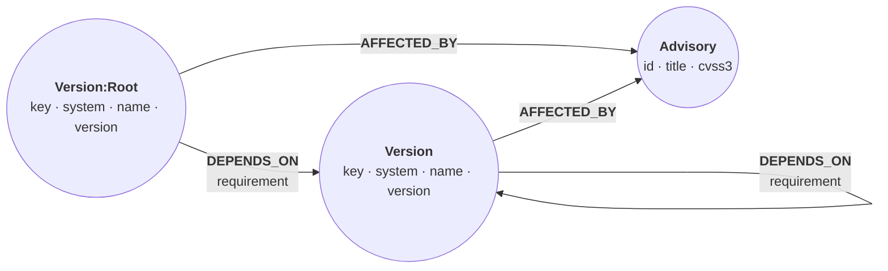

# Dependency blast radius

*A lockfile lists what you install, not why. Load the resolved dependency
graphs of three packages, and a handful of queries answer the questions a
flat list cannot: which known advisories each package can reach and along
which chain, what else goes away if you drop a dependency, and whether a
build should fail.*

The data is what [deps.dev](https://deps.dev) returned on 2026-09-24 for
`npm/express@4.18.2`, `npm/jsonwebtoken@8.5.1`, and `pypi/requests@2.25.0`:
each package's resolved dependency graph, the advisory ids deps.dev lists
for every version in it, and each advisory's title and CVSS v3 score.
deps.dev, run by Google, publishes the data it generates, such as these
resolved graphs, under [CC BY 4.0](https://creativecommons.org/licenses/by/4.0/).
The advisories come from the GitHub and PyPA advisory databases through
OSV.dev, also CC BY 4.0.

The graph is `(:Version {key, name, version})-[:DEPENDS_ON {requirement}]->(:Version)`
for dependencies and `(:Version)-[:AFFECTED_BY]->(:Advisory {id, title, cvss3})`
for advisories. The three packages you start from also carry `:Root`.



## Load the dependency graphs

A version key such as `NPM/express@4.18.2` names one node, so `MERGE` on it
never creates a duplicate. The queries below look versions up by package
name, so `name` gets an index.

```cypher cell=schema setup
CREATE CONSTRAINT version_key IF NOT EXISTS FOR (v:Version) REQUIRE v.key IS UNIQUE;
CREATE CONSTRAINT advisory_id IF NOT EXISTS FOR (a:Advisory) REQUIRE a.id IS UNIQUE;
CREATE INDEX version_name IF NOT EXISTS FOR (v:Version) ON (v.name)
```

```table
(no rows) · indexes added: 1, constraints added: 2
```

The fixture keeps the shape of deps.dev's response: each graph is a `nodes`
list plus an `edges` list whose `fromNode` and `toNode` are positions in
`nodes`. deps.dev lists the package itself first, with `relation: "SELF"`.
A list comprehension turns a graph's nodes into keys once, so every edge
becomes two lookups by position. Versions that two graphs share, such as
`ms@2.1.3`, merge into one node. The edge statement projects the two keys
with `WITH` before it matches, which also keeps the large `g` map out of
each of the 148 edge rows.

```cypher cell=load setup params=deps
UNWIND $graphs AS g
UNWIND g.nodes AS n
MERGE (v:Version {key: n.system + '/' + n.name + '@' + n.version})
  ON CREATE SET v.system = n.system, v.name = n.name, v.version = n.version
WITH v, n WHERE n.relation = 'SELF'
SET v:Root;

UNWIND $graphs AS g
WITH g, [n IN g.nodes | n.system + '/' + n.name + '@' + n.version] AS keys
UNWIND g.edges AS e
WITH keys[e.fromNode] AS from, keys[e.toNode] AS to, e.requirement AS requirement
MATCH (a:Version {key: from}), (b:Version {key: to})
MERGE (a)-[d:DEPENDS_ON]->(b)
  ON CREATE SET d.requirement = requirement;

UNWIND $advisories AS r
CREATE (:Advisory {id: r.id, title: r.title, cvss3: r.cvss3});

UNWIND $advisoryKeys AS r
MATCH (v:Version {key: r.version})
UNWIND r.advisories AS id
MATCH (a:Advisory {id: id})
CREATE (v)-[:AFFECTED_BY]->(a);

MATCH (v:Version) WITH count(v) AS versions
MATCH (r:Root) WITH versions, count(r) AS roots
MATCH ()-[d:DEPENDS_ON]->() WITH versions, roots, count(d) AS dependsOn
MATCH (a:Advisory)
RETURN versions, roots, dependsOn, count(a) AS advisories,
       COUNT { ()-[:AFFECTED_BY]->() } AS affectedBy
```

```table
| versions | roots | dependsOn | advisories | affectedBy |
|----------|-------|-----------|------------|------------|
| 89       | 3     | 148       | 38         | 38         |
1 row · nodes created: 127, relationships created: 186, properties set: 618, labels added: 130
```

## What each package pulls in

Every variable-length pattern in this recipe is bounded at 12 hops. The
longest chain in the data is 11, so `{1,12}` reaches everything, and a
bound keeps a query from running away on a bigger graph.

```cypher cell=overview
MATCH (r:Root)
WITH r, COUNT { (r)-[:DEPENDS_ON]->() } AS direct
MATCH p = (r)-[:DEPENDS_ON]->{1,12}(v:Version)
RETURN r.name AS root, direct,
       count(DISTINCT v) AS transitive,
       count(p) AS chains,
       max(length(p)) AS longest
ORDER BY root
```

```table
| root           | direct | transitive | chains | longest |
|----------------|--------|------------|--------|---------|
| "express"      | 31     | 70         | 499    | 11      |
| "jsonwebtoken" | 10     | 14         | 16     | 4       |
| "requests"     | 4      | 4          | 4      | 1       |
3 rows
```

express names 31 dependencies and ends up with 70 versions, reached along
499 distinct chains. The same version is usually reachable in many ways,
which is why "what does dropping X remove?" needs a graph query further down.

## Which advisories can each package reach?

`SHORTEST 1` keeps one shortest chain for each pair of end nodes. Only the
start is pinned here, so one search per root finds the shortest chain to
every version it reaches. Matching `(r:Root), (v:Version)` first and pinning
both ends would run a separate search for each of the 33 pairs instead.
The lower bound is 0, so a root's own advisories count too, at depth 0.
`EXISTS { }` keeps only versions that have an advisory, and the list
comprehension turns the path into package names.

```cypher cell=reachable
MATCH p = SHORTEST 1 (r:Root)-[:DEPENDS_ON]->{0,12}(v:Version)
WHERE EXISTS { (v)-[:AFFECTED_BY]->() }
MATCH (v)-[:AFFECTED_BY]->(a:Advisory)
RETURN r.name AS root, v.key AS vulnerable, length(p) AS depth,
       count(a) AS advisories, max(a.cvss3) AS maxCvss,
       [n IN nodes(p) | n.name] AS path
ORDER BY root, depth, vulnerable
```

```table
| root           | vulnerable                 | depth | advisories | maxCvss | path                          |
|----------------|----------------------------|-------|------------|---------|-------------------------------|
| "express"      | "NPM/express@4.18.2"       | 0     | 2          | 6.1     | ["express"]                   |
| "express"      | "NPM/body-parser@1.20.1"   | 1     | 2          | 7.5     | ["express", "body-parser"]    |
| "express"      | "NPM/cookie@0.5.0"         | 1     | 1          | 0.0     | ["express", "cookie"]         |
| "express"      | "NPM/path-to-regexp@0.1.7" | 1     | 3          | 7.5     | ["express", "path-to-regexp"] |
| "express"      | "NPM/qs@6.11.0"            | 1     | 3          | 5.3     | ["express", "qs"]             |
| "express"      | "NPM/send@0.18.0"          | 1     | 1          | 5.0     | ["express", "send"]           |
| "express"      | "NPM/serve-static@1.15.0"  | 1     | 1          | 5.0     | ["express", "serve-static"]   |
| "jsonwebtoken" | "NPM/jsonwebtoken@8.5.1"   | 0     | 3          | 8.1     | ["jsonwebtoken"]              |
| "requests"     | "PYPI/requests@2.25.0"     | 0     | 8          | 6.1     | ["requests"]                  |
| "requests"     | "PYPI/idna@2.10.0"         | 1     | 4          | 7.5     | ["requests", "idna"]          |
| "requests"     | "PYPI/urllib3@1.26.20"     | 1     | 10         | 7.5     | ["requests", "urllib3"]       |
11 rows
```

A version a root cannot reach produces no row, so express never lists
`urllib3`.

> **Note**
> deps.dev reports a `cvss3` of 0 for an advisory without a CVSS v3 score,
> such as the `cookie` one. Read `0.0` as "unscored", not "harmless".

## See the chains

The same question for one root, as paths that end at the advisory. Open the
graph view. Edit `root` to `jsonwebtoken` or `requests`, or raise `minCvss`
to keep only the severe ones:

```json data=chain
{"root": "express", "minCvss": 0.0}
```

```cypher cell=chains params=chain
MATCH p = SHORTEST 1 (r:Root {name: $root})-[:DEPENDS_ON]->{0,12}(:Version)
                     -[:AFFECTED_BY]->(a:Advisory)
WHERE a.cvss3 >= $minCvss
RETURN a.id AS advisory, a.cvss3 AS cvss, p
ORDER BY cvss DESC, advisory
```

```gram
// 13 rows
[{advisory: "GHSA-37ch-88jc-xwx2", cvss: 7.5} | (n0:Version:Root {key: "NPM/express@4.18.2", name: "express", system: "NPM", version: "4.18.2"})-[r19:DEPENDS_ON {requirement: "0.1.7"}]->(n51:Version {key: "NPM/path-to-regexp@0.1.7", name: "path-to-regexp", system: "NPM", version: "0.1.7"})-[r156:AFFECTED_BY]->(n90:Advisory {cvss3: 7.5, id: "GHSA-37ch-88jc-xwx2", title: "path-to-regexp vulnerable to Regular Expression Denial of Service via multiple route parameters"})]
[{advisory: "GHSA-9wv6-86v2-598j", cvss: 7.5} | (n0)-[r19]->(n51)-[r157:AFFECTED_BY]->(n97:Advisory {cvss3: 7.5, id: "GHSA-9wv6-86v2-598j", title: "path-to-regexp outputs backtracking regular expressions"})]
[{advisory: "GHSA-qwcr-r2fm-qrc7", cvss: 7.5} | (n0)-[r2:DEPENDS_ON {requirement: "1.20.1"}]->(n5:Version {key: "NPM/body-parser@1.20.1", name: "body-parser", system: "NPM", version: "1.20.1"})-[r148:AFFECTED_BY]->(n110:Advisory {cvss3: 7.5, id: "GHSA-qwcr-r2fm-qrc7", title: "body-parser vulnerable to denial of service when url encoding is enabled"})]
[{advisory: "GHSA-rhx6-c78j-4q9w", cvss: 7.5} | (n0)-[r19]->(n51)-[r158:AFFECTED_BY]->(n112:Advisory {cvss3: 7.5, id: "GHSA-rhx6-c78j-4q9w", title: "path-to-regexp contains a ReDoS"})]
[{advisory: "GHSA-rv95-896h-c2vc", cvss: 6.1} | (n0)-[r152:AFFECTED_BY]->(n113:Advisory {cvss3: 6.1, id: "GHSA-rv95-896h-c2vc", title: "Express.js Open Redirect in malformed URLs"})]
[{advisory: "GHSA-4mjr-xmp4-gh2g", cvss: 5.3} | (n0)-[r21:DEPENDS_ON {requirement: "6.11.0"}]->(n53:Version {key: "NPM/qs@6.11.0", name: "qs", system: "NPM", version: "6.11.0"})-[r159:AFFECTED_BY]->(n92:Advisory {cvss3: 5.3, id: "GHSA-4mjr-xmp4-gh2g", title: "qs: Denial of Service via Attacker Controlled isBuffer"})]
[{advisory: "GHSA-cm22-4g7w-348p", cvss: 5.0} | (n0)-[r25:DEPENDS_ON {requirement: "1.15.0"}]->(n59:Version {key: "NPM/serve-static@1.15.0", name: "serve-static", system: "NPM", version: "1.15.0"})-[r163:AFFECTED_BY]->(n99:Advisory {cvss3: 5.0, id: "GHSA-cm22-4g7w-348p", title: "serve-static vulnerable to template injection that can lead to XSS"})]
[{advisory: "GHSA-m6fv-jmcg-4jfg", cvss: 5.0} | (n0)-[r24:DEPENDS_ON {requirement: "0.18.0"}]->(n58:Version {key: "NPM/send@0.18.0", name: "send", system: "NPM", version: "0.18.0"})-[r162:AFFECTED_BY]->(n105:Advisory {cvss3: 5.0, id: "GHSA-m6fv-jmcg-4jfg", title: "send vulnerable to template injection that can lead to XSS"})]
[{advisory: "GHSA-qw6h-vgh9-j6wx", cvss: 5.0} | (n0)-[r151:AFFECTED_BY]->(n109:Advisory {cvss3: 5.0, id: "GHSA-qw6h-vgh9-j6wx", title: "express vulnerable to XSS via response.redirect()"})]
[{advisory: "GHSA-6rw7-vpxm-498p", cvss: 3.7} | (n0)-[r21]->(n53)-[r160:AFFECTED_BY]->(n94:Advisory {cvss3: 3.7, id: "GHSA-6rw7-vpxm-498p", title: "qs's arrayLimit bypass in its bracket notation allows DoS via memory exhaustion"})]
[{advisory: "GHSA-v422-hmwv-36x6", cvss: 3.7} | (n0)-[r2]->(n5)-[r149:AFFECTED_BY]->(n114:Advisory {cvss3: 3.7, id: "GHSA-v422-hmwv-36x6", title: "body-parser vulnerable to denial of service when invalid limit value silently disables size enforcement"})]
[{advisory: "GHSA-w7fw-mjwx-w883", cvss: 3.7} | (n0)-[r21]->(n53)-[r161:AFFECTED_BY]->(n115:Advisory {cvss3: 3.7, id: "GHSA-w7fw-mjwx-w883", title: "qs's arrayLimit bypass in comma parsing allows denial of service"})]
[{advisory: "GHSA-pxg6-pf52-xh8x", cvss: 0.0} | (n0)-[r5:DEPENDS_ON {requirement: "0.5.0"}]->(n11:Version {key: "NPM/cookie@0.5.0", name: "cookie", system: "NPM", version: "0.5.0"})-[r150:AFFECTED_BY]->(n107:Advisory {cvss3: 0.0, id: "GHSA-pxg6-pf52-xh8x", title: "cookie accepts cookie name, path, and domain with out of bounds characters"})]
```

## What needs a package?

Every chain from a root to any version of the package named `$name`. `qs`
is required twice: by express directly and by `body-parser`. Edit `name` to
`debug` to see five chains.

```json data=needs
{"name": "qs"}
```

```cypher cell=needs params=needs
MATCH p = (r:Root)-[:DEPENDS_ON]->{1,12}(:Version {name: $name})
RETURN r.name AS root, length(p) AS hops, [n IN nodes(p) | n.name] AS chain
ORDER BY root, hops, chain
LIMIT 25
```

```table
| root      | hops | chain                            |
|-----------|------|----------------------------------|
| "express" | 1    | ["express", "qs"]                |
| "express" | 2    | ["express", "body-parser", "qs"] |
2 rows
```

## What disappears if a package is dropped?

Compare everything a root reaches with everything it still reaches along
chains that never step onto the dropped package. The second set is a
quantified path pattern with a predicate inside it:

```cypher
(r)((x)-[:DEPENDS_ON]->(y) WHERE y.name <> $drop){1,12}(k:Version)
```

The `WHERE` applies to every repetition, so a chain stops before it enters
`$drop`. What the root reaches but can no longer keep is the blast radius.
`EXISTS { }` skips roots that never reach the package, and `COUNT { }`
counts the advisories that leave with each version.

```json data=drop
{"drop": "body-parser"}
```

```cypher cell=drop params=drop
MATCH (r:Root)
WHERE EXISTS { (r)-[:DEPENDS_ON]->{1,12}(:Version {name: $drop}) }
MATCH (r)-[:DEPENDS_ON]->{1,12}(v:Version)
WITH r, collect(DISTINCT v) AS reachable
OPTIONAL MATCH (r)((x)-[:DEPENDS_ON]->(y) WHERE y.name <> $drop){1,12}(k:Version)
WITH r, reachable, collect(DISTINCT k) AS kept
UNWIND [v IN reachable WHERE NOT v IN kept] AS gone
RETURN r.name AS root, gone.key AS removed,
       COUNT { (gone)-[:AFFECTED_BY]->() } AS advisories
ORDER BY root, removed
```

```table
| root      | removed                  | advisories |
|-----------|--------------------------|------------|
| "express" | "NPM/body-parser@1.20.1" | 2          |
| "express" | "NPM/bytes@3.1.2"        | 0          |
| "express" | "NPM/iconv-lite@0.4.24"  | 0          |
| "express" | "NPM/raw-body@2.5.1"     | 0          |
| "express" | "NPM/safer-buffer@2.1.2" | 0          |
5 rows
```

Dropping `body-parser` also removes the four packages only it needs, and two
advisories. It does not remove `qs`: the previous step showed that express
requires `qs` directly. Try `debug`: it takes `ms@2.0.0` along, but
`ms@2.1.3` stays because `send` needs it.

> **Note**
> Name the collected lists anything but `all`. Relate currently accepts
> `WITH collect(v) AS all`, but reads a later bare `all` as a keyword:
> `size(all)` returns null instead of a count. Backquote it (`` `all` ``) if
> you must use the name.

## Which dependency has the largest blast radius?

The same comparison for the direct dependencies of one root, all at once.
Each `CALL` subquery runs once per incoming row: the first collects what the
root reaches, the second what it keeps without `d`. A direct dependency with
no dependencies of its own takes nothing else along, so `EXISTS { }` skips
those, and each remaining one costs a full walk of the root's chains. A
pattern comprehension counts the advisories that would leave too.

```json data=rank
{"root": "express"}
```

```cypher cell=rank params=rank
MATCH (r:Root {name: $root})
CALL (r) {
  MATCH (r)-[:DEPENDS_ON]->{1,12}(v:Version)
  RETURN collect(DISTINCT v) AS reachable
}
MATCH (r)-[:DEPENDS_ON]->(d:Version)
WHERE EXISTS { (d)-[:DEPENDS_ON]->() }
CALL (r, d) {
  MATCH (r)((x)-[:DEPENDS_ON]->(y) WHERE y.name <> d.name){1,12}(k:Version)
  RETURN collect(DISTINCT k) AS kept
}
WITH d.name AS cut, [v IN reachable WHERE NOT v IN kept] AS gone
RETURN cut, size(gone) AS removed,
       size([(v:Version)-[:AFFECTED_BY]->(a) WHERE v IN gone | a.id]) AS advisories,
       [v IN gone | v.name + '@' + v.version] AS versions
ORDER BY removed DESC, cut
LIMIT 10
```

```table
| cut                   | removed | advisories | versions                                                                                                                                                                                                                                                                                                                                                                                                                                                                                                                              |
|-----------------------|---------|------------|---------------------------------------------------------------------------------------------------------------------------------------------------------------------------------------------------------------------------------------------------------------------------------------------------------------------------------------------------------------------------------------------------------------------------------------------------------------------------------------------------------------------------------------|
| "qs"                  | 22      | 3          | ["qs@6.11.0", "side-channel@1.1.1", "side-channel-weakmap@1.0.2", "side-channel-map@1.0.1", "side-channel-list@1.0.1", "object-inspect@1.13.4", "es-errors@1.3.0", "get-intrinsic@1.3.1", "call-bound@1.0.4", "math-intrinsics@1.1.0", "hasown@2.0.4", "has-symbols@1.1.0", "gopd@1.2.0", "get-proto@1.0.1", "generator-function@2.0.1", "function-bind@1.1.2", "es-object-atoms@1.1.2", "es-define-property@1.0.1", "call-bind-apply-helpers@1.0.2", "async-generator-function@1.0.0", "async-function@1.0.0", "dunder-proto@1.0.1"] |
| "body-parser"         | 5       | 2          | ["body-parser@1.20.1", "raw-body@2.5.1", "iconv-lite@0.4.24", "bytes@3.1.2", "safer-buffer@2.1.2"]                                                                                                                                                                                                                                                                                                                                                                                                                                    |
| "http-errors"         | 3       | 0          | ["http-errors@2.0.0", "toidentifier@1.0.1", "inherits@2.0.4"]                                                                                                                                                                                                                                                                                                                                                                                                                                                                         |
| "proxy-addr"          | 3       | 0          | ["proxy-addr@2.0.8", "ipaddr.js@1.9.1", "forwarded@0.2.0"]                                                                                                                                                                                                                                                                                                                                                                                                                                                                            |
| "send"                | 3       | 1          | ["send@0.18.0", "ms@2.1.3", "mime@1.6.0"]                                                                                                                                                                                                                                                                                                                                                                                                                                                                                             |
| "accepts"             | 2       | 0          | ["accepts@1.3.8", "negotiator@0.6.3"]                                                                                                                                                                                                                                                                                                                                                                                                                                                                                                 |
| "debug"               | 2       | 0          | ["debug@2.6.9", "ms@2.0.0"]                                                                                                                                                                                                                                                                                                                                                                                                                                                                                                           |
| "on-finished"         | 2       | 0          | ["on-finished@2.4.1", "ee-first@1.1.1"]                                                                                                                                                                                                                                                                                                                                                                                                                                                                                               |
| "type-is"             | 2       | 0          | ["type-is@1.6.18", "media-typer@0.3.0"]                                                                                                                                                                                                                                                                                                                                                                                                                                                                                               |
| "content-disposition" | 1       | 0          | ["content-disposition@0.5.4"]                                                                                                                                                                                                                                                                                                                                                                                                                                                                                                         |
10 rows
```

`qs` pulls in 22 of express's 70 versions, most of them small helpers.
`send` and `debug` each take a different version of `ms` with them, because
express resolves `ms` twice. The predicate compares package names, so
dropping a package drops every version of it. Try `jsonwebtoken`.

> **Note**
> The `versions` lists are recorded in BFS discovery order: the
> quantified paths here are served by the frontier-NFA kernel
> (ADR-0478, Decision 4), which discovers nodes breadth-first, so
> `collect()` over a frontier-served traversal lists them in that order
> instead of the previous DFS enumeration order. Both are valid — Cypher
> leaves the order inside collected lists undefined — and the row sets,
> counts, and members are unchanged.

> **Note**
> The variable is `cut` because `DROP` is a keyword: `WITH d.name AS drop`
> is a syntax error in Relate. The parameter `$drop` is fine.

## Hot spots

The versions with the most direct dependents. A change to one of these
touches many packages at once:

```cypher cell=fan-in
MATCH (v:Version)
RETURN v.key AS version, COUNT { (:Version)-[:DEPENDS_ON]->(v) } AS dependents
ORDER BY dependents DESC, version
LIMIT 8
```

```table
| version                     | dependents |
|-----------------------------|------------|
| "NPM/es-errors@1.3.0"       | 8          |
| "NPM/safe-buffer@5.2.1"     | 5          |
| "NPM/debug@2.6.9"           | 4          |
| "NPM/depd@2.0.0"            | 4          |
| "NPM/encodeurl@1.0.2"       | 4          |
| "NPM/escape-html@1.0.3"     | 4          |
| "NPM/http-errors@2.0.0"     | 4          |
| "NPM/object-inspect@1.13.4" | 4          |
8 rows
```

The deepest versions, measured by their shortest distance from the root.
The longest chain was 11 hops, but no version is more than 6 hops from its
root by the shortest route:

```cypher cell=depth
MATCH p = SHORTEST 1 (r:Root)-[:DEPENDS_ON]->{1,12}(v:Version)
RETURN r.key AS root, v.key AS version, length(p) AS depth
ORDER BY depth DESC, root, version
LIMIT 8
```

```table
| root                 | version                              | depth |
|----------------------|--------------------------------------|-------|
| "NPM/express@4.18.2" | "NPM/dunder-proto@1.0.1"             | 6     |
| "NPM/express@4.18.2" | "NPM/async-function@1.0.0"           | 5     |
| "NPM/express@4.18.2" | "NPM/async-generator-function@1.0.0" | 5     |
| "NPM/express@4.18.2" | "NPM/call-bind-apply-helpers@1.0.2"  | 5     |
| "NPM/express@4.18.2" | "NPM/es-define-property@1.0.1"       | 5     |
| "NPM/express@4.18.2" | "NPM/es-object-atoms@1.1.2"          | 5     |
| "NPM/express@4.18.2" | "NPM/function-bind@1.1.2"            | 5     |
| "NPM/express@4.18.2" | "NPM/generator-function@2.0.1"       | 5     |
8 rows
```

And the versions that more than one root resolves to, where one upgrade
lands in two places:

```cypher cell=shared
MATCH (r:Root)-[:DEPENDS_ON]->{1,12}(v:Version)
WITH v, collect(DISTINCT r.name) AS roots
WHERE size(roots) > 1
RETURN v.key AS version, roots
ORDER BY version
```

```table
| version                 | roots                       |
|-------------------------|-----------------------------|
| "NPM/ms@2.1.3"          | ["express", "jsonwebtoken"] |
| "NPM/safe-buffer@5.2.1" | ["express", "jsonwebtoken"] |
2 rows
```

## Gate CI on reachable advisories

The reachability query becomes a build check: list every advisory at or
above `$minCvss` that some root can reach, minus the ids in `$allow` that a
reviewer accepted. No rows means the build passes.

```json data=gate
{"minCvss": 7.5, "allow": []}
```

```cypher cell=gate params=gate
MATCH p = SHORTEST 1 (r:Root)-[:DEPENDS_ON]->{0,12}(v:Version)
MATCH (v)-[:AFFECTED_BY]->(a:Advisory)
WHERE a.cvss3 >= $minCvss AND NOT a.id IN $allow
RETURN a.id AS advisory, a.cvss3 AS cvss, v.key AS version,
       [n IN nodes(p) | n.name] AS path
ORDER BY cvss DESC, advisory, version
```

```table
| advisory              | cvss | version                    | path                          |
|-----------------------|------|----------------------------|-------------------------------|
| "GHSA-8cf7-32gw-wr33" | 8.1  | "NPM/jsonwebtoken@8.5.1"   | ["jsonwebtoken"]              |
| "GHSA-37ch-88jc-xwx2" | 7.5  | "NPM/path-to-regexp@0.1.7" | ["express", "path-to-regexp"] |
| "GHSA-38jv-5279-wg99" | 7.5  | "PYPI/urllib3@1.26.20"     | ["requests", "urllib3"]       |
| "GHSA-9wv6-86v2-598j" | 7.5  | "NPM/path-to-regexp@0.1.7" | ["express", "path-to-regexp"] |
| "GHSA-qwcr-r2fm-qrc7" | 7.5  | "NPM/body-parser@1.20.1"   | ["express", "body-parser"]    |
| "GHSA-rhx6-c78j-4q9w" | 7.5  | "NPM/path-to-regexp@0.1.7" | ["express", "path-to-regexp"] |
| "PYSEC-2024-60"       | 7.5  | "PYPI/idna@2.10.0"         | ["requests", "idna"]          |
| "PYSEC-2026-1996"     | 7.5  | "PYPI/urllib3@1.26.20"     | ["requests", "urllib3"]       |
8 rows
```

Eight findings fail the build. Add reviewed ids to `allow`, or change
`minCvss`, and run it again. In CI, save the query as `gate.cypher`, run it
against a database built with the load steps above, and let `jq -e` turn a
non-empty result into exit code 1:

```sh
relate --json --param minCvss=7.5 --param 'allow=["GHSA-qwcr-r2fm-qrc7"]' \
  deps.rl < gate.cypher | jq -e 'length == 0'
```

## Data

The datasets the steps above load. Each block is a JSON object whose
keys are the query parameters.

<details>
<summary><code>deps</code> (23 KB)</summary>

```json data=deps
{
 "graphs": [
  {"nodes": [
    {"system": "NPM", "name": "express", "version": "4.18.2", "relation": "SELF"},
    {"system": "NPM", "name": "accepts", "version": "1.3.8", "relation": "DIRECT"},
    {"system": "NPM", "name": "array-flatten", "version": "1.1.1", "relation": "DIRECT"},
    {"system": "NPM", "name": "async-function", "version": "1.0.0", "relation": "INDIRECT"},
    {"system": "NPM", "name": "async-generator-function", "version": "1.0.0", "relation": "INDIRECT"},
    {"system": "NPM", "name": "body-parser", "version": "1.20.1", "relation": "DIRECT"},
    {"system": "NPM", "name": "bytes", "version": "3.1.2", "relation": "INDIRECT"},
    {"system": "NPM", "name": "call-bind-apply-helpers", "version": "1.0.2", "relation": "INDIRECT"},
    {"system": "NPM", "name": "call-bound", "version": "1.0.4", "relation": "INDIRECT"},
    {"system": "NPM", "name": "content-disposition", "version": "0.5.4", "relation": "DIRECT"},
    {"system": "NPM", "name": "content-type", "version": "1.0.5", "relation": "DIRECT"},
    {"system": "NPM", "name": "cookie", "version": "0.5.0", "relation": "DIRECT"},
    {"system": "NPM", "name": "cookie-signature", "version": "1.0.6", "relation": "DIRECT"},
    {"system": "NPM", "name": "debug", "version": "2.6.9", "relation": "DIRECT"},
    {"system": "NPM", "name": "depd", "version": "2.0.0", "relation": "DIRECT"},
    {"system": "NPM", "name": "destroy", "version": "1.2.0", "relation": "INDIRECT"},
    {"system": "NPM", "name": "dunder-proto", "version": "1.0.1", "relation": "INDIRECT"},
    {"system": "NPM", "name": "ee-first", "version": "1.1.1", "relation": "INDIRECT"},
    {"system": "NPM", "name": "encodeurl", "version": "1.0.2", "relation": "DIRECT"},
    {"system": "NPM", "name": "es-define-property", "version": "1.0.1", "relation": "INDIRECT"},
    {"system": "NPM", "name": "es-errors", "version": "1.3.0", "relation": "INDIRECT"},
    {"system": "NPM", "name": "es-object-atoms", "version": "1.1.2", "relation": "INDIRECT"},
    {"system": "NPM", "name": "escape-html", "version": "1.0.3", "relation": "DIRECT"},
    {"system": "NPM", "name": "etag", "version": "1.8.1", "relation": "DIRECT"},
    {"system": "NPM", "name": "finalhandler", "version": "1.2.0", "relation": "DIRECT"},
    {"system": "NPM", "name": "forwarded", "version": "0.2.0", "relation": "INDIRECT"},
    {"system": "NPM", "name": "fresh", "version": "0.5.2", "relation": "DIRECT"},
    {"system": "NPM", "name": "function-bind", "version": "1.1.2", "relation": "INDIRECT"},
    {"system": "NPM", "name": "generator-function", "version": "2.0.1", "relation": "INDIRECT"},
    {"system": "NPM", "name": "get-intrinsic", "version": "1.3.1", "relation": "INDIRECT"},
    {"system": "NPM", "name": "get-proto", "version": "1.0.1", "relation": "INDIRECT"},
    {"system": "NPM", "name": "gopd", "version": "1.2.0", "relation": "INDIRECT"},
    {"system": "NPM", "name": "has-symbols", "version": "1.1.0", "relation": "INDIRECT"},
    {"system": "NPM", "name": "hasown", "version": "2.0.4", "relation": "INDIRECT"},
    {"system": "NPM", "name": "http-errors", "version": "2.0.0", "relation": "DIRECT"},
    {"system": "NPM", "name": "iconv-lite", "version": "0.4.24", "relation": "INDIRECT"},
    {"system": "NPM", "name": "inherits", "version": "2.0.4", "relation": "INDIRECT"},
    {"system": "NPM", "name": "ipaddr.js", "version": "1.9.1", "relation": "INDIRECT"},
    {"system": "NPM", "name": "math-intrinsics", "version": "1.1.0", "relation": "INDIRECT"},
    {"system": "NPM", "name": "media-typer", "version": "0.3.0", "relation": "INDIRECT"},
    {"system": "NPM", "name": "merge-descriptors", "version": "1.0.1", "relation": "DIRECT"},
    {"system": "NPM", "name": "methods", "version": "1.1.2", "relation": "DIRECT"},
    {"system": "NPM", "name": "mime", "version": "1.6.0", "relation": "INDIRECT"},
    {"system": "NPM", "name": "mime-db", "version": "1.52.0", "relation": "INDIRECT"},
    {"system": "NPM", "name": "mime-types", "version": "2.1.35", "relation": "INDIRECT"},
    {"system": "NPM", "name": "ms", "version": "2.0.0", "relation": "INDIRECT"},
    {"system": "NPM", "name": "ms", "version": "2.1.3", "relation": "INDIRECT"},
    {"system": "NPM", "name": "negotiator", "version": "0.6.3", "relation": "INDIRECT"},
    {"system": "NPM", "name": "object-inspect", "version": "1.13.4", "relation": "INDIRECT"},
    {"system": "NPM", "name": "on-finished", "version": "2.4.1", "relation": "DIRECT"},
    {"system": "NPM", "name": "parseurl", "version": "1.3.3", "relation": "DIRECT"},
    {"system": "NPM", "name": "path-to-regexp", "version": "0.1.7", "relation": "DIRECT"},
    {"system": "NPM", "name": "proxy-addr", "version": "2.0.8", "relation": "DIRECT"},
    {"system": "NPM", "name": "qs", "version": "6.11.0", "relation": "DIRECT"},
    {"system": "NPM", "name": "range-parser", "version": "1.2.1", "relation": "DIRECT"},
    {"system": "NPM", "name": "raw-body", "version": "2.5.1", "relation": "INDIRECT"},
    {"system": "NPM", "name": "safe-buffer", "version": "5.2.1", "relation": "DIRECT"},
    {"system": "NPM", "name": "safer-buffer", "version": "2.1.2", "relation": "INDIRECT"},
    {"system": "NPM", "name": "send", "version": "0.18.0", "relation": "DIRECT"},
    {"system": "NPM", "name": "serve-static", "version": "1.15.0", "relation": "DIRECT"},
    {"system": "NPM", "name": "setprototypeof", "version": "1.2.0", "relation": "DIRECT"},
    {"system": "NPM", "name": "side-channel", "version": "1.1.1", "relation": "INDIRECT"},
    {"system": "NPM", "name": "side-channel-list", "version": "1.0.1", "relation": "INDIRECT"},
    {"system": "NPM", "name": "side-channel-map", "version": "1.0.1", "relation": "INDIRECT"},
    {"system": "NPM", "name": "side-channel-weakmap", "version": "1.0.2", "relation": "INDIRECT"},
    {"system": "NPM", "name": "statuses", "version": "2.0.1", "relation": "DIRECT"},
    {"system": "NPM", "name": "toidentifier", "version": "1.0.1", "relation": "INDIRECT"},
    {"system": "NPM", "name": "type-is", "version": "1.6.18", "relation": "DIRECT"},
    {"system": "NPM", "name": "unpipe", "version": "1.0.0", "relation": "INDIRECT"},
    {"system": "NPM", "name": "utils-merge", "version": "1.0.1", "relation": "DIRECT"},
    {"system": "NPM", "name": "vary", "version": "1.1.2", "relation": "DIRECT"}
   ],
   "edges": [
    {"fromNode": 0, "toNode": 1, "requirement": "~1.3.8"},
    {"fromNode": 0, "toNode": 2, "requirement": "1.1.1"},
    {"fromNode": 0, "toNode": 5, "requirement": "1.20.1"},
    {"fromNode": 0, "toNode": 9, "requirement": "0.5.4"},
    {"fromNode": 0, "toNode": 10, "requirement": "~1.0.4"},
    {"fromNode": 0, "toNode": 11, "requirement": "0.5.0"},
    {"fromNode": 0, "toNode": 12, "requirement": "1.0.6"},
    {"fromNode": 0, "toNode": 13, "requirement": "2.6.9"},
    {"fromNode": 0, "toNode": 14, "requirement": "2.0.0"},
    {"fromNode": 0, "toNode": 18, "requirement": "~1.0.2"},
    {"fromNode": 0, "toNode": 22, "requirement": "~1.0.3"},
    {"fromNode": 0, "toNode": 23, "requirement": "~1.8.1"},
    {"fromNode": 0, "toNode": 24, "requirement": "1.2.0"},
    {"fromNode": 0, "toNode": 26, "requirement": "0.5.2"},
    {"fromNode": 0, "toNode": 34, "requirement": "2.0.0"},
    {"fromNode": 0, "toNode": 40, "requirement": "1.0.1"},
    {"fromNode": 0, "toNode": 41, "requirement": "~1.1.2"},
    {"fromNode": 0, "toNode": 49, "requirement": "2.4.1"},
    {"fromNode": 0, "toNode": 50, "requirement": "~1.3.3"},
    {"fromNode": 0, "toNode": 51, "requirement": "0.1.7"},
    {"fromNode": 0, "toNode": 52, "requirement": "~2.0.7"},
    {"fromNode": 0, "toNode": 53, "requirement": "6.11.0"},
    {"fromNode": 0, "toNode": 54, "requirement": "~1.2.1"},
    {"fromNode": 0, "toNode": 56, "requirement": "5.2.1"},
    {"fromNode": 0, "toNode": 58, "requirement": "0.18.0"},
    {"fromNode": 0, "toNode": 59, "requirement": "1.15.0"},
    {"fromNode": 0, "toNode": 60, "requirement": "1.2.0"},
    {"fromNode": 0, "toNode": 65, "requirement": "2.0.1"},
    {"fromNode": 0, "toNode": 67, "requirement": "~1.6.18"},
    {"fromNode": 0, "toNode": 69, "requirement": "1.0.1"},
    {"fromNode": 0, "toNode": 70, "requirement": "~1.1.2"},
    {"fromNode": 1, "toNode": 44, "requirement": "~2.1.34"},
    {"fromNode": 1, "toNode": 47, "requirement": "0.6.3"},
    {"fromNode": 5, "toNode": 6, "requirement": "3.1.2"},
    {"fromNode": 5, "toNode": 10, "requirement": "~1.0.4"},
    {"fromNode": 5, "toNode": 13, "requirement": "2.6.9"},
    {"fromNode": 5, "toNode": 14, "requirement": "2.0.0"},
    {"fromNode": 5, "toNode": 15, "requirement": "1.2.0"},
    {"fromNode": 5, "toNode": 34, "requirement": "2.0.0"},
    {"fromNode": 5, "toNode": 35, "requirement": "0.4.24"},
    {"fromNode": 5, "toNode": 49, "requirement": "2.4.1"},
    {"fromNode": 5, "toNode": 53, "requirement": "6.11.0"},
    {"fromNode": 5, "toNode": 55, "requirement": "2.5.1"},
    {"fromNode": 5, "toNode": 67, "requirement": "~1.6.18"},
    {"fromNode": 5, "toNode": 68, "requirement": "1.0.0"},
    {"fromNode": 7, "toNode": 20, "requirement": "^1.3.0"},
    {"fromNode": 7, "toNode": 27, "requirement": "^1.1.2"},
    {"fromNode": 8, "toNode": 7, "requirement": "^1.0.2"},
    {"fromNode": 8, "toNode": 29, "requirement": "^1.3.0"},
    {"fromNode": 9, "toNode": 56, "requirement": "5.2.1"},
    {"fromNode": 13, "toNode": 45, "requirement": "2.0.0"},
    {"fromNode": 16, "toNode": 7, "requirement": "^1.0.1"},
    {"fromNode": 16, "toNode": 20, "requirement": "^1.3.0"},
    {"fromNode": 16, "toNode": 31, "requirement": "^1.2.0"},
    {"fromNode": 21, "toNode": 20, "requirement": "^1.3.0"},
    {"fromNode": 24, "toNode": 13, "requirement": "2.6.9"},
    {"fromNode": 24, "toNode": 18, "requirement": "~1.0.2"},
    {"fromNode": 24, "toNode": 22, "requirement": "~1.0.3"},
    {"fromNode": 24, "toNode": 49, "requirement": "2.4.1"},
    {"fromNode": 24, "toNode": 50, "requirement": "~1.3.3"},
    {"fromNode": 24, "toNode": 65, "requirement": "2.0.1"},
    {"fromNode": 24, "toNode": 68, "requirement": "~1.0.0"},
    {"fromNode": 29, "toNode": 3, "requirement": "^1.0.0"},
    {"fromNode": 29, "toNode": 4, "requirement": "^1.0.0"},
    {"fromNode": 29, "toNode": 7, "requirement": "^1.0.2"},
    {"fromNode": 29, "toNode": 19, "requirement": "^1.0.1"},
    {"fromNode": 29, "toNode": 20, "requirement": "^1.3.0"},
    {"fromNode": 29, "toNode": 21, "requirement": "^1.1.1"},
    {"fromNode": 29, "toNode": 27, "requirement": "^1.1.2"},
    {"fromNode": 29, "toNode": 28, "requirement": "^2.0.0"},
    {"fromNode": 29, "toNode": 30, "requirement": "^1.0.1"},
    {"fromNode": 29, "toNode": 31, "requirement": "^1.2.0"},
    {"fromNode": 29, "toNode": 32, "requirement": "^1.1.0"},
    {"fromNode": 29, "toNode": 33, "requirement": "^2.0.2"},
    {"fromNode": 29, "toNode": 38, "requirement": "^1.1.0"},
    {"fromNode": 30, "toNode": 16, "requirement": "^1.0.1"},
    {"fromNode": 30, "toNode": 21, "requirement": "^1.0.0"},
    {"fromNode": 33, "toNode": 27, "requirement": "^1.1.2"},
    {"fromNode": 34, "toNode": 14, "requirement": "2.0.0"},
    {"fromNode": 34, "toNode": 36, "requirement": "2.0.4"},
    {"fromNode": 34, "toNode": 60, "requirement": "1.2.0"},
    {"fromNode": 34, "toNode": 65, "requirement": "2.0.1"},
    {"fromNode": 34, "toNode": 66, "requirement": "1.0.1"},
    {"fromNode": 35, "toNode": 57, "requirement": ">= 2.1.2 < 3"},
    {"fromNode": 44, "toNode": 43, "requirement": "1.52.0"},
    {"fromNode": 49, "toNode": 17, "requirement": "1.1.1"},
    {"fromNode": 52, "toNode": 25, "requirement": "0.2.0"},
    {"fromNode": 52, "toNode": 37, "requirement": "1.9.1"},
    {"fromNode": 53, "toNode": 61, "requirement": "^1.0.4"},
    {"fromNode": 55, "toNode": 6, "requirement": "3.1.2"},
    {"fromNode": 55, "toNode": 34, "requirement": "2.0.0"},
    {"fromNode": 55, "toNode": 35, "requirement": "0.4.24"},
    {"fromNode": 55, "toNode": 68, "requirement": "1.0.0"},
    {"fromNode": 58, "toNode": 13, "requirement": "2.6.9"},
    {"fromNode": 58, "toNode": 14, "requirement": "2.0.0"},
    {"fromNode": 58, "toNode": 15, "requirement": "1.2.0"},
    {"fromNode": 58, "toNode": 18, "requirement": "~1.0.2"},
    {"fromNode": 58, "toNode": 22, "requirement": "~1.0.3"},
    {"fromNode": 58, "toNode": 23, "requirement": "~1.8.1"},
    {"fromNode": 58, "toNode": 26, "requirement": "0.5.2"},
    {"fromNode": 58, "toNode": 34, "requirement": "2.0.0"},
    {"fromNode": 58, "toNode": 42, "requirement": "1.6.0"},
    {"fromNode": 58, "toNode": 46, "requirement": "2.1.3"},
    {"fromNode": 58, "toNode": 49, "requirement": "2.4.1"},
    {"fromNode": 58, "toNode": 54, "requirement": "~1.2.1"},
    {"fromNode": 58, "toNode": 65, "requirement": "2.0.1"},
    {"fromNode": 59, "toNode": 18, "requirement": "~1.0.2"},
    {"fromNode": 59, "toNode": 22, "requirement": "~1.0.3"},
    {"fromNode": 59, "toNode": 50, "requirement": "~1.3.3"},
    {"fromNode": 59, "toNode": 58, "requirement": "0.18.0"},
    {"fromNode": 61, "toNode": 20, "requirement": "^1.3.0"},
    {"fromNode": 61, "toNode": 48, "requirement": "^1.13.4"},
    {"fromNode": 61, "toNode": 62, "requirement": "^1.0.1"},
    {"fromNode": 61, "toNode": 63, "requirement": "^1.0.1"},
    {"fromNode": 61, "toNode": 64, "requirement": "^1.0.2"},
    {"fromNode": 62, "toNode": 20, "requirement": "^1.3.0"},
    {"fromNode": 62, "toNode": 48, "requirement": "^1.13.4"},
    {"fromNode": 63, "toNode": 8, "requirement": "^1.0.2"},
    {"fromNode": 63, "toNode": 20, "requirement": "^1.3.0"},
    {"fromNode": 63, "toNode": 29, "requirement": "^1.2.5"},
    {"fromNode": 63, "toNode": 48, "requirement": "^1.13.3"},
    {"fromNode": 64, "toNode": 8, "requirement": "^1.0.2"},
    {"fromNode": 64, "toNode": 20, "requirement": "^1.3.0"},
    {"fromNode": 64, "toNode": 29, "requirement": "^1.2.5"},
    {"fromNode": 64, "toNode": 48, "requirement": "^1.13.3"},
    {"fromNode": 64, "toNode": 63, "requirement": "^1.0.1"},
    {"fromNode": 67, "toNode": 39, "requirement": "0.3.0"},
    {"fromNode": 67, "toNode": 44, "requirement": "~2.1.24"}
   ]
  },
  {"nodes": [
    {"system": "NPM", "name": "jsonwebtoken", "version": "8.5.1", "relation": "SELF"},
    {"system": "NPM", "name": "buffer-equal-constant-time", "version": "1.0.1", "relation": "INDIRECT"},
    {"system": "NPM", "name": "ecdsa-sig-formatter", "version": "1.0.11", "relation": "INDIRECT"},
    {"system": "NPM", "name": "jwa", "version": "1.4.2", "relation": "INDIRECT"},
    {"system": "NPM", "name": "jws", "version": "3.2.3", "relation": "DIRECT"},
    {"system": "NPM", "name": "lodash.includes", "version": "4.3.0", "relation": "DIRECT"},
    {"system": "NPM", "name": "lodash.isboolean", "version": "3.0.3", "relation": "DIRECT"},
    {"system": "NPM", "name": "lodash.isinteger", "version": "4.0.4", "relation": "DIRECT"},
    {"system": "NPM", "name": "lodash.isnumber", "version": "3.0.3", "relation": "DIRECT"},
    {"system": "NPM", "name": "lodash.isplainobject", "version": "4.0.6", "relation": "DIRECT"},
    {"system": "NPM", "name": "lodash.isstring", "version": "4.0.1", "relation": "DIRECT"},
    {"system": "NPM", "name": "lodash.once", "version": "4.1.1", "relation": "DIRECT"},
    {"system": "NPM", "name": "ms", "version": "2.1.3", "relation": "DIRECT"},
    {"system": "NPM", "name": "safe-buffer", "version": "5.2.1", "relation": "INDIRECT"},
    {"system": "NPM", "name": "semver", "version": "5.7.2", "relation": "DIRECT"}
   ],
   "edges": [
    {"fromNode": 0, "toNode": 4, "requirement": "^3.2.2"},
    {"fromNode": 0, "toNode": 5, "requirement": "^4.3.0"},
    {"fromNode": 0, "toNode": 6, "requirement": "^3.0.3"},
    {"fromNode": 0, "toNode": 7, "requirement": "^4.0.4"},
    {"fromNode": 0, "toNode": 8, "requirement": "^3.0.3"},
    {"fromNode": 0, "toNode": 9, "requirement": "^4.0.6"},
    {"fromNode": 0, "toNode": 10, "requirement": "^4.0.1"},
    {"fromNode": 0, "toNode": 11, "requirement": "^4.0.0"},
    {"fromNode": 0, "toNode": 12, "requirement": "^2.1.1"},
    {"fromNode": 0, "toNode": 14, "requirement": "^5.6.0"},
    {"fromNode": 2, "toNode": 13, "requirement": "^5.0.1"},
    {"fromNode": 3, "toNode": 1, "requirement": "^1.0.1"},
    {"fromNode": 3, "toNode": 2, "requirement": "1.0.11"},
    {"fromNode": 3, "toNode": 13, "requirement": "^5.0.1"},
    {"fromNode": 4, "toNode": 3, "requirement": "^1.4.2"},
    {"fromNode": 4, "toNode": 13, "requirement": "^5.0.1"}
   ]
  },
  {"nodes": [
    {"system": "PYPI", "name": "requests", "version": "2.25.0", "relation": "SELF"},
    {"system": "PYPI", "name": "certifi", "version": "2026.7.22", "relation": "DIRECT"},
    {"system": "PYPI", "name": "chardet", "version": "3.0.4", "relation": "DIRECT"},
    {"system": "PYPI", "name": "idna", "version": "2.10.0", "relation": "DIRECT"},
    {"system": "PYPI", "name": "urllib3", "version": "1.26.20", "relation": "DIRECT"}
   ],
   "edges": [
    {"fromNode": 0, "toNode": 1, "requirement": ">=2017.4.17"},
    {"fromNode": 0, "toNode": 2, "requirement": "<4,>=3.0.2"},
    {"fromNode": 0, "toNode": 3, "requirement": "<3,>=2.5"},
    {"fromNode": 0, "toNode": 4, "requirement": "<1.27,>=1.21.1"}
   ]
  }
 ],
 "advisoryKeys": [
  {"version": "NPM/body-parser@1.20.1", "advisories": ["GHSA-qwcr-r2fm-qrc7", "GHSA-v422-hmwv-36x6"]},
  {"version": "NPM/cookie@0.5.0", "advisories": ["GHSA-pxg6-pf52-xh8x"]},
  {"version": "NPM/express@4.18.2", "advisories": ["GHSA-qw6h-vgh9-j6wx", "GHSA-rv95-896h-c2vc"]},
  {"version": "NPM/jsonwebtoken@8.5.1", "advisories": ["GHSA-8cf7-32gw-wr33", "GHSA-hjrf-2m68-5959", "GHSA-qwph-4952-7xr6"]},
  {"version": "NPM/path-to-regexp@0.1.7", "advisories": ["GHSA-37ch-88jc-xwx2", "GHSA-9wv6-86v2-598j", "GHSA-rhx6-c78j-4q9w"]},
  {"version": "NPM/qs@6.11.0", "advisories": ["GHSA-4mjr-xmp4-gh2g", "GHSA-6rw7-vpxm-498p", "GHSA-w7fw-mjwx-w883"]},
  {"version": "NPM/send@0.18.0", "advisories": ["GHSA-m6fv-jmcg-4jfg"]},
  {"version": "NPM/serve-static@1.15.0", "advisories": ["GHSA-cm22-4g7w-348p"]},
  {"version": "PYPI/idna@2.10.0", "advisories": ["GHSA-65pc-fj4g-8rjx", "GHSA-jjg7-2v4v-x38h", "PYSEC-2024-60", "PYSEC-2026-215"]},
  {"version": "PYPI/requests@2.25.0", "advisories": ["GHSA-9hjg-9r4m-mvj7", "GHSA-9wx4-h78v-vm56", "GHSA-gc5v-m9x4-r6x2", "GHSA-j8r2-6x86-q33q", "PYSEC-2023-74", "PYSEC-2026-1872", "PYSEC-2026-1873", "PYSEC-2026-2275"]},
  {"version": "PYPI/urllib3@1.26.20", "advisories": ["GHSA-2xpw-w6gg-jr37", "GHSA-38jv-5279-wg99", "GHSA-gm62-xv2j-4w53", "GHSA-pq67-6m6q-mj2v", "GHSA-qccp-gfcp-xxvc", "PYSEC-2026-141", "PYSEC-2026-1994", "PYSEC-2026-1996", "PYSEC-2026-1998", "PYSEC-2026-1999"]}
 ],
 "advisories": [
  {"id": "GHSA-2xpw-w6gg-jr37", "cvss3": 0.0, "title": "urllib3 streaming API improperly handles highly compressed data"},
  {"id": "GHSA-37ch-88jc-xwx2", "cvss3": 7.5, "title": "path-to-regexp vulnerable to Regular Expression Denial of Service via multiple route parameters"},
  {"id": "GHSA-38jv-5279-wg99", "cvss3": 7.5, "title": "Decompression-bomb safeguards bypassed when following HTTP redirects (streaming API)"},
  {"id": "GHSA-4mjr-xmp4-gh2g", "cvss3": 5.3, "title": "qs: Denial of Service via Attacker Controlled isBuffer"},
  {"id": "GHSA-65pc-fj4g-8rjx", "cvss3": 5.3, "title": "Internationalized Domain Names in Applications (IDNA): Specially crafted inputs to idna.encode() can bypass CVE-2024-3651 fix"},
  {"id": "GHSA-6rw7-vpxm-498p", "cvss3": 3.7, "title": "qs's arrayLimit bypass in its bracket notation allows DoS via memory exhaustion"},
  {"id": "GHSA-8cf7-32gw-wr33", "cvss3": 8.1, "title": "jsonwebtoken unrestricted key type could lead to legacy keys usage"},
  {"id": "GHSA-9hjg-9r4m-mvj7", "cvss3": 5.3, "title": "Requests vulnerable to .netrc credentials leak via malicious URLs"},
  {"id": "GHSA-9wv6-86v2-598j", "cvss3": 7.5, "title": "path-to-regexp outputs backtracking regular expressions"},
  {"id": "GHSA-9wx4-h78v-vm56", "cvss3": 5.6, "title": "Requests `Session` object does not verify requests after making first request with verify=False"},
  {"id": "GHSA-cm22-4g7w-348p", "cvss3": 5.0, "title": "serve-static vulnerable to template injection that can lead to XSS"},
  {"id": "GHSA-gc5v-m9x4-r6x2", "cvss3": 4.4, "title": "Requests has Insecure Temp File Reuse in its extract_zipped_paths() utility function"},
  {"id": "GHSA-gm62-xv2j-4w53", "cvss3": 0.0, "title": "urllib3 allows an unbounded number of links in the decompression chain"},
  {"id": "GHSA-hjrf-2m68-5959", "cvss3": 5.0, "title": "jsonwebtoken's insecure implementation of key retrieval function could lead to Forgeable Public/Private Tokens from RSA to HMAC"},
  {"id": "GHSA-j8r2-6x86-q33q", "cvss3": 6.1, "title": "Unintended leak of Proxy-Authorization header in requests"},
  {"id": "GHSA-jjg7-2v4v-x38h", "cvss3": 6.2, "title": "Internationalized Domain Names in Applications (IDNA) vulnerable to denial of service from specially crafted inputs to idna.encode"},
  {"id": "GHSA-m6fv-jmcg-4jfg", "cvss3": 5.0, "title": "send vulnerable to template injection that can lead to XSS"},
  {"id": "GHSA-pq67-6m6q-mj2v", "cvss3": 5.3, "title": "urllib3 redirects are not disabled when retries are disabled on PoolManager instantiation"},
  {"id": "GHSA-pxg6-pf52-xh8x", "cvss3": 0.0, "title": "cookie accepts cookie name, path, and domain with out of bounds characters"},
  {"id": "GHSA-qccp-gfcp-xxvc", "cvss3": 5.3, "title": "urllib3: Sensitive headers forwarded across origins in proxied low-level redirects"},
  {"id": "GHSA-qw6h-vgh9-j6wx", "cvss3": 5.0, "title": "express vulnerable to XSS via response.redirect()"},
  {"id": "GHSA-qwcr-r2fm-qrc7", "cvss3": 7.5, "title": "body-parser vulnerable to denial of service when url encoding is enabled"},
  {"id": "GHSA-qwph-4952-7xr6", "cvss3": 6.4, "title": "jsonwebtoken vulnerable to signature validation bypass due to insecure default algorithm in jwt.verify()"},
  {"id": "GHSA-rhx6-c78j-4q9w", "cvss3": 7.5, "title": "path-to-regexp contains a ReDoS"},
  {"id": "GHSA-rv95-896h-c2vc", "cvss3": 6.1, "title": "Express.js Open Redirect in malformed URLs"},
  {"id": "GHSA-v422-hmwv-36x6", "cvss3": 3.7, "title": "body-parser vulnerable to denial of service when invalid limit value silently disables size enforcement"},
  {"id": "GHSA-w7fw-mjwx-w883", "cvss3": 3.7, "title": "qs's arrayLimit bypass in comma parsing allows denial of service"},
  {"id": "PYSEC-2023-74", "cvss3": 0.0, "title": "PYSEC-2023-74"},
  {"id": "PYSEC-2024-60", "cvss3": 7.5, "title": "PYSEC-2024-60"},
  {"id": "PYSEC-2026-141", "cvss3": 5.3, "title": "PYSEC-2026-141"},
  {"id": "PYSEC-2026-1872", "cvss3": 5.3, "title": "Requests vulnerable to .netrc credentials leak via malicious URLs"},
  {"id": "PYSEC-2026-1873", "cvss3": 5.6, "title": "Requests `Session` object does not verify requests after making first request with verify=False"},
  {"id": "PYSEC-2026-1994", "cvss3": 0.0, "title": "urllib3 streaming API improperly handles highly compressed data"},
  {"id": "PYSEC-2026-1996", "cvss3": 7.5, "title": "Decompression-bomb safeguards bypassed when following HTTP redirects (streaming API)"},
  {"id": "PYSEC-2026-1998", "cvss3": 0.0, "title": "urllib3 allows an unbounded number of links in the decompression chain"},
  {"id": "PYSEC-2026-1999", "cvss3": 5.3, "title": "urllib3 redirects are not disabled when retries are disabled on PoolManager instantiation"},
  {"id": "PYSEC-2026-215", "cvss3": 5.3, "title": "PYSEC-2026-215"},
  {"id": "PYSEC-2026-2275", "cvss3": 5.5, "title": "PYSEC-2026-2275"}
 ]
}
```

</details>
