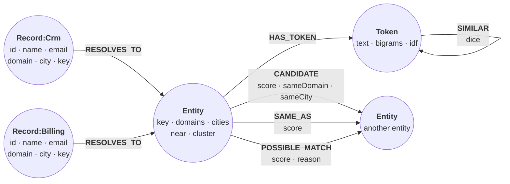
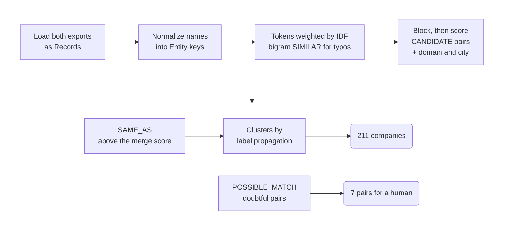

# Entity resolution in pure Cypher

*A CRM export and a billing export list the same customers, spelled
differently: `GOLDEN GATE LOGISTICS, INC.` in one is `Golden Gate Logistics,
Inc.` in the other, and `Kestrel Rbotics` is a typo. This recipe resolves the
396 records into 211 companies inside the database, with no fuzzy-matching
library: normalized keys, bigram similarity for typos, IDF-weighted name
scores, and a seven-item review queue for a human. Checked against the
generator's ground truth, it finds 216 of 218 duplicate pairs and makes no
false merges.*

The resolver builds a small graph and reasons over it. A `Record` is one row
of either export, labeled `Crm` or `Billing`. An `Entity` is one normalized
name, shared by every record that normalizes to it (`RESOLVES_TO`). A `Token`
is one word of those names (`HAS_TOKEN`), and `SIMILAR` links words that look
like typos of each other. Entities that might be the same company get a
scored `CANDIDATE` edge: the strong ones become `SAME_AS`, and the doubtful
ones `POSSIBLE_MATCH`, for a human to check. At the end, every entity's
`cluster` property names the company it resolved to.



The steps below build it in this order:



## Load the two exports

Uniqueness constraints give `MERGE` an index to look keys up in, and the
`cluster` index serves the report queries at the end.

```cypher cell=schema setup
CREATE CONSTRAINT record_id IF NOT EXISTS FOR (r:Record) REQUIRE r.id IS UNIQUE;
CREATE CONSTRAINT entity_key IF NOT EXISTS FOR (e:Entity) REQUIRE e.key IS UNIQUE;
CREATE CONSTRAINT token_text IF NOT EXISTS FOR (t:Token) REQUIRE t.text IS UNIQUE;
CREATE INDEX entity_cluster IF NOT EXISTS FOR (e:Entity) ON (e.cluster)
```

```table
(no rows) · indexes added: 1, constraints added: 3
```

Each export names its columns differently; the load maps both fixture lists,
one JSON object per CSV row, onto one `Record` shape. The last statement is a
guard: an email without an `@` means a row was split in the wrong place.

```cypher cell=load setup params=exports
UNWIND $crm AS row
CREATE (:Record:Crm {id: row.account_id, name: row.account_name,
                     email: row.contact_email, city: trim(row.city)});

UNWIND $billing AS row
CREATE (:Record:Billing {id: row.customer_no, name: row.legal_name,
                         email: row.billing_email, city: trim(row.billing_city)});

MATCH (r:Record)
RETURN count(CASE WHEN r:Crm THEN 1 END) AS crm,
       count(CASE WHEN r:Billing THEN 1 END) AS billing,
       count(CASE WHEN NOT r.email CONTAINS '@' THEN 1 END) AS malformed
```

```table
| crm | billing | malformed |
|-----|---------|-----------|
| 194 | 202     | 0         |
1 row · nodes created: 396, properties set: 1584, labels added: 792
```

> **Note**
> The exports started out as CSV, and 33 of the names contain a quoted comma,
> like `"Golden Gate Logistics, Inc."`. `LOAD CSV` honors RFC 4180 quoting
> (quoted delimiters, escaped `""` quotes, and newlines inside quoted
> fields), so those rows load as-is today; this fixture predates that and was
> converted with Python's `csv` module to JSON for `UNWIND`. Either path
> works — and keep the `malformed` guard.

## Normalize names into keys

Normalizing is string and list processing. Lowercase the name, turn `&` into
`and`, replace every run of punctuation with a space using
`string.regexReplace`, split into words, and drop legal suffixes, `the`, and
single letters (so `L.L.C.` disappears letter by letter). The email domain is
kept as evidence, unless it is a free-mail domain, which says nothing about
the company. The step ends by listing three Golden Gate companies, spelled in
capitals and lower case, with and without a leading `The`, with stray spaces,
and with several legal suffixes. Edit `names` to look at others.

```json data=names
{"names": ["golden gate labs", "golden gate logistics", "golden gate security"]}
```

```cypher cell=normalize params=names
MATCH (r:Record)
WITH r,
     [t IN split(trim(string.regexReplace(replace(lower(r.name), '&', ' and '),
                                          '[^a-z0-9]+', ' ')), ' ')
      WHERE size(t) > 1
        AND NOT t IN ['the', 'inc', 'incorporated', 'corp', 'corporation', 'co',
                      'company', 'llc', 'ltd', 'limited', 'plc', 'gmbh']] AS words,
     split(lower(trim(r.email)), '@')[1] AS domain
SET r.key = string.join(words, ' '),
    r.domain = CASE WHEN domain IN ['gmail.com', 'yahoo.com', 'outlook.com',
                                    'hotmail.com', 'icloud.com', 'aol.com']
                    THEN null ELSE domain END;

MATCH (r:Record)
WHERE any(n IN $names WHERE lower(r.name) CONTAINS n)
RETURN r.name AS name, r.email AS email, r.key AS key, r.domain AS domain
ORDER BY key, name
```

```table
| name                               | email                         | key                     | domain                    |
|------------------------------------|-------------------------------|-------------------------|---------------------------|
| "  The Golden Gate Labs Corp. "    | "lee@goldengatelabs.com"      | "golden gate labs"      | "goldengatelabs.com"      |
| "  golden gate labs corp "         | "kai@goldengatelabs.com"      | "golden gate labs"      | "goldengatelabs.com"      |
| "GOLDEN GATE LOGISTICS, INC."      | "hal@goldengatelogistics.com" | "golden gate logistics" | "goldengatelogistics.com" |
| "Golden Gate Logistics, Inc."      | "ben@gmail.com"               | "golden gate logistics" | null                      |
| "  The Golden Gate Security, LLC " | "ben@goldengatesecurity.com"  | "golden gate security"  | "goldengatesecurity.com"  |
| "Golden Gate Security L.L.C."      | "ivy@goldengatesecurity.com"  | "golden gate security"  | "goldengatesecurity.com"  |
6 rows · properties set: 737
```

Six spellings, three keys: one per company. The free-mail contact leaves
its record without a domain.

## One entity per key

`MERGE` on the key groups the records that normalize the same way. This exact
pass already does most of the work: the 396 records become 244 entities, and
the fuzzy steps below only have to take those to 211 companies.

```cypher cell=exact
MATCH (r:Record)
MERGE (e:Entity {key: r.key})
MERGE (r)-[:RESOLVES_TO]->(e)
```

```table
(no rows) · nodes created: 244, relationships created: 396, properties set: 244, labels added: 244
```

## Weigh words by rarity

Each key splits into `Token` nodes. How much a shared word counts depends on
how rare it is: two names that share `pinnacle` are more likely to be the same
company than two that share `labs`. The weight is an inverse document
frequency, `log(N / df) + 0.1`, where `N` is the number of entities and `df`
is the number that use the token, counted with `COUNT { }`. Each token also
stores its character bigrams for the next step.

```cypher cell=tokens
MATCH (e:Entity)
UNWIND split(e.key, ' ') AS text
MERGE (t:Token {text: text})
MERGE (e)-[:HAS_TOKEN]->(t);

MATCH (e:Entity)
WITH count(e) AS n
MATCH (t:Token)
WITH t, n, ' ' + t.text + ' ' AS padded
SET t.idf = log(toFloat(n) / COUNT { (t)<-[:HAS_TOKEN]-() }) + 0.1,
    t.bigrams = coll.distinct([i IN range(0, size(padded) - 2) |
                               substring(padded, i, 2)]);

MATCH (t:Token)
WITH t, COUNT { (t)<-[:HAS_TOKEN]-() } AS entities
ORDER BY t.text
RETURN entities, round(t.idf, 2) AS idf, count(*) AS tokens,
       collect(t.text)[..4] AS examples
ORDER BY entities DESC
```

```table
| entities | idf  | tokens | examples                                             |
|----------|------|--------|------------------------------------------------------|
| 16       | 2.82 | 1      | ["labs"]                                             |
| 15       | 2.89 | 1      | ["security"]                                         |
| 14       | 2.96 | 1      | ["energy"]                                           |
| 13       | 3.03 | 1      | ["foods"]                                            |
| 12       | 3.11 | 5      | ["acme", "analytics", "outfitters", "software"]      |
| 11       | 3.2  | 9      | ["brightpath", "capital", "consulting", "logistics"] |
| 10       | 3.29 | 3      | ["cobalt", "kestrel", "textiles"]                    |
| 9        | 3.4  | 4      | ["gate", "golden", "health", "quantum"]              |
| 8        | 3.52 | 4      | ["brewing", "dental", "harborview", "zenith"]        |
| 7        | 3.65 | 8      | ["evergreen", "freight", "granite", "horizon"]       |
| 6        | 3.81 | 5      | ["beacon", "driftwood", "juniper", "meridian"]       |
| 5        | 3.99 | 5      | ["blue", "crescent", "harbor", "pinnacle"]           |
| 4        | 4.21 | 5      | ["riverstone", "silverline", "summit", "tidewater"]  |
| 3        | 4.5  | 4      | ["atlas", "bacon", "lakeside", "sterling"]           |
| 2        | 4.9  | 6      | ["dnetal", "drfitwood", "falcon", "oakridge"]        |
| 1        | 5.6  | 32     | ["aalytics", "alas", "analtyics", "analytcs"]        |
16 rows · nodes created: 94, relationships created: 502, properties set: 282, labels added: 94
```

Common words like `labs` weigh about half as much as the 32 words that appear
in only one name, and every one of those is a typo.

## Catch typos with bigram similarity

Relate has no Levenshtein or Jaro function, but Dice similarity over
character bigrams is a few list comprehensions. Pad the word with spaces so
its first and last letters count, take every two-character window, and
compare the two sets: `2 × shared / (size(a) + size(b))`.

```json data=dice
{"a": "beacon", "b": "bacon"}
```

```cypher cell=dice params=dice
WITH ' ' + lower($a) + ' ' AS pa, ' ' + lower($b) + ' ' AS pb
WITH coll.distinct([i IN range(0, size(pa) - 2) | substring(pa, i, 2)]) AS ga,
     coll.distinct([i IN range(0, size(pb) - 2) | substring(pb, i, 2)]) AS gb
WITH ga, gb, [g IN ga WHERE g IN gb] AS shared
RETURN ga, gb, shared, round(2.0 * size(shared) / (size(ga) + size(gb)), 3) AS dice
```

```table
| ga                                         | gb                                   | shared                         | dice  |
|--------------------------------------------|--------------------------------------|--------------------------------|-------|
| [" b", "be", "ea", "ac", "co", "on", "n "] | [" b", "ba", "ac", "co", "on", "n "] | [" b", "ac", "co", "on", "n "] | 0.769 |
1 row
```

`beacon` and `bacon` share five bigrams, for a score of 0.769. Edit the words
and run it again: swapping two letters breaks more bigrams than dropping one,
so `sloar` and `solar` score only 0.5.

Now compare every pair of tokens whose lengths differ by at most two, link
the pairs that score at least 0.55, and list the ten weakest links, where a
false match would show up first:

```cypher cell=similar
MATCH (a:Token), (b:Token)
WHERE a.text < b.text AND abs(size(a.text) - size(b.text)) <= 2
WITH a, b, size([g IN a.bigrams WHERE g IN b.bigrams]) AS shared
WITH a, b, 2.0 * shared / (size(a.bigrams) + size(b.bigrams)) AS dice
WHERE dice >= 0.55
CREATE (a)-[:SIMILAR {dice: dice}]->(b);

MATCH (a:Token)-[s:SIMILAR]->(b:Token)
RETURN a.text AS a, b.text AS b, round(s.dice, 3) AS dice
ORDER BY dice, a, b
LIMIT 10
```

```table
| a           | b          | dice  |
|-------------|------------|-------|
| "coablt"    | "cobalt"   | 0.571 |
| "dental"    | "dnetal"   | 0.571 |
| "pahrma"    | "pharma"   | 0.571 |
| "vertex"    | "vetrex"   | 0.571 |
| "zenith"    | "zentih"   | 0.571 |
| "sftware"   | "sotfware" | 0.588 |
| "horizon"   | "hroizon"  | 0.625 |
| "quantum"   | "qunatum"  | 0.625 |
| "analtyics" | "analytcs" | 0.632 |
| "aalytics"  | "analytcs" | 0.667 |
10 rows · relationships created: 43, properties set: 43
```

Every one of the 43 links (the counters) joins a typo to its word, or two
typos of the same word (`sftware` and `sotfware`). None joins two different
real words.

## Block, then score candidate pairs

Comparing every pair of entities grows with the square of the data.
*Blocking* compares only entities that share a token, or a token and its
`SIMILAR` neighbor. In a graph that is a traversal,
`(a)-[:HAS_TOKEN]->()-[:SIMILAR]-{0,1}()<-[:HAS_TOKEN]-(b)`, where `{0,1}`
makes the typo hop optional.

A candidate's score is the IDF-weighted share of both names' tokens found on
the other side, exactly or through `SIMILAR`. Each entity first stores
`near`, its own tokens plus their `SIMILAR` neighbors, so that scoring does
not repeat the traversal for every token of every pair. The tokens enter
the list ordered — `ORDER BY t.text, s.text` before the `collect`s — so
`near` is plan-choice-stable: `collect` keeps its encounter order, and a
planner free to pick either traversal direction must not change what the
graph renders. Then two
`CALL (a, b) { }` subqueries each sum one side's token weights, and the
weights of the tokens found in the other side's `near` list.

```cypher cell=candidates
MATCH (e:Entity)-[:HAS_TOKEN]->(t:Token)
OPTIONAL MATCH (t)-[:SIMILAR]-(s:Token)
WITH e, t, s ORDER BY t.text, s.text
WITH e, collect(DISTINCT t.text) + collect(DISTINCT s.text) AS near
SET e.near = near;

MATCH (a:Entity)-[:HAS_TOKEN]->(:Token)-[:SIMILAR]-{0,1}(:Token)
      <-[:HAS_TOKEN]-(b:Entity)
WHERE a.key < b.key
WITH DISTINCT a, b
CALL (a, b) {
  MATCH (a)-[:HAS_TOKEN]->(t:Token)
  RETURN sum(t.idf) AS wa, sum(CASE WHEN t.text IN b.near THEN t.idf ELSE 0.0 END) AS ma
}
CALL (a, b) {
  MATCH (b)-[:HAS_TOKEN]->(t:Token)
  RETURN sum(t.idf) AS wb, sum(CASE WHEN t.text IN a.near THEN t.idf ELSE 0.0 END) AS mb
}
CREATE (a)-[:CANDIDATE {score: (ma + mb) / (wa + wb)}]->(b);

MATCH (e:Entity)
WITH count(e) AS n
MATCH ()-[c:CANDIDATE]->()
RETURN n * (n - 1) / 2 AS all_pairs, count(c) AS candidates
```

```table
| all_pairs | candidates |
|-----------|------------|
| 29646     | 2230       |
1 row · relationships created: 2230, properties set: 2474
```

Blocking keeps under 8% of the possible pairs. At a few hundred entities you
could afford them all; at a few hundred thousand, blocking makes it possible.

## Add corroborating evidence

Names are not the only evidence. Each entity collects the email domains and
cities of its records, and each candidate records whether its two sides share
one. Entities that share a corporate domain but no name token become
candidates too, with a score of 0, so that a human gets to see them: seven
pairs here. Grouping entities by domain finds them without comparing every
pair.

```cypher cell=evidence
MATCH (e:Entity)<-[:RESOLVES_TO]-(r:Record)
WITH e, collect(DISTINCT r.domain) AS domains, collect(DISTINCT r.city) AS cities
SET e.domains = domains, e.cities = cities;

MATCH (a:Entity)-[c:CANDIDATE]->(b:Entity)
SET c.sameDomain = any(d IN a.domains WHERE d IN b.domains),
    c.sameCity = any(x IN a.cities WHERE x IN b.cities);

MATCH (e:Entity)
UNWIND e.domains AS domain
WITH domain, collect(e) AS sharing
UNWIND sharing AS a
UNWIND sharing AS b
WITH DISTINCT a, b
WHERE a.key < b.key AND NOT (a)-[:CANDIDATE]-(b)
CREATE (a)-[:CANDIDATE {score: 0.0, sameDomain: true,
                        sameCity: any(x IN a.cities WHERE x IN b.cities)}]->(b)
```

```table
(no rows) · relationships created: 7, properties set: 4969
```

## Choose the thresholds

Two thresholds in the `decide` parameters drive the decision: `merge` is the
score that merges on its own, and `corroborated` is the lower score that
merges with a shared domain or city. Before deciding, look at the strongest
candidates that fall short of `merge`:

```json data=decide
{"merge": 0.9, "corroborated": 0.75}
```

```cypher cell=near-misses params=decide
MATCH (a:Entity)-[c:CANDIDATE]->(b:Entity)
WHERE c.score < $merge
RETURN a.key AS a, b.key AS b, round(c.score, 3) AS score,
       c.sameDomain AS shared_domain, c.sameCity AS shared_city
ORDER BY score DESC, a, b
LIMIT 5
```

```table
| a                      | b                      | score | shared_domain | shared_city |
|------------------------|------------------------|-------|---------------|-------------|
| "blue harbor pharma"   | "blue harbor security" | 0.724 | false         | true        |
| "blue harbor security" | "blue harbor widgets"  | 0.724 | false         | true        |
| "blue harbor health"   | "blue harbor security" | 0.717 | false         | false       |
| "blue harbor pharma"   | "blue harbor widgets"  | 0.714 | false         | true        |
| "blue harbor health"   | "blue harbor pharma"   | 0.707 | false         | false       |
5 rows
```

These are different companies that share a two-word prefix, and they score
about 0.72. Typo pairs score 1.0, because every token finds its match. The
gap is wide, so 0.9 merges safely, and 0.75 leaves room for a near-typo
backed by a shared domain or city.

## Merge and collapse

Merge a candidate when its score reaches `merge`, or reaches `corroborated`
with a shared domain or city. Each connected group of `SAME_AS` edges is one
company. To find the groups, every entity starts with its own key as a label
and repeatedly takes the smallest label among its `SAME_AS` neighbors, one
pass over the edges per round. (A quantified path such as
`(e)-[:SAME_AS]-{0,6}(o)` would enumerate every path instead, and explode
once loose thresholds form dense groups.) `UNWIND range(1, 10)` runs ten
rounds, and each run of the `CALL` subquery sees the labels the previous one
wrote. Then a second subquery names each company after its best spelling:
the key with the most records, then the one whose words are most common
elsewhere, which is the lowest total IDF, summed with `reduce` over a pattern
comprehension.

The cell deletes earlier `SAME_AS` edges first, so you can edit the
thresholds and run it again. `unsettled` counts `SAME_AS` edges whose two
ends landed in different companies; it is 0 when ten rounds were enough.

```cypher cell=decide params=decide
MATCH ()-[s:SAME_AS]->() DELETE s;

MATCH (a:Entity)-[c:CANDIDATE]->(b:Entity)
WHERE c.score >= $merge OR (c.score >= $corroborated AND (c.sameDomain OR c.sameCity))
CREATE (a)-[:SAME_AS {score: c.score}]->(b);

MATCH (e:Entity)
SET e.cluster = e.key;

UNWIND range(1, 10) AS round
CALL (round) {
  MATCH (e:Entity)-[:SAME_AS]-(o:Entity)
  WITH e, min(o.cluster) AS lowest
  WITH e, lowest WHERE lowest < e.cluster
  SET e.cluster = lowest
};

MATCH (e:Entity)
WITH e.cluster AS component, collect(e) AS members
CALL (members) {
  UNWIND members AS o
  WITH o, COUNT { (o)<-[:RESOLVES_TO]-() } AS records,
       reduce(w = 0.0, idf IN [(o)-[:HAS_TOKEN]->(t) | t.idf] | w + idf) AS weight
  ORDER BY records DESC, weight, o.key
  LIMIT 1
  RETURN o.key AS name
}
UNWIND members AS e
SET e.cluster = name;

MATCH (e:Entity)
WITH count(e) AS entities, count(DISTINCT e.cluster) AS companies,
     count(CASE WHEN e.key <> e.cluster THEN 1 END) AS merged
RETURN entities, companies, merged,
       COUNT { MATCH (a:Entity)-[:SAME_AS]->(b:Entity)
               WHERE a.cluster <> b.cluster } AS unsettled
```

```table
| entities | companies | merged | unsettled |
|----------|-----------|--------|-----------|
| 244      | 211       | 33     | 0         |
1 row · relationships created: 34, properties set: 555
```

> **Note**
> Inside `CALL () { }` and `CALL (x) { }`, Relate rejects a `WHERE` on an
> aggregate from the same `WITH`: `WITH e, min(o.cluster) AS lowest WHERE
> lowest < e.cluster` fails with "variable 'lowest' not defined". Repeat the
> `WITH` before the `WHERE`, as above. Outside a subquery the one-line form
> works.

The first ten of the 33 spellings that were merged into another:

```cypher cell=merges
MATCH (e:Entity)
WHERE e.key <> e.cluster
RETURN e.cluster AS company, e.key AS merged_spelling
ORDER BY company, merged_spelling
LIMIT 10
```

```table
| company                | merged_spelling        |
|------------------------|------------------------|
| "acme dental"          | "acme dnetal"          |
| "atlas security"       | "alas security"        |
| "beacon consulting"    | "bacon consulting"     |
| "beacon robotics"      | "bacon robotics"       |
| "blue harbor pharma"   | "blue harbor pahrma"   |
| "brightpath freight"   | "brightpath freght"    |
| "brightpath pharma"    | "brightpath pahrma"    |
| "cobalt logistics"     | "coblt logistics"      |
| "driftwood security"   | "drfitwood security"   |
| "harborview analytics" | "harborview analtyics" |
10 rows
```

The best-spelling rule picks `beacon consulting` over `bacon consulting`
because `beacon` is the more common word. When both spellings have a typo it
can only pick one of them: further down the list, `maple analytcs` merges
into `maple aalytics`.

> **Note**
> A score of 1.0 merges without corroboration, so `bacon robotics` joins
> `beacon robotics` as a typo. In real data those could be two companies. If
> a false merge costs more than a review, require corroboration for every
> merge.

## See one company

Open the graph view. Three records, three spellings of Harborview Analytics:
`harboview` and `analtyics` are `SIMILAR` to `harborview` and `analytics`, so
the three entities score 1.0 against each other, and their `SAME_AS` edges
form a triangle.

```json data=cluster
{"company": "harborview analytics"}
```

```cypher cell=company-graph params=cluster
MATCH p = (:Record)-[:RESOLVES_TO]->(:Entity {cluster: $company})-[:HAS_TOKEN]->(:Token)
RETURN p
UNION
MATCH p = (:Entity {cluster: $company})-[:SAME_AS]->(:Entity)
RETURN p
UNION
MATCH p = (:Entity {cluster: $company})-[:HAS_TOKEN]->(:Token)-[:SIMILAR]->(:Token)
          <-[:HAS_TOKEN]-(:Entity {cluster: $company})
RETURN p
```

```gram
// 13 rows
(n92:Record:Crm {city: "Atlanta", email: "gus@yahoo.com", id: "C0093", key: "harborview analytics", name: "Harborview Analytics, LLC"})-[r92:RESOLVES_TO]->(n487:Entity {cities: ["Atlanta"], cluster: "harborview analytics", domains: cypher`[]`, key: "harborview analytics", near: ["analytics", "harborview", "aalytics", "analtyics", "analytcs", "harboview"]})-[r587:HAS_TOKEN]->(n664:Token {bigrams: [" a", "an", "na", "al", "ly", "yt", "ti", "ic", "cs", "s "], idf: 3.1122615755052014, text: "analytics"})
(n92)-[r92]->(n487)-[r586:HAS_TOKEN]->(n685:Token {bigrams: [" h", "ha", "ar", "rb", "bo", "or", "rv", "vi", "ie", "ew", "w "], idf: 3.517726683613366, text: "harborview"})
(n294:Record:Billing {city: "Atlanta", domain: "harborviewanalytics.com", email: "lee@harborviewanalytics.com", id: "B0101", key: "harboview analytics", name: "Harboview Analytics LLC"})-[r294:RESOLVES_TO]->(n608:Entity {cities: ["Atlanta"], cluster: "harborview analytics", domains: ["harborviewanalytics.com"], key: "harboview analytics", near: ["analytics", "harboview", "aalytics", "analtyics", "analytcs", "harborview"]})-[r835:HAS_TOKEN]->(n664)
(n294)-[r294]->(n608)-[r834:HAS_TOKEN]->(n723:Token {bigrams: [" h", "ha", "ar", "rb", "bo", "ov", "vi", "ie", "ew", "w "], idf: 5.597168225293202, text: "harboview"})
(n328:Record:Billing {city: "Atlanta", domain: "harborviewanalytics.com", email: "chris@harborviewanalytics.com", id: "B0135", key: "harborview analtyics", name: "The Harborview Analtyics L.L.C."})-[r328:RESOLVES_TO]->(n615:Entity {cities: ["Atlanta"], cluster: "harborview analytics", domains: ["harborviewanalytics.com"], key: "harborview analtyics", near: ["analtyics", "harborview", "analytcs", "analytics", "harboview"]})-[r849:HAS_TOKEN]->(n726:Token {bigrams: [" a", "an", "na", "al", "lt", "ty", "yi", "ic", "cs", "s "], idf: 5.597168225293202, text: "analtyics"})
(n328)-[r328]->(n615)-[r848:HAS_TOKEN]->(n685)
(n487)-[r3188:SAME_AS {score: 1.0}]->(n608)
(n615)-[r3207:SAME_AS {score: 1.0}]->(n608)
(n615)-[r3206:SAME_AS {score: 1.0}]->(n487)
(n487)-[r586]->(n685)-[r912:SIMILAR {dice: 0.8571428571428571}]->(n723)<-[r834]-(n608)
(n615)-[r849]->(n726)-[r936:SIMILAR {dice: 0.7}]->(n664)<-[r835]-(n608)
(n615)-[r849]->(n726)-[r936]->(n664)<-[r587]-(n487)
(n615)-[r848]->(n685)-[r912]->(n723)<-[r834]-(n608)
```

## Queue the doubtful pairs for review

Some evidence is too weak to act on. Two companies with the same corporate
email domain might be one company, or a parent and its subsidiary. A name
score between `corroborated` and `merge` with nothing to back it up is just as
doubtful. These pairs go to a human as a `POSSIBLE_MATCH` edge between the two
companies. Like the merge step, the cell replaces the queue each time it runs.

```cypher cell=review params=decide
MATCH ()-[p:POSSIBLE_MATCH]->() DELETE p;

MATCH (a:Entity)-[c:CANDIDATE]->(b:Entity)
WHERE a.cluster <> b.cluster AND (c.sameDomain OR c.score >= $corroborated)
WITH CASE WHEN a.cluster < b.cluster THEN [a.cluster, b.cluster]
          ELSE [b.cluster, a.cluster] END AS pair,
     max(c.score) AS score,
     count(CASE WHEN c.sameDomain THEN 1 END) > 0 AS sharedDomain
MATCH (x:Entity {key: pair[0]}), (y:Entity {key: pair[1]})
CREATE (x)-[:POSSIBLE_MATCH {score: score,
                            reason: CASE WHEN sharedDomain THEN 'shared domain'
                                         ELSE 'similar name' END}]->(y);

MATCH (a:Entity)-[p:POSSIBLE_MATCH]->(b:Entity)
RETURN a.key AS a, b.key AS b, round(p.score, 3) AS score, p.reason AS reason
ORDER BY a, b
LIMIT 100
```

```table
| a                    | b                      | score | reason          |
|----------------------|------------------------|-------|-----------------|
| "acme outfitters"    | "tidewater widgets"    | 0.0   | "shared domain" |
| "acme robotics"      | "northwind outfitters" | 0.0   | "shared domain" |
| "golden gate labs"   | "oakridge consulting"  | 0.0   | "shared domain" |
| "horizon pharma"     | "quantum security"     | 0.0   | "shared domain" |
| "ironclad security"  | "riverstone pharma"    | 0.0   | "shared domain" |
| "juniper sloar"      | "juniper solar"        | 0.466 | "shared domain" |
| "pinnacle logistics" | "quantum media"        | 0.0   | "shared domain" |
7 rows · relationships created: 7, properties set: 14
```

Six pairs share a domain but no name word: they look like subsidiaries that
use a parent's mail server. The seventh, `juniper sloar` and `juniper solar`,
is the typo that bigrams missed; the shared domain is what brings it to a
human.

## Report

A map projection builds one document per company, with `COLLECT { }`
subqueries for its record ids. The summary counts the companies found in both
exports, the orphans found in only one, and the companies with duplicate rows
inside one export: the rows to clean up in the source systems.

```cypher cell=report
MATCH (c:Entity)
WHERE c.key = c.cluster
WITH c {.key,
        crm: COLLECT { MATCH (:Entity {cluster: c.key})<-[:RESOLVES_TO]-(r:Crm)
                       RETURN r.id ORDER BY r.id },
        billing: COLLECT { MATCH (:Entity {cluster: c.key})<-[:RESOLVES_TO]-(r:Billing)
                           RETURN r.id ORDER BY r.id }
       } AS company
WITH count(company) AS companies,
     count(CASE WHEN size(company.crm) > 0 AND size(company.billing) > 0
                THEN 1 END) AS in_both,
     count(CASE WHEN size(company.crm) > 1 OR size(company.billing) > 1
                THEN 1 END) AS duplicated,
     count(CASE WHEN size(company.crm) = 0 OR size(company.billing) = 0
                THEN 1 END) AS orphans
RETURN companies, in_both, duplicated, orphans,
       COUNT { ()-[:POSSIBLE_MATCH]->() } AS to_review
```

```table
| companies | in_both | duplicated | orphans | to_review |
|-----------|---------|------------|---------|-----------|
| 211       | 151     | 33         | 60      | 7         |
1 row
```

> **Note**
> Two details keep this query fast in Relate. Inside `COLLECT { }`,
> matching starts at the pattern's first node, so start from the node the
> outer query pins down: `(:Entity {cluster: c.key})<-…-(r)` uses the
> `cluster` index, and the reverse walks every CRM record for each company,
> about 40 times slower. And count with `count(CASE …)` over rows: collecting
> every company into one list and filtering it with list comprehensions is
> quadratic, more than ten times slower here.

## Score against the ground truth

The generator recorded which company each row came from. Precision and recall
are counted over pairs of records: a pair is *found* when both records resolve
to the same company, *real* when the ground truth says they are the same
company, and *correct* when both are true.

The pairs never need to be listed. A group of records with `c` CRM rows and
`b` billing rows holds `c × b` cross-file pairs and `c(c-1)/2 + b(b-1)/2`
in-file pairs. So each record is counted in three groups: its resolved
company (found pairs), its true company (real pairs), and the two together
(correct pairs). `UNWIND ['all', k.kind]` adds every count to the total as
well as to its kind.

```cypher cell=score params=truth
UNWIND $truth AS t
UNWIND t.records AS id
MATCH (r:Record {id: id})
SET r.truth = t.entity;

MATCH (e:Entity)<-[:RESOLVES_TO]-(r:Record)
UNWIND [{side: 'found', company: e.cluster},
        {side: 'real', company: r.truth},
        {side: 'correct', company: e.cluster + ' / ' + r.truth}] AS g
WITH g.side AS side, g.company AS company,
     count(CASE WHEN r:Crm THEN 1 END) AS c,
     count(CASE WHEN r:Billing THEN 1 END) AS b
UNWIND [{kind: 'cross-file', n: c * b},
        {kind: 'in-file', n: (c * (c - 1) + b * (b - 1)) / 2}] AS k
UNWIND ['all', k.kind] AS pairs
WITH pairs,
     sum(CASE WHEN side = 'found' THEN k.n ELSE 0 END) AS found,
     sum(CASE WHEN side = 'real' THEN k.n ELSE 0 END) AS real,
     sum(CASE WHEN side = 'correct' THEN k.n ELSE 0 END) AS correct
RETURN pairs, found, real, correct,
       round(toFloat(correct) / found, 3) AS precision,
       round(toFloat(correct) / real, 3) AS recall
ORDER BY pairs
```

```table
| pairs        | found | real | correct | precision | recall |
|--------------|-------|------|---------|-----------|--------|
| "all"        | 216   | 218  | 216     | 1.0       | 0.991  |
| "cross-file" | 182   | 183  | 182     | 1.0       | 0.995  |
| "in-file"    | 34    | 35   | 34      | 1.0       | 0.971  |
3 rows · properties set: 396
```

Every merge is right, and only two real pairs are missed: `juniper sloar`
against the two `juniper solar` records, one in each export. To check the
thresholds, label every candidate pair with the truth and bucket the scores:

```cypher cell=bands
UNWIND [{score: '0.90 to 1.00', low: 0.9, high: 1.1},
        {score: '0.75 to 0.90', low: 0.75, high: 0.9},
        {score: '0.50 to 0.75', low: 0.5, high: 0.75},
        {score: '0.00 to 0.50', low: 0.0, high: 0.5}] AS band
CALL (band) {
  MATCH (a:Entity)-[c:CANDIDATE]->(b:Entity)
  WHERE band.low <= c.score < band.high
  WITH c, EXISTS {
    MATCH (a)<-[:RESOLVES_TO]-(x:Record), (b)<-[:RESOLVES_TO]-(y:Record)
    WHERE x.truth = y.truth
  } AS same
  RETURN count(CASE WHEN same THEN 1 END) AS same_company,
         count(CASE WHEN NOT same THEN 1 END) AS different,
         round(max(CASE WHEN NOT same THEN c.score END), 3) AS best_different
}
RETURN band.score AS score, same_company, different, best_different
```

```table
| score          | same_company | different | best_different |
|----------------|--------------|-----------|----------------|
| "0.90 to 1.00" | 34           | 0         | null           |
| "0.75 to 0.90" | 0            | 0         | null           |
| "0.50 to 0.75" | 0            | 810       | 0.724          |
| "0.00 to 0.50" | 1            | 1392      | 0.5            |
4 rows
```

No candidate scores between 0.75 and 0.9 on this data, and no pair of
different companies scores above 0.724, so the thresholds have room on both
sides. The one same-company pair below them is `juniper sloar`, at 0.466.
Rerun this check on your own data before you trust the thresholds. Finally,
grade the review queue:

```cypher cell=review-check
MATCH (a:Entity)-[p:POSSIBLE_MATCH]->(b:Entity)
WITH a, b, EXISTS {
       MATCH (:Entity {cluster: a.key})<-[:RESOLVES_TO]-(x:Record),
             (:Entity {cluster: b.key})<-[:RESOLVES_TO]-(y:Record)
       WHERE x.truth = y.truth
     } AS same
RETURN count(*) AS pairs, count(CASE WHEN same THEN 1 END) AS same_company,
       collect(CASE WHEN same THEN a.key + ' / ' + b.key END) AS same_pairs
```

```table
| pairs | same_company | same_pairs                        |
|-------|--------------|-----------------------------------|
| 7     | 1            | ["juniper sloar / juniper solar"] |
1 row
```

A reviewer who accepts everything gains the two missed pairs but merges six
pairs of different companies. The queue is short enough to check by hand,
which is the point of it.

## Try it on your own data

- Change `merge` and `corroborated` in the merge and review cells, run them
  again, then rerun the report and the score to see precision and recall
  move. Even extreme values finish quickly.
- Extend the suffix and free-mail lists in the normalize step to match your
  data; they are plain Cypher lists.

## Data

The datasets the steps above load. Each block is a JSON object whose
keys are the query parameters.

<details>
<summary><code>exports</code> (52 KB)</summary>

```json data=exports
{
  "crm": [
    {"account_id": "C0001", "account_name": "Acme Textiles", "contact_email": "kai@acmetextiles.com", "city": "Denver"},
    {"account_id": "C0002", "account_name": "Ironclad Outfitters", "contact_email": "hal@ironcladoutfitters.com", "city": "Chicago"},
    {"account_id": "C0003", "account_name": "Beacon Consulting LLC", "contact_email": "chris@beaconconsulting.com", "city": "Minneapolis"},
    {"account_id": "C0004", "account_name": "Acme Consulting", "contact_email": "jo@acmeconsulting.com", "city": "Austin"},
    {"account_id": "C0005", "account_name": "Yellowstone Textiles", "contact_email": "ana@yellowstonetextiles.com", "city": "Austin"},
    {"account_id": "C0006", "account_name": "Ironclad Consulting", "contact_email": "hal@ironcladconsulting.com", "city": "Minneapolis"},
    {"account_id": "C0007", "account_name": "Northwind Capital Corp.", "contact_email": "gus@northwindcapital.com", "city": "San Diego"},
    {"account_id": "C0008", "account_name": "GOLDEN GATE LOGISTICS, INC.", "contact_email": "hal@goldengatelogistics.com", "city": "Phoenix"},
    {"account_id": "C0009", "account_name": "granite widgets inc", "contact_email": "jo@granitewidgets.com", "city": "Nashville"},
    {"account_id": "C0010", "account_name": "  The Golden Gate Labs Corp. ", "contact_email": "lee@goldengatelabs.com", "city": "San Diego"},
    {"account_id": "C0011", "account_name": "Juniper Solar Incorporated", "contact_email": "dee@junipersolar.com", "city": "Atlanta"},
    {"account_id": "C0012", "account_name": "Brightpath Consulting Ltd.", "contact_email": "ivy@brightpathconsulting.com", "city": "Raleigh"},
    {"account_id": "C0013", "account_name": "Keystone Pharma Inc.", "contact_email": "ana@keystonepharma.com", "city": "San Diego"},
    {"account_id": "C0014", "account_name": "Meridian Software, LLC", "contact_email": "ivy@meridiansoftware.com", "city": "Phoenix"},
    {"account_id": "C0015", "account_name": "Yellowstone Security Corp", "contact_email": "gus@yellowstonesecurity.com", "city": "Nashville"},
    {"account_id": "C0016", "account_name": "Riverstone Analytics, LLC", "contact_email": "chris@riverstoneanalytics.com", "city": "Chicago"},
    {"account_id": "C0017", "account_name": "Iornclad Dental Incorporated", "contact_email": "eli@ironcladdental.com", "city": "Boston"},
    {"account_id": "C0018", "account_name": "Quantum Software", "contact_email": "gus@quantumsoftware.com", "city": "Portland"},
    {"account_id": "C0019", "account_name": "The GOLDEN GATE SOFTWARE", "contact_email": "chris@goldengatesoftware.com", "city": "Minneapolis"},
    {"account_id": "C0020", "account_name": "Zentih Security, LLC", "contact_email": "ivy@zenithsecurity.com", "city": "Chicago"},
    {"account_id": "C0021", "account_name": "Driftwood Software Inc", "contact_email": "ana@driftwoodsoftware.com", "city": "Boston"},
    {"account_id": "C0022", "account_name": "ACME LOGISTICS", "contact_email": "ben@acmelogistics.com", "city": "Austin"},
    {"account_id": "C0023", "account_name": "  Cobalt Analytics ", "contact_email": "kai@cobaltanalytics.com", "city": "Atlanta"},
    {"account_id": "C0024", "account_name": "Beacon Energy", "contact_email": "ana@beaconenergy.com", "city": "Raleigh"},
    {"account_id": "C0025", "account_name": "Alas Security", "contact_email": "lee@atlassecurity.com", "city": "Phoenix"},
    {"account_id": "C0026", "account_name": "Granite Consulting Corp", "contact_email": "ben@graniteconsulting.com", "city": "San Diego"},
    {"account_id": "C0027", "account_name": "  Acme Brewing Incorporated ", "contact_email": "ben@gmail.com", "city": "Atlanta"},
    {"account_id": "C0028", "account_name": "Summit Widgets Corp", "contact_email": "lee@summitwidgets.com", "city": "Portland"},
    {"account_id": "C0029", "account_name": "Granite Foods, Inc.", "contact_email": "dee@granitefoods.com", "city": "Phoenix"},
    {"account_id": "C0030", "account_name": "Acme Outfitters", "contact_email": "kai@tidewaterwidgets.com", "city": "San Diego"},
    {"account_id": "C0031", "account_name": "Horizon Analytics", "contact_email": "gus@horizonanalytics.com", "city": "Boston"},
    {"account_id": "C0032", "account_name": "Brightpath Energy", "contact_email": "chris@brightpathenergy.com", "city": "Atlanta"},
    {"account_id": "C0033", "account_name": "Keystone Freight LLC", "contact_email": "gus@keystonefreight.com", "city": "Seattle"},
    {"account_id": "C0034", "account_name": "  Vertex Analytics ", "contact_email": "ana@vertexanalytics.com", "city": "San Diego"},
    {"account_id": "C0035", "account_name": "Westfield Robotics", "contact_email": "ana@westfieldrobotics.com", "city": "Nashville"},
    {"account_id": "C0036", "account_name": "granite media llc", "contact_email": "lee@yahoo.com", "city": "Chicago"},
    {"account_id": "C0037", "account_name": "Juniper Outfitters", "contact_email": "kai@juniperoutfitters.com", "city": "Raleigh"},
    {"account_id": "C0038", "account_name": "Driftwood Foods Inc.", "contact_email": "fay@driftwoodfoods.com", "city": "Denver"},
    {"account_id": "C0039", "account_name": "Zenith Consulting L.L.C.", "contact_email": "ana@zenithconsulting.com", "city": "Raleigh"},
    {"account_id": "C0040", "account_name": "Westfield Solar L.L.C.", "contact_email": "kai@westfieldsolar.com", "city": "Minneapolis"},
    {"account_id": "C0041", "account_name": "The Vertex Pharma", "contact_email": "chris@vertexpharma.com", "city": "Portland"},
    {"account_id": "C0042", "account_name": "Evergreen Energy Corp", "contact_email": "ben@outlook.com", "city": "San Diego"},
    {"account_id": "C0043", "account_name": "Oakridge Consulting", "contact_email": "lee@goldengatelabs.com", "city": "Boston"},
    {"account_id": "C0044", "account_name": "Cobalt Robotics Corp.", "contact_email": "kai@cobaltrobotics.com", "city": "Phoenix"},
    {"account_id": "C0045", "account_name": "BEACON ANALYTICS", "contact_email": "hal@beaconanalytics.com", "city": "Seattle"},
    {"account_id": "C0046", "account_name": "The Summit Capital Corp.", "contact_email": "fay@summitcapital.com", "city": "Atlanta"},
    {"account_id": "C0047", "account_name": "Harborview Textiles", "contact_email": "hal@harborviewtextiles.com", "city": "Portland"},
    {"account_id": "C0048", "account_name": "EVERGREEN OUTFITTERS CORP", "contact_email": "ivy@evergreenoutfitters.com", "city": "Austin"},
    {"account_id": "C0049", "account_name": "  ZENITH ENERGY ", "contact_email": "dee@zenithenergy.com", "city": "Denver"},
    {"account_id": "C0050", "account_name": "CRESCENT TEXTILES", "contact_email": "hal@crescenttextiles.com", "city": "Phoenix"},
    {"account_id": "C0051", "account_name": "Yellowstone Brewing", "contact_email": "ben@yellowstonebrewing.com", "city": "Minneapolis"},
    {"account_id": "C0052", "account_name": "Acme Solar", "contact_email": "ivy@acmesolar.com", "city": "Nashville"},
    {"account_id": "C0053", "account_name": "Redwood Widgets", "contact_email": "chris@redwoodwidgets.com", "city": "Phoenix"},
    {"account_id": "C0054", "account_name": "Redwood Security L.L.C.", "contact_email": "ivy@redwoodsecurity.com", "city": "San Diego"},
    {"account_id": "C0055", "account_name": "Crescent Media", "contact_email": "lee@gmail.com", "city": "Nashville"},
    {"account_id": "C0056", "account_name": "Cobalt Software", "contact_email": "jo@yahoo.com", "city": "San Diego"},
    {"account_id": "C0057", "account_name": "Granite Textiles Limited", "contact_email": "dee@granitetextiles.com", "city": "Portland"},
    {"account_id": "C0058", "account_name": "Tidewater Freight", "contact_email": "gus@tidewaterfreight.com", "city": "Atlanta"},
    {"account_id": "C0059", "account_name": "  The Horizon Robotics Corp ", "contact_email": "dee@horizonrobotics.com", "city": "Boston"},
    {"account_id": "C0060", "account_name": "Silverline Logistics Inc", "contact_email": "ben@silverlinelogistics.com", "city": "Nashville"},
    {"account_id": "C0061", "account_name": "brightpath pharma", "contact_email": "gus@brightpathpharma.com", "city": "Raleigh"},
    {"account_id": "C0062", "account_name": "ZENITH ANALYTICS", "contact_email": "kai@zenithanalytics.com", "city": "Atlanta"},
    {"account_id": "C0063", "account_name": "Meridian Pharma, LLC", "contact_email": "ivy@meridianpharma.com", "city": "Minneapolis"},
    {"account_id": "C0064", "account_name": "Ironclad Solar", "contact_email": "kai@ironcladsolar.com", "city": "San Diego"},
    {"account_id": "C0065", "account_name": "The Northwind Foods", "contact_email": "fay@northwindfoods.com", "city": "Minneapolis"},
    {"account_id": "C0066", "account_name": "Juniper Foods", "contact_email": "lee@juniperfoods.com", "city": "Atlanta"},
    {"account_id": "C0067", "account_name": "Kestrel Brewing", "contact_email": "kai@kestrelbrewing.com", "city": "Denver"},
    {"account_id": "C0068", "account_name": "Beacon Dental", "contact_email": "gus@beacondental.com", "city": "Boston"},
    {"account_id": "C0069", "account_name": "Blue Harbor Pahrma Inc.", "contact_email": "eli@blueharborpharma.com", "city": "Raleigh"},
    {"account_id": "C0070", "account_name": "Brightpath Freght", "contact_email": "ivy@brightpathfreight.com", "city": "Raleigh"},
    {"account_id": "C0071", "account_name": "Brightpath Pahrma Inc.", "contact_email": "ana@brightpathpharma.com", "city": "Raleigh"},
    {"account_id": "C0072", "account_name": "Evergreen Foods Ltd.", "contact_email": "fay@evergreenfoods.com", "city": "Atlanta"},
    {"account_id": "C0073", "account_name": "Quntum Media LLC", "contact_email": "eli@pinnaclelogistics.com", "city": "Boston"},
    {"account_id": "C0074", "account_name": "Zenith Textiles Incorporated", "contact_email": "lee@zenithtextiles.com", "city": "Austin"},
    {"account_id": "C0075", "account_name": "Pinnacle Media Corp", "contact_email": "ivy@pinnaclemedia.com", "city": "Phoenix"},
    {"account_id": "C0076", "account_name": "The Blue Harbor Security", "contact_email": "chris@blueharborsecurity.com", "city": "Raleigh"},
    {"account_id": "C0077", "account_name": "Silevrline Labs Limited", "contact_email": "chris@silverlinelabs.com", "city": "Phoenix"},
    {"account_id": "C0078", "account_name": "beacon consulting llc", "contact_email": "jo@beaconconsulting.com", "city": "Minneapolis"},
    {"account_id": "C0079", "account_name": "Kestrel Denal", "contact_email": "fay@outlook.com", "city": "Minneapolis"},
    {"account_id": "C0080", "account_name": "  golden gate analytics ", "contact_email": "jo@goldengateanalytics.com", "city": "Denver"},
    {"account_id": "C0081", "account_name": "Driftwood Labs, Inc.", "contact_email": "dee@driftwoodlabs.com", "city": "Portland"},
    {"account_id": "C0082", "account_name": "quantum textiles l.l.c.", "contact_email": "fay@quantumtextiles.com", "city": "Nashville"},
    {"account_id": "C0083", "account_name": "juniper health ltd", "contact_email": "kai@outlook.com", "city": "Raleigh"},
    {"account_id": "C0084", "account_name": "COBALT CONSULTING LLC", "contact_email": "dee@cobaltconsulting.com", "city": "Boston"},
    {"account_id": "C0085", "account_name": "GOLDEN GATE TEXTILES", "contact_email": "chris@goldengatetextiles.com", "city": "Minneapolis"},
    {"account_id": "C0086", "account_name": "Evergreen Media", "contact_email": "jo@evergreenmedia.com", "city": "Phoenix"},
    {"account_id": "C0087", "account_name": "Yellowstone Capital Corporation", "contact_email": "ana@yellowstonecapital.com", "city": "Denver"},
    {"account_id": "C0088", "account_name": "Lakeside Outfitters", "contact_email": "kai@lakesideoutfitters.com", "city": "Atlanta"},
    {"account_id": "C0089", "account_name": "Riverstone Labs Corp", "contact_email": "jo@outlook.com", "city": "Chicago"},
    {"account_id": "C0090", "account_name": "  The BRIGHTPATH CAPITAL ", "contact_email": "eli@brightpathcapital.com", "city": "Atlanta"},
    {"account_id": "C0091", "account_name": "Golden Gate Energy LLC", "contact_email": "gus@goldengateenergy.com", "city": "Chicago"},
    {"account_id": "C0092", "account_name": "Driftwood Logistics Corp", "contact_email": "eli@driftwoodlogistics.com", "city": "Chicago"},
    {"account_id": "C0093", "account_name": "Harborview Analytics, LLC", "contact_email": "gus@yahoo.com", "city": "Atlanta"},
    {"account_id": "C0094", "account_name": "Westfield Outfitters Inc", "contact_email": "chris@westfieldoutfitters.com", "city": "Nashville"},
    {"account_id": "C0095", "account_name": "Westfield Brewing LLC", "contact_email": "eli@westfieldbrewing.com", "city": "Chicago"},
    {"account_id": "C0096", "account_name": "Yellowstone Software", "contact_email": "jo@yellowstonesoftware.com", "city": "Denver"},
    {"account_id": "C0097", "account_name": "HARBORVIEW SOLAR INC.", "contact_email": "ana@gmail.com", "city": "Austin"},
    {"account_id": "C0098", "account_name": "  Kestrel Energy L.L.C. ", "contact_email": "kai@kestrelenergy.com", "city": "Chicago"},
    {"account_id": "C0099", "account_name": "Falcon Energy Inc.", "contact_email": "eli@falconenergy.com", "city": "Raleigh"},
    {"account_id": "C0100", "account_name": "Horizon Energy Inc.", "contact_email": "eli@horizonenergy.com", "city": "Atlanta"},
    {"account_id": "C0101", "account_name": "  Horizon Analytics ", "contact_email": "hal@horizonanalytics.com", "city": "Boston"},
    {"account_id": "C0102", "account_name": "The Brightpath Analytics Inc", "contact_email": "eli@brightpathanalytics.com", "city": "Phoenix"},
    {"account_id": "C0103", "account_name": "The Vertex Energy Corp.", "contact_email": "kai@yahoo.com", "city": "Boston"},
    {"account_id": "C0104", "account_name": "Drfitwood Brewing Inc.", "contact_email": "jo@driftwoodbrewing.com", "city": "Boston"},
    {"account_id": "C0105", "account_name": "Quantum Security Corporation", "contact_email": "hal@quantumsecurity.com", "city": "Seattle"},
    {"account_id": "C0106", "account_name": "Maple Capital Ltd", "contact_email": "fay@gmail.com", "city": "Denver"},
    {"account_id": "C0107", "account_name": "Quantum Software Limited", "contact_email": "eli@quantumsoftware.com", "city": "Portland"},
    {"account_id": "C0108", "account_name": "The Brigthpath Solar L.L.C.", "contact_email": "ana@brightpathsolar.com", "city": "Chicago"},
    {"account_id": "C0109", "account_name": "Yellowstone Labs", "contact_email": "kai@yellowstonelabs.com", "city": "Denver"},
    {"account_id": "C0110", "account_name": "harborview health", "contact_email": "hal@harborviewhealth.com", "city": "Seattle"},
    {"account_id": "C0111", "account_name": "  VETREX FOODS CORP. ", "contact_email": "hal@vertexfoods.com", "city": "Raleigh"},
    {"account_id": "C0112", "account_name": "Oakridge Pharma Inc", "contact_email": "ben@gmail.com", "city": "Phoenix"},
    {"account_id": "C0113", "account_name": "The QUANTUM HEALTH", "contact_email": "gus@quantumhealth.com", "city": "Chicago"},
    {"account_id": "C0114", "account_name": "Acme Capital Corp.", "contact_email": "chris@acmecapital.com", "city": "Seattle"},
    {"account_id": "C0115", "account_name": "Pinnacle Consulting Corp", "contact_email": "fay@pinnacleconsulting.com", "city": "San Diego"},
    {"account_id": "C0116", "account_name": "Silverline Widgets L.L.C.", "contact_email": "hal@silverlinewidgets.com", "city": "Boston"},
    {"account_id": "C0117", "account_name": "Cobalt Media Incorporated", "contact_email": "ivy@cobaltmedia.com", "city": "Boston"},
    {"account_id": "C0118", "account_name": "The Quantum Solar, LLC", "contact_email": "kai@outlook.com", "city": "Denver"},
    {"account_id": "C0119", "account_name": "Pinnacle Logistics Corporation", "contact_email": "hal@outlook.com", "city": "Boston"},
    {"account_id": "C0120", "account_name": "The Ironclad Security", "contact_email": "dee@ironcladsecurity.com", "city": "Seattle"},
    {"account_id": "C0121", "account_name": "MAPLE AALYTICS", "contact_email": "dee@mapleanalytics.com", "city": "Nashville"},
    {"account_id": "C0122", "account_name": "  Lakside Freight ", "contact_email": "lee@yahoo.com", "city": "Raleigh"},
    {"account_id": "C0123", "account_name": "Northwind Outfitters", "contact_email": "ivy@acmerobotics.com", "city": "San Diego"},
    {"account_id": "C0124", "account_name": "Horizon Widgets", "contact_email": "gus@horizonwidgets.com", "city": "Minneapolis"},
    {"account_id": "C0125", "account_name": "The Lakeside Dental Ltd.", "contact_email": "jo@yahoo.com", "city": "Portland"},
    {"account_id": "C0126", "account_name": "The Kestrel Security", "contact_email": "hal@kestrelsecurity.com", "city": "Nashville"},
    {"account_id": "C0127", "account_name": "Kestrel Analytics", "contact_email": "jo@kestrelanalytics.com", "city": "Minneapolis"},
    {"account_id": "C0128", "account_name": "Evergreen Media", "contact_email": "ivy@evergreenmedia.com", "city": "Phoenix"},
    {"account_id": "C0129", "account_name": "  Acme Dnetal LLC ", "contact_email": "kai@acmedental.com", "city": "Phoenix"},
    {"account_id": "C0130", "account_name": "Coblt Logistics Incorporated", "contact_email": "fay@cobaltlogistics.com", "city": "Nashville"},
    {"account_id": "C0131", "account_name": "  Redwood Energy Ltd ", "contact_email": "ben@redwoodenergy.com", "city": "Portland"},
    {"account_id": "C0132", "account_name": "Zenith Capital Corp.", "contact_email": "ivy@zenithcapital.com", "city": "San Diego"},
    {"account_id": "C0133", "account_name": "  Summit Outfitters Corp ", "contact_email": "gus@yahoo.com", "city": "Denver"},
    {"account_id": "C0134", "account_name": "IRONCLAD SOFTWARE LTD.", "contact_email": "dee@ironcladsoftware.com", "city": "Denver"},
    {"account_id": "C0135", "account_name": "Yellowstone Robotics", "contact_email": "gus@yellowstonerobotics.com", "city": "San Diego"},
    {"account_id": "C0136", "account_name": "Kestrel Media", "contact_email": "fay@kestrelmedia.com", "city": "Raleigh"},
    {"account_id": "C0137", "account_name": "Acme Robotics LLC", "contact_email": "jo@acmerobotics.com", "city": "Austin"},
    {"account_id": "C0138", "account_name": "Golden Gate Media", "contact_email": "dee@gmail.com", "city": "Portland"},
    {"account_id": "C0139", "account_name": "QUANTUM ENERGY LLC", "contact_email": "hal@quantumenergy.com", "city": "Seattle"},
    {"account_id": "C0140", "account_name": "YELLOWSTONE DENTAL CORP.", "contact_email": "ivy@yellowstonedental.com", "city": "Phoenix"},
    {"account_id": "C0141", "account_name": "  The Golden Gate Security, LLC ", "contact_email": "ben@goldengatesecurity.com", "city": "Phoenix"},
    {"account_id": "C0142", "account_name": "  Blue Harbor Widgets Corporation ", "contact_email": "fay@blueharborwidgets.com", "city": "Raleigh"},
    {"account_id": "C0143", "account_name": "Cobalt Freight Inc.", "contact_email": "hal@cobaltfreight.com", "city": "Austin"},
    {"account_id": "C0144", "account_name": "  Keystone Foods L.L.C. ", "contact_email": "jo@keystonefoods.com", "city": "Raleigh"},
    {"account_id": "C0145", "account_name": "The Maple Capital Ltd", "contact_email": "ivy@maplecapital.com", "city": "Portland"},
    {"account_id": "C0146", "account_name": "  Vertex Labs, LLC ", "contact_email": "chris@outlook.com", "city": "San Diego"},
    {"account_id": "C0147", "account_name": "riverstone pharma l.l.c.", "contact_email": "ivy@ironcladsecurity.com", "city": "Nashville"},
    {"account_id": "C0148", "account_name": "Cobalt Dental", "contact_email": "hal@cobaltdental.com", "city": "San Diego"},
    {"account_id": "C0149", "account_name": "Ironclad Health L.L.C.", "contact_email": "ben@ironcladhealth.com", "city": "Atlanta"},
    {"account_id": "C0150", "account_name": "Pinnacle Outfitters", "contact_email": "lee@pinnacleoutfitters.com", "city": "Nashville"},
    {"account_id": "C0151", "account_name": "The Sterling Mdia Corp.", "contact_email": "ana@sterlingmedia.com", "city": "Chicago"},
    {"account_id": "C0152", "account_name": "  Redwood Textiels ", "contact_email": "gus@redwoodtextiles.com", "city": "Portland"},
    {"account_id": "C0153", "account_name": "HARBORVIEW SOLAR", "contact_email": "gus@harborviewsolar.com", "city": "Austin"},
    {"account_id": "C0154", "account_name": "Evergreen Labs, LLC", "contact_email": "ivy@evergreenlabs.com", "city": "Austin"},
    {"account_id": "C0155", "account_name": "Granite Software", "contact_email": "kai@gmail.com", "city": "Nashville"},
    {"account_id": "C0156", "account_name": "  JUNIPER FOODS LLC ", "contact_email": "fay@juniperfoods.com", "city": "San Diego"},
    {"account_id": "C0157", "account_name": "Horizon Outfitters Corporation", "contact_email": "chris@horizonoutfitters.com", "city": "Minneapolis"},
    {"account_id": "C0158", "account_name": "The Evergreen Software Inc.", "contact_email": "ana@evergreensoftware.com", "city": "Atlanta"},
    {"account_id": "C0159", "account_name": "Sterling Labs", "contact_email": "fay@sterlinglabs.com", "city": "Austin"},
    {"account_id": "C0160", "account_name": "Kestrel Rbotics", "contact_email": "chris@kestrelrobotics.com", "city": "Raleigh"},
    {"account_id": "C0161", "account_name": "Beacon Robotics, Inc.", "contact_email": "ben@beaconrobotics.com", "city": "Phoenix"},
    {"account_id": "C0162", "account_name": "Keystone Energy Limited", "contact_email": "eli@keystoneenergy.com", "city": "Phoenix"},
    {"account_id": "C0163", "account_name": "Falcon Brewing", "contact_email": "eli@falconbrewing.com", "city": "Phoenix"},
    {"account_id": "C0164", "account_name": "The northwind health", "contact_email": "lee@northwindhealth.com", "city": "Chicago"},
    {"account_id": "C0165", "account_name": "Riverstone Foods Corp", "contact_email": "chris@riverstonefoods.com", "city": "Austin"},
    {"account_id": "C0166", "account_name": "Coablt Security Ltd", "contact_email": "fay@cobaltsecurity.com", "city": "Atlanta"},
    {"account_id": "C0167", "account_name": "Northwind Labs", "contact_email": "lee@northwindlabs.com", "city": "Austin"},
    {"account_id": "C0168", "account_name": "Harborview Sftware", "contact_email": "ben@harborviewsoftware.com", "city": "Denver"},
    {"account_id": "C0169", "account_name": "Kestrel Pharma LLC", "contact_email": "eli@kestrelpharma.com", "city": "Minneapolis"},
    {"account_id": "C0170", "account_name": "Maple Widgets, Inc.", "contact_email": "fay@maplewidgets.com", "city": "Nashville"},
    {"account_id": "C0171", "account_name": "Northwind Solar", "contact_email": "dee@northwindsolar.com", "city": "Raleigh"},
    {"account_id": "C0172", "account_name": "Harborview Widgets Corp.", "contact_email": "fay@gmail.com", "city": "Austin"},
    {"account_id": "C0173", "account_name": "Brightpath Health", "contact_email": "chris@outlook.com", "city": "Atlanta"},
    {"account_id": "C0174", "account_name": "  Kestrel Analytics ", "contact_email": "ben@kestrelanalytics.com", "city": "Atlanta"},
    {"account_id": "C0175", "account_name": "Atlas Pharma Limited", "contact_email": "eli@atlaspharma.com", "city": "Nashville"},
    {"account_id": "C0176", "account_name": "The cobalt textiles", "contact_email": "dee@cobalttextiles.com", "city": "Seattle"},
    {"account_id": "C0177", "account_name": "Brightpath Robotics Corp", "contact_email": "gus@brightpathrobotics.com", "city": "Nashville"},
    {"account_id": "C0178", "account_name": "Keystone Labs", "contact_email": "kai@keystonelabs.com", "city": "Portland"},
    {"account_id": "C0179", "account_name": "Silverline Capital LLC", "contact_email": "ben@silverlinecapital.com", "city": "Denver"},
    {"account_id": "C0180", "account_name": "Tidewater Widgets", "contact_email": "ben@tidewaterwidgets.com", "city": "Denver"},
    {"account_id": "C0181", "account_name": "Driftwood Security L.L.C.", "contact_email": "hal@driftwoodsecurity.com", "city": "Nashville"},
    {"account_id": "C0182", "account_name": "atlas foods llc", "contact_email": "ben@atlasfoods.com", "city": "Portland"},
    {"account_id": "C0183", "account_name": "Qunatum Foods", "contact_email": "ana@quantumfoods.com", "city": "Austin"},
    {"account_id": "C0184", "account_name": "Meridian Labs, LLC", "contact_email": "kai@meridianlabs.com", "city": "Atlanta"},
    {"account_id": "C0185", "account_name": "The Redwood Textiles", "contact_email": "ivy@redwoodtextiles.com", "city": "Seattle"},
    {"account_id": "C0186", "account_name": "Horizon Pharma, Inc.", "contact_email": "eli@quantumsecurity.com", "city": "Denver"},
    {"account_id": "C0187", "account_name": "MERIDIAN CAPITAL", "contact_email": "gus@meridiancapital.com", "city": "Portland"},
    {"account_id": "C0188", "account_name": "Zenith Software", "contact_email": "chris@zenithsoftware.com", "city": "Raleigh"},
    {"account_id": "C0189", "account_name": "QUANTUM FOODS", "contact_email": "kai@gmail.com", "city": "Austin"},
    {"account_id": "C0190", "account_name": "KEYSTONE SOLAR CORPORATION", "contact_email": "chris@keystonesolar.com", "city": "Nashville"},
    {"account_id": "C0191", "account_name": "Meridian Labs, LLC", "contact_email": "hal@yahoo.com", "city": "Atlanta"},
    {"account_id": "C0192", "account_name": "Maple Foods", "contact_email": "ivy@maplefoods.com", "city": "Atlanta"},
    {"account_id": "C0193", "account_name": "Crescent Consulting Corp", "contact_email": "lee@crescentconsulting.com", "city": "Nashville"},
    {"account_id": "C0194", "account_name": "maple robotics", "contact_email": "chris@maplerobotics.com", "city": "San Diego"}
  ],
  "billing": [
    {"customer_no": "B0001", "legal_name": "  TIDEWATER LABS, INC. ", "billing_email": "jo@tidewaterlabs.com", "billing_city": "Austin"},
    {"customer_no": "B0002", "legal_name": "Crescent Textiles", "billing_email": "chris@crescenttextiles.com", "billing_city": "Phoenix"},
    {"customer_no": "B0003", "legal_name": "Evergreen Energy", "billing_email": "lee@evergreenenergy.com", "billing_city": "San Diego"},
    {"customer_no": "B0004", "legal_name": "Driftwood Media", "billing_email": "kai@driftwoodmedia.com", "billing_city": "Portland"},
    {"customer_no": "B0005", "legal_name": "Acme Brewing Inc.", "billing_email": "hal@outlook.com", "billing_city": "Atlanta"},
    {"customer_no": "B0006", "legal_name": "Crescent Solar Corp.", "billing_email": "eli@yahoo.com", "billing_city": "Phoenix"},
    {"customer_no": "B0007", "legal_name": "Blue Harbor Pharma Inc.", "billing_email": "ivy@blueharborpharma.com", "billing_city": "Raleigh"},
    {"customer_no": "B0008", "legal_name": "Northwind Logistics", "billing_email": "jo@northwindlogistics.com", "billing_city": "Nashville"},
    {"customer_no": "B0009", "legal_name": "Vertex Analytics", "billing_email": "ben@vertexanalytics.com", "billing_city": "San Diego"},
    {"customer_no": "B0010", "legal_name": "Quantum Textiles", "billing_email": "gus@outlook.com", "billing_city": "Nashville"},
    {"customer_no": "B0011", "legal_name": "Driftwood Labs Incorporated", "billing_email": "eli@driftwoodlabs.com", "billing_city": "Portland"},
    {"customer_no": "B0012", "legal_name": "Yellowstone Capital Corp", "billing_email": "dee@yellowstonecapital.com", "billing_city": "Denver"},
    {"customer_no": "B0013", "legal_name": "Meridian Capital", "billing_email": "chris@meridiancapital.com", "billing_city": "Portland"},
    {"customer_no": "B0014", "legal_name": "The Beacon Consulting LLC", "billing_email": "ana@beaconconsulting.com", "billing_city": "Minneapolis"},
    {"customer_no": "B0015", "legal_name": "  Maple Robotics Corp. ", "billing_email": "dee@gmail.com", "billing_city": "San Diego"},
    {"customer_no": "B0016", "legal_name": "The Quantum Software Limited", "billing_email": "dee@quantumsoftware.com", "billing_city": "Portland"},
    {"customer_no": "B0017", "legal_name": "Juniper Sloar Incorporated", "billing_email": "ivy@junipersolar.com", "billing_city": "Chicago"},
    {"customer_no": "B0018", "legal_name": "Bacon Robotics Incorporated", "billing_email": "fay@beaconrobotics.com", "billing_city": "Phoenix"},
    {"customer_no": "B0019", "legal_name": "DRFITWOOD SECURITY L.L.C.", "billing_email": "dee@gmail.com", "billing_city": "Seattle"},
    {"customer_no": "B0020", "legal_name": "  Quantum Foods ", "billing_email": "lee@quantumfoods.com", "billing_city": "Austin"},
    {"customer_no": "B0021", "legal_name": "Oakridge Consulting L.L.C.", "billing_email": "ana@goldengatelabs.com", "billing_city": "Boston"},
    {"customer_no": "B0022", "legal_name": "Pinnacle Consulting Corp", "billing_email": "dee@pinnacleconsulting.com", "billing_city": "Seattle"},
    {"customer_no": "B0023", "legal_name": "Driftwood Logistics Corp.", "billing_email": "ivy@driftwoodlogistics.com", "billing_city": "Chicago"},
    {"customer_no": "B0024", "legal_name": "  The Yellowstone Txtiles ", "billing_email": "ben@yellowstonetextiles.com", "billing_city": "Austin"},
    {"customer_no": "B0025", "legal_name": "yellowstone security corp", "billing_email": "kai@yellowstonesecurity.com", "billing_city": "Nashville"},
    {"customer_no": "B0026", "legal_name": "Brightpath Analytics Inc", "billing_email": "chris@brightpathanalytics.com", "billing_city": "Phoenix"},
    {"customer_no": "B0027", "legal_name": "The Kestrel Energy LLC", "billing_email": "ana@kestrelenergy.com", "billing_city": "Chicago"},
    {"customer_no": "B0028", "legal_name": "Keystone Labs", "billing_email": "lee@keystonelabs.com", "billing_city": "Portland"},
    {"customer_no": "B0029", "legal_name": "Sterling Labs", "billing_email": "ben@sterlinglabs.com", "billing_city": "Austin"},
    {"customer_no": "B0030", "legal_name": "Horizon Capital Incorporated", "billing_email": "eli@horizoncapital.com", "billing_city": "Nashville"},
    {"customer_no": "B0031", "legal_name": "EVERGREEN HEALTH LTD", "billing_email": "fay@evergreenhealth.com", "billing_city": "Portland"},
    {"customer_no": "B0032", "legal_name": "RIVERSTONE ANALYTICS L.L.C.", "billing_email": "ben@riverstoneanalytics.com", "billing_city": "Chicago"},
    {"customer_no": "B0033", "legal_name": "RIVERSTONE FOODS CORPORATION", "billing_email": "kai@riverstonefoods.com", "billing_city": "Phoenix"},
    {"customer_no": "B0034", "legal_name": "  ATLAS PHARMA ", "billing_email": "ana@atlaspharma.com", "billing_city": "Phoenix"},
    {"customer_no": "B0035", "legal_name": "tidewater widgets llc", "billing_email": "lee@tidewaterwidgets.com", "billing_city": "Denver"},
    {"customer_no": "B0036", "legal_name": "The Oakridge Pharma Inc", "billing_email": "jo@oakridgepharma.com", "billing_city": "Phoenix"},
    {"customer_no": "B0037", "legal_name": "keystone pharma incorporated", "billing_email": "hal@keystonepharma.com", "billing_city": "San Diego"},
    {"customer_no": "B0038", "legal_name": "riverstone foods corp", "billing_email": "dee@riverstonefoods.com", "billing_city": "Boston"},
    {"customer_no": "B0039", "legal_name": "keystone dnetal inc.", "billing_email": "dee@keystonedental.com", "billing_city": "Seattle"},
    {"customer_no": "B0040", "legal_name": "Cobalt Freight Inc.", "billing_email": "ana@cobaltfreight.com", "billing_city": "Austin"},
    {"customer_no": "B0041", "legal_name": "  The VERTEX FOODS CORP ", "billing_email": "hal@vertexfoods.com", "billing_city": "Raleigh"},
    {"customer_no": "B0042", "legal_name": "The BLUE HARBOR WIDGETS CORPORATION", "billing_email": "chris@yahoo.com", "billing_city": "Raleigh"},
    {"customer_no": "B0043", "legal_name": "Cobalt Media Inc.", "billing_email": "ana@cobaltmedia.com", "billing_city": "Boston"},
    {"customer_no": "B0044", "legal_name": "Redwood Logistics", "billing_email": "kai@redwoodlogistics.com", "billing_city": "Denver"},
    {"customer_no": "B0045", "legal_name": "  quantum health llc ", "billing_email": "chris@quantumhealth.com", "billing_city": "Chicago"},
    {"customer_no": "B0046", "legal_name": "Vertex Energy Corp.", "billing_email": "dee@vertexenergy.com", "billing_city": "Boston"},
    {"customer_no": "B0047", "legal_name": "JUNIPER OUTFITTERS", "billing_email": "chris@yahoo.com", "billing_city": "Raleigh"},
    {"customer_no": "B0048", "legal_name": "EVERGREEN MEDIA", "billing_email": "fay@evergreenmedia.com", "billing_city": "Phoenix"},
    {"customer_no": "B0049", "legal_name": "Yellowstone Security Corporation", "billing_email": "lee@yahoo.com", "billing_city": "Nashville"},
    {"customer_no": "B0050", "legal_name": "Granite Software", "billing_email": "kai@granitesoftware.com", "billing_city": "Nashville"},
    {"customer_no": "B0051", "legal_name": "STERLING MEDIA CORP", "billing_email": "kai@sterlingmedia.com", "billing_city": "Chicago"},
    {"customer_no": "B0052", "legal_name": "COBALT CONSULTING", "billing_email": "gus@cobaltconsulting.com", "billing_city": "Boston"},
    {"customer_no": "B0053", "legal_name": "Kestrel Security", "billing_email": "chris@kestrelsecurity.com", "billing_city": "Nashville"},
    {"customer_no": "B0054", "legal_name": "Blue Harbor Health", "billing_email": "kai@blueharborhealth.com", "billing_city": "Minneapolis"},
    {"customer_no": "B0055", "legal_name": "Evergreen Labs LLC", "billing_email": "hal@evergreenlabs.com", "billing_city": "Austin"},
    {"customer_no": "B0056", "legal_name": "IRONCLAD SECURITY", "billing_email": "ivy@ironcladsecurity.com", "billing_city": "Seattle"},
    {"customer_no": "B0057", "legal_name": "Redwood Security L.L.C.", "billing_email": "eli@redwoodsecurity.com", "billing_city": "San Diego"},
    {"customer_no": "B0058", "legal_name": "Crescent Consulting Corp", "billing_email": "ivy@crescentconsulting.com", "billing_city": "Nashville"},
    {"customer_no": "B0059", "legal_name": "Cobalt Robotics Corp.", "billing_email": "fay@cobaltrobotics.com", "billing_city": "Phoenix"},
    {"customer_no": "B0060", "legal_name": "Zenith Textiles, Inc.", "billing_email": "hal@zenithtextiles.com", "billing_city": "Austin"},
    {"customer_no": "B0061", "legal_name": "Hroizon Outfitters Corporation", "billing_email": "gus@horizonoutfitters.com", "billing_city": "Minneapolis"},
    {"customer_no": "B0062", "legal_name": "Yellowstone Capital Corporation", "billing_email": "jo@gmail.com", "billing_city": "Denver"},
    {"customer_no": "B0063", "legal_name": "KESTREL PHARMA, LLC", "billing_email": "hal@kestrelpharma.com", "billing_city": "Minneapolis"},
    {"customer_no": "B0064", "legal_name": "Keystone Solar Corp", "billing_email": "lee@keystonesolar.com", "billing_city": "Nashville"},
    {"customer_no": "B0065", "legal_name": "Acme Textiles", "billing_email": "gus@acmetextiles.com", "billing_city": "Denver"},
    {"customer_no": "B0066", "legal_name": "Granite Brewing, Inc.", "billing_email": "ben@gmail.com", "billing_city": "Austin"},
    {"customer_no": "B0067", "legal_name": "Brightpath Labs", "billing_email": "kai@brightpathlabs.com", "billing_city": "Boston"},
    {"customer_no": "B0068", "legal_name": "  Cobalt Dental ", "billing_email": "jo@cobaltdental.com", "billing_city": "San Diego"},
    {"customer_no": "B0069", "legal_name": "Northwind Health", "billing_email": "eli@yahoo.com", "billing_city": "Chicago"},
    {"customer_no": "B0070", "legal_name": "Riverstone Labs Corp", "billing_email": "gus@riverstonelabs.com", "billing_city": "Chicago"},
    {"customer_no": "B0071", "legal_name": "  Horizon Widgets Ltd. ", "billing_email": "jo@horizonwidgets.com", "billing_city": "Seattle"},
    {"customer_no": "B0072", "legal_name": "Ironclad Dental, Inc.", "billing_email": "ben@ironcladdental.com", "billing_city": "Boston"},
    {"customer_no": "B0073", "legal_name": "Silverline Widgets", "billing_email": "fay@silverlinewidgets.com", "billing_city": "Boston"},
    {"customer_no": "B0074", "legal_name": "Ironclad Health LLC", "billing_email": "ben@ironcladhealth.com", "billing_city": "Atlanta"},
    {"customer_no": "B0075", "legal_name": "Yellowstone Robotics", "billing_email": "ivy@yellowstonerobotics.com", "billing_city": "Austin"},
    {"customer_no": "B0076", "legal_name": "Tidewater Robotics Corporation", "billing_email": "lee@tidewaterrobotics.com", "billing_city": "Atlanta"},
    {"customer_no": "B0077", "legal_name": "  Vertex Foods Corp. ", "billing_email": "eli@vertexfoods.com", "billing_city": "Raleigh"},
    {"customer_no": "B0078", "legal_name": "Northwind Capital", "billing_email": "kai@northwindcapital.com", "billing_city": "Boston"},
    {"customer_no": "B0079", "legal_name": "Horizon Pharma, Inc.", "billing_email": "eli@quantumsecurity.com", "billing_city": "Denver"},
    {"customer_no": "B0080", "legal_name": "Quantum Brewing Limited", "billing_email": "ben@outlook.com", "billing_city": "San Diego"},
    {"customer_no": "B0081", "legal_name": "The Harborview Health", "billing_email": "hal@harborviewhealth.com", "billing_city": "Seattle"},
    {"customer_no": "B0082", "legal_name": "ZENITH CAPITAL", "billing_email": "ana@zenithcapital.com", "billing_city": "San Diego"},
    {"customer_no": "B0083", "legal_name": "Juniper Health", "billing_email": "jo@juniperhealth.com", "billing_city": "Raleigh"},
    {"customer_no": "B0084", "legal_name": "BACON SOFTWARE CORP", "billing_email": "gus@beaconsoftware.com", "billing_city": "Denver"},
    {"customer_no": "B0085", "legal_name": "Qantum Solar LLC", "billing_email": "lee@quantumsolar.com", "billing_city": "Denver"},
    {"customer_no": "B0086", "legal_name": "MERIDIAN LABS LLC", "billing_email": "ana@meridianlabs.com", "billing_city": "Atlanta"},
    {"customer_no": "B0087", "legal_name": "NORTHWIND LABS", "billing_email": "eli@yahoo.com", "billing_city": "Austin"},
    {"customer_no": "B0088", "legal_name": "Brightpath Robotics Corporation", "billing_email": "jo@brightpathrobotics.com", "billing_city": "Nashville"},
    {"customer_no": "B0089", "legal_name": "GOLDEN GATE SOFTWARE LIMITED", "billing_email": "fay@goldengatesoftware.com", "billing_city": "Minneapolis"},
    {"customer_no": "B0090", "legal_name": "Redwood Widgets, LLC", "billing_email": "ivy@redwoodwidgets.com", "billing_city": "Phoenix"},
    {"customer_no": "B0091", "legal_name": "Acme Energy", "billing_email": "ana@outlook.com", "billing_city": "Austin"},
    {"customer_no": "B0092", "legal_name": "Brightpath Capital", "billing_email": "ben@brightpathcapital.com", "billing_city": "Atlanta"},
    {"customer_no": "B0093", "legal_name": "golden gate textiles, inc.", "billing_email": "ivy@goldengatetextiles.com", "billing_city": "Minneapolis"},
    {"customer_no": "B0094", "legal_name": "The ACME ROBOTICS L.L.C.", "billing_email": "kai@acmerobotics.com", "billing_city": "Austin"},
    {"customer_no": "B0095", "legal_name": "Golden Gate Freight", "billing_email": "gus@goldengatefreight.com", "billing_city": "Austin"},
    {"customer_no": "B0096", "legal_name": "  golden gate labs corp ", "billing_email": "kai@goldengatelabs.com", "billing_city": "San Diego"},
    {"customer_no": "B0097", "legal_name": "Golden Gate Security L.L.C.", "billing_email": "ivy@goldengatesecurity.com", "billing_city": "Phoenix"},
    {"customer_no": "B0098", "legal_name": "Quantum Media LLC", "billing_email": "lee@pinnaclelogistics.com", "billing_city": "Boston"},
    {"customer_no": "B0099", "legal_name": "Juniper Solar Incorporated", "billing_email": "eli@junipersolar.com", "billing_city": "Atlanta"},
    {"customer_no": "B0100", "legal_name": "Kestrel Analytics", "billing_email": "lee@kestrelanalytics.com", "billing_city": "Atlanta"},
    {"customer_no": "B0101", "legal_name": "Harboview Analytics LLC", "billing_email": "lee@harborviewanalytics.com", "billing_city": "Atlanta"},
    {"customer_no": "B0102", "legal_name": "Blue Harbor Security Corp", "billing_email": "kai@blueharborsecurity.com", "billing_city": "Raleigh"},
    {"customer_no": "B0103", "legal_name": "Blue Harbor Security Corporation", "billing_email": "chris@blueharborsecurity.com", "billing_city": "Raleigh"},
    {"customer_no": "B0104", "legal_name": "Kestrel Media", "billing_email": "ben@gmail.com", "billing_city": "Raleigh"},
    {"customer_no": "B0105", "legal_name": "Summit Widgets Corp", "billing_email": "lee@summitwidgets.com", "billing_city": "Minneapolis"},
    {"customer_no": "B0106", "legal_name": "Bacon Consulting LLC", "billing_email": "ben@beaconconsulting.com", "billing_city": "Minneapolis"},
    {"customer_no": "B0107", "legal_name": "Ironclad Solar", "billing_email": "jo@ironcladsolar.com", "billing_city": "Chicago"},
    {"customer_no": "B0108", "legal_name": "Harborview Software Corp.", "billing_email": "hal@harborviewsoftware.com", "billing_city": "Portland"},
    {"customer_no": "B0109", "legal_name": "Kestone Labs", "billing_email": "fay@keystonelabs.com", "billing_city": "Portland"},
    {"customer_no": "B0110", "legal_name": "Vertex Labs, LLC", "billing_email": "hal@vertexlabs.com", "billing_city": "San Diego"},
    {"customer_no": "B0111", "legal_name": "HORIZON ANALYTICS", "billing_email": "ben@horizonanalytics.com", "billing_city": "Boston"},
    {"customer_no": "B0112", "legal_name": "Sterling Labs", "billing_email": "lee@sterlinglabs.com", "billing_city": "Austin"},
    {"customer_no": "B0113", "legal_name": "Westfield Solar", "billing_email": "eli@westfieldsolar.com", "billing_city": "Denver"},
    {"customer_no": "B0114", "legal_name": "Vertex Pharma", "billing_email": "dee@yahoo.com", "billing_city": "Portland"},
    {"customer_no": "B0115", "legal_name": "Redwood Textiles", "billing_email": "gus@redwoodtextiles.com", "billing_city": "Portland"},
    {"customer_no": "B0116", "legal_name": "Golden Gate Logistics, Inc.", "billing_email": "ben@gmail.com", "billing_city": "Phoenix"},
    {"customer_no": "B0117", "legal_name": "Quantum Textiles LLC", "billing_email": "hal@quantumtextiles.com", "billing_city": "Nashville"},
    {"customer_no": "B0118", "legal_name": "Keystone Pharma Incorporated", "billing_email": "jo@keystonepharma.com", "billing_city": "San Diego"},
    {"customer_no": "B0119", "legal_name": "keystone foods, llc", "billing_email": "ivy@keystonefoods.com", "billing_city": "Raleigh"},
    {"customer_no": "B0120", "legal_name": "SUMMIT OUTFITTERS", "billing_email": "ana@summitoutfitters.com", "billing_city": "Denver"},
    {"customer_no": "B0121", "legal_name": "Acme Capital Corporation", "billing_email": "hal@acmecapital.com", "billing_city": "Seattle"},
    {"customer_no": "B0122", "legal_name": "Crescent Textiles", "billing_email": "ana@crescenttextiles.com", "billing_city": "Phoenix"},
    {"customer_no": "B0123", "legal_name": "Beacon Energy", "billing_email": "gus@beaconenergy.com", "billing_city": "Raleigh"},
    {"customer_no": "B0124", "legal_name": "Vertex Pharma", "billing_email": "ana@vertexpharma.com", "billing_city": "Portland"},
    {"customer_no": "B0125", "legal_name": "Tidewtaer Labs Inc.", "billing_email": "eli@tidewaterlabs.com", "billing_city": "Austin"},
    {"customer_no": "B0126", "legal_name": "ZENITH SOFTWARE", "billing_email": "kai@zenithsoftware.com", "billing_city": "Raleigh"},
    {"customer_no": "B0127", "legal_name": "Ironclad Consulting L.L.C.", "billing_email": "gus@ironcladconsulting.com", "billing_city": "Minneapolis"},
    {"customer_no": "B0128", "legal_name": "KESTREL DENTAL", "billing_email": "hal@kestreldental.com", "billing_city": "Minneapolis"},
    {"customer_no": "B0129", "legal_name": "Northwind Outfitters", "billing_email": "jo@acmerobotics.com", "billing_city": "San Diego"},
    {"customer_no": "B0130", "legal_name": "Juniper Foods L.L.C.", "billing_email": "jo@juniperfoods.com", "billing_city": "Atlanta"},
    {"customer_no": "B0131", "legal_name": "Zenith Consulting", "billing_email": "jo@gmail.com", "billing_city": "Atlanta"},
    {"customer_no": "B0132", "legal_name": "The Falcon Brewing, LLC", "billing_email": "jo@falconbrewing.com", "billing_city": "Phoenix"},
    {"customer_no": "B0133", "legal_name": "Zenith Software Ltd", "billing_email": "lee@zenithsoftware.com", "billing_city": "Raleigh"},
    {"customer_no": "B0134", "legal_name": "Kestrel Robotics", "billing_email": "ivy@kestrelrobotics.com", "billing_city": "Raleigh"},
    {"customer_no": "B0135", "legal_name": "The Harborview Analtyics L.L.C.", "billing_email": "chris@harborviewanalytics.com", "billing_city": "Atlanta"},
    {"customer_no": "B0136", "legal_name": "  MAPLE ANALYTCS LTD ", "billing_email": "kai@mapleanalytics.com", "billing_city": "Nashville"},
    {"customer_no": "B0137", "legal_name": "GRANITE MEDIA, LLC", "billing_email": "eli@granitemedia.com", "billing_city": "Chicago"},
    {"customer_no": "B0138", "legal_name": "MERIDIAN SECURITY LIMITED", "billing_email": "gus@meridiansecurity.com", "billing_city": "Raleigh"},
    {"customer_no": "B0139", "legal_name": "COBALT ANALYTICS LTD", "billing_email": "dee@cobaltanalytics.com", "billing_city": "Atlanta"},
    {"customer_no": "B0140", "legal_name": "The Evergreen Software Inc", "billing_email": "ben@outlook.com", "billing_city": "Atlanta"},
    {"customer_no": "B0141", "legal_name": "Golden Gate Media Inc.", "billing_email": "hal@goldengatemedia.com", "billing_city": "Portland"},
    {"customer_no": "B0142", "legal_name": "keystone freight", "billing_email": "kai@keystonefreight.com", "billing_city": "Seattle"},
    {"customer_no": "B0143", "legal_name": "Yellowstone Labs", "billing_email": "lee@outlook.com", "billing_city": "Denver"},
    {"customer_no": "B0144", "legal_name": "Driftwood Foods Incorporated", "billing_email": "ben@gmail.com", "billing_city": "Denver"},
    {"customer_no": "B0145", "legal_name": "BEACON PHARMA CORPORATION", "billing_email": "eli@beaconpharma.com", "billing_city": "Austin"},
    {"customer_no": "B0146", "legal_name": "Crescent Solar", "billing_email": "hal@crescentsolar.com", "billing_city": "Raleigh"},
    {"customer_no": "B0147", "legal_name": "The Yellowstone Software", "billing_email": "gus@yellowstonesoftware.com", "billing_city": "Denver"},
    {"customer_no": "B0148", "legal_name": "Acme Dental L.L.C.", "billing_email": "ana@acmedental.com", "billing_city": "Phoenix"},
    {"customer_no": "B0149", "legal_name": "beacon analytics, inc.", "billing_email": "ivy@beaconanalytics.com", "billing_city": "Seattle"},
    {"customer_no": "B0150", "legal_name": "Yellowstone Logistics Ltd.", "billing_email": "fay@outlook.com", "billing_city": "Raleigh"},
    {"customer_no": "B0151", "legal_name": "harborview textiles l.l.c.", "billing_email": "gus@harborviewtextiles.com", "billing_city": "Portland"},
    {"customer_no": "B0152", "legal_name": "  Westfield Robotics ", "billing_email": "ben@gmail.com", "billing_city": "Nashville"},
    {"customer_no": "B0153", "legal_name": "Maple Foods", "billing_email": "eli@maplefoods.com", "billing_city": "Denver"},
    {"customer_no": "B0154", "legal_name": "Silverline Widgets L.L.C.", "billing_email": "fay@silverlinewidgets.com", "billing_city": "Boston"},
    {"customer_no": "B0155", "legal_name": "QUANTUM SECURITY CORPORATION", "billing_email": "lee@quantumsecurity.com", "billing_city": "Minneapolis"},
    {"customer_no": "B0156", "legal_name": "Lakeside Dental", "billing_email": "lee@lakesidedental.com", "billing_city": "Portland"},
    {"customer_no": "B0157", "legal_name": "The Summit Capital", "billing_email": "kai@summitcapital.com", "billing_city": "Atlanta"},
    {"customer_no": "B0158", "legal_name": "The northwind solar ltd", "billing_email": "ben@outlook.com", "billing_city": "Raleigh"},
    {"customer_no": "B0159", "legal_name": "Brightpath Pharma Inc", "billing_email": "kai@brightpathpharma.com", "billing_city": "Raleigh"},
    {"customer_no": "B0160", "legal_name": "The juniper widgets inc", "billing_email": "lee@juniperwidgets.com", "billing_city": "San Diego"},
    {"customer_no": "B0161", "legal_name": "The Zentih Energy L.L.C.", "billing_email": "jo@zenithenergy.com", "billing_city": "Denver"},
    {"customer_no": "B0162", "legal_name": "Silverline Logistics Inc.", "billing_email": "ana@silverlinelogistics.com", "billing_city": "Nashville"},
    {"customer_no": "B0163", "legal_name": "Horizon Energy", "billing_email": "ben@horizonenergy.com", "billing_city": "Atlanta"},
    {"customer_no": "B0164", "legal_name": "Zenith Outfitters Incorporated", "billing_email": "jo@zenithoutfitters.com", "billing_city": "Portland"},
    {"customer_no": "B0165", "legal_name": "Lakeside Freiht", "billing_email": "dee@gmail.com", "billing_city": "Raleigh"},
    {"customer_no": "B0166", "legal_name": "Riverstone Pharma L.L.C.", "billing_email": "dee@ironcladsecurity.com", "billing_city": "Nashville"},
    {"customer_no": "B0167", "legal_name": "Cobalt Logistics Inc", "billing_email": "hal@cobaltlogistics.com", "billing_city": "Nashville"},
    {"customer_no": "B0168", "legal_name": "The Granite Widgets Inc", "billing_email": "lee@granitewidgets.com", "billing_city": "Nashville"},
    {"customer_no": "B0169", "legal_name": "Meridian Pharma L.L.C.", "billing_email": "gus@outlook.com", "billing_city": "Minneapolis"},
    {"customer_no": "B0170", "legal_name": "Ironclad Software Ltd", "billing_email": "chris@ironcladsoftware.com", "billing_city": "Denver"},
    {"customer_no": "B0171", "legal_name": "Northwind Foods", "billing_email": "jo@northwindfoods.com", "billing_city": "Minneapolis"},
    {"customer_no": "B0172", "legal_name": "KESTREL BREWING", "billing_email": "eli@kestrelbrewing.com", "billing_city": "Denver"},
    {"customer_no": "B0173", "legal_name": "Granite Foods Incorporated", "billing_email": "ben@granitefoods.com", "billing_city": "Phoenix"},
    {"customer_no": "B0174", "legal_name": "Maple Solar Incorporated", "billing_email": "lee@maplesolar.com", "billing_city": "Atlanta"},
    {"customer_no": "B0175", "legal_name": "Ironcald Analytics Ltd.", "billing_email": "eli@ironcladanalytics.com", "billing_city": "Portland"},
    {"customer_no": "B0176", "legal_name": "Keystone Energy Ltd.", "billing_email": "chris@keystoneenergy.com", "billing_city": "Phoenix"},
    {"customer_no": "B0177", "legal_name": "The Atlas Security", "billing_email": "dee@atlassecurity.com", "billing_city": "Denver"},
    {"customer_no": "B0178", "legal_name": "Silverline Labs Ltd", "billing_email": "jo@silverlinelabs.com", "billing_city": "Phoenix"},
    {"customer_no": "B0179", "legal_name": "Golden Gate Analytics Incorporated", "billing_email": "eli@gmail.com", "billing_city": "Denver"},
    {"customer_no": "B0180", "legal_name": "zenith security", "billing_email": "gus@zenithsecurity.com", "billing_city": "Chicago"},
    {"customer_no": "B0181", "legal_name": "Meridian Sotfware, LLC", "billing_email": "jo@meridiansoftware.com", "billing_city": "Phoenix"},
    {"customer_no": "B0182", "legal_name": "Yellowstone Fods Limited", "billing_email": "hal@yellowstonefoods.com", "billing_city": "Nashville"},
    {"customer_no": "B0183", "legal_name": "  Lakeside Outfitters ", "billing_email": "dee@gmail.com", "billing_city": "Atlanta"},
    {"customer_no": "B0184", "legal_name": "Redwood Energy Limited", "billing_email": "chris@redwoodenergy.com", "billing_city": "Portland"},
    {"customer_no": "B0185", "legal_name": "ACME FREIGHT", "billing_email": "hal@acmefreight.com", "billing_city": "Atlanta"},
    {"customer_no": "B0186", "legal_name": "ACME LOGISTICS INCORPORATED", "billing_email": "hal@acmelogistics.com", "billing_city": "Austin"},
    {"customer_no": "B0187", "legal_name": "ACME OUTFITTERS", "billing_email": "hal@yahoo.com", "billing_city": "San Diego"},
    {"customer_no": "B0188", "legal_name": "The Atlas Foods", "billing_email": "dee@atlasfoods.com", "billing_city": "Portland"},
    {"customer_no": "B0189", "legal_name": "SUMMIT HEALTH", "billing_email": "lee@summithealth.com", "billing_city": "Boston"},
    {"customer_no": "B0190", "legal_name": "Cobalt Consulting LLC", "billing_email": "fay@cobaltconsulting.com", "billing_city": "Boston"},
    {"customer_no": "B0191", "legal_name": "Sterling Media Corporation", "billing_email": "kai@sterlingmedia.com", "billing_city": "Chicago"},
    {"customer_no": "B0192", "legal_name": "  Brightpath Capital ", "billing_email": "ivy@brightpathcapital.com", "billing_city": "Atlanta"},
    {"customer_no": "B0193", "legal_name": "Brightpath Freight, LLC", "billing_email": "jo@brightpathfreight.com", "billing_city": "Raleigh"},
    {"customer_no": "B0194", "legal_name": "HORIZON ROBOTICS", "billing_email": "lee@horizonrobotics.com", "billing_city": "Boston"},
    {"customer_no": "B0195", "legal_name": "Beacon Dental", "billing_email": "ben@beacondental.com", "billing_city": "Boston"},
    {"customer_no": "B0196", "legal_name": "Northwind Labs", "billing_email": "hal@northwindlabs.com", "billing_city": "Austin"},
    {"customer_no": "B0197", "legal_name": "Crescent Logistics Inc", "billing_email": "fay@crescentlogistics.com", "billing_city": "Boston"},
    {"customer_no": "B0198", "legal_name": "Meridian Software", "billing_email": "ana@yahoo.com", "billing_city": "Phoenix"},
    {"customer_no": "B0199", "legal_name": "Pinnacle Logitsics Corp.", "billing_email": "hal@pinnaclelogistics.com", "billing_city": "Austin"},
    {"customer_no": "B0200", "legal_name": "COBALT TEXTILES", "billing_email": "eli@cobalttextiles.com", "billing_city": "Seattle"},
    {"customer_no": "B0201", "legal_name": "Cobalt Capital", "billing_email": "ben@cobaltcapital.com", "billing_city": "Raleigh"},
    {"customer_no": "B0202", "legal_name": "Mple Widgets Inc.", "billing_email": "ben@maplewidgets.com", "billing_city": "Nashville"}
  ]
}
```

</details>

<details>
<summary><code>truth</code> (11 KB)</summary>

```json data=truth
{
  "truth": [
    {"entity": "E001", "records": ["B0056", "C0120"]},
    {"entity": "E002", "records": ["B0199", "C0119"]},
    {"entity": "E003", "records": ["B0094", "C0137"]},
    {"entity": "E004", "records": ["B0096", "C0010"]},
    {"entity": "E005", "records": ["B0035", "C0180"]},
    {"entity": "E006", "records": ["B0155", "C0105"]},
    {"entity": "E007", "records": ["B0039"]},
    {"entity": "E008", "records": ["B0169", "C0063"]},
    {"entity": "E009", "records": ["C0179"]},
    {"entity": "E010", "records": ["B0022", "C0115"]},
    {"entity": "E011", "records": ["B0072", "C0017"]},
    {"entity": "E012", "records": ["B0009", "C0034"]},
    {"entity": "E013", "records": ["C0140"]},
    {"entity": "E014", "records": ["C0075"]},
    {"entity": "E015", "records": ["B0033", "B0038", "C0165"]},
    {"entity": "E016", "records": ["B0158", "C0171"]},
    {"entity": "E017", "records": ["B0028", "B0109", "C0178"]},
    {"entity": "E018", "records": ["B0030"]},
    {"entity": "E019", "records": ["B0017", "B0099", "C0011"]},
    {"entity": "E020", "records": ["B0160"]},
    {"entity": "E021", "records": ["B0147", "C0096"]},
    {"entity": "E022", "records": ["B0002", "B0122", "C0050"]},
    {"entity": "E023", "records": ["B0113", "C0040"]},
    {"entity": "E024", "records": ["B0026", "C0102"]},
    {"entity": "E025", "records": ["B0047", "C0037"]},
    {"entity": "E026", "records": ["B0119", "C0144"]},
    {"entity": "E027", "records": ["B0010", "B0117", "C0082"]},
    {"entity": "E028", "records": ["B0142", "C0033"]},
    {"entity": "E029", "records": ["B0089", "C0019"]},
    {"entity": "E030", "records": ["B0052", "B0190", "C0084"]},
    {"entity": "E031", "records": ["B0183", "C0088"]},
    {"entity": "E032", "records": ["B0121", "C0114"]},
    {"entity": "E033", "records": ["B0168", "C0009"]},
    {"entity": "E034", "records": ["B0114", "B0124", "C0041"]},
    {"entity": "E035", "records": ["B0029", "B0112", "C0159"]},
    {"entity": "E036", "records": ["B0164"]},
    {"entity": "E037", "records": ["B0060", "C0074"]},
    {"entity": "E038", "records": ["C0166"]},
    {"entity": "E039", "records": ["B0189"]},
    {"entity": "E040", "records": ["B0058", "C0193"]},
    {"entity": "E041", "records": ["B0188", "C0182"]},
    {"entity": "E042", "records": ["C0021"]},
    {"entity": "E043", "records": ["B0127", "C0006"]},
    {"entity": "E044", "records": ["B0004"]},
    {"entity": "E045", "records": ["C0062"]},
    {"entity": "E046", "records": ["B0128", "C0079"]},
    {"entity": "E047", "records": ["B0093", "C0085"]},
    {"entity": "E048", "records": ["B0149", "C0045"]},
    {"entity": "E049", "records": ["B0176", "C0162"]},
    {"entity": "E050", "records": ["B0019", "C0181"]},
    {"entity": "E051", "records": ["C0172"]},
    {"entity": "E052", "records": ["B0007", "C0069"]},
    {"entity": "E053", "records": ["C0032"]},
    {"entity": "E054", "records": ["B0012", "B0062", "C0087"]},
    {"entity": "E055", "records": ["C0150"]},
    {"entity": "E056", "records": ["C0104"]},
    {"entity": "E057", "records": ["B0027", "C0098"]},
    {"entity": "E058", "records": ["B0195", "C0068"]},
    {"entity": "E059", "records": ["B0163", "C0100"]},
    {"entity": "E060", "records": ["B0097", "C0141"]},
    {"entity": "E061", "records": ["B0194", "C0059"]},
    {"entity": "E062", "records": ["B0180", "C0020"]},
    {"entity": "E063", "records": ["B0051", "B0191", "C0151"]},
    {"entity": "E064", "records": ["B0001", "B0125"]},
    {"entity": "E065", "records": ["C0026"]},
    {"entity": "E066", "records": ["B0131", "C0039"]},
    {"entity": "E067", "records": ["B0080"]},
    {"entity": "E068", "records": ["B0177", "C0025"]},
    {"entity": "E069", "records": ["C0057"]},
    {"entity": "E070", "records": ["C0004"]},
    {"entity": "E071", "records": ["B0023", "C0092"]},
    {"entity": "E072", "records": ["B0067"]},
    {"entity": "E073", "records": ["B0025", "B0049", "C0015"]},
    {"entity": "E074", "records": ["B0157", "C0046"]},
    {"entity": "E075", "records": ["B0003", "C0042"]},
    {"entity": "E076", "records": ["B0148", "C0129"]},
    {"entity": "E077", "records": ["B0053", "C0126"]},
    {"entity": "E078", "records": ["B0057", "C0054"]},
    {"entity": "E079", "records": ["B0153", "C0192"]},
    {"entity": "E080", "records": ["B0143", "C0109"]},
    {"entity": "E081", "records": ["B0140", "C0158"]},
    {"entity": "E082", "records": ["B0076"]},
    {"entity": "E083", "records": ["B0171", "C0065"]},
    {"entity": "E084", "records": ["B0162", "C0060"]},
    {"entity": "E085", "records": ["B0141", "C0138"]},
    {"entity": "E086", "records": ["B0090", "C0053"]},
    {"entity": "E087", "records": ["B0074", "C0149"]},
    {"entity": "E088", "records": ["B0071", "C0124"]},
    {"entity": "E089", "records": ["B0201"]},
    {"entity": "E090", "records": ["B0115", "C0152", "C0185"]},
    {"entity": "E091", "records": ["B0024", "C0005"]},
    {"entity": "E092", "records": ["B0150"]},
    {"entity": "E093", "records": ["C0002"]},
    {"entity": "E094", "records": ["C0139"]},
    {"entity": "E095", "records": ["C0055"]},
    {"entity": "E096", "records": ["B0170", "C0134"]},
    {"entity": "E097", "records": ["B0036", "C0112"]},
    {"entity": "E098", "records": ["B0069", "C0164"]},
    {"entity": "E099", "records": ["B0110", "C0146"]},
    {"entity": "E100", "records": ["B0008"]},
    {"entity": "E101", "records": ["B0156", "C0125"]},
    {"entity": "E102", "records": ["B0173", "C0029"]},
    {"entity": "E103", "records": ["B0034", "C0175"]},
    {"entity": "E104", "records": ["B0043", "C0117"]},
    {"entity": "E105", "records": ["B0111", "C0031", "C0101"]},
    {"entity": "E106", "records": ["B0139", "C0023"]},
    {"entity": "E107", "records": ["C0094"]},
    {"entity": "E108", "records": ["B0054"]},
    {"entity": "E109", "records": ["B0134", "C0160"]},
    {"entity": "E110", "records": ["B0151", "C0047"]},
    {"entity": "E111", "records": ["C0048"]},
    {"entity": "E112", "records": ["B0126", "B0133", "C0188"]},
    {"entity": "E113", "records": ["B0174"]},
    {"entity": "E114", "records": ["B0068", "C0148"]},
    {"entity": "E115", "records": ["B0066"]},
    {"entity": "E116", "records": ["C0052"]},
    {"entity": "E117", "records": ["B0082", "C0132"]},
    {"entity": "E118", "records": ["C0058"]},
    {"entity": "E119", "records": ["B0104", "C0136"]},
    {"entity": "E120", "records": ["B0185"]},
    {"entity": "E121", "records": ["B0063", "C0169"]},
    {"entity": "E122", "records": ["C0056"]},
    {"entity": "E123", "records": ["B0086", "C0184", "C0191"]},
    {"entity": "E124", "records": ["B0045", "C0113"]},
    {"entity": "E125", "records": ["B0031"]},
    {"entity": "E126", "records": ["B0040", "C0143"]},
    {"entity": "E127", "records": ["B0044"]},
    {"entity": "E128", "records": ["B0186", "C0022"]},
    {"entity": "E129", "records": ["B0116", "C0008"]},
    {"entity": "E130", "records": ["B0159", "C0061", "C0071"]},
    {"entity": "E131", "records": ["B0178", "C0077"]},
    {"entity": "E132", "records": ["B0181", "B0198", "C0014"]},
    {"entity": "E133", "records": ["B0084"]},
    {"entity": "E134", "records": ["B0032", "C0016"]},
    {"entity": "E135", "records": ["B0179", "C0080"]},
    {"entity": "E136", "records": ["B0144", "C0038"]},
    {"entity": "E137", "records": ["C0173"]},
    {"entity": "E138", "records": ["B0105", "C0028"]},
    {"entity": "E139", "records": ["C0106", "C0145"]},
    {"entity": "E140", "records": ["B0013", "C0187"]},
    {"entity": "E141", "records": ["B0085", "C0118"]},
    {"entity": "E142", "records": ["B0091"]},
    {"entity": "E143", "records": ["B0172", "C0067"]},
    {"entity": "E144", "records": ["B0100", "C0127", "C0174"]},
    {"entity": "E145", "records": ["B0087", "B0196", "C0167"]},
    {"entity": "E146", "records": ["B0182"]},
    {"entity": "E147", "records": ["B0202", "C0170"]},
    {"entity": "E148", "records": ["C0051"]},
    {"entity": "E149", "records": ["B0197"]},
    {"entity": "E150", "records": ["B0152", "C0035"]},
    {"entity": "E151", "records": ["B0042", "C0142"]},
    {"entity": "E152", "records": ["C0099"]},
    {"entity": "E153", "records": ["B0107", "C0064"]},
    {"entity": "E154", "records": ["B0016", "C0018", "C0107"]},
    {"entity": "E155", "records": ["B0059", "C0044"]},
    {"entity": "E156", "records": ["B0145"]},
    {"entity": "E157", "records": ["B0108", "C0168"]},
    {"entity": "E158", "records": ["B0006", "B0146"]},
    {"entity": "E159", "records": ["B0200", "C0176"]},
    {"entity": "E160", "records": ["B0078", "C0007"]},
    {"entity": "E161", "records": ["C0097", "C0153"]},
    {"entity": "E162", "records": ["B0073", "B0154", "C0116"]},
    {"entity": "E163", "records": ["B0083", "C0083"]},
    {"entity": "E164", "records": ["B0088", "C0177"]},
    {"entity": "E165", "records": ["B0061", "C0157"]},
    {"entity": "E166", "records": ["B0138"]},
    {"entity": "E167", "records": ["B0165", "C0122"]},
    {"entity": "E168", "records": ["B0048", "C0086", "C0128"]},
    {"entity": "E169", "records": ["B0005", "C0027"]},
    {"entity": "E170", "records": ["B0123", "C0024"]},
    {"entity": "E171", "records": ["B0070", "C0089"]},
    {"entity": "E172", "records": ["B0065", "C0001"]},
    {"entity": "E173", "records": ["B0101", "B0135", "C0093"]},
    {"entity": "E174", "records": ["B0014", "B0106", "C0003", "C0078"]},
    {"entity": "E175", "records": ["B0136", "C0121"]},
    {"entity": "E176", "records": ["B0018", "C0161"]},
    {"entity": "E177", "records": ["B0120", "C0133"]},
    {"entity": "E178", "records": ["B0161", "C0049"]},
    {"entity": "E179", "records": ["B0184", "C0131"]},
    {"entity": "E180", "records": ["B0167", "C0130"]},
    {"entity": "E181", "records": ["C0108"]},
    {"entity": "E182", "records": ["B0130", "C0066", "C0156"]},
    {"entity": "E183", "records": ["B0175"]},
    {"entity": "E184", "records": ["B0092", "B0192", "C0090"]},
    {"entity": "E185", "records": ["C0095"]},
    {"entity": "E186", "records": ["B0050", "C0155"]},
    {"entity": "E187", "records": ["B0081", "C0110"]},
    {"entity": "E188", "records": ["B0015", "C0194"]},
    {"entity": "E189", "records": ["C0012"]},
    {"entity": "E190", "records": ["B0064", "C0190"]},
    {"entity": "E191", "records": ["B0075", "C0135"]},
    {"entity": "E192", "records": ["B0046", "C0103"]},
    {"entity": "E193", "records": ["B0102", "B0103", "C0076"]},
    {"entity": "E194", "records": ["B0132", "C0163"]},
    {"entity": "E195", "records": ["B0020", "C0183", "C0189"]},
    {"entity": "E196", "records": ["B0041", "B0077", "C0111"]},
    {"entity": "E197", "records": ["B0055", "C0154"]},
    {"entity": "E198", "records": ["B0095"]},
    {"entity": "E199", "records": ["C0072"]},
    {"entity": "E200", "records": ["B0011", "C0081"]},
    {"entity": "E201", "records": ["C0091"]},
    {"entity": "E202", "records": ["B0193", "C0070"]},
    {"entity": "E203", "records": ["B0037", "B0118", "C0013"]},
    {"entity": "E204", "records": ["B0137", "C0036"]},
    {"entity": "E205", "records": ["B0166", "C0147"]},
    {"entity": "E206", "records": ["B0098", "C0073"]},
    {"entity": "E207", "records": ["B0129", "C0123"]},
    {"entity": "E208", "records": ["B0021", "C0043"]},
    {"entity": "E209", "records": ["B0187", "C0030"]},
    {"entity": "E210", "records": ["B0079", "C0186"]}
  ]
}
```

</details>
