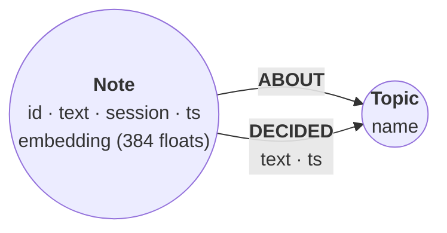
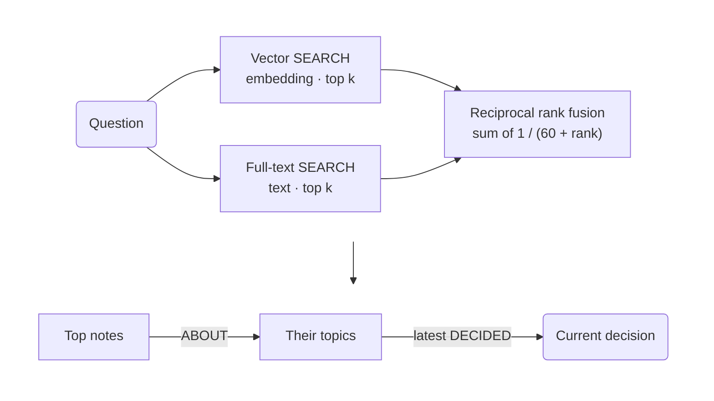

# Hybrid recall: vector + full-text + RRF

*An engineering-support agent keeps 40 notes from three working sessions on a
project. Asked "what did we decide about oauth tokens", it runs one Cypher
statement: a vector search and a full-text search over the notes, fused by
reciprocal rank, then a hop from each recalled note to its topic and that
topic's latest decision. The best match is an early note that says Auth0. The
hop shows that the team later decided to move to Okta.*

The graph is `(:Note {id, text, session, ts, embedding})-[:ABOUT]->(:Topic {name})`.
Nine notes also record a decision as `(:Note)-[:DECIDED {text, ts}]->(:Topic)`.
`ts` is an integer, epoch milliseconds.



The recall statement the recipe builds up to, in one picture:



## Embeddings, computed ahead of time

Every note and every question in this recipe was embedded offline, with the
companion example's deterministic `hash-384` embedder. It hashes lowercased
words and character trigrams into 384 buckets and normalizes the result. It
captures lexical overlap, not meaning, which is enough to show the mechanics.
In an application, call your embedding model here instead.

```python
import hashlib, math, re

import relate

DIMS = 384

def embed(text: str) -> list[float]:
    """hash-384: feature hashing over words and character trigrams, L2-normalized."""
    v = [0.0] * DIMS
    words = re.findall(r"[a-z0-9]+", text.lower())
    feats = words + [w[i:i + 3] for w in words for i in range(max(1, len(w) - 2))]
    for f in feats:
        h = int.from_bytes(hashlib.blake2b(f.encode(), digest_size=8).digest(), "little")
        v[h % DIMS] += 1.0 if h >> 63 else -1.0
    norm = math.sqrt(sum(x * x for x in v)) or 1.0
    return [x / norm for x in v]

# At recall time, embed the question and pass it with the raw text.
# RECALL is the statement in "Hop to the topic and its latest decision".
question = "what did we decide about oauth tokens"
params = {"q": question, "v": embed(question), "k": 5, "since": "2026-03-01T00:00:00Z"}
with relate.connect("notes.rl") as db:
    rows = db.execute(RECALL, params).fetchall()
```

The notes' vectors are in the `notes` data block. Each question's data block
holds the question text `q`, its precomputed vector `v`, and two knobs: `k`
(results per list) and `since` (the oldest note in scope). Editing `k` or
`since` on this page works as you would expect. Editing `q` does not re-embed
it: the full-text search sees the new text, but the vector search still uses
the vector of the original question.

The fixtures round each component to six significant digits, which leaves
every score below unchanged at four decimals. They write every component as a
float (`0.0`, not `0`), because parameters arrive exactly as the JSON spells
them.

## Create the constraints and search indexes

Constraints keep note ids and topic names unique, and keep `DECIDED.ts` an
integer. Then three search indexes:

- `note_e`, a vector index over the note embeddings (384 dimensions, cosine).
  `WITH [n.session, n.ts]` declares the properties a vector search may filter
  on inside the search.
- `note_t`, a full-text index over the note text.
- `dec_t`, a full-text index over the text of the `DECIDED` relationships.

```cypher cell=schema setup
CREATE CONSTRAINT note_id IF NOT EXISTS FOR (n:Note) REQUIRE n.id IS UNIQUE;
CREATE CONSTRAINT topic_name IF NOT EXISTS FOR (t:Topic) REQUIRE t.name IS UNIQUE;
CREATE CONSTRAINT decided_ts IF NOT EXISTS
  FOR ()-[d:DECIDED]-() REQUIRE d.ts IS :: INTEGER;
CREATE VECTOR INDEX note_e IF NOT EXISTS
  FOR (n:Note) ON (n.embedding) WITH [n.session, n.ts]
  OPTIONS {indexConfig: {`vector.dimensions`: 384,
                         `vector.similarity_function`: 'cosine'}};
CREATE FULLTEXT INDEX note_t IF NOT EXISTS FOR (n:Note) ON EACH [n.text];
CREATE FULLTEXT INDEX dec_t IF NOT EXISTS FOR ()-[r:DECIDED]-() ON EACH [r.text]
```

```table
(no rows) · indexes added: 3, constraints added: 3
```

## Load the notes

`vector(r.e, 384, FLOAT32)` stores a typed vector, and doubles as a write
guard: an embedding of the wrong length fails the whole statement. Without
the guard, a wrong-length list is stored anyway, and every vector search
skips it without an error.

```cypher cell=load setup params=notes
UNWIND $notes AS r
CREATE (n:Note {id: r.id, text: r.text, session: r.session, ts: r.ts,
                embedding: vector(r.e, 384, FLOAT32)})
WITH n, r
UNWIND r.topics AS name
MERGE (t:Topic {name: name})
CREATE (n)-[:ABOUT]->(t);

UNWIND $decisions AS r
MATCH (n:Note {id: r.note}), (t:Topic {name: r.topic})
CREATE (n)-[:DECIDED {text: r.text, ts: r.ts}]->(t);

MATCH (n:Note)
RETURN count(n) AS notes, count(DISTINCT n.session) AS sessions,
       COUNT { MATCH (:Topic) } AS topics,
       COUNT { MATCH ()-[:ABOUT]->() } AS about,
       COUNT { MATCH ()-[:DECIDED]->() } AS decided
```

```table
| notes | sessions | topics | about | decided |
|-------|----------|--------|-------|---------|
| 40    | 3        | 6      | 47    | 9       |
1 row · nodes created: 46, relationships created: 56, properties set: 224, labels added: 46
```

## The vector list

`SEARCH` binds `n` to the `k` nearest notes and names the similarity with
`SCORE AS`. The time filter sits inside the search, so it runs before the
`LIMIT`: whatever `since` is, the search returns `k` notes from the time
range, as long as the range holds that many.

```json data=q1
{
  "q": "what did we decide about oauth tokens",
  "k": 5,
  "since": "2026-03-01T00:00:00Z",
  "v": [0.0,0.185695,0.0,0.0,0.0,0.0,0.0,0.0,0.0,0.0,0.0,0.0,0.185695,0.0,0.0,0.0,0.0,0.0,0.0,0.0,0.0,0.0,0.0,0.0,0.0,0.0,0.0,0.0,0.0,0.0,0.0,0.0,-0.185695,0.0,0.0,0.0,0.0,0.0,0.0,0.0,0.0,0.0,0.0,0.0,0.0,0.0,0.0,0.0,0.0,0.0,-0.185695,0.0,0.0,0.0,0.0,0.0,0.0,0.0,0.0,0.0,0.0,0.0,0.0,0.0,0.0,0.0,0.0,0.0,0.0,0.0,0.0,0.0,0.0,0.0,0.0,0.0,0.0,0.0,0.0,0.0,0.0,0.0,0.0,0.0,0.0,0.185695,0.0,0.0,0.0,0.0,0.0,0.0,0.0,0.0,0.0,0.0,0.0,0.0,0.0,0.0,0.0,0.0,0.0,0.0,0.0,0.0,0.0,0.0,0.0,0.0,0.0,0.0,0.0,0.0,0.0,0.0,0.0,0.0,0.0,0.0,0.0,0.0,0.0,0.0,0.0,0.0,0.0,0.0,0.0,0.0,0.0,0.0,0.0,-0.185695,0.0,0.0,0.0,0.0,0.0,0.0,0.0,0.0,0.0,0.0,0.0,0.0,0.0,0.0,0.0,0.0,0.0,0.0,0.185695,0.0,0.0,0.0,0.0,0.0,0.0,0.0,0.0,0.0,0.0,0.0,0.0,0.185695,0.0,0.0,0.0,0.0,0.0,0.0,0.371391,0.0,0.0,0.0,0.0,0.0,0.0,0.0,0.0,0.0,0.0,0.0,0.0,0.0,0.0,0.0,0.0,0.0,0.0,0.0,0.0,0.0,0.0,0.371391,0.0,0.0,0.0,0.0,0.0,0.0,0.0,0.0,0.0,0.0,0.0,0.0,0.0,0.0,0.0,0.0,0.0,0.0,0.0,0.0,0.185695,0.0,0.0,0.0,0.0,0.0,0.0,0.0,0.0,0.0,0.185695,0.0,0.0,0.0,0.0,0.0,0.0,0.0,0.0,0.0,0.0,0.0,0.185695,0.0,0.0,0.0,0.0,0.0,0.0,0.0,0.0,0.0,0.0,0.0,0.0,0.0,0.0,0.0,0.0,0.0,0.0,0.0,0.0,0.0,0.0,0.0,0.0,0.0,0.0,0.0,0.0,0.0,0.0,0.0,0.0,0.0,0.0,0.0,0.0,0.0,0.0,0.0,0.0,0.0,0.0,0.0,0.0,0.0,0.0,0.0,0.0,0.0,0.0,0.0,0.0,0.185695,0.0,0.0,0.0,0.0,0.0,0.0,0.0,0.0,-0.185695,0.0,0.0,0.0,0.0,0.0,0.0,0.0,-0.185695,0.0,0.0,0.0,0.0,0.0,0.0,0.0,0.0,0.0,-0.185695,0.0,0.0,0.0,0.0,0.0,0.0,0.0,0.0,0.0,0.0,0.0,0.0,0.0,0.0,0.0,0.0,0.0,0.0,0.0,0.0,0.0,0.0,0.0,0.0,-0.185695,0.0,0.0,0.0,0.0,0.0,-0.185695,0.0,0.0,0.0,0.0,0.0,0.0,0.0,-0.185695,0.0,0.0,0.0,0.0,0.0,0.0,0.0,0.0,0.0,0.0,0.0,-0.185695,0.0,0.0,0.0,0.0,0.0,0.0,-0.185695,0.0,0.0,0.0,0.0,0.185695,0.0,0.0]
}
```

```cypher cell=vector params=q1
MATCH (n:Note)
SEARCH n IN (VECTOR INDEX note_e FOR $v
             WHERE n.ts >= datetime($since).epochMillis LIMIT $k) SCORE AS vs
RETURN n.id AS id, n.session AS session, round(vs, 4) AS vector, n.text AS text
ORDER BY vs DESC, id
```

```table
| id    | session     | vector | text                                                                            |
|-------|-------------|--------|---------------------------------------------------------------------------------|
| "n02" | "session-1" | 0.6252 | "Customer login goes through Auth0; refresh tokens live in HttpOnly cookies."   |
| "n25" | "session-2" | 0.5692 | "Refresh tokens rotate on every use once Okta is live."                         |
| "n03" | "session-1" | 0.5585 | "OAuth callbacks are published to Kafka so the audit service sees every login." |
| "n15" | "session-2" | 0.5536 | "Migrate customer login from Auth0 to Okta before the April renewal."           |
| "n04" | "session-1" | 0.5435 | "Each tenant gets its own Kafka topic for ticket events."                       |
5 rows
```

Change `since` to `2026-03-09T00:00:00Z` and run it again: the three
session-1 notes drop out, and the search still returns five notes, all from
sessions 2 and 3. The procedure form,
`CALL db.index.vector.queryNodes('note_e', $k, $v)`, returns the same five
notes here, but it has no filter.

## The full-text list

Full-text `SEARCH` splits the question into lowercase terms and ORs them. The
score counts the term occurrences it finds: there is no stemming, and short
words such as `do` or `the` count too. Three notes match one term each
(`oauth` or `tokens`), so each scores 1.0. Equal scores come back in
insertion order, so `n.id` is the second sort key.

A full-text search takes no `WHERE`. So this list fetches three times as
many notes as it needs, filters them by time, and then keeps `k`.

```cypher cell=fulltext params=q1
MATCH (n:Note)
SEARCH n IN (FULLTEXT INDEX note_t FOR $q LIMIT $k * 3) SCORE AS fs
WHERE n.ts >= datetime($since).epochMillis
RETURN n.id AS id, fs AS fulltext, n.text AS text
ORDER BY fs DESC, id LIMIT $k
```

```table
| id    | fulltext | text                                                                            |
|-------|----------|---------------------------------------------------------------------------------|
| "n02" | 1.0      | "Customer login goes through Auth0; refresh tokens live in HttpOnly cookies."   |
| "n03" | 1.0      | "OAuth callbacks are published to Kafka so the audit service sees every login." |
| "n25" | 1.0      | "Refresh tokens rotate on every use once Okta is live."                         |
3 rows
```

> **Note**
> Use the `SEARCH` clause for questions with more than one word.
> `CALL db.index.fulltext.queryNodes('note_t', 'oauth kafka')` currently
> treats the whole string as a single term and returns no rows, while
> `SEARCH` ranks the note that has both words first.

## Filter inside the search, not after it

`SEARCH` takes its `LIMIT` window from the whole index first. A `WHERE` after
the clause only filters that window, and so does a property in the `MATCH`
pattern (`MATCH (n:Note {session: $session})`). Both silently return fewer
than `k` rows.

Here the scope is session 2 from 10:00 on, which holds nine notes, and the
question is `kafka` with `k = 3`:

```json data=window
{
  "q": "kafka",
  "k": 3,
  "session": "session-2",
  "since": "2026-03-09T10:00:00Z",
  "v": [0.0,0.0,0.0,0.0,0.0,0.0,0.0,0.0,0.0,0.0,0.0,0.0,0.0,0.0,0.0,0.0,0.0,0.0,0.5,0.0,0.0,-0.5,0.0,0.0,0.0,0.0,0.0,0.0,0.0,0.0,0.0,0.0,0.0,0.0,0.0,0.0,0.0,0.0,0.0,0.5,0.0,0.0,0.0,0.0,0.0,0.0,0.0,0.0,0.0,0.0,0.0,0.0,0.0,0.0,0.0,0.0,0.0,0.0,0.0,0.0,0.0,0.0,0.0,0.0,0.0,0.0,0.0,0.0,0.0,0.0,0.0,0.0,0.0,0.0,0.0,0.0,0.0,0.0,0.0,0.0,0.0,0.0,0.0,0.0,0.0,0.0,0.0,0.0,0.0,0.0,0.0,0.0,0.0,0.0,0.0,0.0,0.0,0.0,0.0,0.0,0.0,0.0,0.0,0.0,0.0,0.0,0.0,0.0,0.0,0.0,0.0,0.0,0.0,0.0,0.0,0.0,0.0,0.0,0.0,0.0,0.0,0.0,0.0,0.0,-0.5,0.0,0.0,0.0,0.0,0.0,0.0,0.0,0.0,0.0,0.0,0.0,0.0,0.0,0.0,0.0,0.0,0.0,0.0,0.0,0.0,0.0,0.0,0.0,0.0,0.0,0.0,0.0,0.0,0.0,0.0,0.0,0.0,0.0,0.0,0.0,0.0,0.0,0.0,0.0,0.0,0.0,0.0,0.0,0.0,0.0,0.0,0.0,0.0,0.0,0.0,0.0,0.0,0.0,0.0,0.0,0.0,0.0,0.0,0.0,0.0,0.0,0.0,0.0,0.0,0.0,0.0,0.0,0.0,0.0,0.0,0.0,0.0,0.0,0.0,0.0,0.0,0.0,0.0,0.0,0.0,0.0,0.0,0.0,0.0,0.0,0.0,0.0,0.0,0.0,0.0,0.0,0.0,0.0,0.0,0.0,0.0,0.0,0.0,0.0,0.0,0.0,0.0,0.0,0.0,0.0,0.0,0.0,0.0,0.0,0.0,0.0,0.0,0.0,0.0,0.0,0.0,0.0,0.0,0.0,0.0,0.0,0.0,0.0,0.0,0.0,0.0,0.0,0.0,0.0,0.0,0.0,0.0,0.0,0.0,0.0,0.0,0.0,0.0,0.0,0.0,0.0,0.0,0.0,0.0,0.0,0.0,0.0,0.0,0.0,0.0,0.0,0.0,0.0,0.0,0.0,0.0,0.0,0.0,0.0,0.0,0.0,0.0,0.0,0.0,0.0,0.0,0.0,0.0,0.0,0.0,0.0,0.0,0.0,0.0,0.0,0.0,0.0,0.0,0.0,0.0,0.0,0.0,0.0,0.0,0.0,0.0,0.0,0.0,0.0,0.0,0.0,0.0,0.0,0.0,0.0,0.0,0.0,0.0,0.0,0.0,0.0,0.0,0.0,0.0,0.0,0.0,0.0,0.0,0.0,0.0,0.0,0.0,0.0,0.0,0.0,0.0,0.0,0.0,0.0,0.0,0.0,0.0,0.0,0.0,0.0,0.0,0.0,0.0,0.0,0.0,0.0,0.0,0.0,0.0,0.0,0.0,0.0,0.0,0.0,0.0,0.0,0.0,0.0,0.0,0.0,0.0,0.0,0.0,0.0,0.0,0.0,0.0,0.0,0.0,0.0,0.0,0.0,0.0,0.0]
}
```

```cypher cell=window params=window
MATCH (n:Note)
SEARCH n IN (VECTOR INDEX note_e FOR $v
             WHERE n.session = $session AND n.ts >= datetime($since).epochMillis
             LIMIT $k) SCORE AS s
WITH n ORDER BY s DESC, n.id
WITH collect(n.id) AS ids
RETURN 'vector: WHERE inside SEARCH' AS filter, ids
UNION ALL
MATCH (n:Note)
SEARCH n IN (VECTOR INDEX note_e FOR $v LIMIT $k) SCORE AS s
WHERE n.session = $session AND n.ts >= datetime($since).epochMillis
WITH n ORDER BY s DESC, n.id
WITH collect(n.id) AS ids
RETURN 'vector: WHERE after SEARCH' AS filter, ids
UNION ALL
MATCH (n:Note)
SEARCH n IN (FULLTEXT INDEX note_t FOR $q LIMIT $k) SCORE AS s
WHERE n.session = $session AND n.ts >= datetime($since).epochMillis
WITH n ORDER BY s DESC, n.id
WITH collect(n.id) AS ids
RETURN 'full-text: LIMIT $k, then WHERE' AS filter, ids
UNION ALL
MATCH (n:Note)
SEARCH n IN (FULLTEXT INDEX note_t FOR $q LIMIT $k * 3) SCORE AS s
WHERE n.session = $session AND n.ts >= datetime($since).epochMillis
WITH n ORDER BY s DESC, n.id LIMIT $k
WITH collect(n.id) AS ids
RETURN 'full-text: LIMIT $k * 3, WHERE, LIMIT $k' AS filter, ids
```

```table
| filter                                     | ids                   |
|--------------------------------------------|-----------------------|
| "vector: WHERE inside SEARCH"              | ["n18", "n19", "n23"] |
| "vector: WHERE after SEARCH"               | ["n18"]               |
| "full-text: LIMIT $k, then WHERE"          | []                    |
| "full-text: LIMIT $k * 3, WHERE, LIMIT $k" | ["n17", "n18", "n19"] |
4 rows
```

Only the first and last forms return `k` notes. The three best full-text
matches for `kafka` are all session-1 notes, so filtering them afterwards
leaves nothing.

## Fuse the two lists by reciprocal rank

Reciprocal rank fusion (RRF) ignores the raw scores, which are not comparable
across the two lists. Each list ranks its notes 1, 2, 3, …; a note earns
`1 / (60 + rank)` from every list it appears in, and the shares add up. The
constant 60 is the usual choice: it keeps one list's first place from
swamping the other list.

`CALL () { … UNION ALL … }` runs both searches in one statement. Each branch
collects its notes in score order and unwinds them with their position. This
question needs the vector list: the note that answers it says `Token
revocation` and `propagates`, and full-text search has no stemming, so it
never matches `tokens`, `revoking`, or `propagate`.

```json data=q2
{
  "q": "how fast does revoking tokens propagate",
  "k": 5,
  "since": "2026-03-01T00:00:00Z",
  "v": [0.0,0.182574,0.0,0.0,0.0,0.0,0.0,0.0,0.0,0.0,0.182574,-0.182574,0.0,0.0,0.0,0.0,0.0,0.0,0.0,0.0,0.0,-0.182574,0.0,0.0,0.0,0.0,0.0,0.0,0.0,0.0,0.0,0.0,-0.182574,0.0,0.0,0.0,0.0,0.0,0.0,0.0,0.182574,0.0,0.365148,0.0,0.0,0.0,0.0,0.0,0.0,0.0,0.0,0.0,0.182574,0.0,0.0,0.0,0.0,-0.182574,0.182574,0.0,0.0,0.0,0.0,0.0,0.0,0.0,0.0,0.0,0.0,0.0,0.0,0.0,-0.182574,0.0,0.0,0.0,0.0,0.0,0.0,0.0,0.0,0.0,0.0,0.0,0.0,0.0,0.0,0.0,0.0,0.0,0.0,0.0,0.0,0.0,0.0,0.0,0.0,0.0,0.0,0.0,0.0,0.0,0.0,0.0,-0.182574,0.0,0.0,0.0,0.0,0.0,0.0,0.0,0.0,0.0,0.0,0.0,0.0,0.0,0.0,0.0,0.0,0.0,0.182574,0.0,0.0,0.0,0.0,0.0,0.0,0.0,0.0,0.0,0.0,-0.182574,0.0,0.0,0.0,0.0,0.0,0.0,0.0,0.0,0.0,0.0,0.0,0.0,0.0,0.0,0.0,0.0,0.0,0.0,0.0,0.0,0.0,0.0,0.0,0.0,0.0,0.0,0.0,0.0,0.0,0.0,0.0,0.0,0.0,0.0,0.0,0.0,0.0,0.0,0.0,0.0,-0.182574,0.0,0.0,0.0,0.0,0.182574,0.0,0.0,0.0,0.0,0.0,0.0,0.0,0.0,0.182574,0.0,0.0,0.0,0.0,0.0,0.0,0.0,0.0,0.0,0.0,0.0,0.0,0.0,0.0,0.0,0.0,0.0,0.0,0.0,0.0,0.0,0.0,0.0,0.0,0.0,-0.182574,0.0,0.0,0.0,0.0,0.0,0.0,0.0,0.0,0.0,0.0,0.0,0.0,0.0,0.0,0.0,0.0,0.0,0.0,0.0,0.0,0.0,0.0,0.0,0.0,0.0,0.0,0.0,0.0,0.0,0.0,0.0,0.0,0.0,0.0,0.0,0.0,0.0,0.0,0.0,0.0,0.0,0.0,0.0,0.0,0.0,0.0,0.0,0.0,0.0,-0.182574,0.0,0.0,-0.182574,0.0,0.0,0.0,0.0,0.0,0.0,0.0,0.0,0.0,0.0,0.0,0.0,0.0,0.0,0.0,0.0,0.0,0.0,0.0,0.0,0.0,0.0,0.0,0.0,0.0,0.0,0.0,0.0,0.0,0.0,0.0,0.0,0.0,0.0,0.0,0.0,0.0,0.0,0.0,0.0,0.0,0.0,0.0,0.0,0.0,0.0,0.0,0.0,0.0,0.0,-0.182574,0.0,0.0,0.0,0.0,0.0,0.0,0.0,0.0,0.0,0.0,-0.182574,0.0,0.182574,0.0,0.0,0.0,0.0,0.0,0.0,0.0,0.0,0.0,0.0,0.0,0.0,0.0,0.0,-0.182574,0.0,0.0,-0.182574,0.0,0.0,0.0,0.0,0.0,0.0,0.0,0.0,0.0,0.0,0.0,0.0,0.0,0.0,0.0,0.0,0.0,0.0,0.0,-0.182574,0.0,0.0,0.0,0.0,0.0,0.0,0.0,0.0,0.0,0.182574,0.0,0.0,0.0,0.0]
}
```

```cypher cell=fuse-vector params=q2
CALL () {
  MATCH (n:Note)
  SEARCH n IN (VECTOR INDEX note_e FOR $v
               WHERE n.ts >= datetime($since).epochMillis LIMIT $k) SCORE AS vs
  WITH n ORDER BY vs DESC, n.id
  WITH collect(n) AS ns
  UNWIND range(0, size(ns) - 1) AS i
  RETURN ns[i] AS n, 'vector' AS list, i + 1 AS rank
  UNION ALL
  MATCH (n:Note)
  SEARCH n IN (FULLTEXT INDEX note_t FOR $q LIMIT $k * 3) SCORE AS fs
  WHERE n.ts >= datetime($since).epochMillis
  WITH n ORDER BY fs DESC, n.id LIMIT $k
  WITH collect(n) AS ns
  UNWIND range(0, size(ns) - 1) AS i
  RETURN ns[i] AS n, 'fulltext' AS list, i + 1 AS rank
}
WITH n, sum(1.0 / (60 + rank)) AS rrf,
     min(CASE list WHEN 'vector' THEN rank END) AS vector_rank,
     min(CASE list WHEN 'fulltext' THEN rank END) AS fulltext_rank
ORDER BY rrf DESC, n.id LIMIT $k
RETURN n.id AS id, vector_rank, fulltext_rank, round(rrf, 4) AS rrf, n.text AS text
```

```table
| id    | vector_rank | fulltext_rank | rrf    | text                                                                                    |
|-------|-------------|---------------|--------|-----------------------------------------------------------------------------------------|
| "n02" | 2           | 1             | 0.0325 | "Customer login goes through Auth0; refresh tokens live in HttpOnly cookies."           |
| "n25" | 3           | 2             | 0.032  | "Refresh tokens rotate on every use once Okta is live."                                 |
| "n16" | 1           | null          | 0.0164 | "Token revocation now propagates in under a second via the Redis session store."        |
| "n01" | 4           | null          | 0.0156 | "Relay kickoff: ticket intake, the agent console and billing all live in one monorepo." |
| "n32" | 5           | null          | 0.0154 | "Kafka status: consumer lag is back under one second after the rebalance fix."          |
5 rows
```

`n16` is first in the vector list and absent from the full-text list, and it
survives the fusion in third place. The next question needs the full-text
list. The long incident note holds three of its terms (`kafka`, `142`, and
`alert`), so full-text ranks it first, but it is not among the five nearest
vectors.

```json data=q3
{
  "q": "which alert fired for KAFKA-142",
  "k": 5,
  "since": "2026-03-01T00:00:00Z",
  "v": [0.0,0.0,0.0,0.0,0.0,0.0,0.0,0.0,0.0,0.0,0.0,0.0,0.0,0.204124,0.0,0.0,0.0,0.0,0.204124,0.0,0.0,-0.204124,0.0,0.0,0.0,0.0,0.0,0.0,0.0,0.0,0.0,0.0,0.0,0.0,0.0,0.0,0.0,0.0,0.0,0.204124,0.0,0.0,0.0,0.0,0.0,0.0,0.0,0.0,0.0,0.0,0.0,0.0,0.0,0.0,0.0,0.0,0.0,0.0,0.0,0.0,0.0,0.0,0.0,0.0,0.0,0.0,0.0,0.0,0.0,0.0,-0.204124,0.0,0.0,0.0,0.0,0.0,0.0,0.0,0.0,0.0,0.0,0.0,0.0,0.0,0.0,0.0,0.0,0.0,0.0,0.0,0.0,0.0,0.0,0.0,0.0,0.0,0.0,0.0,0.0,0.0,0.0,0.0,0.0,0.0,0.0,0.0,0.0,0.0,0.0,0.0,0.0,0.0,-0.204124,0.0,0.0,0.0,0.0,0.0,0.0,0.408248,0.0,0.0,0.0,0.0,-0.204124,0.0,0.0,0.0,0.0,0.0,0.0,0.0,0.0,0.0,0.0,0.0,0.0,0.0,0.0,0.0,0.0,0.0,0.0,0.0,0.0,0.0,0.0,0.0,0.0,0.0,0.0,0.0,0.0,0.0,0.0,-0.204124,0.0,0.0,0.0,0.0,-0.204124,0.0,0.0,0.0,0.0,0.0,0.0,0.0,0.0,0.0,0.0,0.0,0.0,0.0,0.0,0.0,0.0,0.204124,0.0,0.0,0.0,0.0,0.0,0.0,0.0,0.0,0.0,0.0,0.0,0.0,0.0,0.0,0.0,0.0,0.0,0.0,0.0,0.0,0.0,0.0,0.0,0.0,0.204124,0.0,0.0,0.0,0.0,-0.204124,0.0,0.0,0.0,0.0,0.0,0.0,0.0,0.0,0.0,0.0,0.0,0.0,0.0,0.0,0.0,0.0,0.0,0.0,0.0,0.0,0.0,0.0,0.0,0.0,0.0,0.0,0.0,0.0,0.0,0.0,0.0,0.0,0.0,0.0,0.0,0.0,0.0,0.0,0.0,0.0,0.0,0.0,0.0,0.0,0.0,0.0,0.0,0.0,0.0,0.0,0.0,-0.204124,0.0,0.0,0.0,0.0,0.0,0.0,0.0,0.0,0.0,0.0,0.0,0.0,0.0,0.0,0.0,0.204124,0.0,0.0,0.0,0.0,0.0,0.0,0.0,-0.204124,0.0,0.0,0.0,0.0,-0.408248,0.0,0.0,0.0,0.0,0.0,0.0,0.0,0.0,0.0,0.0,0.0,0.0,0.0,0.0,0.0,0.0,0.0,0.0,0.0,0.0,0.0,0.0,0.0,0.0,0.0,0.0,0.0,0.0,0.0,0.0,0.0,0.0,0.0,0.0,0.0,0.0,0.0,0.0,0.0,0.0,0.0,0.0,0.0,0.0,0.0,0.0,0.0,0.0,0.0,0.0,0.0,0.0,0.0,0.0,0.0,0.0,0.0,0.0,0.0,0.0,0.0,0.0,0.0,0.0,0.0,0.0,0.0,0.0,0.0,0.0,0.0,0.0,0.0,0.0,0.0,0.0,0.0,0.0,0.0,0.0,0.0,0.204124,0.0,0.0,0.0,0.0,0.0,0.0,0.0,0.0,0.0,0.0,0.0,0.0,0.0]
}
```

```cypher cell=fuse-fulltext params=q3
CALL () {
  MATCH (n:Note)
  SEARCH n IN (VECTOR INDEX note_e FOR $v
               WHERE n.ts >= datetime($since).epochMillis LIMIT $k) SCORE AS vs
  WITH n ORDER BY vs DESC, n.id
  WITH collect(n) AS ns
  UNWIND range(0, size(ns) - 1) AS i
  RETURN ns[i] AS n, 'vector' AS list, i + 1 AS rank
  UNION ALL
  MATCH (n:Note)
  SEARCH n IN (FULLTEXT INDEX note_t FOR $q LIMIT $k * 3) SCORE AS fs
  WHERE n.ts >= datetime($since).epochMillis
  WITH n ORDER BY fs DESC, n.id LIMIT $k
  WITH collect(n) AS ns
  UNWIND range(0, size(ns) - 1) AS i
  RETURN ns[i] AS n, 'fulltext' AS list, i + 1 AS rank
}
WITH n, sum(1.0 / (60 + rank)) AS rrf,
     min(CASE list WHEN 'vector' THEN rank END) AS vector_rank,
     min(CASE list WHEN 'fulltext' THEN rank END) AS fulltext_rank
ORDER BY rrf DESC, n.id LIMIT $k
RETURN n.id AS id, vector_rank, fulltext_rank, round(rrf, 4) AS rrf, n.text AS text
```

```table
| id    | vector_rank | fulltext_rank | rrf    | text                                                                                                                                                                           |
|-------|-------------|---------------|--------|--------------------------------------------------------------------------------------------------------------------------------------------------------------------------------|
| "n04" | 2           | 2             | 0.0323 | "Each tenant gets its own Kafka topic for ticket events."                                                                                                                      |
| "n23" | 1           | 4             | 0.032  | "Kafka lag dashboard added to Grafana with a five minute alert."                                                                                                               |
| "n07" | 3           | 3             | 0.0317 | "Kafka consumer lag on the ticket-events group is the first alert to build."                                                                                                   |
| "n26" | null        | 1             | 0.0164 | "Incident KAFKA-142: a broker disk filled overnight because retention on the audit stream was unbounded; retention is now capped and a disk alert pages the on-call engineer." |
| "n18" | 4           | null          | 0.0156 | "Consolidate ticket events into shared Kafka topics keyed by tenant id."                                                                                                       |
5 rows
```

## Hop to the topic and its latest decision

This is the whole recall tool: the fusion from the last step, then the graph.
Each fused note leads to its topics, and each topic to every `DECIDED` edge on
it. Sorting the edges newest first and taking `head(collect(d.text))` keeps
the latest decision per note and topic. The agent can log this one string,
replay it, and evaluate it.

```cypher cell=recall params=q1
CALL () {
  MATCH (n:Note)
  SEARCH n IN (VECTOR INDEX note_e FOR $v
               WHERE n.ts >= datetime($since).epochMillis LIMIT $k) SCORE AS vs
  WITH n ORDER BY vs DESC, n.id
  WITH collect(n) AS ns
  UNWIND range(0, size(ns) - 1) AS i
  RETURN ns[i] AS n, i + 1 AS rank
  UNION ALL
  MATCH (n:Note)
  SEARCH n IN (FULLTEXT INDEX note_t FOR $q LIMIT $k * 3) SCORE AS fs
  WHERE n.ts >= datetime($since).epochMillis
  WITH n ORDER BY fs DESC, n.id LIMIT $k
  WITH collect(n) AS ns
  UNWIND range(0, size(ns) - 1) AS i
  RETURN ns[i] AS n, i + 1 AS rank
}
WITH n, sum(1.0 / (60 + rank)) AS rrf
ORDER BY rrf DESC, n.id LIMIT $k
MATCH (n)-[:ABOUT]->(t:Topic)
OPTIONAL MATCH (t)<-[d:DECIDED]-()
WITH n, rrf, t, d ORDER BY d.ts DESC
WITH n, rrf, t, head(collect(d.text)) AS decided
RETURN n.id AS id, n.text AS text, t.name AS topic, decided, round(rrf, 4) AS rrf
ORDER BY rrf DESC, id, topic
```

```table
| id    | text                                                                            | topic   | decided                                      | rrf    |
|-------|---------------------------------------------------------------------------------|---------|----------------------------------------------|--------|
| "n02" | "Customer login goes through Auth0; refresh tokens live in HttpOnly cookies."   | "auth"  | "migrate customer login to Okta"             | 0.0328 |
| "n03" | "OAuth callbacks are published to Kafka so the audit service sees every login." | "auth"  | "migrate customer login to Okta"             | 0.032  |
| "n03" | "OAuth callbacks are published to Kafka so the audit service sees every login." | "kafka" | "three-day retention on shared Kafka topics" | 0.032  |
| "n25" | "Refresh tokens rotate on every use once Okta is live."                         | "auth"  | "migrate customer login to Okta"             | 0.032  |
| "n15" | "Migrate customer login from Auth0 to Okta before the April renewal."           | "auth"  | "migrate customer login to Okta"             | 0.0156 |
| "n04" | "Each tenant gets its own Kafka topic for ticket events."                       | "kafka" | "three-day retention on shared Kafka topics" | 0.0154 |
6 rows
```

The top note says Auth0 and was written in session 1. Its topic, `auth`, has
two decisions, and the newer one is `migrate customer login to Okta`. Neither
search could have told the agent that on its own.

> **Note**
> Take the latest edge per group with `ORDER BY` and `head(collect(...))`,
> not with `ORDER BY d.ts DESC LIMIT 1`. Relate currently mis-orders a
> relationship property under `ORDER BY … LIMIT` when the pattern starts from
> more than one node: over all nine edges,
> `MATCH (:Note)-[d:DECIDED]->(:Topic) RETURN d.text ORDER BY d.ts DESC LIMIT 1`
> returns the oldest decision, `use Auth0 for customer login`. A second sort
> key (`ORDER BY d.ts DESC, d.text`) avoids it.

To see the shape, return paths from each recalled note to its topic and the
note that made the topic's latest decision. Open the graph view:

```cypher cell=graph params=q1
CALL () {
  MATCH (n:Note)
  SEARCH n IN (VECTOR INDEX note_e FOR $v
               WHERE n.ts >= datetime($since).epochMillis LIMIT $k) SCORE AS vs
  WITH n ORDER BY vs DESC, n.id
  WITH collect(n) AS ns
  UNWIND range(0, size(ns) - 1) AS i
  RETURN ns[i] AS n, i + 1 AS rank
  UNION ALL
  MATCH (n:Note)
  SEARCH n IN (FULLTEXT INDEX note_t FOR $q LIMIT $k * 3) SCORE AS fs
  WHERE n.ts >= datetime($since).epochMillis
  WITH n ORDER BY fs DESC, n.id LIMIT $k
  WITH collect(n) AS ns
  UNWIND range(0, size(ns) - 1) AS i
  RETURN ns[i] AS n, i + 1 AS rank
}
WITH n, sum(1.0 / (60 + rank)) AS rrf
ORDER BY rrf DESC, n.id LIMIT $k
MATCH (n)-[:ABOUT]->(t:Topic)<-[d:DECIDED]-(:Note)
WITH n, rrf, t, d ORDER BY d.ts DESC
WITH n, rrf, t, head(collect(d)) AS d
MATCH p = (n)-[:ABOUT]->(t)<-[d]-(m:Note)
RETURN n.id AS note, t.name AS topic, m.id AS decided_by, p AS path
ORDER BY rrf DESC, note, topic
```

```gram
// 6 rows
[{note: "n02", topic: "auth", decided_by: "n15"} | (n1:Note {embedding: cypher`vector([0.0, 0.0, 0.0, 0.0, 0.0, 0.0, -0.1348399966955185, -0.1348399966955185, 0.0, 0.0, 0.0, -0.1348399966955185, 0.0, 0.1348399966955185, 0.0, 0.0, 0.0, 0.0, 0.0, 0.0, 0.0, 0.0, -0.1348399966955185, 0.0, 0.0, 0.0, 0.0, 0.0, 0.0, 0.0, 0.0, 0.0, -0.1348399966955185, 0.1348399966955185, -0.1348399966955185, 0.0, 0.0, 0.0, 0.0, 0.0, 0.0, 0.0, 0.0, 0.0, 0.0, 0.0, 0.0, 0.0, 0.0, 0.0, 0.0, 0.1348399966955185, 0.0, 0.0, 0.0, -0.269679993391037, 0.0, 0.0, 0.0, 0.0, 0.0, 0.0, 0.0, 0.0, 0.0, 0.0, 0.0, 0.0, 0.0, 0.0, 0.0, 0.0, 0.0, -0.1348399966955185, -0.1348399966955185, 0.0, 0.0, 0.0, 0.0, 0.0, 0.0, 0.0, 0.0, -0.1348399966955185, 0.0, 0.1348399966955185, 0.0, 0.0, 0.0, 0.0, 0.0, 0.0, 0.0, 0.0, 0.0, 0.0, 0.0, 0.0, 0.1348399966955185, 0.0, 0.0, 0.0, 0.0, 0.0, 0.0, 0.0, 0.0, 0.0, 0.0, 0.0, 0.0, 0.0, 0.0, 0.0, 0.0, 0.0, 0.0, 0.0, 0.0, 0.1348399966955185, 0.0, 0.0, 0.0, 0.0, 0.0, 0.0, -0.1348399966955185, 0.0, 0.0, 0.0, 0.0, 0.0, 0.0, -0.1348399966955185, 0.0, 0.0, 0.0, 0.0, -0.1348399966955185, 0.0, 0.0, 0.0, 0.0, 0.0, 0.0, 0.0, 0.0, -0.1348399966955185, 0.0, 0.0, 0.0, -0.1348399966955185, 0.0, 0.0, 0.0, 0.0, -0.1348399966955185, 0.0, 0.0, 0.0, 0.0, 0.0, 0.0, 0.0, 0.0, 0.0, 0.0, 0.0, 0.0, 0.1348399966955185, 0.0, 0.0, 0.0, 0.1348399966955185, 0.0, 0.0, 0.0, 0.0, 0.0, 0.0, 0.0, 0.0, 0.0, 0.0, 0.0, 0.0, 0.0, 0.0, 0.0, 0.0, 0.0, 0.1348399966955185, 0.0, 0.0, -0.1348399966955185, 0.1348399966955185, 0.0, 0.0, 0.0, 0.0, 0.0, 0.0, 0.0, 0.0, 0.0, 0.0, 0.0, 0.0, 0.0, 0.0, 0.0, -0.1348399966955185, 0.0, 0.0, 0.0, 0.0, 0.1348399966955185, 0.0, 0.0, 0.0, 0.0, 0.1348399966955185, 0.0, 0.1348399966955185, 0.0, 0.0, 0.0, 0.0, 0.0, 0.0, 0.0, 0.0, 0.0, 0.0, 0.0, 0.0, 0.0, 0.0, 0.0, 0.1348399966955185, 0.0, 0.0, 0.0, 0.0, 0.0, 0.0, 0.0, 0.0, 0.0, 0.0, 0.0, 0.0, 0.0, 0.0, 0.0, 0.0, 0.0, 0.0, 0.0, -0.1348399966955185, 0.0, 0.0, 0.0, -0.1348399966955185, 0.0, 0.0, 0.0, 0.0, 0.0, 0.0, 0.0, -0.1348399966955185, 0.0, 0.0, 0.0, 0.0, 0.0, 0.0, 0.0, 0.0, 0.0, 0.0, 0.0, 0.0, 0.0, -0.1348399966955185, 0.0, 0.0, 0.0, 0.0, 0.0, 0.0, 0.1348399966955185, -0.1348399966955185, 0.0, 0.0, 0.0, 0.0, 0.1348399966955185, 0.0, 0.0, 0.0, 0.0, 0.0, 0.0, 0.0, -0.1348399966955185, 0.0, 0.0, -0.1348399966955185, 0.0, 0.0, 0.0, 0.0, 0.0, 0.0, 0.0, 0.0, -0.1348399966955185, -0.269679993391037, 0.1348399966955185, 0.0, 0.0, 0.0, 0.0, 0.0, 0.0, 0.0, 0.1348399966955185, 0.0, 0.0, 0.1348399966955185, 0.0, 0.0, 0.0, 0.0, 0.0, 0.0, 0.0, 0.0, 0.0, 0.0, 0.0, 0.0, 0.0, 0.0, 0.0, 0.0, 0.0, -0.1348399966955185, 0.0, 0.0, 0.0, 0.0, 0.0, 0.0, 0.0, 0.0, 0.0, 0.0, 0.0, 0.0, 0.0, 0.0, 0.0, 0.0, 0.0, 0.0, 0.0, -0.1348399966955185, 0.0, 0.0, 0.0, 0.0, 0.0, 0.0, -0.1348399966955185, 0.0, 0.0, 0.0, 0.0, 0.0, 0.0, 0.0], 384, FLOAT32)`, id: "n02", session: "session-1", text: "Customer login goes through Auth0; refresh tokens live in HttpOnly cookies.", ts: 1772442900000})-[r1:ABOUT]->(n41:Topic {name: "auth"})<-[r50:DECIDED {text: "migrate customer login to Okta", ts: 1773048000000}]-(n14:Note {embedding: cypher`vector([0.0, 0.0, 0.0, 0.0, 0.0, 0.0, -0.144337996840477, -0.144337996840477, 0.0, 0.0, 0.0, 0.0, 0.0, 0.144337996840477, 0.144337996840477, 0.0, 0.0, 0.0, 0.0, 0.0, 0.0, 0.0, 0.0, 0.0, 0.0, 0.0, 0.0, 0.0, 0.0, 0.0, 0.0, 0.0, 0.0, 0.0, -0.2886750102043152, -0.144337996840477, 0.0, 0.0, 0.0, -0.144337996840477, 0.0, 0.0, 0.0, 0.0, 0.0, 0.0, 0.0, 0.0, 0.0, 0.0, 0.0, 0.0, 0.0, 0.0, 0.0, 0.0, 0.0, 0.0, 0.0, 0.0, 0.0, 0.0, 0.0, 0.0, 0.0, 0.0, 0.0, 0.0, 0.0, 0.0, 0.0, 0.0, 0.0, -0.144337996840477, 0.0, 0.0, 0.0, 0.0, 0.0, 0.0, 0.0, 0.0, 0.0, 0.0, 0.0, 0.0, 0.0, 0.0, 0.0, 0.0, -0.144337996840477, 0.0, 0.0, -0.144337996840477, 0.0, -0.144337996840477, 0.0, 0.0, 0.0, 0.0, 0.0, 0.0, 0.0, 0.0, 0.0, 0.0, 0.0, 0.0, 0.0, 0.0, 0.0, 0.0, 0.0, 0.0, -0.144337996840477, 0.0, 0.0, 0.0, 0.0, 0.0, 0.0, 0.0, 0.0, 0.0, 0.0, 0.144337996840477, 0.0, 0.0, 0.0, 0.0, 0.0, 0.0, 0.144337996840477, 0.0, 0.0, 0.0, 0.0, 0.0, 0.0, 0.0, 0.0, 0.0, 0.0, 0.0, 0.144337996840477, 0.0, 0.0, 0.0, 0.0, 0.0, 0.0, 0.0, 0.0, 0.0, 0.0, 0.0, -0.144337996840477, 0.144337996840477, 0.0, 0.0, 0.0, 0.0, 0.0, 0.0, 0.0, 0.0, 0.0, 0.0, 0.0, 0.144337996840477, 0.0, 0.0, 0.0, 0.0, 0.0, 0.0, 0.0, 0.0, 0.0, 0.0, 0.0, 0.0, 0.0, -0.144337996840477, 0.0, 0.0, 0.0, 0.0, 0.0, 0.0, 0.0, 0.0, 0.0, 0.0, -0.144337996840477, 0.144337996840477, 0.0, 0.0, 0.0, 0.0, -0.144337996840477, 0.0, 0.0, 0.0, 0.0, 0.0, 0.0, 0.0, 0.0, 0.0, 0.0, -0.144337996840477, 0.0, 0.0, 0.0, 0.0, 0.144337996840477, 0.0, 0.0, 0.0, 0.0, 0.144337996840477, -0.2886750102043152, 0.144337996840477, 0.0, 0.0, 0.0, 0.0, 0.0, 0.0, 0.0, 0.0, 0.0, 0.0, 0.0, 0.0, 0.0, 0.0, 0.0, 0.144337996840477, 0.0, 0.0, 0.0, 0.0, 0.0, 0.0, 0.0, 0.144337996840477, 0.0, 0.0, 0.0, -0.144337996840477, 0.0, 0.0, 0.0, 0.0, 0.0, 0.0, 0.0, 0.0, 0.0, 0.0, 0.0, 0.0, 0.0, 0.0, 0.0, 0.144337996840477, 0.0, 0.0, 0.0, 0.0, 0.0, 0.0, 0.0, 0.0, 0.0, 0.0, 0.0, 0.0, 0.0, 0.0, 0.0, 0.0, 0.0, 0.0, 0.0, 0.0, -0.144337996840477, 0.0, 0.0, 0.0, 0.0, 0.0, 0.0, 0.0, 0.0, 0.0, 0.0, 0.0, 0.0, 0.0, 0.0, -0.144337996840477, 0.0, 0.0, -0.144337996840477, 0.0, 0.0, 0.0, 0.0, 0.0, 0.0, 0.0, 0.0, 0.0, 0.144337996840477, 0.0, 0.0, 0.0, 0.0, 0.144337996840477, 0.0, 0.144337996840477, 0.0, 0.0, 0.0, 0.0, 0.0, -0.144337996840477, 0.0, 0.0, 0.0, 0.0, 0.0, 0.0, 0.0, 0.0, 0.0, 0.0, 0.0, 0.0, 0.0, 0.0, 0.0, 0.0, 0.144337996840477, 0.0, 0.0, 0.0, 0.0, 0.0, 0.0, 0.0, 0.0, 0.0, 0.0, 0.0, 0.144337996840477, 0.0, 0.0, 0.0, 0.0, 0.0, 0.0, 0.0, 0.0, 0.0, 0.0, 0.0, 0.0, 0.0, 0.0, 0.0, 0.0, 0.144337996840477, -0.144337996840477, 0.0, 0.0, 0.0, 0.0, 0.0, 0.0, 0.0], 384, FLOAT32)`, id: "n15", session: "session-2", text: "Migrate customer login from Auth0 to Okta before the April renewal.", ts: 1773048000000})]
[{note: "n03", topic: "auth", decided_by: "n15"} | (n2:Note {embedding: cypher`vector([0.0, 0.0, 0.0, 0.25197601318359375, 0.0, 0.0, 0.0, 0.0, -0.12598800659179688, 0.0, 0.0, 0.0, 0.0, 0.0, 0.0, 0.0, 0.0, 0.0, 0.12598800659179688, -0.12598800659179688, -0.12598800659179688, -0.12598800659179688, 0.0, 0.0, 0.0, 0.0, 0.0, 0.0, 0.0, 0.0, 0.0, 0.0, -0.12598800659179688, 0.0, -0.12598800659179688, 0.0, 0.0, 0.0, 0.0, 0.12598800659179688, 0.0, 0.0, 0.0, 0.0, 0.0, 0.0, 0.0, 0.0, 0.0, 0.0, 0.0, 0.0, 0.0, 0.0, 0.0, 0.0, -0.12598800659179688, 0.0, 0.0, 0.0, 0.0, 0.0, 0.0, 0.0, 0.0, 0.0, 0.0, -0.25197601318359375, 0.0, 0.0, 0.0, -0.12598800659179688, 0.0, -0.12598800659179688, 0.0, 0.0, 0.0, 0.0, 0.0, 0.0, 0.0, 0.0, 0.0, 0.0, 0.0, 0.0, 0.0, 0.0, 0.12598800659179688, 0.0, 0.0, 0.0, 0.12598800659179688, 0.0, 0.0, 0.0, 0.0, 0.0, 0.0, 0.0, 0.0, 0.0, 0.0, -0.12598800659179688, 0.0, 0.0, 0.0, 0.0, -0.12598800659179688, 0.0, 0.0, 0.0, 0.0, 0.0, 0.0, 0.0, 0.0, 0.0, 0.0, 0.0, 0.0, 0.0, 0.0, 0.0, -0.12598800659179688, 0.0, 0.0, 0.0, 0.0, 0.0, 0.0, 0.0, 0.0, 0.12598800659179688, 0.0, 0.12598800659179688, 0.0, 0.0, 0.0, 0.0, 0.0, 0.0, 0.0, 0.0, 0.0, 0.0, 0.0, 0.12598800659179688, 0.0, 0.0, 0.0, -0.12598800659179688, 0.12598800659179688, 0.0, 0.0, 0.0, 0.0, 0.0, 0.0, 0.12598800659179688, 0.0, 0.12598800659179688, 0.0, 0.0, 0.0, 0.0, 0.0, 0.0, 0.0, 0.0, 0.0, 0.0, 0.0, 0.0, 0.0, 0.0, 0.0, 0.0, 0.25197601318359375, 0.12598800659179688, 0.0, 0.0, 0.0, 0.0, 0.0, 0.0, 0.0, 0.0, 0.0, 0.0, 0.0, 0.12598800659179688, 0.0, 0.0, 0.0, 0.12598800659179688, 0.0, 0.0, 0.0, 0.0, 0.0, 0.0, 0.0, 0.0, 0.0, 0.0, 0.0, 0.0, 0.0, 0.0, 0.0, 0.0, 0.0, 0.0, 0.0, 0.0, 0.12598800659179688, 0.0, 0.0, 0.0, 0.0, 0.0, -0.25197601318359375, 0.12598800659179688, 0.0, 0.0, -0.12598800659179688, 0.0, 0.0, 0.0, 0.0, 0.0, 0.0, 0.12598800659179688, 0.0, 0.0, 0.0, 0.0, 0.0, 0.0, 0.0, 0.0, 0.0, 0.0, 0.0, 0.0, 0.0, 0.0, 0.0, 0.0, 0.0, 0.0, 0.0, 0.0, 0.0, 0.0, 0.0, 0.0, 0.0, 0.0, 0.0, 0.0, -0.12598800659179688, 0.0, 0.0, 0.0, 0.0, 0.0, 0.0, 0.0, 0.0, 0.0, 0.0, 0.0, 0.0, 0.0, 0.0, 0.0, 0.0, 0.0, 0.0, 0.0, 0.0, 0.0, 0.0, 0.0, 0.0, 0.0, 0.0, 0.0, 0.0, 0.0, 0.0, 0.0, -0.12598800659179688, 0.0, 0.0, 0.0, -0.12598800659179688, 0.0, -0.12598800659179688, 0.0, -0.12598800659179688, 0.0, 0.0, 0.0, 0.0, 0.0, 0.0, 0.0, 0.0, 0.0, 0.0, 0.0, 0.0, 0.0, 0.0, -0.12598800659179688, 0.0, 0.0, -0.12598800659179688, 0.25197601318359375, 0.0, 0.0, 0.12598800659179688, 0.0, 0.0, 0.0, 0.0, 0.0, 0.0, 0.0, 0.0, 0.0, 0.0, -0.12598800659179688, 0.0, 0.0, 0.0, 0.0, 0.12598800659179688, 0.0, 0.0, 0.0, 0.0, 0.0, 0.0, 0.0, 0.0, 0.0, 0.0, 0.0, 0.0, 0.0, 0.0, 0.0, 0.0, 0.0, 0.0, 0.0, 0.0, 0.0, 0.0, -0.12598800659179688, -0.12598800659179688, 0.0, 0.0, 0.0, 0.0, 0.0, 0.0, 0.0, 0.0, 0.0, 0.0, 0.0, -0.12598800659179688, 0.0, 0.0, 0.0, 0.0, 0.0, 0.0, 0.0], 384, FLOAT32)`, id: "n03", session: "session-1", text: "OAuth callbacks are published to Kafka so the audit service sees every login.", ts: 1772443800000})-[r2:ABOUT]->(n41)<-[r50]-(n14)]
[{note: "n03", topic: "kafka", decided_by: "n27"} | (n2)-[r3:ABOUT]->(n42:Topic {name: "kafka"})<-[r53:DECIDED {text: "three-day retention on shared Kafka topics", ts: 1773652800000}]-(n26:Note {embedding: cypher`vector([0.0, 0.0, 0.0, 0.0, 0.0, 0.0, 0.0, 0.0, 0.0, 0.0, 0.0, 0.0, 0.0, 0.0, 0.0, 0.0, 0.0, 0.0, 0.16903099417686462, 0.0, 0.0, -0.16903099417686462, 0.16903099417686462, 0.0, 0.0, 0.0, 0.33806198835372925, 0.0, 0.0, 0.0, 0.0, 0.0, 0.0, 0.0, 0.0, 0.0, 0.16903099417686462, 0.0, 0.0, 0.16903099417686462, 0.0, 0.0, 0.0, 0.0, 0.16903099417686462, 0.0, 0.0, 0.0, 0.0, 0.0, 0.0, 0.0, 0.0, 0.0, 0.0, 0.0, 0.0, 0.0, 0.0, 0.0, 0.0, 0.0, 0.0, 0.0, 0.0, 0.0, 0.0, -0.16903099417686462, 0.0, 0.0, 0.0, 0.16903099417686462, 0.0, 0.0, 0.0, 0.0, 0.0, 0.0, 0.0, 0.0, 0.0, 0.0, 0.0, 0.0, 0.0, 0.0, 0.0, 0.0, 0.33806198835372925, 0.0, 0.0, 0.0, 0.0, 0.0, 0.0, 0.0, 0.0, 0.0, 0.0, 0.0, 0.0, 0.0, 0.0, 0.0, 0.0, 0.0, 0.0, 0.0, 0.0, 0.0, 0.0, 0.0, 0.0, 0.0, 0.0, 0.0, 0.0, 0.0, 0.0, 0.0, 0.0, 0.0, 0.0, 0.0, -0.33806198835372925, 0.0, 0.0, 0.0, 0.0, 0.0, 0.0, 0.0, 0.0, 0.0, 0.0, 0.0, 0.0, 0.0, 0.0, 0.0, 0.0, 0.0, 0.0, 0.0, 0.0, 0.0, 0.0, 0.0, 0.0, 0.16903099417686462, 0.0, 0.0, 0.0, 0.0, 0.0, 0.0, 0.0, 0.0, 0.0, 0.0, 0.0, 0.0, 0.0, 0.0, 0.0, 0.0, 0.0, 0.0, 0.0, 0.0, 0.0, 0.0, 0.0, 0.0, 0.0, 0.0, 0.0, 0.0, 0.16903099417686462, 0.0, 0.0, 0.0, 0.0, 0.0, 0.0, 0.0, 0.0, 0.0, 0.0, 0.0, 0.0, 0.0, 0.0, 0.0, 0.0, 0.0, 0.0, 0.0, 0.0, 0.0, 0.0, 0.0, 0.0, 0.0, 0.0, 0.0, 0.0, 0.0, 0.0, 0.0, 0.0, 0.0, 0.0, 0.0, 0.0, 0.0, 0.0, 0.0, 0.0, 0.0, 0.0, 0.0, 0.0, 0.0, 0.0, 0.0, 0.0, 0.0, 0.0, 0.0, 0.0, 0.0, 0.0, 0.0, 0.0, 0.0, 0.0, -0.16903099417686462, 0.0, 0.0, 0.0, 0.0, 0.0, 0.0, 0.0, 0.0, 0.0, 0.0, 0.0, 0.0, 0.0, 0.0, 0.0, 0.0, -0.16903099417686462, 0.0, 0.0, 0.0, 0.0, 0.0, 0.0, 0.0, 0.0, 0.0, 0.0, 0.0, 0.0, 0.0, 0.0, 0.0, 0.0, 0.0, 0.0, 0.0, 0.0, 0.16903099417686462, 0.0, 0.0, 0.0, 0.0, 0.0, 0.0, 0.0, 0.0, 0.0, 0.0, 0.0, -0.16903099417686462, 0.0, 0.0, 0.0, 0.0, 0.0, 0.0, 0.0, 0.0, 0.0, 0.0, 0.0, 0.0, 0.0, 0.0, 0.0, 0.0, 0.0, 0.0, 0.0, 0.0, 0.0, -0.16903099417686462, -0.16903099417686462, 0.0, 0.0, 0.0, 0.0, 0.0, 0.16903099417686462, 0.0, 0.16903099417686462, 0.0, 0.0, 0.0, 0.0, 0.0, 0.0, 0.0, 0.0, 0.0, 0.0, 0.0, 0.0, 0.0, 0.0, 0.0, -0.16903099417686462, 0.0, 0.0, 0.0, 0.0, 0.0, 0.0, 0.0, 0.16903099417686462, 0.0, 0.0, 0.0, 0.0, 0.0, 0.0, 0.0, 0.0, 0.0, 0.0, 0.0, -0.16903099417686462, 0.0, 0.0, -0.16903099417686462, -0.16903099417686462, 0.0, 0.0, 0.0, 0.0, 0.0, 0.0, 0.0, 0.0, 0.0, 0.0, 0.0, 0.0, 0.0, 0.0, 0.0, 0.0, 0.0, 0.0, 0.0, 0.0, 0.0, 0.0, 0.0, 0.0, 0.0], 384, FLOAT32)`, id: "n27", session: "session-3", text: "Retention on shared Kafka topics is three days.", ts: 1773652800000})]
[{note: "n25", topic: "auth", decided_by: "n15"} | (n24:Note {embedding: cypher`vector([0.0, 0.0, 0.0, 0.0, 0.0, 0.0, 0.0, -0.14907099306583405, 0.0, 0.0, 0.0, 0.0, 0.0, 0.0, 0.0, 0.0, 0.0, 0.0, 0.0, 0.0, 0.0, 0.0, 0.0, 0.0, 0.0, 0.0, 0.2981419861316681, 0.0, 0.0, 0.0, 0.0, 0.0, -0.14907099306583405, 0.0, 0.0, 0.0, 0.0, 0.0, 0.0, 0.0, 0.0, 0.0, 0.0, 0.0, 0.0, 0.0, 0.2981419861316681, 0.0, 0.0, 0.0, 0.0, 0.0, 0.0, 0.0, 0.0, 0.0, 0.0, 0.0, 0.0, 0.0, 0.0, 0.0, 0.0, 0.0, 0.0, 0.0, 0.0, 0.0, 0.0, 0.0, 0.0, 0.0, 0.0, 0.0, -0.14907099306583405, 0.0, 0.0, 0.0, 0.0, 0.0, 0.0, -0.14907099306583405, 0.0, 0.0, 0.0, 0.14907099306583405, 0.0, -0.14907099306583405, 0.2981419861316681, 0.0, 0.0, 0.0, 0.0, -0.14907099306583405, 0.0, 0.14907099306583405, 0.2981419861316681, 0.0, 0.0, 0.0, 0.0, 0.0, 0.0, 0.0, 0.0, 0.0, 0.0, 0.0, 0.0, 0.0, 0.0, 0.0, 0.0, 0.0, 0.0, 0.0, 0.0, 0.0, 0.0, 0.0, 0.0, 0.0, 0.0, 0.0, 0.0, 0.0, 0.0, 0.0, 0.0, 0.0, 0.0, 0.0, 0.0, -0.14907099306583405, 0.0, 0.0, 0.0, 0.0, -0.14907099306583405, 0.0, 0.0, 0.0, 0.0, 0.0, 0.0, 0.0, 0.0, 0.0, 0.0, 0.0, 0.0, 0.0, 0.0, 0.0, 0.0, 0.0, 0.0, 0.0, 0.0, 0.0, 0.0, 0.0, 0.0, 0.0, 0.0, 0.0, 0.0, 0.0, 0.0, 0.0, 0.0, 0.0, 0.0, 0.0, 0.0, 0.0, 0.0, 0.0, 0.0, 0.14907099306583405, 0.0, 0.0, 0.0, 0.0, 0.0, 0.0, 0.0, 0.0, 0.0, 0.0, 0.0, 0.2981419861316681, 0.0, 0.0, 0.0, 0.0, 0.0, 0.0, 0.0, 0.0, 0.0, 0.0, 0.0, 0.0, 0.0, 0.0, 0.0, 0.0, 0.0, 0.0, 0.0, 0.0, 0.0, 0.0, 0.0, 0.0, 0.0, 0.0, 0.0, 0.0, 0.0, 0.0, 0.0, 0.0, 0.0, 0.0, -0.14907099306583405, 0.0, 0.0, 0.0, 0.0, 0.0, 0.0, 0.14907099306583405, 0.0, 0.0, 0.0, 0.0, 0.0, 0.0, 0.0, 0.0, 0.0, 0.0, 0.0, 0.0, 0.0, -0.14907099306583405, 0.0, 0.0, 0.0, 0.0, 0.0, 0.0, 0.0, 0.0, 0.0, 0.0, 0.0, 0.0, 0.0, 0.0, 0.0, 0.0, 0.0, 0.0, 0.0, 0.0, 0.0, 0.0, 0.0, -0.14907099306583405, 0.0, 0.0, 0.0, 0.0, 0.0, 0.0, 0.0, 0.0, 0.0, 0.0, 0.0, 0.0, 0.0, 0.0, 0.0, 0.0, 0.0, 0.0, 0.0, 0.0, 0.0, 0.0, 0.0, 0.0, 0.0, 0.0, 0.14907099306583405, 0.0, 0.0, 0.0, 0.0, 0.0, 0.0, 0.0, 0.0, 0.0, 0.0, 0.0, 0.0, 0.0, 0.0, 0.0, 0.0, 0.0, 0.0, 0.0, -0.14907099306583405, 0.0, 0.14907099306583405, 0.0, 0.0, 0.0, 0.0, 0.0, 0.0, 0.0, 0.14907099306583405, -0.14907099306583405, 0.0, 0.0, 0.0, 0.0, 0.0, 0.0, 0.0, 0.0, 0.0, 0.0, 0.0, 0.0, 0.0, 0.0, 0.0, 0.0, 0.14907099306583405, 0.0, 0.0, -0.14907099306583405, 0.0, 0.0, 0.0, 0.0, 0.0, 0.0, 0.0, 0.0, 0.14907099306583405, 0.0, 0.0, 0.0, 0.0, 0.0, 0.0, 0.0, 0.0, 0.0, 0.0, -0.14907099306583405, 0.0, 0.0, 0.0, 0.0, 0.0, 0.0, 0.0, 0.14907099306583405, 0.0, 0.0, 0.0, 0.0, 0.0, 0.0], 384, FLOAT32)`, id: "n25", session: "session-2", text: "Refresh tokens rotate on every use once Okta is live.", ts: 1773064800000})-[r28:ABOUT]->(n41)<-[r50]-(n14)]
[{note: "n15", topic: "auth", decided_by: "n15"} | (n14)-[r17:ABOUT]->(n41)<-[r50]-(n14)]
[{note: "n04", topic: "kafka", decided_by: "n27"} | (n3:Note {embedding: cypher`vector([0.0, 0.0, 0.0, 0.0, 0.0, 0.0, 0.0, 0.0, 0.0, 0.0, 0.0, 0.0, 0.0, 0.0, 0.0, 0.0, 0.0, 0.0, 0.15617400407791138, 0.0, 0.0, -0.15617400407791138, 0.0, 0.0, 0.0, -0.15617400407791138, 0.0, 0.0, 0.0, -0.15617400407791138, 0.0, 0.0, 0.0, 0.0, 0.0, 0.0, 0.0, 0.0, 0.0, 0.15617400407791138, 0.0, 0.0, 0.0, 0.0, 0.0, -0.15617400407791138, 0.0, 0.0, 0.0, 0.0, 0.0, 0.0, 0.0, 0.0, 0.0, 0.0, 0.15617400407791138, -0.15617400407791138, 0.0, 0.0, 0.0, 0.0, 0.0, 0.0, 0.0, 0.0, 0.0, 0.0, 0.0, 0.0, 0.0, 0.0, 0.0, -0.15617400407791138, 0.0, 0.0, 0.0, 0.0, 0.0, 0.0, 0.0, 0.0, 0.0, 0.0, 0.0, 0.0, 0.0, 0.0, 0.0, 0.0, 0.0, 0.0, 0.0, 0.0, 0.0, 0.0, 0.0, 0.0, 0.0, 0.15617400407791138, 0.0, 0.0, 0.0, 0.15617400407791138, 0.0, 0.0, 0.0, 0.0, 0.0, 0.15617400407791138, 0.0, 0.0, 0.0, 0.0, 0.0, 0.0, 0.0, 0.0, 0.0, 0.0, 0.0, 0.0, 0.0, 0.0, -0.15617400407791138, 0.0, 0.0, 0.0, 0.0, 0.0, 0.0, 0.0, 0.0, 0.0, 0.0, 0.0, 0.0, 0.0, 0.0, 0.0, 0.0, 0.0, 0.0, 0.0, 0.0, 0.0, 0.0, 0.0, 0.0, 0.15617400407791138, 0.0, 0.0, 0.0, 0.0, 0.0, 0.0, 0.0, 0.0, 0.0, 0.0, 0.15617400407791138, 0.0, 0.0, 0.0, 0.0, 0.0, 0.0, 0.0, 0.0, 0.15617400407791138, 0.0, 0.0, 0.15617400407791138, 0.0, 0.0, 0.0, 0.0, 0.0, 0.0, 0.15617400407791138, 0.0, 0.0, 0.0, 0.0, 0.0, 0.0, 0.0, 0.0, 0.0, 0.0, 0.0, 0.0, 0.0, 0.0, 0.0, 0.0, 0.0, 0.0, 0.0, 0.0, 0.0, 0.0, 0.15617400407791138, 0.0, 0.0, 0.0, 0.0, 0.0, 0.0, 0.0, 0.15617400407791138, 0.0, 0.0, 0.31234800815582275, 0.0, 0.0, 0.0, 0.0, 0.0, 0.0, 0.0, 0.0, 0.0, -0.15617400407791138, -0.15617400407791138, 0.0, 0.0, 0.0, 0.0, 0.0, 0.0, 0.0, 0.0, 0.0, 0.0, 0.0, 0.0, 0.0, 0.0, 0.0, 0.0, 0.0, 0.0, 0.0, 0.0, 0.0, 0.15617400407791138, 0.0, 0.0, 0.0, 0.0, 0.0, 0.0, 0.0, -0.15617400407791138, -0.15617400407791138, 0.0, 0.0, 0.0, 0.0, 0.0, 0.0, 0.0, 0.0, 0.0, 0.0, 0.0, 0.0, 0.0, 0.0, 0.0, 0.0, 0.0, 0.0, 0.0, 0.15617400407791138, 0.0, 0.0, 0.0, 0.0, 0.0, 0.0, 0.0, 0.0, 0.0, 0.0, 0.0, 0.0, -0.31234800815582275, 0.0, 0.0, 0.0, 0.0, 0.0, 0.0, 0.0, 0.0, 0.0, 0.0, 0.0, 0.0, 0.0, 0.0, 0.0, 0.0, 0.0, 0.0, 0.0, 0.0, 0.0, 0.0, 0.0, 0.0, 0.0, 0.0, 0.0, 0.0, 0.0, 0.0, 0.0, 0.0, 0.0, 0.0, 0.15617400407791138, 0.0, 0.0, 0.0, 0.0, 0.0, 0.0, 0.0, 0.0, 0.0, 0.0, 0.0, 0.0, 0.0, 0.0, 0.0, 0.0, 0.0, 0.0, 0.0, 0.0, 0.0, 0.0, 0.0, 0.0, 0.0, 0.0, 0.0, 0.0, 0.0, 0.0, 0.0, 0.0, 0.0, -0.15617400407791138, -0.15617400407791138, 0.0, 0.0, 0.0, 0.0, 0.0, -0.31234800815582275, 0.0, 0.0, 0.0, 0.0, 0.0, 0.0, 0.0, 0.0, 0.0, 0.0, 0.0, 0.0, 0.0, 0.0, 0.0, 0.0, 0.0, 0.0, 0.0], 384, FLOAT32)`, id: "n04", session: "session-1", text: "Each tenant gets its own Kafka topic for ticket events.", ts: 1772444700000})-[r4:ABOUT]->(n42)<-[r53]-(n26)]
```

`n15` appears as both a recalled note and the decider: it is the note that
made the Okta decision.

## Search the decisions themselves

The decision text lives on the `DECIDED` edge, and `dec_t` indexes it, so the
agent can also ask which decisions mention a term. A relationship search binds
`r` in `MATCH ()-[r:DECIDED]->()`. Write the arrow: an undirected pattern
matches each edge once per direction, so every hit comes back twice.

```json data=decisions
{
  "q": "kafka tenant",
  "k": 5
}
```

```cypher cell=decisions params=decisions
MATCH ()-[r:DECIDED]->()
SEARCH r IN (FULLTEXT INDEX dec_t FOR $q LIMIT $k) SCORE AS s
RETURN startNode(r).id AS note, endNode(r).name AS topic, r.text AS decision,
       date(datetime.fromEpochMillis(r.ts)) AS decided_on, s AS score
ORDER BY score DESC, decided_on, note
```

```table
| note  | topic     | decision                                     | decided_on   | score |
|-------|-----------|----------------------------------------------|--------------|-------|
| "n04" | "kafka"   | "one Kafka topic per tenant"                 | "2026-03-02" | 2.0   |
| "n18" | "kafka"   | "shared Kafka topics keyed by tenant id"     | "2026-03-09" | 2.0   |
| "n27" | "kafka"   | "three-day retention on shared Kafka topics" | "2026-03-16" | 1.0   |
| "n30" | "billing" | "nightly invoices from Kafka usage events"   | "2026-03-16" | 1.0   |
4 rows
```

The `kafka` topic changed course: one topic per tenant on March 2, shared
topics keyed by tenant a week later.

> **Note**
> Convert epoch milliseconds with `datetime.fromEpochMillis(ms)`. Relate
> currently returns a date in year 0000 for `datetime({epochMillis: ms})`.

## SEARCH rules worth remembering

> **Note**
> A few rules cover most `SEARCH` mistakes, whether a person or a
> text-to-Cypher prompt writes the query:
>
> - `LIMIT` is required inside the search. `SKIP` works for full-text only,
>   and goes before `LIMIT`.
> - The `MATCH` before `SEARCH` holds only the searched variable: `(n:Note)`,
>   or `()-[r:DECIDED]->()` with bare endpoints. Traverse after a `WITH`.
> - There is no implicit score variable. Name it with `SCORE AS`.
> - `WHERE` inside the search works for vector indexes only. It may use only
>   the properties the index declares in `WITH [...]`, compared with `=`,
>   `<`, `<=`, `>`, or `>=`, and joined by `AND`.

An `IN` over a declared property works too — it says the same thing as the
range form below:

```cypher cell=filter-in params=q1
MATCH (n:Note)
SEARCH n IN (VECTOR INDEX note_e FOR $v
             WHERE n.session IN ['session-2', 'session-3'] LIMIT $k) SCORE AS s
RETURN n.id AS id
```

```table
| id    |
|-------|
| "n25" |
| "n15" |
| "n31" |
| "n35" |
| "n23" |
5 rows
```

A range over the same property says the same thing:

```cypher cell=filter-range params=q1
MATCH (n:Note)
SEARCH n IN (VECTOR INDEX note_e FOR $v
             WHERE n.session >= 'session-2' AND n.session <= 'session-3'
             LIMIT $k) SCORE AS s
RETURN n.id AS id, n.session AS session, round(s, 4) AS vector
ORDER BY s DESC, id
```

```table
| id    | session     | vector |
|-------|-------------|--------|
| "n25" | "session-2" | 0.5692 |
| "n15" | "session-2" | 0.5536 |
| "n31" | "session-3" | 0.5386 |
| "n35" | "session-3" | 0.5383 |
| "n23" | "session-2" | 0.529  |
5 rows
```

## Data

The datasets the steps above load. Each block is a JSON object whose
keys are the query parameters.

<details>
<summary><code>notes</code> (76 KB)</summary>

```json data=notes
{
  "notes": [
    {"id": "n01", "session": "session-1", "ts": 1772442000000, "topics": ["planning"], "text": "Relay kickoff: ticket intake, the agent console and billing all live in one monorepo.", "e": [0.0,0.0,0.0,0.0,0.0,0.0,0.0,-0.121268,0.0,0.0,0.0,0.0,0.0,0.0,0.0,-0.121268,0.0,0.121268,0.0,0.0,0.0,-0.121268,0.0,0.0,0.0,0.0,0.0,0.0,0.0,-0.121268,0.0,0.0,0.0,-0.121268,0.0,0.0,0.0,0.0,0.121268,0.0,0.0,0.0,0.121268,0.0,0.0,-0.242536,0.0,-0.242536,0.0,0.0,0.0,0.0,0.0,0.0,0.0,0.0,0.121268,0.0,0.0,0.0,0.0,0.0,0.0,0.0,0.0,-0.121268,0.0,-0.121268,0.0,0.0,0.0,-0.242536,0.0,0.0,-0.121268,0.0,0.0,0.0,0.0,0.0,0.0,0.0,0.0,0.0,0.0,0.0,0.0,0.0,0.0,-0.121268,0.0,0.0,0.0,0.0,0.0,-0.121268,0.0,0.0,0.0,0.0,0.0,0.0,0.0,0.0,0.0,0.0,0.0,0.0,0.0,0.0,0.0,0.0,0.0,0.121268,0.0,0.0,0.0,0.0,0.0,0.0,0.0,0.0,0.121268,0.0,-0.121268,0.0,0.0,0.0,0.0,0.0,0.0,0.0,0.0,0.0,0.0,-0.121268,0.0,0.0,0.0,0.0,0.0,0.0,0.0,0.0,0.0,0.0,0.0,0.0,-0.121268,0.0,0.0,0.0,0.0,0.0,0.0,0.0,0.0,0.0,0.0,0.0,0.0,0.0,0.0,0.0,-0.121268,0.121268,0.0,0.0,0.0,0.0,0.0,0.0,0.0,0.0,0.0,0.0,0.0,0.0,0.0,0.0,0.242536,0.0,0.0,0.0,0.0,0.0,-0.121268,0.121268,0.0,0.0,0.0,-0.121268,0.0,0.0,0.0,0.0,0.0,0.0,0.0,0.0,0.0,0.121268,0.121268,0.0,0.0,0.0,0.0,0.0,0.0,0.0,0.121268,0.0,0.0,0.0,0.0,0.121268,0.0,-0.121268,0.0,0.0,0.0,0.0,-0.242536,0.0,0.0,0.0,0.0,0.121268,0.0,-0.121268,0.0,0.0,0.0,0.0,0.0,0.0,0.0,0.0,0.0,0.0,0.0,0.0,0.0,0.0,0.0,0.0,0.0,0.0,0.0,0.0,0.0,0.0,0.0,0.0,0.0,0.0,0.121268,0.0,0.0,0.0,0.0,0.0,0.0,0.0,0.0,0.0,0.0,-0.121268,0.0,0.0,0.0,0.0,0.0,0.0,0.0,0.0,0.0,0.0,0.0,0.0,0.0,0.0,0.0,0.0,0.0,0.0,0.0,0.0,0.0,0.0,0.0,0.0,0.0,0.0,-0.121268,0.0,0.0,-0.121268,0.0,0.0,0.0,0.0,0.0,0.0,0.0,0.0,0.0,0.0,0.0,0.0,0.0,0.0,0.0,0.0,0.0,0.0,0.0,0.0,0.0,-0.242536,0.121268,0.0,0.0,0.0,0.0,0.0,0.0,0.0,0.0,0.0,0.0,0.0,0.0,-0.121268,0.0,0.0,0.0,0.0,0.0,0.0,0.0,0.0,0.0,0.0,0.0,0.0,0.0,-0.121268,0.0,0.0,0.0,0.0,0.0,0.0,-0.121268,0.0,-0.121268,-0.121268,0.0,0.0,0.0,0.0,0.0,0.0,-0.121268,0.0,0.121268,0.0,-0.121268,0.0,0.0,0.0,0.0,0.0,0.0,0.0,0.0,0.0,0.0,0.0,0.0,0.0,0.0,0.0]},
    {"id": "n02", "session": "session-1", "ts": 1772442900000, "topics": ["auth"], "text": "Customer login goes through Auth0; refresh tokens live in HttpOnly cookies.", "e": [0.0,0.0,0.0,0.0,0.0,0.0,-0.13484,-0.13484,0.0,0.0,0.0,-0.13484,0.0,0.13484,0.0,0.0,0.0,0.0,0.0,0.0,0.0,0.0,-0.13484,0.0,0.0,0.0,0.0,0.0,0.0,0.0,0.0,0.0,-0.13484,0.13484,-0.13484,0.0,0.0,0.0,0.0,0.0,0.0,0.0,0.0,0.0,0.0,0.0,0.0,0.0,0.0,0.0,0.0,0.13484,0.0,0.0,0.0,-0.26968,0.0,0.0,0.0,0.0,0.0,0.0,0.0,0.0,0.0,0.0,0.0,0.0,0.0,0.0,0.0,0.0,0.0,-0.13484,-0.13484,0.0,0.0,0.0,0.0,0.0,0.0,0.0,0.0,-0.13484,0.0,0.13484,0.0,0.0,0.0,0.0,0.0,0.0,0.0,0.0,0.0,0.0,0.0,0.0,0.13484,0.0,0.0,0.0,0.0,0.0,0.0,0.0,0.0,0.0,0.0,0.0,0.0,0.0,0.0,0.0,0.0,0.0,0.0,0.0,0.0,0.13484,0.0,0.0,0.0,0.0,0.0,0.0,-0.13484,0.0,0.0,0.0,0.0,0.0,0.0,-0.13484,0.0,0.0,0.0,0.0,-0.13484,0.0,0.0,0.0,0.0,0.0,0.0,0.0,0.0,-0.13484,0.0,0.0,0.0,-0.13484,0.0,0.0,0.0,0.0,-0.13484,0.0,0.0,0.0,0.0,0.0,0.0,0.0,0.0,0.0,0.0,0.0,0.0,0.13484,0.0,0.0,0.0,0.13484,0.0,0.0,0.0,0.0,0.0,0.0,0.0,0.0,0.0,0.0,0.0,0.0,0.0,0.0,0.0,0.0,0.0,0.13484,0.0,0.0,-0.13484,0.13484,0.0,0.0,0.0,0.0,0.0,0.0,0.0,0.0,0.0,0.0,0.0,0.0,0.0,0.0,0.0,-0.13484,0.0,0.0,0.0,0.0,0.13484,0.0,0.0,0.0,0.0,0.13484,0.0,0.13484,0.0,0.0,0.0,0.0,0.0,0.0,0.0,0.0,0.0,0.0,0.0,0.0,0.0,0.0,0.0,0.13484,0.0,0.0,0.0,0.0,0.0,0.0,0.0,0.0,0.0,0.0,0.0,0.0,0.0,0.0,0.0,0.0,0.0,0.0,0.0,-0.13484,0.0,0.0,0.0,-0.13484,0.0,0.0,0.0,0.0,0.0,0.0,0.0,-0.13484,0.0,0.0,0.0,0.0,0.0,0.0,0.0,0.0,0.0,0.0,0.0,0.0,0.0,-0.13484,0.0,0.0,0.0,0.0,0.0,0.0,0.13484,-0.13484,0.0,0.0,0.0,0.0,0.13484,0.0,0.0,0.0,0.0,0.0,0.0,0.0,-0.13484,0.0,0.0,-0.13484,0.0,0.0,0.0,0.0,0.0,0.0,0.0,0.0,-0.13484,-0.26968,0.13484,0.0,0.0,0.0,0.0,0.0,0.0,0.0,0.13484,0.0,0.0,0.13484,0.0,0.0,0.0,0.0,0.0,0.0,0.0,0.0,0.0,0.0,0.0,0.0,0.0,0.0,0.0,0.0,0.0,-0.13484,0.0,0.0,0.0,0.0,0.0,0.0,0.0,0.0,0.0,0.0,0.0,0.0,0.0,0.0,0.0,0.0,0.0,0.0,0.0,-0.13484,0.0,0.0,0.0,0.0,0.0,0.0,-0.13484,0.0,0.0,0.0,0.0,0.0,0.0,0.0]},
    {"id": "n03", "session": "session-1", "ts": 1772443800000, "topics": ["auth", "kafka"], "text": "OAuth callbacks are published to Kafka so the audit service sees every login.", "e": [0.0,0.0,0.0,0.251976,0.0,0.0,0.0,0.0,-0.125988,0.0,0.0,0.0,0.0,0.0,0.0,0.0,0.0,0.0,0.125988,-0.125988,-0.125988,-0.125988,0.0,0.0,0.0,0.0,0.0,0.0,0.0,0.0,0.0,0.0,-0.125988,0.0,-0.125988,0.0,0.0,0.0,0.0,0.125988,0.0,0.0,0.0,0.0,0.0,0.0,0.0,0.0,0.0,0.0,0.0,0.0,0.0,0.0,0.0,0.0,-0.125988,0.0,0.0,0.0,0.0,0.0,0.0,0.0,0.0,0.0,0.0,-0.251976,0.0,0.0,0.0,-0.125988,0.0,-0.125988,0.0,0.0,0.0,0.0,0.0,0.0,0.0,0.0,0.0,0.0,0.0,0.0,0.0,0.0,0.125988,0.0,0.0,0.0,0.125988,0.0,0.0,0.0,0.0,0.0,0.0,0.0,0.0,0.0,0.0,-0.125988,0.0,0.0,0.0,0.0,-0.125988,0.0,0.0,0.0,0.0,0.0,0.0,0.0,0.0,0.0,0.0,0.0,0.0,0.0,0.0,0.0,-0.125988,0.0,0.0,0.0,0.0,0.0,0.0,0.0,0.0,0.125988,0.0,0.125988,0.0,0.0,0.0,0.0,0.0,0.0,0.0,0.0,0.0,0.0,0.0,0.125988,0.0,0.0,0.0,-0.125988,0.125988,0.0,0.0,0.0,0.0,0.0,0.0,0.125988,0.0,0.125988,0.0,0.0,0.0,0.0,0.0,0.0,0.0,0.0,0.0,0.0,0.0,0.0,0.0,0.0,0.0,0.0,0.251976,0.125988,0.0,0.0,0.0,0.0,0.0,0.0,0.0,0.0,0.0,0.0,0.0,0.125988,0.0,0.0,0.0,0.125988,0.0,0.0,0.0,0.0,0.0,0.0,0.0,0.0,0.0,0.0,0.0,0.0,0.0,0.0,0.0,0.0,0.0,0.0,0.0,0.0,0.125988,0.0,0.0,0.0,0.0,0.0,-0.251976,0.125988,0.0,0.0,-0.125988,0.0,0.0,0.0,0.0,0.0,0.0,0.125988,0.0,0.0,0.0,0.0,0.0,0.0,0.0,0.0,0.0,0.0,0.0,0.0,0.0,0.0,0.0,0.0,0.0,0.0,0.0,0.0,0.0,0.0,0.0,0.0,0.0,0.0,0.0,0.0,-0.125988,0.0,0.0,0.0,0.0,0.0,0.0,0.0,0.0,0.0,0.0,0.0,0.0,0.0,0.0,0.0,0.0,0.0,0.0,0.0,0.0,0.0,0.0,0.0,0.0,0.0,0.0,0.0,0.0,0.0,0.0,0.0,-0.125988,0.0,0.0,0.0,-0.125988,0.0,-0.125988,0.0,-0.125988,0.0,0.0,0.0,0.0,0.0,0.0,0.0,0.0,0.0,0.0,0.0,0.0,0.0,0.0,-0.125988,0.0,0.0,-0.125988,0.251976,0.0,0.0,0.125988,0.0,0.0,0.0,0.0,0.0,0.0,0.0,0.0,0.0,0.0,-0.125988,0.0,0.0,0.0,0.0,0.125988,0.0,0.0,0.0,0.0,0.0,0.0,0.0,0.0,0.0,0.0,0.0,0.0,0.0,0.0,0.0,0.0,0.0,0.0,0.0,0.0,0.0,0.0,-0.125988,-0.125988,0.0,0.0,0.0,0.0,0.0,0.0,0.0,0.0,0.0,0.0,0.0,-0.125988,0.0,0.0,0.0,0.0,0.0,0.0,0.0]},
    {"id": "n04", "session": "session-1", "ts": 1772444700000, "topics": ["kafka"], "text": "Each tenant gets its own Kafka topic for ticket events.", "e": [0.0,0.0,0.0,0.0,0.0,0.0,0.0,0.0,0.0,0.0,0.0,0.0,0.0,0.0,0.0,0.0,0.0,0.0,0.156174,0.0,0.0,-0.156174,0.0,0.0,0.0,-0.156174,0.0,0.0,0.0,-0.156174,0.0,0.0,0.0,0.0,0.0,0.0,0.0,0.0,0.0,0.156174,0.0,0.0,0.0,0.0,0.0,-0.156174,0.0,0.0,0.0,0.0,0.0,0.0,0.0,0.0,0.0,0.0,0.156174,-0.156174,0.0,0.0,0.0,0.0,0.0,0.0,0.0,0.0,0.0,0.0,0.0,0.0,0.0,0.0,0.0,-0.156174,0.0,0.0,0.0,0.0,0.0,0.0,0.0,0.0,0.0,0.0,0.0,0.0,0.0,0.0,0.0,0.0,0.0,0.0,0.0,0.0,0.0,0.0,0.0,0.0,0.0,0.156174,0.0,0.0,0.0,0.156174,0.0,0.0,0.0,0.0,0.0,0.156174,0.0,0.0,0.0,0.0,0.0,0.0,0.0,0.0,0.0,0.0,0.0,0.0,0.0,0.0,-0.156174,0.0,0.0,0.0,0.0,0.0,0.0,0.0,0.0,0.0,0.0,0.0,0.0,0.0,0.0,0.0,0.0,0.0,0.0,0.0,0.0,0.0,0.0,0.0,0.0,0.156174,0.0,0.0,0.0,0.0,0.0,0.0,0.0,0.0,0.0,0.0,0.156174,0.0,0.0,0.0,0.0,0.0,0.0,0.0,0.0,0.156174,0.0,0.0,0.156174,0.0,0.0,0.0,0.0,0.0,0.0,0.156174,0.0,0.0,0.0,0.0,0.0,0.0,0.0,0.0,0.0,0.0,0.0,0.0,0.0,0.0,0.0,0.0,0.0,0.0,0.0,0.0,0.0,0.0,0.156174,0.0,0.0,0.0,0.0,0.0,0.0,0.0,0.156174,0.0,0.0,0.312348,0.0,0.0,0.0,0.0,0.0,0.0,0.0,0.0,0.0,-0.156174,-0.156174,0.0,0.0,0.0,0.0,0.0,0.0,0.0,0.0,0.0,0.0,0.0,0.0,0.0,0.0,0.0,0.0,0.0,0.0,0.0,0.0,0.0,0.156174,0.0,0.0,0.0,0.0,0.0,0.0,0.0,-0.156174,-0.156174,0.0,0.0,0.0,0.0,0.0,0.0,0.0,0.0,0.0,0.0,0.0,0.0,0.0,0.0,0.0,0.0,0.0,0.0,0.0,0.156174,0.0,0.0,0.0,0.0,0.0,0.0,0.0,0.0,0.0,0.0,0.0,0.0,-0.312348,0.0,0.0,0.0,0.0,0.0,0.0,0.0,0.0,0.0,0.0,0.0,0.0,0.0,0.0,0.0,0.0,0.0,0.0,0.0,0.0,0.0,0.0,0.0,0.0,0.0,0.0,0.0,0.0,0.0,0.0,0.0,0.0,0.0,0.0,0.156174,0.0,0.0,0.0,0.0,0.0,0.0,0.0,0.0,0.0,0.0,0.0,0.0,0.0,0.0,0.0,0.0,0.0,0.0,0.0,0.0,0.0,0.0,0.0,0.0,0.0,0.0,0.0,0.0,0.0,0.0,0.0,0.0,0.0,-0.156174,-0.156174,0.0,0.0,0.0,0.0,0.0,-0.312348,0.0,0.0,0.0,0.0,0.0,0.0,0.0,0.0,0.0,0.0,0.0,0.0,0.0,0.0,0.0,0.0,0.0,0.0,0.0]},
    {"id": "n05", "session": "session-1", "ts": 1772445600000, "topics": ["deploy"], "text": "Deploy with Helm charts to the shared staging cluster.", "e": [0.0,0.0,0.0,0.0,0.0,0.0,-0.160128,0.0,0.0,0.160128,0.0,0.0,0.0,0.160128,0.0,0.0,0.0,0.0,0.0,0.0,0.0,0.0,0.160128,0.0,0.0,0.0,0.0,0.0,0.0,0.0,0.0,0.0,0.0,0.0,0.0,0.0,0.0,0.0,0.0,0.0,0.0,0.0,0.0,0.0,0.0,0.0,0.0,0.160128,0.0,0.0,-0.160128,0.0,0.160128,0.0,0.0,0.0,0.0,0.0,-0.160128,0.160128,0.0,0.0,0.0,0.0,0.0,0.0,0.0,-0.160128,0.0,0.0,0.0,0.0,0.0,0.0,0.0,0.0,0.0,0.0,0.0,0.0,0.0,0.0,0.0,0.0,0.0,0.0,0.0,0.0,-0.160128,0.0,0.0,0.0,0.0,0.0,0.0,0.0,0.0,0.0,0.0,0.160128,0.0,0.0,0.0,0.0,0.0,0.0,0.0,0.0,0.0,0.0,0.0,0.0,0.0,0.0,0.0,0.0,0.0,0.0,0.0,0.0,0.0,0.0,0.0,0.0,-0.160128,0.0,0.0,0.0,0.0,0.0,0.0,0.0,0.0,0.0,0.0,0.0,0.0,0.0,0.0,0.0,0.0,0.0,0.0,0.0,0.0,0.0,0.0,0.0,0.0,0.0,0.0,0.0,0.0,0.0,0.0,0.0,0.0,0.0,0.0,0.0,0.0,0.0,0.0,0.0,0.0,0.0,0.0,0.0,0.0,0.0,0.0,0.0,0.0,0.0,0.0,-0.160128,0.0,0.0,0.0,0.0,0.0,0.0,0.0,0.0,0.0,0.160128,0.0,0.0,0.0,0.0,0.0,0.0,0.160128,0.0,0.0,0.0,0.0,0.0,0.0,0.0,0.0,0.0,0.0,0.0,0.0,0.0,0.0,0.0,0.0,0.0,0.0,0.0,0.0,0.0,0.0,0.0,0.160128,-0.160128,0.0,0.0,0.0,0.0,-0.320256,0.160128,0.0,0.0,0.0,0.160128,0.0,-0.160128,0.0,0.0,0.0,0.0,0.0,0.0,0.0,0.0,0.0,0.0,0.0,0.0,0.0,0.0,0.0,0.0,0.0,0.0,0.0,0.0,0.0,0.0,0.0,0.0,0.0,0.0,0.160128,0.0,0.0,0.0,0.0,0.0,0.0,0.0,0.0,0.0,0.0,-0.160128,0.0,0.160128,0.0,0.0,0.0,0.0,-0.160128,0.0,0.0,0.0,0.0,0.0,0.0,0.0,0.0,0.0,0.0,0.0,0.0,0.0,0.0,0.0,0.0,0.0,0.0,0.0,0.0,0.0,0.0,0.0,0.0,0.0,0.0,0.0,0.0,-0.160128,0.0,0.0,0.0,0.160128,0.0,0.0,0.0,0.0,0.0,0.0,0.0,0.0,0.0,0.0,0.160128,0.0,0.0,0.320256,0.0,0.0,0.0,0.0,0.0,-0.160128,0.0,0.0,0.0,0.0,0.0,0.0,0.0,0.0,0.0,0.160128,0.0,0.0,0.0,0.0,0.0,0.0,0.0,0.0,0.0,0.0,0.0,0.0,0.0,0.0,0.0,-0.160128,0.0,0.0,0.0,0.0,0.0,0.0,0.0,0.0,0.0,0.0,0.0,0.0,0.0,0.0,0.0,0.0,0.0,0.0,0.0,0.0,0.0,0.0,0.0,0.0,0.0,0.0,0.0,0.0,0.0,0.0]},
    {"id": "n06", "session": "session-1", "ts": 1772446800000, "topics": ["auth"], "text": "Open question: do support agents and customers share one login page?", "e": [0.0,0.0,0.0,0.0,0.0,0.0,-0.136083,0.0,0.0,0.0,0.0,0.0,0.0,0.136083,0.0,0.0,0.0,0.0,0.0,0.0,0.0,0.0,0.136083,0.0,0.0,0.0,0.0,0.0,0.0,0.0,0.136083,0.0,0.136083,0.0,-0.136083,0.0,0.0,0.0,0.0,0.0,0.0,0.0,0.0,0.0,0.0,0.0,0.0,-0.272166,0.0,0.0,0.0,0.0,0.0,0.0,0.0,0.0,0.0,0.0,-0.136083,0.0,0.0,0.0,0.0,0.0,0.0,0.0,0.0,-0.136083,0.0,0.0,0.0,0.136083,0.0,-0.136083,0.0,0.0,0.0,0.0,0.0,0.136083,0.0,0.0,0.0,0.0,0.0,0.0,0.0,0.0,0.0,0.0,0.0,0.0,0.0,0.0,0.0,0.0,0.0,0.0,0.0,0.0,0.0,0.0,0.0,0.0,0.0,0.0,0.0,0.0,0.0,0.0,0.0,0.0,0.0,0.0,0.0,0.0,0.0,0.0,0.0,0.0,0.0,0.0,0.0,0.0,0.0,0.0,0.0,0.0,0.0,0.0,0.0,0.0,0.0,0.0,0.0,0.0,0.0,0.0,0.0,0.0,0.0,0.0,0.0,0.0,0.0,0.0,0.0,0.0,0.0,0.0,0.0,0.0,0.0,0.0,0.0,0.0,-0.136083,-0.136083,0.0,0.0,0.0,0.0,0.0,0.0,0.0,0.0,0.0,0.0,0.0,0.0,-0.136083,0.0,0.0,0.0,0.0,0.0,0.0,0.0,0.0,0.0,0.272166,0.0,0.0,0.0,0.0,0.0,0.0,-0.136083,-0.136083,0.0,0.0,0.0,0.0,0.0,-0.136083,0.136083,0.0,0.0,0.0,0.0,0.0,0.0,0.0,0.0,0.136083,0.0,0.0,0.0,0.0,0.0,-0.136083,0.0,0.0,0.0,0.0,0.0,0.0,-0.136083,0.0,0.0,0.0,0.136083,0.0,0.136083,0.0,0.0,0.0,0.0,0.0,-0.272166,0.0,0.0,0.0,0.0,0.0,0.0,0.0,0.0,0.0,0.272166,0.0,0.0,0.136083,0.0,0.0,0.0,0.0,0.0,0.0,0.0,0.0,0.0,0.0,0.0,0.0,0.0,0.0,0.0,0.0,0.0,0.0,0.0,0.0,0.0,0.0,0.0,0.0,0.0,0.0,0.0,0.0,0.0,0.0,0.0,0.0,0.0,0.0,0.0,0.0,0.0,0.0,0.0,0.0,0.0,0.0,0.0,0.0,0.0,-0.136083,0.0,0.0,0.0,0.0,0.0,0.0,0.0,0.0,0.0,0.0,0.0,0.0,0.0,0.0,0.0,0.0,0.0,0.0,0.0,0.0,0.0,0.0,0.0,0.0,0.0,0.0,0.0,0.0,0.0,0.136083,0.0,0.0,0.0,0.0,0.136083,0.0,0.0,0.0,0.0,0.0,0.0,0.0,0.0,0.0,0.0,0.0,0.0,0.0,0.0,0.0,0.0,0.0,0.0,0.0,0.0,0.0,0.0,0.0,-0.272166,-0.136083,0.0,0.0,0.0,0.0,0.0,0.0,0.0,0.0,-0.136083,0.0,0.136083,0.0,0.0,0.0,0.0,-0.136083,0.0,0.0,0.0,0.0,0.0,0.0,0.0,0.0,0.0,0.0,0.0,0.136083,0.0,0.0,0.136083,0.0,0.0,0.136083,0.0]},
    {"id": "n07", "session": "session-1", "ts": 1772448000000, "topics": ["kafka", "observability"], "text": "Kafka consumer lag on the ticket-events group is the first alert to build.", "e": [0.0,0.0,0.0,0.0,0.0,0.0,0.0,0.0,0.0,0.0,0.0,0.0,0.0,0.120386,0.0,0.0,0.0,0.0,0.120386,0.0,0.0,-0.120386,0.0,0.0,0.0,0.0,0.240772,0.0,0.0,-0.120386,0.0,0.0,0.0,0.0,0.0,0.0,0.0,0.0,0.0,0.120386,0.0,0.0,0.0,0.0,0.0,-0.120386,0.0,0.0,0.0,0.0,0.0,0.0,0.0,0.0,0.0,0.0,0.120386,0.0,0.0,0.0,0.0,0.0,0.0,0.0,0.0,-0.120386,0.0,0.0,0.0,0.0,-0.120386,0.0,0.0,-0.120386,0.0,0.0,0.0,0.0,0.0,0.0,0.0,0.0,0.0,0.0,0.0,0.0,0.0,0.0,0.240772,0.0,0.0,0.0,0.0,0.0,0.0,0.0,0.0,0.0,0.120386,0.0,0.0,0.0,0.0,0.0,0.0,0.0,0.0,0.0,0.0,0.0,0.0,0.0,-0.120386,0.0,0.0,0.0,0.0,0.0,0.0,0.0,0.0,0.0,0.0,0.0,-0.120386,0.0,0.0,0.0,0.0,0.0,0.0,0.0,0.0,0.0,0.0,0.120386,0.0,0.0,-0.240772,0.120386,0.0,0.0,0.0,0.0,0.0,0.0,0.0,0.0,0.120386,0.0,0.0,0.0,0.0,0.0,0.0,0.0,0.0,0.0,0.0,0.0,0.0,0.0,0.120386,0.0,0.0,0.0,0.0,0.0,0.0,0.0,0.0,0.0,0.0,0.0,0.0,0.0,0.120386,0.120386,0.0,0.120386,0.0,0.0,0.0,0.0,0.0,0.0,0.0,0.0,0.0,0.0,0.0,0.0,0.0,0.0,0.0,0.0,0.0,0.0,0.0,0.0,0.0,0.0,0.120386,0.0,0.0,0.0,0.120386,0.0,0.0,0.0,0.120386,0.0,0.0,0.0,0.0,0.0,0.0,0.0,0.0,0.0,0.0,0.0,-0.481543,0.0,-0.120386,0.0,0.0,0.0,0.0,0.0,0.0,0.0,-0.120386,0.0,0.0,0.0,0.0,0.0,0.0,0.0,0.0,-0.120386,0.0,0.0,0.0,0.0,0.0,0.0,0.0,0.0,0.0,0.0,0.0,0.0,0.0,0.0,0.0,0.0,0.0,-0.120386,0.0,0.0,0.0,0.0,0.0,0.0,0.0,0.0,0.0,0.0,0.0,0.0,0.0,-0.120386,0.0,0.0,0.0,0.0,0.0,0.0,0.0,0.120386,0.120386,0.0,0.0,0.0,0.0,0.0,0.0,0.0,0.0,0.0,0.0,0.0,0.0,0.0,0.0,-0.120386,0.0,0.0,0.0,0.0,0.0,0.0,0.0,0.0,0.0,0.0,0.0,0.120386,0.0,0.0,0.0,0.0,0.0,0.0,0.0,0.0,0.0,0.0,0.0,0.240772,0.0,0.120386,0.0,0.0,0.0,0.0,0.0,0.0,0.0,0.0,0.0,0.0,0.0,0.0,0.0,0.0,0.0,0.0,0.0,0.0,0.0,0.0,0.0,0.0,-0.120386,0.0,0.0,0.0,0.0,0.0,0.0,0.0,0.0,0.0,0.0,-0.120386,0.0,0.0,0.0,0.0,0.0,0.0,-0.120386,0.0,0.0,0.0,0.0,0.0,0.120386,0.0,0.0,0.0,0.0,0.0,0.0,0.0,0.0,0.0,0.0,0.0,0.0,0.0]},
    {"id": "n08", "session": "session-1", "ts": 1772449200000, "topics": ["deploy"], "text": "Staging deploys take eleven minutes; most of it is image pulls.", "e": [0.0,0.0,0.0,0.0,0.0,0.0,0.0,0.274721,0.0,0.0,0.0,0.0,0.0,0.0,0.137361,0.0,0.0,0.0,0.0,0.0,0.0,0.0,0.137361,0.0,0.0,0.0,0.274721,0.0,0.0,0.0,0.0,0.0,0.0,0.0,0.0,0.0,0.0,0.0,0.0,0.0,0.0,0.0,0.0,0.0,0.0,0.0,0.0,0.0,0.0,0.0,0.0,0.0,0.0,0.0,0.0,0.0,0.0,0.0,0.0,0.137361,0.0,0.137361,0.0,0.0,-0.137361,0.0,0.0,0.0,0.0,0.0,0.0,0.0,0.0,-0.137361,0.0,0.0,0.0,0.0,0.0,0.0,0.0,0.0,0.0,0.0,0.0,0.0,0.0,0.0,-0.137361,0.0,0.0,0.0,-0.137361,0.0,0.0,0.0,0.0,0.0,0.0,0.0,0.0,0.0,0.0,0.0,0.137361,0.0,0.0,0.0,0.0,0.0,0.0,0.0,0.0,0.0,0.0,0.0,0.0,0.0,0.0,0.0,0.0,0.0,0.0,0.0,0.0,0.0,0.0,0.0,0.0,0.0,0.0,0.0,0.0,0.0,0.0,0.0,0.0,0.0,0.0,0.0,0.0,0.0,0.0,0.0,0.137361,0.0,0.0,0.0,-0.274721,0.0,0.0,0.0,0.0,0.0,0.0,0.0,0.0,0.0,0.0,0.0,0.0,0.0,0.0,0.0,0.0,0.0,0.0,0.0,0.0,0.0,0.0,0.0,0.0,0.0,0.0,0.0,0.0,0.0,0.0,0.274721,0.0,0.0,0.0,0.0,0.0,0.0,0.0,0.0,0.0,0.0,0.0,0.0,0.0,0.0,0.0,0.0,0.0,0.0,-0.137361,0.0,0.0,0.137361,0.137361,0.0,0.0,0.137361,0.0,0.0,0.0,0.0,0.0,0.0,0.0,0.0,-0.137361,0.0,0.0,0.0,0.0,0.0,0.0,0.0,0.0,0.137361,0.0,0.137361,0.0,0.0,0.0,0.0,0.0,-0.137361,0.0,0.0,0.0,0.0,0.0,-0.137361,0.0,0.0,0.137361,0.0,0.0,0.0,0.0,0.0,0.0,0.0,0.0,0.0,0.0,0.0,0.0,0.0,0.0,0.0,0.137361,0.0,0.0,0.0,0.0,0.0,0.0,0.0,0.0,0.0,0.0,-0.137361,0.0,0.0,0.0,0.0,0.0,0.0,-0.137361,0.0,0.0,0.0,0.0,0.0,0.0,0.0,0.0,0.0,0.0,0.0,0.0,0.0,0.0,0.0,0.0,0.0,0.0,0.0,0.0,0.0,0.0,0.0,0.0,0.0,0.0,0.0,0.0,-0.137361,0.137361,0.0,0.0,0.137361,0.0,0.0,0.137361,0.0,0.0,0.0,0.0,0.0,0.0,0.0,0.274721,0.0,0.0,-0.137361,0.0,0.0,0.0,0.0,0.0,-0.137361,0.0,0.0,0.0,0.0,0.0,0.0,0.0,0.0,0.0,0.137361,0.0,0.0,0.0,0.0,0.0,0.0,0.0,0.0,0.0,-0.137361,0.0,0.0,0.0,0.0,0.0,0.0,-0.137361,0.0,0.0,0.0,0.0,0.0,0.0,0.0,0.0,0.0,0.0,0.0,0.0,0.0,0.0,0.0,-0.137361,0.0,0.0,0.0,0.0,0.0,0.0,0.0,0.0,0.0,0.0,0.0,0.0,0.0]},
    {"id": "n09", "session": "session-1", "ts": 1772450400000, "topics": ["billing"], "text": "Billing needs per-seat usage counts from the agent console.", "e": [0.0,-0.149071,0.0,0.0,0.0,0.0,0.0,0.0,0.0,0.0,0.0,0.0,0.0,0.0,0.0,0.0,0.0,0.0,0.0,0.0,0.0,-0.149071,0.0,0.0,0.0,0.0,0.0,0.0,0.0,0.0,0.0,0.0,0.0,0.0,0.0,0.0,0.0,0.0,0.0,0.0,0.0,0.0,0.0,0.0,0.0,0.0,0.0,-0.149071,0.0,0.0,0.0,0.0,0.0,0.0,0.0,0.0,0.0,0.0,0.0,0.0,0.0,0.0,0.0,0.0,0.0,-0.149071,0.0,-0.149071,0.0,0.0,0.0,0.0,0.0,0.0,0.0,0.0,0.0,0.0,0.0,0.0,0.0,0.0,0.0,-0.149071,0.0,0.0,0.0,0.0,0.0,0.0,0.0,0.0,0.0,0.0,0.0,0.0,0.0,0.0,0.0,0.0,0.0,0.0,0.0,0.0,0.0,0.149071,0.0,0.0,0.0,0.0,0.0,0.0,0.0,0.149071,-0.149071,0.0,0.0,0.0,0.0,0.0,0.0,0.0,0.149071,0.0,0.0,0.0,0.0,0.0,0.0,0.0,0.0,0.0,0.0,0.0,0.0,0.0,0.0,0.0,0.0,0.0,0.0,0.0,0.0,0.0,0.0,0.0,0.0,0.0,0.0,0.0,0.0,0.0,0.0,0.0,0.0,0.0,0.0,0.0,0.0,0.0,0.0,0.149071,0.0,0.0,-0.149071,0.0,0.149071,0.0,0.0,0.0,0.0,0.0,0.0,0.0,0.149071,0.0,0.0,0.0,0.0,0.0,0.0,0.0,0.0,0.0,0.0,0.0,0.0,0.149071,0.0,0.0,0.0,0.0,0.0,0.149071,0.0,0.0,0.0,0.0,0.0,0.0,0.0,0.0,0.0,0.0,0.0,0.0,0.0,0.0,0.0,0.0,0.0,0.0,0.0,0.0,0.0,0.0,0.0,0.0,0.0,0.149071,0.0,0.0,-0.298142,0.0,0.0,0.0,0.0,0.149071,0.0,0.0,0.0,0.0,0.0,0.0,0.0,0.0,0.0,0.0,0.0,-0.298142,0.0,0.149071,0.0,0.0,0.0,0.0,0.0,0.0,0.0,0.0,0.0,-0.149071,0.0,0.0,0.0,0.0,0.149071,0.0,0.0,0.0,0.0,0.0,0.0,0.0,0.0,0.0,0.0,-0.149071,0.0,0.0,0.0,0.0,0.0,0.0,0.0,0.0,0.0,0.0,0.0,0.0,0.0,0.0,0.0,0.0,0.0,0.0,0.0,0.0,0.0,0.0,0.0,0.0,0.0,0.0,-0.149071,0.0,0.0,-0.149071,0.0,0.0,0.0,0.0,0.0,0.0,0.0,0.0,0.0,0.0,0.0,0.0,0.0,0.0,0.0,0.0,0.0,0.0,0.0,0.0,0.149071,0.0,0.0,-0.149071,0.0,0.149071,0.0,0.0,0.0,-0.149071,0.0,0.0,0.0,0.0,0.0,-0.149071,0.0,0.0,0.0,0.0,0.0,0.0,0.0,0.0,0.0,0.0,0.0,0.0,0.0,-0.298142,0.0,0.0,0.0,0.0,0.0,0.0,0.0,0.0,-0.149071,-0.149071,0.0,0.0,0.0,0.0,0.0,0.0,-0.149071,0.0,0.0,0.0,-0.149071,0.0,0.0,0.0,0.0,0.0,0.0,0.0,0.0,0.0,0.0,0.0,0.0,0.0,0.0,0.0]},
    {"id": "n10", "session": "session-1", "ts": 1772451600000, "topics": ["auth"], "text": "Session cookies expire after twelve hours of inactivity.", "e": [0.0,0.0,0.0,0.0,-0.149071,0.0,0.0,0.0,0.0,0.0,0.0,0.0,0.0,0.0,0.0,0.0,0.0,0.0,-0.149071,0.0,0.0,0.0,0.0,0.0,0.0,0.0,0.0,0.0,0.0,0.0,0.0,0.0,0.0,0.149071,0.149071,0.0,0.298142,0.0,0.0,0.0,0.0,0.0,0.0,0.0,0.149071,0.0,-0.149071,0.0,0.0,0.0,0.0,0.149071,0.149071,0.0,0.0,-0.149071,0.0,0.0,0.0,0.0,0.0,0.149071,0.0,0.0,0.0,0.0,0.0,0.0,0.0,0.0,0.0,0.149071,0.0,0.0,0.0,0.0,0.0,-0.149071,0.0,0.0,0.0,0.0,0.0,-0.149071,0.0,0.0,0.0,0.0,0.0,0.0,0.0,0.0,0.0,0.0,0.0,0.0,0.0,0.0,0.0,0.0,0.0,0.0,0.0,0.0,0.0,0.0,0.0,0.0,-0.149071,0.0,0.0,0.0,-0.149071,0.0,0.0,0.0,0.0,0.0,0.0,0.0,0.0,0.0,0.0,0.0,0.0,0.0,0.0,0.0,0.0,0.0,0.0,-0.149071,0.0,0.0,0.0,0.0,-0.149071,0.0,0.0,0.0,0.0,0.0,0.0,0.0,0.0,0.0,0.0,-0.149071,0.0,0.0,0.0,0.0,0.0,0.0,0.0,0.0,0.0,0.0,0.0,0.0,0.149071,0.0,0.0,0.0,0.0,0.0,0.149071,0.0,0.0,0.0,-0.149071,0.0,0.0,0.0,0.0,0.0,0.0,0.0,0.0,-0.149071,0.0,0.149071,0.0,0.0,0.0,0.0,0.0,0.0,0.0,0.0,0.0,0.0,0.0,0.0,0.0,0.0,0.0,0.0,0.0,0.0,0.0,0.0,0.0,0.149071,0.0,0.0,0.0,0.0,0.0,0.0,0.0,0.0,0.0,0.0,0.0,0.0,0.0,0.0,0.0,0.0,0.0,0.0,0.0,0.0,0.0,0.0,0.0,0.0,0.0,0.0,-0.149071,0.0,0.0,0.0,0.0,0.0,0.0,0.0,0.0,0.0,0.0,0.0,0.0,0.149071,0.0,0.0,0.0,0.0,0.0,0.0,0.0,0.0,0.0,0.0,0.0,0.0,0.0,0.0,0.0,0.149071,0.0,0.0,0.0,-0.149071,0.0,0.149071,0.0,0.0,0.0,0.0,0.0,-0.149071,0.0,0.0,0.0,0.0,0.0,0.0,0.0,0.0,0.149071,0.0,0.0,-0.149071,0.0,0.0,0.0,0.0,0.0,0.0,0.0,0.0,0.0,0.0,0.0,0.0,0.0,0.0,0.0,-0.149071,0.0,0.0,0.0,0.0,0.0,0.0,0.0,0.0,0.0,0.0,0.0,0.0,0.0,0.0,0.0,0.0,0.0,0.0,0.298142,0.0,0.0,0.0,0.0,0.0,0.0,0.0,0.0,0.0,0.0,0.0,0.0,0.149071,0.0,0.0,0.0,0.0,0.0,0.0,0.0,0.0,0.0,0.0,0.0,0.0,0.0,0.0,0.0,0.0,0.0,0.0,0.0,0.0,0.149071,0.0,0.0,0.149071,0.0,0.0,0.0,0.0,0.149071,0.0,0.0,0.0,0.0,0.0,0.0,0.0,0.0,0.0,0.0,0.0,0.0,0.0,0.0,0.0,0.0,0.0,0.0,0.0,0.0,0.0,0.0,0.0]},
    {"id": "n11", "session": "session-1", "ts": 1772456400000, "topics": ["observability"], "text": "Logs from every service are shipped to Loki for now.", "e": [0.0,0.0,0.0,0.164399,0.0,0.0,0.0,0.0,0.0,0.0,0.0,0.0,0.0,0.0,0.0,0.0,0.0,0.0,0.0,0.0,-0.164399,0.0,0.0,0.0,0.0,0.0,0.0,0.0,0.0,0.0,0.0,0.0,0.0,0.0,-0.164399,0.0,0.0,0.0,0.0,0.0,-0.164399,0.0,0.0,0.0,0.0,0.0,0.0,0.0,0.0,0.0,0.0,0.0,0.0,0.0,0.0,0.0,0.0,0.0,0.0,0.0,0.0,0.164399,0.0,0.0,0.0,0.0,0.0,-0.328798,0.0,0.0,0.0,0.0,0.0,0.0,0.0,0.0,0.0,0.0,0.0,0.0,0.0,0.0,0.0,0.0,0.0,0.0,0.0,0.0,0.164399,0.0,0.0,0.0,0.0,0.164399,0.0,0.164399,0.0,0.0,0.0,0.0,0.0,0.0,0.0,0.0,0.0,0.0,0.0,0.0,0.0,0.0,0.0,0.0,0.0,0.0,-0.164399,0.0,0.0,0.0,0.0,0.0,0.0,0.0,0.0,0.0,0.0,0.0,0.0,0.0,0.0,0.0,0.0,0.0,0.0,0.0,0.0,0.0,0.0,0.0,0.0,0.0,0.0,0.0,0.0,0.0,0.0,0.0,0.0,0.164399,0.0,0.0,0.0,0.0,0.0,0.0,0.0,0.0,0.0,0.0,0.0,0.0,0.0,0.0,0.0,0.0,0.0,0.0,0.0,0.0,0.0,0.0,0.0,0.0,0.0,0.0,0.0,0.0,0.0,0.0,0.0,0.164399,0.0,0.0,0.0,0.0,0.0,0.0,0.0,0.0,0.0,0.0,0.0,0.164399,0.0,0.0,0.0,0.164399,0.0,0.0,0.0,0.0,0.0,0.0,0.0,0.164399,0.0,0.0,0.0,0.0,0.0,0.0,0.0,0.0,0.0,0.0,0.0,0.164399,0.0,0.0,0.0,0.0,0.0,0.0,0.0,0.0,0.0,0.0,-0.164399,0.0,0.0,0.0,0.0,0.0,0.0,0.164399,0.0,0.0,0.0,0.0,0.0,0.0,0.0,0.0,0.0,0.0,0.0,0.0,0.0,0.0,0.0,0.0,0.0,-0.164399,0.0,0.0,0.0,0.0,0.0,0.0,0.0,0.0,0.0,0.0,0.0,0.0,0.0,0.0,0.0,0.0,0.0,0.0,0.0,0.0,0.0,0.0,0.0,0.0,0.0,0.0,0.0,0.0,-0.164399,0.0,0.0,0.0,0.0,0.0,0.0,0.0,-0.328798,0.0,0.0,0.0,0.0,0.0,0.0,-0.164399,0.0,0.0,0.0,0.0,0.0,0.0,-0.164399,0.0,0.0,0.0,0.0,0.0,0.0,0.0,0.0,0.0,0.0,0.0,0.0,0.0,0.0,0.0,0.328798,0.0,0.0,0.164399,0.0,0.0,0.0,0.0,0.0,0.0,0.0,0.0,0.0,0.164399,-0.164399,0.0,0.0,0.0,0.0,0.0,0.0,0.0,0.164399,0.0,0.0,0.0,0.0,0.0,0.0,0.0,0.0,0.0,0.0,0.0,0.0,0.0,0.0,0.0,0.0,0.0,0.0,0.0,0.0,0.0,0.0,0.0,0.0,0.0,0.0,0.0,0.0,0.0,0.0,0.0,0.0,0.0,0.0,0.0,0.0,0.0,0.0,0.0,0.0,0.0,0.0,0.0]},
    {"id": "n12", "session": "session-1", "ts": 1772458200000, "topics": ["planning"], "text": "Ticket search indexes subject lines only; bodies come later.", "e": [0.0,0.0,0.0,0.0,0.0,0.0,0.0,0.0,0.0,0.0,0.0,0.0,0.0,0.0,0.0,0.0,0.0,0.0,0.0,0.0,0.0,0.0,0.0,0.0,0.0,-0.164399,0.0,0.0,0.0,-0.164399,0.0,0.0,0.0,0.0,0.0,0.164399,0.0,0.0,0.0,0.0,0.0,0.0,0.0,0.0,0.0,-0.164399,0.0,0.0,0.0,0.0,0.0,0.0,0.164399,0.0,0.0,-0.164399,0.0,0.0,0.0,0.0,0.0,0.0,0.0,0.0,0.0,0.0,0.0,-0.164399,0.0,0.0,0.0,0.0,0.0,0.0,0.0,0.0,0.0,0.0,0.0,0.0,0.0,0.0,0.0,0.0,0.0,0.0,0.0,0.0,0.0,0.0,0.0,0.0,0.0,0.0,-0.164399,0.0,0.0,0.0,0.0,0.0,-0.164399,0.164399,0.0,0.0,0.0,0.0,0.0,0.0,0.0,0.0,0.0,0.0,0.0,-0.164399,0.0,0.0,0.0,0.0,-0.164399,0.0,0.0,0.0,0.0,0.0,0.0,0.0,0.0,0.0,0.0,0.0,-0.164399,0.0,0.0,0.0,0.0,0.0,0.0,0.0,0.0,0.0,-0.164399,0.0,0.0,0.0,0.0,0.0,0.0,0.0,0.0,0.0,0.0,-0.164399,0.0,0.0,0.0,0.0,0.0,0.0,0.0,0.0,0.0,0.0,0.0,0.0,0.0,0.0,0.0,0.0,0.0,0.0,0.0,0.0,-0.164399,0.0,0.0,0.0,0.0,0.0,0.0,0.164399,0.0,0.0,0.0,0.0,0.0,0.0,0.0,0.0,0.0,0.0,0.0,0.0,0.0,-0.164399,-0.164399,0.0,-0.164399,0.0,0.0,0.0,0.0,0.0,0.164399,0.0,0.0,0.0,0.0,0.0,0.0,0.0,0.164399,0.0,0.0,0.0,0.0,0.0,0.0,0.0,0.0,0.0,0.0,0.0,0.0,0.0,0.0,0.0,0.0,0.0,0.164399,0.0,0.0,0.0,0.0,0.0,0.0,0.0,0.0,0.0,0.0,0.164399,0.0,0.164399,0.0,0.0,0.0,0.0,0.0,0.0,0.0,0.0,0.0,0.0,0.0,0.0,0.0,0.0,0.0,0.0,0.0,0.0,0.0,0.0,0.0,0.0,0.0,0.0,0.0,0.0,0.0,0.0,0.164399,0.0,0.0,0.0,0.0,0.0,0.164399,-0.164399,0.0,0.0,0.0,0.0,0.0,-0.164399,0.0,-0.164399,0.0,0.0,-0.164399,0.0,0.0,0.0,0.0,0.0,0.0,0.0,0.0,0.0,0.0,0.0,0.0,0.0,0.0,0.0,0.0,0.0,0.0,0.0,0.0,0.0,0.0,0.0,0.0,0.0,0.0,0.0,0.0,0.0,0.0,0.0,0.0,0.0,0.0,0.0,0.0,0.164399,0.0,0.0,0.0,-0.164399,0.0,0.0,0.0,0.0,0.0,0.0,0.0,0.0,0.0,0.0,0.0,0.0,0.0,0.0,0.0,0.0,0.0,0.0,0.0,0.0,0.0,0.164399,0.0,0.0,0.0,0.0,0.0,0.0,0.0,-0.164399,-0.164399,0.0,0.0,0.0,0.0,0.0,0.0,0.0,0.0,0.0,0.0,0.0,0.0,0.0,0.0,0.0,0.0,0.0,0.0,-0.164399,0.0,0.0,0.0,0.0]},
    {"id": "n13", "session": "session-1", "ts": 1772460000000, "topics": ["auth", "deploy"], "text": "Load test plan: 200 logins per second against staging.", "e": [0.0,0.152499,-0.152499,0.0,0.0,0.152499,0.0,0.0,0.0,0.0,0.0,0.0,0.0,0.0,0.0,0.152499,0.0,0.0,0.0,0.0,0.0,0.0,0.152499,0.0,0.0,0.0,0.0,0.0,0.0,0.0,0.0,0.0,0.0,0.0,0.0,0.0,0.0,0.0,0.0,-0.304997,0.0,0.0,0.0,0.0,0.0,0.0,0.0,0.0,0.0,0.0,0.0,0.0,0.0,0.0,0.0,0.0,0.0,0.0,0.0,0.152499,0.0,0.0,0.0,0.0,0.0,-0.152499,0.0,0.0,0.0,0.0,0.0,0.0,0.0,-0.152499,0.0,0.0,0.0,0.0,0.0,0.0,0.0,0.0,0.0,0.152499,0.0,0.0,0.0,0.0,0.0,0.0,0.0,0.0,0.0,0.0,0.0,0.0,0.0,0.0,0.0,0.0,0.0,0.0,-0.152499,0.0,0.0,0.0,0.0,0.0,0.0,0.0,0.0,0.0,0.0,0.0,0.0,0.0,0.0,0.0,0.0,0.0,0.0,0.0,0.0,0.0,0.0,0.0,0.0,0.0,0.0,0.0,0.0,0.0,0.0,0.0,0.0,0.0,0.0,0.0,0.0,0.0,0.0,0.0,0.0,0.0,0.0,0.0,0.0,0.0,0.0,0.0,0.152499,0.0,0.0,0.0,0.0,0.0,0.0,0.0,0.0,0.0,0.0,0.0,0.0,0.0,0.0,0.0,0.0,0.0,0.0,0.0,0.0,0.0,0.0,0.0,0.0,0.0,-0.152499,0.0,0.0,0.0,0.0,0.0,0.0,0.0,0.0,0.0,0.0,0.0,0.0,0.0,0.0,0.0,0.0,0.0,0.0,0.152499,0.0,0.0,-0.152499,0.0,0.304997,0.0,0.0,-0.152499,0.0,0.0,0.0,0.0,0.0,0.0,0.0,0.0,0.0,0.0,0.0,0.0,0.0,0.0,0.0,0.0,0.0,0.0,0.0,0.304997,0.0,0.0,0.0,0.0,0.0,0.0,0.0,-0.152499,0.0,0.0,0.0,0.0,0.0,0.0,0.0,-0.304997,0.0,0.0,0.0,0.0,0.0,0.0,0.0,0.0,0.0,0.0,0.0,0.0,0.0,0.0,0.0,0.0,0.152499,0.0,0.0,0.0,0.0,0.0,0.0,0.0,0.0,0.0,0.0,-0.152499,0.0,0.0,0.0,0.0,0.0,0.0,-0.152499,0.0,0.0,-0.152499,0.0,0.0,0.0,0.0,0.0,0.0,0.0,0.0,0.0,0.0,-0.152499,0.0,0.152499,0.0,0.0,0.0,0.0,0.0,0.0,0.0,0.0,0.0,0.0,0.0,0.0,0.0,0.0,0.0,0.0,0.0,0.0,0.0,0.0,0.0,0.0,0.152499,0.0,0.0,0.0,0.0,0.0,0.0,0.0,0.0,0.0,0.0,-0.152499,0.0,0.0,-0.152499,0.0,0.0,0.0,0.0,0.0,0.0,0.0,0.0,0.0,0.0,0.0,0.0,0.0,0.0,0.0,0.0,0.0,0.0,0.0,0.0,0.0,0.0,0.0,0.0,0.0,0.0,0.0,0.0,0.0,0.0,0.0,0.0,0.0,0.0,0.0,0.0,0.0,0.0,0.0,0.0,0.0,0.0,0.0,-0.152499,0.0,0.0,0.0,0.0,0.0,0.0,0.0,0.0,0.0,0.0,0.0,0.152499]},
    {"id": "n14", "session": "session-2", "ts": 1773046800000, "topics": ["auth"], "text": "The Auth0 renewal quote doubled; Okta is cheaper for our seat count.", "e": [0.0,0.0,0.0,0.0,0.0,0.0,0.0,0.0,-0.141421,0.0,0.0,0.0,0.0,0.141421,0.141421,0.0,0.0,0.0,0.0,0.141421,0.0,0.0,0.0,0.0,0.0,0.0,0.282843,-0.141421,0.0,0.0,0.0,0.0,0.0,0.0,-0.141421,0.0,-0.141421,0.0,0.0,0.0,0.0,0.0,0.0,0.0,0.0,0.0,0.0,0.0,0.0,0.0,0.0,0.0,0.0,0.0,0.0,0.0,0.0,-0.141421,0.0,0.0,0.0,0.0,0.0,0.0,0.0,0.0,0.0,-0.141421,0.0,0.0,0.0,0.0,0.0,0.0,0.0,0.0,0.0,0.0,0.0,0.0,0.0,0.0,0.0,-0.141421,0.0,0.0,0.0,0.0,0.0,0.0,0.0,0.0,0.0,-0.141421,0.0,0.0,0.0,0.0,0.0,0.0,0.0,0.0,0.0,0.0,0.0,0.141421,0.0,0.0,0.0,-0.141421,0.0,0.0,0.0,0.141421,0.0,0.0,0.0,0.0,0.0,0.0,0.0,0.0,0.0,0.0,0.0,0.0,0.0,0.0,0.0,0.0,0.0,0.0,0.141421,0.0,0.0,0.0,0.0,0.0,0.0,0.0,0.141421,0.0,0.0,0.0,0.0,0.0,0.0,0.0,0.141421,0.0,0.0,0.0,0.0,0.0,0.0,0.0,0.0,0.141421,0.0,0.141421,0.0,0.141421,0.0,0.0,-0.141421,0.0,0.141421,0.0,0.0,0.141421,0.0,0.0,0.0,0.0,0.0,0.0,0.0,0.0,0.0,0.0,0.0,0.0,0.0,0.0,-0.141421,0.0,0.0,0.0,0.0,0.0,0.0,0.0,0.0,0.0,0.0,0.0,0.0,0.0,0.0,0.0,0.0,0.0,0.0,0.0,0.0,0.0,0.0,0.0,0.0,0.0,0.0,0.0,0.0,0.0,0.0,0.0,0.141421,0.0,0.0,0.0,0.0,0.0,-0.282843,0.0,0.0,0.0,0.0,0.0,0.0,0.0,0.0,0.0,0.0,0.0,0.0,0.0,0.0,0.0,0.0,-0.141421,0.0,0.141421,0.0,0.0,0.0,0.0,0.0,0.0,0.0,0.0,0.0,0.0,0.0,0.0,0.0,0.0,0.0,0.0,0.0,0.0,0.0,0.0,0.0,0.0,0.0,0.282843,0.0,0.0,0.0,0.0,0.0,-0.141421,0.0,0.0,0.0,0.0,0.0,0.0,0.0,0.0,0.0,0.0,0.0,0.0,0.0,0.0,0.0,0.0,-0.282843,0.0,0.0,0.0,0.0,0.0,0.0,0.0,0.0,0.0,0.0,0.0,0.0,0.0,0.0,0.0,0.0,0.0,-0.141421,0.0,0.0,0.0,0.0,0.0,0.0,0.0,0.0,0.0,0.0,0.0,0.0,0.0,0.0,0.0,0.0,0.141421,0.0,0.0,0.0,0.0,0.0,0.0,0.0,0.0,0.0,0.0,0.0,0.0,0.0,0.0,0.0,0.0,0.0,0.0,0.0,0.0,0.0,0.0,0.0,0.0,0.0,0.0,0.0,0.0,0.0,0.0,0.0,0.0,0.0,0.0,0.141421,0.0,0.0,-0.141421,0.0,0.0,0.0,0.0,0.0,0.0,0.0,0.0,0.0,0.0,0.0,0.0,0.0,0.141421,-0.141421,0.0,0.0,0.0,0.0,0.0,0.0,0.0]},
    {"id": "n15", "session": "session-2", "ts": 1773048000000, "topics": ["auth"], "text": "Migrate customer login from Auth0 to Okta before the April renewal.", "e": [0.0,0.0,0.0,0.0,0.0,0.0,-0.144338,-0.144338,0.0,0.0,0.0,0.0,0.0,0.144338,0.144338,0.0,0.0,0.0,0.0,0.0,0.0,0.0,0.0,0.0,0.0,0.0,0.0,0.0,0.0,0.0,0.0,0.0,0.0,0.0,-0.288675,-0.144338,0.0,0.0,0.0,-0.144338,0.0,0.0,0.0,0.0,0.0,0.0,0.0,0.0,0.0,0.0,0.0,0.0,0.0,0.0,0.0,0.0,0.0,0.0,0.0,0.0,0.0,0.0,0.0,0.0,0.0,0.0,0.0,0.0,0.0,0.0,0.0,0.0,0.0,-0.144338,0.0,0.0,0.0,0.0,0.0,0.0,0.0,0.0,0.0,0.0,0.0,0.0,0.0,0.0,0.0,0.0,-0.144338,0.0,0.0,-0.144338,0.0,-0.144338,0.0,0.0,0.0,0.0,0.0,0.0,0.0,0.0,0.0,0.0,0.0,0.0,0.0,0.0,0.0,0.0,0.0,0.0,-0.144338,0.0,0.0,0.0,0.0,0.0,0.0,0.0,0.0,0.0,0.0,0.144338,0.0,0.0,0.0,0.0,0.0,0.0,0.144338,0.0,0.0,0.0,0.0,0.0,0.0,0.0,0.0,0.0,0.0,0.0,0.144338,0.0,0.0,0.0,0.0,0.0,0.0,0.0,0.0,0.0,0.0,0.0,-0.144338,0.144338,0.0,0.0,0.0,0.0,0.0,0.0,0.0,0.0,0.0,0.0,0.0,0.144338,0.0,0.0,0.0,0.0,0.0,0.0,0.0,0.0,0.0,0.0,0.0,0.0,0.0,-0.144338,0.0,0.0,0.0,0.0,0.0,0.0,0.0,0.0,0.0,0.0,-0.144338,0.144338,0.0,0.0,0.0,0.0,-0.144338,0.0,0.0,0.0,0.0,0.0,0.0,0.0,0.0,0.0,0.0,-0.144338,0.0,0.0,0.0,0.0,0.144338,0.0,0.0,0.0,0.0,0.144338,-0.288675,0.144338,0.0,0.0,0.0,0.0,0.0,0.0,0.0,0.0,0.0,0.0,0.0,0.0,0.0,0.0,0.0,0.144338,0.0,0.0,0.0,0.0,0.0,0.0,0.0,0.144338,0.0,0.0,0.0,-0.144338,0.0,0.0,0.0,0.0,0.0,0.0,0.0,0.0,0.0,0.0,0.0,0.0,0.0,0.0,0.0,0.144338,0.0,0.0,0.0,0.0,0.0,0.0,0.0,0.0,0.0,0.0,0.0,0.0,0.0,0.0,0.0,0.0,0.0,0.0,0.0,0.0,-0.144338,0.0,0.0,0.0,0.0,0.0,0.0,0.0,0.0,0.0,0.0,0.0,0.0,0.0,0.0,-0.144338,0.0,0.0,-0.144338,0.0,0.0,0.0,0.0,0.0,0.0,0.0,0.0,0.0,0.144338,0.0,0.0,0.0,0.0,0.144338,0.0,0.144338,0.0,0.0,0.0,0.0,0.0,-0.144338,0.0,0.0,0.0,0.0,0.0,0.0,0.0,0.0,0.0,0.0,0.0,0.0,0.0,0.0,0.0,0.0,0.144338,0.0,0.0,0.0,0.0,0.0,0.0,0.0,0.0,0.0,0.0,0.0,0.144338,0.0,0.0,0.0,0.0,0.0,0.0,0.0,0.0,0.0,0.0,0.0,0.0,0.0,0.0,0.0,0.0,0.144338,-0.144338,0.0,0.0,0.0,0.0,0.0,0.0,0.0]},
    {"id": "n16", "session": "session-2", "ts": 1773049200000, "topics": ["auth"], "text": "Token revocation now propagates in under a second via the Redis session store.", "e": [0.0,0.125988,0.0,0.0,0.0,0.125988,0.0,0.0,0.0,0.0,0.0,0.0,0.0,0.125988,0.0,0.0,0.0,0.0,0.0,0.0,0.0,0.0,0.125988,0.0,0.0,0.0,0.0,0.0,0.0,0.0,0.0,0.0,-0.125988,0.0,-0.125988,0.0,0.125988,0.0,0.0,0.0,0.0,0.0,0.0,0.0,0.0,0.0,0.0,0.0,0.0,0.0,0.0,-0.125988,0.0,0.0,0.0,0.0,0.0,-0.125988,0.0,0.125988,0.0,0.0,0.0,-0.125988,0.0,-0.125988,0.0,0.0,0.0,0.0,0.0,0.251976,-0.125988,0.0,0.0,0.0,0.0,0.125988,0.0,0.0,0.0,0.0,0.0,0.0,-0.125988,0.0,0.0,0.0,0.0,0.0,0.0,0.0,0.0,0.0,0.0,-0.125988,0.0,0.0,0.0,0.0,0.0,0.0,0.0,0.0,0.0,0.0,0.0,0.0,0.0,0.0,0.0,0.0,0.0,0.0,0.0,0.0,0.0,0.0,0.0,0.0,0.0,0.0,0.125988,0.0,0.0,-0.125988,0.0,0.0,0.0,0.0,0.0,-0.125988,0.0,0.0,0.0,0.0,-0.125988,0.0,0.0,0.0,0.0,0.0,0.251976,0.0,0.0,0.0,0.0,0.0,0.0,0.0,0.0,0.0,0.0,0.0,0.0,0.0,0.0,0.0,0.0,0.0,0.0,0.0,0.0,0.0,0.0,0.0,0.0,0.0,0.0,0.0,0.0,0.0,0.0,0.0,0.0,0.0,-0.125988,0.0,0.0,0.125988,0.0,0.0,0.0,0.0,0.0,0.0,0.0,0.0,0.125988,0.0,0.0,0.0,0.0,0.0,0.0,0.0,0.0,0.0,-0.125988,0.0,0.0,0.0,0.0,0.0,0.0,0.0,0.0,0.0,0.0,0.0,0.0,0.0,0.0,0.0,0.0,0.0,0.0,0.0,0.0,0.0,0.0,0.125988,-0.251976,0.0,0.0,0.0,0.0,0.0,0.0,0.0,0.0,-0.125988,0.0,0.0,0.0,0.0,0.0,0.0,0.0,0.0,0.0,0.0,0.0,0.125988,0.0,0.0,0.0,0.0,0.0,0.0,0.0,0.0,0.0,0.0,0.0,0.0,0.0,0.125988,0.0,0.0,0.0,0.0,0.0,0.0,-0.125988,0.0,0.0,0.0,0.0,0.0,0.0,-0.125988,0.0,0.0,0.0,0.0,-0.125988,-0.125988,0.0,0.0,0.0,0.0,0.0,0.0,0.0,0.0,0.0,0.0,0.0,0.0,0.125988,0.0,-0.125988,0.0,0.0,0.0,0.0,0.0,0.0,0.0,0.0,0.0,0.0,0.0,0.0,-0.125988,0.0,0.0,0.0,0.0,0.0,0.0,0.0,0.0,0.0,0.0,0.0,0.0,0.251976,-0.251976,-0.251976,0.0,0.0,0.0,0.0,0.0,0.0,0.0,0.0,0.0,0.0,0.0,0.0,0.0,0.0,0.0,0.0,0.0,0.0,0.0,0.0,0.0,0.0,0.0,0.0,0.0,0.0,0.0,0.0,-0.125988,0.0,0.0,0.0,0.0,0.0,0.0,0.0,0.0,0.0,0.0,0.0,0.0,0.0,0.0,0.0,0.0,0.0,0.0,0.0,-0.125988,0.0,0.0,0.0,0.125988,0.0,0.0,0.0,0.0,0.0,0.125988,0.0,0.0,0.0,0.0]},
    {"id": "n17", "session": "session-2", "ts": 1773050400000, "topics": ["kafka"], "text": "Per-tenant topics hit the Kafka partition limit at 900 tenants.", "e": [0.0,0.0,0.0,0.0,0.0,0.0,0.0,0.0,0.0,0.0,0.0,0.0,0.0,-0.127,0.0,0.0,0.0,0.0,0.127,0.0,0.0,-0.127,0.127,0.0,-0.127,0.0,0.0,0.0,0.0,0.0,0.0,0.0,0.0,0.0,0.0,0.0,0.0,0.0,0.0,0.127,0.0,0.0,0.0,0.0,0.0,0.0,0.0,0.0,0.127,0.0,0.0,0.0,0.0,0.0,0.0,0.0,0.0,0.0,0.0,0.0,0.0,0.0,0.0,0.0,0.0,0.0,0.0,0.0,0.0,0.0,0.0,0.127,0.0,0.0,0.0,0.0,0.0,0.0,0.0,0.0,0.0,0.0,0.0,0.0,0.0,0.0,0.0,0.0,0.0,0.0,0.0,0.0,0.0,0.0,0.0,0.0,0.0,0.0,0.254,0.254,0.0,0.127,0.0,0.0,0.0,0.0,0.127,0.0,0.0,0.0,0.0,0.0,0.0,0.0,0.0,0.0,0.0,0.0,0.0,0.0,0.0,0.0,0.0,0.0,-0.127,0.0,0.0,0.0,0.0,0.0,0.0,0.0,0.0,0.0,0.127,0.0,0.0,0.0,0.0,0.0,0.0,0.0,0.0,0.0,0.0,0.0,0.0,0.0,0.0,0.254,0.0,0.0,0.0,0.0,0.0,0.0,0.0,0.127,0.0,0.0,0.0,0.0,0.0,0.0,0.0,0.0,0.0,0.0,0.0,0.127,0.0,0.0,0.0,0.0,0.0,0.0,0.0,0.0,0.0,0.0,0.0,0.0,0.0,0.0,0.0,0.127,0.0,0.0,0.0,0.0,0.0,0.0,0.0,0.0,0.0,0.0,0.0,0.0,0.0,0.0,0.0,0.0,0.0,0.0,0.0,-0.254,0.0,0.0,0.0,0.0,0.0,0.0,0.0,0.0,0.0,0.0,0.0,0.127,0.0,0.0,0.0,0.0,-0.254,0.0,0.0,0.0,0.0,0.0,0.0,0.0,0.0,0.0,0.0,0.0,0.0,0.0,0.0,0.0,0.0,-0.254,0.0,0.0,0.0,0.0,0.0,0.0,0.254,0.0,0.0,0.0,0.0,0.0,0.0,0.0,-0.254,-0.254,0.0,0.0,0.0,0.0,0.0,0.0,0.0,0.0,0.0,0.0,0.0,0.127,0.0,0.0,0.0,0.0,0.0,0.0,0.0,0.127,0.0,0.0,0.0,0.0,0.0,0.0,0.0,0.0,0.0,0.0,0.0,0.0,0.0,0.0,0.0,0.0,0.0,0.0,0.0,0.0,0.0,0.0,0.0,0.0,-0.127,0.0,0.0,0.0,0.0,0.254,0.0,0.0,0.0,0.0,0.0,0.0,0.0,0.0,0.0,0.0,0.0,0.0,0.0,0.0,0.0,0.0,0.0,0.127,0.0,0.0,0.0,0.0,0.0,0.0,0.0,0.0,0.0,0.0,0.0,0.0,0.0,0.0,0.0,0.0,0.0,0.0,0.0,0.0,0.0,0.0,0.0,0.0,0.0,0.0,0.0,0.0,0.0,0.0,0.0,0.0,0.0,0.0,-0.127,0.0,0.0,0.0,0.0,0.0,0.0,0.0,0.0,0.0,0.0,0.0,0.0,0.0,0.0,0.0,0.0,0.0,0.0,0.0,0.0,0.0,-0.127,0.0,0.0,0.0]},
    {"id": "n18", "session": "session-2", "ts": 1773051300000, "topics": ["kafka"], "text": "Consolidate ticket events into shared Kafka topics keyed by tenant id.", "e": [0.0,0.0,0.0,0.0,0.0,0.0,0.0,0.0,0.0,0.0,0.0,0.0,0.0,0.0,0.0,0.0,0.0,0.0,0.136083,0.0,0.0,-0.272166,0.0,0.0,0.0,0.0,0.0,0.0,0.136083,-0.136083,0.0,0.0,0.0,0.0,0.0,0.0,-0.136083,0.0,0.0,0.136083,0.0,0.0,0.0,0.0,0.0,-0.136083,0.0,0.0,0.0,0.0,0.0,0.0,0.0,0.0,0.0,0.0,0.136083,0.0,0.0,0.0,0.0,0.0,0.0,0.0,0.0,-0.136083,0.0,-0.136083,0.0,0.0,0.0,0.0,0.0,-0.136083,0.0,0.0,0.0,0.0,0.136083,0.0,0.0,0.0,0.0,0.0,0.0,0.0,0.0,0.0,0.0,0.0,0.0,0.0,0.0,-0.136083,0.0,0.0,0.0,0.0,0.0,0.136083,0.0,0.0,0.0,0.0,0.0,0.0,0.0,0.0,0.0,0.0,0.0,0.0,0.0,0.0,0.0,0.0,0.0,0.0,0.0,0.0,0.0,0.0,0.0,0.0,-0.272166,0.0,0.0,0.0,0.0,0.0,0.0,0.0,0.0,0.0,0.0,0.0,0.0,0.0,0.0,0.0,0.0,0.0,0.0,0.136083,0.0,0.0,0.0,0.0,0.0,0.136083,0.0,0.0,0.0,0.136083,0.0,0.0,0.0,0.0,0.0,0.0,0.0,0.0,0.0,0.0,0.0,0.0,0.0,0.0,0.0,0.136083,0.0,0.0,0.0,0.0,0.0,0.0,0.0,0.0,0.0,0.136083,0.0,0.0,0.0,0.0,0.0,0.0,0.0,0.136083,0.0,0.0,0.0,0.0,0.0,0.0,0.0,0.0,0.0,0.0,0.0,0.0,0.0,0.0,0.136083,0.0,0.0,0.0,0.0,0.0,0.0,0.0,0.136083,0.0,0.136083,0.0,0.0,0.0,0.0,0.0,0.0,0.136083,0.0,0.0,0.0,0.0,-0.136083,0.272166,0.0,0.136083,0.0,0.0,0.0,0.0,0.0,0.0,0.0,0.0,0.0,0.0,0.272166,0.0,0.0,0.0,0.0,0.0,0.0,0.136083,0.136083,0.0,0.0,0.136083,0.0,0.0,0.0,0.0,-0.136083,-0.136083,0.0,0.136083,0.0,0.0,0.0,0.0,0.0,0.0,0.0,0.0,0.0,0.0,0.0,0.0,0.0,0.0,0.0,0.0,0.0,0.136083,0.0,0.0,0.0,0.0,0.0,0.0,0.0,0.0,0.0,0.0,0.0,0.0,0.0,0.0,0.0,0.0,0.0,0.0,0.0,0.0,0.0,-0.136083,0.0,0.0,0.0,0.0,0.0,0.0,0.0,0.0,0.0,0.0,0.0,0.0,0.0,0.0,0.0,0.0,0.0,0.0,0.0,0.0,0.136083,0.0,0.0,0.0,0.0,0.136083,0.0,0.0,0.0,0.0,0.0,-0.136083,0.0,0.0,0.0,0.0,0.0,0.0,0.0,0.0,0.0,0.0,0.0,0.0,0.0,0.0,0.0,0.0,0.0,0.0,0.0,0.0,0.0,0.0,0.0,0.0,0.0,0.0,0.0,-0.136083,-0.136083,0.0,0.0,0.0,0.0,0.0,0.0,0.0,0.0,0.0,0.0,0.0,0.0,0.0,0.0,0.0,0.0,0.0,0.0,0.0,0.0,0.0,0.0,0.0,0.0,0.0]},
    {"id": "n19", "session": "session-2", "ts": 1773052200000, "topics": ["kafka"], "text": "Kafka consumers must be idempotent because shared topics replay on rebalance.", "e": [0.0,0.0,0.0,0.0,0.0,0.0,-0.132453,0.0,0.0,0.0,0.0,0.0,0.0,0.0,0.0,0.132453,0.0,0.0,0.132453,0.0,0.0,-0.132453,0.0,0.0,0.0,0.0,0.0,0.0,0.0,0.0,0.0,0.0,0.0,0.0,0.0,0.0,0.0,0.0,0.0,0.132453,0.0,0.0,0.132453,0.0,0.0,0.0,0.132453,0.0,0.0,0.0,0.0,0.0,0.0,-0.132453,0.0,0.0,0.0,0.0,0.0,0.0,0.0,0.0,0.0,0.0,0.0,-0.132453,0.0,-0.132453,0.0,0.0,0.0,0.0,0.0,0.0,0.0,0.0,0.0,0.0,0.0,0.0,0.0,-0.132453,0.0,0.0,0.0,0.0,0.0,0.0,0.264906,-0.132453,-0.132453,0.0,0.0,0.0,0.0,0.0,0.0,0.0,0.132453,0.0,0.0,0.0,0.0,0.0,0.0,0.0,0.132453,0.0,0.0,0.0,0.0,-0.132453,0.0,0.0,0.0,0.0,0.0,0.0,0.0,0.0,0.0,0.0,0.0,0.0,-0.264906,0.0,0.0,-0.132453,0.0,0.0,0.0,0.0,0.132453,0.0,0.0,0.0,0.0,0.0,0.0,-0.132453,0.0,0.0,0.0,0.0,0.0,0.0,0.0,-0.132453,0.0,0.132453,0.0,0.0,0.0,0.0,0.0,0.0,0.0,0.0,0.0,0.0,0.0,0.0,0.0,0.0,0.0,0.0,0.0,0.0,0.0,0.0,0.0,0.0,0.0,0.0,0.0,0.0,0.132453,0.0,0.0,0.0,0.0,0.0,0.0,0.132453,0.0,0.0,0.0,0.0,-0.132453,0.0,0.0,0.0,0.0,0.0,0.0,-0.132453,0.0,0.0,0.0,0.0,0.0,-0.132453,0.0,0.132453,0.0,0.0,0.132453,0.0,0.0,0.0,0.0,0.0,0.0,0.0,-0.132453,0.0,0.0,0.0,0.0,0.0,0.0,0.0,0.0,0.0,0.0,0.0,0.0,0.0,0.0,0.0,0.0,0.0,0.0,0.0,0.0,0.0,0.0,0.0,0.0,0.0,0.0,-0.132453,0.0,0.0,0.0,0.0,0.0,0.0,0.0,0.0,0.0,0.0,0.0,0.0,-0.132453,0.0,0.0,0.0,0.0,0.0,0.0,0.0,0.0,0.0,0.0,0.0,0.0,0.0,0.0,0.0,0.0,0.0,0.0,0.0,0.0,0.132453,0.0,-0.132453,0.0,0.0,0.0,0.0,0.0,0.0,0.0,0.132453,0.0,0.0,0.0,0.0,0.0,0.132453,0.0,0.0,0.0,0.0,0.0,-0.132453,0.0,-0.264906,0.0,0.0,0.0,-0.132453,0.0,0.0,0.0,0.0,0.0,0.0,0.0,0.0,0.0,0.0,0.0,0.0,0.0,0.0,0.132453,0.0,0.0,0.0,0.0,0.0,0.0,0.0,0.0,-0.132453,0.0,0.0,0.0,0.0,0.0,0.0,0.0,0.0,0.0,0.0,0.0,0.0,0.0,0.0,0.0,0.0,0.0,0.0,0.0,0.0,0.0,0.0,0.0,0.0,0.0,0.0,0.0,0.0,-0.132453,-0.132453,-0.132453,0.0,0.0,-0.132453,0.0,0.0,0.0,0.0,0.0,0.0,0.0,0.0,-0.132453,0.0,0.0,0.0,0.0,0.0,0.0,0.0,0.0,0.132453,0.0,0.0,0.0,0.0]},
    {"id": "n20", "session": "session-2", "ts": 1773053400000, "topics": ["observability"], "text": "Traces go to Tempo through the OpenTelemetry collector; Loki keeps the logs.", "e": [0.0,0.0,0.0,-0.120386,0.0,0.0,0.0,0.0,0.0,0.0,0.0,0.0,0.0,0.0,0.0,0.0,0.0,0.0,0.0,0.0,0.120386,0.0,0.0,0.0,0.0,0.0,0.0,0.0,0.0,0.0,0.0,-0.120386,0.120386,0.0,0.0,0.0,0.0,0.0,0.0,0.0,0.0,0.0,0.0,0.0,0.0,0.120386,0.0,0.120386,0.0,0.0,0.0,0.0,0.120386,0.0,-0.120386,0.0,0.0,0.0,-0.120386,0.0,0.0,0.120386,0.0,0.0,0.0,0.0,0.0,0.0,0.0,0.0,0.120386,0.0,0.0,0.0,0.0,-0.120386,0.0,0.0,0.0,0.0,0.0,0.0,0.0,0.0,0.0,0.0,0.0,0.120386,0.0,0.0,0.0,0.0,0.0,0.0,0.0,0.0,0.0,0.0,0.120386,-0.120386,0.0,0.0,0.0,0.0,0.0,0.0,0.0,0.0,0.0,0.0,0.0,-0.120386,0.0,0.0,0.0,0.0,0.0,0.0,0.0,0.0,0.0,0.0,0.0,0.0,0.0,0.0,-0.120386,0.0,0.0,0.0,0.0,0.0,0.0,0.0,0.0,0.0,0.0,-0.120386,0.0,0.0,0.0,0.0,0.0,0.0,0.0,0.0,0.0,0.0,0.0,0.0,0.0,0.0,0.0,0.0,0.0,0.0,0.0,0.0,0.0,0.0,0.0,0.0,0.0,-0.120386,0.0,0.0,0.0,0.0,0.0,0.0,0.0,0.0,0.0,0.120386,0.0,0.0,0.0,0.0,0.0,0.0,0.0,0.0,0.0,0.0,0.0,0.0,0.0,0.0,0.0,0.0,0.0,0.0,0.0,0.0,0.0,0.120386,0.0,0.0,0.0,0.0,0.0,0.0,0.0,0.120386,0.120386,0.0,0.0,0.0,0.0,0.0,0.120386,0.0,0.0,0.0,0.0,0.120386,0.0,0.0,0.120386,0.0,0.0,0.0,-0.481543,0.0,0.0,0.0,0.0,0.120386,0.0,0.0,0.0,0.0,-0.120386,0.0,0.0,0.0,0.0,0.0,0.0,0.0,0.0,0.0,0.0,0.0,0.0,0.0,0.0,0.0,0.0,-0.120386,0.0,0.0,0.0,0.0,0.0,0.0,0.0,0.0,0.0,-0.120386,0.0,0.0,0.0,0.0,0.0,0.0,0.0,0.0,0.0,0.0,0.0,0.0,0.0,0.0,0.0,0.0,0.120386,-0.120386,0.0,0.0,0.0,0.0,0.0,0.0,0.0,0.120386,0.0,0.0,0.0,0.0,0.0,0.0,0.0,-0.120386,0.0,-0.120386,0.0,0.0,0.0,-0.120386,0.0,0.0,0.0,0.0,0.120386,0.0,0.0,0.0,0.240772,-0.120386,0.0,-0.120386,0.0,0.0,0.0,0.0,0.0,0.0,0.0,0.0,0.0,0.240772,0.0,0.0,-0.120386,0.0,0.0,0.0,0.0,0.0,0.0,0.120386,0.0,0.0,0.0,0.0,0.0,0.0,0.0,0.0,-0.120386,0.0,0.0,0.0,0.0,0.0,0.0,0.0,-0.120386,0.0,0.0,0.0,0.0,0.0,0.0,0.0,0.0,-0.120386,0.0,0.0,0.0,0.0,0.0,0.0,0.0,0.0,0.0,0.0,0.0,0.0,0.0,0.0,0.0,0.0,0.0,0.0,0.0,0.0,0.0,0.0,0.120386,0.0,0.0,0.0]},
    {"id": "n21", "session": "session-2", "ts": 1773054600000, "topics": ["deploy"], "text": "The deploy pipeline caches base images; staging deploys now take four minutes.", "e": [0.0,0.0,0.0,0.0,0.0,0.0,0.0,0.0,-0.124035,0.0,0.0,0.0,0.0,0.0,0.124035,0.124035,0.0,0.0,0.0,0.0,0.0,0.0,0.124035,0.0,0.0,0.0,0.0,0.0,0.0,0.0,0.0,0.0,0.0,0.0,0.0,0.0,0.0,-0.124035,0.0,0.0,0.0,0.0,0.0,0.0,0.0,0.0,0.0,0.0,0.0,-0.124035,-0.124035,0.0,0.0,0.0,0.0,0.0,0.0,0.0,0.0,0.248069,0.0,0.124035,0.0,0.0,-0.124035,0.0,0.0,-0.124035,0.0,0.0,0.0,0.0,0.0,0.0,0.0,0.124035,0.0,0.0,0.0,0.0,0.0,0.0,0.0,-0.124035,0.124035,0.0,0.0,0.0,-0.248069,0.0,0.0,0.0,0.0,0.0,0.0,0.0,0.0,0.0,0.0,0.0,0.0,0.0,0.0,0.124035,0.0,0.0,0.0,0.0,0.0,0.0,0.0,0.0,-0.124035,0.0,0.0,0.0,0.0,0.0,0.0,0.0,0.0,0.0,0.0,0.0,0.0,0.0,0.0,0.0,0.0,0.0,0.0,0.0,0.0,0.0,0.0,0.0,0.0,0.0,0.0,0.0,0.0,0.0,0.0,0.0,0.0,0.0,0.0,0.0,-0.124035,0.0,0.0,0.0,0.0,0.0,0.0,0.0,0.0,0.0,0.0,0.0,0.0,0.0,0.0,0.0,0.0,0.0,0.0,0.0,0.0,0.0,0.0,0.0,-0.124035,0.0,0.0,0.0,0.0,0.0,0.0,0.124035,0.0,0.0,0.0,0.0,0.0,0.0,0.0,0.0,0.0,0.0,0.0,0.0,0.0,0.0,0.0,0.0,0.0,0.0,-0.124035,0.0,0.0,0.124035,0.0,0.0,0.0,0.0,-0.124035,0.0,0.0,0.0,0.124035,0.0,0.0,0.0,-0.124035,0.0,0.0,0.0,0.0,0.0,0.0,0.0,-0.248069,0.124035,0.0,0.124035,0.0,0.0,0.0,0.0,0.0,-0.124035,0.124035,0.0,0.0,0.0,0.0,-0.124035,0.0,0.0,0.124035,0.0,0.0,0.0,0.0,0.0,0.0,0.0,0.0,0.0,0.0,0.0,0.0,0.0,0.0,0.0,0.124035,0.0,0.0,0.0,0.0,0.0,0.0,0.0,0.0,0.124035,0.0,-0.124035,0.0,0.0,0.0,0.0,0.0,0.0,-0.124035,0.0,0.0,0.0,0.0,0.0,0.0,0.0,0.0,0.0,0.0,0.0,0.0,0.0,0.0,0.0,0.0,0.0,0.0,0.0,0.0,0.0,0.0,0.0,0.0,0.0,0.0,0.0,0.0,-0.248069,0.0,0.0,0.0,0.0,0.0,0.0,0.0,0.0,0.0,0.0,0.0,0.0,0.0,0.0,0.248069,0.0,0.124035,-0.124035,0.0,0.0,0.0,0.124035,0.0,-0.124035,0.0,0.0,0.0,0.0,0.0,0.0,0.0,0.0,0.0,0.248069,0.0,0.0,0.0,0.0,0.0,0.0,0.0,0.124035,0.0,-0.124035,0.0,0.0,0.0,0.0,0.0,0.0,-0.124035,0.0,0.0,0.0,0.0,0.0,0.0,0.0,0.0,0.0,-0.124035,0.0,0.0,0.0,0.0,0.0,0.0,0.0,0.0,0.0,0.0,0.0,0.0,0.0,0.0,0.0,0.0,0.0,0.0,0.0]},
    {"id": "n22", "session": "session-2", "ts": 1773055800000, "topics": ["auth"], "text": "The Okta tenant needs a custom domain before the login page can move.", "e": [0.128037,0.0,0.0,0.0,0.0,0.0,-0.128037,0.0,0.0,0.0,0.0,0.0,0.0,0.128037,0.0,0.0,0.0,0.0,0.0,0.0,0.0,0.0,0.0,0.0,0.0,0.0,0.0,0.0,0.0,0.0,0.0,0.0,0.0,0.0,-0.128037,0.0,0.0,0.0,0.0,0.0,0.0,0.0,0.0,0.0,0.0,0.0,0.0,0.0,0.0,0.0,0.0,0.0,0.0,0.0,0.0,0.0,0.0,0.0,0.0,0.0,0.0,0.0,0.0,0.0,-0.128037,0.0,0.0,0.0,0.0,0.0,0.0,0.0,0.0,-0.128037,0.0,0.0,0.0,0.0,0.0,0.0,0.0,0.0,0.0,0.0,0.0,0.0,0.0,0.0,0.0,0.0,-0.128037,0.0,0.0,-0.128037,0.0,-0.128037,0.0,0.0,0.0,0.128037,0.0,0.0,-0.128037,0.0,0.0,0.0,0.0,0.0,0.0,0.0,0.0,0.0,0.0,0.0,0.0,0.0,0.0,0.0,0.0,0.0,0.0,0.0,0.0,0.0,0.0,0.0,0.0,0.0,0.0,0.0,0.0,0.0,0.0,0.0,0.0,0.0,0.0,0.0,0.0,0.0,0.0,0.0,0.0,0.0,0.128037,0.0,0.0,0.0,0.0,0.128037,0.0,0.0,0.0,0.0,0.0,0.0,-0.128037,0.0,0.0,0.0,0.0,0.0,0.0,0.0,0.0,0.0,0.0,0.0,0.0,0.128037,0.0,0.0,0.0,0.0,0.0,0.0,0.0,0.0,0.0,0.0,0.0,0.0,0.0,0.0,0.0,0.0,0.0,-0.128037,0.0,0.0,0.0,0.0,0.0,0.128037,-0.128037,0.128037,0.0,0.0,0.0,0.0,-0.128037,0.0,0.0,0.0,0.0,0.0,0.0,0.0,0.0,0.0,0.0,0.0,0.128037,0.0,-0.256074,0.0,0.0,0.0,0.0,0.128037,0.0,0.128037,-0.512148,0.128037,0.0,0.0,0.0,0.0,0.0,0.0,0.0,0.0,0.0,0.0,0.0,0.0,0.0,0.0,0.0,0.0,0.0,0.0,0.0,0.0,0.0,0.0,0.128037,0.0,0.0,0.0,0.0,0.0,0.0,0.0,0.0,-0.128037,0.0,0.0,0.0,0.0,0.0,0.0,-0.128037,0.0,0.0,0.0,0.0,-0.128037,0.0,0.0,0.0,0.0,0.0,0.0,0.0,0.0,0.0,0.0,0.0,0.0,0.0,0.0,0.0,0.0,0.0,0.128037,0.0,0.0,-0.128037,0.0,0.0,0.0,0.0,0.0,0.0,0.0,0.0,0.0,0.0,0.0,0.0,0.0,0.0,0.0,0.0,0.0,0.0,0.0,0.0,0.0,0.0,0.128037,0.0,0.0,0.0,0.0,0.0,0.0,0.128037,0.0,-0.256074,0.0,0.0,0.0,0.0,0.0,0.0,-0.128037,0.0,0.0,0.0,0.0,0.0,0.0,0.0,0.0,0.0,0.0,0.0,0.0,0.0,0.0,0.0,0.0,0.0,0.0,0.128037,-0.128037,0.0,0.0,0.0,0.0,0.0,0.0,0.0,0.0,0.0,0.0,0.128037,0.0,0.0,0.0,0.0,0.0,0.0,0.0,0.0,0.0,0.0,0.0,0.0,0.0,0.0,0.0,0.0,0.0,0.0,0.0,0.0,0.128037,0.0,0.0,0.0,0.0]},
    {"id": "n23", "session": "session-2", "ts": 1773061200000, "topics": ["kafka", "observability"], "text": "Kafka lag dashboard added to Grafana with a five minute alert.", "e": [0.0,0.0,0.0,0.0,0.0,0.0,0.0,0.0,0.0,0.0,0.0,0.0,0.0,0.0,0.156174,0.0,0.0,0.0,0.156174,0.0,0.0,-0.156174,0.0,0.156174,0.0,0.0,0.0,0.156174,0.0,0.0,0.0,0.0,-0.156174,0.0,0.0,0.0,0.0,-0.156174,0.0,0.156174,0.0,0.0,0.0,0.0,0.0,0.0,0.0,0.0,0.156174,0.0,0.0,0.0,0.0,0.0,0.0,0.0,0.0,0.0,0.0,0.0,0.0,0.0,-0.156174,0.0,0.0,0.0,0.0,0.0,0.0,0.0,-0.156174,0.0,0.0,0.0,0.0,0.0,0.0,0.0,0.156174,0.0,0.0,0.0,0.0,0.0,0.0,0.0,0.0,0.0,0.0,0.0,0.0,0.0,0.0,0.0,0.0,0.0,0.0,0.0,0.0,0.156174,0.0,0.0,0.0,0.0,0.0,0.0,0.0,0.0,0.0,0.0,0.0,0.0,-0.156174,0.0,0.0,0.0,0.0,0.0,0.0,0.0,0.0,0.0,0.0,0.0,-0.156174,0.0,0.0,0.0,0.0,0.0,0.0,0.0,0.0,0.0,0.0,0.0,0.0,0.0,-0.312348,0.0,0.0,0.0,0.0,0.0,0.0,0.0,0.0,0.0,0.0,0.0,0.0,-0.156174,0.0,0.156174,0.0,0.0,0.0,0.0,0.0,0.0,-0.156174,0.0,0.0,0.0,0.0,0.0,0.0,0.0,0.0,0.0,0.0,0.0,0.156174,0.0,0.0,-0.156174,0.0,0.156174,0.0,0.156174,0.0,0.0,0.0,0.0,0.0,0.0,0.0,0.0,0.0,0.0,0.0,0.0,0.0,0.0,0.0,0.0,0.0,0.0,0.0,0.0,0.0,0.0,0.0,0.156174,0.0,0.0,0.0,0.0,0.0,0.0,0.0,0.0,0.0,0.0,0.0,0.0,0.0,0.0,0.0,0.0,0.0,0.0,0.0,0.0,0.0,0.0,0.0,0.156174,0.0,0.0,0.0,0.0,0.0,0.0,0.0,0.0,0.0,-0.156174,0.0,0.0,0.0,0.0,0.0,0.0,0.0,-0.156174,0.0,0.156174,0.0,0.0,0.0,0.0,0.0,0.0,0.0,0.0,0.0,0.0,0.0,-0.156174,0.0,0.0,0.0,0.0,0.0,0.0,0.0,0.0,0.0,0.0,0.0,0.0,0.0,0.0,0.0,0.0,0.0,0.0,0.0,0.0,0.0,0.0,0.0,-0.156174,0.0,0.0,0.0,0.0,0.0,0.0,0.0,0.0,0.0,0.0,0.0,0.0,0.0,0.0,0.0,0.0,0.0,0.0,0.0,0.0,0.0,0.0,0.0,0.0,0.156174,0.0,0.0,0.0,0.0,0.0,0.0,0.0,0.0,0.0,0.0,0.0,-0.156174,0.156174,0.0,0.0,0.0,0.0,0.0,0.0,0.0,0.0,0.0,0.0,0.156174,0.0,0.0,0.0,0.0,0.0,0.0,0.156174,-0.156174,0.0,0.0,0.0,0.0,0.0,0.0,0.0,0.0,0.0,0.0,0.0,0.0,0.0,0.0,0.0,0.0,0.0,0.0,0.0,0.0,0.0,0.0,0.0,0.0,0.0,0.0,0.0,0.0,0.0,0.0,0.0,0.0,0.0,0.0,0.0,0.0,-0.156174,0.0,0.0,0.156174,0.0,0.0,0.0]},
    {"id": "n24", "session": "session-2", "ts": 1773063000000, "topics": ["billing"], "text": "Billing reads seat counts from the nightly usage snapshot, not from Kafka.", "e": [0.0,-0.132453,0.0,0.132453,0.0,0.0,0.0,0.0,0.0,0.0,0.0,0.0,0.0,0.0,0.0,0.0,0.0,0.0,0.132453,0.0,0.0,-0.132453,0.0,0.0,0.132453,0.0,0.0,0.0,0.0,0.0,0.0,0.0,0.0,0.0,0.0,0.0,0.0,0.0,0.0,0.132453,0.0,0.0,0.0,0.0,0.0,0.0,0.0,-0.132453,0.0,0.0,0.0,0.0,0.0,0.0,0.0,0.0,0.0,0.0,0.0,0.0,0.0,0.0,0.0,0.0,0.0,0.0,0.0,0.0,0.0,0.0,-0.132453,0.0,0.0,-0.132453,0.0,0.0,0.0,0.0,0.132453,0.0,0.0,0.0,0.0,-0.132453,0.0,0.0,0.0,0.0,0.0,0.0,0.0,0.0,0.0,0.0,0.0,0.0,0.0,0.0,0.0,0.0,0.0,0.0,0.0,-0.132453,0.0,0.132453,0.0,-0.132453,0.0,0.0,0.0,0.0,0.0,0.132453,-0.264906,0.0,0.0,0.0,0.0,0.0,0.0,0.0,0.132453,0.0,-0.132453,0.0,0.0,0.0,0.0,0.0,0.0,0.0,0.0,0.0,0.0,0.0,0.0,0.0,-0.132453,0.0,0.0,0.0,0.0,0.0,0.0,0.0,0.0,0.0,0.0,0.0,0.0,0.0,0.0,0.0,0.0,0.0,0.0,0.0,0.0,0.0,0.0,0.132453,0.0,0.0,-0.132453,0.0,0.132453,0.0,0.0,0.0,0.0,0.0,0.0,0.132453,0.132453,0.0,0.0,0.0,0.0,0.0,0.0,0.0,0.0,0.0,0.0,0.0,0.0,0.0,0.0,0.0,0.0,0.0,0.0,0.0,0.0,0.0,0.0,0.0,0.0,0.0,0.0,0.0,0.0,0.0,0.0,0.0,0.0,0.0,0.0,0.0,0.0,0.132453,0.0,0.132453,0.0,0.0,0.0,0.0,0.0,0.0,0.0,0.0,-0.264906,0.0,0.0,0.0,0.0,0.132453,0.0,0.0,0.0,0.132453,0.0,0.0,0.0,0.0,0.0,0.0,0.0,0.0,0.0,0.132453,0.0,0.0,0.0,0.132453,0.0,0.0,0.0,0.0,0.0,-0.264906,0.0,0.0,0.0,-0.264906,0.0,0.0,0.0,0.0,0.0,0.0,0.0,0.0,0.0,0.0,0.0,-0.132453,0.0,0.0,0.132453,0.0,0.0,0.0,0.0,0.0,0.0,0.0,0.0,0.0,0.0,0.0,0.0,0.0,0.0,0.0,0.0,0.0,0.0,0.0,0.0,0.0,0.0,0.0,-0.132453,0.0,0.0,0.0,0.0,0.0,0.0,0.0,0.0,0.0,0.0,0.0,0.0,0.0,0.0,0.0,0.0,0.0,0.0,0.0,0.0,0.0,0.0,0.0,0.0,0.0,0.0,-0.264906,0.0,0.132453,0.0,0.0,0.0,0.0,0.0,0.0,0.0,0.0,0.0,0.0,0.0,0.0,0.0,0.0,0.0,0.0,0.0,0.0,0.0,0.0,0.0,-0.132453,0.0,-0.132453,0.0,0.0,0.0,0.0,0.0,0.0,0.0,0.0,0.0,0.0,0.0,0.0,0.0,0.0,0.0,0.0,0.0,0.0,0.0,0.0,-0.132453,0.0,0.0,-0.132453,0.0,0.0,0.0,0.0,0.0,0.0,0.0,0.0,0.0,0.0,0.0,0.0]},
    {"id": "n25", "session": "session-2", "ts": 1773064800000, "topics": ["auth"], "text": "Refresh tokens rotate on every use once Okta is live.", "e": [0.0,0.0,0.0,0.0,0.0,0.0,0.0,-0.149071,0.0,0.0,0.0,0.0,0.0,0.0,0.0,0.0,0.0,0.0,0.0,0.0,0.0,0.0,0.0,0.0,0.0,0.0,0.298142,0.0,0.0,0.0,0.0,0.0,-0.149071,0.0,0.0,0.0,0.0,0.0,0.0,0.0,0.0,0.0,0.0,0.0,0.0,0.0,0.298142,0.0,0.0,0.0,0.0,0.0,0.0,0.0,0.0,0.0,0.0,0.0,0.0,0.0,0.0,0.0,0.0,0.0,0.0,0.0,0.0,0.0,0.0,0.0,0.0,0.0,0.0,0.0,-0.149071,0.0,0.0,0.0,0.0,0.0,0.0,-0.149071,0.0,0.0,0.0,0.149071,0.0,-0.149071,0.298142,0.0,0.0,0.0,0.0,-0.149071,0.0,0.149071,0.298142,0.0,0.0,0.0,0.0,0.0,0.0,0.0,0.0,0.0,0.0,0.0,0.0,0.0,0.0,0.0,0.0,0.0,0.0,0.0,0.0,0.0,0.0,0.0,0.0,0.0,0.0,0.0,0.0,0.0,0.0,0.0,0.0,0.0,0.0,0.0,0.0,-0.149071,0.0,0.0,0.0,0.0,-0.149071,0.0,0.0,0.0,0.0,0.0,0.0,0.0,0.0,0.0,0.0,0.0,0.0,0.0,0.0,0.0,0.0,0.0,0.0,0.0,0.0,0.0,0.0,0.0,0.0,0.0,0.0,0.0,0.0,0.0,0.0,0.0,0.0,0.0,0.0,0.0,0.0,0.0,0.0,0.0,0.0,0.149071,0.0,0.0,0.0,0.0,0.0,0.0,0.0,0.0,0.0,0.0,0.0,0.298142,0.0,0.0,0.0,0.0,0.0,0.0,0.0,0.0,0.0,0.0,0.0,0.0,0.0,0.0,0.0,0.0,0.0,0.0,0.0,0.0,0.0,0.0,0.0,0.0,0.0,0.0,0.0,0.0,0.0,0.0,0.0,0.0,0.0,0.0,-0.149071,0.0,0.0,0.0,0.0,0.0,0.0,0.149071,0.0,0.0,0.0,0.0,0.0,0.0,0.0,0.0,0.0,0.0,0.0,0.0,0.0,-0.149071,0.0,0.0,0.0,0.0,0.0,0.0,0.0,0.0,0.0,0.0,0.0,0.0,0.0,0.0,0.0,0.0,0.0,0.0,0.0,0.0,0.0,0.0,0.0,-0.149071,0.0,0.0,0.0,0.0,0.0,0.0,0.0,0.0,0.0,0.0,0.0,0.0,0.0,0.0,0.0,0.0,0.0,0.0,0.0,0.0,0.0,0.0,0.0,0.0,0.0,0.0,0.149071,0.0,0.0,0.0,0.0,0.0,0.0,0.0,0.0,0.0,0.0,0.0,0.0,0.0,0.0,0.0,0.0,0.0,0.0,0.0,-0.149071,0.0,0.149071,0.0,0.0,0.0,0.0,0.0,0.0,0.0,0.149071,-0.149071,0.0,0.0,0.0,0.0,0.0,0.0,0.0,0.0,0.0,0.0,0.0,0.0,0.0,0.0,0.0,0.0,0.149071,0.0,0.0,-0.149071,0.0,0.0,0.0,0.0,0.0,0.0,0.0,0.0,0.149071,0.0,0.0,0.0,0.0,0.0,0.0,0.0,0.0,0.0,0.0,-0.149071,0.0,0.0,0.0,0.0,0.0,0.0,0.0,0.149071,0.0,0.0,0.0,0.0,0.0,0.0]},
    {"id": "n26", "session": "session-3", "ts": 1773651600000, "topics": ["kafka", "observability"], "text": "Incident KAFKA-142: a broker disk filled overnight because retention on the audit stream was unbounded; retention is now capped and a disk alert pages the on-call engineer.", "e": [0.0,0.0,0.0,0.0,0.0,0.0,0.0751646,0.0,-0.0751646,0.0,0.0,0.0,0.0,0.0,0.0751646,0.0,0.0,0.0,0.0751646,0.0,0.0,-0.0751646,0.150329,0.0,0.0,0.0,0.150329,0.0,0.0,0.0,0.0,-0.0751646,0.0,0.0751646,0.0,0.0,0.0,0.0,0.0,0.0751646,-0.0751646,0.0,0.0,0.0,0.150329,0.0,0.0751646,-0.150329,0.0751646,0.0,-0.0751646,0.0,0.0,0.0,0.150329,0.0,-0.0751646,0.0,0.0,0.0,0.0,0.0,-0.0751646,0.0751646,0.0,0.0,0.0,0.0,0.0,0.0,-0.0751646,0.0751646,0.0,0.0,0.0,0.0,0.0,0.0,0.0751646,-0.0751646,0.0,0.0,0.0,-0.0751646,0.0,0.0751646,0.0,0.0,0.300658,0.0,-0.0751646,0.0,0.0,0.0,0.0,0.0,0.0,0.0,0.0,0.0,0.0,0.0,0.0,0.0,0.0,0.0,0.0751646,0.0,-0.0751646,0.0,0.0,0.0,-0.0751646,0.0,0.150329,0.0,0.0,0.0,0.0751646,0.150329,0.0,0.0,-0.150329,0.0,-0.0751646,-0.0751646,0.0,0.0,0.0,0.0,0.0,0.0,0.0,0.0,0.0,0.0,0.0,0.0,0.0,0.0,0.0,0.0,0.0,0.0,0.0,0.0,0.0,-0.0751646,0.0,0.150329,0.0,0.0,0.0,0.0,0.0,0.0,0.0,0.0,0.0,0.0,0.0,0.0751646,0.0,0.0,0.0,0.0,0.0,-0.0751646,0.0,-0.0751646,0.0,0.0,-0.0751646,0.0751646,0.0,0.0,0.0,0.0751646,0.0,0.0751646,0.0,0.0,0.0,0.0,0.0,0.0,0.0,0.0,0.0,0.0,0.0,0.0751646,0.0,0.0751646,0.0,0.0,0.0,0.0,0.0,0.0,0.0,0.0,0.0,0.0,0.0,0.0751646,0.0,0.0,0.0,0.0,0.0,0.0751646,0.0,0.0,0.0,0.0,0.0751646,0.0,0.0,0.0,0.0,0.0,-0.300658,0.150329,0.0,0.0,0.0,0.0,0.0,0.0751646,0.0,0.0,0.0,-0.0751646,0.0,0.0,0.0,0.0,0.0,0.0751646,0.0,0.0,0.0,0.0,0.0,0.0,0.0,0.0,0.0,0.0,0.0,0.0,0.0,0.0,0.0,0.0,0.0,0.0,0.0,0.0,-0.0751646,0.0751646,0.0,0.0,0.0,0.0,0.0,0.0,0.0,0.0,0.0,0.0,0.0,0.0,0.0,0.0,0.0,0.0,0.0,0.0,-0.0751646,0.0,0.0,0.0,0.0,0.0,0.0,0.0,-0.0751646,0.0,0.0,0.0751646,-0.150329,0.0,-0.0751646,0.0,0.0,0.0751646,0.0,0.0,0.0,0.0,0.0,0.0,0.0,0.0,0.0,0.0,0.0,0.0,0.0,0.0,0.0,0.0,0.0,0.0,0.0751646,0.0,0.150329,0.0,-0.300658,0.0,0.0,0.0,0.0751646,0.0,0.0,-0.0751646,0.0,0.0,0.0751646,0.0,0.0,0.0,0.0,0.0,0.0,0.0,0.0,0.0,0.0,0.0,0.150329,0.0,0.0,0.0751646,0.0,-0.0751646,0.0,0.0,0.0,0.0,-0.0751646,0.0,-0.150329,0.0,-0.0751646,-0.225494,0.0,0.0,0.0751646,0.0,0.0,0.0,0.0,0.0,0.0,0.0,0.0,-0.0751646,-0.0751646,0.0,0.0,-0.0751646,0.0,0.0,0.0,0.0,0.0,0.0751646,0.0,0.0,0.0,0.0]},
    {"id": "n27", "session": "session-3", "ts": 1773652800000, "topics": ["kafka"], "text": "Retention on shared Kafka topics is three days.", "e": [0.0,0.0,0.0,0.0,0.0,0.0,0.0,0.0,0.0,0.0,0.0,0.0,0.0,0.0,0.0,0.0,0.0,0.0,0.169031,0.0,0.0,-0.169031,0.169031,0.0,0.0,0.0,0.338062,0.0,0.0,0.0,0.0,0.0,0.0,0.0,0.0,0.0,0.169031,0.0,0.0,0.169031,0.0,0.0,0.0,0.0,0.169031,0.0,0.0,0.0,0.0,0.0,0.0,0.0,0.0,0.0,0.0,0.0,0.0,0.0,0.0,0.0,0.0,0.0,0.0,0.0,0.0,0.0,0.0,-0.169031,0.0,0.0,0.0,0.169031,0.0,0.0,0.0,0.0,0.0,0.0,0.0,0.0,0.0,0.0,0.0,0.0,0.0,0.0,0.0,0.0,0.338062,0.0,0.0,0.0,0.0,0.0,0.0,0.0,0.0,0.0,0.0,0.0,0.0,0.0,0.0,0.0,0.0,0.0,0.0,0.0,0.0,0.0,0.0,0.0,0.0,0.0,0.0,0.0,0.0,0.0,0.0,0.0,0.0,0.0,0.0,0.0,-0.338062,0.0,0.0,0.0,0.0,0.0,0.0,0.0,0.0,0.0,0.0,0.0,0.0,0.0,0.0,0.0,0.0,0.0,0.0,0.0,0.0,0.0,0.0,0.0,0.0,0.169031,0.0,0.0,0.0,0.0,0.0,0.0,0.0,0.0,0.0,0.0,0.0,0.0,0.0,0.0,0.0,0.0,0.0,0.0,0.0,0.0,0.0,0.0,0.0,0.0,0.0,0.0,0.0,0.0,0.169031,0.0,0.0,0.0,0.0,0.0,0.0,0.0,0.0,0.0,0.0,0.0,0.0,0.0,0.0,0.0,0.0,0.0,0.0,0.0,0.0,0.0,0.0,0.0,0.0,0.0,0.0,0.0,0.0,0.0,0.0,0.0,0.0,0.0,0.0,0.0,0.0,0.0,0.0,0.0,0.0,0.0,0.0,0.0,0.0,0.0,0.0,0.0,0.0,0.0,0.0,0.0,0.0,0.0,0.0,0.0,0.0,0.0,0.0,-0.169031,0.0,0.0,0.0,0.0,0.0,0.0,0.0,0.0,0.0,0.0,0.0,0.0,0.0,0.0,0.0,0.0,-0.169031,0.0,0.0,0.0,0.0,0.0,0.0,0.0,0.0,0.0,0.0,0.0,0.0,0.0,0.0,0.0,0.0,0.0,0.0,0.0,0.0,0.169031,0.0,0.0,0.0,0.0,0.0,0.0,0.0,0.0,0.0,0.0,0.0,-0.169031,0.0,0.0,0.0,0.0,0.0,0.0,0.0,0.0,0.0,0.0,0.0,0.0,0.0,0.0,0.0,0.0,0.0,0.0,0.0,0.0,0.0,-0.169031,-0.169031,0.0,0.0,0.0,0.0,0.0,0.169031,0.0,0.169031,0.0,0.0,0.0,0.0,0.0,0.0,0.0,0.0,0.0,0.0,0.0,0.0,0.0,0.0,0.0,-0.169031,0.0,0.0,0.0,0.0,0.0,0.0,0.0,0.169031,0.0,0.0,0.0,0.0,0.0,0.0,0.0,0.0,0.0,0.0,0.0,-0.169031,0.0,0.0,-0.169031,-0.169031,0.0,0.0,0.0,0.0,0.0,0.0,0.0,0.0,0.0,0.0,0.0,0.0,0.0,0.0,0.0,0.0,0.0,0.0,0.0,0.0,0.0,0.0,0.0,0.0,0.0]},
    {"id": "n28", "session": "session-3", "ts": 1773654000000, "topics": ["deploy"], "text": "Canary releases go through Argo Rollouts with a five percent first step.", "e": [0.0,0.0,0.0,0.0,0.0,0.0,0.0,0.0,0.0,0.0,0.0,0.0,0.0,0.0,0.0,0.145865,0.0,0.145865,0.0,0.0,0.0,0.0,0.0,0.0,0.0,0.0,0.0,0.0,0.0,0.145865,0.0,0.0,-0.145865,0.0,0.0,0.0,0.0,-0.145865,0.0,0.0,0.0,0.0,0.0,0.0,0.0,0.0,0.0,0.145865,0.0,0.0,0.0,0.0,0.0,0.0,0.0,0.0,0.0,0.0,0.0,0.0,0.0,0.0,0.0,0.0,0.0,0.0,0.0,0.0,0.0,0.0,0.0,0.0,0.0,0.0,0.0,-0.145865,0.0,0.0,0.0,0.0,0.0,0.0,0.0,0.0,0.0,0.0,0.0,0.0,0.0,0.0,0.0,0.0,0.0,0.0,0.0,0.0,0.0,0.0,0.145865,0.0,0.0,0.0,0.0,0.0,-0.145865,0.0,0.0,0.0,0.0,0.0,0.0,0.0,0.0,0.0,0.0,0.0,0.145865,0.0,0.0,0.0,0.0,0.0,0.0,0.0,0.0,0.0,-0.145865,0.0,0.0,0.0,0.0,0.0,0.0,0.0,0.0,0.145865,0.0,0.0,0.0,0.0,0.0,0.0,0.0,0.0,0.0,0.0,0.0,0.0,0.0,0.0,0.0,0.0,0.0,0.145865,0.0,0.0,0.0,0.0,0.0,0.0,0.0,0.0,0.145865,0.0,0.0,0.0,0.0,0.0,0.0,0.0,0.0,0.0,0.0,0.145865,0.0,-0.29173,0.0,0.0,0.0,-0.145865,0.0,0.0,0.0,0.0,0.0,0.0,0.0,0.0,0.0,0.0,0.0,0.0,0.0,-0.145865,0.0,0.0,0.0,0.0,0.0,0.0,0.0,0.0,0.0,0.0,0.0,-0.145865,0.0,0.0,0.0,0.0,0.0,0.0,0.0,0.0,-0.145865,0.0,0.0,0.0,0.0,0.0,0.0,0.0,-0.145865,0.0,0.0,0.0,0.0,0.145865,0.0,-0.145865,0.0,0.0,-0.145865,0.0,0.0,0.0,0.0,0.0,0.0,-0.145865,0.0,0.0,0.0,0.0,0.0,0.0,0.145865,0.0,0.0,-0.145865,0.0,0.0,0.0,0.0,0.0,0.0,0.0,0.0,0.0,-0.145865,0.0,0.0,0.0,0.0,0.0,-0.145865,0.0,0.0,0.0,0.145865,0.0,0.0,0.0,0.0,0.0,0.0,0.0,0.0,0.0,0.0,0.0,0.0,0.0,0.0,0.0,0.0,0.0,-0.145865,0.0,0.0,0.0,0.0,0.0,-0.145865,0.0,0.0,0.0,0.0,0.0,0.0,0.0,0.0,0.0,0.0,0.145865,0.0,0.0,0.0,0.29173,-0.145865,0.0,0.0,0.0,0.0,0.0,0.0,0.0,0.0,-0.145865,0.0,-0.145865,0.0,0.0,0.0,0.0,0.145865,0.0,0.0,0.0,0.0,0.0,0.0,0.0,0.0,0.0,0.0,0.0,0.0,0.0,0.0,0.0,0.0,0.0,0.0,0.0,0.0,0.0,0.0,0.0,0.0,0.0,0.0,0.0,0.0,0.145865,0.0,0.0,-0.145865,0.0,0.0,0.0,0.0,0.0,0.0,0.0,0.0,0.0,0.0,0.0,0.0,0.145865,0.0,0.0,0.0,0.0,0.0,0.0,0.0,0.0,0.0,0.0,0.0,0.0,0.0]},
    {"id": "n29", "session": "session-3", "ts": 1773655200000, "topics": ["auth"], "text": "Okta cutover is done; Auth0 stays read-only for thirty days.", "e": [0.0,0.0,0.0,0.0,0.0,0.0,0.0,0.0,0.0,0.0,0.0,0.0,0.0,0.0,0.0,0.0,0.0,0.0,0.0,0.0,0.0,0.0,0.154303,0.0,0.0,0.0,0.308607,0.0,0.0,0.0,0.0,0.0,0.0,0.0,0.0,0.0,0.154303,0.0,0.0,0.0,0.0,0.0,0.0,0.0,0.0,0.0,0.0,0.0,0.0,0.0,0.0,0.0,0.0,0.0,0.0,0.0,0.0,0.0,0.0,0.0,0.0,0.0,0.0,0.0,0.0,0.0,0.0,0.154303,0.0,0.0,0.0,0.0,0.0,0.0,0.0,0.0,0.0,0.0,0.0,0.0,0.0,0.0,0.0,-0.154303,0.0,0.0,0.0,0.0,0.0,0.0,0.0,0.0,0.0,-0.154303,0.0,0.0,0.0,0.0,0.0,0.0,-0.154303,0.0,0.0,0.0,0.0,0.0,0.0,0.0,0.0,0.0,0.0,0.0,0.0,0.0,0.0,0.0,0.0,0.0,0.0,0.0,0.0,0.0,0.0,0.0,0.0,0.0,0.0,0.0,0.0,0.0,0.154303,0.0,0.0,0.0,0.0,0.0,-0.154303,0.0,0.0,0.0,0.0,0.0,0.0,0.0,0.0,0.0,0.0,0.0,0.0,0.0,0.0,-0.154303,0.0,0.0,0.0,0.0,0.0,0.0,0.0,0.0,0.0,0.0,0.0,0.0,0.0,0.0,0.0,0.0,0.0,0.0,0.0,0.0,0.0,0.0,0.0,0.0,0.0,0.0,0.0,0.0,0.154303,0.0,0.0,0.0,0.0,0.154303,0.0,0.0,0.0,0.0,0.0,0.154303,0.0,0.0,0.0,0.0,0.0,0.0,0.154303,0.0,0.0,0.0,0.0,0.0,0.0,0.0,0.0,0.0,0.0,0.0,0.0,0.0,0.0,0.154303,0.0,0.0,0.154303,0.0,0.0,0.0,0.0,0.0,0.0,0.0,0.0,0.0,0.0,0.0,0.0,0.0,0.0,0.0,0.0,-0.154303,0.0,0.0,0.0,-0.308607,0.0,0.154303,0.0,0.0,0.0,0.0,0.0,0.0,0.0,0.0,0.154303,0.0,0.0,0.0,0.0,0.0,0.0,0.0,0.0,0.0,0.0,0.0,0.0,0.0,-0.154303,0.0,0.0,0.0,0.0,0.0,0.0,-0.154303,0.0,0.0,0.0,0.0,0.0,0.0,0.0,0.0,0.0,0.154303,0.0,0.0,0.0,0.0,0.0,0.154303,0.0,0.0,-0.308607,0.0,0.0,0.0,0.0,0.0,0.0,0.0,0.0,0.0,0.0,0.0,0.0,0.0,0.0,0.0,0.0,0.0,-0.154303,0.0,0.0,0.0,-0.154303,0.0,0.0,0.0,0.0,0.0,0.0,0.0,0.0,0.0,0.0,0.0,0.0,0.0,0.0,0.0,0.0,0.0,0.0,0.0,0.0,0.0,0.0,0.0,0.0,0.0,0.0,0.0,0.0,0.0,0.0,0.0,0.0,0.0,0.0,0.0,0.154303,0.0,0.0,0.0,0.0,0.154303,0.0,0.0,0.0,0.0,0.0,0.0,0.154303,0.0,0.0,0.0,0.0,0.0,0.0,0.0,0.0,0.0,0.0,0.0,0.0,0.0,0.154303,0.0,-0.154303,0.0,-0.154303,0.0,0.0,0.0,0.0,0.0,0.0,0.0]},
    {"id": "n30", "session": "session-3", "ts": 1773656400000, "topics": ["billing", "kafka"], "text": "Invoices are generated nightly from Kafka usage events.", "e": [0.0,-0.152499,0.0,0.152499,0.0,0.0,0.0,-0.152499,0.0,0.0,0.0,0.0,0.0,0.0,0.0,0.0,0.0,0.0,0.152499,0.0,0.0,-0.152499,0.0,0.0,0.0,0.0,0.0,0.0,0.0,0.0,0.0,0.0,0.0,0.0,0.0,0.0,0.0,0.0,0.0,0.152499,0.0,0.0,0.0,0.0,0.0,0.0,0.0,0.0,0.0,0.0,0.0,0.0,0.0,0.0,0.0,0.0,0.0,0.0,0.0,0.0,0.0,0.0,0.0,0.0,0.0,0.0,0.0,-0.304997,0.0,0.0,0.0,0.0,0.0,-0.304997,0.0,0.0,0.0,0.0,0.152499,0.0,0.0,0.0,0.0,0.0,0.0,0.0,0.0,0.0,0.0,0.0,0.0,0.0,0.0,0.0,0.0,0.0,0.0,0.0,0.0,0.0,0.0,0.0,0.0,0.0,0.0,0.0,0.0,0.0,0.0,0.0,0.0,0.0,0.0,0.0,-0.152499,0.0,0.0,0.0,0.0,0.0,0.0,0.0,0.0,0.0,-0.152499,0.0,0.0,0.0,0.0,0.0,0.0,0.0,0.152499,0.0,0.0,0.0,0.0,0.0,0.0,0.0,0.0,0.0,0.0,0.0,0.0,-0.152499,0.0,0.0,0.0,0.0,0.0,0.0,0.0,0.0,0.0,0.0,0.152499,0.0,0.0,0.0,0.0,0.0,0.0,-0.152499,0.0,0.0,0.0,0.0,0.0,0.0,0.0,0.0,0.0,0.152499,0.152499,0.0,0.0,0.0,0.0,0.152499,0.0,0.0,0.0,0.0,0.0,0.0,0.0,0.0,0.0,0.0,0.0,0.0,0.0,0.0,0.0,0.0,0.0,0.0,0.0,0.0,0.0,0.0,0.0,0.0,0.0,0.0,0.0,-0.152499,0.0,0.0,0.0,0.152499,0.0,0.0,0.0,-0.152499,0.0,0.0,0.0,0.0,0.0,0.0,0.0,0.0,-0.152499,-0.152499,0.0,0.152499,0.0,0.0,0.0,0.0,0.0,0.0,0.0,0.0,0.0,0.0,0.0,0.0,0.0,0.0,0.0,0.0,0.152499,0.152499,0.0,0.0,0.0,0.0,0.0,-0.152499,0.0,0.0,0.0,0.0,0.0,0.0,0.0,0.0,0.0,0.0,0.0,0.0,0.0,0.0,0.0,-0.152499,0.0,0.0,0.0,0.0,0.0,0.0,0.0,0.0,0.0,0.0,0.0,0.152499,0.0,0.0,0.0,0.0,0.0,0.0,0.0,0.0,0.0,0.0,0.0,0.0,0.0,0.0,0.0,0.0,0.0,0.0,0.0,0.0,0.0,0.0,-0.152499,0.0,0.0,0.0,0.0,0.0,0.0,0.0,0.0,0.0,0.0,0.0,0.0,0.0,0.0,0.0,0.0,0.0,0.0,-0.152499,0.0,0.152499,0.0,0.0,0.0,0.0,0.0,-0.152499,0.0,0.0,0.0,0.0,0.0,0.0,0.0,0.0,0.0,0.0,0.0,0.0,0.0,0.0,0.0,0.0,0.0,-0.152499,0.152499,0.0,0.0,0.0,0.0,0.0,0.0,0.0,0.0,-0.152499,0.0,0.0,0.0,0.0,0.0,0.0,-0.152499,0.0,0.0,0.0,0.0,0.0,0.0,0.0,0.0,0.0,0.0,0.0,0.0,0.0,0.0,0.0,0.0,0.0,0.0,0.0]},
    {"id": "n31", "session": "session-3", "ts": 1773657600000, "topics": ["auth"], "text": "Magic-link login is requested by three enterprise customers.", "e": [0.0,0.0,0.0,0.0,0.0,0.0,-0.138675,0.0,0.0,0.0,0.0,0.0,0.0,0.138675,0.0,0.0,0.0,0.0,0.0,0.0,0.0,0.0,0.138675,0.0,0.0,0.0,0.27735,0.0,0.0,0.0,0.0,0.0,0.0,0.0,-0.138675,-0.138675,0.0,0.0,0.0,0.0,0.0,0.0,0.0,0.0,0.0,0.0,0.0,0.0,0.0,0.0,0.0,0.0,0.138675,0.0,0.0,0.0,0.0,0.0,0.0,0.0,0.0,0.0,0.0,0.0,0.0,0.0,0.0,-0.138675,0.0,0.0,0.0,0.0,0.0,-0.138675,0.0,0.0,0.0,0.0,0.0,0.0,0.0,0.0,0.0,0.0,0.0,0.0,0.0,0.0,0.0,0.0,0.0,0.0,0.0,0.0,0.0,0.0,0.0,0.0,0.0,0.138675,0.0,0.0,0.0,0.0,0.0,0.0,0.0,0.0,0.0,0.0,0.0,0.0,0.0,0.0,0.0,0.0,0.0,0.0,0.0,0.0,0.0,0.0,0.0,0.0,0.0,0.0,0.0,0.0,0.0,0.0,0.0,0.0,0.0,0.0,0.0,0.0,0.0,-0.138675,0.0,0.0,0.0,0.0,0.0,0.0,0.0,0.0,0.0,0.0,0.0,0.0,0.0,0.0,0.0,0.0,0.0,0.0,-0.138675,0.0,0.0,0.0,0.0,0.0,0.0,0.0,0.0,0.0,0.0,0.0,0.0,0.0,0.0,0.0,0.0,0.0,0.0,0.0,0.0,0.0,0.27735,0.0,0.0,0.0,0.0,0.0,0.0,0.0,0.0,0.0,-0.138675,0.0,0.0,0.0,0.0,0.0,-0.138675,0.138675,0.0,0.0,0.0,0.0,0.0,0.0,0.0,0.0,0.138675,0.0,0.0,0.0,0.0,0.0,-0.138675,0.0,0.0,0.0,0.0,-0.138675,0.0,0.0,0.0,0.0,0.0,0.138675,0.0,0.138675,0.0,0.27735,0.0,0.0,0.0,-0.138675,0.0,0.138675,0.0,0.0,0.0,0.0,0.0,0.0,0.0,0.27735,0.0,0.0,0.0,0.0,0.0,0.0,0.0,0.0,0.0,-0.138675,0.0,0.0,0.0,0.0,0.0,0.0,0.0,0.0,0.0,0.0,0.0,0.0,0.0,0.0,0.0,0.0,0.0,0.0,0.0,0.138675,0.0,0.0,0.0,0.0,-0.138675,0.0,0.0,0.0,0.0,0.0,0.0,0.0,0.0,0.0,0.0,0.0,0.0,-0.138675,-0.138675,0.0,0.0,0.0,0.0,0.138675,0.0,0.0,0.0,0.0,0.0,0.0,0.0,0.0,0.0,0.0,0.0,0.0,0.0,0.0,0.0,-0.138675,0.0,0.0,0.0,0.0,0.0,0.138675,0.0,0.0,0.0,0.0,0.0,0.0,0.0,0.0,0.0,0.0,0.0,0.0,0.0,0.0,0.0,0.0,0.0,0.0,-0.27735,0.0,0.0,0.0,0.0,0.0,0.0,0.0,0.0,0.0,0.0,0.0,0.0,0.0,0.0,0.0,0.0,0.0,0.0,0.0,0.0,0.0,0.0,-0.138675,-0.138675,0.0,0.0,0.0,0.0,0.0,0.0,0.0,0.0,0.138675,0.0,0.0,0.0,0.0,0.0,0.0,0.0,0.0,0.0,0.0,0.0,0.0,0.0,0.0,0.0,0.0]},
    {"id": "n32", "session": "session-3", "ts": 1773658800000, "topics": ["kafka"], "text": "Kafka status: consumer lag is back under one second after the rebalance fix.", "e": [0.0,0.0,0.0,0.121268,-0.121268,0.121268,0.0,0.0,0.0,0.0,0.0,0.0,0.0,0.121268,0.0,0.0,0.0,0.0,0.363803,0.0,0.0,-0.121268,0.121268,0.0,0.0,0.0,0.242536,0.0,0.0,0.0,0.0,0.0,0.0,0.0,0.0,0.0,0.121268,0.0,0.0,0.121268,0.0,0.0,0.0,0.0,0.0,0.0,0.0,0.0,0.0,0.0,0.0,0.0,0.121268,0.0,0.0,0.0,0.0,0.0,0.0,0.121268,0.0,0.0,0.0,0.0,0.0,-0.242536,0.0,0.0,0.0,0.0,0.0,0.0,0.0,0.0,0.0,0.0,0.0,0.121268,0.0,0.0,0.0,-0.121268,0.0,0.0,0.0,0.0,0.0,0.0,0.0,0.0,-0.121268,0.0,0.0,0.0,0.0,0.0,0.121268,0.0,0.0,0.0,0.0,0.0,0.0,0.0,0.0,0.0,0.0,0.0,0.0,0.0,0.0,0.0,0.0,0.0,0.0,0.0,0.0,0.0,0.0,0.0,0.0,0.0,0.0,0.0,-0.121268,-0.121268,-0.121268,0.0,0.0,0.0,0.0,0.0,0.121268,0.0,0.0,0.0,0.0,0.0,-0.242536,0.0,0.0,0.0,0.0,0.0,0.0,0.0,0.0,0.0,0.0,0.0,0.0,0.0,0.0,0.0,0.0,0.0,0.0,0.0,0.0,0.0,0.0,0.0,0.0,0.0,0.0,0.0,0.0,0.0,0.0,0.0,0.0,0.0,0.0,0.0,0.0,0.0,0.121268,0.0,0.0,0.121268,0.242536,0.0,0.0,0.121268,0.0,0.0,0.0,0.0,0.0,0.0,0.0,0.0,0.0,0.0,0.0,-0.121268,0.0,0.0,0.0,0.0,0.0,0.0,0.0,0.242536,0.0,0.0,0.121268,0.0,0.0,0.0,0.0,0.0,0.0,0.121268,0.0,0.0,0.0,0.0,0.0,0.0,0.0,0.0,-0.242536,0.0,0.0,0.0,0.0,0.0,0.0,0.0,0.0,-0.121268,0.0,0.0,0.0,0.0,0.0,0.0,0.0,0.0,0.0,-0.121268,0.0,0.0,0.0,0.0,0.0,0.0,0.0,0.0,0.121268,0.0,0.0,0.0,0.0,0.0,0.0,0.121268,0.0,0.0,0.0,0.0,0.0,0.0,0.0,0.0,0.0,0.0,0.0,0.0,-0.121268,0.0,0.0,0.0,0.0,0.0,0.0,-0.121268,0.0,0.0,0.0,0.121268,0.0,0.0,0.0,0.0,0.0,0.0,0.0,0.0,0.121268,0.0,0.0,0.0,0.0,0.0,0.0,-0.121268,0.0,0.0,0.0,0.0,0.0,0.0,0.0,0.0,0.0,0.0,0.0,0.0,0.0,0.0,0.0,0.0,0.0,0.0,0.0,-0.121268,0.0,0.0,0.0,0.0,0.0,0.0,0.0,0.0,0.0,0.0,0.0,0.0,0.0,0.0,0.0,0.0,0.0,0.0,0.0,0.0,0.0,0.0,0.0,0.0,0.0,0.0,0.0,0.0,0.0,0.0,0.0,0.0,0.0,0.0,0.0,0.0,0.0,0.0,0.0,0.0,0.0,0.0,0.0,0.0,0.0,0.0,0.0,0.0,0.0,0.0,0.0,0.0,0.0,0.0,0.0,0.0,0.0,0.0,0.0,0.0,0.0,0.121268,0.0,0.0,0.0,0.0]},
    {"id": "n33", "session": "session-3", "ts": 1773660000000, "topics": ["kafka"], "text": "The Kafka status page is green again; broker CPU is flat.", "e": [0.0,0.138675,0.0,0.0,0.0,0.0,0.138675,0.0,0.0,0.0,0.0,0.0,0.0,0.0,0.0,0.0,0.0,0.0,0.138675,0.0,0.0,-0.138675,0.138675,0.0,0.0,0.0,0.5547,0.0,0.0,0.0,0.0,0.0,0.0,0.0,0.0,0.0,0.0,0.0,0.0,0.138675,0.0,0.0,0.0,0.0,0.0,0.0,0.0,0.0,0.0,0.0,0.0,0.0,0.0,0.0,0.0,0.0,0.0,0.0,0.0,0.0,0.0,0.0,0.0,0.0,0.0,0.0,0.0,0.0,0.0,0.0,0.0,0.0,0.0,0.0,0.0,0.0,0.0,0.0,0.0,0.0,0.0,0.0,0.0,0.0,0.0,0.0,0.0,0.0,0.0,0.0,0.0,0.0,0.0,0.0,0.0,0.0,0.138675,0.0,0.0,0.0,0.0,0.0,-0.138675,0.0,0.0,0.0,0.0,0.0,0.0,0.0,0.0,0.0,0.0,0.0,0.0,0.0,0.0,0.0,0.0,0.0,0.0,0.0,0.0,0.0,-0.138675,0.0,-0.138675,0.0,0.0,0.0,0.0,0.0,0.0,0.0,0.0,0.0,0.0,0.0,0.0,0.0,0.0,0.0,0.138675,0.0,0.0,0.0,0.0,0.0,0.0,0.0,0.0,0.0,0.0,0.0,0.0,0.0,0.0,0.0,0.0,0.0,0.0,0.0,0.0,0.0,0.0,0.0,0.0,0.0,0.0,0.0,0.0,0.0,0.0,0.0,0.0,0.0,0.0,0.0,0.0,0.0,0.0,0.0,0.0,0.0,0.0,0.0,0.0,-0.138675,0.0,0.0,0.0,0.0,0.0,0.0,0.0,0.0,0.0,0.0,0.0,0.0,0.0,0.0,0.0,0.0,0.138675,0.138675,0.0,0.0,0.0,0.0,0.0,0.0,0.0,0.0,0.0,0.0,0.0,0.0,0.0,0.0,0.0,0.0,-0.27735,0.0,0.0,0.0,0.0,0.0,0.138675,0.0,0.0,0.0,0.0,0.0,0.0,0.0,0.0,0.0,0.0,0.0,0.0,0.0,0.0,0.0,0.0,0.0,0.0,0.0,0.0,0.0,0.138675,0.0,0.0,0.0,0.0,0.0,0.0,0.0,0.0,0.138675,0.0,0.0,0.0,0.0,0.0,-0.138675,0.0,0.0,0.0,0.0,-0.138675,0.27735,0.0,0.0,0.0,0.0,0.0,0.0,0.0,0.0,0.0,0.0,0.0,0.0,0.0,0.0,0.0,-0.138675,0.0,0.0,0.0,0.0,0.0,0.0,0.0,0.0,-0.138675,0.0,0.0,0.0,0.0,0.0,0.0,0.0,0.0,0.0,0.0,0.0,0.0,0.0,0.0,0.0,0.0,0.0,0.0,0.0,0.0,0.0,0.0,0.0,0.0,0.0,0.0,0.0,0.0,0.0,0.0,0.0,0.0,0.0,0.138675,0.0,0.0,0.0,0.0,0.0,0.0,0.0,0.0,0.0,0.0,0.0,0.0,0.0,0.0,0.0,0.0,-0.27735,0.0,0.0,0.0,0.0,0.0,0.0,0.0,0.0,0.0,0.0,0.0,0.0,0.0,0.0,0.0,0.0,0.0,0.0,0.0,0.0,0.0,-0.138675,0.0,0.0,0.0,0.0,0.0,0.0,0.0,0.0,0.0,0.0,0.0,0.0,0.0,0.138675]},
    {"id": "n34", "session": "session-3", "ts": 1773661200000, "topics": ["deploy", "billing"], "text": "Deploy freeze for the billing launch starts on the 23rd.", "e": [0.0,0.0,0.0,0.0,0.0,0.0,0.0,0.0,0.0,0.0,0.0,0.0,0.0,0.0,0.0,0.0,0.0,0.0,0.0,0.0,0.0,0.0,0.145865,0.0,0.0,0.0,0.0,0.0,0.0,0.0,0.0,0.0,0.0,0.0,0.0,0.0,0.0,0.0,0.0,0.0,0.0,0.0,-0.145865,0.0,0.0,-0.145865,0.0,0.0,0.0,0.0,-0.145865,0.0,0.0,0.0,0.0,0.0,0.0,0.145865,0.0,0.145865,0.0,0.0,0.0,0.0,0.0,0.0,0.0,-0.145865,0.0,0.0,0.0,0.0,0.0,0.0,0.0,0.0,0.0,0.0,0.0,0.0,0.0,0.0,0.0,0.0,0.0,0.0,0.0,0.0,0.145865,0.0,0.0,0.0,0.0,0.0,0.0,0.0,0.0,0.0,0.0,0.0,0.0,0.0,0.0,0.0,0.0,0.0,0.0,0.0,0.0,0.0,0.0,0.0,0.0,0.0,0.0,0.0,0.0,0.0,0.0,0.0,0.0,0.0,0.145865,0.0,0.0,0.0,0.0,0.0,0.0,0.0,0.0,0.0,0.0,-0.145865,0.0,0.0,0.0,0.0,0.0,0.0,0.0,-0.145865,0.0,0.0,0.0,0.0,0.0,0.0,0.0,0.0,0.0,0.0,0.0,0.0,0.0,0.0,0.0,0.0,0.0,0.0,0.0,0.0,0.0,0.0,-0.145865,0.0,0.0,0.0,0.0,0.0,0.0,0.0,0.0,0.0,0.0,0.0,0.0,0.0,0.0,0.0,0.0,0.0,0.0,0.0,0.0,0.145865,0.0,0.0,0.0,0.0,0.0,0.0,0.0,0.0,0.0,0.0,0.0,0.0,0.0,0.0,0.0,0.0,0.0,0.0,0.0,0.0,0.0,0.0,0.0,0.0,0.0,0.0,0.0,0.0,0.0,0.0,0.0,0.0,0.0,0.0,0.145865,0.0,-0.58346,0.0,0.0,0.0,0.0,0.0,0.0,-0.145865,0.0,0.0,0.0,0.0,0.0,0.0,0.0,0.0,0.0,0.0,0.0,0.0,0.0,-0.145865,0.0,0.0,0.0,0.0,0.0,0.0,0.0,0.0,0.0,0.0,0.0,0.0,0.0,0.0,0.0,0.0,0.0,0.0,0.0,0.0,0.0,0.0,0.0,-0.145865,0.0,0.0,0.0,0.0,0.0,0.0,0.0,0.0,0.145865,0.0,0.0,0.0,0.0,0.0,-0.145865,0.0,0.0,0.145865,0.0,-0.145865,-0.29173,0.0,0.0,0.0,0.0,0.0,-0.145865,0.0,0.0,0.0,0.0,0.0,0.0,0.0,0.0,-0.145865,0.0,0.0,0.0,0.0,0.0,0.0,0.0,0.0,0.0,0.0,0.0,0.0,0.0,0.0,0.0,0.0,0.0,0.0,0.0,0.0,0.0,0.0,0.0,0.0,0.145865,0.0,0.0,0.0,0.0,0.0,0.0,0.0,0.0,0.145865,0.0,0.0,0.0,0.0,0.145865,0.0,0.0,0.0,0.0,0.0,0.0,0.0,0.0,0.0,0.0,0.0,0.0,0.0,0.0,0.0,0.0,0.0,0.0,0.0,0.0,0.0,0.0,0.0,0.0,0.0,-0.145865,0.0,0.0,0.0,0.0,0.0,0.0,0.0,0.0,0.0,0.0,0.0,0.0,0.0,0.0,0.0]},
    {"id": "n35", "session": "session-3", "ts": 1773666000000, "topics": ["observability"], "text": "Tempo retention is fourteen days; older traces are sampled out.", "e": [0.0,0.0,0.0,0.0,0.0,0.0,0.0,0.0,0.0,0.0,0.0,0.0,0.0,0.0,0.0,0.0,0.0,0.0,0.0,0.0,0.0,0.0,0.137361,0.0,0.137361,0.0,0.274721,0.0,0.0,0.0,0.0,0.0,0.0,0.0,0.0,0.0,0.137361,0.0,0.0,0.0,0.0,0.0,0.0,0.0,0.137361,0.0,0.0,0.0,0.0,0.0,0.0,0.0,0.0,0.0,-0.137361,0.0,0.0,-0.137361,0.0,0.0,0.0,0.0,0.0,0.0,0.0,0.0,0.0,-0.412082,0.0,0.0,0.137361,0.137361,0.0,0.0,0.0,0.0,0.0,0.0,0.0,0.0,0.0,0.0,0.0,0.0,0.0,0.0,0.0,-0.137361,0.0,0.0,0.0,0.0,0.0,0.0,0.0,0.0,0.0,0.0,0.0,0.0,0.0,0.0,0.0,0.0,0.0,0.0,-0.137361,0.0,0.0,0.0,0.0,-0.137361,0.0,0.0,0.0,0.0,0.0,0.0,0.0,0.0,0.137361,0.0,0.0,0.0,0.0,0.0,0.0,0.137361,0.0,0.0,0.0,0.0,0.0,0.0,0.0,0.0,0.0,0.0,0.0,0.0,0.0,0.0,0.0,0.0,0.0,0.0,0.0,0.0,0.0,0.137361,0.0,0.0,0.0,0.0,0.0,0.0,0.0,0.0,0.0,0.0,0.0,0.0,0.0,-0.137361,0.0,0.0,0.0,0.0,0.0,0.0,0.0,0.0,0.0,0.0,0.0,0.0,0.0,0.0,0.0,0.0,0.137361,0.0,-0.137361,0.0,0.0,0.0,0.0,0.0,0.0,0.0,0.0,0.0,0.0,0.0,0.0,0.0,-0.137361,0.0,0.0,0.0,0.0,0.0,0.0,0.0,0.137361,0.0,0.0,0.0,0.0,0.0,0.274721,0.0,0.0,0.0,0.0,0.0,0.0,0.0,0.0,0.0,0.0,0.0,0.0,0.0,0.0,0.0,0.0,0.0,0.0,0.0,0.0,0.0,0.0,0.0,0.0,0.0,0.0,-0.137361,0.0,0.0,0.0,0.0,0.0,0.0,0.0,0.0,0.0,0.0,0.0,0.0,0.0,0.0,0.0,0.0,0.0,0.0,0.0,0.137361,0.0,0.0,0.0,0.0,0.0,0.0,0.0,0.0,0.0,0.0,0.0,0.137361,0.0,0.0,0.0,0.0,0.0,0.0,0.0,0.0,0.0,0.0,0.0,0.0,0.0,0.0,0.0,0.137361,0.0,0.0,0.0,0.0,0.0,0.0,0.0,0.0,0.0,0.0,0.0,0.0,0.0,0.137361,0.0,0.0,0.0,0.0,0.0,0.0,0.0,0.0,-0.274721,0.0,-0.137361,-0.137361,0.0,0.0,0.0,0.0,0.137361,0.0,0.0,0.0,-0.137361,0.0,0.0,0.0,0.0,0.0,0.0,0.0,0.0,0.0,0.0,0.0,0.0,0.0,0.0,0.0,0.0,0.0,0.0,0.0,0.0,0.0,0.137361,0.0,0.0,0.0,0.0,0.0,0.0,0.0,0.0,0.0,0.0,0.0,-0.137361,0.0,0.0,-0.137361,0.0,0.0,0.0,0.0,0.0,0.0,0.0,0.0,0.0,0.0,0.0,0.0,0.0,0.0,0.0,0.0,0.0,0.0,0.0,0.0,0.0,0.0,0.137361,0.0,0.0,0.0]},
    {"id": "n36", "session": "session-3", "ts": 1773667200000, "topics": ["auth"], "text": "Rotating signing keys for Okta sessions is a quarterly job.", "e": [0.0,0.0,0.0,-0.141421,0.0,0.0,0.0,0.0,0.0,0.0,0.0,0.0,0.0,0.0,0.0,0.0,0.0,0.141421,0.0,0.0,0.0,0.0,0.0,0.141421,0.0,0.0,0.282843,0.0,0.0,0.141421,0.0,0.0,0.0,0.0,-0.141421,0.0,0.0,0.0,0.0,0.0,0.0,0.0,0.0,0.0,0.0,0.0,0.0,0.0,0.0,0.0,0.0,0.0,0.141421,0.0,0.0,-0.141421,0.0,0.0,0.0,0.0,0.0,0.0,-0.141421,0.0,0.0,0.0,0.0,0.0,0.0,0.0,0.0,0.141421,0.0,0.0,0.0,0.0,0.0,0.0,0.141421,0.0,0.0,0.0,0.0,0.0,0.0,0.0,0.0,-0.141421,0.0,0.0,0.0,0.0,0.0,-0.141421,0.0,0.0,0.141421,0.0,0.0,0.0,0.0,0.0,0.0,0.0,0.0,0.0,0.0,0.0,0.0,0.0,0.0,0.0,0.0,0.0,0.0,0.0,0.0,0.0,0.0,0.0,0.0,0.0,0.0,0.0,0.0,0.0,0.0,0.0,0.0,0.0,0.0,-0.141421,0.0,0.0,0.0,0.0,-0.141421,0.0,0.0,0.0,-0.141421,0.0,0.0,0.0,0.0,0.0,0.0,0.0,0.0,0.0,0.0,0.0,0.0,0.0,0.0,0.0,0.0,0.0,0.0,0.0,0.0,0.0,0.0,0.0,0.0,0.0,0.0,0.0,0.0,0.0,0.0,0.0,0.0,0.0,0.0,0.0,0.0,0.0,0.0,-0.141421,0.0,0.0,0.0,0.0,0.0,0.141421,0.0,0.0,0.0,0.0,0.0,0.0,0.0,0.0,0.0,0.0,-0.141421,0.0,0.0,0.0,0.0,0.0,0.0,0.0,0.0,0.0,0.0,0.0,0.141421,0.0,0.0,0.0,-0.141421,0.0,0.0,0.0,0.0,0.0,0.0,0.0,0.0,0.0,0.0,0.0,0.0,0.0,0.0,0.0,0.0,0.0,0.0,0.0,0.0,0.0,0.0,0.0,0.0,0.0,0.0,0.0,0.0,0.0,0.0,0.141421,0.0,0.0,0.0,0.0,0.0,0.0,0.0,0.0,0.0,0.0,0.0,0.0,0.0,0.0,0.0,0.0,0.0,0.0,0.0,0.0,0.0,0.0,0.0,-0.282843,0.0,0.0,0.0,0.0,0.0,0.0,0.0,0.0,-0.141421,0.0,0.0,0.0,0.0,0.0,0.0,0.0,0.0,0.0,0.0,0.0,-0.282843,0.0,0.0,0.0,0.0,0.0,0.0,0.0,0.0,-0.141421,0.0,0.0,0.0,0.0,-0.282843,0.0,0.0,0.0,0.0,0.0,0.0,0.0,0.0,0.0,0.0,0.0,0.0,0.0,0.0,0.141421,0.0,0.0,-0.282843,0.0,0.0,0.0,0.0,0.0,0.0,0.0,0.0,0.0,0.0,0.0,0.0,0.0,0.0,0.0,0.0,0.0,0.0,0.0,0.0,0.0,0.0,0.0,0.0,0.0,0.141421,0.0,0.0,0.0,0.0,0.0,0.0,0.0,0.0,0.0,0.0,0.0,0.0,0.0,0.0,0.0,0.0,0.0,0.0,0.0,0.0,0.0,0.0,-0.141421,0.0,0.0,0.0,-0.141421,0.0,0.0,0.0,0.141421,0.0,0.141421,0.0,0.0,0.0,0.0]},
    {"id": "n37", "session": "session-3", "ts": 1773668400000, "topics": ["billing"], "text": "Billing webhooks retry with exponential backoff up to one hour.", "e": [0.0,0.0,0.0,0.13484,0.0,0.0,0.0,0.0,0.0,0.0,0.0,0.0,0.0,0.0,0.0,0.0,0.0,0.0,0.0,0.0,0.0,0.0,0.0,0.0,0.0,0.0,0.0,-0.13484,0.0,0.0,0.0,0.26968,0.0,0.0,0.0,0.0,0.0,0.0,0.0,0.0,0.0,0.0,0.0,0.0,0.0,0.13484,-0.13484,0.0,0.0,0.0,0.0,0.0,0.0,0.0,0.0,0.0,0.0,0.0,0.0,0.0,0.0,0.0,0.0,0.0,0.0,0.0,0.0,-0.13484,0.0,0.13484,0.0,0.0,0.0,0.0,0.0,0.0,0.0,0.0,0.0,0.0,-0.13484,0.0,0.0,0.0,0.0,0.0,0.0,0.0,0.0,-0.13484,0.0,0.0,0.0,0.0,0.0,0.0,0.0,0.0,0.0,0.13484,0.13484,0.0,0.0,0.0,0.0,0.0,0.0,0.0,0.0,0.0,0.0,0.0,0.0,0.13484,0.0,0.0,0.0,0.0,0.0,0.0,0.0,0.0,0.13484,0.0,0.0,0.0,0.0,0.0,0.0,0.0,0.0,0.0,0.0,0.0,0.0,-0.13484,0.0,0.0,0.0,0.0,0.0,0.0,0.0,0.0,0.0,0.0,0.0,-0.13484,0.0,0.0,0.0,0.0,-0.13484,0.0,0.0,0.0,0.0,0.0,0.0,0.0,0.0,0.0,0.0,0.0,-0.13484,0.0,0.0,0.0,0.0,0.0,0.0,0.0,0.0,0.0,0.13484,-0.13484,0.0,0.0,0.0,0.0,0.40452,0.13484,0.0,0.0,0.0,0.0,-0.13484,0.0,0.0,0.0,0.0,0.0,0.0,0.0,0.0,0.0,-0.13484,0.0,0.0,0.0,0.0,0.0,0.0,0.0,0.0,0.0,0.0,0.0,0.0,0.0,0.0,0.0,0.0,0.0,0.0,0.0,0.0,0.0,0.13484,0.0,0.0,0.0,0.0,0.0,0.0,0.0,0.0,0.13484,0.0,0.0,0.0,0.0,0.0,0.0,0.0,0.0,0.0,0.0,0.0,0.0,0.0,0.0,0.0,0.0,0.0,0.0,0.0,0.0,0.0,0.0,0.0,0.0,0.0,0.0,0.0,0.0,0.0,0.0,0.0,0.0,0.0,0.0,0.0,0.0,0.0,0.13484,0.0,-0.13484,0.0,0.0,0.0,0.0,0.0,0.0,0.0,0.0,0.0,0.0,0.0,0.0,0.0,0.0,0.0,0.0,0.0,0.0,0.0,0.0,0.0,0.0,0.0,0.0,0.0,0.0,-0.13484,0.0,0.0,0.13484,0.0,0.0,0.0,0.0,0.0,0.0,0.0,0.0,0.0,0.0,0.0,0.0,0.0,0.0,0.0,0.0,0.0,0.0,0.13484,-0.13484,0.0,0.0,0.0,0.26968,0.0,0.0,0.0,-0.13484,0.0,0.0,0.13484,0.0,0.0,0.13484,0.0,0.0,0.0,0.0,0.0,0.0,0.0,0.0,-0.13484,0.0,0.13484,0.0,0.0,0.0,0.0,0.0,0.0,0.0,0.0,0.0,0.0,0.0,0.0,-0.13484,0.0,-0.13484,0.0,0.0,0.0,0.0,-0.13484,0.0,0.0,0.0,0.0,0.0,-0.13484,0.0,0.0,0.0,0.0,0.0,0.0,0.0,0.0,0.0,0.0,0.0,0.0,0.0,0.0,0.0]},
    {"id": "n38", "session": "session-3", "ts": 1773669600000, "topics": ["deploy"], "text": "Rollback drill: Argo Rollouts aborted the canary in ninety seconds.", "e": [0.0,0.0,0.0,0.125988,0.0,0.0,0.0,0.0,0.0,0.0,0.0,0.0,0.0,0.0,0.0,0.0,0.0,0.0,0.125988,0.0,0.0,0.0,0.0,0.0,0.0,0.0,0.0,0.0,0.0,0.0,0.0,0.0,0.0,0.0,0.0,0.0,0.0,-0.125988,0.0,0.0,0.0,0.0,0.0,0.0,0.0,0.0,0.0,0.0,0.0,0.0,0.0,0.0,0.0,0.0,0.0,0.0,0.0,0.0,0.0,0.125988,0.0,0.0,0.0,0.0,0.0,-0.125988,0.0,0.0,0.0,0.0,0.0,0.0,0.0,0.0,0.0,-0.125988,0.0,0.0,0.0,0.0,0.0,0.0,0.0,0.0,0.0,0.0,0.0,0.0,0.0,0.0,0.0,0.0,0.0,0.0,0.0,0.0,0.0,0.0,0.0,-0.251976,0.0,0.0,0.0,0.0,-0.125988,0.0,0.0,0.0,0.0,0.0,0.0,-0.125988,0.125988,0.0,0.0,0.0,0.0,0.0,0.0,0.0,0.0,0.0,0.0,0.0,0.0,0.0,0.0,0.0,0.0,0.0,0.0,0.0,0.0,0.0,0.0,0.125988,0.0,0.0,0.0,0.0,0.0,0.0,0.0,0.0,0.0,0.0,0.0,0.0,0.0,0.0,0.0,0.0,0.0,0.125988,0.0,0.0,0.0,0.0,0.0,0.0,0.0,0.0,0.0,0.125988,0.0,0.0,0.0,0.0,0.0,0.0,0.0,0.0,-0.125988,0.0,0.0,0.0,0.0,0.0,0.0,0.0,0.0,0.0,0.0,-0.125988,0.0,0.0,0.0,0.0,0.0,0.0,0.0,0.0,0.0,-0.125988,0.0,0.0,-0.125988,0.0,0.0,0.0,0.0,0.0,0.0,0.0,0.0,0.0,0.0,0.0,0.0,0.0,0.0,0.0,0.0,0.0,-0.125988,-0.125988,0.0,0.0,0.0,0.0,0.0,0.0,-0.503953,0.0,0.0,0.0,0.0,0.0,-0.125988,0.0,0.0,-0.125988,0.0,0.0,0.0,0.0,0.0,0.0,0.125988,0.0,0.0,0.0,0.0,0.0,0.0,0.0,0.125988,0.0,0.0,0.0,0.0,0.0,0.0,0.0,0.0,0.0,0.0,0.0,0.0,0.0,-0.125988,0.0,0.0,0.0,0.0,-0.125988,0.125988,0.0,0.0,0.0,0.0,0.0,0.0,0.0,0.0,0.0,0.0,0.0,0.0,0.0,0.0,0.0,0.0,0.0,0.0,0.0,0.0,0.0,0.0,0.0,0.251976,0.0,0.0,0.0,-0.125988,0.0,0.0,0.0,-0.125988,0.0,0.0,0.0,0.0,0.0,0.0,0.0,0.0,0.0,-0.125988,0.0,0.0,0.0,0.0,0.0,0.0,0.0,0.0,-0.125988,0.0,-0.251976,0.0,0.0,0.0,0.0,0.0,0.125988,0.0,0.0,0.0,0.0,0.0,0.0,0.0,-0.125988,0.0,0.0,0.0,0.0,0.0,0.0,0.0,0.0,0.125988,0.0,0.0,0.0,0.0,0.0,0.0,0.0,0.0,0.0,0.0,0.0,0.125988,0.0,0.0,0.0,0.0,0.125988,0.0,0.0,0.0,0.0,0.0,0.0,0.0,0.0,0.0,0.0,0.0,0.0,0.0,0.0,0.0,0.0,0.0,0.0,0.0,0.125988,0.0,0.0,0.0,0.0]},
    {"id": "n39", "session": "session-3", "ts": 1773670800000, "topics": ["auth"], "text": "Support agents keep a separate SSO login through the corporate Okta.", "e": [0.0,0.0,0.0,0.0,0.0,0.0,0.0,-0.272166,0.0,0.0,0.0,0.0,0.0,0.0,0.0,0.0,0.0,0.0,0.0,0.0,0.0,0.0,0.0,0.0,0.0,0.0,0.0,0.0,0.0,0.0,0.0,0.0,0.0,0.0,-0.136083,0.0,0.0,0.0,0.0,0.0,0.0,0.0,0.0,0.0,0.0,0.136083,0.0,0.0,0.0,-0.272166,0.0,0.0,0.0,0.0,0.0,0.0,0.0,0.0,0.0,0.0,0.0,0.0,0.136083,0.0,0.0,0.0,0.0,0.0,0.0,0.0,0.0,0.0,0.0,-0.136083,0.0,0.0,0.0,-0.136083,0.0,0.0,0.0,0.0,0.0,0.0,0.0,0.0,0.0,0.0,0.0,0.0,0.0,0.0,0.0,-0.136083,0.0,0.0,0.0,0.0,0.0,-0.136083,0.0,0.0,0.0,0.0,0.0,0.0,0.0,0.0,0.0,0.0,0.0,0.0,0.0,0.0,0.0,0.0,0.0,0.0,0.0,0.0,0.0,0.0,0.0,0.0,0.0,0.0,-0.136083,0.0,-0.136083,0.0,0.0,-0.136083,0.0,0.0,0.0,0.0,0.0,0.0,0.0,0.0,0.0,0.0,0.0,0.0,0.0,0.0,0.0,0.0,0.0,0.0,0.0,0.0,0.0,0.0,0.0,0.0,0.0,-0.136083,0.0,0.0,0.0,0.0,-0.136083,0.0,0.0,0.0,0.0,0.0,0.0,0.0,0.0,0.0,0.0,0.136083,0.0,0.0,0.0,0.0,0.0,0.0,0.0,0.0,0.0,0.0,0.0,0.0,0.0,0.136083,0.0,0.0,0.0,0.0,0.0,0.0,0.0,0.136083,0.0,0.0,0.0,0.0,0.0,0.0,0.0,0.0,0.0,0.0,0.0,0.0,0.0,0.0,0.0,0.0,0.0,0.0,0.0,0.0,0.0,0.0,-0.136083,0.0,0.0,0.0,-0.272166,0.136083,0.0,0.0,-0.136083,0.0,0.0,0.0,0.0,0.0,0.0,0.0,0.0,0.0,0.0,0.0,0.0,0.136083,0.0,0.0,0.136083,0.0,0.0,0.0,0.0,0.0,0.0,0.0,0.0,0.0,0.0,0.0,-0.136083,0.0,0.0,0.0,0.0,-0.136083,0.0,0.0,0.0,0.0,0.0,0.0,0.0,0.0,0.0,0.0,0.0,0.0,0.0,0.0,0.0,0.0,0.0,0.0,0.0,0.0,0.0,0.0,0.0,0.0,0.0,0.0,0.0,0.0,0.0,0.0,0.0,0.0,0.0,-0.136083,0.0,0.0,0.0,0.0,0.0,-0.136083,0.0,0.0,0.0,0.0,0.0,0.0,0.0,0.0,0.0,-0.136083,0.0,0.0,0.0,0.0,0.0,0.0,0.0,0.0,0.0,0.0,-0.272166,0.0,0.0,0.136083,0.0,0.0,0.0,0.0,0.0,-0.272166,0.0,0.0,0.0,0.0,0.0,0.0,0.0,0.0,0.0,0.0,0.0,0.0,0.0,0.0,0.0,0.0,0.136083,-0.136083,0.0,0.0,0.0,0.0,0.0,0.0,0.0,0.0,0.0,-0.136083,0.136083,0.136083,0.0,0.0,0.0,0.0,-0.136083,0.0,0.0,0.0,0.0,0.0,0.0,0.0,0.0,0.0,0.0,0.0,0.136083,0.0,0.0,0.0,0.0,0.0,0.136083,0.0]},
    {"id": "n40", "session": "session-3", "ts": 1773672000000, "topics": ["kafka"], "text": "Kafka upgrade: brokers are on 3.7 and new clients ship next week.", "e": [0.0,0.0,0.0,0.0,0.0,0.0,0.130189,0.0,0.0,0.0,0.0,0.0,0.0,0.0,0.0,0.0,0.0,0.0,0.130189,0.0,0.0,-0.130189,0.0,0.0,0.0,0.0,0.0,0.0,0.0,0.0,0.0,0.0,0.0,0.0,-0.130189,0.0,0.0,0.0,0.0,0.130189,0.0,0.0,0.0,0.130189,0.0,0.0,0.0,-0.260378,0.0,0.0,0.0,0.0,0.0,0.0,0.0,0.0,0.0,0.0,0.0,0.0,0.0,0.0,0.130189,0.0,0.0,0.0,0.0,-0.260378,0.0,0.0,0.0,0.0,0.0,0.0,0.0,0.0,0.130189,0.0,0.0,0.0,0.0,0.0,0.0,0.0,0.0,0.0,0.0,0.0,0.260378,0.0,0.0,0.0,0.0,0.0,0.0,0.260378,0.0,0.0,0.0,0.0,0.0,0.0,0.0,0.260378,0.0,0.0,0.0,0.0,0.0,0.0,0.0,0.0,0.0,0.0,0.0,0.0,0.0,0.0,0.0,0.0,0.0,0.0,0.0,0.0,-0.130189,0.0,0.0,0.0,0.0,0.0,0.0,0.0,0.0,0.0,0.0,0.0,0.0,0.0,0.0,0.0,0.0,0.0,0.0,0.0,0.0,0.0,0.0,0.0,-0.130189,0.0,0.0,0.130189,0.0,0.0,0.0,0.0,0.0,0.0,0.0,0.0,0.0,0.0,0.0,0.0,0.0,0.0,0.0,0.0,0.0,-0.130189,0.0,0.0,-0.130189,0.0,0.0,0.0,0.0,0.0,0.0,0.0,0.0,0.0,0.0,0.0,0.0,0.0,0.0,0.0,-0.260378,0.0,0.0,0.0,0.0,0.0,0.0,0.0,0.0,0.0,0.0,0.0,0.0,0.0,0.0,0.0,0.0,0.130189,0.0,0.0,0.0,0.0,0.0,0.0,0.0,0.0,0.0,0.0,0.0,0.0,0.0,0.0,0.130189,0.0,0.0,0.0,0.0,0.0,0.0,0.0,0.0,0.0,0.0,0.0,0.0,0.0,0.0,0.0,0.0,-0.130189,0.0,0.0,0.0,0.0,0.0,0.0,0.0,0.0,0.0,0.130189,0.0,0.0,0.0,0.0,0.0,0.130189,0.0,0.0,0.0,0.0,0.0,0.0,0.0,0.0,0.0,0.0,0.0,0.0,0.0,0.0,0.0,0.0,0.0,0.0,0.0,0.0,0.0,0.0,0.0,0.0,0.0,0.0,0.0,0.0,0.0,0.0,0.0,0.130189,-0.260378,0.0,0.0,-0.130189,0.0,0.0,0.0,0.0,0.0,0.0,0.0,0.0,0.0,0.0,0.0,0.0,0.0,0.0,0.0,0.0,0.0,-0.130189,0.0,0.0,0.0,0.0,0.0,0.0,0.0,0.0,0.0,0.0,0.0,0.0,0.0,0.0,0.0,0.130189,0.0,0.0,-0.130189,0.0,0.0,0.0,0.130189,0.0,0.0,0.0,0.0,0.0,0.0,0.0,0.0,0.0,0.0,0.0,0.0,0.0,0.0,0.0,0.0,0.0,0.0,0.0,0.0,0.0,0.0,0.0,0.0,0.0,0.0,-0.130189,0.0,0.0,0.0,0.0,0.0,0.0,0.0,0.0,0.0,0.0,0.0,-0.130189,0.0,0.0,0.0,0.0,0.0,0.260378,-0.130189,0.0,0.0,0.0,0.0,0.0,0.0,0.0]}
  ],
  "decisions": [
    {"note": "n02", "topic": "auth", "text": "use Auth0 for customer login", "ts": 1772442900000},
    {"note": "n04", "topic": "kafka", "text": "one Kafka topic per tenant", "ts": 1772444700000},
    {"note": "n05", "topic": "deploy", "text": "Helm charts on the staging cluster", "ts": 1772445600000},
    {"note": "n15", "topic": "auth", "text": "migrate customer login to Okta", "ts": 1773048000000},
    {"note": "n18", "topic": "kafka", "text": "shared Kafka topics keyed by tenant id", "ts": 1773051300000},
    {"note": "n20", "topic": "observability", "text": "OpenTelemetry traces to Tempo", "ts": 1773053400000},
    {"note": "n27", "topic": "kafka", "text": "three-day retention on shared Kafka topics", "ts": 1773652800000},
    {"note": "n28", "topic": "deploy", "text": "canary releases through Argo Rollouts", "ts": 1773654000000},
    {"note": "n30", "topic": "billing", "text": "nightly invoices from Kafka usage events", "ts": 1773656400000}
  ]
}
```

</details>
