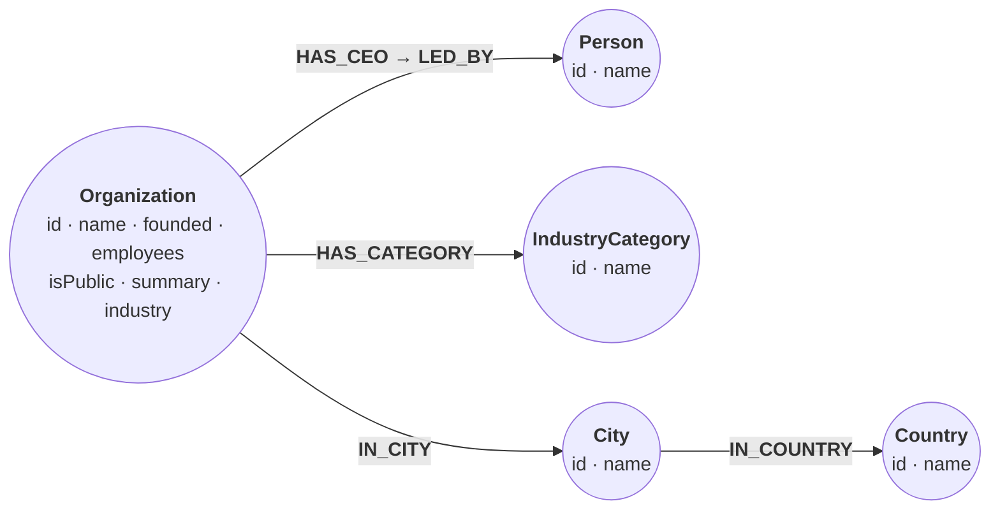
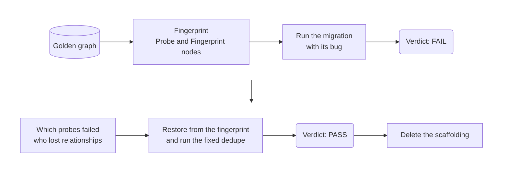

# Rehearse a migration against a golden graph

*A migration can keep every node count and every intended change right and
still destroy data. Fingerprint the graph before the migration runs, write
down what it is allowed to change, and compare afterwards. Here a probe on
each organization's relationships catches a bug that deletes 352 city links
across 61 organizations, and the fingerprint puts the links back.*

The graph is a company directory:
`(:Organization)-[:HAS_CEO]->(:Person)`,
`(:Organization)-[:HAS_CATEGORY]->(:IndustryCategory)`, and
`(:Organization)-[:IN_CITY]->(:City)-[:IN_COUNTRY]->(:Country)`. The migration
renames `HAS_CEO` to `LED_BY`, adds an `industry` property, drops summaries
from organizations without a CEO, and removes duplicate city links. One of
its four statements has a bug.



The companion runs the migration on a copy of a committed golden file and
diffs the two files from Python. Here everything happens in one database: the
fingerprint is stored in the graph itself, on `Probe` and `Fingerprint` nodes
that the migration never matches.



## Load the golden graph

Every node has an `id`, and uniqueness constraints keep them unique. The
fingerprint identifies relationships by their target's `id`.

```cypher cell=schema setup
CREATE CONSTRAINT org_id IF NOT EXISTS FOR (o:Organization) REQUIRE o.id IS UNIQUE;
CREATE CONSTRAINT person_id IF NOT EXISTS FOR (p:Person) REQUIRE p.id IS UNIQUE;
CREATE CONSTRAINT category_id IF NOT EXISTS
  FOR (c:IndustryCategory) REQUIRE c.id IS UNIQUE;
CREATE CONSTRAINT city_id IF NOT EXISTS FOR (c:City) REQUIRE c.id IS UNIQUE;
CREATE CONSTRAINT country_id IF NOT EXISTS FOR (c:Country) REQUIRE c.id IS UNIQUE
```

```table
(no rows) · constraints added: 5
```

Rows for organizations without a summary have no `summary` key, so
`r.summary` is null and `CREATE` sets no property.

```cypher cell=load setup params=golden
UNWIND $countries AS r
CREATE (:Country {id: r.id, name: r.name});

UNWIND $cities AS r
MATCH (k:Country {id: r.country})
CREATE (:City {id: r.id, name: r.name})-[:IN_COUNTRY]->(k);

UNWIND $categories AS r
CREATE (:IndustryCategory {id: r.id, name: r.name});

UNWIND $organizations AS r
CREATE (:Organization {id: r.id, name: r.name, founded: r.founded,
                       employees: r.employees, isPublic: r.isPublic,
                       summary: r.summary});

UNWIND $organizations AS r
WITH r WHERE r.ceo IS NOT NULL
MATCH (o:Organization {id: r.id})
CREATE (o)-[:HAS_CEO]->(:Person {id: r.ceo.id, name: r.ceo.name});

UNWIND $organizations AS r
MATCH (o:Organization {id: r.id})
UNWIND r.categories AS id
MATCH (c:IndustryCategory {id: id})
CREATE (o)-[:HAS_CATEGORY]->(c);

UNWIND $organizations AS r
MATCH (o:Organization {id: r.id})
UNWIND r.cities AS id
MATCH (c:City {id: id})
CREATE (o)-[:IN_CITY]->(c);

RETURN COUNT { MATCH (:Organization) } AS organizations,
       COUNT { MATCH (:Person) } AS ceos,
       COUNT { MATCH (:City) } AS cities,
       COUNT { MATCH (:Organization)-[:IN_CITY]->(:City) } AS city_links
```

```table
| organizations | ceos | cities | city_links |
|---------------|------|--------|------------|
| 90            | 68   | 26     | 438        |
1 row · nodes created: 201, relationships created: 676, properties set: 718, labels added: 201
```

One organization, Nimbus Labs, as it is before anything changes: every
node it links to, and every city in the directory, linked or not. The same
statement runs again after the migration, so the two results can be
compared.

```json data=victim
{
  "org": "org-11"
}
```

```cypher cell=nimbus params=victim
MATCH (o:Organization {id: $org}), (x)
WHERE x:City OR EXISTS { (o)-->(x) }
OPTIONAL MATCH (o)-[r]->(x)
RETURN o, r, x
ORDER BY x.id
```

```gram
// 29 rows
[ | (n53:Organization {employees: 80, founded: 2013, id: "org-11", isPublic: false, name: "Nimbus Labs"}), (n53)-[r282:IN_CITY]->(n11), (n11:City {id: "austin", name: "Austin"})]
[ | (n53), (n53)-[r291:IN_CITY]->(n30), (n30:City {id: "bangalore", name: "Bangalore"})]
[ | (n53), (n53)-[r290:IN_CITY]->(n18), (n18:City {id: "berlin", name: "Berlin"})]
[ | (n53), (n53)-[r280:IN_CITY]->(n9), (n9:City {id: "boston", name: "Boston"})]
[ | (n53), (n53)-[r281:IN_CITY]->(n17), (n17:City {id: "cambridge", name: "Cambridge"})]
[ | (n53), (n53)-[r293:IN_CITY]->(n12), (n12:City {id: "chicago", name: "Chicago"})]
[ | (n53), (n53)-[r271:IN_CITY]->(n13), (n13:City {id: "denver", name: "Denver"})]
[ | (n53), (n53)-[r288:IN_CITY]->(n16), (n16:City {id: "edinburgh", name: "Edinburgh"})]
[ | (n53), (n53)-[r111:HAS_CATEGORY]->(n42), (n42:IndustryCategory {id: "edtech", name: "Education Technology Companies"})]
[ | (n53), (n53)-[r289:IN_CITY]->(n20), (n20:City {id: "hamburg", name: "Hamburg"})]
[ | (n53), (n53)-[r269:IN_CITY]->(n31), (n31:City {id: "hyderabad", name: "Hyderabad"})]
[ | (n53), (n53)-[r270:IN_CITY]->(n14), (n14:City {id: "london", name: "London"})]
[ | (n53), (n53)-[r292:IN_CITY]->(n22), (n22:City {id: "lyon", name: "Lyon"})]
[ | (n53), (n53)-[r294:IN_CITY]->(n15), (n15:City {id: "manchester", name: "Manchester"})]
[ | (n53), (n53)-[r276:IN_CITY]->(n25), (n25:City {id: "montreal", name: "Montreal"})]
[ | (n53), (n53)-[r275:IN_CITY]->(n19), (n19:City {id: "munich", name: "Munich"})]
[ | (n53), (n53)-[r272:IN_CITY]->(n8), (n8:City {id: "new-york", name: "New York"})]
[ | (n53), (n53)-[r287:IN_CITY]->(n29), (n29:City {id: "osaka", name: "Osaka"})]
[ | (n53), (n53)-[r285:IN_CITY]->(n21), (n21:City {id: "paris", name: "Paris"})]
[ | (n53), (n53)-[r31:HAS_CEO]->(n138), (n138:Person {id: "person-06", name: "Kavya Ueda"})]
[ | (n53), (n53)-[r278:IN_CITY]->(n32), (n32:City {id: "pune", name: "Pune"})]
[ | (n53), (n53)-[r112:HAS_CATEGORY]->(n35), (n35:IndustryCategory {id: "robotics", name: "Robotics Companies"})]
[ | (n53), (n53)-[r284:IN_CITY]->(n7), (n7:City {id: "san-francisco", name: "San Francisco"})]
[ | (n53), (n53)-[r279:IN_CITY]->(n10), (n10:City {id: "seattle", name: "Seattle"})]
[ | (n53), (n53)-[r273:IN_CITY]->(n28), (n28:City {id: "tokyo", name: "Tokyo"})]
[ | (n53), (n53)-[r286:IN_CITY]->(n24), (n24:City {id: "toronto", name: "Toronto"})]
[ | (n53), (n53)-[r277:IN_CITY]->(n23), (n23:City {id: "toulouse", name: "Toulouse"})]
[ | (n53), (n53)-[r283:IN_CITY]->(n26), (n26:City {id: "vancouver", name: "Vancouver"})]
[ | (n53), (n53)-[r274:IN_CITY]->(n27), (n27:City {id: "waterloo", name: "Waterloo"})]
```

## Fingerprint it before anything changes

The migration's contract is written down before it runs. Its one structural
change is a relationship rename, passed as a map from old type to new type:

```json data=intent
{
  "renamed": {
    "HAS_CEO": "LED_BY"
  }
}
```

The fingerprint has two parts:

- **Count probes**: one `Probe` node per label and per relationship type,
  holding the count now (`before`) and the count the migration must leave
  (`expected`). Counts stay the same, except that a renamed type drops to 0
  and its new name inherits the old count. `$renamed[type]` looks the type up
  in the map, and is `null` for a type that is not renamed.
- **Per-organization fingerprints**: one `Fingerprint` node per
  organization, holding its property keys, its properties as `key=value`
  strings, and its relationships as `TYPE:targetId` strings. `expected` is
  the relationship list with the rename applied: the relationships the
  organization must have afterwards.

```cypher cell=fingerprint params=intent
MATCH (n)
WITH labels(n)[0] AS label, count(*) AS n
CREATE (:Probe {kind: 'nodes', key: label, name: 'nodes :' + label, before: n,
                expected: n});

MATCH ()-[r]->()
WITH type(r) AS type, count(*) AS n
CREATE (:Probe {kind: 'rels', key: type, name: 'rels :' + type, before: n,
                expected: CASE WHEN $renamed[type] IS NULL THEN n ELSE 0 END});

UNWIND keys($renamed) AS old
MATCH (p:Probe {kind: 'rels', key: old})
MERGE (q:Probe {kind: 'rels', key: $renamed[old]})
  ON CREATE SET q.name = 'rels :' + $renamed[old], q.before = 0, q.expected = 0
SET q.expected = q.expected + p.before;

MATCH (o:Organization)
WITH o, COLLECT { MATCH (o)-[r]->(x) RETURN type(r) + ':' + x.id } AS rels
CREATE (:Fingerprint {
  org: o.id, name: o.name,
  propKeys: keys(o),
  props: [k IN keys(o) | k + '=' + toString(o[k])],
  rels: rels,
  expected: [e IN rels |
    coalesce($renamed[split(e, ':')[0]], split(e, ':')[0]) + ':' + split(e, ':')[1]],
  hadCeo: EXISTS { (o)-[:HAS_CEO]->() },
  hadCategory: EXISTS { (o)-[:HAS_CATEGORY]->() }
});

MATCH (p:Probe)
RETURN p.name AS probe, p.before AS before, p.expected AS expected
ORDER BY probe
```

```table
| probe                     | before | expected |
|---------------------------|--------|----------|
| "nodes :City"             | 26     | 26       |
| "nodes :Country"          | 7      | 7        |
| "nodes :IndustryCategory" | 10     | 10       |
| "nodes :Organization"     | 90     | 90       |
| "nodes :Person"           | 68     | 68       |
| "rels :HAS_CATEGORY"      | 144    | 144      |
| "rels :HAS_CEO"           | 68     | 0        |
| "rels :IN_CITY"           | 438    | 438      |
| "rels :IN_COUNTRY"        | 26     | 26       |
| "rels :LED_BY"            | 0      | 68       |
10 rows · nodes created: 100, properties set: 771, labels added: 100
```

`LED_BY` does not exist yet, so its probe starts at 0 and expects the 68
`HAS_CEO` relationships.

## Run the migration

These are the four statements the migration's author wants to ship. Step 4
has a bug. Try to spot it before the probes do.

```cypher cell=migrate
// 1. Rename HAS_CEO -> LED_BY (relationship types are immutable: copy + delete).
MATCH (o:Organization)-[r:HAS_CEO]->(p:Person)
CREATE (o)-[:LED_BY]->(p)
DELETE r;

// 2. Backfill a denormalised primary industry (alphabetically first category).
MATCH (o:Organization)
WHERE EXISTS { (o)-[:HAS_CATEGORY]->() }
SET o.industry = COLLECT { MATCH (o)-[:HAS_CATEGORY]->(c)
                           RETURN c.name ORDER BY c.name LIMIT 1 }[0];

// 3. Summaries are only shown on company pages with a CEO; drop the rest.
MATCH (o:Organization)
WHERE NOT EXISTS { (o)-[:LED_BY]->() }
REMOVE o.summary;

// 4. Dedupe parallel IN_CITY edges (same org, same city).
MATCH (o:Organization)-[r:IN_CITY]->(c:City)
WITH o, collect(r) AS rels
WHERE size(rels) > 1
FOREACH (r IN tail(rels) | DELETE r)
```

```table
(no rows) · relationships created: 68, relationships deleted: 420, properties set: 95
```

The counters are the first hint: 68 relationships were created for the
rename, but far more than 68 were deleted.

## Ask for a verdict

One read turns the fingerprint into a pass or fail, the way a CI gate
would. It recounts every probe, compares each organization's relationships
with its `expected` list, and checks every property change against the
contract: `industry` may appear on an organization with a category (and must),
`summary` may disappear from an organization without a CEO, and nothing else
may change.

```cypher cell=verdict
CALL () {
  MATCH (p:Probe)
  WITH p, CASE p.kind
            WHEN 'nodes' THEN COUNT { MATCH (n) WHERE p.key IN labels(n) }
            ELSE COUNT { MATCH ()-[r]->() WHERE type(r) = p.key }
          END AS after
  WITH p, after
  WHERE after <> p.expected
  RETURN collect(p.name) AS failing_probes
}
CALL () {
  MATCH (f:Fingerprint)
  MATCH (o:Organization {id: f.org})
  WITH f, COLLECT { MATCH (o)-[r]->(x) RETURN type(r) + ':' + x.id } AS now
  WITH f, now
  WHERE any(e IN f.expected WHERE NOT e IN now)
     OR any(e IN now WHERE NOT e IN f.expected)
  RETURN count(f) AS orgs_with_changed_relationships
}
CALL () {
  MATCH (f:Fingerprint)
  MATCH (o:Organization {id: f.org})
  WITH f, o, [k IN keys(o) | k + '=' + toString(o[k])] AS now
  WITH f, o, now
  WHERE any(e IN f.props WHERE NOT e IN now
                               AND NOT (e STARTS WITH 'summary=' AND NOT f.hadCeo))
     OR any(k IN keys(o) WHERE NOT k IN f.propKeys
                               AND NOT (k = 'industry' AND f.hadCategory))
     OR (f.hadCategory AND o.industry IS NULL)
  RETURN count(f) AS orgs_with_unexpected_properties
}
RETURN CASE WHEN size(failing_probes) = 0 AND orgs_with_changed_relationships = 0
                 AND orgs_with_unexpected_properties = 0
            THEN 'PASS' ELSE 'FAIL' END AS verdict,
       failing_probes, orgs_with_changed_relationships, orgs_with_unexpected_properties
```

```table
| verdict | failing_probes    | orgs_with_changed_relationships | orgs_with_unexpected_properties |
|---------|-------------------|---------------------------------|---------------------------------|
| "FAIL"  | ["rels :IN_CITY"] | 61                              | 0                               |
1 row
```

> **Note**
> Each subquery repeats its new variables in a second `WITH` (`WITH p, after`)
> before filtering. Inside a `CALL (…) {}` subquery, Relate currently
> rejects a `WHERE` that reads a variable its own `WITH` just introduced
> (`UndefinedVariable`). The same `WITH … WHERE` works outside the subquery.

## Which probes failed

The same recount, probe by probe. Every node count matches, and so does the
rename: `HAS_CEO` went to 0 and `LED_BY` to 68. A check that stopped at node
counts would pass. `IN_CITY` did not survive.

```cypher cell=probes
MATCH (p:Probe)
WITH p, CASE p.kind
          WHEN 'nodes' THEN COUNT { MATCH (n) WHERE p.key IN labels(n) }
          ELSE COUNT { MATCH ()-[r]->() WHERE type(r) = p.key }
        END AS after
RETURN p.name AS probe, p.before AS before, after, p.expected AS expected,
       after = p.expected AS ok
ORDER BY probe
```

```table
| probe                     | before | after | expected | ok    |
|---------------------------|--------|-------|----------|-------|
| "nodes :City"             | 26     | 26    | 26       | true  |
| "nodes :Country"          | 7      | 7     | 7        | true  |
| "nodes :IndustryCategory" | 10     | 10    | 10       | true  |
| "nodes :Organization"     | 90     | 90    | 90       | true  |
| "nodes :Person"           | 68     | 68    | 68       | true  |
| "rels :HAS_CATEGORY"      | 144    | 144   | 144      | true  |
| "rels :HAS_CEO"           | 68     | 0     | 0        | true  |
| "rels :IN_CITY"           | 438    | 86    | 438      | false |
| "rels :IN_COUNTRY"        | 26     | 26    | 26       | true  |
| "rels :LED_BY"            | 0      | 68    | 68       | true  |
10 rows
```

## The intended changes happened

Property changes, grouped, each checked against the contract. Only the two
intended changes appear, both allowed.

```cypher cell=properties
MATCH (f:Fingerprint)
MATCH (o:Organization {id: f.org})
WITH f, o, [k IN keys(o) | k + '=' + toString(o[k])] AS now
UNWIND [k IN keys(o) WHERE NOT k IN f.propKeys |
          {change: k + ' added', allowed: k = 'industry' AND f.hadCategory}]
     + [k IN f.propKeys WHERE NOT k IN keys(o) |
          {change: k + ' removed', allowed: k = 'summary' AND NOT f.hadCeo}]
     + [e IN f.props WHERE split(e, '=')[0] IN keys(o) AND NOT e IN now |
          {change: split(e, '=')[0] + ' changed', allowed: false}] AS c
RETURN c.change AS change, c.allowed AS allowed, count(*) AS organizations
ORDER BY change
```

```table
| change            | allowed | organizations |
|-------------------|---------|---------------|
| "industry added"  | true    | 85            |
| "summary removed" | true    | 10            |
2 rows
```

## Who lost relationships

For each organization, `lost` is what its `expected` list has and the graph
no longer does, and `gained` is the reverse. The ten largest losses:

```cypher cell=victims
MATCH (f:Fingerprint)
MATCH (o:Organization {id: f.org})
WITH f, COLLECT { MATCH (o)-[r]->(x) RETURN type(r) + ':' + x.id } AS now
WITH f, [e IN f.expected WHERE NOT e IN now] AS lost,
        [e IN now WHERE NOT e IN f.expected] AS gained
WHERE size(lost) + size(gained) > 0
RETURN f.name AS organization, size(lost) AS lost, size(gained) AS gained,
       COLLECT { UNWIND lost AS e
                 RETURN DISTINCT split(e, ':')[0] AS type ORDER BY type } AS lost_types
ORDER BY lost DESC, organization
LIMIT 10
```

```table
| organization       | lost | gained | lost_types  |
|--------------------|------|--------|-------------|
| "Nimbus Labs"      | 25   | 0      | ["IN_CITY"] |
| "Cinder Vision"    | 22   | 0      | ["IN_CITY"] |
| "Fathom Analytics" | 19   | 0      | ["IN_CITY"] |
| "Meridian AI"      | 19   | 0      | ["IN_CITY"] |
| "Cobalt Analytics" | 18   | 0      | ["IN_CITY"] |
| "Lumen Robotics"   | 18   | 0      | ["IN_CITY"] |
| "Keel AI"          | 16   | 0      | ["IN_CITY"] |
| "Brindle AI"       | 14   | 0      | ["IN_CITY"] |
| "Meridian Vision"  | 14   | 0      | ["IN_CITY"] |
| "Yarrow Vision"    | 13   | 0      | ["IN_CITY"] |
10 rows
```

Every loss is an `IN_CITY` link, and nothing was gained. The histogram of
city links per organization shows the pattern: every organization that was
in two or more cities is now in exactly one.

```cypher cell=histogram
MATCH (f:Fingerprint)
MATCH (o:Organization {id: f.org})
WITH size([e IN f.rels WHERE e STARTS WITH 'IN_CITY:']) AS before,
     COUNT { MATCH (o)-[:IN_CITY]->() } AS after
UNWIND [['before', before], ['after', after]] AS pair
WITH pair[0] AS phase,
     CASE WHEN pair[1] = 0 THEN '0' WHEN pair[1] = 1 THEN '1'
          WHEN pair[1] <= 5 THEN '2-5' WHEN pair[1] <= 20 THEN '6-20'
          ELSE '>20' END AS cities
RETURN cities,
       sum(CASE WHEN phase = 'before' THEN 1 ELSE 0 END) AS before,
       sum(CASE WHEN phase = 'after' THEN 1 ELSE 0 END) AS after
ORDER BY cities
```

```table
| cities | before | after |
|--------|--------|-------|
| "0"    | 4      | 4     |
| "1"    | 25     | 86    |
| "2-5"  | 45     | 0     |
| "6-20" | 14     | 0     |
| ">20"  | 2      | 0     |
5 rows
```

Nimbus Labs had an office in all 26 cities. The statement from before the
migration, run again: one city link is left.

```cypher cell=victim params=victim
MATCH (o:Organization {id: $org}), (x)
WHERE x:City OR EXISTS { (o)-->(x) }
OPTIONAL MATCH (o)-[r]->(x)
RETURN o, r, x
ORDER BY x.id
```

```gram
// 29 rows
[{r: null} | (n53:Organization {employees: 80, founded: 2013, id: "org-11", industry: "Education Technology Companies", isPublic: false, name: "Nimbus Labs"}), (n11:City {id: "austin", name: "Austin"})]
[{r: null} | (n53), (n30:City {id: "bangalore", name: "Bangalore"})]
[{r: null} | (n53), (n18:City {id: "berlin", name: "Berlin"})]
[{r: null} | (n53), (n9:City {id: "boston", name: "Boston"})]
[{r: null} | (n53), (n17:City {id: "cambridge", name: "Cambridge"})]
[{r: null} | (n53), (n12:City {id: "chicago", name: "Chicago"})]
[{r: null} | (n53), (n13:City {id: "denver", name: "Denver"})]
[{r: null} | (n53), (n16:City {id: "edinburgh", name: "Edinburgh"})]
[ | (n53), (n53)-[r111:HAS_CATEGORY]->(n42), (n42:IndustryCategory {id: "edtech", name: "Education Technology Companies"})]
[{r: null} | (n53), (n20:City {id: "hamburg", name: "Hamburg"})]
[{r: null} | (n53), (n31:City {id: "hyderabad", name: "Hyderabad"})]
[{r: null} | (n53), (n14:City {id: "london", name: "London"})]
[{r: null} | (n53), (n22:City {id: "lyon", name: "Lyon"})]
[{r: null} | (n53), (n15:City {id: "manchester", name: "Manchester"})]
[{r: null} | (n53), (n25:City {id: "montreal", name: "Montreal"})]
[{r: null} | (n53), (n19:City {id: "munich", name: "Munich"})]
[{r: null} | (n53), (n8:City {id: "new-york", name: "New York"})]
[{r: null} | (n53), (n29:City {id: "osaka", name: "Osaka"})]
[{r: null} | (n53), (n21:City {id: "paris", name: "Paris"})]
[ | (n53), (n53)-[r681:LED_BY]->(n138), (n138:Person {id: "person-06", name: "Kavya Ueda"})]
[{r: null} | (n53), (n32:City {id: "pune", name: "Pune"})]
[ | (n53), (n53)-[r112:HAS_CATEGORY]->(n35), (n35:IndustryCategory {id: "robotics", name: "Robotics Companies"})]
[ | (n53), (n53)-[r284:IN_CITY]->(n7), (n7:City {id: "san-francisco", name: "San Francisco"})]
[{r: null} | (n53), (n10:City {id: "seattle", name: "Seattle"})]
[{r: null} | (n53), (n28:City {id: "tokyo", name: "Tokyo"})]
[{r: null} | (n53), (n24:City {id: "toronto", name: "Toronto"})]
[{r: null} | (n53), (n23:City {id: "toulouse", name: "Toulouse"})]
[{r: null} | (n53), (n26:City {id: "vancouver", name: "Vancouver"})]
[{r: null} | (n53), (n27:City {id: "waterloo", name: "Waterloo"})]
```

The two results side by side, nodes matched by their `id`: the rename
removed `HAS_CEO` and added `LED_BY`, step 2 changed the organization, and
step 4 removed 25 of the 26 city links. The cities themselves are still
there.

:::graph-diff{before=nimbus after=victim key=id}
:::

## The bug

Step 4 groups the city links by organization only, so `tail(rels)` deletes
all but one link per organization, not all but one per city. The intended
statement groups by organization and city:

```diff
 MATCH (o:Organization)-[r:IN_CITY]->(c:City)
-WITH o, collect(r) AS rels
+WITH o, c, collect(r) AS rels
 WHERE size(rels) > 1
 FOREACH (r IN tail(rels) | DELETE r);
```

## Repair from the fingerprint

The companion fixes the migration and reruns it on a fresh copy of the golden
file. A single database cannot rewind, but the fingerprint recorded every
city link, so the lost ones can be put back. The victims query showed that
`IN_CITY` is the only type that lost anything. `IN_CITY` links carry no
properties, so a recreated link matches the lost one in everything but its
internal id.

```cypher cell=restore
MATCH (f:Fingerprint)
MATCH (o:Organization {id: f.org})
UNWIND f.rels AS e
WITH o, split(e, ':') AS part
WHERE part[0] = 'IN_CITY'
MATCH (c:City {id: part[1]})
WHERE NOT EXISTS { (o)-[:IN_CITY]->(c) }
CREATE (o)-[:IN_CITY]->(c)
```

```table
(no rows) · relationships created: 352
```

Now the fixed step 4. The golden graph has no duplicate city links, so it
deletes nothing, which is what a dedupe of clean data should do:

```cypher cell=fixed
MATCH (o:Organization)-[r:IN_CITY]->(c:City)
WITH o, c, collect(r) AS rels
WHERE size(rels) > 1
FOREACH (r IN tail(rels) | DELETE r)
```

```table
(no rows)
```

Steps 1 to 3 already did what the contract asks, so they need no rerun. The
verdict, unchanged:

```cypher cell=verdict-again
CALL () {
  MATCH (p:Probe)
  WITH p, CASE p.kind
            WHEN 'nodes' THEN COUNT { MATCH (n) WHERE p.key IN labels(n) }
            ELSE COUNT { MATCH ()-[r]->() WHERE type(r) = p.key }
          END AS after
  WITH p, after
  WHERE after <> p.expected
  RETURN collect(p.name) AS failing_probes
}
CALL () {
  MATCH (f:Fingerprint)
  MATCH (o:Organization {id: f.org})
  WITH f, COLLECT { MATCH (o)-[r]->(x) RETURN type(r) + ':' + x.id } AS now
  WITH f, now
  WHERE any(e IN f.expected WHERE NOT e IN now)
     OR any(e IN now WHERE NOT e IN f.expected)
  RETURN count(f) AS orgs_with_changed_relationships
}
CALL () {
  MATCH (f:Fingerprint)
  MATCH (o:Organization {id: f.org})
  WITH f, o, [k IN keys(o) | k + '=' + toString(o[k])] AS now
  WITH f, o, now
  WHERE any(e IN f.props WHERE NOT e IN now
                               AND NOT (e STARTS WITH 'summary=' AND NOT f.hadCeo))
     OR any(k IN keys(o) WHERE NOT k IN f.propKeys
                               AND NOT (k = 'industry' AND f.hadCategory))
     OR (f.hadCategory AND o.industry IS NULL)
  RETURN count(f) AS orgs_with_unexpected_properties
}
RETURN CASE WHEN size(failing_probes) = 0 AND orgs_with_changed_relationships = 0
                 AND orgs_with_unexpected_properties = 0
            THEN 'PASS' ELSE 'FAIL' END AS verdict,
       failing_probes, orgs_with_changed_relationships, orgs_with_unexpected_properties
```

```table
| verdict | failing_probes | orgs_with_changed_relationships | orgs_with_unexpected_properties |
|---------|----------------|---------------------------------|---------------------------------|
| "PASS"  | []             | 0                               | 0                               |
1 row
```

Nimbus Labs is back in all 26 cities:

```cypher cell=victim-restored params=victim
MATCH (o:Organization {id: $org}), (x)
WHERE x:City OR EXISTS { (o)-->(x) }
OPTIONAL MATCH (o)-[r]->(x)
RETURN o, r, x
ORDER BY x.id
```

```gram
// 29 rows
[ | (n53:Organization {employees: 80, founded: 2013, id: "org-11", industry: "Education Technology Companies", isPublic: false, name: "Nimbus Labs"}), (n53)-[r776:IN_CITY]->(n11), (n11:City {id: "austin", name: "Austin"})]
[ | (n53), (n53)-[r768:IN_CITY]->(n30), (n30:City {id: "bangalore", name: "Bangalore"})]
[ | (n53), (n53)-[r769:IN_CITY]->(n18), (n18:City {id: "berlin", name: "Berlin"})]
[ | (n53), (n53)-[r778:IN_CITY]->(n9), (n9:City {id: "boston", name: "Boston"})]
[ | (n53), (n53)-[r777:IN_CITY]->(n17), (n17:City {id: "cambridge", name: "Cambridge"})]
[ | (n53), (n53)-[r766:IN_CITY]->(n12), (n12:City {id: "chicago", name: "Chicago"})]
[ | (n53), (n53)-[r787:IN_CITY]->(n13), (n13:City {id: "denver", name: "Denver"})]
[ | (n53), (n53)-[r771:IN_CITY]->(n16), (n16:City {id: "edinburgh", name: "Edinburgh"})]
[ | (n53), (n53)-[r111:HAS_CATEGORY]->(n42), (n42:IndustryCategory {id: "edtech", name: "Education Technology Companies"})]
[ | (n53), (n53)-[r770:IN_CITY]->(n20), (n20:City {id: "hamburg", name: "Hamburg"})]
[ | (n53), (n53)-[r789:IN_CITY]->(n31), (n31:City {id: "hyderabad", name: "Hyderabad"})]
[ | (n53), (n53)-[r788:IN_CITY]->(n14), (n14:City {id: "london", name: "London"})]
[ | (n53), (n53)-[r767:IN_CITY]->(n22), (n22:City {id: "lyon", name: "Lyon"})]
[ | (n53), (n53)-[r765:IN_CITY]->(n15), (n15:City {id: "manchester", name: "Manchester"})]
[ | (n53), (n53)-[r782:IN_CITY]->(n25), (n25:City {id: "montreal", name: "Montreal"})]
[ | (n53), (n53)-[r783:IN_CITY]->(n19), (n19:City {id: "munich", name: "Munich"})]
[ | (n53), (n53)-[r786:IN_CITY]->(n8), (n8:City {id: "new-york", name: "New York"})]
[ | (n53), (n53)-[r772:IN_CITY]->(n29), (n29:City {id: "osaka", name: "Osaka"})]
[ | (n53), (n53)-[r774:IN_CITY]->(n21), (n21:City {id: "paris", name: "Paris"})]
[ | (n53), (n53)-[r681:LED_BY]->(n138), (n138:Person {id: "person-06", name: "Kavya Ueda"})]
[ | (n53), (n53)-[r780:IN_CITY]->(n32), (n32:City {id: "pune", name: "Pune"})]
[ | (n53), (n53)-[r112:HAS_CATEGORY]->(n35), (n35:IndustryCategory {id: "robotics", name: "Robotics Companies"})]
[ | (n53), (n53)-[r284:IN_CITY]->(n7), (n7:City {id: "san-francisco", name: "San Francisco"})]
[ | (n53), (n53)-[r779:IN_CITY]->(n10), (n10:City {id: "seattle", name: "Seattle"})]
[ | (n53), (n53)-[r785:IN_CITY]->(n28), (n28:City {id: "tokyo", name: "Tokyo"})]
[ | (n53), (n53)-[r773:IN_CITY]->(n24), (n24:City {id: "toronto", name: "Toronto"})]
[ | (n53), (n53)-[r781:IN_CITY]->(n23), (n23:City {id: "toulouse", name: "Toulouse"})]
[ | (n53), (n53)-[r775:IN_CITY]->(n26), (n26:City {id: "vancouver", name: "Vancouver"})]
[ | (n53), (n53)-[r784:IN_CITY]->(n27), (n27:City {id: "waterloo", name: "Waterloo"})]
```

## Clean up

The probes and fingerprints were scaffolding for the rehearsal. Delete them
before the graph is used for anything else:

```cypher cell=cleanup
MATCH (n)
WHERE n:Probe OR n:Fingerprint
DELETE n
```

```table
(no rows) · nodes deleted: 100
```

## Data

The dataset the steps above load. It is a JSON object whose keys are the
query parameters.

<details>
<summary><code>golden</code> (26 KB)</summary>

```json data=golden
{
  "countries": [
    {"id": "us", "name": "United States"},
    {"id": "uk", "name": "United Kingdom"},
    {"id": "de", "name": "Germany"},
    {"id": "fr", "name": "France"},
    {"id": "ca", "name": "Canada"},
    {"id": "jp", "name": "Japan"},
    {"id": "in", "name": "India"}
  ],
  "cities": [
    {"id": "san-francisco", "name": "San Francisco", "country": "us"},
    {"id": "new-york", "name": "New York", "country": "us"},
    {"id": "boston", "name": "Boston", "country": "us"},
    {"id": "seattle", "name": "Seattle", "country": "us"},
    {"id": "austin", "name": "Austin", "country": "us"},
    {"id": "chicago", "name": "Chicago", "country": "us"},
    {"id": "denver", "name": "Denver", "country": "us"},
    {"id": "london", "name": "London", "country": "uk"},
    {"id": "manchester", "name": "Manchester", "country": "uk"},
    {"id": "edinburgh", "name": "Edinburgh", "country": "uk"},
    {"id": "cambridge", "name": "Cambridge", "country": "uk"},
    {"id": "berlin", "name": "Berlin", "country": "de"},
    {"id": "munich", "name": "Munich", "country": "de"},
    {"id": "hamburg", "name": "Hamburg", "country": "de"},
    {"id": "paris", "name": "Paris", "country": "fr"},
    {"id": "lyon", "name": "Lyon", "country": "fr"},
    {"id": "toulouse", "name": "Toulouse", "country": "fr"},
    {"id": "toronto", "name": "Toronto", "country": "ca"},
    {"id": "montreal", "name": "Montreal", "country": "ca"},
    {"id": "vancouver", "name": "Vancouver", "country": "ca"},
    {"id": "waterloo", "name": "Waterloo", "country": "ca"},
    {"id": "tokyo", "name": "Tokyo", "country": "jp"},
    {"id": "osaka", "name": "Osaka", "country": "jp"},
    {"id": "bangalore", "name": "Bangalore", "country": "in"},
    {"id": "hyderabad", "name": "Hyderabad", "country": "in"},
    {"id": "pune", "name": "Pune", "country": "in"}
  ],
  "categories": [
    {"id": "ai", "name": "Artificial Intelligence Companies"},
    {"id": "vision", "name": "Computer Vision Companies"},
    {"id": "robotics", "name": "Robotics Companies"},
    {"id": "nlp", "name": "Natural Language Processing Companies"},
    {"id": "chips", "name": "Semiconductor Companies"},
    {"id": "health", "name": "Healthcare Technology Companies"},
    {"id": "fintech", "name": "Financial Technology Companies"},
    {"id": "security", "name": "Cybersecurity Companies"},
    {"id": "analytics", "name": "Data Analytics Companies"},
    {"id": "edtech", "name": "Education Technology Companies"}
  ],
  "organizations": [
    {"id": "org-01", "name": "Drift AI", "founded": 2022, "employees": 300, "isPublic": false, "categories": ["edtech"], "cities": ["cambridge"]},
    {"id": "org-02", "name": "Quarry Systems", "founded": 2019, "employees": 150, "isPublic": true, "categories": ["analytics"], "cities": ["new-york", "vancouver"]},
    {"id": "org-03", "name": "Estuary Vision", "founded": 2003, "employees": 4000, "isPublic": true, "ceo": {"id": "person-01", "name": "Kavya Varga"}, "categories": ["ai", "nlp", "robotics"], "cities": ["osaka", "new-york"]},
    {"id": "org-04", "name": "Juniper Robotics", "founded": 2018, "employees": 15000, "isPublic": true, "summary": "Juniper Robotics builds edge chips for logistics firms.", "categories": ["health", "robotics"], "cities": ["paris", "vancouver", "osaka", "london", "hyderabad"]},
    {"id": "org-05", "name": "Lumen Systems", "founded": 2015, "employees": 4000, "isPublic": false, "summary": "Lumen Systems builds edge chips for retailers.", "ceo": {"id": "person-02", "name": "Zofia Ueda"}, "categories": ["analytics", "health"], "cities": ["seattle", "manchester", "san-francisco"]},
    {"id": "org-06", "name": "Alder Robotics", "founded": 2008, "employees": 650, "isPublic": false, "ceo": {"id": "person-03", "name": "Xiu Quinn"}, "categories": [], "cities": ["waterloo", "osaka", "montreal", "toulouse", "denver"]},
    {"id": "org-07", "name": "Dunlin Analytics", "founded": 2016, "employees": 12, "isPublic": true, "categories": ["health"], "cities": ["cambridge", "toronto", "waterloo"]},
    {"id": "org-08", "name": "Meridian Systems", "founded": 2006, "employees": 4000, "isPublic": false, "summary": "Meridian Systems builds threat hunting for schools.", "ceo": {"id": "person-04", "name": "Omar Haddad"}, "categories": ["analytics", "fintech"], "cities": ["lyon"]},
    {"id": "org-09", "name": "Zephyr Labs", "founded": 2019, "employees": 25, "isPublic": false, "summary": "Zephyr Labs builds fraud detection for insurers.", "categories": ["ai", "fintech", "nlp"], "cities": ["pune", "london", "toronto", "chicago"]},
    {"id": "org-10", "name": "Gantry AI", "founded": 2004, "employees": 80, "isPublic": false, "summary": "Gantry AI builds sensor dashboards for retailers.", "ceo": {"id": "person-05", "name": "Kavya Jensen"}, "categories": ["fintech", "nlp"], "cities": ["munich", "toronto", "manchester", "lyon", "cambridge"]},
    {"id": "org-11", "name": "Nimbus Labs", "founded": 2013, "employees": 80, "isPublic": false, "ceo": {"id": "person-06", "name": "Kavya Ueda"}, "categories": ["edtech", "robotics"], "cities": ["hyderabad", "london", "denver", "new-york", "tokyo", "waterloo", "munich", "montreal", "toulouse", "pune", "seattle", "boston", "cambridge", "austin", "vancouver", "san-francisco", "paris", "toronto", "osaka", "edinburgh", "hamburg", "berlin", "bangalore", "lyon", "chicago", "manchester"]},
    {"id": "org-12", "name": "Cinder Analytics", "founded": 1995, "employees": 25, "isPublic": false, "summary": "Cinder Analytics builds edge chips for hospitals.", "ceo": {"id": "person-07", "name": "Amara Moreau"}, "categories": ["ai", "fintech", "robotics"], "cities": ["san-francisco"]},
    {"id": "org-13", "name": "Juniper Labs", "founded": 2008, "employees": 1200, "isPublic": false, "summary": "Juniper Labs builds forecasting models for logistics firms.", "ceo": {"id": "person-08", "name": "Rosa Dimitrov"}, "categories": ["chips", "health", "security"], "cities": ["toronto", "hamburg"]},
    {"id": "org-14", "name": "Tessel Systems", "founded": 2007, "employees": 25, "isPublic": true, "summary": "Tessel Systems builds sensor dashboards for utilities.", "ceo": {"id": "person-09", "name": "Zofia Dimitrov"}, "categories": ["security"], "cities": ["edinburgh", "london", "cambridge"]},
    {"id": "org-15", "name": "Harbor AI", "founded": 2007, "employees": 12, "isPublic": true, "summary": "Harbor AI builds forecasting models for banks.", "categories": ["analytics"], "cities": ["seattle", "pune", "boston", "lyon", "vancouver"]},
    {"id": "org-16", "name": "Meridian Labs", "founded": 1998, "employees": 40, "isPublic": false, "summary": "Meridian Labs builds inspection cameras for retailers.", "ceo": {"id": "person-10", "name": "Jonas Eze"}, "categories": ["ai", "chips", "edtech"], "cities": ["toronto"]},
    {"id": "org-17", "name": "Cobalt Labs", "founded": 1996, "employees": 150, "isPublic": false, "categories": ["analytics", "nlp"], "cities": ["london"]},
    {"id": "org-18", "name": "Basalt Vision", "founded": 2001, "employees": 1200, "isPublic": false, "ceo": {"id": "person-11", "name": "Quentin Eze"}, "categories": ["analytics", "chips"], "cities": ["hamburg", "bangalore", "tokyo", "seattle"]},
    {"id": "org-19", "name": "Arbor Analytics", "founded": 2018, "employees": 300, "isPublic": false, "ceo": {"id": "person-12", "name": "Goran Fontaine"}, "categories": ["fintech", "security"], "cities": ["lyon", "tokyo", "pune", "toulouse", "boston", "munich", "cambridge", "waterloo", "vancouver", "hamburg", "edinburgh", "austin", "london"]},
    {"id": "org-20", "name": "Meridian Analytics", "founded": 2017, "employees": 80, "isPublic": true, "summary": "Meridian Analytics builds sensor dashboards for retailers.", "ceo": {"id": "person-13", "name": "Chen Petrov"}, "categories": ["ai"], "cities": ["san-francisco", "seattle"]},
    {"id": "org-21", "name": "Quarry Vision", "founded": 2000, "employees": 4000, "isPublic": false, "summary": "Quarry Vision builds inspection cameras for schools.", "ceo": {"id": "person-14", "name": "Tomas Jensen"}, "categories": ["chips", "health", "security"], "cities": ["austin", "vancouver", "paris", "berlin", "manchester", "edinburgh", "chicago", "munich", "waterloo", "san-francisco", "seattle"]},
    {"id": "org-22", "name": "Basalt Systems", "founded": 2001, "employees": 650, "isPublic": false, "ceo": {"id": "person-15", "name": "Hana Gupta"}, "categories": ["edtech"], "cities": ["seattle", "chicago", "manchester", "paris", "osaka", "hyderabad", "montreal", "london", "munich", "edinburgh", "hamburg", "toulouse", "lyon"]},
    {"id": "org-23", "name": "Sable Labs", "founded": 2007, "employees": 12, "isPublic": true, "summary": "Sable Labs builds threat hunting for factories.", "categories": ["health"], "cities": ["bangalore", "paris"]},
    {"id": "org-24", "name": "Orchid Labs", "founded": 2002, "employees": 25, "isPublic": true, "summary": "Orchid Labs builds warehouse robots for utilities.", "ceo": {"id": "person-16", "name": "Priya Gupta"}, "categories": [], "cities": ["cambridge", "new-york", "hamburg"]},
    {"id": "org-25", "name": "Alder Vision", "founded": 2010, "employees": 12, "isPublic": false, "summary": "Alder Vision builds threat hunting for hospitals.", "ceo": {"id": "person-17", "name": "Goran Gupta"}, "categories": ["chips", "robotics"], "cities": []},
    {"id": "org-26", "name": "Arbor Systems", "founded": 2017, "employees": 650, "isPublic": false, "ceo": {"id": "person-18", "name": "Chen Weber"}, "categories": ["ai", "chips", "health"], "cities": ["denver"]},
    {"id": "org-27", "name": "Harbor Labs", "founded": 2006, "employees": 150, "isPublic": true, "summary": "Harbor Labs builds forecasting models for hospitals.", "categories": ["chips", "robotics"], "cities": ["vancouver", "paris"]},
    {"id": "org-28", "name": "Tessel Vision", "founded": 1998, "employees": 80, "isPublic": false, "ceo": {"id": "person-19", "name": "Goran Moreau"}, "categories": ["ai", "chips"], "cities": ["bangalore", "manchester", "toulouse"]},
    {"id": "org-29", "name": "Cobalt AI", "founded": 2016, "employees": 650, "isPublic": false, "ceo": {"id": "person-20", "name": "Goran Eze"}, "categories": ["security"], "cities": ["boston"]},
    {"id": "org-30", "name": "Orchid Systems", "founded": 2018, "employees": 25, "isPublic": true, "summary": "Orchid Systems builds sensor dashboards for banks.", "ceo": {"id": "person-21", "name": "Rosa Varga"}, "categories": ["fintech"], "cities": ["austin", "lyon", "tokyo", "hyderabad", "berlin"]},
    {"id": "org-31", "name": "Dunlin Labs", "founded": 2007, "employees": 80, "isPublic": true, "summary": "Dunlin Labs builds sensor dashboards for schools.", "ceo": {"id": "person-22", "name": "Quentin Gupta"}, "categories": ["fintech"], "cities": ["london"]},
    {"id": "org-32", "name": "Wren Labs", "founded": 2005, "employees": 1200, "isPublic": false, "summary": "Wren Labs builds inspection cameras for retailers.", "categories": ["analytics", "robotics", "security"], "cities": ["cambridge", "denver", "osaka"]},
    {"id": "org-33", "name": "Lumen Robotics", "founded": 2005, "employees": 150, "isPublic": false, "ceo": {"id": "person-23", "name": "Yusuf Abara"}, "categories": ["vision"], "cities": ["san-francisco", "toulouse", "cambridge", "paris", "boston", "hyderabad", "vancouver", "new-york", "berlin", "montreal", "austin", "london", "tokyo", "bangalore", "hamburg", "denver", "toronto", "manchester", "chicago"]},
    {"id": "org-34", "name": "Arbor Robotics", "founded": 2005, "employees": 300, "isPublic": true, "categories": ["nlp", "vision"], "cities": ["montreal", "lyon", "cambridge", "toulouse", "chicago"]},
    {"id": "org-35", "name": "Wren Systems", "founded": 1998, "employees": 15000, "isPublic": false, "categories": ["nlp", "security"], "cities": ["toronto"]},
    {"id": "org-36", "name": "Lumen Vision", "founded": 2006, "employees": 12, "isPublic": false, "summary": "Lumen Vision builds clinical triage software for hospitals.", "categories": ["analytics"], "cities": ["toronto", "seattle"]},
    {"id": "org-37", "name": "Wren AI", "founded": 2007, "employees": 25, "isPublic": true, "categories": ["fintech"], "cities": ["chicago", "edinburgh"]},
    {"id": "org-38", "name": "Ember AI", "founded": 2004, "employees": 12, "isPublic": false, "ceo": {"id": "person-24", "name": "Bruno Varga"}, "categories": ["ai", "robotics", "security"], "cities": ["edinburgh", "montreal", "pune"]},
    {"id": "org-39", "name": "Basalt Labs", "founded": 1997, "employees": 1200, "isPublic": false, "ceo": {"id": "person-25", "name": "Tomas Castillo"}, "categories": ["chips", "security"], "cities": ["waterloo", "hamburg", "vancouver", "cambridge", "berlin", "boston", "toronto", "lyon"]},
    {"id": "org-40", "name": "Basalt AI", "founded": 2022, "employees": 650, "isPublic": false, "summary": "Basalt AI builds inspection cameras for insurers.", "ceo": {"id": "person-26", "name": "Chen Eze"}, "categories": ["fintech", "nlp"], "cities": ["toulouse"]},
    {"id": "org-41", "name": "Brindle Analytics", "founded": 1999, "employees": 12, "isPublic": true, "ceo": {"id": "person-27", "name": "Yusuf Ishikawa"}, "categories": ["ai", "chips", "vision"], "cities": ["vancouver", "berlin", "boston", "toulouse"]},
    {"id": "org-42", "name": "Juniper Vision", "founded": 2011, "employees": 1200, "isPublic": true, "summary": "Juniper Vision builds sensor dashboards for banks.", "categories": [], "cities": []},
    {"id": "org-43", "name": "Yarrow AI", "founded": 2001, "employees": 15000, "isPublic": false, "ceo": {"id": "person-28", "name": "Tomas Fontaine"}, "categories": ["health", "nlp"], "cities": ["osaka", "chicago", "munich", "boston", "berlin"]},
    {"id": "org-44", "name": "Fathom Systems", "founded": 2022, "employees": 300, "isPublic": true, "summary": "Fathom Systems builds forecasting models for utilities.", "ceo": {"id": "person-29", "name": "Freya Lindqvist"}, "categories": ["nlp"], "cities": ["pune", "tokyo"]},
    {"id": "org-45", "name": "Quarry Robotics", "founded": 2019, "employees": 40, "isPublic": false, "ceo": {"id": "person-30", "name": "Ines Rahman"}, "categories": ["fintech"], "cities": ["hamburg", "boston"]},
    {"id": "org-46", "name": "Meridian AI", "founded": 2015, "employees": 150, "isPublic": false, "ceo": {"id": "person-31", "name": "Dalia Silva"}, "categories": ["edtech", "nlp"], "cities": ["austin", "toronto", "montreal", "berlin", "chicago", "san-francisco", "edinburgh", "manchester", "waterloo", "lyon", "toulouse", "denver", "new-york", "osaka", "munich", "pune", "london", "boston", "bangalore", "cambridge"]},
    {"id": "org-47", "name": "Orchid AI", "founded": 2020, "employees": 12, "isPublic": false, "summary": "Orchid AI builds tutoring assistants for schools.", "ceo": {"id": "person-32", "name": "Chen Fontaine"}, "categories": ["vision"], "cities": ["toronto", "pune", "san-francisco", "lyon", "edinburgh"]},
    {"id": "org-48", "name": "Umber Vision", "founded": 2017, "employees": 650, "isPublic": true, "ceo": {"id": "person-33", "name": "Tomas Quinn"}, "categories": ["analytics"], "cities": ["osaka", "hamburg"]},
    {"id": "org-49", "name": "Pylon AI", "founded": 2015, "employees": 1200, "isPublic": false, "ceo": {"id": "person-34", "name": "Priya Castillo"}, "categories": ["chips"], "cities": ["hyderabad"]},
    {"id": "org-50", "name": "Juniper Analytics", "founded": 2003, "employees": 4000, "isPublic": true, "ceo": {"id": "person-35", "name": "Amara Dimitrov"}, "categories": ["analytics", "chips"], "cities": ["bangalore"]},
    {"id": "org-51", "name": "Keel AI", "founded": 2019, "employees": 80, "isPublic": true, "summary": "Keel AI builds sensor dashboards for schools.", "ceo": {"id": "person-36", "name": "Hana Dimitrov"}, "categories": ["vision"], "cities": ["tokyo", "chicago", "vancouver", "lyon", "munich", "new-york", "hyderabad", "pune", "seattle", "london", "boston", "toronto", "manchester", "denver", "osaka", "berlin", "toulouse"]},
    {"id": "org-52", "name": "Keel Vision", "founded": 2000, "employees": 150, "isPublic": true, "summary": "Keel Vision builds forecasting models for logistics firms.", "categories": ["analytics", "chips"], "cities": ["waterloo", "manchester", "berlin", "chicago", "new-york"]},
    {"id": "org-53", "name": "Vesper Systems", "founded": 2003, "employees": 80, "isPublic": false, "summary": "Vesper Systems builds clinical triage software for factories.", "ceo": {"id": "person-37", "name": "Bruno Lindqvist"}, "categories": ["edtech"], "cities": ["osaka"]},
    {"id": "org-54", "name": "Drift Analytics", "founded": 2018, "employees": 40, "isPublic": false, "categories": ["edtech", "fintech", "vision"], "cities": ["chicago"]},
    {"id": "org-55", "name": "Cobalt Analytics", "founded": 2001, "employees": 40, "isPublic": false, "summary": "Cobalt Analytics builds inspection cameras for retailers.", "ceo": {"id": "person-38", "name": "Amara Eze"}, "categories": ["edtech", "vision"], "cities": ["vancouver", "munich", "new-york", "edinburgh", "seattle", "hamburg", "san-francisco", "paris", "toronto", "berlin", "osaka", "montreal", "london", "manchester", "cambridge", "tokyo", "austin", "bangalore", "hyderabad"]},
    {"id": "org-56", "name": "Gantry Analytics", "founded": 2001, "employees": 150, "isPublic": false, "categories": ["analytics", "nlp"], "cities": ["tokyo", "hyderabad", "hamburg", "pune", "austin"]},
    {"id": "org-57", "name": "Yarrow Systems", "founded": 2001, "employees": 40, "isPublic": false, "ceo": {"id": "person-39", "name": "Nadia Moreau"}, "categories": ["ai", "nlp", "robotics"], "cities": ["montreal", "toronto", "lyon", "manchester", "new-york", "vancouver", "edinburgh", "hyderabad", "london", "munich", "berlin", "chicago"]},
    {"id": "org-58", "name": "Keel Labs", "founded": 2007, "employees": 650, "isPublic": false, "summary": "Keel Labs builds inspection cameras for factories.", "categories": ["nlp"], "cities": ["tokyo"]},
    {"id": "org-59", "name": "Alder AI", "founded": 1999, "employees": 12, "isPublic": false, "ceo": {"id": "person-40", "name": "Tomas Dimitrov"}, "categories": ["nlp"], "cities": ["toulouse"]},
    {"id": "org-60", "name": "Ionic Analytics", "founded": 2018, "employees": 650, "isPublic": false, "summary": "Ionic Analytics builds clinical triage software for retailers.", "ceo": {"id": "person-41", "name": "Dalia Okafor"}, "categories": [], "cities": ["edinburgh"]},
    {"id": "org-61", "name": "Vesper Analytics", "founded": 1996, "employees": 4000, "isPublic": false, "ceo": {"id": "person-42", "name": "Viktor Okafor"}, "categories": ["chips"], "cities": []},
    {"id": "org-62", "name": "Cinder Vision", "founded": 2007, "employees": 40, "isPublic": false, "ceo": {"id": "person-43", "name": "Omar Castillo"}, "categories": ["ai", "chips"], "cities": ["bangalore", "pune", "london", "toronto", "munich", "boston", "lyon", "seattle", "hyderabad", "vancouver", "waterloo", "san-francisco", "tokyo", "denver", "berlin", "osaka", "new-york", "manchester", "paris", "hamburg", "edinburgh", "austin", "cambridge"]},
    {"id": "org-63", "name": "Dunlin AI", "founded": 1996, "employees": 300, "isPublic": false, "categories": ["nlp"], "cities": ["edinburgh"]},
    {"id": "org-64", "name": "Fathom Vision", "founded": 1998, "employees": 300, "isPublic": false, "categories": ["health", "vision"], "cities": ["boston", "manchester", "hamburg", "chicago", "austin"]},
    {"id": "org-65", "name": "Cinder Robotics", "founded": 1999, "employees": 40, "isPublic": false, "summary": "Cinder Robotics builds tutoring assistants for hospitals.", "ceo": {"id": "person-44", "name": "Emeka Silva"}, "categories": ["ai", "health"], "cities": ["vancouver", "waterloo", "san-francisco"]},
    {"id": "org-66", "name": "Rill Robotics", "founded": 2017, "employees": 1200, "isPublic": false, "summary": "Rill Robotics builds tutoring assistants for hospitals.", "ceo": {"id": "person-45", "name": "Emeka Dimitrov"}, "categories": ["nlp"], "cities": []},
    {"id": "org-67", "name": "Rill Systems", "founded": 2005, "employees": 650, "isPublic": false, "summary": "Rill Systems builds fraud detection for schools.", "ceo": {"id": "person-46", "name": "Yusuf Petrov"}, "categories": ["vision"], "cities": ["berlin", "denver", "london", "bangalore", "hamburg"]},
    {"id": "org-68", "name": "Keel Systems", "founded": 2012, "employees": 80, "isPublic": false, "ceo": {"id": "person-47", "name": "Rosa Okafor"}, "categories": ["ai"], "cities": ["munich", "bangalore", "hamburg", "denver", "hyderabad"]},
    {"id": "org-69", "name": "Drift Robotics", "founded": 2014, "employees": 25, "isPublic": false, "categories": ["nlp", "robotics"], "cities": ["tokyo"]},
    {"id": "org-70", "name": "Dunlin Robotics", "founded": 1994, "employees": 1200, "isPublic": false, "ceo": {"id": "person-48", "name": "Priya Tanaka"}, "categories": ["robotics", "vision"], "cities": ["toronto", "seattle", "toulouse"]},
    {"id": "org-71", "name": "Fathom Analytics", "founded": 1999, "employees": 12, "isPublic": false, "ceo": {"id": "person-49", "name": "Rosa Silva"}, "categories": ["chips", "edtech"], "cities": ["chicago", "cambridge", "london", "seattle", "hyderabad", "boston", "toronto", "paris", "lyon", "montreal", "berlin", "new-york", "toulouse", "vancouver", "pune", "munich", "tokyo", "austin", "edinburgh", "bangalore"]},
    {"id": "org-72", "name": "Rill Analytics", "founded": 2021, "employees": 15000, "isPublic": false, "ceo": {"id": "person-50", "name": "Bruno Quinn"}, "categories": ["chips", "security"], "cities": ["london"]},
    {"id": "org-73", "name": "Vesper AI", "founded": 2009, "employees": 80, "isPublic": true, "summary": "Vesper AI builds clinical triage software for schools.", "ceo": {"id": "person-51", "name": "Mei Castillo"}, "categories": ["fintech", "nlp"], "cities": ["bangalore", "london", "denver"]},
    {"id": "org-74", "name": "Nimbus Systems", "founded": 2020, "employees": 15000, "isPublic": false, "ceo": {"id": "person-52", "name": "Kavya Lindqvist"}, "categories": ["edtech", "health", "nlp"], "cities": ["tokyo", "london", "toulouse"]},
    {"id": "org-75", "name": "Pylon Labs", "founded": 2001, "employees": 80, "isPublic": false, "summary": "Pylon Labs builds speech tools for hospitals.", "ceo": {"id": "person-53", "name": "Amara Gupta"}, "categories": ["security"], "cities": ["montreal", "toulouse", "seattle", "london", "boston"]},
    {"id": "org-76", "name": "Yarrow Vision", "founded": 2003, "employees": 300, "isPublic": false, "summary": "Yarrow Vision builds clinical triage software for banks.", "ceo": {"id": "person-54", "name": "Jonas Berg"}, "categories": ["chips", "security"], "cities": ["boston", "edinburgh", "toulouse", "denver", "pune", "tokyo", "montreal", "osaka", "lyon", "munich", "hyderabad", "bangalore", "cambridge", "vancouver"]},
    {"id": "org-77", "name": "Wren Robotics", "founded": 2019, "employees": 4000, "isPublic": false, "summary": "Wren Robotics builds sensor dashboards for factories.", "ceo": {"id": "person-55", "name": "Bruno Okafor"}, "categories": ["fintech"], "cities": ["toronto"]},
    {"id": "org-78", "name": "Harbor Analytics", "founded": 2010, "employees": 25, "isPublic": false, "ceo": {"id": "person-56", "name": "Uma Ueda"}, "categories": [], "cities": ["berlin", "lyon", "chicago", "pune", "vancouver"]},
    {"id": "org-79", "name": "Orchid Analytics", "founded": 2018, "employees": 15000, "isPublic": false, "summary": "Orchid Analytics builds tutoring assistants for factories.", "ceo": {"id": "person-57", "name": "Omar Berg"}, "categories": ["edtech"], "cities": ["new-york"]},
    {"id": "org-80", "name": "Meridian Vision", "founded": 2016, "employees": 1200, "isPublic": false, "summary": "Meridian Vision builds inspection cameras for insurers.", "ceo": {"id": "person-58", "name": "Uma Petrov"}, "categories": ["chips"], "cities": ["montreal", "cambridge", "waterloo", "bangalore", "lyon", "tokyo", "new-york", "austin", "chicago", "toulouse", "paris", "osaka", "vancouver", "munich", "seattle"]},
    {"id": "org-81", "name": "Quarry AI", "founded": 2015, "employees": 650, "isPublic": false, "ceo": {"id": "person-59", "name": "Freya Dimitrov"}, "categories": ["chips"], "cities": ["austin", "london", "osaka", "munich"]},
    {"id": "org-82", "name": "Umber Systems", "founded": 2010, "employees": 40, "isPublic": true, "ceo": {"id": "person-60", "name": "Emeka Berg"}, "categories": ["security"], "cities": ["new-york", "toulouse"]},
    {"id": "org-83", "name": "Umber Robotics", "founded": 2002, "employees": 4000, "isPublic": false, "summary": "Umber Robotics builds sensor dashboards for insurers.", "ceo": {"id": "person-61", "name": "Emeka Novak"}, "categories": ["ai", "edtech"], "cities": ["chicago", "vancouver", "waterloo", "osaka", "edinburgh", "hyderabad", "san-francisco", "munich", "bangalore", "lyon"]},
    {"id": "org-84", "name": "Alder Labs", "founded": 2006, "employees": 650, "isPublic": false, "ceo": {"id": "person-62", "name": "Ines Jensen"}, "categories": ["edtech"], "cities": ["toulouse", "bangalore", "berlin", "boston", "edinburgh"]},
    {"id": "org-85", "name": "Yarrow Labs", "founded": 2020, "employees": 12, "isPublic": false, "summary": "Yarrow Labs builds tutoring assistants for hospitals.", "ceo": {"id": "person-63", "name": "Sami Lindqvist"}, "categories": ["fintech", "vision"], "cities": ["london", "paris"]},
    {"id": "org-86", "name": "Rill Labs", "founded": 2010, "employees": 150, "isPublic": false, "summary": "Rill Labs builds forecasting models for retailers.", "ceo": {"id": "person-64", "name": "Jonas Weber"}, "categories": ["security"], "cities": ["chicago", "cambridge", "manchester"]},
    {"id": "org-87", "name": "Ember Robotics", "founded": 2016, "employees": 4000, "isPublic": false, "summary": "Ember Robotics builds edge chips for hospitals.", "ceo": {"id": "person-65", "name": "Priya Berg"}, "categories": ["chips", "edtech"], "cities": ["cambridge"]},
    {"id": "org-88", "name": "Brindle AI", "founded": 2016, "employees": 12, "isPublic": false, "summary": "Brindle AI builds warehouse robots for schools.", "ceo": {"id": "person-66", "name": "Jonas Lindqvist"}, "categories": ["robotics"], "cities": ["toronto", "san-francisco", "manchester", "paris", "hyderabad", "berlin", "chicago", "lyon", "munich", "seattle", "new-york", "montreal", "osaka", "austin", "denver"]},
    {"id": "org-89", "name": "Meridian Robotics", "founded": 2008, "employees": 150, "isPublic": false, "summary": "Meridian Robotics builds speech tools for retailers.", "ceo": {"id": "person-67", "name": "Ines Kowalski"}, "categories": ["fintech"], "cities": ["chicago"]},
    {"id": "org-90", "name": "Ionic AI", "founded": 2002, "employees": 12, "isPublic": false, "summary": "Ionic AI builds threat hunting for retailers.", "ceo": {"id": "person-68", "name": "Dalia Eze"}, "categories": ["health"], "cities": ["boston"]}
  ]
}
```

</details>
