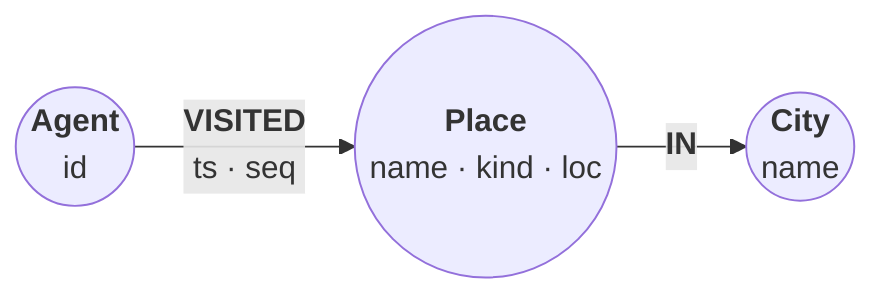

# Nearby places for an agent

*A travel assistant remembers the places its users mention and the places its
agents visit. Five small queries turn that memory into tools: what is within
2 km, what is nearest, what is in this map box, and where an agent went
recently near here.*

The graph is `(:Place {name, kind, loc})-[:IN]->(:City)` for places, and
`(:Agent {id})-[:VISITED {ts, seq}]->(:Place)` for visits. `loc` is a WGS-84
point, so distances come back in metres. "Here" is Hotel Lucia in downtown
Portland.



## Load the places and visits

Constraints keep names unique, so `MERGE` never duplicates a place, city, or
agent. Visit timestamps are epoch milliseconds, and two relationship property
constraints reject a visit without an integer `ts`.

```cypher cell=schema setup
CREATE CONSTRAINT place_name IF NOT EXISTS FOR (p:Place) REQUIRE p.name IS UNIQUE;
CREATE CONSTRAINT city_name IF NOT EXISTS FOR (c:City) REQUIRE c.name IS UNIQUE;
CREATE CONSTRAINT agent_id IF NOT EXISTS FOR (a:Agent) REQUIRE a.id IS UNIQUE;
CREATE CONSTRAINT visit_ts IF NOT EXISTS
  FOR ()-[r:VISITED]-() REQUIRE r.ts IS :: INTEGER;
CREATE CONSTRAINT visit_ts_nn IF NOT EXISTS
  FOR ()-[r:VISITED]-() REQUIRE r.ts IS NOT NULL;
CREATE POINT INDEX place_loc IF NOT EXISTS FOR (p:Place) ON (p.loc)
```

```table
(no rows) · indexes added: 1, constraints added: 5
```

The fixture is one JSON file with a `places` list and a `visits` list.
`point({latitude, longitude})` builds a WGS-84 point (SRID 4326).

```cypher cell=load setup params=places
UNWIND $places AS r
MERGE (c:City {name: r.city})
CREATE (:Place {name: r.name, kind: r.kind,
                loc: point({latitude: r.lat, longitude: r.lon})})-[:IN]->(c);

UNWIND $visits AS v
WITH DISTINCT v.agent AS id ORDER BY id
MERGE (:Agent {id: id});

UNWIND $visits AS v
MATCH (a:Agent {id: v.agent}), (p:Place {name: v.place})
CREATE (a)-[:VISITED {ts: v.ts, seq: v.seq}]->(p);

MATCH (p:Place) WITH count(p) AS places
MATCH (c:City) WITH places, count(c) AS cities
MATCH (:Agent)-[v:VISITED]->()
RETURN places, cities, count(v) AS visits
```

```table
| places | cities | visits |
|--------|--------|--------|
| 80     | 2      | 18     |
1 row · nodes created: 84, relationships created: 98, properties set: 280, labels added: 84
```

## Where is a place?

A point exposes its coordinates and reference system as properties. Return
scalars when a caller needs numbers; return the point itself when it will be
passed back into another query.

```json data=place
{
  "name": "Blue Star Donuts"
}
```

```cypher cell=where params=place
MATCH (p:Place {name: $name})-[:IN]->(c:City)
RETURN p.name AS name, c.name AS city,
       p.loc.latitude AS lat, p.loc.longitude AS lon, p.loc.srid AS srid,
       valueType(p.loc) AS type
```

```table
| name               | city       | lat     | lon       | srid | type             |
|--------------------|------------|---------|-----------|------|------------------|
| "Blue Star Donuts" | "Portland" | 45.5185 | -122.6795 | 4326 | "POINT NOT NULL" |
1 row
```

## Cafes within 2 km

`$here` is a plain map, so `point($here)` builds the caller's position. A
radius is a distance comparison rather than a function of its own:
`point.distance` returns the gap in metres, and `< $radius` keeps the places
inside it. Every radius query below is written the same way.

```json data=within
{
  "here": {
    "latitude": 45.5225,
    "longitude": -122.68
  },
  "radius": 2000,
  "kind": "cafe"
}
```

```cypher cell=within params=within
MATCH (p:Place)
WHERE p.kind = $kind AND point.distance(p.loc, point($here)) < $radius
RETURN p.name AS name, toInteger(round(point.distance(p.loc, point($here)))) AS metres
ORDER BY metres, name
```

```table
| name               | metres |
|--------------------|--------|
| "Blue Star Donuts" | 447    |
| "Stumptown"        | 507    |
| "Coava"            | 1560   |
3 rows
```

The same radius, counted per city. Seattle is 230 km away and contributes
nothing:

```cypher cell=by-city params=within
MATCH (p:Place)-[:IN]->(c:City)
RETURN c.name AS city, count(p) AS places,
       sum(CASE WHEN point.distance(p.loc, point($here)) < $radius
                THEN 1 ELSE 0 END) AS within
ORDER BY city
```

```table
| city       | places | within |
|------------|--------|--------|
| "Portland" | 55     | 13     |
| "Seattle"  | 25     | 0      |
2 rows
```

## The nearest k cafes

With no radius, order by distance and cut. `$k` is a parameter, so the tool
can ask for as many as it needs.

```json data=nearest
{
  "here": {
    "latitude": 45.5225,
    "longitude": -122.68
  },
  "kind": "cafe",
  "k": 2
}
```

```cypher cell=nearest params=nearest
MATCH (p:Place)
WHERE p.kind = $kind
WITH p, point.distance(p.loc, point($here)) AS d
ORDER BY d, p.name
LIMIT $k
RETURN p.name AS name, toInteger(round(d)) AS metres
```

```table
| name               | metres |
|--------------------|--------|
| "Blue Star Donuts" | 447    |
| "Stumptown"        | 507    |
2 rows
```

## What is in this map box?

`point.withinBBox(point, lowerLeft, upperRight)` answers "what is on screen".
The box below has Blue Star Donuts exactly on its lower-left corner and
Stumptown exactly on its upper-right corner. Both count: the boundary is
inclusive.

```json data=bbox
{
  "ll": {
    "latitude": 45.5185,
    "longitude": -122.6795
  },
  "ur": {
    "latitude": 45.5225,
    "longitude": -122.6735
  }
}
```

```cypher cell=bbox params=bbox
MATCH (p:Place)
WHERE point.withinBBox(p.loc, point($ll), point($ur))
WITH p ORDER BY p.name
RETURN count(p) AS in_box, collect(p.name) AS names
```

```table
| in_box | names                             |
|--------|-----------------------------------|
| 2      | ["Blue Star Donuts", "Stumptown"] |
1 row
```

## Where did this agent go recently, near here?

One agent's last visits within the radius. The anchor, `Agent {id: $agent}`,
is unique, and `ts` is an integer, so ordering by `v.ts` and cutting is
exact.

```json data=recent
{
  "agent": "a1",
  "here": {
    "latitude": 45.5225,
    "longitude": -122.68
  },
  "radius": 2000,
  "n": 3
}
```

```cypher cell=recent params=recent
MATCH (a:Agent {id: $agent})-[v:VISITED]->(p:Place)
WHERE point.distance(p.loc, point($here)) < $radius
RETURN p.name AS name, v.seq AS seq, v.ts AS ts
ORDER BY v.ts DESC
LIMIT $n
```

```table
| name               | seq | ts            |
|--------------------|-----|---------------|
| "Blue Star Donuts" | 10  | 1788330030000 |
| "Stumptown"        | 6   | 1788288080000 |
2 rows
```

## The latest visits across all agents

A supervisor wants the newest visits from every agent. The same read now
starts from two `Agent` nodes.

```json data=latest
{
  "n": 3
}
```

```cypher cell=latest params=latest
MATCH (a:Agent)-[v:VISITED]->(p:Place)
RETURN a.id AS agent, p.name AS name, v.seq AS seq, v.ts AS ts
ORDER BY v.ts DESC, v.seq ASC
LIMIT $n
```

```table
| agent | name             | seq | ts            |
|-------|------------------|-----|---------------|
| "a2"  | "Pike Place"     | 6   | 1788363159000 |
| "a2"  | "Pike Cafe"      | 5   | 1788352372000 |
| "a2"  | "Blanchard Cafe" | 4   | 1788350079000 |
3 rows
```

> **Note**
> Keep the second sort key (`v.seq ASC`) when the anchor pattern matches
> more than one node. Without it, Relate currently returns agent `a1`'s
> newest visits instead of the newest overall: it mis-orders a relationship
> property under `ORDER BY … LIMIT` when the pattern starts from more than
> one node.

To see the shape, return the visits themselves. Open the graph view:

```cypher cell=graph params=recent
MATCH path = (a:Agent)-[v:VISITED]->(p:Place)-[:IN]->(:City)
WHERE point.distance(p.loc, point($here)) < $radius
RETURN path
```

```gram
// 4 rows
(n82:Agent {id: "a1"})-[r89:VISITED {seq: 10, ts: 1788330030000}]->(n3:Place {kind: "cafe", loc: {crs: "wgs-84", latitude: 45.5185, longitude: -122.6795, srid: 4326}, name: "Blue Star Donuts"})-[r1:`IN`]->(n0:City {name: "Portland"})
(n82)-[r85:VISITED {seq: 6, ts: 1788288080000}]->(n4:Place {kind: "cafe", loc: {crs: "wgs-84", latitude: 45.5225, longitude: -122.6735, srid: 4326}, name: "Stumptown"})-[r2:`IN`]->(n0)
(n83:Agent {id: "a2"})-[r93:VISITED {seq: 2, ts: 1788281285000}]->(n5:Place {kind: "cafe", loc: {crs: "wgs-84", latitude: 45.5225, longitude: -122.66, srid: 4326}, name: "Coava"})-[r3:`IN`]->(n0)
(n83)-[r92:VISITED {seq: 1, ts: 1788254379000}]->(n6:Place {kind: "bookstore", loc: {crs: "wgs-84", latitude: 45.5231, longitude: -122.6813, srid: 4326}, name: "Powell's"})-[r4:`IN`]->(n0)
```

## Guard the caller's position

Nothing stops a caller from sending a cartesian point. Relate does not
reject a distance between points in different reference systems; it applies
the first argument's metric to both. Here the caller sent
`{"x": -122.68, "y": 45.5225}`:

```json data=guard
{
  "here": {
    "x": -122.68,
    "y": 45.5225
  },
  "radius": 2000,
  "kind": "cafe"
}
```

```cypher cell=mixed-crs params=guard
RETURN point($here).srid AS srid,
       round(point.distance(point({latitude: 45.5225, longitude: -122.68}),
                            point($here)), 2) AS metres
```

```table
| srid | metres |
|------|--------|
| 7203 | null   |
1 row
```

> **Note:** the distance is `null`, not a number: the two points carry
> different CRSs (WGS-84 vs cartesian), and Neo4j returns `null` for a
> mixed-CRS `point.distance` instead of computing across reference systems.

No error, and 0.0 metres: the cartesian `x`/`y` were read as
longitude/latitude. Had the caller swapped them, the answer would be a
plausible-looking wrong number instead. Check the SRID and the coordinate
ranges before the search runs. With the cartesian `$here` from the `guard`
parameters, the guarded tool returns no rows. Edit `here` to
`{"latitude": 45.5225, "longitude": -122.68}` and run it again:

```cypher cell=guarded params=guard
WITH point($here) AS here
WHERE here.srid = 4326
  AND abs(here.latitude) <= 90 AND abs(here.longitude) <= 180
MATCH (p:Place)
WHERE p.kind = $kind AND point.distance(p.loc, here) < $radius
RETURN p.name AS name, toInteger(round(point.distance(p.loc, here))) AS metres
ORDER BY metres, name
```

```table
| name | metres |
|------|--------|
0 rows
```

## Data

The datasets the steps above load. Each block is a JSON object whose
keys are the query parameters.

<details>
<summary><code>places</code> (10 KB)</summary>

```json data=places
{
  "places": [
    {"name": "Hotel Lucia", "kind": "hotel", "city": "Portland", "lat": 45.5225, "lon": -122.68},
    {"name": "Blue Star Donuts", "kind": "cafe", "city": "Portland", "lat": 45.5185, "lon": -122.6795},
    {"name": "Stumptown", "kind": "cafe", "city": "Portland", "lat": 45.5225, "lon": -122.6735},
    {"name": "Coava", "kind": "cafe", "city": "Portland", "lat": 45.5225, "lon": -122.66},
    {"name": "Powell's", "kind": "bookstore", "city": "Portland", "lat": 45.5231, "lon": -122.6813},
    {"name": "Pike Place", "kind": "market", "city": "Seattle", "lat": 47.6097, "lon": -122.3422},
    {"name": "Yamhill Cafe", "kind": "cafe", "city": "Portland", "lat": 45.55954, "lon": -122.7231},
    {"name": "Irving Pharmacy", "kind": "pharmacy", "city": "Portland", "lat": 45.50472, "lon": -122.66591},
    {"name": "Quimby Park", "kind": "park", "city": "Portland", "lat": 45.49611, "lon": -122.70354},
    {"name": "Flanders Museum", "kind": "museum", "city": "Portland", "lat": 45.55345, "lon": -122.63174},
    {"name": "Alder Market", "kind": "market", "city": "Portland", "lat": 45.52692, "lon": -122.71177},
    {"name": "Division Bookstore", "kind": "bookstore", "city": "Portland", "lat": 45.48139, "lon": -122.67622},
    {"name": "Yamhill Bookstore", "kind": "bookstore", "city": "Portland", "lat": 45.47985, "lon": -122.73765},
    {"name": "Vaughn Restaurant", "kind": "restaurant", "city": "Portland", "lat": 45.55528, "lon": -122.67836},
    {"name": "Overton Market", "kind": "market", "city": "Portland", "lat": 45.56149, "lon": -122.62327},
    {"name": "Everett Restaurant", "kind": "restaurant", "city": "Portland", "lat": 45.54747, "lon": -122.65928},
    {"name": "Salmon Park", "kind": "park", "city": "Portland", "lat": 45.51933, "lon": -122.66339},
    {"name": "Alder Hotel", "kind": "hotel", "city": "Portland", "lat": 45.5657, "lon": -122.61317},
    {"name": "Marshall Bookstore", "kind": "bookstore", "city": "Portland", "lat": 45.51802, "lon": -122.66999},
    {"name": "Johnson Museum", "kind": "museum", "city": "Portland", "lat": 45.55963, "lon": -122.61875},
    {"name": "Everett Cafe", "kind": "cafe", "city": "Portland", "lat": 45.47915, "lon": -122.67476},
    {"name": "Clinton Hotel", "kind": "hotel", "city": "Portland", "lat": 45.53758, "lon": -122.64866},
    {"name": "Lovejoy Park", "kind": "park", "city": "Portland", "lat": 45.49837, "lon": -122.68352},
    {"name": "Kearney Park", "kind": "park", "city": "Portland", "lat": 45.51387, "lon": -122.69684},
    {"name": "Burnside Cafe", "kind": "cafe", "city": "Portland", "lat": 45.49092, "lon": -122.64375},
    {"name": "Clinton Restaurant", "kind": "restaurant", "city": "Portland", "lat": 45.5163, "lon": -122.67438},
    {"name": "Taylor Hotel", "kind": "hotel", "city": "Portland", "lat": 45.56565, "lon": -122.71548},
    {"name": "Burnside Market", "kind": "market", "city": "Portland", "lat": 45.47851, "lon": -122.71604},
    {"name": "Kearney Market", "kind": "market", "city": "Portland", "lat": 45.55316, "lon": -122.71161},
    {"name": "Alder Park", "kind": "park", "city": "Portland", "lat": 45.55781, "lon": -122.65309},
    {"name": "Salmon Market", "kind": "market", "city": "Portland", "lat": 45.5629, "lon": -122.66027},
    {"name": "Alder Cafe", "kind": "cafe", "city": "Portland", "lat": 45.54746, "lon": -122.64849},
    {"name": "Burnside Pharmacy", "kind": "pharmacy", "city": "Portland", "lat": 45.48971, "lon": -122.66668},
    {"name": "Hawthorne Park", "kind": "park", "city": "Portland", "lat": 45.55042, "lon": -122.62751},
    {"name": "Lovejoy Restaurant", "kind": "restaurant", "city": "Portland", "lat": 45.56357, "lon": -122.61796},
    {"name": "Couch Pharmacy", "kind": "pharmacy", "city": "Portland", "lat": 45.47392, "lon": -122.62056},
    {"name": "Thurman Hotel", "kind": "hotel", "city": "Portland", "lat": 45.50793, "lon": -122.6946},
    {"name": "Davis Museum", "kind": "museum", "city": "Portland", "lat": 45.51452, "lon": -122.62215},
    {"name": "Salmon Bookstore", "kind": "bookstore", "city": "Portland", "lat": 45.53677, "lon": -122.66596},
    {"name": "Quimby Restaurant", "kind": "restaurant", "city": "Portland", "lat": 45.47408, "lon": -122.68934},
    {"name": "Belmont Museum", "kind": "museum", "city": "Portland", "lat": 45.49958, "lon": -122.7016},
    {"name": "Belmont Bookstore", "kind": "bookstore", "city": "Portland", "lat": 45.52876, "lon": -122.73347},
    {"name": "Flanders Cafe", "kind": "cafe", "city": "Portland", "lat": 45.48912, "lon": -122.70503},
    {"name": "Overton Bookstore", "kind": "bookstore", "city": "Portland", "lat": 45.55439, "lon": -122.72204},
    {"name": "Glisan Hotel", "kind": "hotel", "city": "Portland", "lat": 45.52472, "lon": -122.65898},
    {"name": "Upshur Museum", "kind": "museum", "city": "Portland", "lat": 45.54853, "lon": -122.64524},
    {"name": "Couch Market", "kind": "market", "city": "Portland", "lat": 45.50464, "lon": -122.61045},
    {"name": "Northrup Pharmacy", "kind": "pharmacy", "city": "Portland", "lat": 45.51475, "lon": -122.69744},
    {"name": "Couch Hotel", "kind": "hotel", "city": "Portland", "lat": 45.50866, "lon": -122.70067},
    {"name": "Kearney Museum", "kind": "museum", "city": "Portland", "lat": 45.47497, "lon": -122.68041},
    {"name": "Taylor Pharmacy", "kind": "pharmacy", "city": "Portland", "lat": 45.50094, "lon": -122.70588},
    {"name": "Johnson Restaurant", "kind": "restaurant", "city": "Portland", "lat": 45.5334, "lon": -122.64365},
    {"name": "Burnside Hotel", "kind": "hotel", "city": "Portland", "lat": 45.49792, "lon": -122.68376},
    {"name": "Flanders Restaurant", "kind": "restaurant", "city": "Portland", "lat": 45.56668, "lon": -122.68074},
    {"name": "Couch Cafe", "kind": "cafe", "city": "Portland", "lat": 45.47951, "lon": -122.68022},
    {"name": "Everett Museum", "kind": "museum", "city": "Portland", "lat": 45.50086, "lon": -122.63163},
    {"name": "Pike Market", "kind": "market", "city": "Seattle", "lat": 47.58972, "lon": -122.37561},
    {"name": "Cherry Bookstore", "kind": "bookstore", "city": "Seattle", "lat": 47.61666, "lon": -122.29283},
    {"name": "Blanchard Bookstore", "kind": "bookstore", "city": "Seattle", "lat": 47.61048, "lon": -122.33574},
    {"name": "Madison Museum", "kind": "museum", "city": "Seattle", "lat": 47.6025, "lon": -122.36664},
    {"name": "Pike Cafe", "kind": "cafe", "city": "Seattle", "lat": 47.60903, "lon": -122.36381},
    {"name": "Columbia Museum", "kind": "museum", "city": "Seattle", "lat": 47.60816, "lon": -122.3155},
    {"name": "Pine Hotel", "kind": "hotel", "city": "Seattle", "lat": 47.62318, "lon": -122.32256},
    {"name": "Pike Pharmacy", "kind": "pharmacy", "city": "Seattle", "lat": 47.62768, "lon": -122.35556},
    {"name": "Madison Restaurant", "kind": "restaurant", "city": "Seattle", "lat": 47.58144, "lon": -122.33158},
    {"name": "Pike Bookstore", "kind": "bookstore", "city": "Seattle", "lat": 47.65943, "lon": -122.3091},
    {"name": "Stewart Pharmacy", "kind": "pharmacy", "city": "Seattle", "lat": 47.6279, "lon": -122.36409},
    {"name": "Stewart Park", "kind": "park", "city": "Seattle", "lat": 47.61066, "lon": -122.31556},
    {"name": "Lenora Bookstore", "kind": "bookstore", "city": "Seattle", "lat": 47.6549, "lon": -122.35739},
    {"name": "Seneca Restaurant", "kind": "restaurant", "city": "Seattle", "lat": 47.62295, "lon": -122.29118},
    {"name": "Blanchard Cafe", "kind": "cafe", "city": "Seattle", "lat": 47.65724, "lon": -122.318},
    {"name": "Blanchard Market", "kind": "market", "city": "Seattle", "lat": 47.63592, "lon": -122.33786},
    {"name": "Virginia Bookstore", "kind": "bookstore", "city": "Seattle", "lat": 47.63039, "lon": -122.33496},
    {"name": "Yesler Hotel", "kind": "hotel", "city": "Seattle", "lat": 47.60041, "lon": -122.30023},
    {"name": "Bell Market", "kind": "market", "city": "Seattle", "lat": 47.64225, "lon": -122.29814},
    {"name": "Lenora Restaurant", "kind": "restaurant", "city": "Seattle", "lat": 47.62588, "lon": -122.37153},
    {"name": "Blanchard Park", "kind": "park", "city": "Seattle", "lat": 47.64802, "lon": -122.29406},
    {"name": "Union Restaurant", "kind": "restaurant", "city": "Seattle", "lat": 47.58381, "lon": -122.31199},
    {"name": "Seneca Pharmacy", "kind": "pharmacy", "city": "Seattle", "lat": 47.65149, "lon": -122.3714},
    {"name": "Pike Hotel", "kind": "hotel", "city": "Seattle", "lat": 47.59158, "lon": -122.33062}
  ],
  "visits": [
    {"agent": "a1", "place": "Alder Hotel", "ts": 1788251014000, "seq": 1},
    {"agent": "a1", "place": "Lovejoy Restaurant", "ts": 1788256140000, "seq": 2},
    {"agent": "a1", "place": "Clinton Hotel", "ts": 1788262124000, "seq": 3},
    {"agent": "a1", "place": "Flanders Museum", "ts": 1788264540000, "seq": 4},
    {"agent": "a1", "place": "Overton Bookstore", "ts": 1788271493000, "seq": 5},
    {"agent": "a1", "place": "Stumptown", "ts": 1788288080000, "seq": 6},
    {"agent": "a1", "place": "Kearney Museum", "ts": 1788297186000, "seq": 7},
    {"agent": "a1", "place": "Burnside Pharmacy", "ts": 1788304446000, "seq": 8},
    {"agent": "a1", "place": "Everett Cafe", "ts": 1788322173000, "seq": 9},
    {"agent": "a1", "place": "Blue Star Donuts", "ts": 1788330030000, "seq": 10},
    {"agent": "a1", "place": "Cherry Bookstore", "ts": 1788338666000, "seq": 11},
    {"agent": "a1", "place": "Madison Restaurant", "ts": 1788347754000, "seq": 12},
    {"agent": "a2", "place": "Powell's", "ts": 1788254379000, "seq": 1},
    {"agent": "a2", "place": "Coava", "ts": 1788281285000, "seq": 2},
    {"agent": "a2", "place": "Yamhill Cafe", "ts": 1788314362000, "seq": 3},
    {"agent": "a2", "place": "Blanchard Cafe", "ts": 1788350079000, "seq": 4},
    {"agent": "a2", "place": "Pike Cafe", "ts": 1788352372000, "seq": 5},
    {"agent": "a2", "place": "Pike Place", "ts": 1788363159000, "seq": 6}
  ]
}
```

</details>
