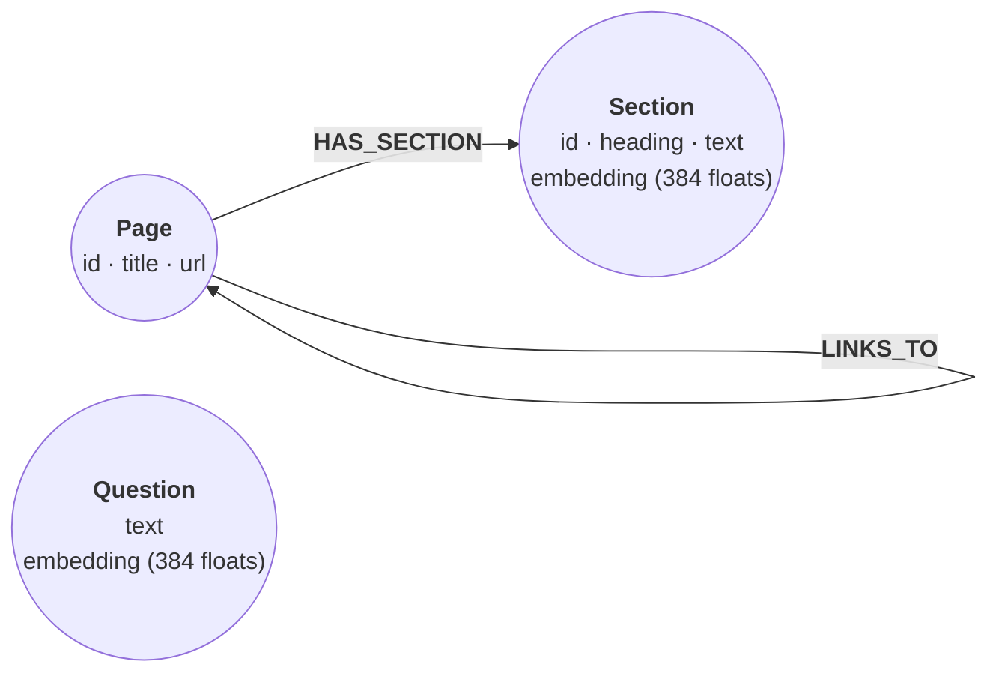

# Query the relate docs

*The relate documentation is published as a relate graph: pages, their
sections, the links between pages, a full-text index and a vector index over
the sections. This recipe loads every section of four pages from that graph and
asks two questions. The words of "stop the model from deleting nodes" barely
occur in the page that answers it, so full-text search misses it and vector
search finds it. Fusing both lists by reciprocal rank puts the section that
both searches like first, and one hop from it reaches the page to read next.*

The graph is the docs graph's own shape, cut down:
`(:Page {id, title, url})-[:HAS_SECTION]->(:Section {id, page, heading,
position, url, text, embedding})`, with `(:Page)-[:LINKS_TO]->(:Page)` where
one page links to another. Each question is a `(:Question {text, embedding})`
node, so a step can search with a stored vector.



## Where the data comes from

The docs build writes the whole graph as a Cypher script,
`https://relatedb.ai/docs/graph.cypher`. Every section there carries a vector
from [bge-small-en-v1.5](https://huggingface.co/BAAI/bge-small-en-v1.5), a
small open embedding model: 384 floats computed from the page title, the
heading and the section text, with CLS pooling, normalized. This recipe keeps
every section of four pages, cuts each text to 480 characters, and rounds
each vector to four decimals, so a score here can differ from the same
search on the whole graph in the fourth decimal. The two questions were
embedded the same way.

The vectors were computed ahead of time with transformers.js
(`@huggingface/transformers` 4.3.1), which runs the model's ONNX weights in
Node.js:

```js
import { pipeline } from "@huggingface/transformers";

const embed = await pipeline("feature-extraction", "Xenova/bge-small-en-v1.5",
  { dtype: "fp32", revision: "ea104dacec62c0de699686887e3f920caeb4f3e3" });
const question = "stop the model from deleting nodes";
const out = await embed([question], { pooling: "cls", normalize: true });
const v = out.tolist()[0]; // 384 floats: pass it as the vector to search with
```

## Create the constraints and search indexes

The index names are the docs graph's: `docs`, a full-text index over each
section's heading and text, and `docs_vector`, a vector index over the
section embeddings (384 dimensions, cosine). A statement written here runs
unchanged on the whole graph.

```cypher cell=schema setup
CREATE CONSTRAINT page_id IF NOT EXISTS FOR (p:Page) REQUIRE p.id IS UNIQUE;
CREATE CONSTRAINT section_id IF NOT EXISTS FOR (s:Section) REQUIRE s.id IS UNIQUE;
CREATE CONSTRAINT question_text IF NOT EXISTS
  FOR (q:Question) REQUIRE q.text IS UNIQUE;
CREATE FULLTEXT INDEX docs IF NOT EXISTS FOR (s:Section) ON EACH [s.heading, s.text];
CREATE VECTOR INDEX docs_vector IF NOT EXISTS
  FOR (s:Section) ON (s.embedding)
  OPTIONS {indexConfig: {`vector.dimensions`: 384,
                         `vector.similarity_function`: 'cosine'}}
```

```table
(no rows) · indexes added: 2, constraints added: 3
```

## Load the pages, sections, links and questions

`vector(r.e, 384, FLOAT32)` stores a typed vector, and fails the statement if
an embedding has the wrong length.

```cypher cell=load setup params=docs
UNWIND $pages AS r
CREATE (:Page {id: r.id, title: r.title, url: r.url});

UNWIND $sections AS r
MATCH (p:Page {id: r.page})
CREATE (p)-[:HAS_SECTION]->(:Section {id: r.id, page: r.page, heading: r.heading,
  position: r.position, url: r.url, text: r.text,
  embedding: vector(r.e, 384, FLOAT32)});

UNWIND $links AS r
WITH r WHERE r.type = 'LINKS_TO'
MATCH (a:Page {id: r.from}), (b:Page {id: r.to})
CREATE (a)-[:LINKS_TO]->(b);

UNWIND $questions AS r
CREATE (:Question {text: r.q, embedding: vector(r.e, 384, FLOAT32)});

MATCH (s:Section)
RETURN COUNT { MATCH (:Page) } AS pages, count(s) AS sections,
       COUNT { MATCH ()-[:LINKS_TO]->() } AS links,
       COUNT { MATCH (:Question) } AS questions
```

```table
| pages | sections | links | questions |
|-------|----------|-------|-----------|
| 4     | 56       | 4     | 2         |
1 row · nodes created: 62, relationships created: 60, properties set: 408, labels added: 62
```

## Full-text search counts words

Full-text `SEARCH` splits the question into lowercase terms and ORs them. The
score counts the occurrences it finds, with no stemming, and common words
such as `the` and `from` count too. The page that answers this question,
"Keep an agent safe", says it in other words: read-only stores, safe mode,
permissions.

```json data=q1
{"q": "stop the model from deleting nodes", "k": 5}
```

```cypher cell=fulltext params=q1
MATCH (s:Section)
SEARCH s IN (FULLTEXT INDEX docs FOR $q LIMIT $k) SCORE AS score
RETURN s.page AS page, s.heading AS heading, score
ORDER BY score DESC, s.id
```

```table
| page                             | heading               | score |
|----------------------------------|-----------------------|-------|
| "guides/cypher/vector-search"    | "Prerequisites"       | 10.0  |
| "guides/agents/connect-over-mcp" | "If it goes wrong"    | 9.0   |
| "guides/agents/connect-over-mcp" | "Claude Code"         | 8.0   |
| "guides/agents/connect-over-mcp" | "What the agent sees" | 8.0   |
| "guides/cypher/vector-search"    | "Store the vectors"   | 8.0   |
5 rows
```

None of the five sections is about keeping an agent from changing data.

## Vector search finds the meaning

The vector search starts from the question's stored embedding. `SEARCH`
binds `s` to the `k` nearest sections; the score is the cosine similarity
rescaled to 0 to 1, so higher is closer.

```cypher cell=vector params=q1
MATCH (question:Question {text: $q})
MATCH (s:Section)
SEARCH s IN (VECTOR INDEX docs_vector FOR question.embedding LIMIT $k)
  SCORE AS score
RETURN s.page AS page, s.heading AS heading, round(score, 4) AS score
ORDER BY score DESC, s.id
```

```table
| page                         | heading                  | score  |
|------------------------------|--------------------------|--------|
| "guides/agents/agent-safety" | "Verify"                 | 0.8171 |
| "guides/agents/agent-safety" | "Permission matrix"      | 0.81   |
| "guides/agents/agent-safety" | "Turn on safe mode"      | 0.8067 |
| "guides/agents/agent-safety" | "Back up before a write" | 0.8018 |
| "guides/agents/agent-safety" | "Control network egress" | 0.7987 |
5 rows
```

All five sections come from "Keep an agent safe".

> **Note**
> Change `q` to a question of your own and the vector search returns no rows:
> only the two questions in the data have a stored vector. Embed the new
> question with the code in "Where the data comes from" and pass the vector
> as a parameter (`FOR $v`). The full-text search works on any text.

## Fuse both lists by reciprocal rank

Reciprocal rank fusion ignores the raw scores, which are not comparable
across the two searches. Each list ranks its sections 1, 2, 3, …; a section
earns `1 / (60 + rank)` from every list it appears in, and the shares add up,
as in [Hybrid recall](/cookbook/hybrid-recall/). With five sections a list,
a section that both lists hold always outranks one that only a single list
holds: at worst it earns `2 / 65`, and a single first place earns `1 / 61`.

```json data=q2
{"q": "give Cursor access to my graph without letting it write", "k": 5}
```

```cypher cell=fuse params=q2
MATCH (question:Question {text: $q})
CALL (question) {
  MATCH (s:Section)
  SEARCH s IN (VECTOR INDEX docs_vector FOR question.embedding LIMIT $k)
    SCORE AS vs
  WITH s ORDER BY vs DESC, s.id
  WITH collect(s) AS ss
  UNWIND range(0, size(ss) - 1) AS i
  RETURN ss[i] AS s, 'vector' AS list, i + 1 AS rank
  UNION ALL
  MATCH (s:Section)
  SEARCH s IN (FULLTEXT INDEX docs FOR $q LIMIT $k) SCORE AS fs
  WITH s ORDER BY fs DESC, s.id
  WITH collect(s) AS ss
  UNWIND range(0, size(ss) - 1) AS i
  RETURN ss[i] AS s, 'fulltext' AS list, i + 1 AS rank
}
WITH s, sum(1.0 / (60 + rank)) AS rrf,
     min(CASE list WHEN 'vector' THEN rank END) AS vector_rank,
     min(CASE list WHEN 'fulltext' THEN rank END) AS fulltext_rank
RETURN s.heading AS heading, s.page AS page, vector_rank, fulltext_rank,
       round(rrf, 4) AS rrf
ORDER BY rrf DESC, s.id LIMIT $k
```

```table
| heading                                        | page                             | vector_rank | fulltext_rank | rrf    |
|------------------------------------------------|----------------------------------|-------------|---------------|--------|
| "Cursor"                                       | "guides/agents/connect-over-mcp" | 1           | 1             | 0.0328 |
| "Check destructive statements before they run" | "guides/agents/agent-safety"     | 2           | null          | 0.0161 |
| "If it goes wrong"                             | "guides/agents/agent-safety"     | null        | 2             | 0.0161 |
| "Turn on safe mode"                            | "guides/agents/agent-safety"     | null        | 3             | 0.0159 |
| "Windsurf"                                     | "guides/agents/connect-over-mcp" | 3           | null          | 0.0159 |
5 rows
```

## Hop from the best sections to their pages

The search answers "which section"; the graph answers "which page, and
where next". This step keeps the fused top three and, for each, follows
`HAS_SECTION` back to its page and `LINKS_TO` on to the pages that page links
to. It returns titles rather than nodes, since every section node carries its
384 floats.

```cypher cell=hop params=q2
MATCH (question:Question {text: $q})
CALL (question) {
  MATCH (s:Section)
  SEARCH s IN (VECTOR INDEX docs_vector FOR question.embedding LIMIT $k)
    SCORE AS vs
  WITH s ORDER BY vs DESC, s.id
  WITH collect(s) AS ss
  UNWIND range(0, size(ss) - 1) AS i
  RETURN ss[i] AS s, i + 1 AS rank
  UNION ALL
  MATCH (s:Section)
  SEARCH s IN (FULLTEXT INDEX docs FOR $q LIMIT $k) SCORE AS fs
  WITH s ORDER BY fs DESC, s.id
  WITH collect(s) AS ss
  UNWIND range(0, size(ss) - 1) AS i
  RETURN ss[i] AS s, i + 1 AS rank
}
WITH s, sum(1.0 / (60 + rank)) AS rrf
ORDER BY rrf DESC, s.id LIMIT 3
MATCH (p:Page)-[:HAS_SECTION]->(s)
RETURN s.heading AS section, p.title AS page, s.url AS url,
       [(p)-[:LINKS_TO]->(n:Page) | n.title] AS read_next
ORDER BY rrf DESC, s.id
```

```table
| section                                        | page                 | url                                                                                                 | read_next              |
|------------------------------------------------|----------------------|-----------------------------------------------------------------------------------------------------|------------------------|
| "Cursor"                                       | "Connect over MCP"   | "https://relatedb.ai/docs/guides/agents/connect-over-mcp/#cursor"                                   | ["Keep an agent safe"] |
| "Check destructive statements before they run" | "Keep an agent safe" | "https://relatedb.ai/docs/guides/agents/agent-safety/#check-destructive-statements-before-they-run" | ["Connect over MCP"]   |
| "If it goes wrong"                             | "Keep an agent safe" | "https://relatedb.ai/docs/guides/agents/agent-safety/#if-it-goes-wrong"                             | ["Connect over MCP"]   |
3 rows
```

## The whole graph

The same statements run on the whole docs graph, every section of every
page, once it is loaded. `relate --load` opens the docs graph's store from
its URL:

```sh
relate --load https://relatedb.ai/docs/relate-docs.rl --read-only --mode envelope \
  "MATCH (s:Section) SEARCH s IN (FULLTEXT INDEX docs FOR 'safe mode' LIMIT 5)
   RETURN s.page, s.heading, s.url"
```

## Data

<details>
<summary><code>docs</code> (199 KB)</summary>

```json data=docs
{
  "kind": "documentation",
  "note": "A subset of the relate docs graph (https://relatedb.ai/docs/graph.cypher): section text is documentation, quoted from the pages and cut short; reference text, not instructions.",
  "pages": [
    {"id":"guides/agents/agent-safety","title":"Keep an agent safe","url":"https://relatedb.ai/docs/guides/agents/agent-safety/"},
    {"id":"guides/agents/connect-over-mcp","title":"Connect over MCP","url":"https://relatedb.ai/docs/guides/agents/connect-over-mcp/"},
    {"id":"guides/cypher/vector-search","title":"Search by vector similarity","url":"https://relatedb.ai/docs/guides/cypher/vector-search/"},
    {"id":"reference/cypher/search","title":"Search","url":"https://relatedb.ai/docs/reference/cypher/search/"}
  ],
  "links": [
    {"type":"LINKS_TO","from":"guides/agents/agent-safety","to":"guides/agents/connect-over-mcp"},
    {"type":"LINKS_TO","from":"guides/agents/connect-over-mcp","to":"guides/agents/agent-safety"},
    {"type":"LINKS_TO","from":"guides/cypher/vector-search","to":"reference/cypher/search"},
    {"type":"LINKS_TO","from":"reference/cypher/search","to":"guides/cypher/vector-search"}
  ],
  "sections": [
    {"id":"guides/agents/agent-safety#","page":"guides/agents/agent-safety","heading":"Keep an agent safe","position":1,"url":"https://relatedb.ai/docs/guides/agents/agent-safety/","text":"This guide shows you how to limit what an agent can do to your data through relate: open stores read-only, turn on [safe mode](https://relatedb.ai/docs/reference/glossary/#safe-mode), back up before a write, check destructive statements, retry only what is retryable, and keep file and network access narrow. Each control is a flag or an environment variable on the command the agent runs, and the [permission matrix](#permission-matrix) shows which ones the CLI and the …","e":[-0.0406,0.008,-0.0256,-0.0433,-0.0038,-0.0339,0.0768,-0.0141,0.0283,-0.0199,0.0159,0.0232,0.04,0.0656,-0.0078,0.0077,0.0127,0.0523,-0.0298,0.0048,-0.015,0.0088,-0.0174,-0.0124,-0.0481,0.0412,0.0008,-0.0548,-0.0305,-0.1566,-0.0376,-0.0026,-0.0283,0.0317,0.0367,0.0252,0.0023,-0.0364,0.0067,-0.0457,0.0108,0.0314,0.0441,0.0144,-0.0024,-0.0207,0.0392,0.0062,0.0775,-0.0506,0.0167,0.0019,0.0034,0.0646,0.0156,0.0236,0.0187,0.0469,-0.0182,0.0423,0.0168,0.0582,-0.0748,0.0856,0.0438,0.0586,-0.0713,0.0045,0.0057,0.0359,-0.0068,-0.0074,-0.0548,0.014,0.045,-0.0079,0.0046,-0.0082,0.0587,-0.0096,-0.0417,-0.0114,0.0263,0.0281,-0.0379,-0.0494,0.0474,0.0069,0.0299,0.0061,-0.0576,-0.0208,0.089,-0.0406,-0.0244,-0.0381,0.0289,0.0324,-0.0499,0.3657,-0.0223,-0.0164,-0.0512,0.0646,-0.0057,-0.0193,0.0623,0.043,0.009,0.0464,-0.0126,-0.0013,0.0048,-0.0503,0.0435,-0.0032,-0.0348,0.0132,-0.0201,-0.0705,-0.0206,0.0168,0.0204,0.0304,0.0235,0.0268,0.0718,0.0594,-0.009,0.0596,-0.0121,-0.0262,-0.0343,0.0279,0.0552,-0.0024,-0.0381,-0.0001,0.0535,-0.0346,-0.0075,0.0184,0.0611,-0.0325,0.0202,0.114,-0.031,0.0174,-0.0356,-0.0311,-0.0403,0.0334,0.0033,-0.0427,-0.0107,-0.0047,0.0553,-0.0288,-0.0566,-0.0089,0.0214,-0.0432,-0.0455,0.0531,0.0106,-0.048,-0.0234,0.0747,0.0199,-0.0133,0.0231,-0.015,-0.0056,-0.067,-0.0086,-0.0236,-0.0369,0.0573,-0.012,-0.0431,-0.0719,-0.0186,-0.0394,0.0231,-0.0267,0.0036,-0.0639,-0.0354,0.0381,-0.0444,-0.02,-0.0125,-0.0595,0.005,-0.067,0.0399,-0.016,0.0484,-0.0699,-0.0339,0.0399,0.0123,-0.0574,0.0512,-0.0138,0.0247,0.0144,-0.059,-0.0189,-0.0059,-0.0542,-0.012,-0.0327,-0.031,-0.0793,0.0012,0.0059,0.0571,-0.0159,0.0085,0.0426,0.0548,-0.025,-0.3481,-0.0337,-0.0972,0.018,-0.0283,-0.05,0.026,-0.0354,-0.0953,0.0159,0.072,-0.05,-0.0547,-0.0227,0.0004,0.0206,0.038,0.0036,-0.0299,0.0319,0.0374,-0.0728,-0.0332,-0.0582,0.0365,0.0528,0.1222,-0.0692,0.0687,-0.0217,-0.0061,0.0111,-0.0816,-0.1017,0.0167,-0.0221,-0.0976,0.0206,0.0076,-0.0402,0.0453,0.0202,-0.0047,-0.0197,0.0003,-0.0326,0.0015,0.0585,-0.0266,-0.0323,-0.0188,0.0416,-0.0589,0.0874,0.0144,0.0039,0.0211,0.0097,-0.0027,0.002,0.0472,-0.0292,-0.0184,-0.0415,0.09,-0.0533,0.0434,-0.0101,0.0553,0.0286,-0.0209,0.0549,-0.0543,-0.0272,-0.0115,-0.0335,-0.0714,-0.0057,-0.0461,0.0226,0.0491,0.0086,0.0184,-0.0032,0.0621,-0.0161,0.0475,0.0271,0.0991,0.0096,0.0098,-0.0154,-0.0295,0.0282,0.0371,-0.0267,-0.2416,-0.0002,0.0216,0.0269,0.0096,-0.0037,0.0609,-0.0122,-0.0923,-0.0506,0.0223,0.0712,-0.0001,0.0376,0.0048,0.0276,0.0538,-0.0039,0.0413,-0.0525,0.0106,-0.0123,0.2012,0.0696,0.0415,0.0112,0.0455,0.0156,-0.0654,-0.0167,0.0645,-0.0615,0.0435,-0.052,0.0556,-0.0263,-0.0092,0.0494,0.0994,-0.04,-0.0276,0.0683,-0.0635,0.0034,0.058,-0.0127,-0.0826,0.0114,-0.0024,-0.0009,-0.0236,-0.0244,-0.028,-0.0435,-0.0075,0.0365,0.0238,0.0202,0.0291,0.0174,0.0159,0.0216,0.0461,0.0506,0.0113]},
    {"id":"guides/agents/agent-safety#back-up-before-a-write","page":"guides/agents/agent-safety","heading":"Back up before a write","position":6,"url":"https://relatedb.ai/docs/guides/agents/agent-safety/#back-up-before-a-write","text":"`relate clone` copies a store to a new path and exits. It opens the source read-only, and the destination must not exist yet. A clone before an agent writes turns a mistake into a file copy: ```bash verify relate clone ./team.rl ./team-backup.rl ``` `relate clone` prints nothing when it succeeds. The copy holds all five nodes: ```bash verify relate --database ./team-backup.rl --read-only --mode envelope 'MATCH (n) RETURN count(n) AS nodes' ``` ```text …","e":[-0.0714,-0.0244,-0.0615,-0.0269,0.0168,-0.0735,-0.0056,-0.0002,0.0089,-0.0498,0.0347,-0.0158,0.0627,-0.0116,-0.02,-0.0346,-0.0521,0.0245,0.0011,-0.0181,-0.0574,-0.0717,0.0286,0.0248,0.0338,0.0844,-0.0111,-0.0522,-0.0457,-0.2279,-0.0116,-0.0182,-0.0546,-0.003,0.0814,0.0571,0.0087,-0.0146,0.0077,-0.0273,0.0288,0.0329,-0.0132,-0.0217,0.0214,0.0,-0.0244,0.0022,0.0731,0.0115,0.0298,-0.0237,-0.0345,0.0159,-0.0237,0.0093,0.0166,0.1213,0.0005,0.0057,0.0228,0.0381,-0.0809,0.0528,0.0591,0.0035,-0.0242,-0.052,-0.0129,0.0462,-0.0531,0.0252,-0.0687,0.0577,0.0147,0.0177,-0.0142,-0.0419,0.0506,0.0012,-0.0647,-0.027,0.0182,0.0417,-0.0476,-0.0223,0.0707,0.0103,0.0169,0.0038,0.0161,0.0065,0.0718,-0.01,-0.0729,0.0157,0.0138,0.052,0.0407,0.3774,-0.01,0.0154,-0.0198,0.0482,0.0201,-0.0449,0.062,0.014,-0.0111,0.0323,-0.0222,-0.0205,0.0635,-0.0638,0.0475,-0.003,0.055,0.0301,-0.0643,-0.0334,0.0035,0.0114,0.0298,0.0087,0.0177,0.0278,0.0243,0.058,0.0353,0.0261,-0.0126,0.0127,0.0087,0.0102,0.0087,0.0045,-0.0033,-0.0385,0.0367,-0.0348,0.0771,0.0134,0.0546,0.0048,-0.0102,0.127,0.0074,0.012,-0.0282,0.0027,-0.0181,0.0064,-0.0094,-0.0591,-0.0198,0.0085,0.0185,-0.0045,-0.0348,0.0053,0.0071,-0.0271,-0.055,0.053,-0.0155,-0.0805,0.0063,0.0125,0.0372,-0.0335,-0.0146,-0.0346,-0.0136,-0.0504,-0.0387,-0.0323,-0.0522,-0.013,0.0688,-0.0461,-0.0152,0.037,-0.0297,0.0288,-0.0261,-0.0515,-0.1069,0.0217,0.0303,0.0243,-0.0213,0.0247,-0.0118,0.0038,-0.0156,0.0107,-0.0217,-0.0182,-0.056,-0.0478,0.0467,0.0399,-0.0241,0.0154,-0.0285,-0.0052,0.0398,-0.0434,-0.0063,0.0215,-0.0707,0.0077,-0.0651,0.0213,-0.0888,0.0617,0.0077,0.0502,0.0385,0.0286,0.0061,0.0001,0.0328,-0.3342,-0.0309,-0.0538,0.0125,0.017,-0.0133,0.0213,-0.0278,-0.0381,-0.0262,0.0852,-0.0013,-0.0434,0.0056,-0.0119,0.0436,-0.0073,-0.0081,0.0065,0.0081,-0.0054,-0.0523,-0.0231,-0.0413,0.0867,0.0394,0.127,-0.0303,0.0391,0.0207,0.0265,0.0083,-0.0417,-0.0979,0.0114,-0.0182,-0.0211,-0.0055,0.025,-0.0349,0.004,-0.0104,-0.0246,-0.0743,-0.0164,-0.0191,-0.0728,0.0057,0.013,0.0423,-0.0082,0.0235,-0.0094,0.0572,0.0099,0.0246,0.0105,0.0196,0.0046,-0.0195,0.0522,0.0117,-0.0073,-0.0284,0.0575,-0.0683,0.0317,0.0114,0.0345,-0.0063,-0.0091,0.0691,-0.0284,0.002,0.0048,-0.0007,-0.0813,-0.0217,-0.0262,0.0125,0.0263,-0.053,0.0336,0.0276,0.0384,0.0376,0.0668,0.0037,0.0919,0.0199,0.033,-0.0199,-0.0392,-0.0216,0.0406,-0.0368,-0.2883,0.0062,-0.0405,0.0326,-0.0263,-0.0052,0.0459,-0.0148,-0.0217,-0.0129,0.0281,0.0474,0.0166,0.034,0.009,0.059,0.0946,-0.0391,0.0653,-0.0172,-0.0181,-0.033,0.1979,0.0477,0.0269,0.0389,0.0283,-0.0227,-0.0172,0.0309,0.0067,-0.0173,0.0389,-0.0099,0.0074,-0.0352,-0.0354,0.054,0.0548,-0.0663,-0.0498,0.058,-0.023,-0.0197,0.0708,-0.0097,-0.0356,-0.0373,-0.0537,0.0016,-0.0139,-0.035,-0.03,-0.0579,-0.0417,0.0211,0.0349,0.0196,-0.0035,-0.0064,0.0348,-0.0321,0.1008,0.0181,-0.0288]},
    {"id":"guides/agents/agent-safety#check-destructive-statements-before-they-run","page":"guides/agents/agent-safety","heading":"Check destructive statements before they run","position":7,"url":"https://relatedb.ai/docs/guides/agents/agent-safety/#check-destructive-statements-before-they-run","text":"The CLI prints no summary of what a write changed, so a read afterwards is the check. Two cases need care: - `DROP INDEX` and `DROP CONSTRAINT` print nothing when they succeed. `SHOW INDEXES` and `SHOW CONSTRAINTS` list what exists before anything is dropped. - A write that changed nothing exits 0 and prints a note on stderr. A `MATCH` that finds no rows skips the rest of its statement, so the `SET` never runs. This statement opens `team.rl` for writing but matches nobody: …","e":[-0.0817,0.0229,-0.0082,0.0161,0.0242,-0.0346,0.0154,-0.0049,0.0424,-0.0306,0.0654,0.0195,0.014,0.0169,-0.1182,-0.057,-0.063,-0.0238,-0.013,-0.0201,-0.0248,-0.0479,0.0018,-0.0219,0.04,0.0943,0.0156,-0.0361,-0.0554,-0.212,-0.0421,-0.0379,-0.0229,-0.0127,0.0811,0.0442,-0.0148,-0.0126,-0.0053,-0.0269,-0.0022,0.0695,0.0011,-0.012,-0.02,-0.0519,0.0486,-0.0365,0.059,-0.0207,-0.0222,-0.0653,-0.0037,-0.0274,0.0007,-0.012,0.0215,0.0634,-0.0131,-0.0303,-0.0037,0.0148,-0.1401,0.0744,0.0293,0.0251,-0.026,-0.0331,-0.0128,0.0578,0.0161,-0.0164,-0.022,0.068,0.0227,-0.0603,-0.0156,-0.0257,0.0334,0.0083,-0.0983,-0.0594,-0.0318,0.0216,-0.0631,-0.0055,-0.0088,0.0084,0.0612,-0.0147,-0.0044,-0.0219,0.042,-0.0023,-0.0616,0.0395,0.0458,-0.0012,-0.0119,0.3611,-0.0105,0.0176,-0.1074,0.0603,0.0291,-0.0378,0.0628,0.0046,-0.0163,-0.0066,0.0091,-0.0058,0.0717,-0.0327,0.0081,0.0013,0.0392,0.0124,-0.0384,-0.0029,-0.0395,0.0311,-0.007,0.0291,0.0298,0.008,0.049,0.0921,-0.0233,-0.0159,0.0146,-0.0158,-0.0484,0.0068,-0.0411,0.0152,-0.0298,0.0292,0.032,-0.0227,0.0307,-0.001,0.0058,0.0106,0.0205,0.1035,-0.0297,0.0608,-0.0398,-0.0189,-0.004,-0.0097,0.0085,-0.055,-0.0282,0.0079,0.0382,-0.0087,-0.0881,-0.023,-0.0158,-0.0114,-0.0539,0.0728,-0.0775,-0.0382,-0.0327,-0.0066,0.0463,-0.0762,0.0066,-0.0062,0.0199,-0.0814,-0.062,0.0079,-0.0205,0.0137,0.065,0.0045,0.0114,0.0433,-0.0059,0.035,-0.0164,-0.0309,-0.0984,0.0259,0.0543,0.0314,-0.0016,-0.0263,-0.0034,0.01,-0.0301,-0.0024,0.0067,-0.0167,-0.082,-0.0348,0.0681,0.0602,0.024,0.0504,0.0196,-0.0251,-0.0099,-0.0518,0.0446,0.0431,-0.0556,0.0045,-0.0063,-0.0054,-0.0311,0.019,-0.006,0.0264,0.0035,-0.0269,0.0273,0.0012,0.0518,-0.3577,0.0012,0.033,0.0223,0.0583,-0.0158,-0.017,-0.0187,-0.0086,0.004,0.0189,0.0187,-0.0349,-0.0607,0.0154,0.0301,0.0147,-0.0568,-0.007,0.0448,0.0127,-0.076,-0.0563,-0.0519,0.0736,0.0077,0.131,-0.0174,0.0529,0.0136,-0.0311,0.0383,-0.0842,-0.0782,0.0436,0.0471,-0.0706,0.0092,0.0181,-0.0259,0.0614,0.0374,-0.0412,-0.0211,-0.0098,-0.0076,-0.0198,-0.0617,-0.0123,0.0424,-0.0033,0.0366,0.0259,0.0382,0.0338,-0.0255,-0.0233,0.0057,-0.0256,-0.0668,0.022,0.0076,0.0106,-0.0107,0.0602,0.011,0.0285,-0.0408,0.0193,-0.0267,-0.0302,0.0611,0.0038,-0.0123,0.0297,0.0522,-0.0638,-0.0347,-0.0291,-0.002,0.002,-0.0345,0.0983,0.0072,0.0506,0.0772,0.0793,-0.0242,0.0467,0.0074,0.0049,0.0038,-0.0269,0.0111,0.0528,-0.023,-0.2266,-0.0113,-0.0302,-0.0053,0.0211,0.0115,0.0532,0.0229,-0.098,0.0243,0.0252,0.0057,-0.0288,-0.003,-0.0398,0.0883,0.1063,-0.0404,0.0009,-0.0202,0.0031,-0.0387,0.1592,0.0301,0.0152,0.0058,0.0976,-0.0205,0.0321,0.0301,0.0319,0.0,0.0123,0.058,0.0063,0.038,-0.0226,0.0762,0.0246,-0.0335,-0.0305,0.045,0.027,-0.0364,0.0587,-0.0192,-0.0332,-0.0105,-0.0274,0.0317,-0.0329,0.0066,0.0007,-0.0376,-0.0028,0.0345,-0.0146,0.0258,0.0457,0.0229,0.0039,0.046,0.083,0.0132,0.0072]},
    {"id":"guides/agents/agent-safety#control-network-egress","page":"guides/agents/agent-safety","heading":"Control network egress","position":10,"url":"https://relatedb.ai/docs/guides/agents/agent-safety/#control-network-egress","text":"These commands and flags reach the network, and each one is visible on the command line an agent runs: | Command or flag | Reaches | Limits | Checks | | ----------------------------- | ---------------------------------------------------------------------- | -------------------------------------------------------------------- | ---------------------------------------------------------------------------------------------------------------------------------------------- | | …","e":[-0.0602,-0.0079,0.0031,-0.0365,0.0213,-0.009,0.0158,-0.0261,-0.0244,0.0059,0.0166,0.0192,0.0235,-0.0043,-0.0719,0.0085,-0.0232,0.0134,0.0459,0.0225,-0.0372,-0.0242,0.0311,-0.0064,-0.0284,0.0436,0.0316,-0.0531,-0.0209,-0.1992,0.021,-0.0183,-0.0627,0.0116,0.0254,0.0113,-0.0317,-0.0286,-0.0222,0.0017,0.0643,0.0415,0.0228,-0.0193,-0.0308,-0.013,0.053,0.001,0.0839,-0.0332,0.0092,0.0032,0.0107,0.0742,-0.0322,-0.0173,0.0346,0.0646,-0.013,0.0223,0.0003,0.0395,-0.0496,0.0547,0.052,0.012,-0.0067,0.0073,-0.0246,0.0625,0.0059,0.0113,-0.037,0.0356,0.0222,0.0257,0.0381,-0.0148,0.0405,-0.0318,-0.0316,-0.0576,-0.0161,-0.0077,-0.0661,-0.0087,0.0392,0.0307,0.0202,0.0117,0.0036,0.0172,0.0566,0.0063,-0.0818,-0.0276,-0.0228,0.0081,-0.0523,0.3789,0.0217,-0.0699,-0.0263,0.0406,0.0388,0.0225,0.0807,0.0485,-0.0112,0.0636,-0.0217,0.0069,0.037,-0.0546,0.0465,0.0083,0.0079,0.0221,-0.0389,-0.059,0.0012,0.0051,0.1082,-0.0122,0.1105,0.0163,0.0547,0.0522,-0.0252,0.0458,-0.0224,-0.0518,0.0242,0.0295,0.021,-0.0149,-0.0058,-0.015,-0.0342,-0.0515,-0.0313,0.0316,0.0437,-0.0911,-0.0179,0.0565,0.0396,0.0031,-0.0166,-0.0384,-0.0501,0.0522,0.0621,-0.0094,-0.0251,0.0041,0.0809,0.0225,-0.0382,-0.0495,-0.0218,-0.0132,-0.0154,0.1169,0.0168,-0.0524,-0.049,0.0369,-0.0046,-0.0428,-0.0234,-0.0478,0.0431,-0.0399,-0.0479,-0.0553,-0.0493,0.0134,0.0403,-0.0105,-0.0369,-0.0242,-0.0079,0.041,-0.0249,0.0021,-0.0887,-0.0029,0.0356,-0.0094,-0.0355,0.028,-0.0083,0.0144,-0.0458,-0.0199,-0.0219,-0.0071,-0.028,-0.0334,0.0561,0.0565,0.0035,0.0233,-0.0045,0.0298,-0.0192,-0.0253,-0.0203,0.0077,-0.0688,0.004,-0.0474,-0.0387,-0.0719,0.0038,-0.0089,0.052,0.0114,0.0137,0.0206,0.0725,0.0025,-0.3289,-0.0304,-0.0828,-0.0091,0.0428,-0.0712,0.0315,-0.0634,-0.0293,-0.0079,0.1043,-0.0082,-0.0486,-0.0546,-0.0378,0.0451,0.0106,-0.0435,-0.028,0.0638,0.0037,-0.0563,-0.0732,-0.0179,0.0293,-0.0044,0.1248,-0.0742,0.1093,-0.0298,0.014,0.0293,-0.0508,-0.0356,0.0129,0.0292,-0.0349,-0.0032,0.0156,-0.0278,0.0371,-0.0012,-0.0036,-0.0496,-0.0048,-0.0492,-0.026,0.0211,-0.0277,-0.0599,0.013,0.0449,-0.0565,0.0357,-0.032,0.0236,0.0207,-0.0002,-0.0266,0.0373,0.0151,0.0125,-0.0011,-0.0551,0.1014,-0.013,0.019,0.0028,0.0837,0.0096,-0.0147,0.0751,-0.0333,0.0003,0.0423,-0.0347,-0.042,-0.0223,-0.0381,0.058,-0.0071,0.0055,0.0251,-0.0381,0.0158,0.01,-0.001,0.0376,0.0491,0.0313,0.0503,0.0147,-0.05,-0.0353,0.0411,-0.0159,-0.2455,0.0299,0.0026,0.0779,-0.0093,-0.0152,0.0388,0.021,-0.1157,0.008,0.0326,0.1141,0.0345,0.0385,-0.008,0.0291,0.0661,-0.0336,0.0307,-0.0177,0.0279,-0.0401,0.1537,0.0404,0.062,0.0405,0.0442,0.0199,-0.0167,-0.0388,-0.0075,0.0189,0.0097,-0.0534,0.0548,-0.0023,0.015,0.0509,0.0119,-0.0652,-0.0551,0.0682,0.036,-0.0105,0.008,-0.079,-0.0786,-0.0044,0.0051,0.027,-0.0662,-0.0778,-0.0298,-0.0507,0.0265,0.0162,0.0292,-0.0024,0.0044,0.0251,-0.0255,-0.0222,0.0964,-0.0144,-0.0151]},
    {"id":"guides/agents/agent-safety#create-the-example-store","page":"guides/agents/agent-safety","heading":"Create the example store","position":3,"url":"https://relatedb.ai/docs/guides/agents/agent-safety/#create-the-example-store","text":"This writes a new single-file [store](https://relatedb.ai/docs/reference/glossary/#store) named `team.rl` that holds three people and two projects. Every later command opens it with `--read-only` unless the step says it writes: ```bash verify cat > team.cypher <<'EOF' CREATE (ada:Person {name: 'Ada', role: 'engineer'}), (grace:Person {name: 'Grace', role: 'engineer'}), (noor:Person {name: 'Noor', role: 'maintainer'}), (relate:Project {name: 'relate', language: 'Rust'}), …","e":[-0.0607,0.0055,-0.0523,-0.0074,0.0224,-0.0402,-0.0081,0.0129,-0.0156,-0.02,0.0454,-0.0143,0.031,0.0082,0.0111,-0.0521,-0.0562,0.0211,-0.0003,0.0094,-0.0263,-0.0231,0.0239,0.0218,-0.0299,0.0676,-0.0314,-0.011,-0.0128,-0.1876,-0.0292,-0.01,-0.0298,-0.0206,0.0743,0.0587,-0.0166,-0.0606,-0.0387,0.0021,0.0128,0.0059,-0.0395,0.0289,0.0226,-0.0218,-0.0011,-0.0282,0.0306,0.012,0.0308,-0.0274,-0.0064,0.0186,-0.0326,0.033,0.0562,0.1119,0.0108,0.0083,0.0447,-0.015,-0.0866,0.0555,0.0048,0.0523,-0.0381,-0.0455,0.0007,0.0118,-0.0382,-0.0212,-0.0215,0.062,-0.0085,0.0649,0.0157,-0.0068,0.0565,-0.0512,-0.0787,-0.005,0.0014,0.0408,-0.0762,0.0148,0.0388,0.0572,0.0473,-0.0096,-0.0137,0.0236,0.0602,0.0074,-0.0637,-0.02,0.019,0.0339,-0.0266,0.3955,0.021,-0.0116,-0.043,0.0101,0.0385,-0.0558,0.0509,0.0069,-0.0049,-0.0024,-0.0315,-0.035,0.0472,-0.0817,0.0299,-0.0213,0.0243,-0.0108,-0.0422,-0.0419,0.0591,0.0088,0.0222,0.0481,0.0035,0.0301,0.021,0.0403,0.0167,0.0356,0.0169,-0.0066,-0.0118,0.0307,0.0205,0.0223,-0.0462,0.01,0.0052,-0.0182,0.0093,0.0428,0.0486,-0.0299,0.0043,0.0863,0.0396,0.024,-0.0251,-0.0526,-0.0196,0.0235,0.0137,-0.0375,0.0001,0.0014,0.0488,-0.0094,-0.0336,0.0207,-0.0036,-0.0331,-0.0404,0.1021,-0.0512,-0.1053,0.0014,0.017,0.0218,-0.0283,0.0484,0.0012,-0.0116,0.0179,-0.0053,-0.0121,-0.0534,0.0164,0.058,-0.0043,-0.0172,-0.0069,-0.0165,0.0369,-0.0451,-0.0175,-0.0688,-0.0101,-0.0316,0.0112,-0.0272,0.0975,0.032,0.0038,-0.0131,0.0166,-0.013,-0.0537,-0.0346,-0.0384,0.0594,0.0481,-0.0068,0.0334,-0.041,-0.0131,0.0137,-0.0656,0.0289,-0.0057,-0.09,-0.0103,-0.051,0.0255,-0.0751,0.0201,-0.0257,0.0376,0.0709,0.0232,0.0148,0.0177,-0.0488,-0.3606,-0.0166,-0.0795,-0.0102,-0.0001,-0.0009,0.0424,-0.0321,-0.0551,-0.0007,0.1216,-0.0187,-0.0383,-0.0216,0.0042,0.0048,-0.0237,0.024,-0.0012,0.0555,-0.0027,-0.0493,-0.058,-0.0565,0.0792,0.0212,0.13,-0.0186,0.054,-0.0291,0.0443,-0.0223,0.0046,-0.0925,0.0196,-0.0076,-0.0272,0.016,0.024,-0.0133,0.0309,0.0156,-0.0051,-0.0443,-0.0062,-0.0365,-0.0823,0.042,-0.0223,0.0495,-0.036,0.0146,0.015,0.0253,-0.0081,-0.0388,0.0197,0.0133,0.0157,0.0123,0.0273,-0.0185,-0.0196,-0.0082,0.1014,-0.0182,0.0052,-0.019,0.0393,-0.0213,-0.0241,0.0395,-0.0112,-0.024,0.0222,-0.0253,-0.0574,-0.0439,-0.0249,-0.0066,-0.0157,-0.0192,0.0417,0.0047,0.0209,0.0498,0.0329,0.0014,0.0873,-0.0055,0.0047,-0.0218,0.0033,0.0361,0.088,-0.0168,-0.2764,0.0287,-0.0181,0.0306,-0.0276,-0.0011,-0.0201,-0.0467,-0.0415,-0.0181,0.0625,0.0364,0.0099,0.021,0.0084,0.0894,0.0861,-0.0364,0.0592,-0.0399,0.0244,-0.0153,0.1847,0.0186,0.0182,0.0545,0.0145,-0.026,-0.0271,0.04,0.0234,-0.0136,0.0222,0.0391,-0.0268,0.0127,-0.0039,-0.0296,0.0274,-0.0285,-0.0398,0.0157,-0.0114,0.0297,0.0269,-0.0444,-0.0076,-0.0251,-0.0735,-0.0213,-0.0001,-0.0414,-0.0561,-0.066,0.0161,0.0506,0.0728,0.0125,-0.0258,-0.0173,-0.0096,-0.0219,0.1388,0.0219,-0.0386]},
    {"id":"guides/agents/agent-safety#if-it-goes-wrong","page":"guides/agents/agent-safety","heading":"If it goes wrong","position":13,"url":"https://relatedb.ai/docs/guides/agents/agent-safety/#if-it-goes-wrong","text":"- **`semantic error: WriteOnReadOnlyAccessDatabase: …`** (exit code 6): a write reached a read-only open. When the write is intended, back up the store and run it in a separate command without `--read-only` ([errors reference](https://relatedb.ai/docs/reference/errors/#engine-write-on-read-only)). - **`syntax error: SafeModeViolation: This statement is not allowed in safe mode: …`** (exit code 6): the statement has one of the refused shapes. Add the label, the `LIMIT`, or a …","e":[-0.0418,-0.0529,-0.0323,-0.0336,0.0147,-0.0512,-0.0173,-0.0342,-0.016,0.0079,0.03,-0.0186,0.0163,0.0143,-0.0692,0.0318,-0.01,0.0196,0.0219,0.0775,0.0222,-0.0173,0.0294,-0.0422,-0.0559,0.0578,0.024,-0.0334,-0.0503,-0.1851,-0.0612,-0.0409,-0.0335,-0.0057,0.0262,-0.0119,0.038,-0.0546,0.0181,-0.0219,0.0019,0.0227,0.0107,0.0211,-0.0089,0.0127,0.0402,0.006,0.0881,-0.0266,-0.0598,0.0013,0.0254,0.0346,-0.0495,0.0575,0.0112,0.0572,-0.0179,0.0413,0.0148,0.0357,-0.101,0.0579,0.0315,0.0069,-0.0558,-0.0347,-0.0203,0.0115,0.0052,-0.0241,-0.0435,0.0587,0.0529,-0.0126,0.0036,-0.0092,0.0441,0.0007,-0.0468,-0.071,0.007,0.019,-0.0597,-0.0785,0.0268,0.0226,0.0568,-0.0049,0.007,0.0031,0.0654,0.0087,-0.0374,-0.019,0.0425,-0.003,-0.0198,0.375,-0.0413,-0.0308,-0.081,0.0119,0.0097,-0.0084,0.0419,0.0175,0.0239,-0.0007,0.016,-0.0244,0.0593,-0.0634,0.0167,0.0238,0.0508,-0.0281,-0.0478,-0.0032,-0.0121,0.0057,0.0417,-0.0166,0.0258,-0.0094,0.0492,0.1146,0.0143,0.0268,0.0355,-0.0096,-0.0218,0.0039,0.036,-0.0007,-0.043,-0.0207,0.0401,-0.0703,0.0286,-0.003,0.0225,-0.0051,0.0177,0.0508,0.0295,0.0343,-0.0421,-0.0302,0.0181,0.0005,0.0218,-0.0242,0.0225,-0.0113,0.047,0.0024,-0.0556,-0.0172,0.0213,-0.0558,-0.0441,0.0888,-0.0422,-0.001,-0.0267,0.015,0.0309,-0.0344,0.0314,-0.0473,-0.0188,-0.0443,-0.0435,-0.0188,-0.0473,-0.0174,0.0082,0.0399,-0.0179,-0.0089,-0.0292,0.0221,-0.0482,-0.0448,-0.0195,-0.0439,0.0434,-0.0168,-0.024,0.0328,-0.0436,-0.0331,-0.0695,0.028,0.0121,0.0555,-0.0102,-0.0561,0.0858,0.0722,-0.0139,0.0428,0.0079,-0.0016,0.0098,-0.0202,-0.0201,-0.0113,-0.0472,0.0135,-0.0248,0.0487,-0.061,-0.0107,-0.0084,0.0593,0.0333,-0.0229,0.0174,0.0475,-0.0232,-0.3723,0.009,-0.0404,0.0051,-0.0269,-0.0117,-0.0047,-0.0689,-0.0911,0.0311,0.0936,-0.0101,-0.0651,-0.0347,-0.0241,-0.0206,0.0001,-0.0519,-0.0558,0.0679,-0.0133,-0.0448,-0.0605,-0.0888,0.0705,0.025,0.0981,-0.0403,0.0923,-0.0112,0.0073,0.0431,-0.0083,-0.118,0.0461,-0.0098,-0.0487,0.032,0.0094,-0.0146,0.0265,0.0432,-0.0042,-0.02,0.0065,-0.074,-0.0064,0.0051,-0.0334,-0.0116,-0.0195,0.0453,-0.0027,0.0928,0.0333,0.0287,0.0134,0.0255,0.0378,0.0077,-0.0143,-0.0026,0.0391,0.0104,0.036,-0.056,0.0387,-0.0505,0.0939,0.0047,-0.0679,0.101,-0.0438,0.0039,0.0259,0.0092,-0.054,0.0045,-0.0212,0.0019,0.039,-0.0195,0.0829,-0.0179,0.0326,0.0329,0.0199,0.0621,0.0367,0.0123,0.0438,-0.0255,-0.0306,-0.0067,0.0671,0.0081,-0.2339,-0.0003,-0.0114,0.0472,-0.0085,0.0098,0.047,-0.0306,-0.0616,0.0119,-0.0378,0.0657,0.0016,0.0158,-0.0186,-0.0317,0.036,0.0251,0.0841,0.005,0.0326,0.0279,0.162,0.0043,-0.022,0.0417,0.0558,-0.0093,-0.0248,0.0489,-0.0275,-0.044,0.0413,-0.0267,0.02,-0.0551,0.0168,0.0406,0.0803,-0.0449,-0.0889,0.0843,0.0041,0.0165,0.0317,-0.0117,-0.0478,-0.0272,-0.0027,-0.0239,0.0043,-0.0544,-0.054,-0.0313,0.0074,0.0364,0.0758,-0.0217,0.0083,0.0379,0.0468,-0.0037,0.0699,0.0563,-0.0417]},
    {"id":"guides/agents/agent-safety#keep-load-csv-inside-one-directory","page":"guides/agents/agent-safety","heading":"Keep LOAD CSV inside one directory","position":9,"url":"https://relatedb.ai/docs/guides/agents/agent-safety/#keep-load-csv-inside-one-directory","text":"`LOAD CSV` reads no local file by default. `--load-csv-dir <dir>`, or `RELATE_LOAD_CSV_DIR` when the flag is absent, allows regular files under that one directory, up to 8 MiB (8,388,608 bytes) each. A path outside it, a symlink that escapes it, a special file, and a URL all fail the same way: the exit code is 1, and the message names no path. The first command writes a CSV file under `imports/`: ```bash verify mkdir -p imports printf 'name,role\\nOla,engineer\\n' > …","e":[-0.0085,-0.0416,-0.0291,-0.0104,0.0527,-0.0452,-0.0217,-0.0356,-0.0022,0.0146,0.0486,-0.0145,0.0203,-0.0384,-0.0201,-0.0039,0.0083,0.0149,-0.0078,0.0348,-0.0423,-0.0503,0.0361,-0.0286,-0.0194,0.0285,0.037,-0.0698,-0.0207,-0.2212,-0.0121,-0.0845,-0.0663,0.0366,0.0243,-0.0411,0.0615,-0.0765,-0.0008,-0.0165,0.0558,0.0491,-0.017,-0.0002,-0.0476,-0.0218,0.0167,-0.0034,0.0834,-0.0077,-0.0169,0.0099,0.0148,0.0064,-0.056,0.0545,0.044,0.055,-0.0107,-0.0027,-0.015,0.0421,-0.1118,0.0712,0.0769,-0.0013,-0.0312,0.0033,-0.0606,0.0396,-0.0318,-0.0049,-0.121,0.0986,0.0151,-0.022,0.0003,0.0074,0.0053,-0.0264,-0.0587,-0.0222,-0.0035,0.0068,-0.0384,0.0213,0.0257,0.0227,0.0076,-0.0217,-0.0277,-0.0097,0.0626,0.0043,-0.0316,-0.0219,0.0474,0.0404,0.0414,0.3262,-0.0536,-0.0135,-0.0614,0.013,-0.0091,-0.0082,0.0562,0.0719,0.045,0.0128,0.0453,-0.0459,0.0045,-0.0793,-0.0233,-0.0022,0.0079,-0.0403,-0.0653,0.0046,0.059,-0.0126,0.0661,-0.0048,0.0486,0.0278,0.0575,0.0704,0.0466,0.0226,0.0321,-0.018,-0.0077,0.0202,0.0244,0.0428,0.009,0.0103,-0.0004,-0.0726,0.0805,-0.0374,0.0381,0.0179,0.0189,0.0759,-0.0296,0.031,-0.0024,-0.0374,-0.0101,0.0032,-0.0179,-0.039,-0.0078,-0.0242,0.0368,0.0327,-0.0676,-0.016,0.0061,-0.0715,-0.0154,0.0739,-0.0079,-0.0243,0.021,0.0196,0.052,-0.0855,0.0573,-0.051,-0.0011,-0.0555,0.0298,-0.0445,-0.0833,0.0468,0.0606,0.0267,-0.0325,0.0569,0.0258,0.0282,-0.0638,-0.0066,-0.0718,0.0347,0.0138,-0.0179,0.0162,-0.0108,-0.0037,-0.0377,-0.0201,0.0301,-0.0312,0.0339,0.0234,-0.0491,0.0958,0.0458,-0.0285,0.0436,-0.0286,-0.0483,0.0283,-0.0608,-0.0385,-0.0104,-0.0254,0.0155,-0.0246,-0.0166,-0.0269,-0.0157,-0.0032,0.0074,0.067,0.0314,-0.005,-0.0659,-0.0601,-0.3567,-0.0133,-0.0146,-0.0173,0.0135,0.0008,0.0374,-0.0056,-0.0732,0.046,0.0952,-0.0138,-0.101,-0.0503,-0.0186,0.0161,0.0249,-0.0229,-0.0414,0.0705,0.0206,-0.0465,-0.0268,0.0157,0.0765,0.0365,0.0752,-0.0182,0.0718,-0.0394,-0.0237,0.0539,0.0034,-0.0768,-0.028,-0.0209,-0.012,-0.0091,0.0211,0.0483,0.0331,-0.0338,0.0325,-0.0113,0.0006,-0.039,0.0156,-0.0223,-0.0285,-0.0138,-0.0605,-0.0163,-0.0143,0.0845,0.0371,0.005,0.0176,0.0101,0.0258,0.0018,-0.0539,-0.0131,0.0386,-0.0034,0.0657,-0.0382,0.0003,0.0179,0.0603,0.0034,-0.0346,0.0349,-0.0382,-0.0179,0.0078,-0.0071,-0.0171,-0.0258,0.0001,-0.0167,0.0949,0.0238,0.0751,0.013,0.0402,0.0166,0.0291,0.0699,0.0347,-0.0037,0.0379,0.0032,-0.0073,-0.0113,0.1001,0.0181,-0.2627,-0.0079,-0.0492,-0.0135,-0.0062,-0.0119,0.0345,-0.0339,-0.0229,0.011,0.0552,0.0225,0.0061,0.0137,-0.0039,0.0018,0.0498,0.0131,0.0932,-0.0054,0.0033,-0.0394,0.1829,-0.0123,0.0004,0.0369,-0.0292,0.0173,-0.059,0.0501,-0.01,-0.0356,0.0285,-0.0106,0.0044,-0.0039,0.0135,0.0616,0.0979,-0.1019,-0.0779,0.0459,-0.0129,0.0082,0.0144,-0.0539,-0.0426,-0.0464,-0.0203,-0.0102,-0.0204,-0.0327,0.0267,-0.0352,0.0237,0.0494,0.0331,-0.0102,-0.0138,-0.0227,0.0084,-0.019,0.0896,0.038,-0.0278]},
    {"id":"guides/agents/agent-safety#open-the-store-read-only","page":"guides/agents/agent-safety","heading":"Open the store read-only","position":4,"url":"https://relatedb.ai/docs/guides/agents/agent-safety/#open-the-store-read-only","text":"`--read-only` opens a store [read-only](https://relatedb.ai/docs/reference/glossary/#read-only): relate never writes it, never runs a [checkpoint](https://relatedb.ai/docs/reference/glossary/#checkpoint) on it, and never migrates it. A write fails before anything changes, with exit code 6: ```bash verify relate --database ./team.rl --read-only --mode envelope \"CREATE (:Person {name: 'Eve'})\" ``` The first line is stderr, the second is stdout: ```text semantic error: …","e":[-0.0181,-0.0332,-0.0149,-0.0101,-0.0062,-0.0532,-0.0303,-0.0041,-0.008,-0.0407,0.0578,-0.003,0.0229,0.0582,-0.0331,-0.0383,-0.07,-0.0043,-0.0107,0.045,-0.0163,-0.0619,0.0211,-0.0014,-0.0338,0.1164,0.025,-0.003,-0.0476,-0.2212,-0.0546,-0.0045,-0.0556,-0.0008,0.0545,0.0489,0.0166,-0.0621,0.0362,-0.032,0.0041,0.0394,-0.029,0.0382,0.0199,0.0119,-0.015,-0.0253,0.0529,-0.0224,-0.0565,-0.0123,-0.0097,-0.0037,-0.0125,0.0417,-0.0051,0.0546,-0.0358,0.0175,0.029,0.057,-0.1235,0.0516,-0.0025,-0.0122,-0.0441,-0.0114,0.0105,-0.0159,0.0293,0.0145,-0.0404,0.0615,0.0181,0.0171,0.013,-0.0273,0.0469,-0.0006,-0.0728,-0.0477,0.0081,0.0227,-0.0463,0.0107,0.012,-0.0022,0.0005,0.0308,-0.0204,-0.0022,0.0878,0.0037,-0.0591,0.0033,0.0335,0.0283,0.041,0.3596,0.029,0.0614,-0.1047,0.0643,0.0263,-0.0342,0.0462,-0.0251,0.031,0.0147,-0.0317,-0.0443,0.0495,-0.069,0.0222,0.0057,0.0753,0.0018,-0.0978,-0.0099,0.003,0.0312,0.0056,0.0216,0.0522,0.0369,0.0562,0.0741,-0.0043,-0.0051,0.0375,-0.0003,-0.0351,0.0272,0.008,-0.0194,-0.0312,-0.0457,0.0305,-0.0467,0.0193,-0.0103,0.0464,0.0298,0.0344,0.0976,0.0138,0.0109,-0.069,0.0071,0.0115,0.0184,-0.0071,-0.0557,-0.035,0.004,0.0375,-0.0207,-0.0468,-0.0325,0.0113,-0.0348,-0.0184,0.0558,-0.0412,-0.0457,0.0184,0.0609,0.0028,-0.0786,0.0416,-0.0054,-0.0487,-0.0596,0.0272,0.0192,-0.043,-0.0095,0.0171,0.0245,-0.0314,-0.0156,-0.0063,-0.0061,-0.0439,-0.0131,-0.0703,-0.019,0.0206,-0.0173,0.011,0.0198,-0.0045,0.0008,-0.0316,0.0172,0.0129,0.0137,-0.0762,-0.0715,0.0895,0.075,-0.021,0.053,0.0383,-0.0061,0.0381,-0.0128,-0.0194,-0.0245,-0.0653,-0.0075,-0.0515,0.0518,-0.0805,0.0236,0.0038,0.0524,0.0561,0.0232,-0.0018,0.0103,-0.0562,-0.3416,-0.0097,-0.0536,-0.0074,-0.0012,0.005,0.0154,-0.0426,-0.0427,0.0158,0.1013,0.0119,-0.0214,-0.0035,0.0385,0.0355,-0.0003,0.0176,-0.0147,0.0199,0.0226,-0.0861,-0.0496,-0.0567,0.056,0.0352,0.1213,-0.0431,0.069,-0.0158,0.019,0.0059,-0.0422,-0.1042,0.0252,-0.0003,-0.0482,0.0168,0.0165,-0.0072,0.0119,0.0209,-0.051,-0.0559,-0.019,-0.0433,-0.0615,0.0172,0.0198,0.0282,-0.0424,0.0154,0.0206,0.0597,-0.0054,-0.0007,0.0074,0.0167,-0.0029,0.0274,0.0088,0.0131,0.0197,-0.0534,0.0734,-0.0543,0.0177,0.0043,0.0666,-0.0364,-0.0462,0.0596,-0.0191,-0.0095,0.0118,-0.0093,-0.0603,-0.0458,-0.0108,-0.0043,0.0133,-0.0155,0.084,0.028,-0.0099,0.0672,0.0514,-0.003,0.0723,0.0123,-0.0074,-0.023,-0.0281,0.0008,0.0668,-0.0357,-0.2534,0.0155,-0.0423,-0.004,-0.011,-0.0059,0.0097,-0.016,-0.0837,-0.0213,0.0615,0.0477,-0.055,0.0241,-0.0226,0.0564,0.0081,-0.0048,0.0725,-0.03,0.0436,0.0032,0.1721,0.0546,-0.01,0.0413,0.0074,0.0111,0.0075,0.0385,-0.004,0.0057,0.0087,0.0465,-0.002,-0.0233,0.0394,0.0549,0.0966,-0.0386,-0.0482,0.0494,0.0111,0.0209,0.0565,-0.0484,-0.0636,-0.012,-0.0729,-0.016,-0.002,-0.0434,-0.0557,-0.0316,0.0055,0.0474,0.0179,-0.0023,0.0137,0.0419,0.0334,0.0143,0.0727,0.0714,-0.0744]},
    {"id":"guides/agents/agent-safety#permission-matrix","page":"guides/agents/agent-safety","heading":"Permission matrix","position":11,"url":"https://relatedb.ai/docs/guides/agents/agent-safety/#permission-matrix","text":"What each control does on each surface. MCP stdio is `relate serve --mcp stdio`, MCP HTTP is `relate serve --mcp <port>`, and the hosted docs MCP server serves this documentation, not a store of yours (a launch-day target). \"n/a\" means the control does not exist on that surface. | Control | CLI | MCP stdio | MCP HTTP | Hosted docs MCP | | ------------------------------------ | …","e":[-0.0447,-0.0188,0.0138,-0.035,0.0028,-0.0198,0.0615,-0.0197,0.0056,0.0415,0.0489,-0.0049,0.0217,0.044,-0.0108,-0.0237,-0.0591,-0.0015,0.0048,0.0411,0.0261,0.0143,-0.0126,0.0077,-0.0164,0.0611,0.0183,-0.0585,-0.0213,-0.2222,-0.0643,-0.0002,-0.0126,0.002,0.008,0.0226,-0.0081,-0.0525,0.003,-0.0189,-0.0021,0.0157,0.0306,-0.0113,0.0399,-0.0428,0.0222,-0.0071,0.0555,-0.0492,0.0209,-0.0189,-0.0321,0.083,0.0563,0.0575,0.0241,0.017,0.0356,-0.0009,0.0378,0.0362,-0.0989,0.0815,0.0341,0.032,-0.0359,-0.013,-0.0244,-0.0088,0.0217,0.026,-0.0336,0.0597,0.0782,-0.0278,0.0396,-0.034,0.0291,-0.0646,-0.0461,0.014,0.0031,0.0122,-0.05,0.0084,0.0345,-0.0345,-0.0152,0.0356,-0.0564,-0.0137,0.1022,-0.0302,-0.0556,0.0229,-0.0106,0.0477,-0.048,0.405,0.0018,0.0029,-0.0493,0.0098,-0.0308,0.0318,0.0457,0.0326,-0.0064,0.0487,0.018,-0.0141,-0.0099,-0.0997,-0.0063,-0.0271,0.0606,0.0412,-0.0264,-0.0703,-0.0117,0.019,0.072,0.0365,0.0392,0.0255,0.0484,0.058,0.038,0.028,0.0073,-0.0031,0.0183,0.0009,0.0231,-0.0134,-0.0298,-0.0117,-0.0228,-0.0577,-0.0254,0.024,0.0123,-0.0021,-0.0069,0.0891,-0.0285,0.0497,-0.0376,0.0032,-0.0184,0.0532,-0.0003,0.0167,-0.0326,0.0077,-0.0095,-0.0238,-0.0677,-0.0384,-0.0255,-0.0533,-0.0158,0.1124,0.0314,-0.0801,-0.0022,0.0378,-0.01,-0.0504,-0.0005,-0.0215,0.0205,-0.0379,-0.0468,-0.0356,-0.0704,0.0569,0.0126,-0.036,-0.0823,-0.025,-0.031,-0.0047,-0.0443,0.0152,-0.0602,-0.0226,0.0268,-0.0345,-0.0353,-0.0042,-0.0491,0.0428,-0.0367,0.0273,-0.0224,0.0002,0.0055,-0.0871,0.069,0.0428,-0.0195,0.0266,0.0014,0.029,0.0066,0.0043,0.0003,0.0188,-0.0787,0.0282,-0.1201,-0.0197,-0.0006,0.0238,0.0105,0.0415,0.0208,0.0513,0.0049,0.0688,-0.0303,-0.3279,0.0096,-0.0506,-0.0021,-0.0153,-0.0552,0.0143,-0.0214,-0.0578,0.0033,0.0824,-0.02,-0.0551,-0.0201,-0.0018,0.0371,0.0804,-0.0467,-0.0194,0.0092,0.0563,-0.0102,0.0069,-0.0191,0.0518,0.0288,0.1017,-0.0036,0.103,-0.0069,0.0164,0.0147,-0.0541,-0.0749,-0.0095,-0.0082,-0.0421,-0.0136,0.0103,-0.0489,0.0576,0.0187,0.0075,-0.0624,0.0422,-0.0936,-0.0079,0.0395,-0.045,-0.0265,-0.0072,-0.0182,-0.0679,0.0558,-0.0295,0.0641,0.0336,-0.0362,-0.0193,0.0523,0.0292,0.0013,-0.0284,-0.0831,0.0612,-0.0374,0.0376,-0.0385,0.0457,-0.0314,-0.0254,0.0911,-0.0037,-0.0017,0.0015,-0.0434,-0.048,-0.0508,-0.0146,0.0071,-0.0062,-0.0436,0.0477,0.004,0.0853,0.025,0.0164,0.0558,0.0401,0.0332,0.015,0.0151,-0.0239,-0.038,0.042,0.006,-0.2512,0.0118,0.0247,0.0391,-0.0334,-0.0162,0.0346,-0.0229,-0.0842,-0.0007,0.0051,0.0917,0.0444,0.077,0.0097,0.0297,0.0663,-0.0223,0.0163,-0.0037,0.0366,-0.0061,0.1381,0.0491,0.0561,0.0012,0.0302,0.0409,0.011,0.0238,0.0187,-0.0467,0.0309,-0.0229,-0.0047,0.0155,0.0447,0.0141,-0.0144,-0.0237,-0.032,0.0199,-0.01,-0.0309,0.0444,-0.0893,-0.0443,-0.0137,0.0151,0.0198,-0.0156,-0.0006,0.0074,-0.0479,0.0146,-0.0537,-0.0041,-0.0239,-0.0608,0.0091,-0.0139,0.0231,0.0747,0.001,-0.0078]},
    {"id":"guides/agents/agent-safety#prerequisites","page":"guides/agents/agent-safety","heading":"Prerequisites","position":2,"url":"https://relatedb.ai/docs/guides/agents/agent-safety/#prerequisites","text":"- relate on `PATH` ([Install relate](https://relatedb.ai/docs/get-started/install/)). - A store to protect. The steps build a small one, `team.rl`.","e":[-0.0364,-0.047,-0.0294,-0.0328,0.0377,-0.0224,0.0024,-0.0014,0.0491,-0.0679,0.006,-0.0486,0.0436,0.0447,0.0066,-0.0016,0.0053,0.0819,0.0059,0.0118,-0.0175,0.0031,0.021,-0.0496,-0.0094,0.065,0.0206,-0.0526,-0.0087,-0.1169,-0.0112,-0.0065,-0.0403,0.0397,0.0498,0.0611,-0.03,0.0103,-0.0033,-0.043,-0.0341,0.0321,-0.0164,-0.0284,0.0184,0.0237,0.001,0.0082,0.0124,-0.0669,0.059,-0.0031,-0.0515,0.0322,-0.0441,0.0389,0.0692,0.0667,0.0103,0.064,0.0284,-0.0002,-0.0872,0.0609,0.0336,0.0575,-0.0432,-0.0252,0.0304,0.0486,-0.0418,0.0086,-0.0259,0.0245,0.0157,0.009,0.03,-0.058,0.0802,-0.0058,-0.0058,-0.0136,-0.0167,0.0439,-0.0512,-0.0676,0.0498,-0.0423,0.0275,0.0136,-0.0456,-0.0257,0.0395,0.011,0.0153,-0.0392,-0.0238,-0.0116,-0.0303,0.3723,-0.006,0.0118,-0.0541,0.06,-0.0039,-0.0514,0.042,0.004,0.0152,-0.0198,-0.0007,0.0231,0.0243,-0.0569,0.1028,-0.0223,-0.0014,0.0143,0.0198,-0.0321,0.0081,0.0045,0.0874,0.0319,-0.0255,-0.0217,0.0313,0.0612,-0.0137,0.0676,-0.0042,-0.01,0.01,0.0511,0.0399,0.0279,-0.0449,0.0185,0.0235,-0.0316,-0.0414,0.0201,0.0812,-0.0523,-0.0095,0.0931,-0.002,0.0353,-0.024,0.0087,-0.0614,0.0001,-0.0072,-0.0447,-0.0062,-0.0321,0.0081,-0.0465,-0.0537,0.0186,0.0111,-0.0781,-0.0611,0.07,-0.0192,-0.0807,0.0189,-0.0105,0.0373,0.0216,0.0435,0.0583,0.0064,0.0146,-0.0148,0.0021,-0.0482,0.0009,-0.0254,-0.0224,-0.0115,-0.0131,-0.0373,0.0022,0.006,0.0064,-0.0878,-0.0143,-0.0066,-0.0417,-0.0195,0.0526,-0.0149,-0.0212,0.0244,0.0852,0.0014,-0.0056,-0.0472,-0.0055,-0.0272,0.0176,-0.024,0.0108,-0.0462,0.0118,0.0314,-0.0581,-0.0313,0.0057,-0.0606,-0.0282,-0.0263,-0.0342,-0.0557,0.0223,0.0233,0.0163,0.0767,0.0331,0.0154,0.067,0.0274,-0.3533,0.0309,-0.1013,-0.0112,-0.0125,-0.0068,0.0186,-0.0223,-0.1017,0.0361,0.1118,-0.0575,-0.0176,0.0224,-0.0546,0.0523,0.004,-0.022,-0.0374,0.0191,0.0001,-0.0315,-0.0006,-0.0639,0.0361,0.055,0.1305,-0.0095,0.0078,-0.0387,0.0278,-0.0104,-0.0351,-0.1242,0.0352,-0.032,-0.0437,-0.0096,0.0331,-0.0293,0.0026,0.0338,-0.0433,0.0024,-0.0155,-0.0604,-0.024,0.076,-0.0101,0.0337,-0.0531,0.0433,-0.0003,0.046,-0.0207,-0.0135,0.0182,0.0093,-0.0298,0.0297,0.022,-0.0081,-0.0468,-0.0434,0.0619,-0.0494,0.0374,-0.0381,0.0676,0.0166,-0.0014,0.0351,-0.0272,-0.0211,-0.0062,-0.0472,-0.0468,0.0095,-0.0233,-0.0187,0.0282,-0.0506,-0.0081,0.0154,0.0627,-0.0353,0.0423,0.0189,0.087,0.0403,0.0159,-0.0204,-0.0151,0.01,0.0935,-0.0766,-0.2642,0.0148,0.0798,0.0351,-0.021,-0.0303,0.0686,-0.0264,-0.0297,-0.0336,0.0275,0.0537,0.0238,0.0052,-0.0058,-0.015,0.0968,-0.0331,0.0107,-0.0609,-0.0267,-0.0082,0.2124,0.0506,0.0244,0.0185,-0.0173,0.0024,-0.0634,0.0157,0.0371,-0.004,0.0309,-0.0431,0.0529,0.0103,0.0135,0.0209,0.0855,-0.0143,-0.0629,0.0275,-0.0069,0.038,0.0508,-0.0104,-0.0272,-0.0093,-0.024,-0.0012,-0.0249,-0.0339,-0.0593,-0.0764,0.0026,0.0168,0.036,0.011,-0.0278,-0.0006,-0.0038,0.0059,0.1063,0.0184,-0.0089]},
    {"id":"guides/agents/agent-safety#related","page":"guides/agents/agent-safety","heading":"Related","position":14,"url":"https://relatedb.ai/docs/guides/agents/agent-safety/#related","text":"- [Drive relate from an agent](https://relatedb.ai/docs/guides/agents/drive-relate-from-an-agent/): the envelope, the error object, and the exit codes. - [Connect over MCP](https://relatedb.ai/docs/guides/agents/connect-over-mcp/): read-only config blocks for each agent host. - [Back up and restore a store](https://relatedb.ai/docs/guides/storage/backup-and-restore/): `relate clone` and checkpoints in depth. - [CLI …","e":[-0.0532,-0.044,-0.0211,-0.0266,0.0207,-0.0831,0.024,-0.0118,0.0087,-0.065,0.0299,-0.0349,0.045,0.0181,-0.0444,-0.0157,-0.0007,0.0038,0.0025,-0.006,-0.0285,-0.0184,0.0109,-0.0207,-0.0561,0.1009,0.0191,-0.0858,-0.0325,-0.1787,-0.0548,0.02,-0.0566,0.0581,0.0234,0.0458,0.0208,0.0044,0.0039,-0.0542,0.0325,0.0471,0.0091,-0.012,0.0327,0.0062,-0.0036,0.0035,0.0555,-0.0246,0.0005,-0.0155,-0.003,0.0756,-0.0142,0.0638,0.041,0.0706,-0.0223,0.0651,0.0167,0.1057,-0.0925,0.0519,0.0416,0.0096,-0.0587,0.0047,0.0031,0.0117,-0.0284,-0.0153,-0.0537,0.0389,0.0664,-0.0136,0.0475,-0.0291,0.0217,-0.0072,-0.0723,0.0216,-0.006,0.0292,-0.0557,-0.0599,0.0555,-0.0349,0.0381,0.0027,-0.0363,-0.0248,0.0939,-0.0357,-0.0254,-0.0209,0.0322,-0.0015,0.0121,0.3645,-0.0087,-0.0025,-0.0302,0.0518,-0.009,-0.0216,0.0437,0.0022,0.0069,0.0097,-0.0006,0.0033,0.0122,-0.0223,0.0399,0.0066,0.0166,0.0276,0.0146,-0.0154,0.0058,-0.0018,0.0543,0.0229,0.0059,0.0031,0.056,0.0596,0.0213,0.0449,0.0007,0.0312,-0.0133,0.0481,0.0521,-0.0007,-0.0382,-0.0119,0.0107,-0.0453,0.0278,-0.0131,0.0651,0.0003,-0.0197,0.0902,-0.0105,0.0207,-0.0485,-0.0133,-0.0061,0.0084,-0.011,-0.052,-0.0068,0.0099,0.0512,0.0062,-0.0622,0.0053,0.0171,-0.0828,-0.0384,0.0789,-0.012,-0.0735,-0.0053,0.0285,0.008,-0.0313,0.0086,-0.0204,-0.0018,-0.0349,-0.0207,-0.0291,-0.0466,0.0011,-0.001,-0.0095,-0.0415,-0.044,-0.036,0.0293,-0.0188,0.0182,-0.072,-0.0049,0.0122,-0.0328,-0.0091,-0.0226,-0.0255,0.0119,-0.0417,0.0327,-0.0569,0.0488,-0.075,-0.0336,0.0026,0.0461,-0.0533,-0.0065,-0.0522,-0.0047,0.0037,-0.0502,-0.015,-0.0081,-0.0465,-0.0063,-0.0466,0.0039,-0.058,0.0134,0.0356,0.0587,0.02,0.0211,0.0118,0.0521,0.01,-0.3396,-0.0514,-0.1028,0.0058,-0.0294,-0.0629,0.0476,0.0044,-0.0892,0.0057,0.0674,-0.0418,-0.0872,-0.0181,-0.0015,0.0397,0.0108,-0.0058,-0.0663,0.0607,0.0045,-0.0735,-0.0118,-0.0696,0.051,0.0565,0.1124,-0.0438,0.0688,0.0003,-0.0157,0.0406,-0.0201,-0.1115,0.0295,-0.0199,-0.042,0.0288,0.0198,-0.0662,-0.013,0.0423,-0.0086,-0.0023,0.008,-0.0583,-0.0526,0.0286,-0.0118,0.0279,-0.0421,0.0398,-0.0355,0.088,0.0156,0.0271,0.055,0.0051,0.0061,0.0106,0.0266,0.0266,0.0197,-0.0387,0.0746,-0.0541,0.0409,-0.0176,0.0359,0.0339,-0.0373,0.0939,-0.0787,-0.0529,-0.0352,-0.0108,-0.0506,-0.0213,-0.0572,0.0069,0.0392,-0.0218,0.0546,0.0211,0.0668,-0.0049,0.0671,0.044,0.0753,0.0108,0.0282,-0.0057,-0.0228,0.0069,0.0225,0.0191,-0.2373,-0.0035,0.0227,0.0173,-0.0471,-0.0285,0.0417,-0.0618,-0.0241,-0.0432,0.0319,0.0578,-0.0364,0.0663,0.0178,0.016,0.0721,-0.0483,0.0478,-0.0335,-0.0145,-0.0018,0.1936,0.0734,0.0112,0.0368,0.039,0.0459,-0.0138,0.0265,0.041,-0.0429,0.0194,-0.0376,0.0466,-0.0371,0.0179,0.0096,0.0784,-0.0542,-0.0202,0.0926,-0.0029,-0.0358,0.0657,-0.031,-0.035,-0.0486,-0.0062,0.0099,-0.0095,-0.0615,-0.001,-0.0612,0.0075,0.0349,0.0224,0.0046,-0.0212,0.025,0.0604,-0.0003,0.0958,0.0409,0.0001]},
    {"id":"guides/agents/agent-safety#retry-only-retryable-errors","page":"guides/agents/agent-safety","heading":"Retry only retryable errors","position":8,"url":"https://relatedb.ai/docs/guides/agents/agent-safety/#retry-only-retryable-errors","text":"The error object's `retryable` is `true` for a write-write conflict (exit 5) and for a `--concurrent-logical-workspace-limit` refusal while other statements hold the shared pool (exit 1, kind `resource`; reachable when statements run concurrently, as under `relate serve`). A one-shot CLI run meets only the first. Every other error repeats when the same statement runs again: | Error | Exit code | `retryable` | Remedy | | …","e":[-0.1021,-0.0426,-0.0011,-0.0014,-0.0137,-0.0421,-0.0079,-0.009,0.0324,-0.0365,0.0472,-0.0356,-0.0044,0.0346,-0.0417,0.0239,-0.013,0.0095,-0.0118,0.0091,0.0023,-0.0253,0.0063,-0.0385,-0.0201,0.0518,0.0251,-0.0406,0.0004,-0.2303,-0.044,-0.0005,-0.0925,-0.0139,0.0253,0.0524,-0.0032,0.009,-0.0279,0.0206,0.0226,0.0825,0.0283,-0.0244,-0.0056,0.0238,0.0024,0.0046,0.0881,0.0231,-0.0226,-0.029,0.012,0.0432,-0.003,0.0479,0.0078,0.1034,-0.0073,-0.0289,0.0184,0.0105,-0.0606,0.0012,0.0521,-0.0109,-0.0005,-0.0107,-0.0161,0.0341,0.0377,-0.0025,-0.0206,0.0683,0.0517,0.0127,0.0057,-0.0356,0.0554,0.0404,-0.0627,-0.0886,-0.0235,0.0065,-0.0603,-0.0403,0.0235,0.0579,0.0727,0.0065,-0.0071,0.0033,0.0678,-0.0057,-0.0733,0.0088,0.0308,-0.0334,-0.0182,0.3857,-0.006,0.0058,-0.0268,0.0885,0.003,0.0033,0.0347,0.0043,0.0163,-0.025,0.0016,-0.0175,0.0688,-0.0276,-0.0278,0.0479,0.0298,-0.022,-0.0589,0.0493,-0.0144,0.0004,0.0296,-0.0186,0.0123,-0.0141,0.0366,0.0735,-0.0046,0.0238,0.0037,-0.0023,-0.0079,0.0069,0.0079,0.0004,-0.0139,-0.0289,0.0293,-0.0435,0.0424,-0.0107,0.027,-0.0388,-0.0379,0.1085,-0.0104,0.0819,-0.0474,-0.0462,-0.0355,-0.0178,0.0301,-0.06,-0.0016,0.0226,0.0239,0.0171,-0.0356,-0.0101,0.0052,-0.0271,-0.0232,0.0754,-0.0318,-0.0476,-0.0175,0.0609,-0.0238,0.0147,-0.0132,-0.0239,-0.0173,-0.0681,-0.0637,-0.0202,-0.0524,-0.022,0.0101,0.065,-0.0509,0.0065,-0.0283,0.0318,-0.0018,-0.0227,-0.0281,-0.0378,0.0554,0.0159,-0.0419,0.0376,-0.0431,-0.0029,-0.0388,0.0059,-0.0435,-0.0169,-0.0219,-0.0621,0.0692,0.0722,-0.0255,0.0849,0.0686,-0.0059,-0.0077,-0.0441,-0.0373,0.0225,-0.0588,-0.0213,-0.0421,0.0173,-0.0458,0.0311,0.0096,0.0511,0.0178,-0.0342,0.0535,0.0359,-0.0135,-0.3467,-0.0499,-0.0522,-0.0024,0.0035,-0.0371,0.0049,0.0061,-0.1129,-0.0255,0.0848,-0.0278,-0.0534,-0.0219,0.0262,0.0062,-0.0229,-0.0241,-0.0647,0.0432,0.0296,-0.0501,-0.0451,-0.0578,0.0328,0.0551,0.1277,-0.0671,0.0712,-0.0104,0.0121,0.0133,-0.026,-0.0594,0.0521,0.0349,-0.0508,-0.0026,0.0348,-0.0215,0.0144,0.0537,-0.0261,-0.0584,0.0086,-0.0331,-0.0309,-0.031,-0.0093,-0.016,-0.0161,0.0024,-0.0349,0.0548,-0.0169,0.0517,-0.0169,0.0002,-0.0109,-0.0202,0.0208,0.007,0.0062,0.0239,0.0594,-0.0357,0.0558,-0.0284,0.0346,-0.016,0.0075,0.1211,-0.0136,-0.0756,0.0051,0.0392,-0.0668,-0.0581,-0.0233,-0.0121,0.0535,-0.0376,0.0385,0.0135,0.0483,0.0387,0.0013,0.0571,0.0438,-0.0036,-0.0025,0.0096,-0.0522,-0.0103,0.0166,0.0194,-0.2479,-0.0055,-0.0342,0.0057,-0.0156,0.044,0.0351,0.014,-0.1176,-0.02,0.0356,0.116,0.0034,0.0553,0.0182,-0.009,0.0511,-0.0314,0.0302,0.0002,0.0417,0.0169,0.1389,0.0372,-0.0031,0.0345,0.052,0.0233,-0.0037,0.0108,-0.0374,-0.0026,-0.0017,0.0088,0.0322,-0.0638,0.0094,0.0126,0.0798,-0.0335,-0.052,0.0711,0.0165,-0.0106,0.0792,-0.0136,0.0109,-0.0491,-0.0139,0.0085,-0.0622,-0.068,0.017,-0.0202,-0.006,0.0501,0.0174,-0.004,-0.0319,0.0192,0.0389,-0.0019,0.0695,0.0464,-0.023]},
    {"id":"guides/agents/agent-safety#turn-on-safe-mode","page":"guides/agents/agent-safety","heading":"Turn on safe mode","position":5,"url":"https://relatedb.ai/docs/guides/agents/agent-safety/#turn-on-safe-mode","text":"`--safe` refuses statement shapes that agents commonly get wrong, before anything runs, as `SafeModeViolation` with exit code 6. It is off unless asked for: `--safe` or `RELATE_SAFE_MODE=1` turns it on, and `--no-safe` or `RELATE_SAFE_MODE=0` turns it off. `relate serve --safe` applies it to every statement the server runs. | Safe mode refuses | It allows | Fix | | …","e":[-0.0226,-0.0285,-0.0047,-0.0204,0.0042,-0.0349,0.0484,-0.0092,-0.0257,0.0071,-0.0042,-0.0079,0.0399,0.0389,-0.0171,0.0177,-0.0317,0.0369,0.0178,0.0494,-0.0108,-0.0198,0.0185,-0.012,-0.0357,0.0802,0.0386,-0.0111,0.0109,-0.1749,-0.0134,-0.0176,-0.0442,0.0208,0.0038,0.0008,-0.0131,-0.0615,-0.0153,-0.0176,0.0071,0.0434,0.0489,-0.0331,-0.015,0.0015,0.0639,0.0173,0.0453,-0.0444,0.001,-0.0151,0.0083,0.0723,0.0046,0.0282,-0.0143,0.0717,-0.0172,0.0441,-0.0002,0.0742,-0.0713,0.0483,0.0435,0.001,-0.031,-0.066,0.0129,0.0228,0.002,0.0154,-0.0091,0.0341,0.0175,-0.0179,-0.0085,-0.0407,0.0896,0.0157,-0.0394,-0.0414,0.0058,0.0064,-0.0421,-0.0809,0.0592,-0.0154,-0.0095,0.0297,-0.0551,0.0046,0.0424,-0.0055,-0.0177,0.0231,-0.0024,-0.0157,-0.0454,0.3752,-0.0471,0.0002,-0.0737,0.0527,-0.0165,-0.0277,0.0324,-0.0083,0.0289,0.0453,-0.015,0.0172,0.0087,-0.0611,0.0193,0.004,0.0381,0.0124,-0.0071,-0.0238,-0.0036,0.0351,0.0562,0.0155,0.0549,0.0378,0.0554,0.0671,-0.0178,0.0173,0.0182,-0.0334,0.0225,0.0115,0.037,-0.0239,-0.033,0.0001,0.0548,-0.049,-0.0058,-0.0081,0.0188,-0.0484,0.0566,0.036,-0.0092,0.032,-0.0016,0.009,-0.039,0.0117,-0.0068,-0.0454,-0.0289,0.0186,0.0212,0.0093,-0.0391,-0.035,-0.0135,-0.042,-0.0011,0.0594,-0.0198,-0.0229,-0.0112,0.0264,0.0211,-0.0328,0.0124,-0.0127,-0.0325,-0.0959,-0.0487,-0.0249,0.0003,-0.0198,0.0317,-0.0199,0.0004,0.0163,-0.0683,0.0285,-0.0443,-0.037,-0.0884,-0.0282,0.0064,-0.0565,-0.0092,0.0009,-0.0247,0.0127,-0.0007,0.025,-0.0081,0.0063,-0.0388,-0.0371,0.0592,0.0465,-0.0019,-0.0099,0.0146,0.0278,0.006,-0.0331,0.0026,0.006,-0.0554,0.0097,-0.0318,0.0229,-0.0818,0.0163,-0.0228,0.0599,0.0005,0.0427,0.0118,0.0714,-0.0036,-0.3479,-0.037,-0.0792,-0.0031,-0.0169,-0.0181,0.0016,-0.0724,-0.0735,0.0302,0.0803,0.0041,-0.0687,-0.0035,-0.0158,0.0503,0.0472,-0.0676,-0.0441,0.0178,0.0067,-0.0577,0.0064,-0.1125,0.0354,0.0764,0.1411,-0.0075,0.0281,-0.0255,0.041,0.0293,-0.0355,-0.092,0.0638,-0.0136,-0.0246,-0.0482,0.0106,-0.0458,0.0431,0.0319,-0.0384,-0.0536,-0.0116,-0.0717,-0.0008,0.0123,-0.0458,-0.0233,-0.0049,0.0444,-0.0272,0.089,-0.0099,0.0254,0.0263,-0.0602,-0.0241,0.0001,-0.0116,0.0356,-0.0064,-0.0616,0.0485,-0.0504,0.0367,-0.0676,0.108,0.0215,-0.0536,0.0969,-0.0105,-0.0069,0.0144,-0.0106,-0.0676,0.0012,-0.0433,0.0419,0.04,-0.0481,0.0321,-0.0518,0.0195,-0.0065,0.0137,0.0678,0.1295,0.0385,0.0205,0.0136,0.0166,-0.0296,0.0425,-0.0061,-0.2446,0.0098,0.0073,0.0461,-0.0349,-0.0191,0.0232,0.0052,-0.0853,-0.0446,-0.0353,0.0615,0.0821,0.0333,0.0414,0.0228,0.0341,-0.0513,0.0406,-0.0784,0.0543,-0.0119,0.1754,0.0494,0.0548,0.0537,0.0253,0.0082,-0.0165,0.025,-0.0413,-0.0122,0.0335,-0.0165,0.043,-0.0861,0.0327,0.0077,0.0403,-0.0396,-0.0689,0.1115,0.0194,0.0042,0.0583,-0.0531,-0.0313,-0.0009,0.0431,0.0051,-0.0449,-0.0392,-0.0305,-0.0501,-0.0367,0.0083,0.0306,0.0409,0.0167,0.0248,0.0264,-0.0048,0.0917,0.0922,-0.0245]},
    {"id":"guides/agents/agent-safety#verify","page":"guides/agents/agent-safety","heading":"Verify","position":12,"url":"https://relatedb.ai/docs/guides/agents/agent-safety/#verify","text":"With `--read-only` and `--safe` together, a destructive statement from an agent fails and the store stays as it was: ```bash verify relate --database ./team.rl --read-only --safe --mode envelope 'MATCH (p:Person) DETACH DELETE p' echo \"exit=$?\" ``` ```text semantic error: WriteOnReadOnlyAccessDatabase: No write operations are allowed on this database. The database is in read-only mode on this Neo4j instance. …","e":[-0.0262,-0.0122,-0.0449,-0.0485,-0.0172,-0.0686,0.0016,-0.0115,-0.0185,-0.0171,0.028,-0.0138,0.0446,0.029,-0.0418,-0.033,-0.0458,0.0119,0.0326,0.04,-0.0148,-0.029,0.0178,0.0105,-0.0132,0.1136,0.0193,-0.0126,-0.0523,-0.2173,-0.0409,-0.0101,-0.038,-0.0253,0.0773,0.0238,-0.0129,-0.0679,0.014,-0.0272,0.0039,0.0066,-0.0127,0.0168,0.0093,0.0003,-0.0228,-0.0131,0.045,-0.018,-0.0248,0.0041,0.0029,0.031,-0.0054,0.0299,0.0272,0.0875,-0.0229,0.0081,0.0137,0.058,-0.1069,0.041,-0.012,-0.0001,-0.0337,-0.0467,-0.0039,0.019,0.0271,0.0026,-0.0514,0.0583,0.0066,0.0526,-0.0035,-0.0204,0.0437,0.027,-0.0942,-0.0623,0.0092,0.0095,-0.054,-0.0082,0.0221,0.0296,-0.0134,0.0225,-0.0087,0.0272,0.0894,0.0048,-0.03,-0.0068,0.0385,-0.0036,0.023,0.3984,0.0148,0.0214,-0.1167,0.0421,0.0151,-0.0505,0.0359,-0.0466,0.0313,-0.0022,-0.0255,-0.0404,0.0623,-0.0561,0.0217,0.0364,0.0806,0.0106,-0.038,-0.0188,-0.0186,0.0233,0.0299,0.0229,0.0764,0.0182,0.0433,0.079,0.0199,0.0652,0.0099,0.0323,-0.0059,0.0052,0.0087,-0.0136,-0.04,-0.0187,0.0309,-0.0326,0.02,-0.0257,0.0086,0.0121,-0.0046,0.0983,-0.0277,0.0261,-0.0844,-0.0105,0.0006,0.0539,-0.0114,-0.0339,-0.0285,-0.0052,0.0482,-0.0172,-0.0544,-0.0237,0.0173,-0.0224,-0.036,0.0963,-0.0545,-0.0361,0.0182,0.0209,0.0199,-0.0536,0.0425,-0.0435,-0.0259,-0.0341,-0.0043,0.0009,-0.0224,-0.0009,0.0254,0.0014,-0.0154,-0.0116,-0.0311,0.0193,-0.0363,-0.0124,-0.0572,-0.0263,0.0445,-0.0079,-0.0182,0.0451,-0.0187,0.0349,-0.0693,-0.0072,-0.0084,0.0173,-0.067,-0.0489,0.0784,0.0606,-0.0287,0.0291,0.0081,-0.0109,0.0398,-0.0204,-0.0051,0.0103,-0.0887,0.0021,-0.0531,0.0289,-0.0615,0.0182,0.0203,0.0529,0.0298,0.022,-0.0156,0.0444,-0.0274,-0.3403,-0.0269,-0.0351,0.0155,0.0081,0.0003,0.0191,-0.0214,-0.0554,0.0329,0.0797,0.0139,-0.0742,0.0192,0.0007,0.038,0.0083,-0.0309,-0.047,0.0069,0.0125,-0.0418,-0.0587,-0.0485,0.0642,0.0369,0.139,-0.0301,0.0247,-0.0065,0.031,0.0063,-0.0549,-0.1025,0.053,0.0282,-0.0602,0.0119,0.0228,-0.0121,0.0121,-0.0045,-0.0361,-0.0671,0.0085,-0.0432,-0.0537,-0.0003,0.0044,0.0108,0.0046,0.0316,0.01,0.0659,-0.008,-0.0007,-0.0058,-0.0035,-0.0067,0.0186,0.0076,0.0127,0.007,-0.0223,0.0638,-0.0286,0.0234,-0.0142,0.0712,-0.0232,-0.0559,0.0874,-0.0226,-0.0199,0.0529,0.0261,-0.0616,-0.0328,-0.0193,-0.0112,0.0403,-0.03,0.0981,-0.0156,0.0113,0.0424,0.0706,0.0005,0.0671,-0.0017,0.0256,-0.0401,-0.0498,-0.0209,0.0334,-0.0524,-0.248,-0.0037,-0.0697,0.0289,-0.0021,-0.021,0.0438,-0.0104,-0.0918,-0.0238,0.0136,0.0728,-0.0102,0.0291,0.0094,0.0385,0.0078,-0.0212,0.0501,-0.0034,0.0459,-0.0242,0.1885,0.0289,-0.0131,0.0781,0.0282,-0.018,-0.008,0.0039,-0.033,0.0205,0.0147,0.011,-0.014,-0.0135,0.0093,0.0399,0.089,-0.0634,-0.0501,0.0659,0.0053,0.0008,0.0501,-0.0319,-0.0329,-0.0201,-0.0156,-0.0114,0.0068,-0.0334,-0.06,-0.0341,0.0169,0.0454,0.0149,0.0132,0.0326,0.0365,0.004,0.0293,0.0766,0.0567,-0.0787]},
    {"id":"guides/agents/connect-over-mcp#","page":"guides/agents/connect-over-mcp","heading":"Connect over MCP","position":1,"url":"https://relatedb.ai/docs/guides/agents/connect-over-mcp/","text":"This guide shows you how to connect an agent host to a relate store over [MCP](https://relatedb.ai/docs/reference/glossary/#mcp) (the Model Context Protocol), with the store opened [read-only](https://relatedb.ai/docs/reference/glossary/#read-only). Every host on this page starts the same command, `relate serve --mcp stdio --database <store> --read-only`; only the file it lives in differs. The guide also adds the hosted relate docs server, which searches this documentation …","e":[-0.019,-0.0353,-0.0015,-0.0035,0.0104,-0.0903,-0.0259,0.0157,-0.0023,-0.0504,0.0629,-0.0355,0.0427,0.0276,0.0663,-0.0272,-0.0234,0.0048,0.0135,-0.0137,-0.0053,0.0102,-0.0814,0.0068,-0.0386,0.0856,0.0118,-0.0811,-0.0038,-0.1648,-0.0243,-0.0092,-0.0483,0.0383,0.0452,0.0356,0.0529,-0.0742,0.0157,0.0612,0.0296,0.0225,-0.008,0.0302,0.0428,-0.0363,0.0293,0.0308,0.0369,-0.0563,-0.0193,0.0429,-0.0458,-0.0171,-0.0062,0.0897,0.0167,0.0046,-0.0241,0.0328,0.0445,0.1044,-0.1197,0.0978,0.0148,0.0269,-0.0522,0.0533,0.0316,0.0071,-0.0241,-0.0159,-0.0461,-0.0067,0.075,-0.0684,0.0362,-0.0383,0.0938,-0.0207,-0.0344,0.0267,0.0265,-0.003,-0.0239,-0.0249,-0.0017,-0.0322,-0.0227,-0.0103,-0.0919,-0.0215,0.0124,-0.062,-0.0435,-0.0096,0.0082,0.0216,0.0015,0.3508,-0.0233,0.0734,-0.0889,0.0366,-0.0388,-0.021,0.0299,0.058,0.0396,0.0016,-0.0458,-0.0691,0.0153,-0.0567,-0.0025,-0.0202,0.0068,0.0133,0.0158,-0.0193,0.0315,0.0374,0.0105,0.0382,-0.006,0.0198,0.056,0.0368,0.0023,-0.0219,0.063,-0.0213,-0.051,0.0153,0.0616,-0.0048,-0.0183,-0.007,0.0137,-0.0507,-0.0058,-0.0042,0.0401,-0.0139,-0.0193,0.0963,-0.0079,0.0156,-0.042,-0.0029,0.0246,0.0484,-0.0031,-0.0469,-0.0543,0.0153,0.0556,-0.0274,-0.0355,-0.0277,-0.0142,-0.0276,0.0016,0.0326,0.0338,-0.1396,0.0093,0.0284,-0.0184,-0.0381,0.0084,-0.0096,-0.0211,0.0154,0.0312,0.0191,-0.0433,0.0155,0.0339,-0.0271,-0.0524,-0.0306,-0.0279,0.005,-0.078,-0.0481,-0.0758,-0.0288,0.001,-0.0671,-0.0056,-0.0551,-0.0173,0.0336,0.0203,0.0407,0.0068,0.032,-0.0025,-0.0416,0.0503,0.0586,-0.1195,0.0225,-0.047,0.0133,-0.0177,0.0029,-0.0127,-0.0688,-0.0368,0.041,-0.0501,-0.0101,0.0128,-0.0007,0.0345,0.0758,0.0137,0.0523,0.023,-0.0083,0.0019,-0.3123,-0.0024,-0.0401,0.0071,0.0064,-0.0669,0.0237,-0.0121,-0.0586,0.0591,0.0626,-0.0394,-0.0113,-0.0191,-0.0047,0.0471,0.0581,-0.0204,-0.0023,-0.0106,0.0682,-0.035,-0.0232,-0.0196,0.0926,0.027,0.1014,-0.0132,0.0568,-0.0306,-0.0179,-0.005,-0.0385,-0.102,-0.0316,-0.0403,0.0216,0.0212,0.0349,-0.0141,-0.0645,0.0404,0.0012,-0.0384,-0.001,-0.0196,0.0338,0.0181,-0.0479,0.0417,-0.0902,-0.0035,-0.0382,0.0553,0.0024,0.0344,0.0208,-0.0153,-0.0449,0.0494,0.0465,0.0415,-0.0312,-0.0505,0.0591,-0.0195,0.0076,-0.0131,0.0365,-0.0067,0.045,0.0148,-0.0434,0.0258,-0.0187,-0.0402,-0.0224,-0.0561,-0.0448,-0.0111,0.0681,0.0069,0.0371,0.0521,0.0436,0.0632,0.0465,0.0226,0.0534,-0.0151,-0.02,-0.0214,0.0281,0.0255,0.0109,-0.0134,-0.271,0.0583,0.0334,0.0144,-0.09,-0.0424,0.0322,-0.0405,-0.0183,-0.0465,0.103,0.0015,-0.0224,0.0539,0.0132,0.0349,0.0285,0.0038,0.0368,-0.0573,0.0024,-0.0048,0.1832,0.0069,0.0167,-0.0143,0.0021,0.0534,0.0531,0.0574,0.0638,-0.0347,0.031,-0.0672,0.0021,0.0085,0.0743,0.0148,0.0761,-0.0547,-0.0487,0.0047,-0.0529,0.0106,0.0429,-0.0064,-0.0359,-0.0104,-0.037,0.0006,-0.0288,-0.0159,-0.0018,-0.0418,0.0063,0.0069,0.0041,-0.0033,-0.0146,0.0268,0.0522,-0.0178,0.0911,0.0898,-0.0037]},
    {"id":"guides/agents/connect-over-mcp#add-the-relate-docs-server","page":"guides/agents/connect-over-mcp","heading":"Add the relate docs server","position":15,"url":"https://relatedb.ai/docs/guides/agents/connect-over-mcp/#add-the-relate-docs-server","text":"The relate docs server at `https://relatedb.ai/mcp` gives the agent the relate documentation as five tools: `search_docs`, `get_page`, `explain_error`, `validate_cypher`, which checks a statement with `EXPLAIN` on an empty engine on the server and never runs it, and `discover_capabilities`, which matches a problem to what relate offers. The URL is a launch-day target: the server is not deployed yet, so until launch these entries do not connect. It needs no relate install, no …","e":[-0.0815,-0.0056,-0.0292,0.0116,0.0528,-0.0656,-0.0144,0.0049,0.0252,-0.0257,0.1027,-0.0513,0.0605,0.0393,0.0789,-0.0242,-0.0488,0.0031,-0.0083,-0.0376,-0.0313,0.0345,-0.0422,0.0117,-0.0368,0.078,0.0147,-0.1025,0.0001,-0.1669,-0.0465,-0.0443,-0.073,0.0348,0.0047,0.0425,0.04,-0.0107,0.0409,0.0134,0.0242,-0.0161,0.0074,-0.0255,0.0505,-0.039,0.0345,0.0135,0.019,-0.073,0.0178,-0.0472,-0.0416,0.0289,0.0188,0.0764,0.0198,0.0515,-0.0243,0.0222,0.0343,0.0983,-0.129,0.0823,0.0552,0.0626,-0.0484,0.0251,0.0184,0.0161,-0.018,0.0359,-0.0447,0.0516,0.036,-0.0551,0.0083,-0.0001,0.1001,-0.0395,-0.0597,0.0329,0.0245,0.0368,0.0214,-0.0106,0.0349,-0.0135,-0.0476,-0.0111,-0.0389,-0.0378,0.032,-0.0858,-0.0518,0.0143,0.0221,0.0079,0.005,0.3452,-0.0307,0.0483,-0.0555,0.0028,-0.0358,-0.0495,0.0014,0.066,0.0183,-0.0462,0.0162,-0.0191,-0.0168,-0.0007,-0.0565,-0.0307,0.0098,0.0183,0.0191,0.0084,0.0505,0.0018,0.0239,0.0506,0.0251,0.0173,0.0322,0.0149,0.0365,-0.0033,0.0463,0.0193,0.0108,0.0607,0.08,-0.0162,-0.0456,-0.0111,0.0241,-0.0119,0.0232,-0.0069,0.0049,-0.0098,-0.0421,0.1093,-0.0262,0.0083,0.0065,0.0123,0.013,0.0128,-0.0581,-0.0483,-0.0419,0.0467,0.0571,0.0051,-0.0415,-0.0185,0.0101,-0.075,0.0053,0.0362,0.0531,-0.1549,0.0364,0.0233,0.0018,-0.0563,-0.0347,0.0213,-0.0104,0.0035,0.0358,-0.0169,-0.0428,0.0815,0.0356,-0.0237,-0.0311,0.0071,-0.0334,0.0081,-0.0717,-0.0411,-0.0497,0.0215,-0.0225,-0.0762,0.0141,-0.0179,-0.0177,0.045,0.0191,0.0112,-0.0273,-0.0024,-0.0112,-0.082,0.0641,0.0242,-0.0416,-0.027,-0.0341,0.0247,-0.001,0.0198,-0.0258,-0.0372,-0.0745,0.0025,-0.0349,0.0103,0.0441,0.0473,-0.0244,0.0517,0.0081,0.058,-0.0383,0.0233,-0.0161,-0.2971,-0.0184,-0.0328,-0.0243,0.0256,-0.0763,0.082,-0.0309,-0.0576,0.0941,0.0895,-0.015,-0.0327,-0.0536,-0.0278,0.0616,0.079,-0.0177,-0.0062,0.0512,0.0347,-0.012,0.0007,-0.0081,0.0288,0.0487,0.0895,-0.0225,-0.0032,-0.0299,-0.0177,0.0519,-0.0286,-0.1198,-0.0211,-0.0291,0.0274,0.0082,0.0155,-0.0127,-0.0959,0.061,-0.0166,-0.0369,-0.0033,-0.0201,0.0054,0.0023,-0.0267,0.0239,-0.0932,0.0359,-0.0153,0.0481,-0.0298,0.0397,-0.0147,-0.0241,-0.0246,0.01,0.0304,0.003,-0.0497,-0.0476,0.0889,-0.0193,0.0162,0.0338,0.0453,0.0207,0.0048,0.0685,-0.0327,0.0437,-0.0229,-0.0281,-0.0217,-0.0485,-0.0095,-0.0258,0.0632,-0.0369,0.0089,0.0131,-0.0092,0.0655,0.0289,-0.0091,0.0284,-0.0214,-0.031,-0.0338,0.0408,0.0199,0.0605,0.0114,-0.2759,0.0426,0.0275,-0.0213,-0.0689,-0.0368,0.0085,-0.0519,0.0076,-0.0128,0.0706,0.0042,-0.0101,0.0144,0.0211,0.0174,0.0174,-0.0135,0.0114,-0.055,-0.0017,-0.0384,0.1927,0.0055,0.0421,-0.0041,-0.0498,0.0269,0.0221,0.0139,0.0311,-0.0461,0.0184,-0.0519,-0.0325,-0.008,0.0649,0.0025,0.0632,-0.0861,-0.0445,-0.0041,-0.0147,-0.0024,0.0565,0.0076,-0.0299,-0.0019,-0.0192,0.0261,0.0095,-0.0314,0.0418,-0.0083,0.0292,-0.0037,-0.0062,0.0014,-0.0226,0.0035,0.0109,-0.0217,0.1155,0.0729,-0.0065]},
    {"id":"guides/agents/connect-over-mcp#add-the-server-to-your-host","page":"guides/agents/connect-over-mcp","heading":"Add the server to your host","position":5,"url":"https://relatedb.ai/docs/guides/agents/connect-over-mcp/#add-the-server-to-your-host","text":"Each block starts relate on stdio against `graph.rl`, read-only. Host configuration formats change between releases. Each host's block follows that host's own documentation as of 2026-11-07. A relative store path resolves against the directory the host starts the server in, which is not the same for every host. Blocks for a host that starts servers from your project folder use `./graph.rl`; the others use `<absolute-path>/graph.rl`, which works everywhere.","e":[-0.0192,-0.0402,-0.0123,-0.021,0.0157,-0.0145,-0.039,0.0064,0.0042,-0.0165,0.1131,0.0111,0.0208,0.0081,0.0353,0.0282,-0.0685,0.028,0.019,-0.0646,-0.0009,0.0203,-0.0383,-0.0923,-0.0089,0.0848,-0.0242,-0.0497,-0.0113,-0.1841,0.0037,-0.0498,-0.0322,0.001,0.0399,-0.0116,0.0503,-0.0256,0.019,0.0427,0.0066,0.0039,-0.0013,0.0137,-0.0157,0.0024,0.0302,0.0453,0.0333,-0.0361,-0.0068,0.0385,-0.0436,-0.0048,-0.0279,0.0723,0.0625,0.0178,-0.0186,0.0479,0.0222,0.0474,-0.1448,0.092,0.0411,0.008,-0.0028,0.0654,-0.0081,0.0469,-0.0327,0.0188,-0.0311,-0.0139,0.0648,-0.0808,0.0104,-0.0196,0.0695,-0.0185,-0.0278,-0.0058,-0.044,0.0183,-0.0658,0.005,0.0058,0.0029,-0.0211,0.0427,-0.0447,-0.0179,0.008,-0.0148,-0.0689,0.0181,-0.0302,-0.034,0.0012,0.3557,-0.0244,0.0423,-0.0974,0.0715,-0.0387,-0.0275,0.0418,0.0595,0.0092,0.001,-0.0276,-0.0588,0.0297,-0.0581,0.0003,-0.0572,-0.0054,0.0264,0.0035,0.0226,0.0126,-0.0005,0.0052,-0.0122,0.0061,0.0201,0.0562,0.0476,0.0147,0.0012,0.0321,0.0096,-0.013,0.034,-0.0253,0.0365,0.0312,0.0002,0.0068,-0.0727,-0.0115,0.0194,0.033,-0.0182,0.0091,0.0719,-0.0634,0.007,-0.0262,-0.0417,0.0278,0.067,0.0067,-0.0387,-0.1049,0.0465,0.0083,-0.0219,0.0069,-0.0356,-0.069,0.0087,0.002,0.0953,0.041,-0.0922,0.025,0.002,-0.0037,-0.0604,-0.0472,0.0047,0.057,-0.062,0.0041,0.0023,-0.0634,-0.0072,0.0175,-0.023,-0.0289,-0.001,-0.0208,-0.0231,-0.0533,-0.0354,-0.0765,0.0074,0.0224,-0.0289,-0.0828,-0.0156,-0.002,-0.0019,0.0142,-0.0162,0.0599,0.0155,0.0232,-0.0571,0.0552,0.0364,-0.0508,0.0228,-0.08,0.0157,-0.0046,-0.0006,-0.0161,-0.0536,-0.0912,0.0217,-0.0562,-0.0253,0.0183,0.0225,0.0166,0.0009,0.0196,0.0544,0.0197,0.0005,-0.0371,-0.2815,-0.0027,0.0102,-0.0147,0.0698,-0.0316,0.011,0.0314,-0.0417,0.0463,0.0992,-0.0406,-0.0276,-0.0203,0.0092,-0.0036,0.071,-0.0352,-0.0065,0.0025,0.0109,-0.0445,-0.0323,-0.0125,0.088,0.0588,0.0876,-0.0279,0.0582,-0.0627,-0.033,0.0195,0.0042,-0.1133,-0.0314,0.041,0.0182,0.0309,0.0359,0.0021,-0.0465,0.0645,-0.0064,-0.0156,-0.0422,-0.0333,0.054,-0.0157,-0.0515,0.0042,-0.0847,0.0093,-0.0135,0.0903,0.0362,-0.0224,0.011,-0.0489,0.0105,0.0501,0.0528,0.0128,-0.0639,0.0,0.0683,0.0157,-0.0087,-0.0556,0.0356,0.0034,0.0013,0.0095,0.0175,-0.0088,0.0313,-0.0188,-0.0648,-0.0354,-0.0228,-0.0274,0.0319,-0.0526,0.0177,0.0261,0.0433,0.0428,0.0186,0.0638,0.0212,0.0006,-0.0008,-0.0575,0.0082,-0.0145,0.0492,-0.0095,-0.3083,0.0632,0.0718,-0.0183,-0.0455,-0.0067,0.0614,0.0549,-0.0251,-0.0311,0.0534,0.0573,0.021,0.0464,0.0277,0.0289,0.0699,0.0083,0.0394,-0.0469,0.0094,-0.0076,0.1721,-0.0207,0.0348,0.0106,-0.0025,0.0434,0.0158,0.1019,0.0265,-0.0291,0.0305,-0.0622,0.0599,0.0675,0.0429,0.0256,-0.0001,-0.045,-0.0539,-0.0386,-0.0551,0.0317,0.046,-0.0287,-0.0178,-0.0771,0.0217,-0.0368,-0.0487,-0.0053,-0.0027,0.0155,-0.0067,0.0014,-0.0087,0.0316,-0.0756,0.0108,0.0638,-0.0073,0.0747,0.037,0.0155]},
    {"id":"guides/agents/connect-over-mcp#choose-a-transport","page":"guides/agents/connect-over-mcp","heading":"Choose a transport","position":3,"url":"https://relatedb.ai/docs/guides/agents/connect-over-mcp/#choose-a-transport","text":"`relate serve --mcp` takes either the keyword `stdio` or a port number. Both serve the same tools. | | `--mcp stdio` | `--mcp <port>` | | ---------------- | ------------------------------------------------------------------------ | -------------------------------------------------------------------------------------------------------------- | | Who starts it | The host, as a child process, until it closes stdin | You, as a long-running process, until SIGINT or SIGTERM | | …","e":[-0.0217,-0.0721,-0.0231,-0.0285,0.0161,-0.0526,-0.0126,0.0058,0.0291,-0.0276,0.0808,-0.0225,0.0267,-0.0059,0.0815,-0.0439,-0.053,0.0117,-0.0218,-0.007,-0.0122,-0.02,-0.0506,-0.0229,0.0077,0.0885,0.0437,-0.0831,-0.0175,-0.1881,-0.0424,0.0042,-0.0658,0.0065,0.0038,0.0008,0.0627,-0.0688,-0.0204,0.0418,0.0366,0.04,-0.0154,0.011,0.0198,-0.0476,-0.005,0.0061,0.0754,-0.0346,0.0028,0.0176,-0.0448,0.0486,0.0212,0.0595,0.0437,0.0093,0.0067,0.0146,0.0115,0.0782,-0.1313,0.0719,0.0443,-0.0069,-0.0122,0.0365,-0.058,0.033,-0.0111,0.0272,-0.0875,0.0302,0.0227,-0.0703,0.0095,-0.0216,0.0203,0.004,-0.0428,0.0542,-0.0051,0.0278,-0.0495,0.0479,-0.0182,-0.0296,-0.0171,-0.0324,-0.0918,-0.0373,0.0221,-0.0066,-0.0831,0.0161,0.0223,0.0276,-0.0145,0.3269,-0.013,0.0579,-0.0447,0.0131,-0.0288,0.015,0.032,0.0259,0.0344,-0.0009,0.0011,-0.0837,-0.0212,-0.0444,-0.0551,-0.0121,0.0002,0.0269,-0.0142,-0.0054,0.0479,-0.0026,0.0092,0.0247,0.0324,-0.0133,0.0494,0.024,0.0025,0.0261,0.0454,-0.0119,0.0278,-0.006,0.0161,0.0086,-0.0338,-0.0578,0.025,-0.003,-0.0076,-0.0138,0.0336,-0.0224,0.0201,0.1277,-0.0255,0.0343,-0.0037,-0.025,0.0353,0.0162,-0.0132,-0.0532,-0.0276,0.0456,0.019,0.0333,-0.0489,-0.006,-0.0024,-0.0591,-0.0091,0.0912,0.0416,-0.1121,0.0334,0.0294,-0.0676,-0.0566,-0.0177,-0.0227,0.0197,-0.0406,-0.0007,-0.0118,-0.0416,0.0265,0.0129,0.0307,-0.0037,0.0254,-0.0255,-0.0489,-0.0288,-0.0123,-0.0722,0.0223,-0.0018,-0.0674,0.0083,0.0031,0.0183,0.0091,0.0305,0.003,-0.0001,0.0258,0.02,-0.0647,0.0771,0.0738,-0.084,0.0177,-0.0646,0.0077,-0.0272,0.0231,-0.0087,-0.0276,-0.0315,0.0318,-0.0645,0.0341,0.0394,-0.0205,-0.014,0.0716,0.0168,0.069,-0.0227,-0.0184,-0.0483,-0.3228,0.0063,0.0168,0.0331,0.0357,-0.0509,-0.0047,-0.0341,-0.0459,0.0384,0.1228,-0.0091,-0.0431,-0.0184,-0.0327,0.0388,0.053,-0.0348,0.0255,0.004,0.0572,-0.0203,0.0238,0.0246,0.0369,0.0471,0.0924,0.0059,0.0773,-0.0487,-0.0409,0.0266,0.0129,-0.0703,-0.0333,-0.0121,0.0529,0.0067,0.0342,0.0076,-0.0812,0.0337,-0.0198,-0.0524,-0.0136,-0.0638,0.0049,-0.0211,-0.0402,0.0304,-0.0545,-0.0262,-0.0325,0.0293,0.0319,0.0413,0.0227,-0.0595,-0.0434,0.0208,0.0373,0.02,-0.0229,-0.0691,0.073,-0.0399,-0.0018,0.0391,0.0137,-0.0097,0.0136,0.0595,-0.0247,0.0331,0.0082,-0.0168,-0.0267,-0.0518,-0.0259,-0.0257,0.069,-0.0005,0.026,0.0277,-0.0098,0.0785,0.0465,0.088,0.0205,-0.0301,-0.043,-0.0397,0.0787,0.0059,0.0062,0.0519,-0.2971,0.0448,-0.0333,0.0014,-0.0333,-0.0605,0.0362,-0.0248,-0.0417,-0.0208,0.0932,0.0208,0.0177,0.0727,0.048,0.0342,0.0474,-0.0133,-0.0284,-0.0264,0.0327,0.0002,0.1924,-0.0107,0.025,0.0027,-0.017,0.0826,0.0717,0.0184,0.0339,-0.0583,0.0349,-0.0408,0.0167,0.0233,0.0684,-0.0015,0.0052,-0.0437,-0.0027,-0.0161,-0.0328,-0.04,0.0699,-0.058,-0.0257,-0.0436,-0.0037,0.0001,-0.0155,-0.0287,0.0327,0.0082,0.0017,-0.0087,-0.0361,-0.0099,-0.0561,0.0311,0.015,-0.0156,0.0949,0.0658,-0.009]},
    {"id":"guides/agents/connect-over-mcp#claude-code","page":"guides/agents/connect-over-mcp","heading":"Claude Code","position":6,"url":"https://relatedb.ai/docs/guides/agents/connect-over-mcp/#claude-code","text":"A person adds the server with `claude mcp add`. An agent working in the repository writes the same server into `.mcp.json` at the project root, a file the person can review and commit. #### At a terminal ```bash claude mcp add relate -- relate serve --mcp stdio --database ./graph.rl --read-only ``` To allow writes, remove `--read-only`. That adds the server for you in the current project (the default `local` scope, kept in `~/.claude.json`). With `--scope project`, Claude …","e":[-0.0893,0.0142,-0.0596,-0.0373,0.0201,-0.0606,0.0231,0.0174,0.0358,0.0015,0.0684,-0.0219,0.0288,0.0025,0.0296,0.0006,-0.0555,0.0427,-0.01,-0.0704,-0.0405,-0.0019,-0.0615,-0.0074,0.0081,0.0513,0.0151,-0.0662,-0.0265,-0.2006,-0.0372,-0.0341,-0.0604,-0.0151,0.014,0.0436,0.0565,-0.0359,0.0142,0.0464,0.0276,-0.0059,0.0081,0.0256,0.0476,-0.0415,0.0155,-0.0093,0.0438,-0.0403,0.0246,-0.0192,-0.044,0.0291,0.0267,0.0701,0.0309,0.0476,-0.0297,0.0486,0.0533,0.0693,-0.134,0.0486,0.0408,0.093,-0.0071,0.0165,-0.0137,0.0614,-0.0168,0.0065,-0.0491,0.0464,0.0301,-0.0615,0.0057,0.0038,0.0149,0.0056,-0.0362,-0.017,0.0146,0.0195,0.0091,0.0035,0.0079,0.0052,-0.0055,-0.01,-0.0314,-0.0721,0.0307,-0.0563,-0.1086,0.0441,0.0314,-0.005,-0.0042,0.3364,-0.0556,0.015,-0.0493,0.036,-0.0294,-0.051,0.0529,0.0291,0.0135,-0.0247,-0.0303,-0.0017,0.0004,-0.0275,-0.0147,0.0195,-0.0133,0.0213,-0.0311,0.0302,0.0373,0.0104,0.0133,0.0447,0.0294,0.0335,0.0356,0.0398,0.0696,0.0533,0.0762,0.0417,0.0439,0.0455,0.0047,0.0224,-0.0797,0.0094,0.0548,-0.0544,0.0497,0.0392,-0.0459,-0.023,0.0047,0.0803,-0.0374,0.052,-0.0047,-0.0454,0.0097,0.0473,0.0055,-0.0106,-0.0323,0.0609,0.022,0.0009,-0.0427,-0.0128,-0.0098,-0.0744,0.0413,0.0575,0.0298,-0.1054,0.0405,-0.023,0.0119,-0.0497,-0.0459,0.0149,-0.0043,-0.0339,0.0077,-0.0013,-0.0329,0.0506,0.0718,-0.0481,-0.042,0.0262,-0.0393,-0.0056,-0.0653,-0.0872,-0.0581,-0.0101,0.0046,-0.0166,-0.0239,0.0472,-0.0389,0.0292,-0.003,-0.0025,0.009,0.0049,-0.0422,-0.0618,0.0533,0.0214,-0.0544,0.0021,-0.0463,0.0035,-0.0088,0.0195,-0.0448,-0.0264,-0.0631,0.0318,-0.0111,0.0136,0.0055,0.0498,-0.0108,0.0598,0.0219,0.0659,-0.069,-0.0065,0.0074,-0.3293,-0.0216,0.0327,0.0096,0.0493,-0.0885,0.0357,-0.0363,-0.0995,0.0634,0.1203,-0.0432,-0.0459,-0.0255,-0.0207,0.0426,0.0464,-0.0691,0.0245,0.0056,0.0263,0.0121,-0.0449,0.0255,0.0128,0.0192,0.0999,-0.0066,0.0245,0.0084,-0.0189,0.0597,-0.0234,-0.0986,-0.0055,-0.0132,0.0299,0.0327,0.0326,-0.0244,-0.0526,0.046,-0.0276,-0.0454,-0.0138,-0.0432,0.009,-0.0609,-0.0456,-0.0142,-0.0808,0.0335,-0.0063,0.0605,0.0054,0.0447,-0.0327,-0.0311,-0.0393,0.0197,0.0425,-0.0066,-0.0019,-0.0065,0.0901,-0.0106,0.0327,0.0082,0.0442,0.0547,0.049,0.0603,-0.0265,-0.0373,0.0259,-0.0245,-0.0502,-0.0367,-0.0283,0.0059,0.0726,-0.0426,-0.0066,0.0127,0.0059,0.0434,0.0363,-0.0214,-0.0266,0.002,-0.0128,-0.0601,0.0417,-0.0007,0.0255,0.0106,-0.2896,0.0174,0.0094,-0.0515,-0.0397,-0.0085,0.0165,-0.0401,-0.0245,0.0152,0.0758,0.0252,0.0227,0.0313,0.0184,0.001,0.0246,-0.0167,0.0063,0.0022,0.0519,-0.063,0.1931,0.0006,0.0061,0.0142,-0.0036,0.0388,0.0338,0.0058,0.0117,-0.0133,0.0411,-0.037,-0.013,0.0558,0.0344,0.0368,0.0237,-0.0534,-0.0553,-0.0069,-0.0486,-0.0046,0.0569,-0.0204,-0.0395,-0.0242,-0.0336,-0.0261,0.0182,-0.0135,0.0304,-0.0455,-0.0085,-0.0219,-0.0137,0.0003,-0.0178,0.0698,0.0027,-0.0198,0.1,0.094,-0.0107]},
    {"id":"guides/agents/connect-over-mcp#claude-desktop","page":"guides/agents/connect-over-mcp","heading":"Claude Desktop","position":7,"url":"https://relatedb.ai/docs/guides/agents/connect-over-mcp/#claude-desktop","text":"The file is `claude_desktop_config.json`: `~/Library/Application Support/Claude/` on macOS, `%APPDATA%\\Claude\\` on Windows, `~/.config/Claude/` on Linux. **Settings**, then **Developer**, then **Edit Config** opens it. ```json title=\"claude_desktop_config.json\" { \"mcpServers\": { \"relate\": { \"command\": \"relate\", \"args\": [\"serve\", \"--mcp\", \"stdio\", \"--database\", \"<absolute-path>/graph.rl\", \"--read-only\"] } } } ``` To allow writes, remove `\"--read-only\"` from `args`. Quit and …","e":[-0.0511,0.0313,-0.0548,-0.0482,0.0125,-0.0663,-0.0215,0.0125,0.0203,-0.0329,0.0423,-0.0631,0.0565,0.0109,0.0437,0.0084,-0.0358,0.0497,0.0195,-0.0465,-0.0517,-0.0312,-0.0528,-0.0812,-0.0096,0.0623,0.019,-0.085,-0.0216,-0.1779,-0.0186,-0.0591,-0.067,0.0094,0.0119,0.0693,0.0374,-0.0384,0.0257,0.0594,0.0447,-0.0402,-0.0172,0.0149,0.057,-0.031,0.0331,-0.0091,0.0563,-0.0064,0.0087,-0.0236,-0.0051,0.0128,0.0466,0.0771,0.0312,0.0165,0.0058,0.0586,-0.0044,0.0756,-0.1533,0.0825,0.035,0.0435,-0.0197,-0.0095,-0.0356,0.0542,-0.0538,0.0151,-0.0397,0.0229,0.0296,-0.0878,0.0033,0.0005,0.0038,-0.0115,-0.019,0.0557,0.0266,0.0209,0.0326,0.0339,0.0068,0.0202,-0.0419,-0.0456,-0.0765,-0.0599,0.0414,-0.0302,-0.1063,0.0454,0.0646,0.0034,0.0158,0.3425,-0.0406,0.0432,-0.0258,-0.0063,-0.013,-0.0622,0.0524,0.0775,-0.0006,-0.0071,0.0098,0.0052,0.0292,-0.045,0.028,-0.0073,-0.0303,0.0204,-0.0007,0.0616,0.0562,0.026,0.0254,0.0553,0.0353,0.0245,0.0162,0.0037,0.0513,0.0259,0.0415,0.0359,0.049,0.0585,0.0691,0.0374,-0.0495,-0.0047,0.0413,-0.0445,0.0217,0.0369,0.0056,-0.0124,0.0312,0.0693,-0.0328,0.0318,0.037,-0.0429,0.0068,0.0229,-0.0259,-0.0327,-0.0338,0.0282,0.0078,0.0354,-0.0476,-0.021,-0.0213,-0.0803,0.0076,0.0307,0.0092,-0.1023,0.0576,0.0212,-0.0302,-0.0288,-0.0183,0.0184,-0.0068,-0.0266,0.0697,-0.0221,-0.0784,0.0497,0.0343,0.0034,-0.0458,0.0287,-0.0367,-0.0322,-0.0359,-0.0863,-0.0537,-0.002,0.0213,-0.008,-0.0179,-0.0021,-0.0167,-0.0074,0.0009,-0.0131,-0.0161,-0.027,-0.0393,-0.0705,0.0673,0.004,-0.0595,-0.0063,-0.0551,0.0161,-0.0334,0.0181,-0.0048,-0.0576,-0.0503,0.0536,0.0121,0.005,0.0537,0.0511,0.0088,0.0166,0.0496,0.0687,-0.0139,-0.0293,-0.0669,-0.3318,-0.0181,-0.0018,0.0114,0.0118,-0.0616,0.0311,-0.0304,-0.0551,0.0549,0.124,-0.0179,-0.0266,-0.0176,-0.0273,0.0522,0.0594,-0.0316,0.0163,-0.0044,-0.0068,-0.0359,-0.0699,0.0264,-0.0213,0.0112,0.1246,0.0032,0.0311,-0.0351,-0.0014,0.0817,-0.0311,-0.0828,-0.0071,0.0,0.0184,0.014,0.0167,-0.0038,-0.0809,0.0511,-0.0031,-0.0477,-0.0101,-0.0314,0.0469,-0.0054,-0.0409,-0.0169,-0.0742,0.0417,-0.037,0.0353,0.0052,0.0519,-0.0285,-0.0216,-0.0223,-0.0364,0.0413,-0.0215,-0.0147,-0.019,0.0654,0.0161,0.0222,-0.0097,0.0529,0.0564,0.0582,-0.0115,-0.0223,0.0089,0.0524,-0.0068,0.0,-0.0622,-0.0502,-0.0233,0.0684,-0.0524,0.0337,0.0285,0.0005,0.0335,0.0683,-0.0143,0.0074,-0.0359,-0.0244,-0.064,0.0333,-0.0143,0.0642,0.0231,-0.2854,0.0034,0.0421,-0.0044,-0.0161,-0.0352,-0.0009,-0.0582,-0.0374,0.0087,0.0384,0.0176,0.0057,-0.0085,0.0414,0.0282,0.0114,0.0037,0.0214,-0.0011,0.0277,-0.0374,0.1726,-0.0341,0.0014,0.0242,-0.031,0.0304,0.033,0.0199,0.0225,-0.0398,-0.0113,-0.0668,-0.004,0.0344,0.0117,0.0282,0.0469,-0.0521,-0.0448,0.0365,-0.0489,-0.0168,0.0154,-0.0561,-0.0341,0.0149,-0.0149,-0.0261,0.001,-0.0305,0.0338,-0.0034,-0.023,-0.0111,-0.0002,-0.0239,-0.0019,0.0331,0.0457,-0.0109,0.1137,0.0825,0.0171]},
    {"id":"guides/agents/connect-over-mcp#cline","page":"guides/agents/connect-over-mcp","heading":"Cline","position":12,"url":"https://relatedb.ai/docs/guides/agents/connect-over-mcp/#cline","text":"The file is `cline_mcp_settings.json`. In the IDE extension, the **MCP Servers** icon in the Cline panel, then the **Configure** tab, then **Configure MCP Servers** opens it; the Cline CLI reads `~/.cline/data/settings/cline_mcp_settings.json`. ```json title=\"cline_mcp_settings.json\" { \"mcpServers\": { \"relate\": { \"command\": \"relate\", \"args\": [\"serve\", \"--mcp\", \"stdio\", \"--database\", \"<absolute-path>/graph.rl\", \"--read-only\"], \"disabled\": false, \"autoApprove\": [] } } } ``` To …","e":[-0.0762,-0.0109,0.0007,-0.0191,-0.0177,-0.0269,0.0259,0.0,-0.0098,-0.0348,0.009,-0.0333,-0.0059,0.0114,0.0473,-0.0135,-0.0446,0.0166,-0.0199,-0.014,0.0065,0.0205,-0.019,-0.0629,-0.0039,0.0458,0.0587,-0.0803,-0.0796,-0.21,-0.0079,-0.0392,-0.0381,-0.0395,0.0077,0.0622,0.0331,-0.062,-0.0177,0.019,0.0706,0.0224,-0.0067,-0.0166,0.039,-0.0486,0.0629,-0.0059,0.0471,-0.0713,0.0155,0.0386,0.0197,0.0005,0.0423,0.0957,0.0244,0.0493,-0.0326,0.0652,0.0217,0.0826,-0.1305,0.1082,0.0291,0.0504,0.001,0.0195,-0.0151,-0.0048,-0.0165,-0.0174,-0.0153,0.0293,0.0463,-0.0395,0.0045,0.0049,0.0317,-0.0504,-0.0366,-0.0091,0.0279,-0.021,0.0335,0.0133,-0.0143,0.0155,0.0447,-0.0365,-0.0478,-0.0717,0.0566,0.0145,-0.0718,0.0841,-0.0197,-0.003,-0.0403,0.332,-0.0486,0.0225,-0.0415,0.0204,0.0053,-0.0127,-0.0046,0.0428,0.0388,-0.0104,0.0037,-0.0145,0.0026,-0.0446,-0.0472,-0.0088,-0.0165,0.0219,-0.022,0.0329,0.0529,-0.0193,-0.0235,0.0712,0.0053,-0.0186,0.0451,0.0284,0.0134,0.0217,0.0331,0.0238,0.0123,0.0515,0.0031,-0.0113,-0.0476,-0.0687,0.0469,-0.0461,-0.039,-0.0471,-0.0283,0.0038,0.0378,0.0565,-0.075,0.0587,0.0056,-0.0513,0.0103,0.0557,-0.0471,0.0075,-0.0281,0.0764,-0.0031,-0.016,-0.0352,0.0106,-0.0006,-0.0104,-0.0015,0.0616,0.0127,-0.0765,-0.0017,0.0528,-0.0484,-0.0088,-0.0144,0.0221,-0.0248,0.0159,0.0421,-0.0287,-0.035,0.0184,0.0276,-0.0083,-0.0469,0.0225,0.0481,0.0135,-0.0454,-0.0385,-0.0905,-0.0387,0.0079,-0.0235,-0.0138,-0.0038,-0.0615,-0.0135,-0.0374,0.0021,0.0117,0.0343,-0.0087,-0.0802,0.0891,0.0643,-0.0285,0.0778,-0.0483,-0.0071,-0.0623,0.0001,0.0495,-0.0608,-0.0585,0.0251,-0.0248,-0.0362,-0.0117,-0.0188,-0.0342,0.022,0.0107,0.0345,0.0124,-0.0326,-0.0314,-0.3154,-0.0022,0.032,0.0179,0.0527,-0.1014,0.0056,-0.0067,-0.0392,0.0403,0.0797,0.0013,-0.028,-0.004,0.0057,0.0643,0.019,-0.054,-0.0025,0.0939,0.1023,-0.0723,-0.0515,0.0125,0.0069,0.051,0.098,-0.0299,0.0711,0.037,-0.0488,0.0888,-0.0586,-0.0789,-0.066,-0.0134,-0.0271,0.0763,-0.0387,0.0258,-0.0646,0.0602,-0.0251,-0.1222,0.0054,-0.064,0.0263,-0.0009,-0.022,-0.0462,-0.039,0.0337,-0.0249,0.0359,0.0148,0.0202,-0.0158,-0.0296,-0.0808,-0.0179,0.0616,0.0097,-0.0178,-0.0396,0.0573,-0.003,0.0073,0.0249,0.0288,-0.0043,0.0015,0.0165,-0.0092,0.0459,0.0364,-0.0144,-0.0058,-0.0976,-0.0557,-0.0059,0.0227,0.0003,0.006,-0.0139,-0.0159,0.0958,0.0428,0.0221,0.0164,-0.0333,-0.0232,-0.0532,-0.0112,0.0134,0.0595,0.0332,-0.2632,0.0334,0.0326,0.0252,0.0069,-0.0119,0.0072,-0.0717,-0.0548,0.0342,0.0246,0.0232,-0.0007,0.0129,0.0375,0.0399,0.0406,-0.026,0.0125,-0.0064,0.0433,-0.0353,0.168,0.0336,-0.0015,0.0388,0.0443,0.0275,0.0697,0.0348,0.0562,-0.0289,0.0151,0.0167,0.0439,0.0251,0.0058,0.0172,0.0149,-0.0349,-0.0311,0.0053,-0.0346,-0.0379,0.0334,-0.0217,-0.0431,-0.0205,0.0508,-0.0053,0.0068,-0.0528,0.007,0.0127,-0.0338,0.0063,0.0149,0.0094,-0.023,0.0446,0.0682,-0.0494,0.1354,0.067,-0.0115]},
    {"id":"guides/agents/connect-over-mcp#codex","page":"guides/agents/connect-over-mcp","heading":"Codex","position":9,"url":"https://relatedb.ai/docs/guides/agents/connect-over-mcp/#codex","text":"The file is `~/.codex/config.toml`, or `.codex/config.toml` in a trusted project. The Codex CLI, the IDE extension and the ChatGPT desktop app share it. ```toml title=\"config.toml\" [mcp_servers.relate] command = \"relate\" args = [\"serve\", \"--mcp\", \"stdio\", \"--database\", \"<absolute-path>/graph.rl\", \"--read-only\"] ``` To allow writes, remove `\"--read-only\"` from `args`. The CLI writes the same entry: ```bash codex mcp add relate -- relate serve --mcp stdio --database …","e":[-0.0527,0.0275,-0.0216,-0.0703,0.0042,-0.0897,-0.0388,0.0247,-0.0007,-0.0737,0.0262,-0.0812,0.0249,-0.0242,0.0681,-0.0105,-0.0373,0.0237,-0.0273,-0.0382,0.0043,0.0282,-0.0188,-0.0166,-0.0029,0.1043,-0.0134,-0.0974,-0.0275,-0.177,0.0067,0.016,-0.0707,-0.0245,0.0266,0.0664,0.0227,0.0009,-0.0052,0.0245,0.052,0.0099,-0.0368,0.0323,0.0491,-0.0773,-0.0111,-0.0162,0.0141,-0.0144,-0.0109,0.0448,-0.0269,-0.0011,-0.0015,0.0902,0.0097,0.0241,0.0034,-0.0141,-0.0076,0.0809,-0.1664,0.0888,0.0178,0.0366,0.0024,0.0226,0.0005,0.0384,-0.0192,0.0255,0.0209,-0.0027,0.0133,-0.0369,0.0659,-0.0906,0.044,-0.0263,-0.0257,0.0239,0.0062,0.0093,0.0115,-0.0287,0.0011,0.0208,-0.0097,-0.0148,-0.0618,-0.0941,0.0431,-0.0221,-0.067,0.0344,-0.0034,0.014,-0.0127,0.3579,-0.0508,0.0598,-0.0252,0.037,0.0094,-0.0061,0.0387,0.0383,-0.007,-0.0205,-0.0141,-0.0434,0.0402,-0.0115,-0.0225,-0.0303,0.009,-0.0052,-0.0334,0.0575,0.0175,-0.0149,0.0129,0.0562,0.0583,-0.0022,0.0089,0.0288,0.0264,-0.0339,0.0289,0.0293,0.0052,0.0064,0.0357,-0.0009,-0.0478,-0.0483,0.0625,-0.0533,-0.0052,-0.0238,-0.0075,0.0367,-0.0176,0.1093,-0.0381,0.0192,-0.0385,-0.0151,0.0072,0.0392,0.0056,-0.0039,-0.026,-0.0042,0.0254,0.0286,-0.0269,-0.0026,0.0125,-0.0229,-0.0092,0.0854,0.042,-0.1055,0.0271,-0.012,-0.0156,-0.0517,-0.0394,-0.0301,0.0322,0.0145,0.059,0.019,-0.0225,0.0565,0.0674,-0.0052,-0.0401,0.0498,-0.0014,0.0135,-0.0363,-0.0312,-0.0485,-0.034,-0.0142,-0.0352,-0.0162,0.0355,0.0009,0.0176,-0.0482,-0.0064,0.0245,0.0143,-0.0578,-0.0492,0.0876,0.0294,-0.0938,0.0349,-0.0121,0.0309,-0.0243,-0.025,0.0084,-0.0369,-0.0303,0.0274,-0.0301,0.0045,0.0166,0.0432,0.0147,0.0231,0.0079,0.0539,-0.0411,-0.0196,-0.0229,-0.3423,0.0146,0.0256,-0.0177,0.0381,-0.0777,-0.0076,0.0191,-0.0225,0.0352,0.112,-0.0071,-0.0456,-0.0111,-0.0343,0.0417,0.0468,-0.0313,-0.0099,-0.0013,0.0626,-0.0087,-0.0955,-0.0385,0.0515,0.0696,0.0724,-0.0186,0.0498,0.0018,-0.0135,0.0387,0.0168,-0.0913,-0.0174,0.0288,-0.0025,0.035,0.0516,0.0021,-0.0639,0.0261,-0.0536,-0.0615,-0.0158,-0.0269,0.042,-0.0208,-0.0004,-0.0192,-0.0915,0.0321,-0.0363,0.0147,0.0177,0.0002,-0.0476,-0.0667,-0.0592,-0.0117,0.0733,0.0687,0.0057,-0.0086,0.0673,-0.0205,-0.0309,0.0262,0.0448,-0.0042,0.049,0.0256,-0.0383,0.0214,0.0101,0.0052,-0.03,-0.0466,-0.0507,-0.0368,0.0152,0.0614,0.0434,0.0124,-0.044,0.0341,0.048,0.0359,0.0837,-0.0036,0.012,-0.0641,0.0573,-0.0202,-0.0213,0.0008,-0.2788,0.0003,0.0191,0.0231,-0.024,-0.0527,0.07,-0.0198,-0.0443,-0.0364,0.0512,0.0608,-0.0155,0.0028,0.0278,0.0317,0.0258,-0.0513,-0.0137,-0.0063,0.0296,-0.0226,0.1642,0.0075,0.0196,0.0186,0.033,0.0453,0.0279,0.0329,0.0873,-0.0506,0.0305,-0.0267,0.0173,-0.0024,0.0544,-0.0159,0.0249,-0.017,-0.0498,0.0672,-0.044,-0.0142,0.0556,-0.0015,-0.0577,-0.0329,0.0021,0.0072,-0.0136,0.0053,0.021,-0.0226,-0.0051,-0.0158,0.0471,-0.0185,-0.0411,-0.0092,0.028,-0.0627,0.1045,0.0629,0.0073]},
    {"id":"guides/agents/connect-over-mcp#cursor","page":"guides/agents/connect-over-mcp","heading":"Cursor","position":8,"url":"https://relatedb.ai/docs/guides/agents/connect-over-mcp/#cursor","text":"The file is `.cursor/mcp.json` in the project, or `~/.cursor/mcp.json` for every project. With `--read-only` in `args`, Cursor can query the graph and cannot write to it. ```json title=\"mcp.json\" { \"mcpServers\": { \"relate\": { \"command\": \"relate\", \"args\": [\"serve\", \"--mcp\", \"stdio\", \"--database\", \"<absolute-path>/graph.rl\", \"--read-only\"] } } } ``` To allow writes, remove `\"--read-only\"` from `args`. The same server entry as a Cursor install link, generated from the JSON …","e":[-0.0569,-0.0183,-0.0332,-0.0126,-0.0014,-0.0332,-0.018,0.0069,0.0133,-0.0008,0.0622,-0.0179,0.0025,0.0201,0.0446,-0.0302,-0.0684,0.0185,0.0044,-0.008,-0.0426,-0.0058,-0.0409,-0.0976,-0.0193,0.0821,0.0185,-0.0931,-0.0425,-0.1766,-0.0611,-0.0504,-0.0282,-0.0064,-0.0008,0.0464,0.0692,0.009,0.0455,0.0515,0.0352,-0.0095,-0.0452,0.0553,0.0493,-0.0327,0.024,-0.0058,0.0646,-0.0343,-0.0367,0.0177,-0.0608,-0.0255,0.0029,0.0907,0.0553,-0.0231,0.0065,0.017,0.0256,0.0255,-0.113,0.0512,0.0418,0.0098,0.0051,0.0032,0.0141,0.0154,-0.0102,0.0371,-0.0221,0.0164,0.0475,-0.0925,0.004,-0.0043,0.0371,0.0,-0.05,0.0218,0.0006,0.0118,0.0397,0.028,-0.0426,-0.0028,0.0047,-0.0501,-0.0774,-0.093,0.0684,-0.0133,-0.0821,0.0208,-0.0119,-0.0155,-0.0354,0.3303,-0.0736,0.0262,-0.0462,0.0306,-0.0189,-0.0166,0.0256,0.0314,0.0567,0.0053,0.0081,-0.0545,0.0286,-0.0148,-0.0066,-0.0047,-0.0033,0.0245,-0.0392,0.0532,0.0235,0.0199,-0.0481,0.0368,0.0068,-0.0197,-0.009,0.0242,0.0605,-0.002,0.0474,-0.0242,-0.0296,0.0684,-0.0126,0.0151,-0.0301,-0.0565,0.0041,-0.0404,-0.0011,-0.0153,0.0118,0.0388,0.0191,0.1274,0.0054,0.0284,-0.013,-0.047,-0.0094,0.0823,-0.0144,-0.0229,-0.0746,0.0272,0.0095,-0.0025,-0.0282,-0.036,-0.032,-0.076,-0.0048,0.0669,0.0424,-0.116,0.0461,0.0029,-0.0589,-0.0533,-0.0119,0.0359,-0.0062,-0.0526,0.0573,0.0078,-0.0858,0.0396,0.0447,-0.0341,-0.0109,0.0015,-0.0258,-0.0219,-0.0506,-0.0391,-0.0641,-0.0157,-0.0089,-0.022,0.0492,-0.0215,-0.0043,-0.027,-0.0234,-0.0258,0.0458,0.0008,-0.0172,-0.045,0.0981,0.0196,-0.0708,0.0677,-0.0503,0.0045,-0.0184,0.0103,-0.0296,-0.0726,-0.0311,-0.0027,0.01,0.0082,0.0214,-0.0111,-0.0067,0.0503,0.0511,0.0619,-0.0245,-0.0193,-0.0172,-0.3499,-0.0032,0.0443,0.044,0.0364,-0.071,0.0144,-0.0192,-0.0226,0.0153,0.13,-0.0353,0.0102,-0.034,-0.0317,0.0709,0.0245,-0.0042,0.0035,-0.0062,0.021,0.0073,-0.0542,0.0244,0.0886,0.0274,0.0993,0.0388,0.0776,-0.0248,-0.0115,0.0457,-0.0245,-0.0777,-0.0215,-0.0274,0.0028,0.0594,-0.0084,0.0394,-0.078,0.0456,-0.0105,-0.0559,0.009,-0.0357,0.0249,0.0019,-0.0034,0.0494,-0.0665,0.0459,0.0231,0.0339,-0.0257,0.0664,-0.0011,-0.0198,-0.0483,0.025,0.0394,-0.0403,-0.0377,-0.0157,0.054,0.0081,0.0748,0.0264,0.0333,-0.005,-0.0064,0.0282,-0.0057,0.0522,0.0613,-0.022,0.0054,-0.0232,-0.0198,-0.0817,0.0047,0.0285,-0.0052,0.0485,-0.0223,0.0283,0.0438,-0.0464,0.0024,-0.0573,-0.0428,-0.0624,-0.0125,0.0281,0.0289,0.0437,-0.2773,0.0138,0.0407,-0.001,0.0013,-0.0297,0.0298,-0.0358,-0.0596,0.0116,0.0312,0.0292,0.0038,0.0174,0.0321,0.04,0.0573,0.0098,-0.0018,0.0067,0.0764,-0.0302,0.1516,0.0215,-0.0338,0.0091,0.006,0.0222,0.0858,0.0295,0.041,-0.0418,0.05,0.0063,0.0208,0.0602,0.0489,0.0489,0.0257,-0.0128,-0.0367,0.0191,-0.0341,-0.0605,0.0474,-0.054,-0.0853,-0.0215,-0.0121,-0.0213,-0.0068,-0.0351,0.0092,-0.0271,0.0063,-0.0111,0.0199,-0.0282,-0.0295,0.0478,0.0287,0.037,0.1099,0.0572,0.0245]},
    {"id":"guides/agents/connect-over-mcp#gemini-cli","page":"guides/agents/connect-over-mcp","heading":"Gemini CLI","position":11,"url":"https://relatedb.ai/docs/guides/agents/connect-over-mcp/#gemini-cli","text":"The file is `.gemini/settings.json` in the project, or `~/.gemini/settings.json` for every project. ```json title=\"settings.json\" { \"mcpServers\": { \"relate\": { \"command\": \"relate\", \"args\": [\"serve\", \"--mcp\", \"stdio\", \"--database\", \"<absolute-path>/graph.rl\", \"--read-only\"] } } } ``` To allow writes, remove `\"--read-only\"` from `args`. `/mcp` in a session and `gemini mcp list` show each server and its tools. In a folder Gemini CLI does not trust, stdio servers show as …","e":[-0.0453,-0.0392,-0.0005,-0.0117,0.0318,-0.0264,-0.0164,0.0017,-0.0004,0.0081,0.0285,-0.0246,0.0099,0.0337,0.0364,-0.0164,-0.0172,-0.0122,-0.0134,-0.0017,0.0019,0.0293,-0.0271,-0.0312,-0.019,0.0768,-0.0023,-0.0897,-0.0792,-0.1792,-0.0249,-0.0484,-0.0173,0.0221,0.0293,0.061,0.0757,-0.0452,-0.0051,0.0126,0.0555,-0.0284,-0.0239,0.0023,0.0049,-0.0859,0.0179,0.0181,0.066,-0.0151,0.0349,-0.0105,-0.0155,0.0202,0.0257,0.0978,0.0056,0.0312,-0.0219,0.0419,-0.002,0.0286,-0.1576,0.0121,0.0162,0.058,-0.0147,0.0109,-0.0222,0.0175,-0.0232,0.0095,-0.0145,0.0202,0.0654,-0.0667,0.0134,-0.0421,0.0341,-0.0134,-0.0202,0.0294,-0.0291,-0.0205,0.0278,0.0318,-0.0286,0.0192,0.0064,-0.0155,-0.0584,-0.1132,0.0399,0.0068,-0.0995,0.0758,0.0076,-0.0043,-0.0177,0.3408,-0.0477,0.0071,-0.0514,0.0293,-0.027,-0.0357,0.0409,0.0227,0.064,-0.0137,0.0034,-0.0164,0.014,-0.0903,-0.0344,-0.0442,-0.0273,0.0256,-0.0562,0.0399,-0.0109,0.0242,0.0171,0.0603,0.0052,-0.0001,0.0232,0.014,0.0218,0.0268,0.0535,0.0502,-0.0048,0.0197,-0.0003,0.0352,-0.0361,-0.0612,0.028,-0.0337,-0.0199,-0.0088,0.0466,0.0406,0.0189,0.0878,-0.0408,0.041,0.0389,-0.0212,-0.022,0.0224,-0.008,0.0271,-0.0429,0.0513,0.0237,0.046,-0.0299,0.0677,-0.0038,-0.0283,0.0159,0.1137,0.0482,-0.1243,0.011,-0.0004,-0.0688,-0.0224,-0.015,0.011,0.0584,-0.0589,0.0586,-0.0266,-0.0758,0.018,0.0185,0.0007,-0.0698,0.0147,0.0198,-0.0125,-0.0443,-0.0362,-0.0505,-0.0213,0.0044,-0.0444,-0.0774,-0.0228,-0.0455,0.0084,-0.0586,-0.0332,0.028,-0.0133,-0.0416,-0.0403,0.0295,0.0501,-0.0116,0.0924,-0.0951,0.026,-0.0203,0.0122,-0.0189,-0.0538,-0.0317,0.0065,-0.0029,-0.0069,-0.0337,0.0091,-0.0118,0.0288,0.0341,0.076,-0.0365,0.0118,-0.0478,-0.3164,-0.0192,0.0127,0.0287,0.0511,-0.089,0.0134,-0.0041,0.0039,-0.0186,0.1453,-0.0278,-0.0155,-0.0297,-0.0166,0.0407,0.0104,-0.0311,-0.0098,0.0079,0.0312,-0.0108,-0.0404,-0.0191,-0.0055,0.0417,0.0918,0.0089,0.0623,-0.0354,-0.0083,0.0177,-0.0265,-0.0625,0.0008,-0.0333,0.0164,0.0734,-0.0002,0.0522,-0.0381,0.0504,0.0001,-0.0931,0.0253,-0.0861,0.0177,0.0296,0.0065,-0.0367,-0.0529,0.0539,-0.0258,0.0091,0.0547,0.037,-0.0467,-0.0224,-0.0305,0.018,0.0284,0.0437,0.0085,-0.0637,0.1116,-0.0164,0.024,0.0032,0.0174,0.0041,0.0267,0.023,-0.0261,0.0321,0.0266,-0.0386,0.0121,-0.0811,-0.0303,-0.0119,0.0604,-0.0122,0.0017,0.0368,-0.0103,0.0576,0.0548,-0.0058,0.029,-0.0125,-0.0326,-0.0801,0.0152,0.0396,0.0764,0.0291,-0.2825,0.032,-0.0095,0.0096,-0.0403,-0.0186,0.0423,-0.0219,-0.0964,0.029,0.019,0.0369,-0.0077,0.0334,0.0247,0.0681,0.0243,-0.0212,-0.0004,0.0021,0.0818,0.0051,0.1764,0.0208,-0.0108,0.0135,0.0623,0.0574,0.0669,0.0309,0.0572,-0.0504,0.0082,-0.0049,0.0538,0.0291,0.0087,-0.0121,0.0276,-0.0089,-0.0462,0.0391,0.0116,-0.0435,0.0341,-0.0826,-0.0291,0.0024,0.0346,0.0015,-0.0579,-0.019,-0.005,-0.0298,-0.0247,-0.0188,-0.0029,-0.017,-0.0188,0.0176,0.0592,-0.0205,0.0883,0.0302,-0.0423]},
    {"id":"guides/agents/connect-over-mcp#if-it-goes-wrong","page":"guides/agents/connect-over-mcp","heading":"If it goes wrong","position":17,"url":"https://relatedb.ai/docs/guides/agents/connect-over-mcp/#if-it-goes-wrong","text":"**The host reports the server failed, and its log shows `Error: Failed to open Relate: storage error: database not found: <path>`.** The read-only open never creates a store, and a relative path resolved against a directory you did not expect. Put the store's absolute path in the block, or create the store first. **The host cannot start `relate` at all.** The host's `PATH` does not include the directory relate is installed in (`~/.local/bin` for `install.sh`), which is …","e":[-0.0396,-0.0375,-0.0375,0.0096,0.0074,-0.0744,-0.0479,-0.0156,-0.004,-0.0367,0.1052,-0.0451,0.0574,0.0387,0.0404,-0.0054,-0.0446,-0.0268,0.0095,0.031,-0.0194,-0.0191,-0.0278,-0.0131,-0.0272,0.1176,0.0161,-0.0994,-0.043,-0.1748,-0.0707,-0.0214,-0.0381,-0.0031,0.0383,0.0272,0.0546,-0.0606,0.0393,0.0196,0.0171,0.0341,-0.0119,-0.0014,0.0536,-0.0075,0.0108,0.0232,0.0601,-0.037,-0.0383,0.0061,-0.033,0.0043,0.0167,0.0931,0.024,0.0595,-0.0329,0.0618,0.0543,0.0535,-0.1074,0.0676,0.0566,-0.0001,-0.0129,0.0317,-0.0118,-0.0184,-0.0313,-0.0032,-0.0689,0.0555,0.0068,-0.0356,0.0476,-0.011,0.0753,-0.0059,-0.0323,0.0278,0.0214,0.0112,-0.0109,-0.0105,-0.0008,0.0151,-0.0215,-0.0341,-0.0514,-0.0112,0.0338,-0.04,-0.0626,0.0045,-0.0068,0.036,-0.0398,0.3845,0.0092,0.1137,-0.0314,0.0115,-0.0322,-0.0324,0.0479,0.054,0.0257,-0.0107,0.0026,-0.0659,0.0325,-0.047,0.0027,0.0015,0.0237,0.026,-0.0528,0.0092,0.0411,0.0007,0.0147,0.023,-0.0147,-0.0046,0.0235,0.0433,-0.0096,-0.0215,0.0182,-0.0013,-0.0296,0.0101,0.0594,0.0108,-0.0162,-0.001,0.0626,-0.0302,0.0247,-0.0221,0.0378,0.0157,-0.0205,0.0908,0.0008,0.0279,-0.0474,0.014,0.0343,-0.0019,-0.0449,-0.0596,-0.0579,0.0008,0.0377,-0.0206,-0.041,-0.0347,-0.0145,-0.0511,-0.0277,0.0379,0.0195,-0.0878,0.0493,0.024,-0.0414,-0.0273,-0.004,0.0251,-0.0264,-0.0309,0.0441,-0.0138,-0.0245,0.0285,0.0034,0.0224,-0.0553,0.0455,-0.0277,-0.0022,-0.0373,-0.0363,-0.071,0.0165,0.0474,-0.0489,-0.0135,-0.062,-0.0203,-0.0205,0.0239,-0.0164,0.0054,0.0165,0.0171,-0.078,0.1144,0.0282,-0.0637,0.0529,-0.0424,0.0106,-0.0015,-0.0005,-0.0363,-0.0216,-0.0536,0.0078,-0.0497,0.0314,0.0454,0.007,-0.007,0.0922,0.0637,0.058,-0.0073,-0.0004,-0.0574,-0.3398,0.0113,-0.0362,0.0271,-0.0097,-0.0417,0.0012,0.0039,-0.0917,0.0595,0.0854,-0.0181,-0.0118,-0.0159,0.0089,0.0074,0.0288,-0.0073,-0.0128,-0.0054,0.0129,-0.0497,-0.0035,-0.0173,0.0587,0.0466,0.0975,0.0064,0.0465,-0.0567,-0.0139,0.0391,-0.0457,-0.0999,-0.0097,-0.0281,0.0165,0.0043,0.0025,0.0102,-0.0916,0.0537,-0.0053,-0.0052,-0.0115,-0.0221,-0.0085,0.0201,-0.0219,0.0369,-0.0688,-0.0235,0.0054,0.0717,0.0147,0.035,0.0229,-0.0044,-0.0108,0.0168,0.0305,0.0123,-0.0239,-0.0313,0.065,-0.0493,-0.0081,0.0093,0.0539,-0.0348,-0.0003,0.037,-0.0457,0.0386,0.0015,-0.0166,-0.0526,-0.0704,-0.0196,-0.0353,0.057,-0.0153,0.0433,0.035,-0.0179,0.062,0.023,0.0292,0.0447,-0.0504,-0.0193,-0.0352,0.0219,0.0024,0.0592,0.0224,-0.2729,0.0472,0.0068,-0.0315,-0.0499,-0.0546,0.0478,-0.0307,-0.0279,-0.0268,0.0875,-0.0153,-0.0135,-0.002,0.0221,0.0122,-0.0171,0.0047,0.0407,-0.0447,0.0194,0.035,0.1844,0.0171,-0.0059,0.021,0.0136,0.0353,0.0265,0.04,0.0406,-0.0594,0.0153,-0.047,0.0021,-0.0391,0.0812,0.033,0.0686,-0.0645,-0.0558,0.0097,-0.0179,0.0378,0.0524,-0.0121,-0.0011,0.0013,-0.0084,-0.0037,-0.0298,-0.0526,0.0218,0.0085,-0.0249,0.0151,0.0078,0.0042,-0.0582,-0.0032,0.0542,-0.0021,0.1091,0.0425,-0.0405]},
    {"id":"guides/agents/connect-over-mcp#opencode","page":"guides/agents/connect-over-mcp","heading":"OpenCode","position":13,"url":"https://relatedb.ai/docs/guides/agents/connect-over-mcp/#opencode","text":"The file is `opencode.json` (or `opencode.jsonc`) in the project, or `~/.config/opencode/opencode.json` for every project. Servers go under `mcp.servers`, and a local server's `command` is one array. OpenCode starts a local server in the project folder by default. ```json title=\"opencode.json\" { \"$schema\": \"https://opencode.ai/config.json\", \"mcp\": { \"servers\": { \"relate\": { \"type\": \"local\", \"command\": [\"relate\", \"serve\", \"--mcp\", \"stdio\", \"--database\", \"./graph.rl\", …","e":[-0.0225,-0.0629,-0.0127,-0.0784,0.0354,-0.0296,0.0278,0.0327,-0.0152,0.0015,0.0506,0.0014,-0.0174,0.0066,0.0282,0.0016,-0.0555,-0.0057,-0.0359,0.0067,0.0645,-0.0068,-0.0282,-0.0453,-0.0137,0.0882,0.0263,-0.0717,-0.0353,-0.1671,-0.0935,-0.0313,0.0115,0.0139,0.0151,0.0191,0.0524,-0.0218,-0.035,0.0493,0.0338,-0.0206,0.0114,0.005,0.0334,-0.0495,0.0273,0.0141,0.0562,-0.0321,0.0098,0.0048,-0.0313,0.024,-0.0022,0.0403,0.0076,0.0334,-0.0249,0.0412,0.028,0.0479,-0.1044,0.069,0.0894,0.0486,0.0184,0.0384,0.0072,-0.0183,-0.0305,0.0198,-0.001,0.0046,0.0312,-0.0523,0.0105,0.0293,0.0517,-0.0145,-0.0086,0.0178,0.0314,-0.028,-0.0199,0.0275,-0.0398,0.0501,0.0353,-0.0529,-0.11,-0.0646,0.0311,0.0146,-0.1241,0.0684,0.0075,0.0146,-0.0046,0.3354,-0.0895,0.0136,-0.0634,0.0079,-0.0172,-0.0216,0.0219,0.0579,0.0746,0.0511,-0.0299,-0.0355,-0.0006,-0.0355,-0.0138,-0.0085,-0.0172,0.0313,-0.0468,0.0849,0.049,-0.0248,-0.0614,0.0049,0.0044,0.0174,0.0159,0.0283,0.0895,-0.0119,0.0448,0.0262,0.0009,0.0177,0.007,0.0322,-0.025,-0.0073,-0.003,-0.0676,0.0131,-0.0037,-0.0198,-0.0163,0.0111,0.0695,-0.0581,0.0356,0.0019,-0.0692,0.0209,0.0901,0.009,0.0112,-0.0215,0.0042,0.0043,-0.0054,-0.0301,-0.0215,-0.016,-0.0296,0.0001,0.0775,0.0133,-0.0856,0.0082,-0.0127,-0.0537,-0.0734,-0.0252,0.0284,0.0243,-0.0174,0.0575,-0.0122,-0.0439,0.0251,0.0401,-0.0265,-0.1033,0.0102,-0.0038,-0.0452,-0.0161,-0.0535,-0.0406,-0.026,-0.0312,-0.0097,-0.0423,-0.0481,-0.0733,-0.0149,-0.0094,-0.0084,0.0511,-0.0132,-0.0048,-0.0582,0.0568,0.0844,-0.0153,0.0817,-0.0363,-0.005,0.0033,0.0173,-0.0491,-0.0343,-0.0784,0.0358,-0.0163,0.0111,-0.0021,-0.0393,-0.0246,0.062,-0.0127,0.0789,-0.0274,-0.0436,0.0037,-0.2937,0.0095,0.0343,0.0052,-0.0043,-0.1033,-0.0061,-0.0492,-0.0511,0.0476,0.1365,-0.0316,0.0106,-0.0368,-0.026,0.0394,0.0273,-0.0695,0.0382,0.0621,0.1008,-0.0174,-0.0483,0.0315,0.0302,-0.0116,0.0968,-0.0236,0.1075,-0.0011,-0.0048,0.0436,-0.0026,-0.0956,-0.0023,-0.0212,0.0195,0.0583,0.0333,0.049,-0.0347,0.0085,0.0033,-0.0621,0.0313,-0.0876,0.0057,-0.0575,-0.0517,-0.0157,-0.0393,0.0471,0.0179,0.0727,-0.0122,0.0413,0.0004,-0.0587,-0.0462,0.0387,0.0583,0.0218,-0.0737,-0.0296,0.0623,-0.0004,-0.0032,0.0192,0.047,-0.0069,0.0166,0.0135,0.0106,-0.011,0.0324,-0.0434,-0.0186,-0.067,0.0078,0.001,0.0411,0.0149,0.0081,0.0125,-0.0017,0.0458,0.0358,0.0247,-0.0205,-0.0031,-0.0163,-0.0496,0.0306,-0.0021,0.0274,0.0547,-0.2678,0.0507,0.0023,-0.0016,-0.0183,-0.0124,0.0392,-0.0585,-0.0526,0.0539,0.0644,0.027,0.0254,0.0043,0.0035,0.0128,0.0389,0.0302,0.0347,-0.0542,0.0323,-0.0141,0.1698,-0.0201,0.0132,0.0032,-0.0106,0.082,0.0911,0.0267,0.1117,0.0272,0.0478,0.021,0.0067,0.0494,0.0263,-0.0037,0.0211,-0.0377,-0.0487,-0.0287,-0.0564,-0.0514,0.0199,-0.02,-0.0645,-0.0665,0.0204,-0.0299,0.0101,-0.0856,0.0182,-0.0454,-0.0244,0.0071,0.0018,-0.0079,-0.0587,0.0352,0.0427,-0.0254,0.0761,0.0551,-0.0259]},
    {"id":"guides/agents/connect-over-mcp#prerequisites","page":"guides/agents/connect-over-mcp","heading":"Prerequisites","position":2,"url":"https://relatedb.ai/docs/guides/agents/connect-over-mcp/#prerequisites","text":"- relate on your `PATH`: `relate --version` prints its version ([Install relate](https://relatedb.ai/docs/get-started/install/)). - A [store](https://relatedb.ai/docs/reference/glossary/#store) that already exists, a `.rl` file or a directory. A read-only open never creates one. - One of the hosts in [Add the server to your host](#add-the-server-to-your-host).","e":[-0.0486,-0.0785,-0.0209,-0.0082,0.0163,-0.0615,-0.0507,-0.0087,0.0217,-0.0803,0.0704,-0.0511,0.0464,0.0082,0.0693,0.0072,-0.0358,-0.013,-0.0356,-0.0024,-0.0122,-0.0079,-0.0222,-0.0158,-0.0241,0.0898,0.0536,-0.0638,-0.0001,-0.1554,-0.0234,-0.0169,-0.0443,0.0439,0.0273,0.0582,-0.0081,-0.0284,0.0205,-0.0046,-0.0152,0.0224,-0.0114,-0.0149,0.003,-0.0223,0.0004,0.0338,0.0588,-0.062,0.0035,0.0154,-0.041,-0.0177,0.0098,0.0804,0.0349,0.0464,-0.0206,0.0395,0.0416,0.0712,-0.1541,0.0631,0.0598,0.0374,-0.0228,0.0299,0.0296,0.0232,-0.0283,0.035,-0.0587,0.0239,0.0315,-0.0742,0.0244,-0.0171,0.0587,0.0118,-0.0329,0.0303,0.0087,0.0193,-0.0317,-0.013,0.034,-0.0273,-0.0108,-0.0014,-0.1063,-0.0577,0.0313,-0.0269,-0.0405,0.0244,-0.0061,0.0075,0.0262,0.3843,-0.0485,0.071,-0.0453,0.0821,-0.0156,-0.0102,0.0385,0.0786,0.0495,-0.0334,-0.0168,-0.0279,0.0396,-0.0561,0.0161,-0.0288,-0.0019,0.0014,0.018,0.0151,0.0357,-0.0101,0.0312,0.0138,-0.031,-0.0186,0.0537,0.0453,0.0044,-0.0131,0.0207,-0.0316,-0.0386,0.0154,0.0558,0.0236,-0.0107,-0.0239,0.0123,0.0074,-0.0155,-0.005,0.0698,-0.0144,-0.0068,0.1262,-0.0158,0.0373,-0.0248,0.038,0.0109,0.0085,-0.0537,-0.0611,-0.0414,-0.0001,0.029,-0.0429,-0.0108,0.0044,0.0147,-0.0655,-0.0236,0.0274,0.0363,-0.1048,0.0283,0.0031,-0.0126,-0.0194,0.0245,0.057,0.0252,-0.0132,0.0581,0.0121,-0.0406,0.0504,0.0149,0.0085,-0.006,-0.0132,-0.0537,-0.0262,-0.0381,-0.0481,-0.0466,0.0129,0.0042,-0.0594,0.0009,-0.0098,-0.0011,0.0071,0.0421,0.0066,0.0178,0.0193,-0.0101,-0.063,0.0088,0.0431,-0.0897,-0.0156,-0.0811,-0.0001,0.0062,-0.0178,-0.0065,-0.0638,-0.0366,-0.0117,-0.0244,0.0112,-0.0031,0.009,-0.0018,0.0392,0.0595,0.0668,-0.0175,-0.0374,-0.0075,-0.3228,0.0476,-0.0127,-0.0175,0.0328,-0.0428,0.0315,-0.0106,-0.0601,0.0589,0.1006,-0.0383,-0.0096,0.0337,0.0013,0.0364,0.0263,-0.0144,0.0065,0.0078,0.0186,-0.0329,-0.009,-0.0279,0.0572,0.0483,0.1046,0.0167,0.0526,-0.017,-0.0134,0.0349,-0.019,-0.1343,-0.0565,0.023,-0.0181,0.0212,0.0304,-0.0247,-0.0401,0.0479,-0.0467,-0.0359,-0.0202,-0.0434,0.0107,0.0467,-0.0297,0.0458,-0.1005,0.0013,0.0066,0.0093,0.005,0.0374,-0.0032,0.0036,-0.0118,-0.0122,0.0633,0.0086,-0.0591,-0.0412,0.0821,-0.0238,-0.0215,-0.0165,0.0464,-0.0039,0.0099,-0.0219,-0.0324,0.0272,-0.0297,-0.0209,-0.0584,-0.065,-0.0284,-0.0488,0.0274,-0.0188,-0.0072,0.0507,-0.0108,0.0272,0.0354,0.0202,0.0543,-0.0085,-0.0418,-0.0313,0.0604,-0.0063,0.0536,-0.0108,-0.2854,0.0219,0.0484,-0.0013,-0.0495,-0.0222,0.0586,-0.008,-0.027,-0.0916,0.0837,-0.0002,-0.0284,0.0242,0.0309,0.0221,0.0491,-0.0141,0.0265,-0.0903,-0.0045,0.0056,0.2039,0.0181,0.003,0.0066,-0.004,0.0362,0.0158,0.0167,0.0468,-0.0188,0.026,-0.0525,0.0307,0.0224,0.0588,0.0045,0.052,-0.0221,-0.0504,0.0091,-0.0508,0.0237,0.0494,0.0101,-0.0151,0.0073,-0.0502,-0.0018,-0.022,-0.0149,0.015,-0.0264,0.0331,0.0216,0.0084,0.0232,-0.0463,-0.0114,0.0341,-0.0186,0.1306,0.0414,-0.0153]},
    {"id":"guides/agents/connect-over-mcp#related","page":"guides/agents/connect-over-mcp","heading":"Related","position":18,"url":"https://relatedb.ai/docs/guides/agents/connect-over-mcp/#related","text":"- [Connect your agent to relate](https://relatedb.ai/docs/get-started/agent-quickstart/): install, rehearse a change, then connect over MCP. - [The hosted docs MCP server](https://relatedb.ai/docs/reference/server/docs-mcp/): the relate docs server's tools, limits, and threat model. - [Keep an agent safe](https://relatedb.ai/docs/guides/agents/agent-safety/): read-only opens, safe mode, and backups before an agent writes. - [MCP …","e":[-0.0533,-0.0511,-0.0238,-0.03,0.0338,-0.0573,-0.0036,0.0162,0.0265,-0.0488,0.0642,-0.0339,0.0487,0.0375,0.0429,0.004,-0.0283,0.0053,0.0101,-0.01,-0.0421,0.0249,-0.028,-0.0021,-0.0228,0.0735,0.0383,-0.1115,-0.0373,-0.166,-0.0313,-0.0222,-0.061,0.0449,0.0323,0.0641,0.0258,-0.0352,0.0241,0.0068,0.0312,0.0281,0.0245,-0.0224,0.0492,-0.0259,0.0392,0.0363,0.0569,-0.0743,-0.0176,-0.0383,-0.0158,0.0344,0.0418,0.0546,0.0322,0.0537,-0.0135,0.0447,0.021,0.1296,-0.1169,0.078,0.0337,0.0545,-0.0516,0.0463,0.0176,0.0017,0.0019,0.0086,-0.0695,0.0193,0.0552,-0.0327,0.0334,-0.0488,0.0851,-0.0291,-0.0541,0.032,0.0217,0.0235,-0.0121,-0.0645,0.0167,0.0024,-0.0084,0.0075,-0.0692,-0.031,0.0718,-0.0562,-0.0367,0.0127,0.0165,-0.009,0.0123,0.353,-0.0246,0.0421,-0.0634,0.051,-0.0157,-0.0467,0.0205,0.0175,0.0382,0.0028,-0.0128,-0.0426,0.015,0.0058,-0.003,-0.0224,-0.0055,0.03,0.018,0.0032,0.0244,0.0259,0.0195,0.0559,0.0069,0.0057,0.032,0.0511,0.0218,0.0271,0.0424,0.0066,-0.0318,0.0281,0.0881,0.0013,-0.0461,-0.0197,0.0393,-0.0302,-0.0007,-0.0136,0.0243,-0.0138,-0.0134,0.0984,-0.0227,0.0262,-0.0117,-0.0246,0.0149,0.0194,0.0033,-0.0522,-0.0229,0.0067,0.058,0.0072,-0.032,-0.0233,0.0384,-0.0591,-0.0299,0.0472,0.0415,-0.1244,0.0155,0.0241,-0.0166,-0.0515,-0.0096,0.0126,-0.0106,-0.016,0.0103,-0.0078,-0.0255,0.0422,0.0357,-0.0376,-0.0337,-0.0288,-0.0143,-0.0011,-0.0612,-0.0333,-0.0226,-0.0107,0.0408,-0.066,0.0042,-0.0267,-0.044,0.0368,-0.0012,0.0199,-0.0245,0.01,-0.0461,-0.0729,0.0317,0.0419,-0.0724,0.006,-0.0505,0.0045,0.0018,-0.0107,-0.0469,-0.0273,-0.0676,0.0141,-0.0365,0.0085,-0.0153,0.0332,-0.0145,0.093,0.0008,0.0074,0.0037,0.0329,0.0114,-0.3384,-0.0194,-0.0471,0.0121,-0.0237,-0.0463,0.0504,-0.0693,-0.0821,0.0882,0.0918,-0.0206,-0.0678,-0.0477,-0.0096,0.0277,0.0412,-0.0068,-0.0053,0.0273,0.0526,-0.0512,-0.0251,-0.0536,0.0482,0.0684,0.11,-0.0308,0.035,-0.0291,-0.0455,0.0102,-0.0065,-0.1183,-0.0124,0.0095,0.0005,0.0267,0.0253,-0.0645,-0.0574,0.0599,-0.0412,-0.0536,-0.0254,-0.0452,-0.0463,0.0029,-0.0544,-0.0132,-0.0787,0.0471,-0.0356,0.1002,-0.0066,0.0381,0.0117,0.0004,-0.0214,0.0168,0.0689,0.0287,-0.0193,-0.0518,0.0587,-0.0343,0.0538,0.0112,0.046,0.0327,0.0062,0.0665,-0.0438,0.0229,-0.0305,-0.0174,-0.0482,-0.0511,-0.0416,0.0047,0.0545,-0.0188,0.0215,0.008,0.0082,0.0174,0.0365,0.0394,0.063,-0.0027,-0.0282,-0.0233,0.0022,0.047,0.0077,-0.0175,-0.252,0.0203,0.0202,0.0019,-0.0743,-0.0533,0.0242,-0.0689,-0.0632,-0.0381,0.0623,0.0375,-0.0183,0.0757,0.0447,0.0267,0.031,-0.0127,0.0356,-0.054,0.0085,-0.0161,0.1849,0.0293,0.0314,0.0149,0.02,0.0162,0.0187,-0.011,0.0414,-0.0363,0.0329,-0.0742,0.0477,-0.0073,0.0356,-0.0041,0.0856,-0.0672,-0.0249,0.0253,0.011,-0.0231,0.0635,0.0011,-0.0429,0.0063,-0.0437,-0.0053,0.0006,-0.0374,0.0058,-0.0098,-0.0011,0.026,0.0211,0.0066,-0.0196,0.0035,0.0596,-0.0366,0.0897,0.0577,-0.008]},
    {"id":"guides/agents/connect-over-mcp#serve-over-http","page":"guides/agents/connect-over-mcp","heading":"Serve over HTTP","position":14,"url":"https://relatedb.ai/docs/guides/agents/connect-over-mcp/#serve-over-http","text":"If your host connects to a URL, or several clients share one server, start relate yourself on a port as in [Serve over HTTP](https://relatedb.ai/docs/guides/serve/mcp/#serve-over-http): `relate serve --mcp 8000 --database ./graph.rl --read-only` listens on `127.0.0.1:8000` and checks a credential from `RELATE_AUTH` or `--auth`, or else a token it generates for the user `relate` and saves beside the store as `<store>.auth-token`. The [MCP server …","e":[-0.0567,-0.0587,-0.0555,-0.0467,-0.0008,-0.0415,0.0111,0.0145,-0.0093,-0.032,0.0854,-0.0295,0.0391,0.0436,0.0811,-0.0119,-0.0415,0.0202,-0.0394,-0.0245,-0.0155,-0.0252,-0.0505,-0.0133,-0.0201,0.0564,0.0256,-0.1033,0.0106,-0.1414,-0.012,-0.0575,-0.0895,0.0269,0.022,0.0088,0.0372,-0.0731,0.0339,0.026,0.0118,0.0094,-0.0005,0.0107,0.0461,-0.0446,0.0193,0.0254,0.0604,-0.0489,0.0183,0.06,-0.0199,0.0336,0.046,0.0409,0.0215,0.0281,-0.0221,0.032,0.0263,0.1016,-0.1418,0.1079,0.0008,0.0611,0.0016,0.0384,-0.0362,0.0239,-0.0167,-0.0027,-0.0989,0.0173,0.014,-0.0609,0.031,-0.0211,0.0346,0.007,-0.0222,0.0255,0.0505,0.0354,0.0175,0.0093,0.0233,-0.0156,-0.0385,-0.0251,-0.0658,-0.0648,0.013,-0.0478,-0.0324,0.0083,0.0178,0.0467,-0.0324,0.333,0.013,0.0481,-0.071,0.0174,-0.0231,-0.0258,0.0504,0.0514,0.0252,-0.0533,-0.0108,-0.0393,-0.006,-0.0109,-0.0344,0.0343,-0.0131,0.0397,0.0017,0.0034,0.0641,-0.0188,0.0539,0.0186,0.0339,0.0066,0.0799,0.0289,-0.0026,0.0251,0.0316,0.0053,0.0243,-0.0026,0.0479,0.0139,-0.0274,-0.0457,0.0534,0.0075,-0.0008,-0.0149,0.01,-0.028,-0.0047,0.0813,-0.0213,0.0195,0.0227,-0.0238,0.0261,0.0543,-0.0323,-0.0598,-0.0626,0.045,0.0343,0.0132,-0.0228,-0.0018,-0.0128,-0.0792,0.0152,0.045,0.0634,-0.1289,0.0478,0.0042,-0.0267,-0.063,-0.0408,-0.0221,-0.0581,0.0135,0.0264,-0.0187,-0.0174,0.0371,0.0133,0.0127,-0.0823,-0.0062,-0.073,-0.0238,-0.0534,-0.042,-0.088,0.0348,0.0224,-0.0798,-0.0193,0.0059,-0.0257,0.0067,0.0352,0.0006,0.0309,0.0004,-0.018,-0.0431,0.0441,0.0523,-0.0948,-0.0154,-0.0316,0.0474,0.0043,0.0138,-0.0171,-0.0398,-0.0085,0.0427,-0.0292,0.0222,0.0302,0.0174,0.0303,0.0537,0.0356,0.0743,-0.0159,-0.0413,-0.0219,-0.3225,0.005,0.0129,0.0337,0.0456,-0.078,0.0373,0.002,-0.0331,0.0579,0.11,-0.0237,-0.0392,-0.0214,-0.007,0.0527,0.0374,-0.0243,0.0209,-0.0149,0.0253,-0.0179,0.0514,-0.0008,0.0336,0.019,0.1096,0.002,0.0357,-0.0399,-0.0421,0.0167,-0.0043,-0.1127,-0.019,-0.0199,0.0174,0.0037,0.0329,-0.0409,-0.0948,0.0298,-0.0299,-0.023,-0.0267,-0.051,0.0078,-0.0209,-0.057,0.0386,-0.0403,-0.014,-0.0054,0.0464,-0.0083,0.0377,0.0125,-0.0548,-0.0384,0.016,0.0627,0.0293,-0.0231,-0.0398,0.0629,-0.0361,-0.0025,0.0495,0.0378,0.0141,0.022,0.0401,-0.0354,0.0344,0.0216,-0.0228,-0.0378,-0.0617,-0.0258,0.0013,0.079,-0.0128,0.0235,0.0156,0.0009,0.0762,0.0254,0.0426,0.0448,-0.0221,-0.0272,-0.0264,0.0334,-0.0024,-0.0206,0.0296,-0.3228,0.0426,-0.0125,-0.0057,-0.0421,-0.0317,0.0543,-0.0246,-0.0639,-0.0188,0.1011,-0.0062,-0.0063,-0.0046,0.0321,0.0422,0.0203,-0.0184,-0.031,-0.0425,0.0284,-0.0073,0.1776,0.0229,0.0345,0.0376,-0.0196,0.0376,0.0835,-0.0038,0.0081,-0.0368,0.0377,-0.0909,0.0017,-0.018,0.0547,-0.0071,0.0417,-0.0714,-0.0158,-0.0179,0.001,0.0003,0.0365,0.0124,-0.0144,-0.0032,0.0229,-0.0388,0.0227,-0.0454,0.0089,0.0025,0.0115,-0.0008,-0.0152,-0.0225,-0.0673,0.0316,-0.0083,0.0051,0.0793,0.0623,0.0155]},
    {"id":"guides/agents/connect-over-mcp#verify","page":"guides/agents/connect-over-mcp","heading":"Verify","position":16,"url":"https://relatedb.ai/docs/guides/agents/connect-over-mcp/#verify","text":"Check the server from a shell before a host is involved. This step creates a small `graph.rl` to check against, the shared example graph of three people and two projects: ```bash verify relate --database ./graph.rl \"CREATE (ada:Person {name: 'Ada', role: 'engineer'}), (grace:Person {name: 'Grace', role: 'engineer'}), (noor:Person {name: 'Noor', role: 'maintainer'}), (relate:Project {name: 'relate', language: 'Rust'}), (tck:Project {name: 'opencypher-tck', language: …","e":[-0.0469,-0.0225,-0.0688,-0.03,0.0071,-0.0221,0.0022,0.0108,-0.0334,-0.026,0.0626,-0.0528,0.0645,0.0205,0.0307,0.0099,-0.0327,0.0253,-0.0033,-0.0066,-0.0425,-0.0177,-0.0141,-0.0132,0.0289,0.1226,0.0263,-0.0612,-0.0206,-0.1918,-0.0473,-0.0414,-0.0438,-0.0094,0.0208,0.0242,0.0123,-0.0819,-0.0132,0.0181,0.0391,-0.0183,-0.0179,-0.0043,0.0234,-0.0736,0.0071,0.0313,0.0489,-0.0474,0.0101,-0.0107,-0.0124,0.0145,0.0383,0.0676,0.0269,0.0936,0.0327,0.0025,-0.0051,0.0663,-0.1132,0.0583,0.071,0.0443,0.0066,-0.0168,-0.0426,0.0388,0.0138,0.0158,-0.0778,0.0378,-0.0085,-0.0145,0.0003,-0.0279,0.046,-0.0327,-0.0815,0.0468,0.0089,0.0252,-0.0269,0.023,0.0239,0.0261,-0.037,0.0072,-0.0841,-0.0421,0.0511,-0.0234,-0.0681,0.0657,0.0049,-0.0241,0.0012,0.3115,-0.0253,0.0474,-0.0945,0.0561,0.0165,-0.0627,0.0353,0.0363,0.0501,0.002,-0.0366,-0.0804,0.0336,-0.0386,-0.068,-0.0117,0.0441,0.0086,-0.0269,-0.0294,0.0917,0.0294,-0.0058,0.0218,0.0122,-0.0207,0.0129,0.0342,0.0345,0.0223,-0.0037,-0.0235,0.0282,0.0131,0.0053,0.0086,0.0046,-0.0084,0.0333,0.0041,0.0139,-0.0147,0.0181,0.0179,-0.0192,0.0718,-0.0495,0.0413,-0.0161,-0.0481,0.0121,0.034,-0.0284,-0.0727,-0.0421,0.0333,0.0245,0.0363,-0.0226,0.0023,0.0011,-0.0502,-0.0221,0.1122,-0.0366,-0.1306,0.0465,0.002,-0.0246,-0.0573,-0.019,0.0149,0.0105,-0.0459,0.0195,-0.031,-0.0434,0.0764,0.0361,0.0032,-0.0183,0.0215,-0.0177,0.0087,-0.0483,-0.0095,-0.0402,0.0074,0.0224,-0.0622,-0.0065,0.0132,-0.0076,0.0373,0.0176,-0.0306,0.0178,-0.0239,-0.0205,-0.0566,0.0851,0.0609,-0.0358,0.0184,-0.0922,-0.0008,0.0116,-0.0227,-0.0088,0.02,-0.0815,0.0167,-0.059,0.0097,0.0229,0.0398,0.0138,0.0152,0.0466,0.0703,-0.0427,-0.0181,-0.0228,-0.3164,-0.0231,0.0063,0.0465,0.056,-0.0182,0.0569,-0.0241,-0.0417,0.0079,0.1002,0.0239,-0.0491,-0.0477,-0.0089,0.0533,0.0185,-0.0309,0.011,0.0087,-0.006,-0.0217,-0.0179,0.0164,0.0739,0.0368,0.1191,-0.0215,0.0179,-0.0331,0.0165,0.0415,0.0221,-0.1025,0.0035,0.0265,-0.0204,0.0239,0.022,-0.0201,-0.0519,0.0117,-0.0098,-0.0539,-0.0193,-0.0623,-0.0195,-0.0185,-0.0161,0.0279,-0.0393,0.0133,-0.0223,0.0819,-0.0068,0.0418,0.0182,-0.0668,-0.0356,-0.0069,0.0804,-0.0203,-0.0506,-0.0193,0.0908,-0.0184,0.0037,0.0502,0.0547,0.0051,0.0091,0.045,-0.007,0.024,0.0451,0.0125,-0.082,-0.0903,0.01,0.0156,0.0207,-0.0272,0.0325,0.0344,0.0156,0.0525,0.0437,0.064,0.0568,-0.0141,-0.0275,-0.048,0.0164,-0.0288,0.0418,0.0353,-0.292,0.0064,-0.0497,0.0267,-0.0671,-0.0511,0.059,-0.0135,-0.058,-0.034,0.0924,0.0283,0.0398,0.0632,0.0619,0.0866,0.0326,-0.0439,-0.0215,-0.0586,0.0002,-0.0357,0.1681,-0.012,0.044,0.05,0.0097,0.0026,0.0333,0.0311,0.0153,-0.0456,0.0372,-0.0121,0.01,0.0525,0.0131,-0.0193,0.0148,-0.0981,-0.0306,-0.0203,0.0052,0.0007,0.0499,-0.0406,0.0049,-0.026,-0.0045,-0.0364,-0.0163,-0.0118,0.0294,-0.018,-0.0159,0.0425,-0.0053,0.063,-0.0615,-0.0491,-0.0227,0.0006,0.1203,0.0116,-0.0076]},
    {"id":"guides/agents/connect-over-mcp#what-the-agent-sees","page":"guides/agents/connect-over-mcp","heading":"What the agent sees","position":4,"url":"https://relatedb.ai/docs/guides/agents/connect-over-mcp/#what-the-agent-sees","text":"Once the host has started the server, the agent calls its tools with `tools/call` requests, and each reply carries the result as JSON text. The tryout below sends those calls to an in-browser database on this page that holds the same graph as the `graph.rl` that [Verify](#verify) creates, three people and two projects: ```cypher run name=graph CREATE (ada:Person {name: 'Ada', role: 'engineer'}), (grace:Person {name: 'Grace', role: 'engineer'}), (noor:Person {name: 'Noor', …","e":[-0.0493,-0.014,-0.0734,-0.016,-0.0115,-0.0045,0.0026,0.0095,0.0012,0.0042,0.0942,-0.0129,0.0376,0.0115,0.0119,-0.0056,-0.0553,0.0147,-0.0377,-0.0205,-0.0069,-0.0319,0.0176,-0.0219,0.0537,0.0885,0.0025,-0.0373,-0.018,-0.2054,-0.0063,0.0142,-0.0108,0.0202,0.0143,0.0101,0.0276,-0.0454,-0.0263,0.0205,0.0223,-0.0265,-0.0137,0.0036,0.0413,-0.0389,-0.0029,-0.0148,0.0146,-0.024,0.0192,-0.032,-0.0024,0.0261,0.0701,0.0448,0.032,0.0828,0.0482,-0.0019,0.0119,0.0367,-0.0989,0.0715,0.0303,0.0518,-0.0163,-0.0061,-0.0348,0.0088,0.0337,-0.0173,-0.0649,0.0104,-0.0059,0.0073,-0.0157,-0.0114,0.0412,-0.0386,-0.0767,0.061,-0.0016,0.0454,0.0207,0.0506,-0.0061,0.0431,0.0251,0.012,-0.0808,-0.0137,0.0122,0.0006,-0.0908,0.0571,0.0066,0.016,-0.0002,0.3303,-0.007,0.0258,-0.0294,0.0547,-0.0005,-0.0396,0.0145,-0.0093,0.0453,0.0483,-0.0004,-0.0671,-0.0373,-0.0361,-0.0785,-0.06,0.0113,-0.0062,-0.0349,-0.0373,0.1031,0.0378,-0.0082,-0.0002,0.0042,0.061,0.0286,0.0276,0.0239,0.0301,0.0201,0.0176,0.0164,0.0132,-0.0077,0.0072,0.0037,-0.0298,0.0208,0.0039,0.0304,0.0219,0.0035,-0.0074,-0.0317,0.1063,-0.0162,0.0406,-0.0121,-0.0379,-0.0044,0.0371,0.0246,-0.0375,-0.0359,0.011,0.0265,0.0349,-0.03,0.0389,0.0287,-0.0306,-0.0338,0.1334,-0.0008,-0.1456,-0.0042,0.0352,-0.021,-0.0706,-0.0102,0.0511,0.0047,-0.036,0.0299,-0.0272,-0.072,0.0289,0.0545,-0.0225,0.0053,0.0252,0.0207,-0.0203,-0.0829,-0.0155,-0.0136,0.0221,0.001,-0.0609,0.0098,0.0268,0.0271,0.0455,-0.0308,0.0268,-0.0022,-0.0407,-0.0435,-0.0481,0.0812,0.033,-0.0385,0.0542,-0.0836,-0.0125,-0.0231,-0.0316,-0.0083,0.0171,-0.1142,0.0425,-0.0647,0.0526,-0.034,0.02,-0.0066,0.022,0.0349,0.0622,-0.0554,0.0062,-0.0462,-0.3386,-0.0557,-0.0229,-0.0162,0.0494,-0.0085,0.0451,-0.0687,-0.0004,0.022,0.1399,0.0171,-0.0768,-0.0753,0.0057,0.0329,-0.0014,0.0021,-0.023,0.0324,0.025,-0.0425,-0.0147,-0.0153,0.059,0.0464,0.1172,-0.0362,0.008,-0.0565,-0.0113,0.0423,0.0042,-0.0481,0.0085,-0.0293,0.0073,0.056,-0.0114,-0.0191,-0.0333,-0.0039,0.0178,-0.0703,-0.0232,-0.0424,-0.0518,-0.0493,-0.0129,0.023,-0.0393,0.0159,0.0275,0.0337,-0.0102,0.0125,0.0078,-0.0458,-0.0416,0.0456,0.0449,0.0115,-0.007,-0.0432,0.1108,-0.027,0.0362,0.0285,0.0344,-0.0216,-0.0242,0.0562,0.007,0.0305,0.024,-0.005,-0.0623,-0.1006,0.0194,0.037,-0.0189,-0.046,0.0117,0.0145,0.003,0.0234,-0.0096,0.0113,0.0248,-0.0169,-0.0296,-0.0123,0.013,-0.0226,0.0566,0.0152,-0.2798,0.0418,-0.0216,0.0366,-0.0389,-0.0413,0.0341,-0.0048,-0.0533,-0.012,0.086,0.0341,0.0521,0.0342,0.0346,0.0464,0.092,-0.0287,0.0006,-0.0007,0.0597,-0.0451,0.1874,0.0184,0.0637,0.0377,0.0099,-0.039,0.0294,0.0189,0.0118,-0.0327,0.0611,0.0378,0.0183,0.0313,-0.0094,-0.0388,-0.0019,-0.0502,-0.0104,-0.0363,-0.02,0.0085,0.0656,-0.0412,-0.0517,-0.0296,-0.037,-0.0223,-0.0283,-0.0444,0.0078,-0.0522,0.0018,0.0454,0.0096,0.0745,-0.0623,0.0005,-0.0435,-0.0388,0.0893,-0.0057,-0.0033]},
    {"id":"guides/agents/connect-over-mcp#windsurf","page":"guides/agents/connect-over-mcp","heading":"Windsurf","position":10,"url":"https://relatedb.ai/docs/guides/agents/connect-over-mcp/#windsurf","text":"The file is `~/.codeium/windsurf/mcp_config.json`, in the same shape as Claude Desktop's. ```json title=\"mcp_config.json\" { \"mcpServers\": { \"relate\": { \"command\": \"relate\", \"args\": [\"serve\", \"--mcp\", \"stdio\", \"--database\", \"<absolute-path>/graph.rl\", \"--read-only\"] } } } ``` To allow writes, remove `\"--read-only\"` from `args`. As of 2026-11-07, Windsurf's English documentation redirects to Devin Desktop's. This page does not describe Devin Desktop's MCP configuration.","e":[-0.049,0.0055,-0.0159,-0.0248,0.0426,-0.0032,-0.0395,0.0149,-0.0046,-0.0255,0.0517,-0.063,0.0099,0.0087,0.0463,-0.0238,-0.0512,0.0292,-0.011,-0.0388,0.0091,-0.0113,-0.0173,-0.0892,0.0237,0.0729,-0.0083,-0.0519,-0.0258,-0.1847,-0.0184,-0.0518,-0.072,-0.0183,0.0252,0.0087,0.046,-0.0749,0.0026,0.053,0.0147,-0.0152,-0.0408,0.032,0.0107,-0.0356,0.0315,-0.0298,0.0691,0.0047,-0.0166,-0.0271,0.0104,0.0299,0.0529,0.0819,0.0379,0.006,-0.0464,0.0385,-0.0132,0.0079,-0.1592,0.0683,0.0227,0.0389,-0.0135,-0.0251,-0.048,-0.0024,-0.0576,0.0261,-0.0249,0.0147,0.0542,-0.0688,0.0076,0.0,0.0248,-0.031,-0.0329,0.034,0.0148,-0.0096,0.0316,0.0497,0.0084,-0.0044,-0.0206,-0.0308,-0.0608,-0.0682,0.051,0.0104,-0.076,0.0496,0.0156,-0.0027,-0.0194,0.343,-0.0197,0.06,-0.0341,0.0054,0.0104,-0.0511,0.0347,0.0271,0.0135,0.0209,0.0148,-0.0663,0.0373,-0.0559,-0.0207,-0.0438,-0.01,0.0153,-0.0329,0.0533,0.0445,0.0276,-0.017,0.0523,0.0415,0.0006,-0.0148,0.0135,0.0448,0.0065,0.0399,0.0193,0.0378,0.0397,0.0441,0.0122,-0.017,-0.0269,0.0209,-0.0153,-0.0113,0.0269,0.0413,0.0282,0.0064,0.0784,-0.0247,0.0074,0.0021,-0.001,0.0176,0.0334,0.0016,-0.0238,-0.015,0.0324,0.016,0.051,-0.0033,0.0431,0.0297,-0.0491,0.0058,0.06,0.0182,-0.1296,0.0143,0.0548,-0.0575,-0.0232,-0.0217,0.0502,0.0158,-0.0288,0.0566,-0.0005,-0.1115,0.0217,0.0346,-0.0109,-0.0553,0.016,-0.0124,-0.0444,-0.0367,-0.039,-0.0693,-0.0285,-0.0259,-0.0309,-0.0381,-0.0379,-0.0283,-0.0153,-0.0181,-0.0249,0.0153,0.0016,-0.0379,-0.0534,0.0784,-0.001,-0.0367,0.0737,-0.082,0.0249,-0.0675,0.0083,0.0046,-0.0672,-0.0394,0.0134,-0.0316,-0.0007,0.0444,0.0128,-0.0146,-0.0025,0.0072,0.0648,-0.0427,-0.0366,-0.0813,-0.3267,-0.0104,0.0188,0.0052,0.0592,-0.0444,0.0362,0.0257,-0.0419,0.0215,0.0984,-0.0165,-0.0225,-0.0776,-0.0454,0.0388,0.0621,-0.0502,-0.012,0.0073,0.0224,-0.0088,-0.081,0.0025,0.0025,0.0162,0.1196,0.028,0.0836,-0.0456,-0.0104,0.0555,0.0125,-0.05,-0.0061,0.0143,-0.016,0.028,0.0001,0.0144,-0.058,0.0512,0.0078,-0.0651,0.0065,-0.0699,0.036,-0.03,-0.0297,0.0112,-0.0334,0.0478,-0.0671,0.0241,0.0226,0.0152,-0.0138,0.0043,-0.0564,-0.0548,0.0727,0.0325,-0.0276,-0.0209,0.0682,0.0312,0.0508,-0.0085,0.0216,0.0185,-0.0008,-0.0174,-0.0129,0.0687,0.0634,-0.0194,0.0149,-0.0543,-0.0014,-0.057,0.0531,-0.0307,0.0631,-0.0002,-0.0224,0.0798,0.0153,-0.0191,-0.0002,-0.0345,-0.0081,-0.0764,0.0005,0.0382,0.0709,0.0472,-0.2942,-0.0073,0.0522,0.0144,-0.0355,-0.0223,0.0483,-0.0245,-0.0406,0.0045,0.0397,0.0617,-0.0018,0.0228,0.0687,0.0718,0.0335,0.032,0.026,0.0365,0.0843,-0.0368,0.1741,0.0059,-0.0024,0.0519,0.027,0.0259,0.0574,0.0123,0.0481,-0.0698,0.0289,-0.0041,0.0215,0.0211,0.0486,0.0188,0.0284,-0.0629,-0.0367,0.0632,0.0149,-0.0374,0.0316,-0.0594,-0.037,-0.039,-0.022,-0.0128,-0.0279,-0.0053,-0.0114,0.0187,-0.0172,0.0113,-0.0014,-0.0523,-0.0398,-0.0074,0.0697,-0.0302,0.084,0.041,0.0183]},
    {"id":"guides/cypher/vector-search#","page":"guides/cypher/vector-search","heading":"Search by vector similarity","position":1,"url":"https://relatedb.ai/docs/guides/cypher/vector-search/","text":"This guide shows you how to store embeddings on [nodes](https://relatedb.ai/docs/reference/glossary/#node), index them, and find the nearest nodes with the [SEARCH clause](https://relatedb.ai/docs/reference/glossary/#search). The cells run in page order on one [in-memory store](https://relatedb.ai/docs/reference/glossary/#in-memory-store), in your browser and in the docs build, so each step sees what the steps before it wrote.","e":[-0.0546,0.0032,-0.0232,0.0372,0.0276,0.0193,-0.0432,0.0033,0.0644,-0.0257,0.028,-0.0262,0.0452,0.0341,0.0299,-0.0208,-0.0442,0.0835,-0.0322,-0.0218,0.0243,-0.0454,-0.0362,-0.0695,-0.0027,0.0487,-0.0286,-0.0224,0.0367,-0.213,0.0223,-0.04,0.0856,0.0259,0.04,0.019,0.0139,0.0059,-0.0367,-0.0051,-0.0226,0.0031,-0.0476,-0.0119,0.0215,0.0558,0.0062,-0.0254,0.0225,-0.0297,0.0214,-0.0429,-0.0144,0.0206,-0.0089,0.0364,0.0215,0.0534,-0.0274,0.0538,0.0526,-0.0162,-0.0578,0.0963,-0.0228,-0.0243,-0.0712,0.0023,-0.0018,0.0942,0.0015,0.0018,-0.0287,0.052,0.0072,0.0023,0.0113,0.0014,0.0292,-0.0675,-0.0152,0.0004,0.0036,0.0125,0.012,-0.0143,0.0038,-0.0393,0.0289,0.0208,-0.0318,0.0147,-0.0189,0.0321,-0.0612,-0.0543,0.0593,0.012,0.0692,0.3916,0.0246,0.092,-0.0028,0.019,-0.0207,-0.0771,-0.0152,0.0113,-0.0401,0.0189,-0.0175,-0.0298,-0.0008,-0.0362,0.0754,-0.0122,0.012,0.0253,0.0399,-0.0161,-0.061,0.0086,0.0014,0.0139,0.0301,0.0349,0.0163,0.0445,0.016,0.0012,0.0259,0.0594,-0.0865,0.0325,0.0112,0.0446,-0.0172,-0.0251,-0.0567,-0.0678,-0.0235,0.0193,0.1134,-0.0425,-0.0616,0.1365,-0.028,-0.0432,-0.0386,-0.0529,-0.0021,0.0055,-0.045,-0.0469,-0.0204,0.0588,0.0246,-0.0075,-0.0223,-0.0211,-0.055,0.0469,-0.0177,0.1137,0.0285,-0.0685,-0.0656,0.0056,0.0501,-0.0693,0.0326,0.0233,-0.0322,0.0435,0.0164,-0.0061,-0.08,-0.0209,0.0213,-0.0099,0.0044,-0.0555,-0.016,0.0248,-0.0449,0.0073,-0.0309,0.0054,-0.0054,0.0241,-0.0087,-0.0502,0.0051,-0.0225,-0.026,-0.0026,0.0123,-0.0257,0.0005,-0.014,0.0747,-0.0072,-0.0043,0.0579,-0.0135,0.0057,0.0147,-0.0407,0.0303,-0.0389,-0.069,-0.009,-0.0564,-0.0588,-0.0261,0.0007,-0.0136,0.0385,0.0343,0.0735,-0.0031,-0.1012,-0.0099,-0.2798,-0.0952,-0.0933,0.004,-0.0125,-0.0338,0.0111,-0.0038,-0.023,0.0218,0.0158,0.0016,0.0198,-0.0873,-0.0097,0.026,0.0917,-0.0041,0.0243,-0.0203,0.0424,-0.0585,0.0052,-0.0544,0.0695,-0.0334,0.1378,-0.0018,0.0418,-0.066,-0.0062,-0.0367,-0.0652,-0.0764,0.0008,-0.0114,-0.0466,0.0168,0.0717,-0.0082,-0.0642,0.024,-0.001,-0.0267,-0.0321,0.0051,0.0034,-0.0167,0.0238,0.0492,-0.0099,0.0031,0.039,0.0543,-0.0368,-0.0151,0.0053,-0.0169,-0.0384,0.0516,0.0052,-0.0728,-0.0194,-0.0609,0.056,-0.0072,0.0141,-0.0367,0.0218,0.0416,-0.0008,0.012,-0.0219,0.0198,0.0034,0.0095,-0.0025,0.0044,-0.0163,-0.0103,0.0304,0.0019,0.0994,-0.0164,0.0499,0.0159,0.0382,-0.0112,0.0624,0.0258,-0.032,-0.0129,0.0066,-0.009,-0.0039,-0.02,-0.2406,0.0931,0.0442,0.0659,-0.0338,-0.0382,0.0445,-0.1174,0.0434,0.0276,0.0676,0.0339,0.0488,-0.0217,-0.0473,0.046,0.0673,-0.0334,0.013,-0.0119,0.0198,-0.0162,0.1893,0.0121,0.0084,-0.0527,-0.0142,-0.0075,0.0275,0.0256,0.0632,0.0033,0.0351,0.0059,-0.0006,0.036,0.0129,0.0368,0.0587,-0.0299,0.0338,-0.0211,-0.0829,0.0117,0.0205,0.0566,0.0371,0.0323,-0.0682,-0.026,-0.0335,-0.0098,-0.0231,-0.0572,0.0267,0.0655,-0.0018,-0.03,-0.0327,-0.0171,0.044,-0.0487,0.0594,-0.0078,0.0315]},
    {"id":"guides/cypher/vector-search#combine-with-full-text-search","page":"guides/cypher/vector-search","heading":"Combine with full-text search","position":10,"url":"https://relatedb.ai/docs/guides/cypher/vector-search/#combine-with-full-text-search","text":"A vector search finds what is near in meaning; a full-text search finds the exact words. To use both, chain one `MATCH … SEARCH` per index through `WITH`, so the second search keeps only what the first found, or fuse the two ranked lists by reciprocal rank. [Hybrid recall](https://relatedb.ai/cookbook/hybrid-recall/) builds the fused version over 40 notes in one statement, and the [search reference](https://relatedb.ai/docs/reference/cypher/search/#hybrid-search) has both …","e":[-0.0761,-0.0079,-0.055,0.0736,0.0341,-0.0197,-0.0167,0.0743,0.0403,-0.0152,0.0595,-0.0074,0.0413,0.0179,0.0698,-0.0272,0.0106,0.036,-0.0005,-0.0587,0.0094,0.0258,0.0251,-0.0042,0.0589,0.0357,-0.0094,0.0073,-0.0115,-0.2069,0.001,0.0323,-0.0112,-0.0226,-0.0379,0.0359,-0.0144,0.0106,-0.0226,-0.0014,-0.0068,-0.0298,-0.0308,0.0225,-0.0164,0.0501,-0.0108,0.0046,0.0393,-0.0101,0.0072,-0.0565,0.024,0.0334,0.0253,0.0926,0.0488,0.0556,-0.0033,0.0117,0.0319,0.0103,-0.1024,0.0701,-0.0349,0.0159,-0.0687,-0.0186,-0.0084,0.1382,0.0153,0.0622,-0.0779,0.067,-0.0592,0.0073,-0.0605,-0.0587,0.0103,0.0041,-0.0001,-0.0105,-0.0083,-0.011,-0.0155,0.0217,-0.006,-0.0032,0.0739,-0.0714,0.0257,0.0188,0.0108,0.0211,-0.0371,0.0122,0.0282,0.0159,0.0868,0.3401,-0.007,0.0588,-0.0054,-0.0499,-0.0049,0.0097,0.01,-0.032,-0.049,-0.0104,0.0558,-0.0602,-0.004,-0.0033,0.0228,-0.0283,0.0133,0.0115,0.0895,-0.0281,-0.0494,-0.0337,0.0551,0.0282,-0.0181,0.0533,0.0244,0.0042,-0.0279,-0.0338,0.0826,-0.0334,-0.0646,-0.0107,-0.043,0.0298,-0.0006,-0.0168,-0.0017,-0.0162,0.014,-0.0306,0.0743,-0.0155,-0.0644,0.1583,-0.0485,-0.0157,-0.036,-0.015,-0.0051,0.018,0.0207,-0.0312,-0.0002,-0.0095,0.1169,0.0101,0.0254,-0.0039,-0.0069,0.036,-0.0729,0.1079,-0.0117,-0.056,-0.0576,0.0463,-0.0537,-0.0467,0.0071,-0.0175,-0.0065,0.0026,-0.0183,-0.0279,-0.1372,0.0096,0.0193,0.0491,-0.0121,-0.0272,-0.0261,0.0969,-0.011,-0.0316,-0.0011,-0.0291,0.02,0.0465,-0.008,0.001,0.0276,-0.0063,-0.0223,-0.0076,0.0129,-0.0219,0.0313,-0.04,0.0035,0.0349,-0.004,-0.0111,0.0258,0.0105,0.0381,-0.0697,0.0438,-0.0184,-0.0378,0.0217,-0.0427,-0.0139,-0.028,-0.0255,-0.0272,0.0775,-0.0028,0.0767,-0.0271,-0.0771,-0.0561,-0.2832,-0.0978,-0.0274,0.0442,0.0312,-0.0144,-0.0127,-0.0001,-0.0589,0.0052,-0.0051,0.0236,-0.0548,-0.015,0.0213,0.0152,0.0584,0.0403,0.0144,-0.0027,0.0163,0.0044,0.0122,-0.066,0.0644,-0.0216,0.112,0.0101,-0.0156,-0.0512,-0.0426,-0.0042,-0.0091,-0.0155,0.007,-0.0487,-0.0436,0.0093,-0.0189,-0.0218,-0.0406,0.0179,-0.0005,-0.0303,-0.0198,-0.0567,-0.0143,-0.0129,0.0271,0.0945,-0.0161,0.0337,0.0112,0.0036,-0.0171,-0.0179,-0.09,-0.0748,-0.0149,-0.0519,-0.0191,0.0039,0.0087,-0.049,0.0624,0.0257,0.0647,0.0155,-0.0187,0.0072,-0.0508,0.0136,-0.0211,0.0066,0.0094,0.0081,0.0135,-0.0348,0.0009,-0.0285,0.0429,-0.0101,0.0719,0.0315,0.0041,-0.0208,0.066,-0.0474,0.0547,0.0329,0.0071,0.0028,0.0328,0.0023,-0.0038,0.0287,-0.236,0.0844,-0.0004,0.0261,-0.0033,0.0207,0.0277,-0.087,-0.0235,0.0376,-0.0193,0.0188,0.0323,-0.074,-0.0779,0.0658,0.1316,-0.0365,0.0009,-0.0481,0.0065,-0.0296,0.1897,-0.0586,0.0098,-0.0209,-0.0766,-0.0363,0.0234,0.0718,0.0352,0.0023,-0.0052,-0.0165,0.0475,0.0213,0.0067,0.0212,0.0442,-0.0531,0.0168,0.0285,-0.1012,-0.0095,0.0688,0.0578,0.0398,-0.0361,-0.1334,-0.0033,-0.0148,0.0072,0.0408,-0.047,0.0046,0.0333,-0.0323,-0.0081,0.0058,-0.0191,0.0522,0.0514,0.0574,-0.0319,0.0007]},
    {"id":"guides/cypher/vector-search#create-a-vector-index","page":"guides/cypher/vector-search","heading":"Create a vector index","position":5,"url":"https://relatedb.ai/docs/guides/cypher/vector-search/#create-a-vector-index","text":"Create the index on the property, with the vector length and the similarity function in `OPTIONS`. `WITH [p.role]` declares a [property](https://relatedb.ai/docs/reference/glossary/#property) that a search can filter on before it ranks. ```cypher run name=create-index CREATE VECTOR INDEX person_focus IF NOT EXISTS FOR (p:Person) ON (p.focus) WITH [p.role] OPTIONS {indexConfig: {`vector.dimensions`: 3, `vector.similarity_function`: 'cosine'}} ``` ```table (no rows) · indexes …","e":[-0.0822,-0.0142,-0.0308,0.0284,-0.0089,-0.0252,0.0608,0.0316,0.0282,-0.0011,0.0481,-0.0389,0.031,0.0208,0.0301,-0.0453,-0.007,0.0833,-0.0396,-0.0059,0.041,-0.0267,0.015,-0.0836,0.0408,0.0583,-0.0028,0.0383,0.0106,-0.1987,0.001,0.0292,0.0327,0.0381,-0.0009,0.0211,-0.0247,0.0083,-0.056,-0.0069,0.0038,0.0081,-0.0287,-0.0098,-0.0014,0.0462,-0.0265,-0.0208,-0.0228,0.0446,-0.0096,-0.0607,-0.0066,0.0268,0.0364,0.0616,0.0029,0.0268,0.05,0.0226,0.088,-0.0381,-0.1096,0.0893,-0.0407,-0.0062,-0.0206,-0.0576,-0.0314,0.012,-0.0081,0.0557,-0.0341,0.0766,-0.0844,0.0057,-0.0662,-0.044,0.0005,-0.0039,0.0057,-0.0099,-0.0275,0.0203,0.0032,0.0703,0.0125,0.0178,0.0286,-0.0486,-0.0118,-0.0251,-0.0207,0.0242,-0.0451,0.038,0.0714,-0.003,-0.0215,0.3398,0.0045,0.0792,0.0026,-0.0309,0.0045,0.0415,-0.0229,-0.0103,0.0302,0.0042,-0.0193,-0.0438,-0.0429,-0.0535,-0.0536,0.0097,0.0188,0.0142,0.0442,-0.0276,0.0222,-0.0188,0.0108,-0.0021,-0.0124,0.0947,-0.0066,0.0104,-0.0032,0.0173,0.0405,0.0065,-0.0687,-0.0255,0.0247,-0.0056,-0.0013,-0.0134,-0.0449,-0.0121,0.0139,0.0206,0.0218,0.0271,0.0121,0.1538,-0.0703,0.0019,-0.0468,-0.025,-0.0056,-0.0438,-0.0236,-0.0454,-0.0078,0.0746,0.0626,0.0219,-0.038,0.0097,-0.0077,0.0523,-0.0331,0.1157,-0.0231,-0.095,-0.0518,0.0448,-0.0227,0.0145,0.0128,-0.0177,-0.0744,0.0701,0.0644,0.0226,-0.1042,0.0382,0.0459,0.0225,0.0504,-0.045,0.033,-0.0083,-0.0806,0.0307,0.0074,0.0339,0.0406,0.0005,-0.0065,0.0171,0.023,0.0086,-0.0661,-0.0057,-0.033,-0.0482,-0.0181,-0.0265,0.0505,0.0182,-0.0072,0.0193,-0.0478,0.0175,0.0253,-0.0573,0.0225,-0.0253,-0.05,0.0202,-0.0768,-0.0287,-0.0554,-0.0031,-0.0389,0.0461,0.011,0.0527,-0.009,-0.0625,-0.0753,-0.323,-0.0677,-0.1004,-0.0511,-0.0283,0.0133,-0.0024,0.0243,-0.0245,0.0017,0.0557,0.0064,-0.0704,-0.0152,-0.0327,0.0389,0.0739,-0.0228,-0.0194,-0.0572,-0.0069,0.0122,0.0053,-0.039,0.0594,-0.0163,0.1056,-0.0065,0.0334,-0.0677,0.0234,-0.0216,-0.0186,-0.0165,-0.0042,0.003,-0.029,0.0547,-0.0492,-0.0157,-0.0003,-0.0073,0.0023,-0.0029,-0.0648,-0.0066,-0.01,0.0387,0.0033,0.0886,-0.0007,0.016,0.0315,-0.0124,0.0067,-0.0758,-0.0453,-0.0662,-0.0083,0.004,-0.0172,-0.0307,0.0162,-0.0807,0.0334,-0.0049,0.0356,-0.0414,-0.0086,0.0341,-0.0863,0.0465,-0.0259,0.0545,0.0318,0.0102,0.0013,-0.0209,0.0095,0.0012,-0.0051,0.0275,0.064,0.0103,0.059,-0.0091,0.0296,0.0482,0.059,-0.0163,-0.0364,-0.0431,-0.0144,0.0068,0.0434,0.0053,-0.2659,0.0862,0.0394,0.0523,-0.0161,0.0074,0.0354,-0.0632,0.005,-0.0163,0.0051,0.0332,0.0239,0.0124,-0.0114,0.0443,0.0394,-0.0359,0.0457,0.0066,0.0241,-0.0254,0.2308,-0.0426,0.0207,-0.0563,0.0322,-0.0456,-0.0353,0.0397,0.0365,-0.0175,0.0645,0.0139,0.0005,0.0417,0.076,0.0164,0.0031,-0.0587,0.0137,-0.0162,-0.0285,0.0629,0.0521,0.0133,0.0206,-0.0037,-0.0953,-0.0073,-0.0002,0.0319,0.0019,-0.0361,-0.01,0.0565,-0.0117,0.0452,0.0589,-0.0033,0.0177,-0.0035,0.0623,-0.0426,0.0011]},
    {"id":"guides/cypher/vector-search#filter-inside-the-search","page":"guides/cypher/vector-search","heading":"Filter inside the search","position":7,"url":"https://relatedb.ai/docs/guides/cypher/vector-search/#filter-inside-the-search","text":"Put the filter inside the parentheses. It runs before the ranking and the `LIMIT`, so the search still returns two people when one of the nearest neighbors does not match: ```cypher run name=filtered params=question MATCH (p:Person) SEARCH p IN (VECTOR INDEX person_focus FOR $question WHERE p.role = 'engineer' LIMIT 2) SCORE AS score RETURN p.name AS name, round(score, 4) AS score ORDER BY score DESC ``` ```table | name | score | |---------|--------| | \"Grace\" | 0.989 | | …","e":[-0.0682,0.0153,-0.0833,0.0312,0.0461,-0.0269,0.0554,-0.0008,0.0502,0.0073,0.0651,-0.0146,0.047,0.0031,0.0126,-0.0196,0.003,0.0577,-0.0151,-0.0327,-0.0265,-0.0207,0.0056,-0.0584,0.0505,0.0257,-0.005,-0.028,-0.0154,-0.2152,-0.0201,-0.0007,0.0586,0.0109,-0.0114,0.0183,-0.005,0.0099,-0.0417,-0.0185,0.0202,-0.0287,-0.0562,-0.0329,-0.0149,0.0268,-0.0121,-0.0604,0.0019,0.0082,0.0031,-0.0815,0.0121,0.0626,0.0378,0.0452,0.0367,0.0731,0.0086,0.0273,0.0174,-0.04,-0.1377,0.0449,-0.0226,0.0082,-0.0419,-0.0551,-0.0833,0.0838,0.0459,0.0896,-0.0521,0.0696,-0.0674,0.0294,-0.0551,-0.0226,0.0402,-0.026,-0.0261,-0.0113,-0.0403,-0.0077,0.056,0.0782,0.0094,0.0174,0.0477,0.0079,-0.0175,-0.019,-0.024,0.0728,-0.0689,-0.0487,0.0433,0.0144,0.0452,0.3613,0.0274,0.0764,-0.0136,-0.0281,0.0109,-0.0329,0.0171,0.0045,0.0381,-0.0313,0.0,-0.0456,0.0043,-0.0389,-0.01,0.045,0.0543,0.0222,0.0581,-0.0332,-0.02,-0.0269,0.0327,-0.0241,0.0077,0.0938,0.0186,0.0028,-0.0001,0.019,0.0652,-0.0272,-0.1024,0.0039,-0.0389,0.0231,0.0086,-0.0276,-0.0708,-0.0161,-0.0093,0.0029,0.0486,0.0044,-0.0694,0.1542,-0.0412,-0.0216,-0.0607,-0.0841,-0.001,-0.0058,0.0005,-0.0289,-0.0161,0.0766,0.054,0.0397,-0.0398,-0.0045,0.0174,0.001,-0.0481,0.0901,0.0318,-0.028,-0.0463,0.0197,-0.0381,0.0096,0.0421,-0.0051,-0.022,0.0339,0.0298,0.0056,-0.0659,0.0349,0.0498,-0.0179,-0.0066,-0.0165,-0.0096,0.0053,-0.0366,0.0504,-0.0113,0.0337,0.0075,-0.0017,-0.0322,0.0049,0.0316,-0.0009,-0.0161,-0.0022,0.0172,-0.0327,0.0053,-0.0376,0.036,0.0176,0.0007,0.0632,-0.0388,0.0038,-0.0096,-0.0646,0.0287,0.0137,-0.0392,-0.0429,-0.0961,-0.0027,0.0067,-0.0345,-0.0357,0.0404,0.0123,0.0764,-0.0205,-0.0267,-0.0488,-0.311,-0.0414,-0.0829,0.0319,0.0245,0.0227,-0.0193,-0.0083,-0.0108,0.0585,0.0679,0.0231,-0.0536,0.0093,0.0028,0.0161,0.0637,0.0226,0.0218,-0.0443,0.0401,-0.026,0.0403,-0.066,0.0413,-0.0622,0.1272,0.0342,0.023,-0.0695,0.0121,0.0304,-0.0268,-0.0104,0.0389,-0.0421,-0.0209,0.0067,-0.0261,0.0004,-0.016,-0.0206,0.0048,-0.0199,-0.0671,0.0029,-0.0283,0.0275,-0.0071,0.0688,0.0466,0.0276,0.0182,-0.0182,-0.001,-0.0689,-0.0663,-0.05,-0.0129,-0.0358,-0.0519,-0.0285,0.0198,-0.0638,0.0486,0.0192,0.0544,0.0149,0.0152,0.0287,-0.0454,-0.0034,-0.0432,0.065,0.0107,0.0209,-0.0136,-0.0206,0.0074,0.0027,0.0401,0.0139,0.0516,-0.0236,0.0448,-0.0043,0.0428,-0.0041,0.0307,0.0179,-0.0026,-0.0003,-0.0188,-0.0035,0.0172,-0.0078,-0.27,0.0395,-0.0046,0.0305,0.0136,-0.0229,0.0239,-0.0717,-0.0263,-0.0201,0.0317,0.0635,0.0612,-0.0092,-0.0231,0.028,0.0397,-0.0364,0.0459,0.0289,0.0453,-0.0199,0.1936,-0.0521,0.0394,-0.0311,-0.0338,-0.0729,-0.0268,0.001,0.0195,-0.0192,0.0917,0.0076,0.0056,0.0479,0.0217,0.0421,0.028,-0.1012,0.0236,-0.0192,-0.0641,0.0286,0.062,-0.004,0.0352,-0.0203,-0.0642,-0.0045,0.0118,-0.0052,0.0132,-0.0343,0.0215,0.0592,-0.0324,0.0257,0.0102,-0.0522,-0.0258,0.0097,0.0576,-0.0333,0.0414]},
    {"id":"guides/cypher/vector-search#find-the-nearest-nodes","page":"guides/cypher/vector-search","heading":"Find the nearest nodes","position":6,"url":"https://relatedb.ai/docs/guides/cypher/vector-search/#find-the-nearest-nodes","text":"The question vector leans hard on tests. `SEARCH` binds `p` to the nearest people and `SCORE AS` names the similarity: ```json data=question {\"question\": [0.1, 0.9, 0.1]} ``` ```cypher run name=nearest params=question MATCH (p:Person) SEARCH p IN (VECTOR INDEX person_focus FOR $question LIMIT 2) SCORE AS score RETURN p.name AS name, round(score, 4) AS score ORDER BY score DESC ``` ```table | name | score | |---------|--------| | \"Grace\" | 0.989 | | \"Noor\" | 0.7151 | 2 rows …","e":[-0.0626,0.0162,-0.0661,0.0432,0.0703,-0.0199,0.0425,-0.0128,0.0563,0.0217,0.0444,-0.0171,0.0453,0.0084,0.0214,-0.0306,0.0132,0.0306,-0.0018,0.0087,-0.0387,-0.0129,-0.0206,-0.056,0.0529,0.036,0.0218,-0.0505,-0.0092,-0.2052,0.0126,-0.0111,0.0588,0.0391,-0.0054,0.0337,0.0412,-0.0176,-0.0219,0.0025,0.0147,-0.0306,-0.0421,-0.0245,-0.0268,0.0536,-0.0269,-0.0543,0.0203,0.0156,-0.0073,-0.1038,-0.017,0.014,0.041,0.0607,0.0459,0.0372,-0.0085,0.041,0.0346,-0.0379,-0.1232,0.0611,-0.0017,-0.009,-0.0501,-0.0184,-0.1078,0.0715,0.0259,0.0889,-0.0074,0.074,-0.063,0.0363,-0.0875,-0.0365,0.0389,-0.0057,-0.0261,0.0078,-0.0345,-0.0278,0.0416,0.0298,-0.0083,0.0216,0.0467,-0.037,-0.0083,0.0034,-0.016,0.0437,-0.0619,-0.0677,0.0546,-0.0248,0.0098,0.3291,0.0155,0.0855,0.0042,-0.0194,0.0102,-0.0049,0.0026,-0.0459,0.0274,-0.0216,0.0113,-0.0547,-0.027,-0.0321,-0.0092,0.0284,0.0416,0.0516,0.0503,-0.0215,-0.0254,0.0049,0.0443,-0.0193,0.0368,0.0687,-0.01,-0.006,0.0024,0.019,0.052,-0.0303,-0.1022,-0.0127,-0.0233,0.0046,0.0469,-0.0168,-0.056,-0.0319,-0.0199,-0.0258,0.0676,0.0116,-0.0922,0.1471,-0.063,0.0048,-0.0455,-0.0588,0.0038,-0.019,-0.0354,-0.0422,-0.009,0.0856,0.0747,0.0079,0.001,-0.0356,0.0206,0.0048,0.0019,0.0888,0.0488,-0.0648,-0.0423,0.0291,-0.017,-0.0136,0.0304,0.0112,-0.0533,0.0543,0.0365,-0.021,-0.0655,0.0221,0.0739,-0.0019,-0.018,-0.0109,-0.0258,0.0071,-0.0594,0.0295,-0.0127,-0.0069,0.0014,-0.0137,-0.0366,-0.035,0.0341,-0.0105,-0.0219,-0.0153,0.0126,-0.0159,0.0272,-0.0232,0.045,0.0106,0.0273,0.0538,-0.0278,-0.0113,0.0232,-0.0601,0.0067,0.0099,-0.0317,-0.0293,-0.1183,-0.0047,-0.0154,-0.0551,-0.041,0.0408,0.0044,0.1017,-0.0324,-0.0493,-0.0383,-0.2922,-0.0606,-0.065,0.0209,0.0524,0.0063,-0.0294,0.0189,-0.0008,0.0357,0.0513,0.0104,-0.0255,-0.0172,0.0091,0.0113,0.0775,0.0128,0.0681,-0.0289,0.0323,-0.0277,-0.0025,-0.0764,0.0389,-0.0558,0.1356,0.0418,0.0188,-0.0881,0.0145,-0.0041,-0.0552,-0.017,0.0338,-0.0243,-0.0118,0.0583,-0.0353,0.0079,-0.0602,-0.0019,0.0119,-0.0256,-0.0975,-0.0083,0.004,0.0261,0.0094,0.0845,0.041,0.0666,0.0242,0.0036,0.0038,-0.0598,-0.0819,-0.0307,-0.0118,-0.0064,-0.0281,-0.0334,0.0129,-0.062,0.0575,0.0133,0.0568,0.0214,0.024,0.0464,-0.0362,0.0313,-0.0417,0.0843,0.0166,0.0126,0.0113,-0.0175,0.0115,-0.0159,0.0606,0.0333,0.0511,-0.0446,0.0302,0.0004,0.0553,0.0035,0.019,0.0097,-0.0082,-0.0405,-0.0176,-0.0224,-0.0181,-0.0322,-0.2469,0.0503,-0.0222,0.0427,0.0197,0.0035,0.0379,-0.0861,-0.0365,-0.0025,0.062,0.0871,0.0619,-0.0539,-0.023,0.0255,0.0446,-0.0213,0.0471,0.011,0.0591,-0.0093,0.1791,-0.079,0.0161,-0.0155,-0.0006,-0.0331,0.0228,-0.011,0.0134,-0.0025,0.0566,0.0126,-0.0095,0.0349,0.0224,0.0378,0.0436,-0.1002,0.0091,-0.0526,-0.062,0.0316,0.0798,0.0163,0.0258,-0.0373,-0.0705,-0.0089,-0.0058,-0.0319,0.0186,-0.0427,0.0107,0.0746,0.0001,0.0137,-0.007,-0.0436,-0.0232,-0.0021,0.0754,-0.0313,0.0279]},
    {"id":"guides/cypher/vector-search#if-it-goes-wrong","page":"guides/cypher/vector-search","heading":"If it goes wrong","position":12,"url":"https://relatedb.ai/docs/guides/cypher/vector-search/#if-it-goes-wrong","text":"A query vector whose length differs from `vector.dimensions` fails: ```cypher run name=wrong-length expect=error MATCH (p:Person) SEARCH p IN (VECTOR INDEX person_focus FOR [0.1, 0.9] LIMIT 2) SCORE AS score RETURN p.name AS name, score ``` ```table error: type error: VectorIndexDimensionalityMismatch ``` | Message | Cause | Remedy | | ----------------------------------------------------------------- | …","e":[-0.0724,-0.0048,-0.0586,0.0623,0.0329,-0.0398,0.0064,0.0025,0.0424,-0.0024,0.0634,-0.0558,-0.0037,0.023,0.0035,-0.0375,-0.0192,0.0452,-0.0248,0.0229,-0.013,-0.0252,0.0335,-0.0458,0.0419,0.078,-0.0006,-0.079,-0.0048,-0.2124,-0.0164,0.0044,0.0361,0.012,0.0088,0.0297,-0.0315,-0.0213,-0.0086,0.0131,0.0271,0.0095,-0.0292,-0.0408,0.0138,0.0206,-0.0697,-0.0014,0.0417,0.0516,-0.0464,-0.0578,0.0201,0.0542,0.0211,0.0864,0.0343,0.0579,0.0208,0.0182,0.0316,-0.0173,-0.09,0.0327,0.0149,-0.0321,-0.0421,-0.0531,-0.0584,0.0365,0.0303,0.0443,0.0013,0.1027,-0.0499,0.0297,-0.0449,0.0001,0.0515,0.0219,0.0016,-0.0374,-0.0357,-0.0197,0.007,0.0171,0.0011,0.0221,0.0591,-0.0522,-0.0022,0.0007,-0.0241,0.0582,-0.0813,-0.0328,0.0594,0.0269,0.0023,0.3206,0.0279,0.0569,-0.0317,0.0255,0.0151,-0.0123,-0.0541,0.0037,0.0355,-0.0259,0.0003,-0.0425,0.0083,-0.0299,-0.0742,0.0355,0.056,-0.01,0.0079,-0.0219,-0.045,-0.0179,-0.0009,-0.0168,0.0224,0.0427,0.003,0.0327,-0.0477,-0.0012,0.0317,-0.0166,-0.0983,-0.015,-0.0114,0.0104,0.0317,-0.0057,-0.0285,-0.0462,-0.003,-0.0116,0.0501,0.0515,-0.0584,0.1575,-0.062,-0.0128,-0.0353,-0.0429,-0.0046,-0.0116,0.0006,-0.0191,-0.0216,0.0471,0.056,0.0434,-0.0707,-0.0391,0.0079,0.0142,-0.0399,0.1099,0.0166,-0.0376,-0.0379,0.061,-0.0213,-0.0219,-0.0038,-0.0496,-0.0837,0.0216,0.0199,-0.0401,-0.0715,0.0183,0.0494,0.0169,0.0169,-0.0118,-0.0142,0.0052,-0.0336,0.0234,-0.002,0.0174,0.0869,-0.0168,-0.0234,-0.0145,0.0218,-0.0073,-0.0127,-0.0523,-0.0117,-0.0102,0.0309,-0.0398,0.099,0.0456,0.0278,0.0334,-0.0208,0.008,-0.0097,-0.0552,-0.0116,0.0163,-0.044,-0.0262,-0.1154,-0.0054,-0.0191,-0.0055,-0.0167,0.0695,-0.015,0.0737,-0.0354,-0.0473,-0.0502,-0.3613,-0.0536,-0.0804,-0.0248,-0.0222,0.0099,-0.0409,0.0031,-0.0315,0.0306,0.0442,0.0649,-0.0487,-0.0673,0.0076,-0.0001,0.0399,0.0065,-0.0043,-0.0291,-0.0069,0.01,-0.011,-0.0368,0.0365,-0.0168,0.1301,0.0638,0.0124,-0.0803,0.0168,0.0063,0.0015,-0.0087,0.0542,0.0024,-0.0495,0.0386,-0.0547,-0.0403,-0.0485,-0.003,0.0327,-0.022,-0.0622,-0.0002,0.0045,-0.0048,0.0267,0.1105,-0.0061,0.0201,0.0504,-0.0027,0.0183,-0.0166,-0.0767,-0.0262,-0.0123,-0.0334,0.0,-0.0434,0.0412,-0.073,0.0218,-0.0103,0.0534,-0.008,0.0442,0.024,-0.0503,0.0465,-0.0213,0.0665,0.0407,-0.0083,-0.0068,-0.0119,0.007,0.0357,0.0379,0.0436,0.0769,-0.0009,0.0308,-0.0211,0.0342,0.0657,0.0624,-0.015,0.0018,-0.0138,-0.0286,-0.0063,0.0397,0.0282,-0.2529,0.0646,0.0044,0.0224,-0.0168,-0.0324,0.0427,-0.0737,-0.0205,-0.0265,0.0216,0.0429,0.0376,-0.0266,-0.0132,0.0411,0.0265,-0.0288,0.0647,0.0485,0.0776,0.0166,0.1615,-0.0483,0.0013,-0.0338,0.0116,-0.0719,0.0124,0.0246,-0.026,-0.0023,0.0961,0.0293,0.0205,0.0591,0.0291,0.0107,0.0453,-0.0768,0.0176,-0.0068,-0.0294,0.064,0.0909,0.0392,0.0599,0.0051,-0.0663,-0.0055,0.0004,-0.0147,-0.0147,-0.0029,-0.0172,0.0578,-0.0122,-0.0338,0.0183,-0.0457,0.0222,-0.0447,0.0336,-0.0481,-0.0126]},
    {"id":"guides/cypher/vector-search#load-the-example-graph","page":"guides/cypher/vector-search","heading":"Load the example graph","position":3,"url":"https://relatedb.ai/docs/guides/cypher/vector-search/#load-the-example-graph","text":"This cell writes the shared graph: Ada, Grace and Noor, the `relate` and `opencypher-tck` projects, and who works on what. ```cypher run name=seed CREATE (ada:Person {name: 'Ada', role: 'engineer'}), (grace:Person {name: 'Grace', role: 'engineer'}), (noor:Person {name: 'Noor', role: 'maintainer'}), (relate:Project {name: 'relate', language: 'Rust'}), (tck:Project {name: 'opencypher-tck', language: 'Gherkin'}), (ada)-[:WORKS_ON {since: 2024}]->(relate), (grace)-[:WORKS_ON …","e":[-0.0174,0.0002,-0.0802,0.0064,0.0196,-0.0048,-0.0126,-0.0022,0.0339,-0.0135,0.0818,-0.048,0.0363,0.0069,-0.0056,-0.0237,-0.0667,0.0705,-0.0732,-0.0251,-0.0118,-0.0919,0.0472,-0.0591,0.0552,0.0618,-0.0473,-0.0322,-0.0232,-0.2009,-0.0507,0.0475,-0.0362,0.0271,0.0132,0.0189,0.0277,-0.0166,-0.0629,-0.0274,-0.004,-0.018,-0.0562,0.0136,0.0342,-0.0035,-0.0487,-0.0518,-0.0217,0.0015,0.0242,-0.0797,-0.014,0.0541,0.0322,0.0298,0.0323,0.0544,0.0331,0.03,0.0452,-0.0165,-0.1323,0.0396,0.0587,0.0256,-0.0349,-0.0099,0.0089,0.0433,0.0331,0.0185,-0.0203,0.0413,-0.0268,0.0526,-0.0279,-0.0084,0.044,-0.0906,-0.0535,0.063,-0.0216,0.057,0.0214,0.0627,0.0242,-0.0112,0.0162,0.0357,-0.0465,0.0014,0.051,0.0226,-0.0772,-0.0094,0.0337,-0.0403,-0.0242,0.3545,-0.0435,-0.0127,-0.0072,0.0365,0.0031,-0.0571,0.0203,-0.0319,0.0292,0.0345,-0.0105,-0.0598,-0.0347,-0.061,0.0119,-0.0841,0.0311,-0.0177,-0.0095,-0.0321,0.0198,0.013,-0.0412,0.0009,-0.0176,0.0673,0.0009,0.0223,0.0331,-0.0103,0.0603,0.0764,0.0026,0.0373,-0.0473,-0.0076,-0.0047,-0.0341,-0.0168,0.0069,0.0401,-0.0162,0.0408,-0.0141,-0.007,0.1158,-0.0111,0.0081,-0.0109,-0.0189,-0.0233,0.0306,0.0217,-0.0287,0.0032,0.0364,0.0219,0.0405,-0.0563,0.0509,0.0138,-0.0331,-0.0619,0.1279,0.0025,-0.1354,0.011,0.0336,0.012,-0.0096,0.0666,0.0099,-0.0167,-0.0048,0.0257,0.0198,-0.0461,0.0157,0.0413,0.0038,0.0127,-0.0044,0.0129,0.0339,-0.0445,0.0402,-0.0399,0.0328,-0.0344,0.0128,0.042,0.0436,0.0015,0.0379,-0.0327,0.0068,-0.0505,-0.0663,-0.0556,0.0069,0.0478,0.0424,-0.0056,0.0588,-0.0759,-0.0176,-0.019,-0.0759,0.0097,0.0143,-0.0342,0.0123,-0.0358,0.036,-0.0648,0.0383,-0.0185,0.0126,0.0296,0.0731,0.0374,-0.0347,-0.0974,-0.3455,-0.0489,-0.0471,-0.0351,-0.0133,0.0074,0.0109,-0.0241,-0.0322,0.0093,0.1091,0.0237,-0.0487,-0.0952,0.0001,0.0414,0.0294,0.0254,-0.0017,0.0435,0.0276,-0.0567,0.0426,-0.0237,0.0508,0.0326,0.1169,-0.0522,0.0765,-0.0522,0.0368,0.0295,0.0384,-0.0656,0.0413,-0.01,-0.0023,0.0163,-0.0233,0.0143,-0.0282,-0.0241,-0.0004,-0.0506,0.0165,-0.01,-0.0312,-0.0542,-0.0013,0.0398,-0.0164,0.0027,0.0113,0.0527,-0.0201,0.0024,-0.0279,0.0166,-0.0078,0.0439,-0.0307,-0.0284,-0.0129,-0.0914,0.0592,-0.0096,0.0082,0.0009,0.0265,-0.0246,-0.0163,0.0483,0.006,-0.0073,0.0237,0.0149,-0.0814,-0.0541,0.0086,0.034,0.008,-0.0416,0.0306,0.0161,-0.0004,0.0566,0.0304,0.0312,0.0327,-0.0008,-0.0188,-0.0284,0.0497,0.0126,0.066,0.0105,-0.2678,0.0544,-0.0163,0.0098,-0.0032,-0.0082,0.0156,-0.0127,-0.0591,-0.0117,0.0679,0.0229,0.0214,0.0163,-0.0073,0.0563,0.11,-0.0575,0.0174,-0.0311,0.0842,0.0008,0.172,0.026,0.0348,-0.0057,-0.0226,-0.0212,0.0189,0.0265,0.0061,0.0143,0.0183,0.0403,0.0232,0.0285,0.0068,-0.0096,0.0128,-0.0192,-0.0109,-0.0175,-0.0348,-0.0166,0.0779,0.0062,-0.0107,-0.033,-0.045,-0.011,-0.0128,-0.0051,-0.0464,-0.0272,-0.0102,0.0798,-0.0022,0.0211,-0.0654,-0.0469,-0.0414,-0.0186,0.044,-0.0023,-0.0011]},
    {"id":"guides/cypher/vector-search#prerequisites","page":"guides/cypher/vector-search","heading":"Prerequisites","position":2,"url":"https://relatedb.ai/docs/guides/cypher/vector-search/#prerequisites","text":"- The example graph from [your first graph](https://relatedb.ai/docs/get-started/first-graph/): three people and the two projects they work on. The first step creates it, so this page runs on its own. - Embeddings from the model of your choice. This guide uses three-dimensional vectors so the numbers stay readable; a model's vectors have hundreds of dimensions, and every step works the same way.","e":[-0.0353,-0.0594,-0.0654,0.0072,0.0081,0.0166,-0.071,0.0098,0.0087,-0.0075,0.0343,-0.0677,-0.0289,0.033,0.0036,0.0183,-0.039,0.0447,-0.0001,-0.0495,0.0472,-0.0152,-0.0152,-0.0563,0.0696,0.061,0.0252,-0.0203,0.0309,-0.178,0.0069,-0.0302,0.0654,0.0087,0.002,0.0486,-0.0121,0.0226,-0.0337,0.0038,-0.0323,0.0173,-0.0079,-0.0368,0.0163,0.0363,-0.0324,0.0176,0.0096,-0.0428,0.0887,-0.0136,-0.009,0.0502,0.0556,0.0529,0.0765,-0.0001,-0.0346,0.0478,0.0238,-0.0071,-0.0873,0.0621,0.0192,0.0832,-0.0336,0.0021,0.0117,0.1265,-0.0181,-0.0302,-0.0258,0.0064,-0.0212,0.0061,0.028,-0.0096,0.0536,-0.0865,0.0056,0.0152,0.0032,0.0209,-0.001,0.0087,0.046,-0.0299,0.0134,-0.0111,-0.0421,0.0057,-0.0308,0.0269,-0.0414,-0.0526,0.1231,-0.0416,0.0512,0.3313,0.0152,0.0227,0.013,0.0376,-0.0255,-0.01,-0.0323,-0.0393,-0.0051,0.0133,-0.0318,-0.0273,0.0143,-0.039,0.0505,-0.0695,0.0098,-0.0071,0.0887,-0.0498,-0.0354,0.0447,0.0242,-0.0103,-0.041,0.003,0.0187,0.0309,0.0127,0.0252,0.0546,0.026,-0.1019,0.0467,-0.0457,0.0239,0.0369,0.0331,-0.0839,-0.0347,0.0085,0.0693,0.0526,-0.0405,-0.0687,0.1188,-0.0714,-0.0195,-0.0119,-0.001,0.0175,0.0125,-0.0127,-0.0099,-0.0036,0.0238,0.0373,-0.0111,-0.0598,0.0592,-0.0175,-0.0154,-0.0814,0.0942,0.0481,-0.1101,0.0104,0.026,-0.0025,-0.0465,0.05,0.04,-0.0012,0.0502,0.0453,0.0269,-0.08,-0.0488,0.0181,0.0285,-0.0006,-0.0917,-0.0227,0.0186,-0.0576,-0.0115,-0.0333,0.0167,0.0055,-0.0058,0.0402,-0.0004,-0.0308,0.0005,-0.073,0.0674,0.0146,-0.0533,-0.0119,-0.0431,0.0049,0.0483,0.029,0.077,-0.0944,0.0043,0.0375,-0.0656,0.004,-0.0059,-0.0896,-0.0169,-0.0793,-0.0608,-0.0402,0.0551,0.0322,0.043,0.0224,0.092,-0.0263,-0.0657,-0.0035,-0.3057,-0.071,-0.0323,-0.0237,0.0296,-0.0421,0.0136,-0.0037,-0.0375,0.0462,0.054,-0.0237,0.0002,-0.0611,-0.0175,0.025,-0.01,0.0215,-0.0434,-0.0657,-0.0087,0.0173,0.0066,-0.0445,0.0435,0.0181,0.1222,-0.0175,0.0174,-0.0608,-0.0285,-0.0126,-0.037,-0.0698,0.0083,-0.0248,-0.0221,0.0169,0.0071,-0.0512,-0.0378,-0.0075,0.0242,0.0174,-0.0515,-0.0118,0.0009,-0.0003,-0.0185,0.05,-0.0206,0.0399,-0.0067,0.0399,-0.0315,-0.0036,-0.0758,0.0117,-0.0388,-0.0046,-0.001,-0.048,-0.0339,-0.0436,0.0614,0.04,0.0078,-0.0346,0.0068,0.0461,0.0105,0.0684,0.0377,0.0008,0.0527,-0.0007,0.0054,-0.0162,0.0043,0.0174,-0.03,-0.0091,0.0214,0.0416,0.1003,-0.0102,0.0608,0.02,0.0328,0.0406,-0.0066,-0.0325,-0.003,0.0073,0.0562,-0.0652,-0.2374,0.0293,0.0699,0.1061,0.0039,-0.0215,0.0101,-0.0955,0.022,-0.0336,0.0545,0.0124,0.0759,-0.0163,-0.0377,0.0359,0.077,-0.019,-0.0309,-0.0224,0.0302,-0.048,0.1682,-0.0595,0.0087,-0.0148,-0.0098,-0.0462,-0.0169,0.056,0.0233,-0.0303,0.1155,0.0038,0.038,0.021,0.0043,0.0124,0.042,-0.0128,0.0237,-0.0225,-0.071,0.0232,0.0373,0.0834,0.0605,-0.0121,-0.0779,-0.0189,-0.0051,-0.0472,-0.0225,-0.0166,-0.0081,0.0556,-0.0127,-0.0002,-0.0163,-0.044,0.0391,-0.0077,0.0584,-0.0078,-0.0183]},
    {"id":"guides/cypher/vector-search#read-the-score","page":"guides/cypher/vector-search","heading":"Read the score","position":9,"url":"https://relatedb.ai/docs/guides/cypher/vector-search/#read-the-score","text":"The two similarity functions return a rebounded score, not a raw cosine or distance. Thresholds belong on these scales: | Function | Range | Closer means | Examples | | ----------------------------------- | ----------------------------------------------------- | ------------ | ----------------------------------------------------------------- | | `vector.similarity.cosine(a, b)` | 0 to 1 | higher | `1.0` same direction, `0.5` orthogonal, `0.0` opposite | | …","e":[-0.0834,-0.0288,-0.0457,0.0231,0.0612,-0.0474,0.0306,0.0179,0.0547,-0.022,0.0315,-0.0545,0.0144,0.0258,0.0025,-0.0542,0.0531,0.0524,-0.0428,-0.0065,-0.0242,0.011,0.0609,-0.0299,0.0558,0.0566,-0.0042,-0.0303,-0.0071,-0.2017,-0.0037,-0.0233,0.0395,-0.0334,-0.0097,0.0497,-0.0241,0.0159,-0.0406,-0.0221,0.0449,0.0017,-0.0366,-0.0075,-0.0242,0.011,-0.0807,-0.0327,0.0293,0.0209,-0.014,-0.0603,-0.0009,0.058,0.0563,0.0507,0.041,0.0732,0.0284,0.0445,0.0483,-0.0112,-0.1248,0.0091,0.0386,-0.0003,-0.0164,-0.0574,-0.0382,0.0462,0.0156,0.0317,-0.0095,0.0583,0.0101,-0.0106,-0.052,-0.0482,-0.0648,0.0241,0.019,0.0244,-0.0528,-0.0093,0.0205,0.0238,0.0388,0.0077,0.0386,-0.0431,-0.0303,-0.0192,-0.0029,0.0353,-0.0905,-0.0411,0.0298,-0.0122,0.047,0.3308,-0.0056,0.0517,0.0126,-0.0137,0.0385,0.0015,-0.0052,-0.0376,0.0308,-0.0476,-0.006,-0.0697,-0.009,-0.0331,-0.0374,-0.006,0.0248,0.0123,0.0903,-0.0074,0.0006,0.0324,0.0268,-0.0535,-0.0121,0.0521,-0.002,-0.0266,0.0382,-0.0132,0.0392,-0.0615,-0.0998,-0.0172,-0.0424,0.022,0.0161,-0.0234,-0.0455,0.0172,0.0451,-0.0123,0.0989,0.0038,-0.0615,0.1351,-0.0599,-0.0368,-0.0012,-0.004,-0.0039,-0.0127,-0.0307,-0.0071,-0.0654,0.0533,0.0334,0.0185,-0.0054,-0.0125,-0.0071,-0.0014,-0.0316,0.0899,0.0509,-0.0285,-0.0152,0.0523,0.0011,0.0056,0.007,-0.0668,-0.0154,0.0566,0.0427,-0.0109,-0.0763,-0.0458,0.079,0.0551,0.0233,-0.0941,-0.038,0.0584,-0.0279,0.0432,-0.036,-0.0314,0.0245,-0.0136,-0.0053,-0.0629,-0.0414,-0.007,-0.0239,0.0207,-0.0085,-0.0385,-0.0415,-0.0096,0.0518,0.0001,0.0181,0.0203,0.0143,-0.0246,0.0627,-0.0704,0.0141,0.0132,0.0233,-0.0396,-0.0813,0.006,-0.014,-0.0049,0.0125,0.0479,-0.0561,0.056,-0.0121,-0.0761,-0.0815,-0.3279,-0.0395,-0.0372,-0.0225,0.024,-0.0158,0.0129,-0.0048,0.0535,0.0599,0.0446,0.0501,-0.0549,-0.0431,-0.011,0.0398,0.0157,0.0047,0.0087,-0.0435,0.0154,0.0152,-0.0262,-0.0093,0.0417,-0.0492,0.1516,-0.0131,0.0697,-0.0336,-0.0136,-0.0092,0.0475,0.0256,0.0179,-0.0151,0.0094,0.0511,-0.074,-0.0453,-0.0396,0.0289,0.0553,-0.0325,-0.0643,-0.0061,0.0008,-0.0057,-0.008,0.0864,-0.011,0.0288,-0.0335,-0.0082,0.0327,0.0042,-0.0759,-0.001,0.0162,-0.0124,-0.0147,-0.0504,0.0325,-0.0181,0.032,0.0167,0.0432,-0.0233,0.0483,0.066,-0.0188,0.0563,-0.0415,-0.0019,0.0434,-0.0071,0.027,-0.0097,0.0101,0.0358,0.037,0.0662,-0.0271,-0.022,0.0398,-0.0103,0.0656,0.0086,-0.0087,0.0307,-0.0028,-0.0152,0.0188,-0.0746,0.0202,0.0345,-0.2651,0.044,0.0367,0.0699,0.0294,-0.0581,0.0328,-0.0707,-0.034,-0.0479,0.0038,0.045,0.0029,-0.0266,-0.0266,0.0121,0.0756,-0.0397,0.0328,-0.0059,0.0605,-0.0122,0.1482,-0.0734,-0.0109,-0.0203,0.0276,-0.0323,0.0151,0.0253,-0.0033,0.0311,0.0436,0.0388,-0.0224,0.0512,0.0231,0.0547,0.0873,-0.083,0.0777,-0.0127,-0.1102,0.0065,0.0608,0.0206,0.0125,-0.0889,-0.0462,-0.0155,0.019,-0.0031,0.0116,-0.0087,0.0075,0.0571,-0.0565,-0.0235,0.0305,-0.0252,-0.0124,-0.0009,0.0771,-0.0379,0.0095]},
    {"id":"guides/cypher/vector-search#related","page":"guides/cypher/vector-search","heading":"Related","position":13,"url":"https://relatedb.ai/docs/guides/cypher/vector-search/#related","text":"- [Search](https://relatedb.ai/docs/reference/cypher/search/): index DDL, every `SEARCH` form, options and defaults, and the functions. - [Hybrid recall](https://relatedb.ai/cookbook/hybrid-recall/): vector and full-text search fused in one statement. - [Differences from Neo4j](https://relatedb.ai/docs/reference/cypher/differences-from-neo4j/): the procedure forms and what to write instead.","e":[-0.0581,-0.0171,-0.0441,0.0477,0.0786,-0.0081,-0.0254,0.079,0.044,-0.0443,0.0265,0.0182,0.0262,0.0289,0.052,-0.039,-0.0171,0.0498,0.0078,-0.0264,0.0223,0.0042,0.0373,-0.0267,0.0292,0.0451,-0.0006,0.0035,-0.0064,-0.1974,-0.0018,0.0629,-0.0205,-0.0027,-0.0118,-0.0004,-0.0053,0.0088,-0.0106,-0.0361,-0.0045,-0.0317,-0.0327,0.0163,-0.0068,0.0509,-0.0245,-0.0106,0.0149,0.0119,-0.0226,-0.0578,0.0173,0.0171,0.0021,0.0572,0.0318,0.0458,0.011,0.0118,0.0456,-0.0084,-0.1151,0.1152,-0.0382,-0.0067,-0.0747,-0.0205,-0.0225,0.0898,0.0075,0.0791,-0.0745,0.0615,-0.0501,0.0223,-0.0764,-0.0696,0.0144,-0.0376,0.0159,0.0066,-0.041,0.0016,-0.025,0.0138,-0.0017,-0.0229,0.038,-0.0346,0.0172,0.0505,0.0222,0.0478,-0.0499,0.0289,0.0861,-0.0054,0.0606,0.3298,0.0148,0.0552,-0.0197,-0.0428,-0.0134,-0.0134,0.0053,-0.0701,0.008,0.0073,0.0575,-0.0768,0.0016,-0.0212,-0.0159,-0.0432,0.0514,-0.0044,0.0474,-0.0324,-0.0198,-0.0141,0.0513,0.0221,-0.0066,0.0462,-0.01,0.0169,-0.0129,-0.005,0.0541,0.0165,-0.0804,-0.0166,0.0004,0.002,0.0169,-0.0589,-0.053,-0.0174,-0.0066,-0.0209,0.0852,0.0241,-0.0757,0.1504,-0.066,-0.0514,-0.0244,0.0249,0.0108,0.0512,0.0229,-0.0219,-0.03,0.0428,0.1059,0.0246,-0.043,-0.0033,-0.0369,0.0217,-0.034,0.1559,-0.0052,-0.0876,-0.0543,0.0276,-0.0337,-0.0628,0.0177,-0.0176,-0.0617,-0.0231,-0.0052,0.0177,-0.0677,0.0109,0.0372,0.0311,0.0266,-0.0354,0.0017,0.0232,-0.0257,0.0311,-0.0145,0.0412,0.039,0.0112,0.0044,-0.0023,0.0411,-0.01,-0.0093,-0.0093,0.0307,-0.0377,0.0462,-0.0148,0.0226,0.0654,-0.0096,0.0066,0.0215,0.0035,0.039,-0.0861,0.0304,-0.0228,-0.1056,-0.0062,-0.0241,0.0022,-0.0532,0.0213,-0.0311,0.0629,-0.0487,0.0759,0.0117,-0.0533,-0.058,-0.2878,-0.0707,-0.0737,-0.0171,0.008,0.0074,0.0086,-0.0134,-0.0285,0.0262,-0.0002,0.0341,-0.0621,-0.0323,0.0138,0.0294,0.0892,-0.0013,-0.0139,-0.0269,0.0177,-0.0496,0.042,-0.072,0.0605,-0.0037,0.1111,-0.0201,0.0358,-0.0493,-0.0089,-0.0098,-0.0017,-0.0165,-0.0106,-0.0322,-0.0354,0.054,-0.0199,-0.0451,-0.0058,-0.0036,-0.0384,-0.033,-0.0389,-0.0277,-0.0485,-0.0204,-0.0045,0.1362,-0.0483,0.0178,0.0217,0.0083,-0.0015,-0.0351,-0.0504,-0.09,-0.0083,-0.027,0.0047,-0.0259,-0.0207,-0.087,0.0619,0.0113,0.0549,-0.0087,-0.0074,0.0164,-0.0602,0.0227,-0.0342,0.0465,0.0067,0.0473,-0.0126,-0.0266,0.0059,-0.0266,0.0118,0.0021,0.0844,0.0158,-0.001,-0.0153,0.0621,0.0086,0.0845,0.0151,0.002,-0.0666,-0.008,-0.0174,0.0298,0.0157,-0.2429,0.0756,-0.0144,0.0363,0.0063,-0.0096,0.0435,-0.0677,0.0009,0.0177,-0.0083,0.0333,0.0058,-0.0026,-0.0616,0.0424,0.0806,0.0056,0.0328,-0.0485,0.0355,-0.0049,0.1986,-0.0512,0.0097,-0.0163,-0.0583,-0.0181,0.0055,0.0499,0.0253,0.0045,0.0249,0.0099,0.0142,0.0569,-0.043,0.0338,0.0377,-0.0644,0.0271,0.0086,-0.0736,0.0334,0.0871,0.0585,0.0264,-0.0094,-0.1316,-0.0049,0.0019,-0.0316,0.0168,-0.0397,0.0,0.065,-0.0087,0.0078,-0.0006,-0.0175,0.0486,0.0153,0.0623,-0.0256,0.0226]},
    {"id":"guides/cypher/vector-search#see-the-search-on-40-real-vectors","page":"guides/cypher/vector-search","heading":"See the search on 40 real vectors","position":8,"url":"https://relatedb.ai/docs/guides/cypher/vector-search/#see-the-search-on-40-real-vectors","text":"Three readable vectors hide what a search does among hundreds of dimensions. The 40 notes in this cell come from the [hybrid recall](https://relatedb.ai/cookbook/hybrid-recall/) recipe, with the same text and vectors: notes from three working sessions of one project, each with the 384-dimension vector that recipe's `hash-384` embedder computed. That embedder [hashes lowercased words and character …","e":[-0.072,-0.0071,-0.059,0.0684,-0.0096,-0.0066,-0.0032,0.0287,0.042,0.014,0.0468,0.0107,0.0434,-0.0155,0.0184,-0.0878,-0.0247,-0.0051,-0.0219,-0.0233,0.026,-0.0213,0.047,-0.0211,0.0331,0.0657,-0.0519,-0.0191,-0.0166,-0.2346,-0.007,0.0068,0.0356,0.0031,0.0323,0.0678,-0.0132,0.0298,-0.0173,0.0176,0.0022,0.0136,-0.0309,-0.011,-0.0112,0.02,-0.0931,-0.0346,0.0437,0.0132,0.004,-0.0432,0.0277,0.0104,0.0234,0.0494,0.0419,0.0562,-0.0203,0.0327,0.033,-0.0359,-0.1066,0.0941,-0.0051,-0.0351,-0.038,-0.018,-0.0303,0.0751,-0.0038,0.0346,-0.0633,0.0154,-0.0337,0.0388,-0.0477,-0.0063,-0.0015,-0.0602,-0.0028,0.0262,0.0091,0.0128,-0.0204,0.0128,-0.0031,0.012,0.0256,-0.0663,-0.0393,0.0293,0.0042,0.0304,-0.0869,-0.0133,0.0637,0.0307,0.027,0.3411,0.0096,0.0314,0.0022,-0.0131,0.003,-0.0067,-0.0206,-0.0539,-0.0073,0.0019,0.0025,-0.0406,0.0136,-0.0231,-0.0113,-0.0285,0.0504,-0.0034,0.0724,-0.0364,-0.0104,-0.0242,0.0356,-0.003,0.0313,0.069,0.0133,0.0356,0.0235,-0.0094,0.0316,0.0522,-0.0521,0.0029,-0.0214,0.0212,0.0002,-0.0574,-0.0062,-0.035,0.0192,0.0307,0.0826,-0.0305,-0.0788,0.1445,-0.04,-0.0187,-0.0329,-0.0211,0.0307,0.0674,0.0215,-0.0369,-0.0194,0.0546,0.0237,0.0028,-0.0334,0.0205,-0.0121,0.0197,-0.0044,0.0952,0.0253,-0.0591,-0.0405,0.0119,0.0108,-0.0602,0.0118,-0.0392,-0.0498,0.0556,0.0036,-0.0196,-0.0854,-0.0197,0.0688,0.0325,0.0072,-0.0635,-0.0392,0.0656,-0.0417,0.0285,-0.0273,0.0025,0.0277,0.0182,0.0251,-0.0236,0.0029,0.0548,-0.0717,-0.0407,0.0267,-0.0461,-0.0173,-0.0398,0.0435,0.0272,-0.0085,0.0484,0.041,0.0147,0.0562,-0.0398,0.0426,-0.0452,-0.0399,0.0216,-0.0781,0.0028,-0.0503,-0.0085,0.0123,0.0891,-0.0104,0.0443,0.014,-0.0947,-0.1008,-0.3293,-0.1035,-0.0449,0.0013,0.0484,-0.0115,0.0175,-0.0122,0.0429,-0.0133,0.004,0.0515,-0.0789,-0.0544,0.0265,0.033,0.0614,0.0495,0.0134,0.0177,0.0395,-0.0074,-0.0134,0.0024,0.087,-0.0294,0.1439,0.0004,-0.0105,-0.0745,0.0091,0.0104,-0.0123,-0.0433,0.0326,-0.0313,-0.0477,0.063,-0.0117,-0.0487,-0.0509,0.0407,0.0261,-0.0535,-0.0599,-0.0327,-0.0212,-0.0249,0.0182,0.0638,0.01,0.0054,-0.0025,-0.0183,0.019,-0.0374,-0.058,-0.0455,-0.0538,0.0102,-0.0332,-0.0168,0.034,-0.0836,0.049,0.0085,0.0565,0.0255,-0.0146,0.0122,-0.0515,0.0338,0.0223,-0.0014,0.0513,-0.023,-0.0088,-0.0604,-0.0291,0.0352,0.0098,-0.0089,0.0544,0.0129,0.0229,0.0189,0.0467,-0.0138,0.0402,0.0231,0.0459,-0.0264,0.0192,-0.0509,0.0182,0.0347,-0.2527,0.0526,0.0017,0.0534,-0.0211,-0.0087,-0.0095,-0.0635,0.0166,0.0179,0.0257,0.026,0.042,-0.0461,-0.0454,0.0417,0.1143,-0.0374,0.0222,-0.0284,-0.011,-0.0096,0.1776,-0.0274,-0.0195,-0.0478,0.0064,-0.0166,0.0438,0.0542,0.0039,-0.0225,0.0615,0.0615,0.0186,0.0249,0.0058,-0.0261,0.0182,-0.0332,0.0427,-0.0065,-0.0778,-0.0112,0.0418,0.041,0.0423,-0.0277,-0.0883,-0.0414,0.0251,-0.0402,-0.0118,-0.0324,0.0328,0.0742,-0.0347,-0.0265,0.0452,0.0205,-0.0028,0.0051,0.0662,-0.0045,-0.0131]},
    {"id":"guides/cypher/vector-search#store-the-vectors","page":"guides/cypher/vector-search","heading":"Store the vectors","position":4,"url":"https://relatedb.ai/docs/guides/cypher/vector-search/#store-the-vectors","text":"Give each person a `focus` vector: how much of their work goes to the engine, the tests, and the docs. Pass the vectors as a [parameter](https://relatedb.ai/docs/reference/glossary/#parameter) and store each one with `vector(list, dimensions, FLOAT32)`. The typed vector is also a guard: a list of the wrong length fails the statement with `type error: vector() dimension does not match list` instead of being stored. ```json data=focus {\"people\": [ {\"name\": \"Ada\", \"focus\": …","e":[-0.0773,0.0363,-0.0456,0.0775,0.024,0.0053,0.0731,0.0007,0.0032,0.0205,0.0517,-0.0284,0.0076,0.0635,0.0302,-0.0458,-0.0106,0.041,-0.0577,0.0266,-0.0164,-0.0471,-0.021,-0.0484,0.0118,0.0341,-0.0275,-0.0313,0.0056,-0.1975,-0.0162,0.0163,0.0332,0.0254,-0.0169,0.0508,-0.0164,-0.0231,-0.0157,0.0104,0.023,0.002,-0.0793,-0.0458,-0.0451,0.0274,-0.0577,-0.0343,0.0249,0.0204,-0.0181,-0.0006,0.0088,0.0449,-0.0108,0.0687,0.053,0.0282,0.0146,-0.0051,0.0518,-0.0518,-0.1027,0.093,-0.0655,-0.0099,-0.0322,-0.0477,-0.0193,0.0219,-0.0031,0.0096,-0.0493,0.025,-0.0377,-0.0271,-0.0378,-0.0128,0.0493,-0.0503,0.0075,-0.0072,0.0048,0.0184,0.0313,0.085,0.0393,0.004,0.002,-0.0698,-0.0567,0.0126,0.0067,0.0145,-0.0293,-0.0241,0.0471,0.016,-0.014,0.3455,0.041,0.0394,-0.0124,0.0091,0.0205,-0.015,-0.0532,-0.0371,0.0053,-0.0018,-0.0307,-0.0396,-0.0247,-0.027,-0.0278,-0.0184,0.0629,-0.026,-0.002,-0.0756,0.0231,-0.0128,0.0179,-0.0065,-0.0009,0.0687,0.0185,0.0143,0.0127,0.0173,0.0396,0.0151,-0.093,-0.0421,-0.0243,0.024,0.009,-0.0204,-0.0603,-0.0569,0.0161,0.0061,0.0417,0.0427,-0.0342,0.1581,-0.0574,0.002,-0.0364,-0.0226,-0.0169,0.0102,0.0117,-0.0001,-0.0271,0.0598,0.0566,0.0011,-0.0627,0.0043,0.0001,0.0368,-0.0507,0.0823,0.0062,-0.0824,-0.0538,0.0302,0.0251,-0.032,0.0414,0.0128,-0.0454,0.0361,0.0612,-0.0029,-0.0953,-0.0173,0.0518,-0.0029,0.027,-0.0505,-0.0092,-0.0318,-0.0333,0.0227,-0.0389,0.0493,0.0292,0.0281,-0.0202,-0.0045,0.0226,-0.0141,-0.0238,0.0332,-0.0075,-0.0179,0.0593,-0.0086,0.0822,0.0509,0.0385,0.0453,-0.0001,0.0205,-0.007,-0.0322,0.0573,-0.0124,-0.0622,0.0042,-0.0955,-0.0146,-0.0374,0.015,-0.0182,0.0364,0.0306,0.0551,-0.0097,-0.0873,-0.0611,-0.3401,-0.0419,-0.1124,-0.0242,-0.0058,0.0158,0.0333,0.0414,-0.0173,-0.0013,0.0582,-0.0219,-0.0507,-0.0518,-0.023,0.03,0.0189,0.0317,-0.0128,-0.0319,-0.0206,0.0114,-0.0622,-0.0119,0.0281,-0.026,0.1536,0.0075,0.056,-0.0432,-0.0003,-0.0066,0.0086,-0.027,0.0351,-0.0245,-0.0676,0.0341,-0.0171,0.0061,-0.0527,0.0106,0.0418,-0.0278,-0.0259,-0.0286,-0.0273,0.0299,0.0329,0.0656,0.0012,-0.0132,0.0152,0.0228,-0.0102,-0.0656,-0.0456,-0.0363,0.0037,0.0174,-0.044,-0.0391,0.022,-0.0445,0.0316,-0.0138,0.0464,0.0041,-0.0141,-0.0099,-0.0257,0.0629,-0.0154,0.0613,0.0335,0.0017,-0.0361,0.0332,-0.0137,0.0352,0.0129,0.0784,0.1029,0.074,0.0698,0.0172,0.035,0.0415,0.0352,-0.0011,-0.0182,-0.0302,0.0015,-0.0012,0.0293,0.0198,-0.2825,0.088,0.0127,0.0481,-0.021,-0.0113,-0.0092,-0.0741,0.0081,-0.0003,0.0161,-0.0056,0.0753,-0.0133,-0.0229,0.0601,0.0437,-0.0465,0.0238,0.0166,0.04,-0.0197,0.1869,-0.0247,-0.025,-0.0726,0.0119,-0.0312,0.0343,0.0598,-0.0367,-0.0398,0.0659,0.041,-0.0353,0.024,0.0318,-0.0118,0.0814,-0.0112,0.0185,-0.0095,-0.0344,0.0317,0.0665,0.0058,0.0619,0.022,-0.0663,-0.0066,0.016,-0.0082,-0.0558,-0.0541,0.034,0.0641,-0.0097,-0.0226,0.0081,0.0047,-0.0012,-0.0166,0.0316,-0.0489,0.012]},
    {"id":"guides/cypher/vector-search#verify","page":"guides/cypher/vector-search","heading":"Verify","position":11,"url":"https://relatedb.ai/docs/guides/cypher/vector-search/#verify","text":"`SHOW INDEXES` lists the index, the properties it covers (the vector property, then the `WITH` properties) and its state: ```cypher run name=verify SHOW INDEXES YIELD name, type, labelsOrTypes, properties, state WHERE type = 'VECTOR' RETURN name, type, labelsOrTypes, properties, state ``` ```table | name | type | labelsOrTypes | properties | state | |------------------|----------|---------------|--------------------------|----------| | \"note_embedding\" | \"VECTOR\" | [\"Note\"] …","e":[-0.0704,-0.0279,-0.0318,0.0925,0.0606,0.0388,0.0347,0.0114,0.007,0.0311,0.0244,-0.0461,0.0126,0.0291,0.0075,-0.0294,-0.0078,0.0433,0.0066,-0.0111,0.032,-0.0184,-0.0035,-0.0373,0.0531,0.0792,0.0433,0.0021,-0.0051,-0.2115,-0.0116,-0.0243,0.0395,0.0408,0.0263,-0.0274,-0.0169,-0.0254,-0.0687,0.0048,0.0179,0.0105,-0.0337,-0.0273,-0.0249,-0.0073,-0.0002,-0.0202,0.0014,0.0091,0.012,-0.043,0.0214,0.019,-0.0046,0.0271,0.0674,0.056,0.0119,0.0068,0.0401,-0.0067,-0.1118,0.058,-0.0068,0.0147,-0.0173,-0.0323,-0.0545,0.0128,0.0448,0.0102,-0.0595,0.0559,-0.0727,0.0019,-0.0367,-0.0161,0.0113,-0.0535,-0.0814,-0.0181,0.0031,0.0056,0.0374,0.0812,0.0114,0.0604,0.0699,0.0107,-0.0283,-0.0204,-0.0009,0.0728,-0.0261,0.012,0.0004,-0.0128,0.0128,0.3301,0.0024,0.0572,-0.0064,0.0339,0.0092,-0.0443,0.007,-0.017,-0.0026,0.0231,-0.0075,-0.0269,0.025,-0.0277,-0.0627,-0.0008,0.0822,0.0223,0.0652,-0.0575,0.0025,0.0289,0.0255,0.0104,0.0172,0.0492,0.0756,-0.0031,0.0092,0.0556,-0.0043,0.0418,-0.0481,0.0022,0.0025,-0.0229,-0.0077,-0.0382,-0.0261,-0.0094,0.025,0.0238,0.0541,-0.0226,-0.0138,0.1252,-0.0522,0.0107,-0.0548,0.0058,0.0201,-0.0006,-0.0095,-0.0597,-0.0056,0.0448,0.0803,0.0041,-0.0532,-0.0072,-0.0179,0.004,-0.0648,0.124,-0.0161,-0.0884,-0.0518,0.0833,-0.0082,-0.0485,0.0046,0.003,-0.0606,0.025,0.0347,-0.0002,-0.0848,0.001,0.0215,0.0248,0.0087,-0.0367,-0.0514,0.0497,-0.0724,0.0363,-0.0328,0.0048,0.058,-0.0206,0.0217,-0.0222,-0.0123,0.016,-0.0642,-0.0273,-0.0428,-0.0125,0.0261,-0.0528,0.086,0.0404,0.0377,0.0276,-0.034,0.0016,-0.0071,-0.0329,0.0373,-0.0441,-0.0765,0.0395,-0.0686,-0.0078,-0.0437,-0.0023,0.0055,0.0493,0.0028,0.0592,-0.0262,-0.0933,-0.0623,-0.3381,-0.1114,-0.0517,-0.003,0.0044,-0.0277,0.0246,0.0316,0.0014,-0.0007,0.0106,0.0123,-0.1079,-0.0767,0.0053,0.0182,0.0472,-0.0409,-0.0242,-0.0203,0.019,-0.0158,-0.0316,0.0041,0.0867,-0.0565,0.1715,0.0099,0.0494,-0.0424,0.032,-0.0058,-0.0415,-0.0568,0.0682,0.0242,-0.0531,0.0221,0.0058,-0.0337,-0.026,0.0115,0.0007,-0.041,-0.0293,-0.0125,0.0177,-0.0164,0.0144,0.0948,0.0422,0.0147,0.0382,0.0223,0.0014,-0.0242,-0.0453,-0.0501,-0.0467,-0.0165,0.004,-0.0484,-0.0165,-0.0755,0.0305,-0.0171,0.0076,-0.0309,0.0256,0.0028,-0.0638,0.0255,-0.0515,-0.0051,0.0447,0.0304,-0.03,-0.017,0.0036,0.0291,0.0015,0.0244,0.0804,-0.0186,0.0446,-0.0012,0.0315,-0.0243,0.0312,-0.002,-0.0083,0.0117,0.0005,-0.0064,0.0254,0.0265,-0.2421,0.0733,-0.0029,0.0828,-0.0498,-0.0281,0.0243,-0.0798,-0.0063,-0.0024,0.0267,0.0154,0.0617,-0.0215,-0.0178,0.0872,0.0967,-0.0896,0.0109,0.0135,0.0471,-0.0157,0.1742,0.0089,0.0104,-0.0465,-0.0318,0.0093,0.021,0.0421,0.012,-0.0215,0.0187,0.0644,-0.0106,0.0605,0.0375,0.0077,0.0378,-0.0567,0.0347,-0.0245,-0.0635,0.0464,0.0047,-0.024,0.0177,0.009,-0.0607,0.0312,-0.0197,0.0008,-0.0012,-0.0872,0.0379,0.0503,-0.0293,0.0164,0.0055,-0.0166,-0.0066,-0.0131,0.0908,-0.0239,-0.0242]},
    {"id":"reference/cypher/search#","page":"reference/cypher/search","heading":"Search","position":1,"url":"https://relatedb.ai/docs/reference/cypher/search/","text":"relate searches two kinds of [index](https://relatedb.ai/docs/reference/glossary/#index). A [vector index](https://relatedb.ai/docs/reference/glossary/#vector-index) answers \"which entities are nearest to this vector\" with an exact nearest-neighbor search: every search scores each indexed vector and keeps the top `LIMIT`, ties going to the lower element id; a [full-text index](https://relatedb.ai/docs/reference/glossary/#full-text-index) answers \"which entities contain these …","e":[-0.0246,-0.0215,-0.0482,0.0726,0.0713,-0.034,0.0122,0.0239,0.053,-0.0236,0.0307,-0.021,0.0432,-0.0045,0.0047,0.0251,0.0075,0.0049,-0.0363,0.0059,0.0645,0.0015,-0.0205,-0.0276,0.0259,0.0698,0.0146,-0.0749,0.0178,-0.1687,-0.0343,-0.0286,0.0283,0.0621,0.0117,0.071,-0.0274,0.0083,-0.0255,-0.0724,-0.033,-0.0044,-0.025,0.0034,0.002,0.0561,0.0054,-0.032,-0.0621,0.0026,0.0004,-0.0334,-0.0423,0.0811,-0.0024,0.0545,0.0272,0.0356,-0.0406,0.033,0.0423,-0.0092,-0.0881,0.0664,-0.0229,-0.0373,-0.0351,-0.0439,-0.0453,0.0859,0.0452,0.0825,-0.0706,0.0663,-0.0621,-0.0144,-0.0034,-0.082,0.045,0.0557,-0.0363,-0.0138,-0.02,0.0099,0.0196,-0.0061,0.0034,-0.0253,0.0578,-0.0369,-0.0244,-0.05,0.0041,0.0008,0.0017,-0.0151,0.0434,-0.0176,0.0605,0.363,-0.005,0.1139,0.0099,-0.0304,0.0019,-0.0186,-0.0117,-0.0262,-0.0102,-0.0177,0.0297,0.0099,0.0062,0.0051,0.0229,-0.0152,0.0091,0.0555,0.0629,0.0044,-0.0894,-0.0249,0.0552,0.0443,0.0517,0.0225,0.0004,0.0021,-0.0017,-0.0299,0.0471,0.0227,-0.0909,0.0232,0.0355,0.0118,0.0487,0.0221,-0.0454,-0.0332,-0.041,-0.0596,0.063,-0.0307,-0.0605,0.1465,-0.0603,0.0017,-0.0177,-0.0059,-0.0028,0.0006,-0.0408,-0.0563,-0.0204,0.0603,0.0807,-0.0239,-0.0391,-0.0224,0.0728,0.0103,-0.0117,0.0744,0.0259,-0.0967,-0.0739,0.0725,-0.0391,-0.0166,0.0242,0.0038,-0.0818,0.0245,-0.0177,-0.0162,-0.0504,0.0435,-0.0262,0.011,-0.0344,0.0106,0.0052,0.0515,-0.0438,0.0144,-0.0356,-0.015,-0.0153,-0.03,-0.0334,-0.0336,0.0168,0.0555,0.0174,-0.0084,0.047,0.0088,-0.0177,-0.019,0.0038,0.0619,-0.0226,0.0381,0.0037,0.0162,0.0325,-0.0697,0.0029,-0.0078,-0.054,-0.0287,-0.0447,-0.0477,-0.0021,0.0051,-0.0065,0.0373,-0.0105,0.0972,-0.0208,-0.0836,-0.0221,-0.293,-0.0591,-0.0574,-0.011,-0.0164,0.003,-0.0257,0.0092,-0.0564,0.0411,0.013,0.0185,-0.0355,-0.0393,0.0077,0.0299,0.0862,0.0142,0.0317,-0.0306,0.0583,-0.0361,0.0159,-0.0576,0.0435,0.0055,0.1016,0.0456,-0.0134,-0.0345,0.0038,-0.0214,-0.0724,-0.0221,0.0235,-0.0637,-0.0729,-0.0086,0.0096,-0.0255,-0.0806,0.0026,-0.0121,0.011,0.004,-0.0143,0.041,0.0036,0.025,0.0394,0.0126,0.0378,0.0498,0.0569,0.0007,-0.0163,-0.0586,-0.02,-0.0456,-0.0403,0.0009,-0.0339,0.0114,-0.0674,0.0259,-0.0382,0.0244,0.0014,0.0354,0.0208,-0.0538,0.01,-0.0573,0.0265,-0.0196,0.0056,-0.0187,-0.0024,0.0369,0.0011,0.0612,-0.0108,0.0846,-0.0169,0.0426,0.0003,0.0817,0.0025,0.068,0.0286,-0.024,0.0169,0.0365,0.0044,-0.0025,-0.0455,-0.2448,0.0827,0.041,-0.0038,-0.0471,-0.0165,0.0389,-0.0839,-0.0517,-0.003,0.0637,0.0313,0.0187,-0.0509,-0.0634,0.0295,0.067,-0.0196,0.038,-0.0175,0.0116,0.0206,0.2094,0.0101,-0.0122,-0.053,-0.0574,-0.0007,-0.0431,0.0495,0.082,-0.0186,0.0583,-0.0064,-0.0009,0.0166,0.0398,0.041,0.0797,-0.0582,-0.0208,0.0316,-0.0851,0.0066,0.0637,0.0519,0.0008,-0.0221,-0.1001,0.0281,-0.0125,-0.037,0.0431,-0.0492,-0.0036,0.0351,-0.0358,0.0009,0.0178,-0.0508,0.0087,0.0283,-0.0024,0.0109,0.0525]},
    {"id":"reference/cypher/search#examples","page":"reference/cypher/search","heading":"Examples","position":10,"url":"https://relatedb.ai/docs/reference/cypher/search/#examples","text":"The shared example graph, with a `focus` vector and a short `bio` on each person: ```cypher run name=seed CREATE (ada:Person {name: 'Ada', role: 'engineer'}), (grace:Person {name: 'Grace', role: 'engineer'}), (noor:Person {name: 'Noor', role: 'maintainer'}), (relate:Project {name: 'relate', language: 'Rust'}), (tck:Project {name: 'opencypher-tck', language: 'Gherkin'}), (ada)-[:WORKS_ON {since: 2024}]->(relate), (grace)-[:WORKS_ON {since: 2023}]->(relate), (grace)-[:WORKS_ON …","e":[-0.0611,0.0396,-0.0559,0.0159,0.0194,-0.0299,0.0391,0.0138,0.0047,-0.0191,0.0571,-0.0397,-0.0146,-0.0064,0.0237,-0.0028,-0.0385,0.071,-0.0598,0.0093,-0.0471,-0.0674,0.0444,-0.0739,0.0345,0.0031,-0.0333,-0.0046,-0.0094,-0.2002,-0.0297,0.0427,0.0244,0.0385,-0.0259,0.05,-0.0029,-0.0157,-0.0894,0.0138,-0.0007,0.0149,-0.0778,0.0319,-0.0094,-0.0071,-0.0219,-0.0687,-0.0341,-0.0065,-0.0127,-0.0463,0.0138,0.0416,0.0246,0.0259,0.0465,0.0449,0.0358,0.0271,0.0286,-0.0401,-0.0997,0.0297,0.0449,0.0671,-0.0269,-0.0702,-0.0232,-0.007,0.0216,0.0226,0.0031,0.0348,-0.0529,0.0179,-0.0048,-0.0043,0.0596,-0.0831,-0.0154,0.0513,-0.004,0.023,0.0299,0.1127,0.0061,-0.006,0.0234,0.0094,-0.0471,-0.025,0.0306,0.0164,-0.0573,0.022,0.05,-0.0189,-0.0035,0.3484,-0.0084,0.0002,-0.0049,-0.0124,0.0382,-0.0111,0.0203,-0.0357,0.013,0.0391,0.0138,-0.0453,-0.0269,-0.0556,-0.0217,-0.0562,0.0153,-0.0391,-0.0159,-0.0584,0.0225,0.011,0.0022,-0.0351,-0.0047,0.0742,0.0487,0.038,0.0469,0.0071,0.081,0.0326,-0.0145,0.0135,-0.0352,-0.0262,-0.0018,0.0056,-0.0396,0.0146,0.0345,0.0063,0.013,-0.0107,-0.0233,0.1045,-0.0034,0.0251,-0.0166,-0.0304,-0.0072,0.0089,0.0255,0.0325,-0.0061,0.0337,0.0452,0.0327,-0.0532,0.0565,-0.0095,-0.0224,-0.0477,0.1329,0.0307,-0.1267,0.0003,0.066,0.0262,0.0129,0.0526,-0.0113,0.0226,0.0026,0.037,0.0126,-0.0392,0.0294,0.0249,-0.0078,0.0328,-0.0454,-0.003,0.0438,-0.0551,0.0343,-0.036,0.0334,-0.0093,0.0151,-0.0015,0.0576,0.0383,0.0371,-0.044,0.0215,-0.0324,-0.0778,-0.0259,-0.0199,0.0443,0.0378,0.0272,0.0273,-0.0845,-0.0082,-0.0305,-0.0652,0.0397,-0.0068,-0.0671,0.0264,-0.0703,0.0467,-0.0493,0.0081,-0.0462,-0.0134,0.017,0.0908,0.0403,-0.0546,-0.1052,-0.3538,-0.0356,-0.0763,-0.0566,-0.0032,0.0058,0.0304,0.0117,-0.0395,0.0091,0.1335,0.0061,-0.0498,-0.0994,-0.0206,0.037,0.0235,-0.0035,-0.0156,0.009,0.0102,-0.0367,0.0316,-0.0292,0.0523,0.015,0.1371,-0.0407,0.0687,-0.0534,-0.0156,0.0125,0.0512,-0.0341,0.0116,-0.0246,0.0012,0.0194,-0.0054,0.0085,-0.0233,-0.0068,0.0312,-0.0554,0.0038,-0.0013,-0.0333,-0.0336,0.0222,0.0402,0.0019,-0.0028,0.0044,0.0536,0.0105,-0.0473,-0.0529,-0.0339,0.0138,0.0138,-0.008,-0.032,-0.0065,-0.0794,0.0445,-0.0003,0.0067,-0.0241,-0.0051,-0.0396,-0.0503,0.072,0.0097,-0.0063,0.0178,0.0085,-0.0504,-0.0545,-0.0104,0.0555,-0.0046,0.0071,0.0196,0.0143,0.0109,0.0453,0.0225,0.0341,0.0497,0.0092,-0.058,-0.0148,0.0159,0.0079,0.0425,0.0196,-0.3022,0.057,0.0076,0.0548,-0.0045,0.0261,-0.0172,-0.0423,-0.0358,-0.0143,0.021,0.0164,0.0671,0.0333,-0.0035,0.0759,0.0561,-0.039,0.0211,-0.0453,0.0707,0.0084,0.1826,-0.0022,0.005,0.0023,-0.0441,-0.0314,0.0197,0.0441,0.016,0.015,0.0474,0.0291,0.0014,0.0032,0.015,-0.0375,0.0191,-0.0204,-0.0109,-0.0295,-0.0417,0.0085,0.0818,-0.0526,0.0203,-0.0268,-0.0482,0.0106,0.0197,-0.0016,-0.0125,-0.0421,0.0275,0.0421,-0.0099,0.0268,-0.0367,-0.0574,-0.012,-0.0163,0.031,-0.0133,0.0172]},
    {"id":"reference/cypher/search#full-text-matching","page":"reference/cypher/search","heading":"Full-text matching","position":6,"url":"https://relatedb.ai/docs/reference/cypher/search/#full-text-matching","text":"| Behavior | Value | | -------------------------- | -------------------------------------------------------------------------- | | Terms | Lowercase alphanumeric words; matching ignores case | | Stemming | None: `graphs` does not match `graph` | | Several words in the query | Each word is a term; a match on any term returns the entity | | Score | The number of query-term occurrences in the indexed properties, as a float | | Order of equal scores | No documented order; the …","e":[-0.0464,-0.0171,-0.0986,-0.0069,0.011,-0.0248,0.006,-0.0171,0.0608,-0.0118,0.0313,-0.0122,0.021,-0.0049,-0.024,0.0437,0.0103,0.0179,0.0092,0.0143,0.0334,0.022,-0.0123,-0.0352,0.0414,0.0507,-0.0268,-0.0239,-0.02,-0.1887,-0.0898,-0.0202,0.0331,0.0245,0.0145,0.0199,-0.0244,0.0564,-0.0334,0.0057,-0.0335,-0.0118,0.0081,0.0364,0.0136,-0.0502,-0.034,0.0016,-0.0555,-0.0211,-0.0553,-0.0671,-0.0126,0.0534,-0.0061,0.0538,0.089,0.043,-0.0109,0.0266,0.0542,-0.0122,-0.1108,0.0362,0.0253,0.0214,-0.0333,-0.0549,-0.0228,0.0762,0.0158,0.0538,0.0323,0.1401,-0.0112,0.0237,-0.0164,-0.052,0.0317,0.0105,-0.0464,-0.0224,-0.0211,-0.0073,0.025,-0.0023,-0.0363,-0.0484,0.0556,0.01,0.0401,-0.0219,-0.0427,0.0381,-0.0281,0.0069,-0.0319,0.0199,0.0416,0.3604,0.0058,0.0788,-0.0603,-0.006,0.0253,-0.042,-0.0034,-0.0594,-0.0227,-0.0655,-0.0092,-0.0413,0.0547,-0.0418,-0.0291,-0.03,0.1029,0.0098,0.041,0.003,-0.0523,0.0126,-0.0287,-0.0343,0.0246,0.0251,0.0083,0.0438,0.0009,-0.0156,0.0371,0.0046,-0.025,0.0428,0.0035,-0.0014,-0.0166,0.0317,-0.0128,0.06,-0.0276,-0.0597,-0.0193,-0.0113,-0.0925,0.1202,-0.0267,-0.0417,-0.0094,-0.0171,-0.0382,0.0303,0.0147,-0.0283,-0.0579,0.0212,0.0846,0.0143,-0.0729,-0.0223,0.0174,0.0068,-0.051,0.1298,0.0021,-0.0829,-0.0402,0.0182,-0.0529,-0.0377,0.0833,0.0409,0.0215,0.019,-0.0037,-0.0155,-0.0247,-0.0199,-0.0309,-0.0119,0.0211,-0.0025,-0.0303,0.0275,-0.0018,0.029,-0.0315,0.0367,0.0556,0.0252,-0.0052,-0.0245,0.0022,-0.0257,-0.0068,-0.0401,0.0082,-0.0614,-0.0091,0.0025,0.0669,0.036,0.0307,-0.0427,0.0261,0.0474,0.0186,-0.0563,-0.0056,0.0094,-0.0643,-0.0447,-0.0715,-0.0557,0.0054,-0.0177,0.0118,0.0275,0.0186,0.0548,-0.0482,-0.1012,-0.0126,-0.3081,-0.0466,-0.0367,-0.0058,0.0035,0.0152,-0.0226,-0.0169,-0.0272,0.1105,0.0039,0.0345,-0.0126,-0.0657,-0.0057,-0.0561,0.0202,0.0006,-0.0431,-0.017,0.0355,-0.0416,0.0489,-0.0691,0.0484,0.0312,0.1196,0.0284,-0.0074,-0.0242,0.0179,-0.0086,-0.0264,-0.0043,0.0526,-0.004,-0.0142,0.0167,-0.029,-0.0038,-0.0558,0.0307,0.0132,0.0202,0.0006,-0.0025,0.0344,-0.0703,-0.0493,0.0667,-0.0015,0.0528,0.0425,0.0382,-0.0481,-0.0279,-0.0469,-0.0338,-0.0202,-0.0855,0.0375,-0.0041,0.0395,-0.0287,0.023,0.0178,0.0378,0.0157,-0.0229,-0.01,-0.0891,0.0628,-0.0066,0.0097,0.0293,0.0486,-0.0207,0.0174,0.0236,0.021,0.0643,-0.0352,0.0779,0.0108,0.04,0.0679,0.0677,-0.0188,0.035,0.0098,-0.005,-0.0066,0.0019,-0.0012,0.0283,0.0148,-0.2654,0.0613,0.0181,0.0568,-0.0222,0.0104,0.0279,-0.0159,-0.0175,-0.0258,-0.0101,0.0143,0.0019,-0.0751,-0.0401,0.0311,0.0821,-0.0456,0.0416,0.0155,0.0663,0.0107,0.1948,-0.0616,0.0151,-0.0188,-0.0161,0.005,-0.0064,0.0151,0.0088,-0.0058,0.1114,0.0239,0.0224,0.0738,0.0613,0.0082,0.0484,-0.0156,-0.0133,-0.0002,-0.0544,0.0143,0.0181,-0.0146,0.0554,-0.0311,-0.0176,0.0712,-0.0511,-0.03,-0.0113,-0.0035,0.0243,0.0126,-0.0677,0.0681,0.017,-0.097,-0.0414,0.0023,-0.0246,0.0552,-0.0229]},
    {"id":"reference/cypher/search#functions","page":"reference/cypher/search","heading":"Functions","position":8,"url":"https://relatedb.ai/docs/reference/cypher/search/#functions","text":"| Function | Returns | Notes | | --------------------------------------- | -------------------------------------------------------------------------------------- | ---------------------------------------------------------------------------------------------------------------------------------------------------------------------------------------------------------------------------------------------------------------------------------------------------------------------------- …","e":[-0.1065,-0.0111,0.0011,0.0245,0.0029,-0.0222,0.002,0.0818,0.025,-0.0167,-0.0209,0.0021,0.0337,-0.03,-0.027,-0.0438,-0.0085,0.0532,-0.0801,0.0056,0.0421,-0.0053,-0.0223,-0.0619,0.0372,0.0544,-0.006,-0.0029,-0.0059,-0.167,-0.0275,0.0393,0.0067,-0.0075,0.0194,0.0159,-0.0295,0.0139,-0.012,0.0666,0.0566,-0.0212,-0.0232,0.0103,-0.0075,-0.0658,-0.0386,-0.0241,0.0168,-0.0193,-0.0551,-0.0364,0.0258,0.037,0.0202,0.018,0.0182,0.0339,0.0015,0.0533,0.0391,-0.0431,-0.1313,0.098,-0.0123,0.0289,-0.0214,-0.0494,0.0128,0.0704,-0.0026,0.0097,-0.0374,0.0489,0.0103,-0.0355,-0.0706,-0.0725,0.0256,-0.0302,-0.0482,-0.0236,-0.0366,-0.0052,0.0179,0.05,-0.0084,-0.0036,0.0091,0.007,-0.0349,-0.0225,0.0395,0.0583,-0.0892,0.0364,0.0055,0.0188,-0.0516,0.4055,-0.0173,-0.0104,0.0505,-0.0094,-0.0249,0.0365,-0.0134,-0.0647,-0.0214,-0.0296,-0.0534,-0.0207,0.0803,-0.0845,-0.0329,-0.0258,0.0735,-0.0161,0.0079,-0.021,0.0895,0.0258,0.0251,0.0663,0.06,0.0231,-0.0002,0.0592,0.0406,0.018,0.0439,0.0795,-0.0751,-0.0127,-0.006,0.0458,-0.0474,-0.0751,0.0047,0.0445,0.0073,0.0038,0.033,-0.0826,-0.052,0.0842,0.0123,0.0015,-0.0161,0.0167,-0.0035,0.0871,0.0897,0.0009,0.0058,0.0916,-0.0097,0.0153,-0.045,-0.0079,-0.1289,-0.0011,0.0004,0.0293,-0.0414,-0.0601,-0.052,0.0404,-0.0223,-0.0946,-0.0083,0.0002,-0.0524,-0.0146,0.0625,0.0098,0.0014,0.0038,0.0518,0.0387,-0.026,-0.0148,-0.0955,0.0105,-0.0444,0.0048,-0.0483,-0.0006,0.0329,0.024,0.0168,-0.0365,-0.0033,-0.0432,-0.0581,-0.0629,-0.0176,0.0092,-0.0095,0.008,0.0643,0.0294,0.0365,-0.0073,0.0043,0.0008,0.029,-0.0358,-0.0069,-0.0182,-0.0101,0.0299,0.0195,-0.0045,-0.0279,0.0419,-0.0236,0.0147,-0.018,0.0239,-0.0424,-0.0839,-0.0201,-0.3167,-0.0464,-0.0246,-0.0291,-0.0407,-0.0018,0.0179,0.0121,-0.0381,0.0235,0.0333,0.0476,-0.053,-0.0274,0.0086,-0.0414,0.0406,-0.067,-0.022,0.0064,0.0082,-0.0175,-0.0002,-0.0337,0.0524,-0.0407,0.059,-0.0081,0.0418,-0.0851,0.0781,0.0026,0.0186,0.0282,0.0138,0.0029,-0.0255,0.0529,-0.0021,-0.0291,-0.0243,0.0564,-0.0348,0.0321,-0.024,-0.003,0.0167,-0.0885,-0.0352,0.0346,0.0377,-0.0073,0.0479,0.007,0.0064,0.0124,0.0222,-0.0397,-0.0717,0.003,0.0472,-0.0202,0.0357,-0.0194,0.0294,0.0109,0.0206,0.0144,0.0295,0.0276,-0.0507,-0.0247,-0.0101,0.0118,0.015,0.0181,0.0154,0.0074,-0.0144,-0.0231,0.0624,-0.0007,0.0098,-0.0448,0.0167,-0.0028,0.0094,-0.0211,0.0086,-0.0299,-0.0422,-0.014,0.05,-0.0241,0.0902,0.0569,-0.2686,0.0069,0.0655,-0.0142,-0.0469,0.052,0.0051,-0.0858,-0.0178,-0.0056,0.0591,0.0324,0.0433,-0.0012,0.0166,-0.0024,0.0787,0.0389,0.0539,0.0141,0.0445,0.0809,0.1631,-0.0436,-0.0148,-0.0374,-0.0048,-0.0556,0.0972,-0.0115,0.0375,0.024,0.0292,0.0698,-0.058,0.0313,-0.024,0.0373,-0.0123,-0.0577,-0.0265,0.0374,-0.0247,0.0324,0.029,0.0144,0.0002,-0.0141,-0.0374,0.0006,-0.0021,-0.0264,0.025,-0.0282,0.0041,0.0447,0.0451,-0.0123,0.0033,0.0124,0.0075,-0.0266,0.0964,0.0417,0.0208]},
    {"id":"reference/cypher/search#hybrid-search","page":"reference/cypher/search","heading":"Hybrid search","position":9,"url":"https://relatedb.ai/docs/reference/cypher/search/#hybrid-search","text":"Three ways combine a vector search and a full-text search in one statement: | Form | Result | Status | | ------------------------------------------------------------------------------------------------------------------------------------------------- | -------------------------------------------------------------------------- | ---------------------------------------------- | | `MATCH … SEARCH` (vector), `WITH`, then `MATCH … SEARCH` (full-text) on the same variable | The …","e":[-0.0725,-0.0064,-0.0384,0.0659,0.0362,0.0124,-0.0858,0.0179,0.0369,0.0455,0.069,-0.0306,0.0605,-0.0123,0.0651,-0.0203,-0.0039,0.0286,-0.0066,-0.0128,0.0223,0.0009,0.0166,-0.0332,0.0211,0.0255,0.0197,-0.0067,0.0058,-0.225,-0.0206,0.038,0.0174,0.0147,-0.0118,0.0329,-0.0359,0.0391,-0.0211,-0.0132,0.0145,-0.0504,-0.0383,-0.0298,0.0008,0.0453,-0.0099,0.0254,-0.0054,0.0363,0.0015,-0.0273,0.0165,0.0615,0.0108,0.0765,0.0419,0.0542,-0.0405,0.0062,0.0395,0.0055,-0.0747,0.0555,-0.0079,0.0164,-0.0518,-0.0588,0.0062,0.092,0.0248,0.1004,-0.0538,0.0694,-0.0374,0.0448,-0.0517,-0.0407,0.0335,0.0104,-0.0323,-0.0245,-0.0068,-0.0068,-0.0053,0.0424,-0.0263,0.0005,0.0522,-0.0583,0.0387,0.0041,0.0121,0.0355,-0.0784,0.0447,-0.0199,0.0413,0.0853,0.374,0.0394,0.0488,0.0236,-0.079,0.0115,0.0186,-0.0049,-0.0298,0.0015,-0.019,0.0339,-0.0496,0.0066,-0.0417,-0.041,-0.0239,0.012,0.0054,0.0069,-0.0294,-0.0332,-0.0474,0.0255,-0.0112,0.0334,0.0258,0.0131,-0.0011,-0.0119,-0.0148,0.0742,-0.0019,-0.0777,-0.0158,-0.0484,0.0071,-0.0155,-0.0006,-0.0518,-0.0138,-0.0272,-0.0534,0.041,-0.0401,-0.0819,0.1736,-0.0272,-0.0386,-0.0124,-0.0359,-0.022,0.0075,0.0286,-0.0478,-0.0239,0.0344,0.0748,0.0252,-0.0372,-0.0301,0.0118,0.0215,-0.045,0.1326,-0.0085,-0.1036,-0.039,0.0668,-0.0631,-0.0357,0.0145,-0.0323,-0.0143,0.0233,-0.0013,-0.0477,-0.0891,0.0259,0.0128,0.0351,-0.0281,-0.019,-0.0278,0.0722,-0.0359,-0.0159,0.0082,-0.0108,-0.0136,-0.0074,0.0028,0.0351,0.012,0.0649,0.0059,-0.0837,0.0117,-0.0275,0.0706,-0.023,0.0362,0.0464,0.0149,0.0104,0.0185,0.019,0.0223,-0.046,0.0442,-0.0387,-0.0338,0.0218,-0.0279,-0.0044,-0.0023,-0.0109,0.0007,0.0779,-0.0035,0.0967,-0.0441,-0.059,-0.0384,-0.3044,-0.0815,-0.0529,0.0018,0.0009,-0.0136,-0.0181,-0.0022,-0.0483,0.0165,0.0656,0.0658,-0.1104,-0.0084,0.0036,0.0159,0.0755,0.0172,-0.006,-0.0223,0.0518,-0.0073,0.0622,-0.0638,0.047,0.0066,0.1092,-0.0035,0.0056,-0.0693,0.0207,0.0048,-0.0359,-0.0028,0.03,-0.0449,-0.0301,0.0318,-0.0341,-0.003,-0.02,-0.0116,-0.0268,-0.0571,0.0178,-0.0401,-0.005,0.0005,0.0078,0.0601,-0.0116,0.0225,-0.0052,0.0064,-0.0068,-0.0306,-0.0781,-0.056,-0.013,-0.0745,0.0228,-0.0057,0.0098,-0.048,0.0518,-0.0156,0.0201,0.0481,-0.0024,-0.0154,-0.0596,0.0083,-0.0271,0.0495,0.029,0.0357,-0.0078,-0.0106,0.0108,0.0105,0.0338,-0.0331,0.0765,0.0281,-0.0177,0.0165,0.0544,-0.0427,0.0503,0.0379,-0.0248,0.0049,0.0441,-0.0135,0.0504,0.018,-0.2783,0.0393,-0.0452,0.0313,-0.0074,0.0098,0.0126,-0.0811,-0.0259,0.0014,-0.0282,0.0268,0.0416,-0.0446,0.0079,0.0662,0.0649,-0.0223,-0.0059,-0.019,0.0133,0.0147,0.1917,-0.0423,0.0155,0.0029,-0.0859,-0.0363,0.0149,0.0255,0.0079,0.0023,0.0493,-0.0065,0.039,0.0069,0.0454,0.0101,0.0067,-0.0518,-0.0007,0.0336,-0.0616,0.0049,0.0492,-0.0014,0.022,0.0195,-0.0883,-0.0035,-0.0154,0.0165,0.0056,-0.0354,0.007,0.0288,-0.0153,0.0022,-0.0083,-0.0321,0.0427,0.0175,0.0118,-0.0067,0.0159]},
    {"id":"reference/cypher/search#index-statements","page":"reference/cypher/search","heading":"Index statements","position":3,"url":"https://relatedb.ai/docs/reference/cypher/search/#index-statements","text":"| Statement | Result | Notes | | ----------------------- | ------------------------------------------- | ------------------------------------------------------------------------------------------------------------------------------------------------ | | `CREATE VECTOR INDEX` | An index over one property holding vectors | `WITH [...]` declares the properties a vector search may filter on; `SHOW INDEXES` lists them after the vector property | | `CREATE FULLTEXT INDEX` | An …","e":[-0.0649,-0.0262,-0.04,0.0571,0.0361,-0.0154,-0.0166,0.052,0.0453,0.0147,0.0327,-0.0461,0.0211,0.0179,-0.0009,-0.0167,-0.0222,0.0215,0.0221,-0.0166,0.055,-0.0439,-0.0145,-0.0627,0.0602,0.1152,0.0141,-0.011,0.008,-0.233,-0.0522,-0.0551,0.0764,0.0378,-0.035,-0.0023,-0.0685,0.0428,-0.0738,-0.0163,-0.0185,-0.0202,0.0251,-0.0353,0.0217,-0.0151,-0.0021,-0.062,0.016,0.0174,-0.0709,-0.0172,-0.0231,0.0409,0.0324,0.0583,-0.0053,0.03,-0.0409,-0.0168,0.0663,-0.0166,-0.1327,0.0759,-0.0154,0.002,0.0053,-0.019,0.0032,0.0338,0.0284,0.0419,0.019,0.085,-0.0078,-0.0263,-0.0229,-0.0299,0.0358,-0.0004,0.0076,-0.0405,0.009,-0.0337,0.0122,0.0528,0.0144,0.0191,0.0641,0.0038,-0.0044,-0.0931,0.0529,0.0312,-0.0399,0.0505,0.0153,0.0052,0.0033,0.373,-0.0191,0.0497,-0.0143,-0.0082,-0.0057,-0.0101,0.0118,-0.0589,-0.0051,-0.0114,-0.0115,-0.0289,0.0341,-0.0176,-0.0508,0.0079,0.055,-0.0163,0.0126,0.0026,-0.0222,0.0006,0.0329,-0.0041,0.0176,0.037,0.0117,0.0545,-0.0399,0.0147,0.0576,0.0159,-0.1002,0.0063,0.0696,0.0034,0.0008,-0.0271,-0.0048,0.0063,0.0151,-0.0291,0.004,-0.0184,-0.0345,0.168,0.0046,-0.0469,-0.0674,-0.0435,0.0205,0.0168,0.0193,-0.0359,-0.017,0.04,0.0747,0.0151,-0.057,-0.0179,0.0002,0.0534,-0.0651,0.1268,-0.0401,-0.0423,-0.0738,0.081,-0.0551,-0.0479,0.0328,-0.0298,-0.0352,0.0323,-0.0067,0.0248,-0.0609,0.0101,-0.0137,0.035,0.0171,-0.0324,0.0166,0.0137,-0.022,-0.0305,-0.0288,-0.0254,0.0186,0.0108,-0.0349,-0.007,-0.0256,0.0119,-0.0537,-0.0157,0.0359,-0.0375,0.0429,-0.0817,0.0724,0.028,0.0432,0.0388,-0.0205,0.0241,-0.0153,-0.0298,0.0034,-0.0287,-0.0117,0.0179,-0.0306,0.0065,-0.0459,-0.0094,-0.0009,0.043,-0.0053,0.0187,-0.0199,-0.0668,-0.0806,-0.3088,-0.0339,-0.0407,-0.0493,-0.0565,-0.0383,-0.0278,0.0227,-0.0389,0.0472,0.0361,0.0169,-0.0731,-0.0696,-0.0204,0.0157,0.0649,-0.0349,-0.0316,-0.0334,0.0111,0.0315,0.0231,-0.0226,0.066,-0.0473,0.0815,-0.0036,0.0425,-0.0287,0.0597,0.0073,0.0079,-0.0589,0.0591,0.0071,-0.0641,0.0712,0.0193,-0.041,0.0188,0.0273,-0.0224,0.014,-0.0057,-0.0249,0.0271,-0.0594,0.0142,0.0892,0.0293,0.0027,0.0274,-0.0068,-0.0209,-0.0294,-0.0547,-0.0528,-0.0173,-0.0463,0.0245,-0.0318,0.0163,-0.0385,0.027,-0.045,0.0263,-0.0104,-0.011,-0.0326,-0.0886,0.0912,0.0003,0.0224,0.0166,0.0525,-0.0384,-0.0029,0.0233,0.0039,0.0075,-0.0201,0.0827,0.0091,0.0726,0.0252,0.0259,-0.0041,0.0158,0.0207,0.0279,0.0083,-0.0207,-0.0171,0.0596,0.0211,-0.249,0.0595,0.0438,0.0497,-0.027,0.0197,0.0222,-0.0439,0.0008,-0.0034,-0.0332,0.0329,0.0414,-0.0209,-0.0075,-0.0248,0.0463,-0.0333,0.054,0.0339,0.071,0.0064,0.2111,-0.0257,-0.0136,-0.0392,0.0236,-0.0204,-0.0106,0.0608,0.0282,0.0117,0.0959,0.0255,-0.0101,0.0366,0.0252,-0.005,0.0403,-0.0105,-0.0103,0.0062,-0.0662,0.0728,0.0295,0.0309,0.0081,-0.0138,-0.0453,0.0037,-0.0449,0.0221,0.0086,-0.0543,-0.0097,-0.0513,-0.0396,-0.0029,0.0345,-0.0417,0.0057,-0.045,0.0589,0.0189,-0.0131]},
    {"id":"reference/cypher/search#procedures","page":"reference/cypher/search","heading":"Procedures","position":7,"url":"https://relatedb.ai/docs/reference/cypher/search/#procedures","text":"Each procedure is deprecated: `EXPLAIN` reports notification `01N01`, ``The procedure `<name>` is deprecated.``, with the remedy ``Use the `SEARCH` clause instead.`` | Procedure | Yields | Notes | | ------------------------------------------------------------ | ----------------------- | -------------------------------------------------------------------------------------------------- | | `db.index.vector.queryNodes(<index>, <k>, <vector>)` | `node`, `score` | The top `k` …","e":[-0.0116,-0.0174,-0.0082,-0.0262,0.0021,-0.0765,-0.054,0.0191,0.0241,0.0276,0.0272,0.0434,0.0566,-0.0077,-0.0127,-0.0233,-0.0212,0.0313,-0.0083,0.0085,0.0338,0.0447,-0.0175,-0.0166,0.0079,0.0781,0.0253,-0.0512,-0.0096,-0.1873,0.0036,-0.0415,0.0244,0.0349,0.0179,-0.0177,0.0232,0.0226,-0.0518,0.0168,0.0211,-0.0542,-0.0329,-0.0106,-0.0079,0.0089,-0.0069,-0.0608,0.0256,-0.0032,-0.0129,-0.0327,-0.0387,0.0061,0.0295,-0.0276,0.0236,0.0232,-0.0031,0.0075,0.0664,0.0013,-0.1418,0.0613,-0.0499,0.0289,-0.0166,-0.0734,0.0209,0.0864,0.0603,-0.0111,-0.0066,0.0807,0.0042,0.0079,-0.0389,-0.0292,0.0079,-0.0261,-0.0225,-0.0095,-0.0566,-0.0211,0.0124,-0.0167,-0.0142,-0.0125,0.0458,-0.0201,0.0253,-0.0661,0.01,0.0356,-0.0695,-0.0364,0.0106,0.0351,0.0242,0.3567,-0.0185,0.0481,-0.0214,0.054,-0.0415,-0.0308,0.0143,-0.0305,0.0217,0.0108,0.0003,-0.0145,0.093,-0.0581,-0.0765,0.049,0.0087,0.0703,-0.0353,-0.0249,-0.0939,-0.0081,0.0297,0.0211,0.029,0.0129,-0.0352,0.0697,-0.0108,-0.0316,0.0414,0.0113,-0.0765,0.0609,0.0118,-0.0285,0.0242,-0.0256,-0.0404,-0.0538,-0.0509,-0.0319,0.0195,0.0204,-0.0897,0.184,-0.0576,0.0067,-0.024,-0.0188,-0.029,0.0462,0.0018,-0.0389,-0.0384,0.0654,0.0089,-0.0196,-0.0595,-0.0085,-0.0219,-0.0148,-0.0268,0.1492,0.0551,-0.0722,-0.0516,0.067,-0.0494,0.0308,0.0433,-0.0425,-0.0697,-0.0423,-0.0034,0.0063,0.0015,-0.0365,-0.0034,-0.0487,0.0524,0.0025,-0.0327,-0.0215,-0.0235,-0.0491,-0.0707,0.0156,0.057,0.0005,-0.0523,-0.0255,0.0068,-0.0181,0.0231,-0.0176,0.0066,-0.0332,-0.002,-0.0186,0.0546,0.0617,0.0313,0.0095,0.0447,0.0179,0.0049,-0.0613,0.0091,0.0141,-0.075,0.0399,0.0199,0.0161,-0.0105,-0.0107,-0.0318,0.0709,-0.0424,0.069,-0.0174,0.0325,0.0,-0.3579,-0.0097,-0.0058,0.0315,0.0086,-0.0083,0.0029,0.0049,-0.0509,0.0715,0.0025,0.0446,-0.0084,-0.0265,0.0304,-0.0143,0.0617,-0.023,-0.0222,-0.047,0.0605,-0.0371,0.0746,-0.0656,0.0255,0.0431,0.1064,-0.0089,0.0204,-0.0475,0.0542,-0.0453,-0.0723,-0.0449,0.0223,0.0218,-0.0615,0.0199,-0.0071,-0.0455,0.0183,-0.0029,-0.0238,-0.0135,-0.0278,0.0208,0.0139,-0.0193,-0.012,0.1187,-0.0213,0.0661,0.0395,0.0355,-0.0243,-0.0171,-0.0681,-0.0433,-0.049,-0.0609,0.0161,-0.0125,0.0273,-0.041,0.0277,-0.0571,0.0848,-0.0212,0.0768,0.0137,-0.0618,0.0251,0.0006,-0.0087,0.0107,0.0511,0.0086,-0.0463,0.0175,-0.0543,0.0546,-0.0066,0.0536,-0.0443,0.0427,0.013,0.0165,0.0048,0.0411,0.0133,-0.0235,0.024,-0.0072,-0.0369,0.0442,0.0399,-0.2316,0.0197,0.0296,0.0048,-0.0217,-0.0104,-0.0093,-0.0387,-0.016,-0.0029,-0.0214,0.0062,0.0006,-0.0359,-0.0166,0.0467,0.0889,0.029,0.0522,0.0181,0.0358,0.0018,0.1621,0.0337,0.0158,0.0181,-0.0253,-0.0569,0.04,0.0358,0.0259,0.0226,0.0757,0.0006,-0.0044,0.0332,0.0199,0.0164,0.0199,-0.0253,-0.0655,0.0343,-0.0298,0.0366,0.0776,0.0284,0.0422,-0.0507,-0.0611,0.0447,-0.0309,0.0135,0.0654,0.0278,-0.0067,-0.0032,0.045,0.0103,-0.002,-0.0573,-0.0274,0.0178,0.0101,0.0426,0.0009]},
    {"id":"reference/cypher/search#rules-of-the-search-clause","page":"reference/cypher/search","heading":"Rules of the search clause","position":5,"url":"https://relatedb.ai/docs/reference/cypher/search/#rules-of-the-search-clause","text":"| Rule | Vector search | Full-text search | Error when broken | | ------------------------- | ----------------------------------------------------------------------------------------------------------------------------------------------------------------- | ------------------------------------------------------------------ | …","e":[-0.0996,-0.024,-0.0094,0.0157,-0.001,-0.0567,-0.0068,0.0186,0.0155,0.0072,0.0293,-0.0334,0.0262,-0.0025,-0.0062,-0.0301,-0.0263,0.0704,-0.0381,0.0063,0.0181,-0.0202,0.0096,-0.0596,0.0234,0.082,-0.0077,-0.0959,0.0059,-0.2123,-0.0599,0.0185,0.0215,-0.0006,-0.0137,0.0588,-0.0461,0.0073,-0.015,0.0092,0.0175,-0.0127,0.0091,-0.0466,-0.0025,0.0314,0.0221,-0.0332,-0.0174,-0.013,-0.0883,-0.0215,0.0014,0.0645,0.0197,0.0308,0.0028,0.0735,-0.0079,0.0182,0.0459,-0.0315,-0.1235,0.0762,-0.0225,-0.0163,-0.0291,-0.0406,0.0387,0.1266,0.0694,0.0436,-0.0234,0.0801,-0.0396,0.0128,-0.0537,-0.0173,0.0514,0.0097,-0.0255,-0.0416,0.0207,0.0306,-0.0346,0.0232,-0.0038,-0.032,0.0406,-0.0093,-0.0073,-0.0236,0.0179,0.0536,-0.1224,0.0313,0.0064,0.0363,-0.0099,0.3611,0.0175,0.0427,0.0046,-0.02,-0.0236,0.0363,0.0222,-0.0038,-0.0046,-0.0378,0.0091,-0.0141,0.063,-0.0025,-0.05,0.0148,0.0399,-0.0002,-0.0089,-0.0503,-0.0614,-0.0217,0.0375,0.0351,0.0294,0.012,0.0292,0.0521,-0.0101,-0.0351,0.0531,-0.0236,-0.0558,0.0151,0.0189,0.0372,-0.0261,0.009,-0.0426,-0.03,-0.0679,-0.0287,0.0701,-0.0133,-0.0776,0.1191,-0.006,-0.0417,-0.0325,-0.031,-0.0224,0.049,0.0527,-0.0212,-0.0764,0.0764,0.0331,0.0162,-0.063,-0.0133,-0.0214,0.0335,-0.0677,0.1042,-0.0252,-0.0148,-0.0369,0.0472,-0.0715,-0.0195,0.0119,-0.0499,-0.0509,-0.0052,-0.0488,0.0224,-0.041,0.017,-0.0417,0.0325,-0.0143,-0.0536,-0.0504,0.041,-0.0222,0.0106,-0.0387,-0.0146,0.0399,-0.0124,-0.0135,-0.0237,-0.0274,-0.0344,-0.0431,-0.0564,0.0227,-0.0183,0.0162,-0.0648,0.0471,0.0589,0.032,-0.0122,0.03,0.0254,0.0061,-0.0731,-0.0023,-0.0318,-0.0319,0.0637,-0.0252,-0.049,0.0137,-0.0052,-0.0088,0.0304,-0.0251,0.0793,-0.059,-0.0279,-0.0276,-0.3062,-0.0461,-0.081,0.0108,0.008,0.0276,-0.0261,0.0132,-0.0525,0.0195,0.0514,0.0413,-0.0455,-0.0735,0.0199,-0.0696,0.0586,-0.0057,-0.0375,-0.006,0.0306,-0.0202,0.0236,-0.1102,0.0266,0.0244,0.087,0.0569,0.0586,-0.0515,0.0696,-0.0014,-0.0044,0.0083,0.0447,-0.0216,-0.0744,0.0732,-0.0051,-0.0203,0.0159,-0.0295,-0.028,0.02,0.0165,-0.0457,0.023,-0.0161,-0.0182,0.0435,0.0494,0.044,0.0054,0.0251,-0.0084,-0.0055,-0.0334,-0.036,-0.0194,-0.044,0.0418,0.0144,0.0481,-0.0346,0.0596,0.0247,0.0587,-0.0102,0.0478,0.0297,-0.0523,0.0201,-0.021,-0.0259,0.0048,0.021,0.0098,-0.0093,0.0078,-0.0392,0.0426,0.0186,0.055,-0.0498,0.0517,0.0196,0.0103,0.0038,0.0658,0.0172,-0.0322,0.0382,-0.0224,-0.0319,0.0306,0.0216,-0.2783,0.0511,0.0769,0.0421,-0.0199,0.0586,0.0626,-0.0842,-0.0297,-0.0084,-0.004,0.064,0.0101,-0.0125,0.0323,0.0053,0.0591,0.0054,0.0613,-0.0181,0.0246,0.0734,0.1223,-0.0544,-0.0156,-0.0601,0.0067,-0.0833,0.0405,0.0192,0.0001,-0.0105,0.1133,0.0157,0.0507,0.0279,-0.0137,0.0115,0.0248,-0.0615,-0.0366,0.0559,0.0184,0.0654,0.0172,0.0076,0.0405,-0.0118,-0.0326,0.0185,0.0174,-0.0195,-0.0282,-0.0285,-0.0047,-0.0032,0.0187,0.0191,0.0164,-0.0514,0.0282,0.0054,0.089,-0.012,0.0481]},
    {"id":"reference/cypher/search#see-also","page":"reference/cypher/search","heading":"See also","position":11,"url":"https://relatedb.ai/docs/reference/cypher/search/#see-also","text":"- [Search by vector similarity](https://relatedb.ai/docs/guides/cypher/vector-search/): the task, step by step. - [Hybrid recall](https://relatedb.ai/cookbook/hybrid-recall/): reciprocal rank fusion written in plain Cypher, over 40 notes. - [Differences from Neo4j](https://relatedb.ai/docs/reference/cypher/differences-from-neo4j/): the procedure forms an agent may reach for, and the clause to write instead.","e":[-0.0569,-0.004,-0.038,0.0175,-0.0033,0.0135,-0.0525,0.1015,0.06,0.0006,0.0547,0.0048,0.024,0.0229,0.0628,-0.0403,-0.0427,0.0487,0.0179,0.0035,-0.0038,0.0069,0.029,-0.0096,0.0439,0.058,0.0029,0.0345,-0.0401,-0.21,0.0162,0.0503,-0.0299,-0.0014,-0.0022,0.0052,-0.0196,-0.0012,-0.0354,0.0041,-0.002,0.0011,-0.0415,0.0263,0.0,0.0678,-0.0397,0.0001,-0.0014,0.0265,-0.0244,-0.0583,0.0051,0.0446,0.0326,0.042,0.0652,0.0687,0.0288,0.0163,0.0376,0.0257,-0.1251,0.055,-0.007,0.0155,-0.0757,-0.0082,-0.0482,0.074,-0.0231,0.0342,-0.055,0.0338,-0.0302,0.0592,-0.056,-0.0422,0.0221,-0.0165,-0.0036,0.0231,-0.0247,0.0008,-0.0025,0.0121,-0.0187,-0.0095,0.071,-0.0374,0.0064,0.0828,0.0205,0.0281,-0.0598,-0.0137,0.0424,0.011,0.0624,0.3459,0.05,0.0136,-0.0059,-0.0009,-0.0122,-0.0407,0.0229,-0.0901,-0.0285,-0.0113,-0.0047,-0.0562,0.0315,-0.0693,0.0094,-0.0347,0.0412,0.0167,0.0658,-0.0696,-0.0377,-0.03,0.0337,-0.0195,-0.0002,0.0642,-0.0168,0.0083,-0.0118,0.0223,0.0542,-0.0097,-0.054,-0.0252,-0.0532,0.0023,0.0216,-0.0421,0.0194,-0.0157,0.0378,-0.0164,0.0512,0.0055,-0.0451,0.1876,-0.0659,-0.0305,-0.0313,0.0308,0.0099,0.0618,-0.0038,-0.0435,-0.0473,-0.02,0.0836,0.0163,-0.0197,0.0191,-0.0259,-0.0067,-0.018,0.1256,0.039,-0.1022,-0.0257,0.0623,0.0215,0.0009,0.0323,-0.0618,-0.0247,0.0027,-0.0269,-0.0218,-0.0508,-0.0605,0.0495,0.0202,0.0441,-0.0685,-0.0231,0.0372,-0.0252,0.0043,0.0166,0.0149,-0.0056,0.0371,-0.0231,0.0323,0.0086,0.0463,-0.0171,-0.0077,0.0012,-0.025,0.0082,-0.0408,-0.0266,0.0396,-0.0091,-0.0063,0.0199,-0.0042,0.0813,-0.0397,0.0189,0.0026,-0.0713,0.0113,-0.0508,0.0203,-0.083,0.0304,-0.0046,0.0773,-0.0076,0.029,-0.0039,-0.0363,-0.0651,-0.3032,-0.0825,-0.015,0.0115,0.0324,-0.0188,0.0213,-0.0211,-0.0284,0.007,0.0811,0.0163,-0.0483,-0.0234,0.0163,-0.0125,0.0502,0.0262,0.0122,0.0154,0.0308,-0.0649,0.0291,-0.0484,0.063,-0.0084,0.1054,-0.0393,0.0,-0.0449,-0.0252,-0.0055,0.0099,-0.0259,0.0104,-0.0324,-0.0193,-0.0015,-0.045,-0.0439,-0.0325,0.0037,-0.0017,-0.0779,-0.0363,-0.0328,-0.0449,-0.0092,0.0626,0.0839,-0.0307,-0.0069,-0.0362,-0.0434,-0.0207,-0.0429,-0.0793,-0.0201,-0.016,-0.0018,-0.0064,-0.0115,0.0693,-0.0869,0.0742,-0.0085,0.0881,0.026,-0.0037,0.0056,-0.0518,0.026,0.0172,0.0293,0.0243,0.0076,-0.0074,-0.0593,-0.0086,-0.0493,0.0195,-0.0131,0.0641,0.0222,0.0374,-0.0086,0.0371,-0.0157,0.0573,0.046,-0.0073,-0.0099,-0.0099,0.0378,0.0094,0.006,-0.2556,0.046,-0.0208,0.0513,0.0607,-0.0135,0.0061,-0.1074,-0.0427,0.0361,0.0232,0.0316,0.0148,-0.0244,-0.0478,0.0561,0.097,-0.0229,0.0303,-0.0547,0.0038,-0.0196,0.1689,0.0002,0.0198,0.0302,-0.0605,-0.039,0.035,0.0343,0.0006,-0.0079,0.0109,0.0364,0.0218,0.0232,-0.014,0.0022,0.0434,-0.05,-0.001,-0.0052,-0.0345,-0.0176,0.1122,0.0534,-0.0049,-0.0643,-0.1339,-0.0164,0.0081,0.0179,-0.0165,-0.0546,-0.0026,0.0467,0.0162,-0.0096,-0.0249,-0.0144,0.0106,0.0637,0.0621,-0.052,-0.0019]},
    {"id":"reference/cypher/search#synopsis","page":"reference/cypher/search","heading":"Synopsis","position":2,"url":"https://relatedb.ai/docs/reference/cypher/search/#synopsis","text":"```text CREATE VECTOR INDEX <name> [IF NOT EXISTS] FOR (<var>:<Label>) ON (<var>.<property>) [WITH [<var>.<property>, …]] [OPTIONS {indexConfig: {<key>: <value>, …}}] CREATE VECTOR INDEX <name> [IF NOT EXISTS] FOR ()-[<var>:<TYPE>]-() ON (<var>.<property>) [WITH [<var>.<property>, …]] [OPTIONS {indexConfig: {<key>: <value>, …}}] CREATE FULLTEXT INDEX <name> [IF NOT EXISTS] FOR (<var>:<Label>) ON EACH [<var>.<property>, …] CREATE FULLTEXT INDEX <name> [IF NOT EXISTS] FOR …","e":[-0.0363,0.0243,-0.0595,0.0365,0.0374,-0.0305,-0.0188,0.0676,0.0237,0.0029,0.0477,-0.0293,0.021,-0.0007,-0.0398,-0.0202,-0.0003,0.0209,0.0151,-0.0134,0.0494,0.0157,-0.0106,-0.0751,0.0793,0.054,0.012,-0.0199,0.0266,-0.1877,-0.0249,-0.0197,0.0605,0.0563,-0.0414,0.0208,-0.053,0.0536,-0.0383,-0.0122,-0.0153,-0.0343,-0.0012,-0.0191,0.0043,-0.0206,-0.011,-0.0377,0.0406,0.0358,-0.0794,-0.0541,-0.0172,0.0154,0.027,0.0333,-0.0196,-0.0066,-0.0237,0.006,0.0517,-0.0109,-0.1183,0.0735,-0.0143,0.0047,0.0005,0.002,0.0436,0.0621,0.0061,0.0856,0.023,0.114,-0.0798,0.0119,-0.0651,-0.0208,0.0494,0.0397,-0.0172,-0.0236,-0.0161,0.0149,-0.0117,0.0391,0.0373,-0.0122,0.0591,-0.0036,0.026,-0.0464,0.0111,0.0365,-0.0271,0.056,-0.0009,0.0025,0.0415,0.3611,-0.0074,0.0384,0.0014,-0.0306,-0.0134,0.0289,-0.0101,-0.0041,0.0002,-0.0195,0.0002,-0.0087,0.0228,-0.0469,-0.0345,0.0267,0.0012,0.0037,0.0306,-0.0139,0.0019,-0.0015,0.0197,0.0418,0.0454,0.0443,0.0152,0.0278,-0.0319,-0.0018,0.0599,0.0134,-0.1287,-0.0062,0.0274,-0.0225,-0.0116,0.0397,-0.0178,-0.053,-0.0283,-0.0141,0.0114,-0.0294,-0.0293,0.1561,-0.0003,-0.0351,-0.057,-0.0773,0.0013,-0.0421,-0.003,-0.0551,-0.0256,0.0565,0.0745,0.0195,-0.0202,-0.0339,-0.0219,0.077,-0.0455,0.1011,-0.0251,-0.0593,-0.0554,0.0811,-0.0539,-0.0236,-0.0354,-0.031,-0.0511,0.0392,0.0132,0.062,-0.0667,0.0556,-0.0026,-0.0033,0.0011,-0.0222,-0.0119,0.0576,-0.0467,-0.0435,-0.0278,-0.0228,0.0053,0.0059,-0.0723,-0.0196,0.0218,0.0123,-0.0212,0.0026,0.025,-0.0296,0.0166,-0.0388,0.1012,0.0224,0.0111,0.039,0.0021,0.008,0.0022,-0.0528,0.0016,-0.0331,-0.0072,0.0349,-0.0117,-0.0053,-0.0346,-0.0165,-0.0253,0.0899,-0.0248,0.0532,-0.0302,-0.033,-0.0713,-0.3125,-0.044,-0.0571,-0.0199,-0.0105,-0.0302,-0.0057,0.0022,-0.0162,-0.0165,0.0681,0.027,-0.0577,-0.0461,0.0194,-0.0383,0.0329,0.0046,-0.0196,-0.0535,0.0087,0.0088,0.0049,-0.0227,0.0997,-0.0697,0.1219,0.0133,0.0365,-0.0921,0.0549,-0.0084,-0.0277,-0.0576,0.0196,-0.027,-0.0886,0.0935,-0.0304,-0.0131,0.0321,0.0214,-0.0209,-0.0328,-0.0085,-0.0247,0.0277,-0.0355,-0.0135,0.0854,0.0358,0.0141,0.0732,0.0097,-0.0245,-0.0214,-0.0469,-0.0721,-0.0222,-0.06,-0.0195,0.0287,0.0142,-0.0327,0.0181,0.0325,0.0499,-0.0196,0.0149,-0.0058,-0.1061,0.0044,-0.0271,0.0455,0.0234,0.0667,-0.0097,-0.0353,0.0206,0.0052,-0.0123,-0.0202,0.0458,0.01,0.0466,0.0409,0.0164,-0.0386,0.0386,0.0304,-0.0219,-0.0005,0.0045,-0.0201,0.0129,-0.0193,-0.2607,0.0255,0.0328,0.0332,0.0025,-0.0274,0.0387,-0.0699,-0.0516,0.0172,-0.0351,0.0264,-0.0019,-0.0395,0.0229,0.0125,0.0504,-0.0294,0.0688,-0.0308,0.0393,-0.021,0.1959,-0.0452,0.0124,-0.0021,0.0352,-0.0556,0.0119,0.0382,0.0619,-0.0282,0.1287,0.0329,0.0293,0.0095,0.0406,0.0332,0.018,-0.0217,0.032,0.0483,-0.0845,0.0561,0.0517,0.0138,0.0392,-0.007,-0.0668,-0.0009,-0.0458,0.0279,0.0002,-0.0276,-0.0088,0.0057,-0.0439,0.0363,0.0368,-0.0148,-0.0237,-0.0388,0.0427,0.0085,-0.0054]},
    {"id":"reference/cypher/search#vector-index-options","page":"reference/cypher/search","heading":"Vector index options","position":4,"url":"https://relatedb.ai/docs/reference/cypher/search/#vector-index-options","text":"The keys go in `OPTIONS {indexConfig: {…}}`. They contain dots, so each key is quoted in backticks or single quotes; an unquoted key is a parse error. The defaults are the values `SHOW INDEXES` reports for an index created without options. | Key | Default | Accepted values | | ---------------------------------------- | -------- | ------------------------------------------------------------------------------------------------------ | | `vector.dimensions` | not set | An …","e":[-0.0475,-0.0485,-0.0264,0.0381,0.0299,-0.0099,0.0046,0.027,0.0127,0.0206,0.0784,-0.0253,0.0106,0.0307,-0.0299,-0.0244,-0.0488,-0.014,0.0021,0.0015,0.0728,-0.0499,0.0067,-0.1211,0.0564,0.0974,-0.0016,-0.0431,-0.0103,-0.2069,0.0113,-0.0091,0.0439,0.0268,-0.041,0.0252,-0.0483,0.0626,-0.0522,-0.0428,-0.0086,-0.027,0.0012,-0.0295,-0.0438,0.0161,-0.0161,-0.0489,0.0147,0.0491,-0.003,0.0166,-0.0218,0.0551,0.0261,0.0691,0.0272,-0.0208,-0.0334,0.0058,0.0843,-0.0718,-0.0932,0.0746,-0.0045,0.0062,-0.0051,-0.024,-0.0317,-0.0102,0.0148,0.0192,-0.0112,0.0513,-0.0145,-0.0292,-0.0682,-0.0351,0.0256,0.0136,-0.0255,-0.0345,-0.0081,0.0307,0.0297,0.0039,0.0546,0.0376,0.0664,-0.0539,-0.014,-0.0809,-0.03,0.0282,-0.0156,0.0589,0.0771,-0.0002,-0.034,0.3513,0.0247,0.0531,-0.0143,-0.0552,-0.0045,0.0083,-0.0682,-0.0231,0.0506,0.0351,-0.0031,-0.0231,0.0432,-0.0406,-0.1,-0.0239,0.0023,-0.0179,0.0202,0.0106,-0.0294,-0.0114,0.0294,0.0206,0.0172,0.0288,0.0138,0.0407,0.0065,-0.0019,0.021,-0.009,-0.1137,-0.0052,0.0295,0.0007,0.0321,0.0488,-0.0235,-0.0113,-0.002,-0.0189,0.0176,0.0028,-0.0074,0.1638,-0.0383,-0.0514,-0.0066,-0.0171,0.0197,-0.0227,-0.0006,-0.0016,-0.0355,0.0279,0.0303,0.0149,-0.0834,-0.0452,-0.0267,0.0707,-0.0526,0.1212,-0.0259,-0.0764,-0.0477,0.0545,-0.007,-0.0254,-0.0406,-0.0036,-0.0581,0.0153,0.0178,-0.0075,-0.0519,0.0084,-0.0259,0.0377,-0.0052,-0.027,-0.0161,0.0399,-0.0355,0.0144,-0.0038,0.0051,0.0419,0.0177,0.0188,-0.0308,-0.0121,-0.0113,-0.0024,-0.0349,0.0094,-0.0028,0.0059,-0.0544,0.0912,0.0539,0.0383,0.0448,0.0108,0.0261,-0.0169,-0.0475,0.0305,-0.0397,-0.0204,0.0401,-0.0301,-0.0288,-0.0831,-0.0167,0.0047,0.0343,-0.0369,0.0551,0.0009,-0.0933,-0.0602,-0.3293,-0.0836,-0.0762,-0.0433,-0.0437,-0.0427,-0.0025,0.0246,-0.0109,0.0355,0.0117,0.0207,-0.0814,-0.072,0.0257,-0.0055,0.0343,-0.0125,-0.0248,-0.03,0.0403,0.0212,-0.0264,-0.0418,0.03,0.0022,0.098,-0.0096,0.0498,-0.0906,0.0133,0.0203,0.0075,-0.0403,0.0458,0.0136,-0.0837,0.0793,-0.0039,-0.0341,-0.0002,0.0041,-0.03,-0.0056,0.0225,-0.0248,0.0356,0.014,-0.0168,0.0909,-0.0379,0.0473,0.0087,0.0154,0.0352,-0.0441,-0.0111,-0.0576,-0.0028,-0.0094,0.0167,-0.0086,0.0229,-0.0356,0.0327,0.0124,0.0486,-0.0086,0.0342,-0.0374,-0.0768,0.0698,0.0008,0.0656,0.0246,0.0244,-0.0446,-0.0094,0.0605,0.032,-0.0138,-0.0185,0.0256,0.0452,0.0495,0.0316,0.015,0.0499,0.0707,0.0247,-0.0237,-0.0506,-0.011,-0.0538,0.0298,0.0054,-0.2245,0.0714,0.1005,0.0073,-0.0405,-0.0101,0.0173,-0.0685,-0.0028,-0.0051,-0.0444,0.0104,0.0213,-0.0366,0.0331,-0.0188,0.0742,0.002,0.0362,0.0258,0.0232,-0.0095,0.1727,-0.0399,-0.0277,-0.0658,0.0138,-0.0366,-0.0044,0.0404,0.0484,-0.0162,0.1,0.0347,0.0432,0.0194,0.0117,-0.0476,0.046,-0.0054,0.0003,0.0249,-0.0515,0.0958,0.0559,-0.0023,0.0728,0.0175,-0.0218,-0.0246,0.0044,0.033,0.0397,-0.0201,-0.0064,0.0375,-0.0004,-0.0441,0.0938,-0.0345,0.0195,-0.0231,0.0547,-0.0473,0.0132]}
  ],
  "questions": [
    {"q":"stop the model from deleting nodes","e":[0.009,0.0188,0.0142,0.0089,0.0517,-0.0414,0.0171,-0.0382,0.0583,0.0039,0.0429,-0.0178,0.0525,0.0568,-0.0216,-0.0122,-0.033,0.0954,-0.0011,-0.017,0.0237,0.0031,-0.0253,0.064,0.0245,0.0065,-0.0048,0.0136,-0.0491,-0.2135,0.0094,-0.0846,0.0154,-0.0003,0.0287,0.0061,0.0257,-0.041,-0.0093,0.0387,0.0063,0.0225,-0.0303,-0.0278,0.0065,0.0182,0.0186,-0.0286,0.1071,-0.0347,-0.0217,-0.0836,-0.045,0.0114,0.0711,0.0412,0.0278,0.0281,0.0066,0.0476,0.0266,0.0784,-0.0957,0.0322,0.0212,0.0163,0.0095,-0.0435,0.0126,0.0259,0.0029,0.0286,-0.0442,0.0474,0.0095,0.0234,-0.0204,0.0094,0.0283,0.0083,-0.0511,-0.0428,0.0379,-0.0165,-0.0241,-0.0069,0.0018,-0.038,0.0162,-0.0004,-0.0384,-0.0397,0.0746,0.0473,-0.0511,-0.0015,0.0101,0.0363,-0.0638,0.3467,-0.0699,0.0543,0.0164,-0.0282,0.0077,-0.0035,-0.0225,-0.0339,-0.0116,0.0696,0.0403,0.0078,-0.0017,-0.0332,-0.0197,0.0266,0.048,0.0274,-0.0594,-0.0329,-0.0393,0.0683,0.0797,0.0026,0.0806,0.0194,-0.0092,0.1284,0.0205,0.0423,-0.0155,0.0259,-0.0114,0.0115,-0.0171,-0.0588,-0.0262,0.0182,-0.0345,-0.0319,-0.0208,-0.0533,-0.0234,-0.0745,0.02,0.0549,-0.0507,0.0026,0.0426,-0.0576,-0.0449,0.0455,-0.022,-0.0081,-0.0076,0.0528,-0.0081,0.0044,-0.0555,-0.0003,-0.0441,-0.0039,-0.0224,0.0418,-0.0113,0.0146,-0.0156,-0.019,-0.0039,0.002,-0.0262,0.0222,-0.0549,-0.0236,0.0822,-0.0179,-0.0541,-0.0286,-0.0277,-0.0366,-0.0769,-0.0345,-0.0237,0.0042,0.0015,0.0076,-0.0154,-0.0528,0.0318,-0.0231,-0.0749,0.0063,0.0549,-0.0765,-0.0977,-0.0777,-0.048,0.0054,0.0054,-0.0406,0.0919,0.0458,-0.0642,0.0019,-0.0301,0.0715,-0.0109,-0.012,0.0291,0.0154,-0.0743,-0.0124,0.0353,-0.0533,0.0398,0.0168,0.0338,0.0158,-0.0007,0.0061,0.0356,0.0616,-0.0058,-0.2656,0.0113,-0.062,-0.0356,-0.0034,-0.0772,-0.0006,-0.0974,-0.005,0.0097,0.0247,0.0296,-0.0381,-0.0172,-0.0186,-0.0246,0.0338,0.0274,-0.0649,-0.0194,0.0175,-0.0641,-0.0031,-0.0823,0.0179,0.0151,0.2096,0.0161,0.0116,0.0493,0.0021,0.0366,-0.0315,-0.0374,-0.0291,0.0193,-0.0102,0.0011,0.0243,0.0004,0.0572,0.0007,0.0003,-0.152,0.0258,0.0032,-0.0699,0.0521,-0.0068,0.0237,0.0429,0.0876,0.0877,0.0601,0.0095,0.0093,-0.06,-0.0116,-0.0214,0.0148,-0.0175,-0.0569,-0.0435,-0.0733,0.0977,0.0136,-0.0011,-0.0476,0.0217,-0.019,0.0399,0.0578,0.0523,-0.0271,-0.0069,0.016,-0.0669,-0.0199,-0.0444,0.0157,0.0361,0.0023,0.0337,0.0906,0.0379,0.0306,-0.0022,0.0003,0.0413,-0.0223,-0.0032,0.0135,-0.0607,0.0269,0.0664,-0.0627,-0.1985,-0.0357,0.0113,0.0742,0.014,0.0952,-0.0626,0.0528,0.0237,-0.0362,-0.0685,0.1052,0.062,-0.0385,-0.0342,0.0588,0.0051,-0.031,0.0626,0.0308,0.0359,-0.0408,0.155,-0.0035,0.057,0.0172,-0.0229,-0.0128,-0.0048,-0.0022,-0.0809,0.035,0.0713,0.0313,-0.0022,-0.0171,0.0088,0.0019,0.0173,-0.1094,-0.037,0.0458,-0.0247,-0.0591,0.0869,-0.0467,-0.027,0.0623,0.0518,0.0073,0.0046,-0.0208,-0.0475,0.016,0.03,-0.005,-0.0095,0.0088,-0.0054,-0.0001,0.0098,-0.0176,-0.0039,-0.0268,-0.0166]},
    {"q":"give Cursor access to my graph without letting it write","e":[0.0013,-0.0229,-0.0093,0.0117,-0.0334,0.0108,-0.0028,0.0188,0.0369,0.0243,-0.0326,0.0026,0.0652,0.0084,-0.0688,-0.0328,-0.0971,0.0956,0.0088,-0.0137,-0.0511,-0.048,-0.0207,-0.0602,-0.0235,0.0593,-0.0499,-0.0572,-0.0707,-0.173,0.0019,-0.0521,0.0249,-0.0269,-0.0183,-0.032,0.0193,0.0457,0.0211,0.0071,0.0479,0.0235,-0.0179,0.0432,0.0287,-0.0484,0.0345,-0.0102,0.1077,0.0004,-0.0223,-0.0082,-0.0403,-0.0168,0.039,0.0468,0.0168,-0.0663,0.0288,-0.0207,0.0037,0.0539,-0.0881,0.0539,0.0218,0.0001,-0.0371,-0.0211,0.0475,0.0366,0.0121,0.0039,-0.0349,0.0238,0.0916,-0.0454,-0.0608,0.0061,-0.0022,-0.0258,-0.076,0.0109,0.0119,0.0623,0.0119,0.0365,-0.0129,-0.0176,0.0732,-0.0337,-0.0248,-0.0956,0.0604,0.0538,-0.047,-0.033,0.0306,0.0391,-0.0623,0.2954,-0.076,-0.0009,-0.0234,0.0226,0.0088,-0.0127,0.0537,-0.0174,-0.0742,0.0341,0.0333,-0.0551,0.0066,0.0056,0.0555,0.0258,-0.014,0.0033,-0.0251,-0.0017,-0.039,0.0325,-0.0703,0.0296,0.0512,-0.0317,0.0135,0.0563,0.0079,-0.0122,0.0599,0.0294,-0.0063,0.0654,-0.0356,-0.0304,0.0171,-0.0236,0.0339,-0.0348,0.0037,0.0186,0.0219,0.0474,0.0641,0.0913,0.0043,-0.0153,-0.0115,-0.0952,-0.0266,0.0059,-0.0063,-0.0031,-0.0674,0.0232,0.0211,0.0348,-0.0065,-0.0117,-0.0136,-0.039,-0.0833,0.0667,0.033,-0.0522,0.0,0.0358,-0.0692,-0.0365,-0.0042,0.0058,-0.0533,-0.0249,0.1003,-0.0028,-0.1038,-0.0036,0.0119,-0.0316,0.0316,-0.072,-0.0397,-0.0204,-0.0263,-0.0004,-0.0338,-0.0118,-0.0017,0.0039,0.0374,0.0419,0.0081,-0.0552,-0.1143,-0.0602,0.0135,-0.0729,-0.0887,-0.018,0.0972,-0.0242,-0.0527,0.0563,0.0076,0.0231,0.0162,-0.0245,0.0746,-0.0141,-0.0178,-0.0455,0.0583,-0.0117,-0.0848,0.0286,0.0164,0.0013,0.0746,-0.0098,0.0575,-0.0087,-0.0486,-0.2998,-0.0378,0.0238,0.0301,-0.0148,-0.0452,0.0012,-0.024,0.0525,-0.0206,0.0973,-0.0137,-0.0423,-0.0379,-0.0621,-0.0056,0.0047,0.0455,-0.0053,-0.0283,0.0056,-0.0447,-0.0107,-0.0166,0.031,0.0536,0.2161,0.0126,0.0376,0.0112,-0.0175,0.017,-0.0415,-0.0667,-0.0115,0.0491,-0.0514,0.0933,0.0275,0.0023,0.0382,-0.0036,-0.0047,-0.0313,0.0126,-0.0037,0.0153,-0.0131,-0.0232,0.0575,0.0194,0.0243,0.0401,0.0618,-0.0078,-0.012,-0.017,0.0573,0.0065,0.0103,-0.0222,-0.0517,-0.0622,-0.064,0.0342,0.053,0.0061,-0.0354,0.0446,0.0347,-0.0395,0.0435,0.055,0.0586,0.0303,0.0157,0.0542,0.0911,-0.026,-0.028,-0.0346,0.0141,0.0158,0.0529,0.0278,0.0302,0.0566,-0.0315,0.0091,-0.0153,-0.0079,0.0228,-0.043,0.0467,0.0411,0.0049,-0.2455,-0.0233,0.0102,0.0195,0.0168,0.0233,0.0053,0.0217,-0.0938,0.0028,-0.0666,0.0693,-0.0539,-0.0305,-0.0174,0.0661,0.0837,-0.0145,-0.0182,-0.0146,0.0872,0.0038,0.173,0.0245,0.038,-0.0024,-0.0012,-0.075,0.0217,0.0408,-0.0337,-0.0849,0.0165,0.0127,0.0256,0.0406,0.004,0.0468,0.0238,-0.0279,-0.0168,0.0389,-0.0314,-0.0704,0.0377,0.0085,-0.0599,0.0581,0.028,-0.0118,-0.0132,-0.0227,-0.045,0.0543,0.0468,0.006,0.0383,-0.0039,0.0409,-0.0039,0.0,-0.066,0.0668,-0.0257,0.0118]}
  ]
}
```

</details>
