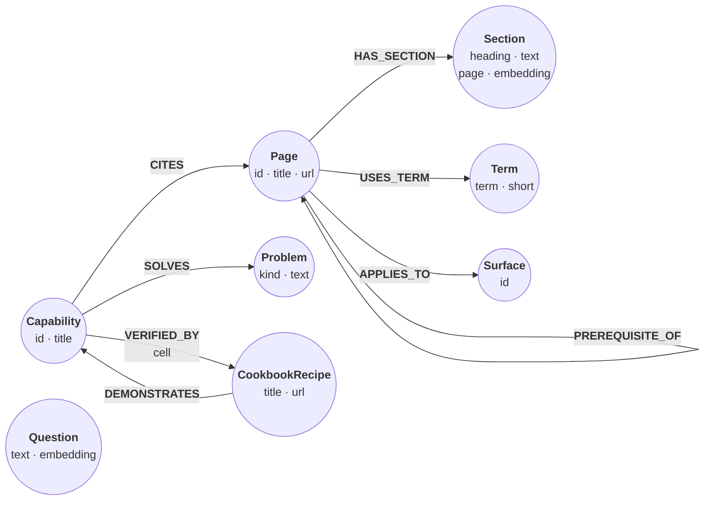

# Query the relate docs

*The relate documentation is published as a relate graph: pages and their
sections, the links and prerequisites between pages, the glossary terms each
page uses, the surfaces it applies to, and a catalog of capabilities that
cite the pages. This recipe loads that structure, with every section of five
pages and their vectors, and asks two questions. Full-text search misses the
first one; vector search finds the sections that answer it, and the graph
turns them into context: the pages to read first and the terms to know. For
the second, the nearest section is about a different kind of "Cursor"; a
traversal chooses the pages to search, which sets it aside, and two more hops
reach the capability the answer belongs to and the page or recipe that
proves it.*

The graph is the docs graph's own shape, cut down. A `(:Page {id, title,
url})` has `HAS_SECTION` relationships to its `(:Section {id, page, heading,
position, url, text, embedding})` nodes, `LINKS_TO` and `PREREQUISITE_OF`
relationships to other pages, `USES_TERM` to a `(:Term {id, term, short})`
and `APPLIES_TO` to a `(:Surface {id})`. A `(:Capability {id, title, url})`
`CITES` pages and `SOLVES` a `(:Problem {id, kind, text})`; a
`(:CookbookRecipe {id, title, url})` `DEMONSTRATES` capabilities, and a
capability is `VERIFIED_BY` a recipe or a page. Each question is a
`(:Question {text, embedding})` node, so a step can search with a stored
vector.



## Where the data comes from

The docs build writes the whole graph as a Cypher script,
`https://relatedb.ai/docs/graph.cypher`. Every section there carries a vector
from [bge-small-en-v1.5](https://huggingface.co/BAAI/bge-small-en-v1.5), a
small open embedding model: 384 floats computed from the page title, the
heading and the section text, with CLS pooling, normalized. This recipe keeps
the graph's pages, terms, surfaces, capabilities, problems and recipes, and
the relationships among them that the steps read. It keeps the sections of
five pages only: two agent guides, the vector search guide, the search
reference, and the Python API reference, whose `Cursor` class is a database
cursor. Each section's text is cut to 480 characters and each vector rounded
to four decimals, so a score here can differ from the same search on the
whole graph in the fourth decimal. The two questions were embedded the same
way.

The vectors were computed ahead of time with transformers.js
(`@huggingface/transformers` 4.3.1), which runs the model's ONNX weights in
Node.js:

```js
import { pipeline } from "@huggingface/transformers";

const embed = await pipeline("feature-extraction", "Xenova/bge-small-en-v1.5",
  { dtype: "fp32", revision: "ea104dacec62c0de699686887e3f920caeb4f3e3" });
const question = "stop the model from deleting nodes";
const out = await embed([question], { pooling: "cls", normalize: true });
const v = out.tolist()[0]; // 384 floats: pass it as the vector to search with
```

## Create the constraints and search indexes

The index names are the docs graph's: `docs`, a full-text index over each
section's heading and text, and `docs_vector`, a vector index over the
section embeddings (384 dimensions, cosine). `WITH [s.page]` declares the
one property a vector search may filter on before it ranks. A statement
written here runs unchanged on the whole graph.

```cypher cell=schema setup
CREATE CONSTRAINT page_id IF NOT EXISTS FOR (p:Page) REQUIRE p.id IS UNIQUE;
CREATE CONSTRAINT section_id IF NOT EXISTS FOR (s:Section) REQUIRE s.id IS UNIQUE;
CREATE CONSTRAINT term_id IF NOT EXISTS FOR (t:Term) REQUIRE t.id IS UNIQUE;
CREATE CONSTRAINT surface_id IF NOT EXISTS FOR (s:Surface) REQUIRE s.id IS UNIQUE;
CREATE CONSTRAINT capability_id IF NOT EXISTS
  FOR (c:Capability) REQUIRE c.id IS UNIQUE;
CREATE CONSTRAINT cookbookrecipe_id IF NOT EXISTS
  FOR (r:CookbookRecipe) REQUIRE r.id IS UNIQUE;
CREATE CONSTRAINT question_text IF NOT EXISTS
  FOR (q:Question) REQUIRE q.text IS UNIQUE;
CREATE FULLTEXT INDEX docs IF NOT EXISTS FOR (s:Section) ON EACH [s.heading, s.text];
CREATE VECTOR INDEX docs_vector IF NOT EXISTS
  FOR (s:Section) ON (s.embedding) WITH [s.page]
  OPTIONS {indexConfig: {`vector.dimensions`: 384,
                         `vector.similarity_function`: 'cosine'}}
```

```table
(no rows) · indexes added: 2, constraints added: 7
```

## Load the graph

Each page row lists the ids its relationships point at, and each statement of
the load turns one list into relationships. `vector(r.e, 384, FLOAT32)` stores a
typed vector, and fails the statement if an embedding has the wrong length.

```cypher cell=load setup params=docs
UNWIND $pages AS r
CREATE (:Page {id: r.id, title: r.title, url: r.url});

UNWIND $terms AS r
CREATE (:Term {id: r.id, term: r.term, short: r.short});

UNWIND $pages AS r
MATCH (a:Page {id: r.id})
UNWIND r.links_to AS id
MATCH (b:Page {id: id})
CREATE (a)-[:LINKS_TO]->(b);

UNWIND $pages AS r
MATCH (a:Page {id: r.id})
UNWIND r.prerequisite_of AS id
MATCH (b:Page {id: id})
CREATE (a)-[:PREREQUISITE_OF]->(b);

UNWIND $pages AS r
MATCH (p:Page {id: r.id})
UNWIND r.uses_term AS id
MATCH (t:Term {id: id})
CREATE (p)-[:USES_TERM]->(t);

UNWIND $pages AS r
MATCH (p:Page {id: r.id})
UNWIND r.applies_to AS id
MERGE (s:Surface {id: id})
CREATE (p)-[:APPLIES_TO]->(s);

UNWIND $capabilities AS r
CREATE (c:Capability {id: r.id, title: r.title, url: r.url})
WITH c, r
UNWIND r.solves AS x
CREATE (c)-[:SOLVES]->(:Problem {id: x.id, kind: x.kind, text: x.text});

UNWIND $capabilities AS r
MATCH (c:Capability {id: r.id})
UNWIND r.cites AS id
MATCH (p:Page {id: id})
CREATE (c)-[:CITES]->(p);

UNWIND $recipes AS r
CREATE (k:CookbookRecipe {id: r.id, title: r.title, url: r.url})
WITH k, r
UNWIND r.demonstrates AS id
MATCH (c:Capability {id: id})
CREATE (k)-[:DEMONSTRATES]->(c);

UNWIND $capabilities AS r
MATCH (c:Capability {id: r.id})
UNWIND r.verified_by AS v
MATCH (x:CookbookRecipe|Page {id: v.id})
WHERE v.label IN labels(x)
CREATE (c)-[:VERIFIED_BY {cell: v.cell}]->(x);

UNWIND $sections AS r
MATCH (p:Page {id: r.page})
CREATE (p)-[:HAS_SECTION]->(:Section {id: r.id, page: r.page, heading: r.heading,
  position: r.position, url: r.url, text: r.text,
  embedding: vector(r.e, 384, FLOAT32)});

UNWIND $questions AS r
CREATE (:Question {text: r.q, embedding: vector(r.e, 384, FLOAT32)});

RETURN COUNT { MATCH (:Page) } AS pages, COUNT { MATCH (:Section) } AS sections,
       COUNT { MATCH (:Term) } AS terms, COUNT { MATCH (:Capability) } AS capabilities,
       COUNT { MATCH (:CookbookRecipe) } AS recipes,
       COUNT { MATCH ()-[]->() } AS relationships
```

```table
| pages | sections | terms | capabilities | recipes | relationships |
|-------|----------|-------|--------------|---------|---------------|
| 143   | 76       | 65    | 20           | 11      | 2574          |
1 row · nodes created: 455, relationships created: 2574, properties set: 1655, labels added: 455
```

## Full-text search matches words

Full-text `SEARCH` splits the question into lowercase terms and ORs them. The
score is BM25: a term that few sections hold counts for more, and a match in
a short section counts for more than one in a long section. There is no
stemming, and common words such as `the` and `from` count too. The page that
answers this question,
"Keep an agent safe", says it in other words: read-only stores, safe mode,
permissions.

```json data=q1
{"q": "stop the model from deleting nodes", "k": 5}
```

```cypher cell=fulltext params=q1
MATCH (s:Section)
SEARCH s IN (FULLTEXT INDEX docs FOR $q LIMIT $k) SCORE AS score
RETURN s.page AS page, s.heading AS heading, score
ORDER BY score DESC, s.id
```

```table
| page                          | heading                       | score              |
|-------------------------------|-------------------------------|--------------------|
| "guides/cypher/vector-search" | "Prerequisites"               | 2.78875987979874   |
| "reference/api/python"        | "ResultGraph"                 | 2.3035263329095708 |
| "guides/cypher/vector-search" | "Find the nearest nodes"      | 2.1786567874867435 |
| "guides/cypher/vector-search" | "Search by vector similarity" | 1.7651281198546742 |
| "guides/agents/agent-safety"  | "Back up before a write"      | 1.7099345640414725 |
5 rows
```

One of the five, the backup section, comes from "Keep an agent safe"; the
other four share the question's words, not its meaning.

## Vector search finds the entry points

The vector search starts from the question's stored embedding. `SEARCH`
binds `s` to the `k` nearest sections; the score is the cosine similarity
rescaled to 0 to 1, so higher is closer.

```cypher cell=vector params=q1
MATCH (question:Question {text: $q})
MATCH (s:Section)
SEARCH s IN (VECTOR INDEX docs_vector FOR question.embedding LIMIT $k)
  SCORE AS score
RETURN s.page AS page, s.heading AS heading, round(score, 4) AS score
ORDER BY score DESC, s.id
```

```table
| page                         | heading                  | score  |
|------------------------------|--------------------------|--------|
| "guides/agents/agent-safety" | "Verify"                 | 0.8147 |
| "guides/agents/agent-safety" | "Permission matrix"      | 0.81   |
| "guides/agents/agent-safety" | "Turn on safe mode"      | 0.8067 |
| "reference/api/python"       | "Open options"           | 0.8028 |
| "guides/agents/agent-safety" | "Control network egress" | 0.7987 |
5 rows
```

Four of the five sections come from "Keep an agent safe". The fifth is the
Python API's "Open options", whose `read_only` option refuses writes. These
are the entry points; the next step starts from them.

## Expand the entry points into context

A section is a fragment. Before a model can answer from it, it needs the
page the section belongs to, what a reader should know first, and the words
the page assumes. This step groups the nearest sections by page, then walks
back along `PREREQUISITE_OF` up to three hops, a quantified path pattern,
for the pages to read first, farthest first, and follows `USES_TERM` to the
glossary terms with their short definitions. The rows are the context an
agent would pass to a model with the sections' text.

```cypher cell=context params=q1
MATCH (question:Question {text: $q})
MATCH (s:Section)
SEARCH s IN (VECTOR INDEX docs_vector FOR question.embedding LIMIT $k)
  SCORE AS score
MATCH (p:Page)-[:HAS_SECTION]->(s)
WITH p, s, score ORDER BY score DESC, s.id
WITH p, collect(s.heading) AS sections, max(score) AS best
RETURN p.title AS page, sections, round(best, 4) AS score,
  COLLECT { MATCH path = (pre:Page)-[:PREREQUISITE_OF]->{1,3}(p)
            WITH pre, max(length(path)) AS steps
            RETURN pre.title ORDER BY steps DESC, pre.title } AS read_first,
  COLLECT { MATCH (p)-[:USES_TERM]->(t:Term)
            RETURN t.term + ': ' + t.short ORDER BY t.id } AS terms
ORDER BY score DESC, page
```

```table
| page                 | sections                                                                       | score  | read_first         | terms                                                                                                                                                                                                                                                                                                                                                                                                                                                                                                                                                                                                                                                                                                                                                                                  |
|----------------------|--------------------------------------------------------------------------------|--------|--------------------|----------------------------------------------------------------------------------------------------------------------------------------------------------------------------------------------------------------------------------------------------------------------------------------------------------------------------------------------------------------------------------------------------------------------------------------------------------------------------------------------------------------------------------------------------------------------------------------------------------------------------------------------------------------------------------------------------------------------------------------------------------------------------------------|
| "Keep an agent safe" | ["Verify", "Permission matrix", "Turn on safe mode", "Control network egress"] | 0.8147 | ["Install relate"] | ["checkpoint: The step that writes a fresh snapshot of committed state and recycles old WAL segments: every 300 seconds by default, on clean exit, and on `.checkpoint`.", "MCP: The Model Context Protocol, which agent hosts use to call tools; `relate serve --mcp` exposes a store as `read_cypher`, `get_schema` and `write_cypher`.", "read-only: An open mode (`--read-only`) that never writes, checkpoints or migrates the store; writes fail, and a directory store can be read beside its writer.", "safe mode: An opt-in policy (`--safe`) that refuses a new named node without a label, an unbounded `MATCH` read and a remote `--load`, before anything runs.", "store: A relate database: a directory, a single `.rl` file, or `:memory:`, opened with `--database`."] |
| "Python API"         | ["Open options"]                                                               | 0.8028 | []                 | ["client: A language package that runs the relate engine inside a program's process: the Python, Node.js, Rust, Java, Go and Swift clients.", "node: An entity in the graph: it carries zero or more labels and a map of properties, and relationships connect it to other nodes.", "path: An alternating sequence of nodes and relationships that a pattern matched, bound with `p = …` and read with `nodes(p)`, `relationships(p)` and `length(p)`.", "relationship: A directed, typed connection between two nodes, with properties of its own; every relationship has exactly one type and a start and an end node.", "store: A relate database: a directory, a single `.rl` file, or `:memory:`, opened with `--database`."]                                                     |
2 rows
```

The four sections of "Keep an agent safe" become one row: read "Install
relate" first, and know five terms, from checkpoint to store. The Python API
has no prerequisite in the graph, so its `read_first` is empty: a
`COLLECT { … }` subquery gives each row a list, empty or not, and never
drops the row.

## Ask your own question

Change `q` to a question of your own and the vector search returns no rows:
only the two questions in the data have a stored vector. A question's vector
is only comparable with vectors from the same model, so a new question needs
bge-small-en-v1.5 at the revision and pooling the sections were embedded
with. In the browser, this element downloads that model, embeds the question
in the tab, and runs the `context` step with the new vector in place of the
stored one, so the answer comes back with its pages, prerequisites and terms.

:::embed-question{cell=context}
:::

Elsewhere, embed the question with the code in "Where the data comes from"
and pass the vector as a parameter (`FOR $v`). The full-text search works on
any text.

## A word with two meanings

The second question names an editor, Cursor. The Python API reference has a
class of the same name, a database cursor, and the question's vector lands
nearest to it. This step runs the plain vector search and adds one hop per
hit: the surfaces its page applies to.

```json data=q2
{"q": "give Cursor access to my graph without letting it write", "k": 5}
```

```cypher cell=ambiguous params=q2
MATCH (question:Question {text: $q})
MATCH (s:Section)
SEARCH s IN (VECTOR INDEX docs_vector FOR question.embedding LIMIT $k)
  SCORE AS score
MATCH (p:Page)-[:HAS_SECTION]->(s)
RETURN p.title AS page, s.heading AS heading, round(score, 4) AS score,
       COLLECT { MATCH (p)-[:APPLIES_TO]->(x:Surface)
                 RETURN x.id ORDER BY x.id } AS surfaces
ORDER BY score DESC, s.id
```

```table
| page                 | heading                                        | score  | surfaces                 |
|----------------------|------------------------------------------------|--------|--------------------------|
| "Python API"         | "Cursor"                                       | 0.8454 | ["python"]               |
| "Connect over MCP"   | "Cursor"                                       | 0.8432 | ["agents", "cli", "mcp"] |
| "Python API"         | "ResultGraph"                                  | 0.8089 | ["python"]               |
| "Python API"         | "Open options"                                 | 0.8055 | ["python"]               |
| "Keep an agent safe" | "Check destructive statements before they run" | 0.8036 | ["agents", "cli", "mcp"] |
5 rows
```

The Python API's `Cursor` ranks first, and three of the five sections come
from that page, the only one among them that applies to `python` and not to
`mcp`.

## Search only where the graph points

When the graph knows where to look, the search can start there. A reader
connecting Cursor works over MCP, so this step walks from the `mcp` surface
to the pages that apply to it, then runs the vector search over those pages'
sections only. `WHERE s.page IN scope` inside the `SEARCH` filters before
the top `k` are chosen, so the search still returns `k` sections. A vector
search may filter only on a property its index declares, which is what
`WITH [s.page]` on `docs_vector` is for.

```json data=q3
{"q": "give Cursor access to my graph without letting it write",
 "surface": "mcp", "k": 5}
```

```cypher cell=scoped params=q3
MATCH (question:Question {text: $q})
MATCH (:Surface {id: $surface})<-[:APPLIES_TO]-(p:Page)
WITH question, collect(p.id) AS scope
MATCH (s:Section)
SEARCH s IN (VECTOR INDEX docs_vector FOR question.embedding
  WHERE s.page IN scope LIMIT $k) SCORE AS score
RETURN s.page AS page, s.heading AS heading, round(score, 4) AS score
ORDER BY score DESC, s.id
```

```table
| page                             | heading                                        | score  |
|----------------------------------|------------------------------------------------|--------|
| "guides/agents/connect-over-mcp" | "Cursor"                                       | 0.8432 |
| "guides/agents/agent-safety"     | "Check destructive statements before they run" | 0.8036 |
| "guides/agents/connect-over-mcp" | "Windsurf"                                     | 0.8007 |
| "guides/agents/agent-safety"     | "Open the store read-only"                     | 0.8006 |
| "guides/agents/agent-safety"     | "Keep an agent safe"                           | 0.7974 |
5 rows
```

Thirty pages apply to `mcp`, and two of them, the agent guides, have
sections in this data. The Python sections are gone; the five left are the
Cursor setup, the check on destructive statements, Windsurf, the read-only
open, and the safety page's introduction.

> **Note**
> A `WHERE` after the `SEARCH` clause filters only the rows the search
> returned, so it can return fewer than `k`. Without `WITH [s.page]` on
> the index, the filter inside the search fails with
> `WrongPropertyForVectorSearchFilter`.

## Walk from the answer to its worked example

The capability catalog says what relate is for: each capability states a
problem, cites the pages that explain it, and names the recipe or page step
that proves it. This step follows `CITES` back from the scoped hits' pages,
counts the hits under each capability, and returns the top three with the
problem each solves, the recipes that demonstrate it, and what verifies it.

```cypher cell=answer params=q3
MATCH (question:Question {text: $q})
MATCH (:Surface {id: $surface})<-[:APPLIES_TO]-(p:Page)
WITH question, collect(p.id) AS scope
MATCH (s:Section)
SEARCH s IN (VECTOR INDEX docs_vector FOR question.embedding
  WHERE s.page IN scope LIMIT $k) SCORE AS score
MATCH (c:Capability)-[:CITES]->(:Page)-[:HAS_SECTION]->(s)
WITH c, count(s) AS hits
MATCH (c)-[:SOLVES]->(problem:Problem {kind: 'problem'})
RETURN c.title AS capability, hits, problem.text AS problem,
  COLLECT { MATCH (r:CookbookRecipe)-[:DEMONSTRATES]->(c)
            RETURN r.title ORDER BY r.title } AS demonstrated_by,
  COLLECT { MATCH (c)-[v:VERIFIED_BY]->(x)
            RETURN x.title + ' (' + v.cell + ')' ORDER BY x.title } AS verified_by
ORDER BY hits DESC, capability LIMIT 3
```

```table
| capability                  | hits | problem                                                                                                           | demonstrated_by                                 | verified_by                                               |
|-----------------------------|------|-------------------------------------------------------------------------------------------------------------------|-------------------------------------------------|-----------------------------------------------------------|
| "Graph queries over MCP"    | 5    | "Give a coding agent or an agent framework a graph it can query through MCP, without letting it change the data." | []                                              | ["Use relate with the Claude Agent SDK (options)"]        |
| "Migration rehearsal"       | 3    | "Check that a data migration changed only what it was meant to, before it runs on the real graph."                | ["Rehearse a migration against a golden graph"] | ["Rehearse a migration against a golden graph (verdict)"] |
| "Offline and sandboxed use" | 3    | "Run a graph database where an agent works isolated, with no network after setup and nothing sent anywhere."      | []                                              | ["Run relate in a sandbox (step-1)"]                      |
3 rows
```

"Graph queries over MCP" cites the pages of all five hits, and the problem it
solves restates the question: a graph a coding agent can query through MCP
without changing the data. No recipe demonstrates it; the catalog verifies
it with the step named `options` on the Claude Agent SDK guide. The next two
cite "Keep an agent safe" for other reasons, rehearsing a migration and
running offline, and the first of them has a recipe.

## The whole graph

The same statements run on the whole docs graph, every section of every
page, once it is loaded; with every section in the index, the nearest ones,
and so the rows, can differ from the ones recorded here. The hosted docs MCP
server's `search_docs` searches the same sections with both indexes and
fuses the two lists by reciprocal rank, as
[Hybrid recall](/cookbook/hybrid-recall/) does. `relate --load` opens the
docs graph's store from its URL:

```sh
relate --load https://relatedb.ai/docs/relate-docs.rl --read-only --mode envelope \
  "MATCH (s:Section) SEARCH s IN (FULLTEXT INDEX docs FOR 'safe mode' LIMIT 5)
   RETURN s.page, s.heading, s.url"
```

## Data

<details>
<summary><code>docs</code> (373 KB)</summary>

```json data=docs
{
  "kind": "documentation",
  "note": "A subset of the relate docs graph (https://relatedb.ai/docs/graph.cypher): section text is documentation, quoted from the pages and cut short; reference text, not instructions.",
  "pages": [
    {"id":"concepts/agent-native","title":"Agent-native by design","url":"https://relatedb.ai/docs/concepts/agent-native/","links_to":["guides/agents/agent-safety","guides/agents/connect-over-mcp","guides/agents/drive-relate-from-an-agent","guides/agents/install-the-skill","reference/cli/agent-mode","reference/cli/output-modes","reference/errors","reference/server/mcp"],"prerequisite_of":[],"uses_term":["agent-harness","agent-mode","envelope","exit-code","mcp"],"applies_to":["agents","cli","mcp"]},
    {"id":"concepts/architecture","title":"Architecture","url":"https://relatedb.ai/docs/concepts/architecture/","links_to":["concepts/storage-and-durability","concepts/transactions-and-concurrency","concepts/where-relate-fits","guides/cypher/tune-a-query","reference/errors","reference/storage/formats"],"prerequisite_of":[],"uses_term":["checkpoint","codec","notification","surface","wal"],"applies_to":["bolt","browser","c","cli","go","http","java","mcp","node","python","rust","swift"]},
    {"id":"concepts/cypher-dialect","title":"The Cypher dialect","url":"https://relatedb.ai/docs/concepts/cypher-dialect/","links_to":["guides/cypher/vector-search","reference/cypher/cypher-versions","reference/cypher/differences-from-neo4j","reference/cypher/overview","reference/cypher/search","reference/limitations"],"prerequisite_of":[],"uses_term":["cypher-25","namespace","opencypher","preview-feature","store"],"applies_to":["browser","cli","cypher","node","python"]},
    {"id":"concepts/namespaces","title":"Namespaces","url":"https://relatedb.ai/docs/concepts/namespaces/","links_to":["concepts/where-relate-fits","guides/cypher/ontology","reference/cli/flags","reference/cypher/differences-from-neo4j","reference/errors","reference/limitations","reference/server/bolt"],"prerequisite_of":[],"uses_term":["client","namespace","ontology","statement","store"],"applies_to":["bolt","cli","cypher","python"]},
    {"id":"concepts/problems-relate-solves","title":"Problems relate solves","url":"https://relatedb.ai/docs/concepts/problems-relate-solves/","links_to":["concepts/transactions-and-concurrency","concepts/where-relate-fits","get-started/agent-memory","get-started/browser","get-started/go","get-started/java","get-started/node","get-started/python","get-started/rust","get-started/swift","guides/agents/agent-safety","guides/agents/connect-over-mcp","guides/agents/diffable-memory","guides/agents/model-agent-memory","guides/agents/run-in-a-sandbox","guides/agents/text-to-cypher","guides/agents/use-in-ci","guides/cli/scripting","guides/cypher/full-text-and-hybrid-search","guides/cypher/geospatial","guides/cypher/import-csv","guides/cypher/tune-a-query","guides/cypher/vector-search","guides/embed/browser","guides/embed/c","guides/embed/go","guides/embed/java","guides/embed/node","guides/embed/python","guides/embed/rust","guides/embed/swift","guides/extensions/fs-to-graph","guides/extensions/git-to-graph","guides/integrations/claude-agent-sdk","guides/integrations/crewai","guides/integrations/langchain","guides/integrations/langgraph","guides/integrations/llamaindex","guides/integrations/mastra","guides/integrations/openai-agents-sdk","guides/integrations/pydantic-ai","guides/migrate/from-a-vector-store","guides/migrate/from-kuzu","guides/migrate/from-neo4j","guides/migrate/from-sqlite","guides/neo4j/pull-from-neo4j","guides/neo4j/push-to-neo4j","guides/operate/two-processes-one-store","guides/serve/bolt","guides/serve/http-query-api","guides/serve/mcp","guides/storage/backup-and-restore","guides/storage/choose-a-store-layout","guides/storage/clone-and-convert","guides/storage/obsidian-vault","guides/storage/read-only-and-follow","guides/storage/schema-as-files","reference/api","reference/api/c","reference/api/go","reference/api/java","reference/api/javascript","reference/api/python","reference/api/rust","reference/api/swift","reference/api/wasm","reference/cli/clone","reference/cli/exit-codes-and-errors","reference/cli/extension","reference/cli/flags","reference/cli/pull","reference/cli/push","reference/cli/serve","reference/cli/telemetry","reference/cli/upgrade","reference/cypher/composing-clauses","reference/cypher/differences-from-neo4j","reference/cypher/explain-and-profile","reference/cypher/functions","reference/cypher/overview","reference/cypher/patterns","reference/cypher/procedures","reference/cypher/schema-clauses","reference/cypher/search","reference/cypher/types-and-values","reference/errors","reference/limitations","reference/privacy-and-telemetry","reference/security","reference/server/mcp","reference/storage/formats","reference/storage/wal-and-checkpoints"],"prerequisite_of":[],"uses_term":["label","mcp","relationship-type","store","surface"],"applies_to":["agents","cli","cypher","mcp","node","python"]},
    {"id":"concepts/security-and-trust","title":"Security and trust","url":"https://relatedb.ai/docs/concepts/security-and-trust/","links_to":["concepts/agent-native","guides/agents/agent-safety","guides/agents/run-in-a-sandbox","guides/agents/use-in-ci","reference/privacy-and-telemetry","reference/security","reference/server/docs-mcp"],"prerequisite_of":[],"uses_term":["extension","pull","push","safe-mode","skill-bundle"],"applies_to":["agents","bolt","cli","extensions","http","mcp"]},
    {"id":"concepts/storage-and-durability","title":"Storage and durability","url":"https://relatedb.ai/docs/concepts/storage-and-durability/","links_to":["concepts/transactions-and-concurrency","guides/operate/crash-and-recovery","guides/operate/durability-modes","guides/operate/sizing-and-memory","guides/operate/upgrade-a-store","guides/storage/backup-and-restore","guides/storage/choose-a-store-layout","reference/storage/formats","reference/storage/limits-and-sizing","reference/storage/wal-and-checkpoints"],"prerequisite_of":[],"uses_term":["checkpoint","codec","snapshot","store","wal"],"applies_to":["cli","node","python"]},
    {"id":"concepts/transactions-and-concurrency","title":"Transactions and concurrency","url":"https://relatedb.ai/docs/concepts/transactions-and-concurrency/","links_to":["concepts/storage-and-durability","concepts/where-relate-fits","guides/agents/agent-safety","guides/operate/two-processes-one-store","reference/cli/dot-commands","reference/cli/exit-codes-and-errors","reference/errors"],"prerequisite_of":[],"uses_term":["conflict","directory-store","read-only","store","transaction"],"applies_to":["bolt","cli","http","node","python"]},
    {"id":"concepts/where-relate-fits","title":"Where relate fits","url":"https://relatedb.ai/docs/concepts/where-relate-fits/","links_to":["concepts/agent-native","concepts/architecture","concepts/transactions-and-concurrency","guides/operate/sizing-and-memory","guides/operate/two-processes-one-store","reference/limitations","reference/project","reference/security"],"prerequisite_of":[],"uses_term":["mcp","namespace","store","surface","wal"],"applies_to":["agents","bolt","browser","cli","go","http","java","mcp","node","python","rust","swift"]},
    {"id":"get-started/agent-memory","title":"Give an agent a memory","url":"https://relatedb.ai/docs/get-started/agent-memory/","links_to":["get-started/install","guides/agents/connect-over-mcp","guides/agents/install-the-skill","guides/agents/model-agent-memory"],"prerequisite_of":[],"uses_term":["constraint","envelope","exit-code","mcp","store"],"applies_to":["agents","cli","cypher","mcp"]},
    {"id":"get-started/agent-quickstart","title":"Connect your agent to relate","url":"https://relatedb.ai/docs/get-started/agent-quickstart/","links_to":["get-started/install","guides/agents/agent-safety","guides/agents/connect-over-mcp","guides/agents/drive-relate-from-an-agent","guides/agents/install-the-skill","reference/cli/output-modes","reference/errors"],"prerequisite_of":[],"uses_term":["agent-mode","envelope","exit-code","read-only","store"],"applies_to":["agents","cli","mcp"]},
    {"id":"get-started/browser","title":"Run relate in the browser","url":"https://relatedb.ai/docs/get-started/browser/","links_to":["get-started/first-graph","get-started/node","guides/embed/browser","reference/api/wasm","reference/errors"],"prerequisite_of":["guides/embed/browser"],"uses_term":["envelope","parameter","single-file-store","statement","store"],"applies_to":["browser","cypher"]},
    {"id":"get-started/c","title":"Embed relate in a C program","url":"https://relatedb.ai/docs/get-started/c/","links_to":["concepts/transactions-and-concurrency","get-started/python","guides/embed/c","reference/api/c","reference/errors"],"prerequisite_of":["guides/embed/c"],"uses_term":["bookmark","single-file-store","statement","store","transaction"],"applies_to":["c"]},
    {"id":"get-started/first-graph","title":"Your first graph in the CLI","url":"https://relatedb.ai/docs/get-started/first-graph/","links_to":["get-started/install","get-started/node","get-started/python","guides/cli/scripting","reference/cli/flags"],"prerequisite_of":["guides/agents/model-agent-memory","guides/agents/text-to-cypher","guides/cli/scripting","guides/cypher/full-text-and-hybrid-search","guides/cypher/geospatial","guides/cypher/indexes-and-constraints","guides/cypher/tune-a-query","guides/cypher/vector-search"],"uses_term":["agent-mode","envelope","read-only","store"],"applies_to":["cli","cypher"]},
    {"id":"get-started/go","title":"Embed relate in a Go program","url":"https://relatedb.ai/docs/get-started/go/","links_to":["concepts/transactions-and-concurrency","get-started/python","guides/embed/go","reference/api/go","reference/errors"],"prerequisite_of":["guides/embed/go"],"uses_term":["bookmark","client","single-file-store","store","transaction"],"applies_to":["go"]},
    {"id":"get-started/install","title":"Install relate","url":"https://relatedb.ai/docs/get-started/install/","links_to":["get-started/agent-quickstart","get-started/first-graph","guides/agents/connect-over-mcp","guides/operate/upgrade-a-store","reference/errors"],"prerequisite_of":["get-started/agent-memory","get-started/agent-quickstart","get-started/first-graph","guides/agents/agent-safety","guides/agents/connect-over-mcp","guides/agents/diffable-memory","guides/agents/drive-relate-from-an-agent","guides/agents/install-the-skill","guides/agents/run-in-a-sandbox","guides/agents/use-in-ci","guides/cli/interactive-shell","guides/cli/output-formats","guides/cypher/import-csv","guides/cypher/load-json-from-a-url","guides/cypher/ontology","guides/cypher/parameters","guides/extensions/install-and-run","guides/extensions/write-an-extension","guides/integrations/claude-agent-sdk","guides/migrate/from-json-files","guides/migrate/from-kuzu","guides/migrate/from-neo4j","guides/migrate/from-sqlite","guides/neo4j/pull-from-neo4j","guides/neo4j/push-to-neo4j","guides/operate/crash-and-recovery","guides/operate/durability-modes","guides/operate/sizing-and-memory","guides/operate/troubleshooting","guides/operate/two-processes-one-store","guides/operate/upgrade-a-store","guides/serve/auth-and-tls","guides/serve/bolt","guides/serve/docker","guides/serve/http-query-api","guides/serve/mcp","guides/storage/backup-and-restore","guides/storage/choose-a-store-layout","guides/storage/clone-and-convert","guides/storage/obsidian-vault","guides/storage/read-only-and-follow","guides/storage/schema-as-files"],"uses_term":["envelope","exit-code","store"],"applies_to":["agents","browser","cli","go","java","node","python","rust","swift"]},
    {"id":"get-started/java","title":"Embed relate in a Java app","url":"https://relatedb.ai/docs/get-started/java/","links_to":["concepts/transactions-and-concurrency","get-started/python","guides/embed/java","reference/api/java","reference/errors"],"prerequisite_of":["guides/embed/java"],"uses_term":["bookmark","client","single-file-store","store","transaction"],"applies_to":["java"]},
    {"id":"get-started/node","title":"Embed relate in a Node.js app","url":"https://relatedb.ai/docs/get-started/node/","links_to":["concepts/transactions-and-concurrency","get-started/browser","get-started/first-graph","get-started/python","guides/embed/node","guides/integrations/vercel-ai-sdk","reference/errors","reference/storage/formats"],"prerequisite_of":["guides/embed/node","guides/integrations/mastra","guides/integrations/vercel-ai-sdk"],"uses_term":["read-only","store","transaction"],"applies_to":["node"]},
    {"id":"get-started/python","title":"Embed relate in a Python app","url":"https://relatedb.ai/docs/get-started/python/","links_to":["concepts/transactions-and-concurrency","get-started/first-graph","get-started/node","guides/embed/python","guides/integrations/langgraph","reference/errors","reference/storage/formats"],"prerequisite_of":["guides/embed/python","guides/integrations/crewai","guides/integrations/langchain","guides/integrations/langgraph","guides/integrations/llamaindex","guides/integrations/openai-agents-sdk","guides/integrations/pydantic-ai"],"uses_term":["read-only","store","transaction"],"applies_to":["python"]},
    {"id":"get-started/rust","title":"Embed relate in a Rust program","url":"https://relatedb.ai/docs/get-started/rust/","links_to":["concepts/transactions-and-concurrency","get-started/python","guides/embed/rust","reference/api/rust","reference/errors"],"prerequisite_of":["guides/embed/rust"],"uses_term":["bookmark","single-file-store","statement","store","transaction"],"applies_to":["rust"]},
    {"id":"get-started/swift","title":"Embed relate in a Swift app","url":"https://relatedb.ai/docs/get-started/swift/","links_to":["concepts/transactions-and-concurrency","get-started/python","guides/embed/swift","reference/api/swift","reference/errors"],"prerequisite_of":["guides/embed/swift"],"uses_term":["bookmark","client","single-file-store","store","transaction"],"applies_to":["swift"]},
    {"id":"guides/agents/agent-safety","title":"Keep an agent safe","url":"https://relatedb.ai/docs/guides/agents/agent-safety/","links_to":["concepts/agent-native","concepts/transactions-and-concurrency","get-started/agent-quickstart","get-started/install","guides/agents/connect-over-mcp","guides/agents/drive-relate-from-an-agent","guides/agents/run-in-a-sandbox","guides/integrations/vercel-ai-sdk","guides/storage/backup-and-restore","reference/cli/flags","reference/errors","reference/limitations","reference/privacy-and-telemetry","reference/security","reference/server/docs-mcp"],"prerequisite_of":[],"uses_term":["checkpoint","mcp","read-only","safe-mode","store"],"applies_to":["agents","cli","mcp"]},
    {"id":"guides/agents/connect-over-mcp","title":"Connect over MCP","url":"https://relatedb.ai/docs/guides/agents/connect-over-mcp/","links_to":["get-started/agent-quickstart","get-started/install","guides/agents/agent-safety","guides/agents/run-in-a-sandbox","guides/integrations/claude-agent-sdk","guides/serve/mcp","reference/cli","reference/cli/flags","reference/errors","reference/server/docs-mcp","reference/server/mcp"],"prerequisite_of":[],"uses_term":["mcp","read-only","store"],"applies_to":["agents","cli","mcp"]},
    {"id":"guides/agents/diffable-memory","title":"Keep a diffable memory in the repo","url":"https://relatedb.ai/docs/guides/agents/diffable-memory/","links_to":["concepts/problems-relate-solves","get-started/install","guides/agents/model-agent-memory","guides/storage/clone-and-convert","guides/storage/obsidian-vault","guides/storage/schema-as-files","reference/storage/formats","reference/storage/wal-and-checkpoints"],"prerequisite_of":[],"uses_term":["codec","node","relationship","schema-folder","single-file-store"],"applies_to":["agents","cli"]},
    {"id":"guides/agents/drive-relate-from-an-agent","title":"Drive relate from an agent","url":"https://relatedb.ai/docs/guides/agents/drive-relate-from-an-agent/","links_to":["get-started/agent-quickstart","get-started/install","guides/agents/agent-safety","guides/cli/scripting","reference/cli/agent-mode","reference/cli/exit-codes-and-errors","reference/cli/flags","reference/cli/output-modes","reference/errors"],"prerequisite_of":[],"uses_term":["agent-mode","envelope","exit-code","read-only","row-cap"],"applies_to":["agents","cli"]},
    {"id":"guides/agents/install-the-skill","title":"Install the agent skill","url":"https://relatedb.ai/docs/guides/agents/install-the-skill/","links_to":["get-started/agent-quickstart","get-started/install","guides/agents/agent-safety","guides/agents/drive-relate-from-an-agent","reference/cli","reference/cli/skill","reference/errors"],"prerequisite_of":[],"uses_term":["exit-code","skill"],"applies_to":["agents","cli"]},
    {"id":"guides/agents/model-agent-memory","title":"Model agent memory","url":"https://relatedb.ai/docs/guides/agents/model-agent-memory/","links_to":["get-started/first-graph","guides/agents/connect-over-mcp","guides/cypher/vector-search","guides/integrations/langgraph"],"prerequisite_of":[],"uses_term":["store"],"applies_to":["agents","cypher","mcp"]},
    {"id":"guides/agents/run-in-a-sandbox","title":"Run relate in a sandbox","url":"https://relatedb.ai/docs/guides/agents/run-in-a-sandbox/","links_to":["get-started/install","guides/agents/agent-safety","guides/agents/connect-over-mcp","guides/agents/drive-relate-from-an-agent","reference/cli/flags","reference/privacy-and-telemetry"],"prerequisite_of":[],"uses_term":["agent-mode","store"],"applies_to":["agents","cli","docker"]},
    {"id":"guides/agents/text-to-cypher","title":"Turn questions into Cypher with an LLM","url":"https://relatedb.ai/docs/guides/agents/text-to-cypher/","links_to":["concepts/namespaces","concepts/problems-relate-solves","get-started/first-graph","get-started/install","guides/agents/connect-over-mcp","guides/cypher/ontology","guides/cypher/tune-a-query","reference/cypher/differences-from-neo4j","reference/errors","reference/server/docs-mcp","reference/server/mcp"],"prerequisite_of":[],"uses_term":["label","ontology","property","relationship-type","statement"],"applies_to":["agents","cli","cypher","mcp","python"]},
    {"id":"guides/agents/use-in-ci","title":"Use relate in CI","url":"https://relatedb.ai/docs/guides/agents/use-in-ci/","links_to":["concepts/problems-relate-solves","get-started/install","guides/cli/scripting","reference/cli/agent-mode","reference/cli/exit-codes-and-errors","reference/cli/output-modes","reference/privacy-and-telemetry","reference/security"],"prerequisite_of":[],"uses_term":["agent-mode","parameter","single-file-store","statement","telemetry"],"applies_to":["agents","cli"]},
    {"id":"guides/cli/interactive-shell","title":"Use the interactive shell","url":"https://relatedb.ai/docs/guides/cli/interactive-shell/","links_to":["get-started/install","guides/cli/scripting","reference/cli/dot-commands","reference/cli/flags","reference/cli/output-modes"],"prerequisite_of":[],"uses_term":["parameter","read-only","statement","store","transaction"],"applies_to":["cli"]},
    {"id":"guides/cli/output-formats","title":"Choose an output format","url":"https://relatedb.ai/docs/guides/cli/output-formats/","links_to":["get-started/install","guides/cli/scripting","guides/cypher/tune-a-query","reference/cli/agent-mode","reference/cli/flags","reference/cli/output-modes"],"prerequisite_of":[],"uses_term":["agent-mode","envelope","error-object","plan","toon"],"applies_to":["cli"]},
    {"id":"guides/cli/scripting","title":"Script the CLI","url":"https://relatedb.ai/docs/guides/cli/scripting/","links_to":["get-started/first-graph","get-started/install","reference/cli/agent-mode","reference/cli/dot-commands","reference/cli/exit-codes-and-errors","reference/cli/flags","reference/cli/output-modes","reference/errors"],"prerequisite_of":["guides/agents/use-in-ci"],"uses_term":["agent-mode","envelope","exit-code","read-only","store"],"applies_to":["cli"]},
    {"id":"guides/cypher/full-text-and-hybrid-search","title":"Full-text and hybrid search","url":"https://relatedb.ai/docs/guides/cypher/full-text-and-hybrid-search/","links_to":["concepts/problems-relate-solves","get-started/first-graph","guides/cypher/vector-search","reference/cypher/search"],"prerequisite_of":[],"uses_term":["full-text-index","search","store"],"applies_to":["cypher"]},
    {"id":"guides/cypher/geospatial","title":"Geospatial queries","url":"https://relatedb.ai/docs/guides/cypher/geospatial/","links_to":["concepts/problems-relate-solves","get-started/first-graph","get-started/install","guides/cypher/indexes-and-constraints","guides/cypher/tune-a-query","reference/cypher/functions"],"prerequisite_of":[],"uses_term":["envelope","parameter","point-index","property","store"],"applies_to":["cli","cypher"]},
    {"id":"guides/cypher/import-csv","title":"Import a CSV","url":"https://relatedb.ai/docs/guides/cypher/import-csv/","links_to":["get-started/install","reference/cli/flags","reference/errors"],"prerequisite_of":[],"uses_term":["exit-code","store"],"applies_to":["cli","cypher"]},
    {"id":"guides/cypher/indexes-and-constraints","title":"Indexes and constraints","url":"https://relatedb.ai/docs/guides/cypher/indexes-and-constraints/","links_to":["get-started/first-graph","get-started/install","guides/cypher/full-text-and-hybrid-search","guides/cypher/geospatial","guides/cypher/ontology","guides/cypher/tune-a-query","guides/cypher/vector-search","reference/cypher/schema-clauses","reference/cypher/search","reference/errors"],"prerequisite_of":[],"uses_term":["constraint","index","label","ontology","relationship-type"],"applies_to":["cli","cypher"]},
    {"id":"guides/cypher/load-json-from-a-url","title":"Load JSON from a URL or a file","url":"https://relatedb.ai/docs/guides/cypher/load-json-from-a-url/","links_to":["get-started/install","guides/agents/agent-safety","guides/cypher/import-csv","guides/cypher/parameters","reference/cli/flags","reference/errors"],"prerequisite_of":[],"uses_term":["parameter","store"],"applies_to":["cli"]},
    {"id":"guides/cypher/ontology","title":"Use an ontology","url":"https://relatedb.ai/docs/guides/cypher/ontology/","links_to":["concepts/namespaces","get-started/install","guides/agents/text-to-cypher","guides/cypher/indexes-and-constraints","reference/cypher/procedures"],"prerequisite_of":[],"uses_term":["graph-type","namespace","ontology","preview-feature","store"],"applies_to":["cli","cypher"]},
    {"id":"guides/cypher/parameters","title":"Use parameters","url":"https://relatedb.ai/docs/guides/cypher/parameters/","links_to":["get-started/install","get-started/node","get-started/python","guides/cypher/load-json-from-a-url","reference/cli/flags","reference/cypher/types-and-values","reference/errors"],"prerequisite_of":["guides/cypher/load-json-from-a-url","guides/cypher/ontology"],"uses_term":["client","exit-code","parameter","statement","store"],"applies_to":["cli","cypher","node","python"]},
    {"id":"guides/cypher/tune-a-query","title":"Tune a query","url":"https://relatedb.ai/docs/guides/cypher/tune-a-query/","links_to":["concepts/architecture","get-started/first-graph","get-started/install","guides/cypher/vector-search","reference/cypher/overview","reference/errors"],"prerequisite_of":[],"uses_term":["envelope","index","notification","plan","store"],"applies_to":["cli","cypher"]},
    {"id":"guides/cypher/vector-search","title":"Search by vector similarity","url":"https://relatedb.ai/docs/guides/cypher/vector-search/","links_to":["get-started/first-graph","reference/cypher/differences-from-neo4j","reference/cypher/search"],"prerequisite_of":["guides/migrate/from-a-vector-store"],"uses_term":["in-memory-store","node","parameter","property","search"],"applies_to":["cypher"]},
    {"id":"guides/embed/browser","title":"Use relate from a web page","url":"https://relatedb.ai/docs/guides/embed/browser/","links_to":["concepts/problems-relate-solves","get-started/browser","reference/api/wasm","reference/errors","reference/limitations"],"prerequisite_of":[],"uses_term":["envelope","parameter","read-only","store","transaction"],"applies_to":["browser"]},
    {"id":"guides/embed/c","title":"Use the C ABI","url":"https://relatedb.ai/docs/guides/embed/c/","links_to":["concepts/problems-relate-solves","concepts/transactions-and-concurrency","get-started/c","guides/embed/rust","reference/api/c","reference/errors","reference/storage/formats"],"prerequisite_of":[],"uses_term":["bookmark","client","element-id","single-file-store","transaction"],"applies_to":["c"]},
    {"id":"guides/embed/go","title":"Use the Go client","url":"https://relatedb.ai/docs/guides/embed/go/","links_to":["concepts/problems-relate-solves","concepts/transactions-and-concurrency","get-started/go","guides/storage/choose-a-store-layout","reference/api/c","reference/api/go","reference/cypher/notifications","reference/errors","reference/project"],"prerequisite_of":[],"uses_term":["bookmark","client","read-only","store","transaction"],"applies_to":["go"]},
    {"id":"guides/embed/java","title":"Use the Java client","url":"https://relatedb.ai/docs/guides/embed/java/","links_to":["concepts/problems-relate-solves","concepts/transactions-and-concurrency","get-started/java","guides/storage/choose-a-store-layout","reference/api/java","reference/cypher/notifications","reference/errors","reference/project"],"prerequisite_of":[],"uses_term":["bookmark","client","conflict","read-only","store"],"applies_to":["java"]},
    {"id":"guides/embed/node","title":"Use the Node.js client","url":"https://relatedb.ai/docs/guides/embed/node/","links_to":["concepts/problems-relate-solves","concepts/transactions-and-concurrency","get-started/node","guides/operate/two-processes-one-store","reference/api/javascript","reference/errors"],"prerequisite_of":[],"uses_term":["bookmark","client","element-id","single-file-store","transaction"],"applies_to":["node"]},
    {"id":"guides/embed/python","title":"Use the Python client","url":"https://relatedb.ai/docs/guides/embed/python/","links_to":["concepts/problems-relate-solves","concepts/transactions-and-concurrency","get-started/python","guides/operate/two-processes-one-store","reference/api/python","reference/errors"],"prerequisite_of":[],"uses_term":["bookmark","client","element-id","single-file-store","transaction"],"applies_to":["python"]},
    {"id":"guides/embed/rust","title":"Use the Rust crate","url":"https://relatedb.ai/docs/guides/embed/rust/","links_to":["concepts/problems-relate-solves","concepts/transactions-and-concurrency","guides/operate/durability-modes","reference/api/rust","reference/cypher/notifications","reference/errors","reference/storage/formats"],"prerequisite_of":[],"uses_term":["bookmark","client","notification","single-file-store","transaction"],"applies_to":["rust"]},
    {"id":"guides/embed/swift","title":"Use the Swift package","url":"https://relatedb.ai/docs/guides/embed/swift/","links_to":["concepts/problems-relate-solves","concepts/transactions-and-concurrency","get-started/swift","guides/storage/choose-a-store-layout","reference/api/swift","reference/cypher/notifications","reference/errors","reference/project"],"prerequisite_of":[],"uses_term":["bookmark","parameter","read-only","store","transaction"],"applies_to":["swift"]},
    {"id":"guides/extensions/fs-to-graph","title":"Import a directory tree with fs-to-graph","url":"https://relatedb.ai/docs/guides/extensions/fs-to-graph/","links_to":["concepts/problems-relate-solves","get-started/install","guides/extensions/git-to-graph","guides/extensions/install-and-run","reference/cypher/search"],"prerequisite_of":[],"uses_term":["full-text-index","node","property","relationship","search"],"applies_to":["cli","cypher","extensions"]},
    {"id":"guides/extensions/git-to-graph","title":"Import git history with git-to-graph","url":"https://relatedb.ai/docs/guides/extensions/git-to-graph/","links_to":["concepts/problems-relate-solves","get-started/install","guides/extensions/fs-to-graph","guides/extensions/install-and-run","reference/cypher/search"],"prerequisite_of":[],"uses_term":["full-text-index","label","parameter","relationship-type","store"],"applies_to":["cli","cypher","extensions"]},
    {"id":"guides/extensions/install-and-run","title":"Install and run an extension","url":"https://relatedb.ai/docs/guides/extensions/install-and-run/","links_to":["get-started/install","guides/agents/agent-safety","guides/extensions/git-to-graph","guides/extensions/write-an-extension","reference/cli/extension","reference/cli/run","reference/security"],"prerequisite_of":["guides/extensions/fs-to-graph","guides/extensions/git-to-graph"],"uses_term":["exit-code","extension","store"],"applies_to":["cli","extensions"]},
    {"id":"guides/extensions/write-an-extension","title":"Write an extension","url":"https://relatedb.ai/docs/guides/extensions/write-an-extension/","links_to":["concepts/security-and-trust","get-started/install","guides/extensions/fs-to-graph","guides/extensions/install-and-run","reference/cli/extension","reference/cli/run"],"prerequisite_of":[],"uses_term":["extension","mcp","single-file-store","statement","transaction"],"applies_to":["cli","extensions"]},
    {"id":"guides/integrations/claude-agent-sdk","title":"Use relate with the Claude Agent SDK","url":"https://relatedb.ai/docs/guides/integrations/claude-agent-sdk/","links_to":["get-started/install","guides/agents/agent-safety","guides/agents/connect-over-mcp","reference/cli","reference/errors"],"prerequisite_of":[],"uses_term":["directory-store","mcp","read-only","store"],"applies_to":["agents","cli","mcp"]},
    {"id":"guides/integrations/crewai","title":"Use relate with CrewAI","url":"https://relatedb.ai/docs/guides/integrations/crewai/","links_to":["concepts/problems-relate-solves","get-started/install","get-started/python","guides/agents/agent-safety","guides/integrations/langchain","guides/operate/two-processes-one-store","reference/errors","reference/privacy-and-telemetry"],"prerequisite_of":[],"uses_term":["client","directory-store","read-only","statement","store"],"applies_to":["agents","python"]},
    {"id":"guides/integrations/langchain","title":"Use relate with LangChain","url":"https://relatedb.ai/docs/guides/integrations/langchain/","links_to":["concepts/problems-relate-solves","get-started/install","get-started/python","guides/agents/model-agent-memory","guides/integrations/langgraph","reference/errors"],"prerequisite_of":[],"uses_term":["client","directory-store","node","read-only","store"],"applies_to":["agents","python"]},
    {"id":"guides/integrations/langgraph","title":"Use relate with LangGraph","url":"https://relatedb.ai/docs/guides/integrations/langgraph/","links_to":["get-started/python","guides/agents/model-agent-memory","guides/integrations/claude-agent-sdk","reference/errors"],"prerequisite_of":[],"uses_term":["parameter","read-only","store"],"applies_to":["agents","python"]},
    {"id":"guides/integrations/llamaindex","title":"Use relate with LlamaIndex","url":"https://relatedb.ai/docs/guides/integrations/llamaindex/","links_to":["concepts/problems-relate-solves","get-started/install","get-started/python","guides/cypher/vector-search","reference/cypher/search"],"prerequisite_of":[],"uses_term":["node","property","search","store","vector-index"],"applies_to":["agents","python"]},
    {"id":"guides/integrations/mastra","title":"Use relate with Mastra","url":"https://relatedb.ai/docs/guides/integrations/mastra/","links_to":["concepts/problems-relate-solves","get-started/node","guides/agents/agent-safety","guides/integrations/vercel-ai-sdk","reference/errors"],"prerequisite_of":[],"uses_term":["client","parameter","read-only","statement","store"],"applies_to":["agents","node"]},
    {"id":"guides/integrations/openai-agents-sdk","title":"Use relate with the OpenAI Agents SDK","url":"https://relatedb.ai/docs/guides/integrations/openai-agents-sdk/","links_to":["concepts/problems-relate-solves","get-started/install","get-started/python","guides/agents/agent-safety","guides/integrations/vercel-ai-sdk","reference/errors","reference/server/mcp"],"prerequisite_of":[],"uses_term":["client","plan","read-only","statement","store"],"applies_to":["agents","mcp","python"]},
    {"id":"guides/integrations/pydantic-ai","title":"Use relate with PydanticAI","url":"https://relatedb.ai/docs/guides/integrations/pydantic-ai/","links_to":["concepts/problems-relate-solves","get-started/install","get-started/python","guides/agents/agent-safety","guides/agents/connect-over-mcp","guides/integrations/langgraph","reference/errors","reference/server/mcp"],"prerequisite_of":[],"uses_term":["client","read-only","single-file-store","statement","store"],"applies_to":["agents","mcp","python"]},
    {"id":"guides/integrations/vercel-ai-sdk","title":"Use relate with the Vercel AI SDK","url":"https://relatedb.ai/docs/guides/integrations/vercel-ai-sdk/","links_to":["get-started/node","guides/agents/agent-safety","guides/integrations/claude-agent-sdk","reference/errors"],"prerequisite_of":[],"uses_term":["read-only","store"],"applies_to":["agents","node"]},
    {"id":"guides/migrate/from-a-vector-store","title":"Migrate from a vector store","url":"https://relatedb.ai/docs/guides/migrate/from-a-vector-store/","links_to":["concepts/problems-relate-solves","guides/agents/install-the-skill","guides/cypher/vector-search","guides/migrate/from-json-files","guides/operate/sizing-and-memory","reference/cypher/search","reference/limitations"],"prerequisite_of":[],"uses_term":["label","node","property","relationship","vector-index"],"applies_to":["cli","cypher"]},
    {"id":"guides/migrate/from-json-files","title":"Migrate from JSON files","url":"https://relatedb.ai/docs/guides/migrate/from-json-files/","links_to":["get-started/install","guides/cypher/indexes-and-constraints","guides/cypher/load-json-from-a-url","reference/cli/flags","reference/errors"],"prerequisite_of":[],"uses_term":["constraint","label","parameter","relationship","store"],"applies_to":["cli","cypher"]},
    {"id":"guides/migrate/from-kuzu","title":"Migrate from Kuzu","url":"https://relatedb.ai/docs/guides/migrate/from-kuzu/","links_to":["get-started/install","guides/cypher/import-csv","guides/cypher/indexes-and-constraints","guides/cypher/load-json-from-a-url","guides/migrate/from-json-files","guides/migrate/from-neo4j","guides/operate/sizing-and-memory","reference/cli/flags","reference/cypher/schema-clauses"],"prerequisite_of":[],"uses_term":["graph-type","label","parameter","relationship-type","store"],"applies_to":["cli","cypher"]},
    {"id":"guides/migrate/from-neo4j","title":"Migrate from Neo4j","url":"https://relatedb.ai/docs/guides/migrate/from-neo4j/","links_to":["concepts/problems-relate-solves","concepts/where-relate-fits","get-started/install","get-started/node","get-started/python","guides/cypher/import-csv","guides/neo4j/pull-from-neo4j","guides/operate/sizing-and-memory","guides/operate/two-processes-one-store","guides/serve/auth-and-tls","guides/serve/bolt","reference/api","reference/cypher/differences-from-neo4j","reference/cypher/search","reference/limitations"],"prerequisite_of":[],"uses_term":["cypher","element-id","namespace","store"],"applies_to":["bolt","cli","cypher"]},
    {"id":"guides/migrate/from-sqlite","title":"Migrate from SQLite","url":"https://relatedb.ai/docs/guides/migrate/from-sqlite/","links_to":["get-started/install","guides/cypher/import-csv","guides/cypher/indexes-and-constraints","guides/cypher/load-json-from-a-url","guides/migrate/from-json-files","guides/operate/sizing-and-memory","reference/cli/flags","reference/cypher/schema-clauses"],"prerequisite_of":[],"uses_term":["constraint","index","label","relationship","store"],"applies_to":["cli","cypher"]},
    {"id":"guides/neo4j/pull-from-neo4j","title":"Pull a subgraph from Neo4j","url":"https://relatedb.ai/docs/guides/neo4j/pull-from-neo4j/","links_to":["concepts/problems-relate-solves","get-started/install","guides/neo4j/push-to-neo4j","guides/storage/clone-and-convert","reference/cli/pull","reference/cypher/differences-from-neo4j","reference/cypher/search"],"prerequisite_of":["guides/neo4j/push-to-neo4j"],"uses_term":["constraint","element-id","label","pull","relationship-type"],"applies_to":["cli"]},
    {"id":"guides/neo4j/push-to-neo4j","title":"Push a subgraph to Neo4j","url":"https://relatedb.ai/docs/guides/neo4j/push-to-neo4j/","links_to":["concepts/problems-relate-solves","get-started/install","guides/cypher/indexes-and-constraints","guides/neo4j/pull-from-neo4j","reference/cli/push","reference/cypher/differences-from-neo4j"],"prerequisite_of":[],"uses_term":["constraint","label","push","relationship-type","store"],"applies_to":["cli"]},
    {"id":"guides/operate/crash-and-recovery","title":"Recover from a crash","url":"https://relatedb.ai/docs/guides/operate/crash-and-recovery/","links_to":["concepts/storage-and-durability","get-started/install","guides/operate/durability-modes","guides/operate/two-processes-one-store","guides/operate/upgrade-a-store","guides/storage/backup-and-restore","reference/errors","reference/storage/wal-and-checkpoints"],"prerequisite_of":[],"uses_term":["checkpoint","durability-mode","read-only","snapshot","wal"],"applies_to":["cli"]},
    {"id":"guides/operate/durability-modes","title":"Choose a durability mode","url":"https://relatedb.ai/docs/guides/operate/durability-modes/","links_to":["concepts/storage-and-durability","get-started/install","guides/operate/crash-and-recovery","reference/cli/flags","reference/errors"],"prerequisite_of":[],"uses_term":["checkpoint","durability-mode","store","wal"],"applies_to":["cli","node","python"]},
    {"id":"guides/operate/sizing-and-memory","title":"Size a store and its memory","url":"https://relatedb.ai/docs/guides/operate/sizing-and-memory/","links_to":["get-started/install","guides/operate/crash-and-recovery","guides/operate/durability-modes","reference/cli/flags","reference/errors","reference/storage/limits-and-sizing"],"prerequisite_of":[],"uses_term":["checkpoint","logical-graph-size","snapshot","store","wal"],"applies_to":["cli"]},
    {"id":"guides/operate/troubleshooting","title":"Troubleshooting","url":"https://relatedb.ai/docs/guides/operate/troubleshooting/","links_to":["concepts/transactions-and-concurrency","get-started/install","guides/agents/agent-safety","guides/agents/connect-over-mcp","guides/agents/install-the-skill","guides/cli/scripting","guides/cypher/import-csv","guides/cypher/indexes-and-constraints","guides/cypher/tune-a-query","guides/cypher/vector-search","guides/embed/browser","guides/embed/c","guides/embed/node","guides/extensions/install-and-run","guides/extensions/write-an-extension","guides/neo4j/pull-from-neo4j","guides/neo4j/push-to-neo4j","guides/operate/crash-and-recovery","guides/operate/durability-modes","guides/operate/sizing-and-memory","guides/operate/two-processes-one-store","guides/operate/upgrade-a-store","guides/serve/auth-and-tls","guides/serve/mcp","guides/storage/choose-a-store-layout","guides/storage/clone-and-convert","reference/cli","reference/cli/agent-mode","reference/cli/clone","reference/cli/exit-codes-and-errors","reference/cli/extension","reference/cli/flags","reference/cli/pull","reference/cli/serve","reference/cypher/differences-from-neo4j","reference/cypher/overview","reference/errors","reference/limitations","reference/server/mcp","reference/storage/formats","reference/storage/limits-and-sizing"],"prerequisite_of":[],"uses_term":["durability-mode","error-object","exit-code","store","transaction"],"applies_to":["agents","bolt","cli","cypher","http","mcp"]},
    {"id":"guides/operate/two-processes-one-store","title":"Share one store between two processes","url":"https://relatedb.ai/docs/guides/operate/two-processes-one-store/","links_to":["concepts/transactions-and-concurrency","get-started/install","guides/agents/connect-over-mcp","guides/storage/choose-a-store-layout","reference/cli/flags","reference/errors"],"prerequisite_of":[],"uses_term":["directory-store","exit-code","read-only","store","transaction"],"applies_to":["bolt","cli","http","mcp"]},
    {"id":"guides/operate/upgrade-a-store","title":"Upgrade a store","url":"https://relatedb.ai/docs/guides/operate/upgrade-a-store/","links_to":["get-started/install","guides/operate/two-processes-one-store","guides/storage/backup-and-restore","reference/storage/formats"],"prerequisite_of":[],"uses_term":["codec","snapshot","store"],"applies_to":["cli"]},
    {"id":"guides/serve/auth-and-tls","title":"Authentication and TLS for relate serve","url":"https://relatedb.ai/docs/guides/serve/auth-and-tls/","links_to":["get-started/install","guides/serve/bolt","guides/serve/docker","guides/serve/http-query-api","guides/serve/mcp","reference/cli/serve","reference/security"],"prerequisite_of":[],"uses_term":["bolt","http-query-api","mcp","store","surface"],"applies_to":["bolt","cli","http","mcp"]},
    {"id":"guides/serve/bolt","title":"Serve a store over Bolt","url":"https://relatedb.ai/docs/guides/serve/bolt/","links_to":["concepts/problems-relate-solves","get-started/install","guides/serve/auth-and-tls","guides/serve/http-query-api","reference/cli/serve","reference/cypher/differences-from-neo4j","reference/errors","reference/server/bolt"],"prerequisite_of":[],"uses_term":["bolt","bookmark","parameter","statement","store"],"applies_to":["bolt","cli","python"]},
    {"id":"guides/serve/docker","title":"Run relate serve in a container","url":"https://relatedb.ai/docs/guides/serve/docker/","links_to":["get-started/install","guides/serve/auth-and-tls","guides/serve/bolt","guides/serve/http-query-api","guides/serve/mcp","reference/cli/serve","reference/privacy-and-telemetry"],"prerequisite_of":[],"uses_term":["bolt","http-query-api","mcp","read-only","store"],"applies_to":["bolt","docker","http","mcp"]},
    {"id":"guides/serve/http-query-api","title":"Serve the HTTP Query API","url":"https://relatedb.ai/docs/guides/serve/http-query-api/","links_to":["concepts/problems-relate-solves","get-started/install","guides/operate/two-processes-one-store","guides/serve/auth-and-tls","guides/serve/bolt","reference/cli/serve","reference/cypher/differences-from-neo4j","reference/errors","reference/server/http"],"prerequisite_of":[],"uses_term":["http-query-api","node","path","relationship","statement"],"applies_to":["cli","http"]},
    {"id":"guides/serve/mcp","title":"Serve a store over MCP","url":"https://relatedb.ai/docs/guides/serve/mcp/","links_to":["concepts/problems-relate-solves","get-started/install","guides/agents/agent-safety","guides/agents/connect-over-mcp","guides/serve/auth-and-tls","reference/cli/serve","reference/errors","reference/server/mcp"],"prerequisite_of":[],"uses_term":["directory-store","mcp","read-only","statement","store"],"applies_to":["agents","cli","mcp"]},
    {"id":"guides/storage/backup-and-restore","title":"Back up and restore a store","url":"https://relatedb.ai/docs/guides/storage/backup-and-restore/","links_to":["get-started/install","guides/operate/crash-and-recovery","guides/operate/upgrade-a-store","guides/storage/choose-a-store-layout","reference/storage/formats"],"prerequisite_of":[],"uses_term":["checkpoint","directory-store","read-only","store","wal"],"applies_to":["cli"]},
    {"id":"guides/storage/choose-a-store-layout","title":"Choose a store layout","url":"https://relatedb.ai/docs/guides/storage/choose-a-store-layout/","links_to":["concepts/storage-and-durability","get-started/install","get-started/python","guides/operate/two-processes-one-store","guides/storage/backup-and-restore","reference/errors","reference/storage/formats"],"prerequisite_of":[],"uses_term":["codec","directory-store","read-only","store","wal"],"applies_to":["cli","node","python"]},
    {"id":"guides/storage/clone-and-convert","title":"Clone and convert a store","url":"https://relatedb.ai/docs/guides/storage/clone-and-convert/","links_to":["concepts/problems-relate-solves","get-started/install","guides/storage/backup-and-restore","guides/storage/choose-a-store-layout","guides/storage/obsidian-vault","reference/cli/clone","reference/errors","reference/storage/formats"],"prerequisite_of":[],"uses_term":["clone","codec","directory-store","rl","store"],"applies_to":["cli"]},
    {"id":"guides/storage/obsidian-vault","title":"Open a store as an Obsidian vault","url":"https://relatedb.ai/docs/guides/storage/obsidian-vault/","links_to":["concepts/problems-relate-solves","get-started/install","guides/agents/diffable-memory","guides/storage/clone-and-convert","reference/cli/flags","reference/storage/formats"],"prerequisite_of":[],"uses_term":["codec","label","node","property","relationship-type"],"applies_to":["cli"]},
    {"id":"guides/storage/read-only-and-follow","title":"Open a store read-only and follow a writer","url":"https://relatedb.ai/docs/guides/storage/read-only-and-follow/","links_to":["concepts/problems-relate-solves","concepts/transactions-and-concurrency","get-started/install","guides/operate/two-processes-one-store","guides/storage/choose-a-store-layout","guides/storage/clone-and-convert","reference/cli/flags","reference/errors"],"prerequisite_of":[],"uses_term":["directory-store","live-read-only","read-only","single-file-store","wal"],"applies_to":["cli","python"]},
    {"id":"guides/storage/schema-as-files","title":"Keep the schema as files","url":"https://relatedb.ai/docs/guides/storage/schema-as-files/","links_to":["concepts/problems-relate-solves","get-started/install","guides/agents/diffable-memory","guides/cypher/indexes-and-constraints","guides/cypher/ontology","guides/storage/clone-and-convert","reference/cypher/schema-clauses","reference/storage/formats"],"prerequisite_of":[],"uses_term":["constraint","graph-type","index","ontology","schema-folder"],"applies_to":["agents","cli"]},
    {"id":"reference/api","title":"API reference","url":"https://relatedb.ai/docs/reference/api/","links_to":["concepts/architecture","concepts/problems-relate-solves","get-started/install","guides/cli/scripting","guides/embed/browser","guides/embed/c","guides/embed/go","guides/embed/java","guides/embed/node","guides/embed/python","guides/embed/rust","guides/embed/swift","guides/serve/bolt","guides/serve/http-query-api","guides/serve/mcp","reference/api/c","reference/api/go","reference/api/java","reference/api/javascript","reference/api/python","reference/api/rust","reference/api/swift","reference/api/wasm","reference/cli","reference/errors","reference/project","reference/server/bolt","reference/server/http","reference/server/mcp"],"prerequisite_of":[],"uses_term":["bolt","client","mcp","store","surface"],"applies_to":["bolt","browser","c","cli","go","http","java","mcp","node","python","rust","swift"]},
    {"id":"reference/api/c","title":"C ABI","url":"https://relatedb.ai/docs/reference/api/c/","links_to":["concepts/problems-relate-solves","guides/embed/c","reference/api/rust","reference/errors","reference/storage/formats","reference/storage/limits-and-sizing"],"prerequisite_of":[],"uses_term":["bookmark","client","element-id","notification","single-file-store"],"applies_to":["c"]},
    {"id":"reference/api/go","title":"Go API","url":"https://relatedb.ai/docs/reference/api/go/","links_to":["concepts/problems-relate-solves","get-started/go","guides/embed/go","reference/api","reference/api/c","reference/errors","reference/storage/limits-and-sizing"],"prerequisite_of":[],"uses_term":["bookmark","checkpoint","client","element-id","transaction"],"applies_to":["go"]},
    {"id":"reference/api/java","title":"Java API","url":"https://relatedb.ai/docs/reference/api/java/","links_to":["concepts/problems-relate-solves","get-started/java","guides/embed/java","reference/api","reference/api/c","reference/errors","reference/storage/limits-and-sizing"],"prerequisite_of":[],"uses_term":["bookmark","checkpoint","client","conflict","element-id"],"applies_to":["java"]},
    {"id":"reference/api/javascript","title":"Node.js API","url":"https://relatedb.ai/docs/reference/api/javascript/","links_to":["concepts/problems-relate-solves","get-started/node","guides/embed/node","reference/api/python","reference/errors"],"prerequisite_of":[],"uses_term":["client","node","path","relationship","store"],"applies_to":["node"]},
    {"id":"reference/api/python","title":"Python API","url":"https://relatedb.ai/docs/reference/api/python/","links_to":["concepts/problems-relate-solves","get-started/python","guides/embed/python","reference/api/javascript","reference/errors"],"prerequisite_of":[],"uses_term":["client","node","path","relationship","store"],"applies_to":["python"]},
    {"id":"reference/api/rust","title":"Rust API","url":"https://relatedb.ai/docs/reference/api/rust/","links_to":["concepts/problems-relate-solves","guides/embed/rust","guides/operate/durability-modes","reference/api/c","reference/cypher/notifications","reference/errors","reference/storage/formats","reference/storage/limits-and-sizing"],"prerequisite_of":[],"uses_term":["checkpoint","element-id","single-file-store","store","wal"],"applies_to":["rust"]},
    {"id":"reference/api/swift","title":"Swift API","url":"https://relatedb.ai/docs/reference/api/swift/","links_to":["concepts/problems-relate-solves","get-started/swift","guides/embed/swift","reference/api","reference/api/c","reference/errors","reference/storage/limits-and-sizing"],"prerequisite_of":[],"uses_term":["bookmark","checkpoint","client","element-id","store"],"applies_to":["swift"]},
    {"id":"reference/api/wasm","title":"WebAssembly API","url":"https://relatedb.ai/docs/reference/api/wasm/","links_to":["concepts/problems-relate-solves","get-started/browser","guides/embed/browser","reference/errors","reference/limitations","reference/storage/limits-and-sizing"],"prerequisite_of":[],"uses_term":["envelope","parameter","read-only","statement","store"],"applies_to":["browser"]},
    {"id":"reference/cli","title":"relate CLI","url":"https://relatedb.ai/docs/reference/cli/","links_to":["get-started/install","guides/agents/connect-over-mcp","guides/agents/drive-relate-from-an-agent","guides/agents/install-the-skill","guides/cli/scripting","guides/extensions/install-and-run","guides/extensions/write-an-extension","guides/neo4j/pull-from-neo4j","guides/neo4j/push-to-neo4j","guides/storage/backup-and-restore","reference/cli/agent-context","reference/cli/agent-mode","reference/cli/clone","reference/cli/dot-commands","reference/cli/environment-variables","reference/cli/exit-codes-and-errors","reference/cli/extension","reference/cli/flags","reference/cli/info","reference/cli/output-modes","reference/cli/pull","reference/cli/push","reference/cli/query","reference/cli/run","reference/cli/serve","reference/cli/skill","reference/cli/telemetry","reference/cli/upgrade","reference/errors","reference/privacy-and-telemetry","reference/storage/formats"],"prerequisite_of":[],"uses_term":["checkpoint","envelope","exit-code","store","transaction"],"applies_to":["cli"]},
    {"id":"reference/cli/agent-context","title":"relate agent-context","url":"https://relatedb.ai/docs/reference/cli/agent-context/","links_to":["get-started/agent-quickstart","guides/agents/drive-relate-from-an-agent","guides/agents/install-the-skill","reference/cli","reference/cli/agent-mode","reference/cli/exit-codes-and-errors","reference/cli/flags","reference/cli/query"],"prerequisite_of":[],"uses_term":["agent-mode","error-object","exit-code"],"applies_to":["agents","cli"]},
    {"id":"reference/cli/agent-mode","title":"Agent mode","url":"https://relatedb.ai/docs/reference/cli/agent-mode/","links_to":["concepts/agent-native","get-started/agent-quickstart","guides/agents/drive-relate-from-an-agent","reference/cli/exit-codes-and-errors","reference/cli/flags","reference/cli/output-modes","reference/errors"],"prerequisite_of":[],"uses_term":["agent-mode","envelope","error-object","exit-code","read-only"],"applies_to":["agents","cli"]},
    {"id":"reference/cli/clone","title":"relate clone","url":"https://relatedb.ai/docs/reference/cli/clone/","links_to":["guides/storage/backup-and-restore","reference/cli/exit-codes-and-errors","reference/cli/flags","reference/cli/info","reference/storage/formats"],"prerequisite_of":[],"uses_term":["clone","codec","directory-store","single-file-store","store"],"applies_to":["cli"]},
    {"id":"reference/cli/dot-commands","title":"Dot commands","url":"https://relatedb.ai/docs/reference/cli/dot-commands/","links_to":["concepts/transactions-and-concurrency","guides/cli/interactive-shell","guides/cli/scripting","reference/cli","reference/cli/output-modes","reference/storage/wal-and-checkpoints"],"prerequisite_of":[],"uses_term":["checkpoint","exit-code","statement","store","transaction"],"applies_to":["cli"]},
    {"id":"reference/cli/environment-variables","title":"Environment variables","url":"https://relatedb.ai/docs/reference/cli/environment-variables/","links_to":["guides/cli/scripting","guides/operate/durability-modes","guides/operate/sizing-and-memory","reference/cli","reference/cli/agent-mode","reference/cli/extension","reference/cli/flags","reference/cli/pull","reference/cli/push","reference/cli/serve","reference/cli/upgrade","reference/errors","reference/privacy-and-telemetry"],"prerequisite_of":[],"uses_term":["agent-harness","codec","preview-feature","store","telemetry"],"applies_to":["cli"]},
    {"id":"reference/cli/exit-codes-and-errors","title":"Exit codes and errors","url":"https://relatedb.ai/docs/reference/cli/exit-codes-and-errors/","links_to":["guides/agents/drive-relate-from-an-agent","guides/cli/scripting","guides/operate/two-processes-one-store","reference/cli/agent-mode","reference/cli/flags","reference/errors"],"prerequisite_of":[],"uses_term":["error-object","exit-code","store"],"applies_to":["agents","cli"]},
    {"id":"reference/cli/extension","title":"relate extension","url":"https://relatedb.ai/docs/reference/cli/extension/","links_to":["concepts/problems-relate-solves","guides/extensions/install-and-run","guides/extensions/write-an-extension","reference/cli/run","reference/security"],"prerequisite_of":[],"uses_term":["exit-code","extension","store"],"applies_to":["cli","extensions"]},
    {"id":"reference/cli/flags","title":"CLI flags","url":"https://relatedb.ai/docs/reference/cli/flags/","links_to":["guides/cli/scripting","guides/operate/durability-modes","guides/operate/sizing-and-memory","reference/cli","reference/cli/agent-mode","reference/cli/clone","reference/cli/environment-variables","reference/cli/exit-codes-and-errors","reference/cli/extension","reference/cli/info","reference/cli/output-modes","reference/cli/pull","reference/cli/push","reference/cli/query","reference/cli/run","reference/cli/serve","reference/cli/skill","reference/cli/upgrade","reference/errors","reference/storage/formats"],"prerequisite_of":[],"uses_term":["agent-mode","codec","exit-code","store","wal"],"applies_to":["cli"]},
    {"id":"reference/cli/info","title":"relate info","url":"https://relatedb.ai/docs/reference/cli/info/","links_to":["reference/cli/clone","reference/cli/exit-codes-and-errors","reference/cli/flags","reference/storage/formats","reference/storage/wal-and-checkpoints"],"prerequisite_of":[],"uses_term":["checkpoint","codec","constraint","error-object","store"],"applies_to":["cli"]},
    {"id":"reference/cli/output-modes","title":"Output modes","url":"https://relatedb.ai/docs/reference/cli/output-modes/","links_to":["guides/cli/output-formats","guides/storage/backup-and-restore","reference/cli/agent-mode","reference/cli/exit-codes-and-errors","reference/cli/flags","reference/cypher/explain-and-profile"],"prerequisite_of":[],"uses_term":["envelope","error-object","row-cap","statement","toon"],"applies_to":["cli"]},
    {"id":"reference/cli/pull","title":"relate pull","url":"https://relatedb.ai/docs/reference/cli/pull/","links_to":["concepts/problems-relate-solves","guides/neo4j/pull-from-neo4j","reference/cli/exit-codes-and-errors","reference/cli/push","reference/cypher/differences-from-neo4j"],"prerequisite_of":[],"uses_term":["constraint","element-id","http-query-api","pull","store"],"applies_to":["cli"]},
    {"id":"reference/cli/push","title":"relate push","url":"https://relatedb.ai/docs/reference/cli/push/","links_to":["concepts/problems-relate-solves","guides/neo4j/push-to-neo4j","reference/cli/exit-codes-and-errors","reference/cli/pull","reference/cypher/schema-clauses"],"prerequisite_of":[],"uses_term":["constraint","label","push","relationship-type","store"],"applies_to":["cli"]},
    {"id":"reference/cli/query","title":"relate query","url":"https://relatedb.ai/docs/reference/cli/query/","links_to":["guides/cli/interactive-shell","guides/cli/scripting","reference/cli/agent-context","reference/cli/agent-mode","reference/cli/dot-commands","reference/cli/environment-variables","reference/cli/exit-codes-and-errors","reference/cli/flags","reference/cli/output-modes"],"prerequisite_of":[],"uses_term":["live-read-only","parameter","query","statement","transaction"],"applies_to":["cli"]},
    {"id":"reference/cli/run","title":"relate run","url":"https://relatedb.ai/docs/reference/cli/run/","links_to":["guides/extensions/fs-to-graph","guides/extensions/git-to-graph","guides/extensions/install-and-run","guides/extensions/write-an-extension","reference/cli/exit-codes-and-errors","reference/cli/extension"],"prerequisite_of":[],"uses_term":["exit-code","extension","in-memory-store","mcp","store"],"applies_to":["cli","extensions"]},
    {"id":"reference/cli/serve","title":"relate serve","url":"https://relatedb.ai/docs/reference/cli/serve/","links_to":["guides/agents/connect-over-mcp","guides/serve/auth-and-tls","reference/cli/flags","reference/cli/telemetry","reference/privacy-and-telemetry","reference/security","reference/server/bolt","reference/server/http","reference/server/mcp","reference/storage/formats"],"prerequisite_of":[],"uses_term":["bolt","http-query-api","live-read-only","mcp","surface"],"applies_to":["bolt","cli","http","mcp"]},
    {"id":"reference/cli/skill","title":"relate skill","url":"https://relatedb.ai/docs/reference/cli/skill/","links_to":["guides/agents/install-the-skill","reference/cli/agent-mode","reference/cli/exit-codes-and-errors","reference/cli/upgrade","reference/errors"],"prerequisite_of":[],"uses_term":["agent-harness","exit-code","skill","skill-bundle"],"applies_to":["agents","cli"]},
    {"id":"reference/cli/telemetry","title":"relate telemetry","url":"https://relatedb.ai/docs/reference/cli/telemetry/","links_to":["guides/agents/run-in-a-sandbox","reference/cli/environment-variables","reference/cli/exit-codes-and-errors","reference/cli/flags","reference/privacy-and-telemetry"],"prerequisite_of":[],"uses_term":["telemetry"],"applies_to":["cli"]},
    {"id":"reference/cli/upgrade","title":"relate upgrade","url":"https://relatedb.ai/docs/reference/cli/upgrade/","links_to":["concepts/problems-relate-solves","get-started/install","guides/operate/upgrade-a-store","reference/cli/skill","reference/security"],"prerequisite_of":[],"uses_term":["skill","store"],"applies_to":["cli"]},
    {"id":"reference/cypher/composing-clauses","title":"Composing clauses","url":"https://relatedb.ai/docs/reference/cypher/composing-clauses/","links_to":["concepts/namespaces","concepts/transactions-and-concurrency","reference/cypher/procedures","reference/cypher/reading-clauses","reference/cypher/writing-clauses","reference/limitations"],"prerequisite_of":[],"uses_term":["namespace","transaction"],"applies_to":["cypher"]},
    {"id":"reference/cypher/cypher-versions","title":"Cypher versions","url":"https://relatedb.ai/docs/reference/cypher/cypher-versions/","links_to":["concepts/cypher-dialect","reference/cli/environment-variables","reference/cypher/differences-from-neo4j","reference/cypher/overview"],"prerequisite_of":[],"uses_term":["cypher","cypher-25","gql","namespace","preview-feature"],"applies_to":["cli","cypher"]},
    {"id":"reference/cypher/differences-from-neo4j","title":"Differences from Neo4j","url":"https://relatedb.ai/docs/reference/cypher/differences-from-neo4j/","links_to":["concepts/cypher-dialect","concepts/namespaces","guides/cypher/import-csv","guides/migrate/from-neo4j","reference/cypher/overview","reference/cypher/search","reference/errors","reference/limitations"],"prerequisite_of":[],"uses_term":["cypher","exit-code","namespace","store"],"applies_to":["cli","cypher","python"]},
    {"id":"reference/cypher/explain-and-profile","title":"EXPLAIN and PROFILE","url":"https://relatedb.ai/docs/reference/cypher/explain-and-profile/","links_to":["concepts/problems-relate-solves","guides/cypher/tune-a-query","reference/cli/output-modes","reference/cypher/notifications","reference/cypher/search","reference/server/mcp"],"prerequisite_of":[],"uses_term":["envelope","index","notification","plan","single-file-store"],"applies_to":["cli","cypher","mcp"]},
    {"id":"reference/cypher/expressions","title":"Expressions","url":"https://relatedb.ai/docs/reference/cypher/expressions/","links_to":["guides/cypher/parameters","reference/cypher/composing-clauses","reference/cypher/differences-from-neo4j","reference/cypher/functions","reference/cypher/notifications","reference/cypher/patterns","reference/cypher/types-and-values"],"prerequisite_of":[],"uses_term":["node","parameter","property"],"applies_to":["cypher"]},
    {"id":"reference/cypher/functions","title":"Functions","url":"https://relatedb.ai/docs/reference/cypher/functions/","links_to":["concepts/problems-relate-solves","guides/cypher/geospatial","reference/cypher/expressions","reference/cypher/notifications","reference/cypher/patterns","reference/cypher/procedures","reference/cypher/search","reference/cypher/types-and-values"],"prerequisite_of":[],"uses_term":["element-id","node","path","property","relationship"],"applies_to":["cypher"]},
    {"id":"reference/cypher/notifications","title":"Notifications","url":"https://relatedb.ai/docs/reference/cypher/notifications/","links_to":["guides/cypher/tune-a-query","reference/cypher/differences-from-neo4j","reference/cypher/explain-and-profile","reference/errors","reference/server/mcp"],"prerequisite_of":[],"uses_term":["bolt","envelope","http-query-api","notification","plan"],"applies_to":["bolt","cli","cypher","http","mcp"]},
    {"id":"reference/cypher/overview","title":"Cypher overview","url":"https://relatedb.ai/docs/reference/cypher/overview/","links_to":["concepts/cypher-dialect","guides/cypher/tune-a-query","reference/cypher/cypher-versions","reference/cypher/differences-from-neo4j","reference/cypher/search","reference/limitations"],"prerequisite_of":[],"uses_term":["label-expression","namespace","opencypher","preview-feature","store"],"applies_to":["cli","cypher"]},
    {"id":"reference/cypher/patterns","title":"Patterns","url":"https://relatedb.ai/docs/reference/cypher/patterns/","links_to":["concepts/cypher-dialect","reference/cli/flags","reference/cypher/functions","reference/cypher/reading-clauses","reference/cypher/writing-clauses","reference/limitations"],"prerequisite_of":[],"uses_term":["label","node","path","quantified-path-pattern","relationship"],"applies_to":["cli","cypher"]},
    {"id":"reference/cypher/procedures","title":"Procedures","url":"https://relatedb.ai/docs/reference/cypher/procedures/","links_to":["concepts/problems-relate-solves","guides/cypher/ontology","guides/extensions/write-an-extension","reference/cypher/explain-and-profile","reference/cypher/functions","reference/cypher/notifications","reference/cypher/search"],"prerequisite_of":[],"uses_term":["label","preview-feature","property","relationship-type","vector-index"],"applies_to":["cli","cypher"]},
    {"id":"reference/cypher/reading-clauses","title":"Reading clauses","url":"https://relatedb.ai/docs/reference/cypher/reading-clauses/","links_to":["reference/cli/exit-codes-and-errors","reference/cypher/composing-clauses","reference/cypher/differences-from-neo4j","reference/cypher/expressions","reference/cypher/patterns","reference/cypher/writing-clauses"],"prerequisite_of":[],"uses_term":["gql","query","statement"],"applies_to":["cypher"]},
    {"id":"reference/cypher/schema-clauses","title":"Schema clauses","url":"https://relatedb.ai/docs/reference/cypher/schema-clauses/","links_to":["guides/cypher/geospatial","guides/cypher/indexes-and-constraints","reference/cypher/differences-from-neo4j","reference/cypher/overview","reference/cypher/procedures","reference/cypher/search","reference/cypher/writing-clauses"],"prerequisite_of":[],"uses_term":["constraint","graph-type","point-index","relationship-type","store"],"applies_to":["cypher"]},
    {"id":"reference/cypher/search","title":"Search","url":"https://relatedb.ai/docs/reference/cypher/search/","links_to":["guides/cypher/vector-search","reference/cypher/differences-from-neo4j"],"prerequisite_of":[],"uses_term":["full-text-index","index","vector-index"],"applies_to":["cypher"]},
    {"id":"reference/cypher/types-and-values","title":"Types and values","url":"https://relatedb.ai/docs/reference/cypher/types-and-values/","links_to":["concepts/problems-relate-solves","guides/cypher/geospatial","reference/cli/output-modes","reference/cypher/expressions","reference/cypher/functions","reference/cypher/notifications","reference/cypher/search"],"prerequisite_of":[],"uses_term":["element-id","node","path","property","relationship"],"applies_to":["cli","cypher"]},
    {"id":"reference/cypher/writing-clauses","title":"Writing clauses","url":"https://relatedb.ai/docs/reference/cypher/writing-clauses/","links_to":["guides/cypher/import-csv","reference/cypher/composing-clauses","reference/cypher/schema-clauses","reference/cypher/types-and-values","reference/errors"],"prerequisite_of":[],"uses_term":["element-id","property","relationship-type","store"],"applies_to":["cli","cypher"]},
    {"id":"reference/docs-graph","title":"The docs graph","url":"https://relatedb.ai/docs/reference/docs-graph/","links_to":["concepts/problems-relate-solves","reference/server/docs-mcp","reference/server/mcp"],"prerequisite_of":[],"uses_term":["in-memory-store","node","relationship","single-file-store","store"],"applies_to":["agents","cypher","mcp"]},
    {"id":"reference/errors","title":"Errors","url":"https://relatedb.ai/docs/reference/errors/","links_to":["get-started/agent-quickstart","guides/operate/troubleshooting","reference/cli/exit-codes-and-errors","reference/cypher/differences-from-neo4j","reference/cypher/overview"],"prerequisite_of":[],"uses_term":["error-object","exit-code","surface"],"applies_to":["agents","bolt","cli","cypher","http","mcp","python"]},
    {"id":"reference/limitations","title":"Limitations","url":"https://relatedb.ai/docs/reference/limitations/","links_to":["concepts/architecture","concepts/transactions-and-concurrency","concepts/where-relate-fits","get-started/install","get-started/node","get-started/python","guides/agents/agent-safety","guides/operate/durability-modes","guides/operate/sizing-and-memory","guides/operate/two-processes-one-store","guides/operate/upgrade-a-store","reference/cli/flags","reference/cypher/differences-from-neo4j","reference/cypher/overview","reference/errors","reference/privacy-and-telemetry","reference/project","reference/security","reference/server/http","reference/storage/formats","reference/storage/limits-and-sizing"],"prerequisite_of":[],"uses_term":["checkpoint","namespace","read-only","store","wal"],"applies_to":["bolt","browser","cli","cypher","http","mcp","node","python"]},
    {"id":"reference/privacy-and-telemetry","title":"Privacy and telemetry","url":"https://relatedb.ai/docs/reference/privacy-and-telemetry/","links_to":["guides/agents/run-in-a-sandbox","reference/cli/flags","reference/project","reference/security","reference/server/docs-mcp"],"prerequisite_of":[],"uses_term":["mcp","parameter","store","surface","telemetry"],"applies_to":["agents","bolt","browser","cli","http","mcp","node","python"]},
    {"id":"reference/project","title":"Project","url":"https://relatedb.ai/docs/reference/project/","links_to":["get-started/install","reference/limitations","reference/privacy-and-telemetry","reference/security"],"prerequisite_of":[],"uses_term":["preview-feature","store"],"applies_to":["browser","c","cli","go","java","node","python","rust","swift"]},
    {"id":"reference/security","title":"Security","url":"https://relatedb.ai/docs/reference/security/","links_to":["get-started/install","guides/agents/agent-safety","reference/limitations","reference/privacy-and-telemetry","reference/project","reference/server/docs-mcp"],"prerequisite_of":[],"uses_term":["bolt","http-query-api","mcp","store","surface"],"applies_to":["agents","bolt","cli","http","mcp"]},
    {"id":"reference/server/bolt","title":"Bolt server","url":"https://relatedb.ai/docs/reference/server/bolt/","links_to":["guides/serve/bolt","reference/cli/flags","reference/cli/serve","reference/cypher/differences-from-neo4j","reference/errors","reference/security","reference/server/http"],"prerequisite_of":[],"uses_term":["bolt","bookmark","conflict","element-id","store"],"applies_to":["bolt"]},
    {"id":"reference/server/docs-mcp","title":"The hosted docs MCP server","url":"https://relatedb.ai/docs/reference/server/docs-mcp/","links_to":["concepts/problems-relate-solves","get-started/agent-quickstart","guides/agents/agent-safety","guides/agents/connect-over-mcp","reference/cypher/differences-from-neo4j","reference/errors","reference/privacy-and-telemetry","reference/security","reference/server/mcp"],"prerequisite_of":[],"uses_term":["in-memory-store","mcp","read-only","skill","store"],"applies_to":["agents","mcp"]},
    {"id":"reference/server/http","title":"HTTP Query API","url":"https://relatedb.ai/docs/reference/server/http/","links_to":["guides/serve/http-query-api","reference/cli/flags","reference/cli/serve","reference/errors","reference/security","reference/server/bolt","reference/server/mcp"],"prerequisite_of":[],"uses_term":["http-query-api","namespace","node","statement","transaction"],"applies_to":["http"]},
    {"id":"reference/server/mcp","title":"MCP server","url":"https://relatedb.ai/docs/reference/server/mcp/","links_to":["concepts/problems-relate-solves","guides/agents/agent-safety","guides/agents/connect-over-mcp","reference/cli/flags","reference/cli/serve","reference/cypher/notifications","reference/errors","reference/security","reference/server/docs-mcp"],"prerequisite_of":[],"uses_term":["live-read-only","mcp","notification","read-only","store"],"applies_to":["agents","cli","mcp"]},
    {"id":"reference/storage/formats","title":"Storage formats","url":"https://relatedb.ai/docs/reference/storage/formats/","links_to":["concepts/storage-and-durability","guides/operate/sizing-and-memory","guides/operate/upgrade-a-store","guides/storage/backup-and-restore","guides/storage/choose-a-store-layout","guides/storage/obsidian-vault","guides/storage/schema-as-files","reference/cli/clone","reference/errors","reference/storage/limits-and-sizing","reference/storage/wal-and-checkpoints"],"prerequisite_of":[],"uses_term":["checkpoint","codec","snapshot","store","wal"],"applies_to":["cli","node","python"]},
    {"id":"reference/storage/limits-and-sizing","title":"Limits and sizing","url":"https://relatedb.ai/docs/reference/storage/limits-and-sizing/","links_to":["guides/operate/sizing-and-memory","reference/errors","reference/limitations","reference/storage/formats","reference/storage/wal-and-checkpoints"],"prerequisite_of":[],"uses_term":["checkpoint","exit-code","parameter","store","wal"],"applies_to":["cli","cypher","node"]},
    {"id":"reference/storage/wal-and-checkpoints","title":"WAL and checkpoints","url":"https://relatedb.ai/docs/reference/storage/wal-and-checkpoints/","links_to":["concepts/storage-and-durability","guides/operate/crash-and-recovery","guides/operate/durability-modes","guides/operate/upgrade-a-store","reference/cli/flags","reference/errors","reference/storage/formats","reference/storage/limits-and-sizing"],"prerequisite_of":[],"uses_term":["checkpoint","durability-mode","snapshot","store","wal"],"applies_to":["cli"]}
  ],
  "terms": [
    {"id":"agent-harness","term":"agent harness","short":"The program that runs a model and executes the commands it chooses, such as Claude Code, Codex or Cursor; relate detects one from its environment variables."},
    {"id":"agent-mode","term":"agent mode","short":"CLI defaults for a detected agent harness on a non-terminal stdout, or forced on: at most 100 rows printed per statement, the cut reported, TOON in a pipe."},
    {"id":"bolt","term":"Bolt","short":"Neo4j's binary client protocol; `relate serve --bolt <port>` speaks it, so Neo4j's drivers and Neo4j Browser can run statements against a relate store."},
    {"id":"bookmark","term":"bookmark","short":"The marker a commit returns, `relate:<n>`, naming its place in the store's commit sequence; returned by the clients and over Bolt."},
    {"id":"checkpoint","term":"checkpoint","short":"The step that writes a fresh snapshot of committed state and recycles old WAL segments: every 300 seconds by default, on clean exit, and on `.checkpoint`."},
    {"id":"client","term":"client","short":"A language package that runs the relate engine inside a program's process: the Python, Node.js, Rust, Java, Go and Swift clients."},
    {"id":"clone","term":"clone","short":"`relate clone`: the command that copies a store into a new one, optionally in another codec, reading the source without writing it."},
    {"id":"codec","term":"codec","short":"The on-disk encoding of a store's snapshot: Parquet (the default), JSON or markdown, fixed when the store is created."},
    {"id":"conflict","term":"write-write conflict","short":"The retryable error a commit gets when another transaction committed a change to the same node or relationship after it began; exit code 5 on the CLI."},
    {"id":"constraint","term":"constraint","short":"A rule the store enforces on every write, such as a unique property, a required property, a property type or a node key; a violating write fails."},
    {"id":"cypher","term":"Cypher","short":"The declarative graph query language relate runs, written as ASCII-art patterns such as `(a)-[:KNOWS]->(b)`; relate follows Neo4j's Cypher 25 by default."},
    {"id":"cypher-25","term":"Cypher 25","short":"The Neo4j Cypher version aligned with GQL; the default language of every relate namespace, with `CYPHER 5` as the per-statement alternative."},
    {"id":"directory-store","term":"directory store","short":"A store kept as a folder of snapshot files, a WAL folder and lock files; the layout for any `--database` path that is not `:memory:` and does not end in `.rl`."},
    {"id":"durability-mode","term":"durability mode","short":"When a commit counts as safe on disk: `full` (the default) syncs the WAL first, `everysecond` about once a second, and `snapshot` only at checkpoints."},
    {"id":"element-id","term":"element id","short":"The string `elementId()` returns for a node or relationship, such as `4:relate-neo4j:n0`; it stays the same when the store is closed and opened again."},
    {"id":"envelope","term":"envelope","short":"One compact JSON object per result set, printed by `--mode envelope`, that keeps the column list even when there are no rows."},
    {"id":"error-object","term":"error object","short":"The JSON object a failed query run prints on stdout in the `json`, `jsonl`, `envelope` and `speedscope` modes: the class, the kind, the message, the exit code."},
    {"id":"exit-code","term":"exit code","short":"The number a `relate` run returns to the shell; each nonzero value names a class of failure, such as 2 for usage, 5 for conflict, 6 for a rejected statement."},
    {"id":"extension","term":"extension","short":"A package that adds an action to the CLI, run as `relate run <name>` and installed with `relate extension install`."},
    {"id":"full-text-index","term":"full-text index","short":"An index over one or more string properties that finds entities containing given words, ranked by a BM25 relevance score."},
    {"id":"gql","term":"GQL","short":"The ISO standard graph query language; Neo4j's Cypher 25 aligns Cypher with it, and relate follows that alignment."},
    {"id":"graph-type","term":"graph type","short":"A schema for a whole graph, declared in Cypher, that lists node and relationship types with their properties; writes that break it fail."},
    {"id":"http-query-api","term":"HTTP Query API","short":"The JSON-over-HTTP statement endpoint `relate serve --http <port>` hosts, in the shape of Neo4j's Query API v2: `POST /db/<name>/query/v2`."},
    {"id":"in-memory-store","term":"in-memory store","short":"A store that lives only in the process that opened it, named `:memory:`; the default `--database`, gone when the process exits."},
    {"id":"index","term":"index","short":"A structure the planner uses to find nodes or relationships by a property without scanning a label: range, text, point, vector or full-text."},
    {"id":"label","term":"label","short":"A name that classifies a node, such as `Person`; a node has zero or more, and patterns, indexes and constraints refer to them."},
    {"id":"label-expression","term":"label expression","short":"A test on a node's labels or a relationship's type built with `&`, `|`, `!` and `%`, such as `(n:Person|Project)` or `(n IS Person)`."},
    {"id":"live-read-only","term":"live read-only","short":"A read-only open of a directory store, `--read-only=live`, that tails the WAL and follows the writer's commits as they land."},
    {"id":"logical-graph-size","term":"logical graph size","short":"relate's own byte count of the live nodes, relationships, properties and index entries; what `--logical-graph-size-limit` caps."},
    {"id":"mcp","term":"MCP","short":"The Model Context Protocol, which agent hosts use to call tools; `relate serve --mcp` exposes a store as `read_cypher`, `get_schema` and `write_cypher`."},
    {"id":"namespace","term":"namespace","short":"One of the three fixed graphs in every store: `neo4j` for user data, `system` for administration, and `system_ontologies`, listed but not queryable."},
    {"id":"node","term":"node","short":"An entity in the graph: it carries zero or more labels and a map of properties, and relationships connect it to other nodes."},
    {"id":"notification","term":"notification","short":"Advice the planner attaches to a plan, such as a missing index, with a GQLSTATUS code, a severity and a remedy; derived only under `EXPLAIN` or `PROFILE`."},
    {"id":"ontology","term":"ontology","short":"An Ontology Graph Spec document stored with a store, managed by the `db.ontology.*` procedures behind the `ontology` preview, and appliable as the graph type."},
    {"id":"opencypher","term":"openCypher","short":"The open specification of Cypher and its Technology Compatibility Kit (TCK) of scenarios; relate treats it as the floor of its dialect."},
    {"id":"parameter","term":"parameter","short":"A named value a statement refers to as `$name` and the caller binds separately, such as with `--param name=value` on the CLI."},
    {"id":"path","term":"path","short":"An alternating sequence of nodes and relationships that a pattern matched, bound with `p = …` and read with `nodes(p)`, `relationships(p)` and `length(p)`."},
    {"id":"plan","term":"plan","short":"The tree of operators the planner chooses to run a statement; `EXPLAIN` shows it without running, `PROFILE` runs and adds rows and time per operator."},
    {"id":"point-index","term":"point index","short":"An index over a property holding `point` values that narrows bounding-box and radius predicates to nearby nodes through an R-tree."},
    {"id":"preview-feature","term":"preview feature","short":"A Cypher feature from a not-yet-settled proposal that relate ships switched off; it runs only when `RELATE_PREVIEW` names it when the store opens."},
    {"id":"property","term":"property","short":"A named value stored on a node or relationship, such as `name: 'Ada'`; values are scalars, temporal and spatial values, vectors, or lists of them."},
    {"id":"pull","term":"pull","short":"`relate pull`: the command that copies a subgraph from Neo4j or Aura into a store, over the HTTP Query API, from Cypher that returns graph elements."},
    {"id":"push","term":"push","short":"`relate push`: the command that copies a scoped subgraph of a store into Neo4j or Aura over the HTTP Query API; the mirror of `relate pull`."},
    {"id":"quantified-path-pattern","term":"quantified path pattern","short":"A pattern repeated a bounded or unbounded number of times, written `((a)-[:R]->(b)){1,3}` or `-[:R]->{1,3}`; GQL's form of a variable-length path."},
    {"id":"query","term":"query","short":"A statement that reads, where the contrast with writing matters; also `relate query`, the command that runs a statement session."},
    {"id":"read-only","term":"read-only","short":"An open mode (`--read-only`) that never writes, checkpoints or migrates the store; writes fail, and a directory store can be read beside its writer."},
    {"id":"relationship","term":"relationship","short":"A directed, typed connection between two nodes, with properties of its own; every relationship has exactly one type and a start and an end node."},
    {"id":"relationship-type","term":"relationship type","short":"The single name every relationship carries, such as `KNOWS` or `WORKS_ON`; patterns match on it, and a relationship cannot change it."},
    {"id":"rl","term":".rl","short":"The file extension of a single-file store; a `--database` path that ends in `.rl` selects that layout."},
    {"id":"row-cap","term":"row cap","short":"The limit on rows printed per statement, 100 by default under a detected agent harness; `--max-rows` sets it, and a cut is reported in-band."},
    {"id":"safe-mode","term":"safe mode","short":"An opt-in policy (`--safe`) that refuses a new named node without a label, an unbounded `MATCH` read and a remote `--load`, before anything runs."},
    {"id":"schema-folder","term":"schema folder","short":"The text copy of a store's schema under `.cypherlite/schema/`: indexes and constraints, the graph type and the ontology, rewritten at each checkpoint."},
    {"id":"search","term":"search clause","short":"The Cypher 25 `SEARCH` clause, which restricts a `MATCH` to the top results of a vector or full-text index and binds their score."},
    {"id":"single-file-store","term":"single-file store","short":"A store kept in one `.rl` file that holds the snapshot and the WAL together; the layout for a `--database` path ending in `.rl`."},
    {"id":"skill","term":"skill","short":"The `SKILL.md` cheat sheet and reference files a coding agent reads before it uses relate; `relate skill install` writes them."},
    {"id":"skill-bundle","term":"skill bundle","short":"The set of files that make up the relate skill: `SKILL.md` and 15 reference files, embedded in the binary and served by the site."},
    {"id":"snapshot","term":"snapshot","short":"The committed graph state a checkpoint writes to disk, loaded on open before the WAL replays; not the `snapshot` durability mode or `--read-only` freshness."},
    {"id":"statement","term":"statement","short":"One unit of Cypher that relate parses, plans and runs, such as a `MATCH … RETURN` read or a `CREATE` write; a script holds several, separated by `;`."},
    {"id":"store","term":"store","short":"A relate database: a directory, a single `.rl` file, or `:memory:`, opened with `--database`."},
    {"id":"surface","term":"surface","short":"Any front door to the relate engine: the CLI, a language client, the C ABI, the WebAssembly build, or a server that `relate serve` hosts."},
    {"id":"telemetry","term":"telemetry","short":"The anonymous usage metrics the `relate` CLI sends: on by default, off with `DO_NOT_TRACK=1`, `RELATE_TELEMETRY=0` or `relate telemetry off`."},
    {"id":"toon","term":"TOON","short":"Token-Oriented Object Notation: an output mode that prints the columns once, then one comma-separated line per row; the piped default in agent mode."},
    {"id":"transaction","term":"transaction","short":"A unit of work that commits as a whole or not at all; each statement is its own transaction unless an explicit `begin` … `commit` groups several."},
    {"id":"vector-index","term":"vector index","short":"An index over a property holding embeddings that answers nearest-neighbor searches exactly, by cosine or Euclidean similarity."},
    {"id":"wal","term":"WAL","short":"Append-only log each commit goes to before it applies; under the default `full` durability mode it is synced first, so a crash loses no acknowledged write."}
  ],
  "capabilities": [
    {"id":"agent-memory","title":"Agent memory","url":"https://relatedb.ai/docs/concepts/problems-relate-solves/#agent-memory","cites":["get-started/agent-memory","guides/agents/model-agent-memory","guides/integrations/claude-agent-sdk","guides/integrations/langchain","guides/integrations/langgraph","reference/cypher/search","reference/storage/formats"],"solves":[{"id":"agent-memory#intent-1","kind":"intent","text":"give my agent long-term memory"},{"id":"agent-memory#intent-2","kind":"intent","text":"remember facts across agent sessions"},{"id":"agent-memory#intent-3","kind":"intent","text":"persistent memory for an LLM agent"},{"id":"agent-memory#intent-4","kind":"intent","text":"store what the agent learned in a graph"},{"id":"agent-memory#intent-5","kind":"intent","text":"recall past conversations by meaning"},{"id":"agent-memory#intent-6","kind":"intent","text":"a memory layer for my chatbot agent"},{"id":"agent-memory#problem","kind":"problem","text":"Give an agent memory that survives restarts, which a later session can recall by meaning and by connection."}],"verified_by":[{"label":"CookbookRecipe","id":"agent-memory","cell":"recall"}]},
    {"id":"agent-trajectory-timeline","title":"Agent trajectory timeline","url":"https://relatedb.ai/docs/concepts/problems-relate-solves/#agent-trajectory-timeline","cites":["reference/cypher/overview"],"solves":[{"id":"agent-trajectory-timeline#intent-1","kind":"intent","text":"log every step my agent takes"},{"id":"agent-trajectory-timeline#intent-2","kind":"intent","text":"page through an agent's recent actions"},{"id":"agent-trajectory-timeline#intent-3","kind":"intent","text":"keep an ordered history of agent tool calls"},{"id":"agent-trajectory-timeline#intent-4","kind":"intent","text":"newest agent steps across all sessions"},{"id":"agent-trajectory-timeline#intent-5","kind":"intent","text":"token budget per agent session"},{"id":"agent-trajectory-timeline#problem","kind":"problem","text":"Log every step an agent takes and read the last few, the page before them, and everything since a cutoff, in the right order every time."}],"verified_by":[{"label":"CookbookRecipe","id":"agent-trajectory-timeline","cell":"latest"}]},
    {"id":"bi-temporal-facts","title":"Bi-temporal facts","url":"https://relatedb.ai/docs/concepts/problems-relate-solves/#bi-temporal-facts","cites":["guides/agents/model-agent-memory","reference/cypher/overview","reference/cypher/types-and-values"],"solves":[{"id":"bi-temporal-facts#intent-1","kind":"intent","text":"what did the agent believe on a given day"},{"id":"bi-temporal-facts#intent-2","kind":"intent","text":"what was true on a date in my agent's memory"},{"id":"bi-temporal-facts#intent-3","kind":"intent","text":"track late corrections without losing history"},{"id":"bi-temporal-facts#intent-4","kind":"intent","text":"bitemporal data model in a graph"},{"id":"bi-temporal-facts#intent-5","kind":"intent","text":"as-of queries over a decision log"},{"id":"bi-temporal-facts#problem","kind":"problem","text":"Answer both what was true on a date and what the agent believed on that date, after late corrections and rejected decisions."}],"verified_by":[{"label":"CookbookRecipe","id":"bitemporal-decisions","cell":"as-of"}]},
    {"id":"codebase-context-graph","title":"Codebase context graph","url":"https://relatedb.ai/docs/concepts/problems-relate-solves/#codebase-context-graph","cites":["guides/agents/connect-over-mcp","guides/extensions/fs-to-graph","guides/extensions/git-to-graph","reference/cypher/patterns","reference/cypher/search"],"solves":[{"id":"codebase-context-graph#intent-1","kind":"intent","text":"context graph for a coding agent"},{"id":"codebase-context-graph#intent-2","kind":"intent","text":"which modules depend on this crate"},{"id":"codebase-context-graph#intent-3","kind":"intent","text":"what replaced this design decision"},{"id":"codebase-context-graph#intent-4","kind":"intent","text":"search a codebase's architecture records"},{"id":"codebase-context-graph#intent-5","kind":"intent","text":"multi-hop questions about a repository"},{"id":"codebase-context-graph#problem","kind":"problem","text":"Give a coding agent answers to multi-hop questions about a codebase, such as what replaced a design decision or what builds on a module."}],"verified_by":[{"label":"CookbookRecipe","id":"codebase-context-graph","cell":"storage"}]},
    {"id":"dependency-analysis","title":"Dependency analysis","url":"https://relatedb.ai/docs/concepts/problems-relate-solves/#dependency-analysis","cites":["guides/agents/use-in-ci","guides/cli/scripting","reference/cli/exit-codes-and-errors","reference/cypher/composing-clauses","reference/cypher/overview","reference/cypher/patterns"],"solves":[{"id":"dependency-analysis#intent-1","kind":"intent","text":"which vulnerabilities can my package reach"},{"id":"dependency-analysis#intent-2","kind":"intent","text":"blast radius of a dependency"},{"id":"dependency-analysis#intent-3","kind":"intent","text":"what breaks if I drop this dependency"},{"id":"dependency-analysis#intent-4","kind":"intent","text":"fail CI on a reachable advisory"},{"id":"dependency-analysis#intent-5","kind":"intent","text":"transitive dependency analysis"},{"id":"dependency-analysis#problem","kind":"problem","text":"Find which known advisories a package can reach and through which chain, and what goes away when a dependency is dropped."}],"verified_by":[{"label":"CookbookRecipe","id":"dependency-blast-radius","cell":"reachable"}]},
    {"id":"diffable-memory","title":"Diffable memory","url":"https://relatedb.ai/docs/concepts/problems-relate-solves/#diffable-memory","cites":["guides/agents/diffable-memory","guides/storage/choose-a-store-layout","guides/storage/obsidian-vault","reference/storage/formats","reference/storage/wal-and-checkpoints"],"solves":[{"id":"diffable-memory#intent-1","kind":"intent","text":"review agent memory changes in a pull request"},{"id":"diffable-memory#intent-2","kind":"intent","text":"keep agent memory in git"},{"id":"diffable-memory#intent-3","kind":"intent","text":"diff a graph between commits"},{"id":"diffable-memory#intent-4","kind":"intent","text":"human-readable graph storage format"},{"id":"diffable-memory#intent-5","kind":"intent","text":"store a graph as markdown notes"},{"id":"diffable-memory#problem","kind":"problem","text":"Keep an agent's memory in the repository, so each session's changes show up in a pull request as a diff a person can review."}],"verified_by":[{"label":"CookbookRecipe","id":"bitemporal-decisions","cell":"retry"}]},
    {"id":"embedded-graph-in-an-app","title":"Embedded graph in an app","url":"https://relatedb.ai/docs/concepts/problems-relate-solves/#embedded-graph-in-an-app","cites":["get-started/browser","get-started/go","get-started/java","get-started/node","get-started/python","get-started/rust","get-started/swift","guides/embed/browser","guides/embed/c","guides/embed/go","guides/embed/java","guides/embed/node","guides/embed/python","guides/embed/rust","guides/embed/swift","guides/migrate/from-kuzu","guides/migrate/from-sqlite","guides/storage/choose-a-store-layout","reference/api","reference/api/c","reference/api/go","reference/api/java","reference/api/javascript","reference/api/python","reference/api/rust","reference/api/swift","reference/api/wasm","reference/limitations","reference/storage/formats"],"solves":[{"id":"embedded-graph-in-an-app#intent-1","kind":"intent","text":"embedded graph database for Python"},{"id":"embedded-graph-in-an-app#intent-2","kind":"intent","text":"graph database inside my Node.js app"},{"id":"embedded-graph-in-an-app#intent-3","kind":"intent","text":"SQLite for graphs"},{"id":"embedded-graph-in-an-app#intent-4","kind":"intent","text":"Cypher without a database server"},{"id":"embedded-graph-in-an-app#intent-5","kind":"intent","text":"in-process graph database library"},{"id":"embedded-graph-in-an-app#intent-6","kind":"intent","text":"graph database in the browser"},{"id":"embedded-graph-in-an-app#problem","kind":"problem","text":"Add a graph database to an application without running, securing or paying for a database server."}],"verified_by":[{"label":"Page","id":"get-started/python","cell":"program"}]},
    {"id":"entity-resolution","title":"Entity resolution","url":"https://relatedb.ai/docs/concepts/problems-relate-solves/#entity-resolution","cites":["guides/cypher/import-csv","reference/cypher/overview"],"solves":[{"id":"entity-resolution#intent-1","kind":"intent","text":"deduplicate customer records"},{"id":"entity-resolution#intent-2","kind":"intent","text":"match the same company across two exports"},{"id":"entity-resolution#intent-3","kind":"intent","text":"fuzzy matching of names in Cypher"},{"id":"entity-resolution#intent-4","kind":"intent","text":"merge duplicate entities in a graph"},{"id":"entity-resolution#intent-5","kind":"intent","text":"review queue for uncertain matches"},{"id":"entity-resolution#problem","kind":"problem","text":"Merge two messy exports that list the same customers spelled differently into one record per company, with doubtful pairs left for a person."}],"verified_by":[{"label":"CookbookRecipe","id":"entity-resolution","cell":"score"}]},
    {"id":"fresh-graph-per-test-run","title":"Fresh graph per test run","url":"https://relatedb.ai/docs/concepts/problems-relate-solves/#fresh-graph-per-test-run","cites":["get-started/python","guides/agents/use-in-ci","guides/cli/scripting","guides/storage/choose-a-store-layout","reference/cli/exit-codes-and-errors","reference/cli/flags"],"solves":[{"id":"fresh-graph-per-test-run#intent-1","kind":"intent","text":"in-memory graph database for tests"},{"id":"fresh-graph-per-test-run#intent-2","kind":"intent","text":"test fixtures for a graph"},{"id":"fresh-graph-per-test-run#intent-3","kind":"intent","text":"run graph queries in CI"},{"id":"fresh-graph-per-test-run#intent-4","kind":"intent","text":"throwaway database per test"},{"id":"fresh-graph-per-test-run#intent-5","kind":"intent","text":"gate a build on a Cypher query"},{"id":"fresh-graph-per-test-run#problem","kind":"problem","text":"Give every test or CI run its own graph, built from a fixture and thrown away afterwards, with results a script can check."}],"verified_by":[{"label":"CookbookRecipe","id":"dependency-blast-radius","cell":"gate"}]},
    {"id":"geospatial-memory","title":"Geospatial memory","url":"https://relatedb.ai/docs/concepts/problems-relate-solves/#geospatial-memory","cites":["guides/cypher/geospatial","reference/cypher/functions","reference/cypher/overview"],"solves":[{"id":"geospatial-memory#intent-1","kind":"intent","text":"places within 2 km of a location"},{"id":"geospatial-memory#intent-2","kind":"intent","text":"nearest places to the user"},{"id":"geospatial-memory#intent-3","kind":"intent","text":"geo-aware memory for a travel agent"},{"id":"geospatial-memory#intent-4","kind":"intent","text":"which places are inside this map box"},{"id":"geospatial-memory#intent-5","kind":"intent","text":"where did the agent go recently near here"},{"id":"geospatial-memory#problem","kind":"problem","text":"Let an agent answer what is near here, what is nearest, what is inside this map box, and where it went recently near a place."}],"verified_by":[{"label":"CookbookRecipe","id":"nearby-places","cell":"within"}]},
    {"id":"graph-queries-over-mcp","title":"Graph queries over MCP","url":"https://relatedb.ai/docs/concepts/problems-relate-solves/#graph-queries-over-mcp","cites":["guides/agents/agent-safety","guides/agents/connect-over-mcp","guides/integrations/claude-agent-sdk","guides/integrations/openai-agents-sdk","guides/integrations/pydantic-ai","guides/serve/mcp","reference/cli/flags","reference/cli/serve","reference/errors","reference/server/mcp"],"solves":[{"id":"graph-queries-over-mcp#intent-1","kind":"intent","text":"MCP server for a graph database"},{"id":"graph-queries-over-mcp#intent-2","kind":"intent","text":"let Claude Code query my graph"},{"id":"graph-queries-over-mcp#intent-3","kind":"intent","text":"read-only graph tool for an agent"},{"id":"graph-queries-over-mcp#intent-4","kind":"intent","text":"connect Cursor to a local graph"},{"id":"graph-queries-over-mcp#intent-5","kind":"intent","text":"graph tools for the Claude Agent SDK"},{"id":"graph-queries-over-mcp#problem","kind":"problem","text":"Give a coding agent or an agent framework a graph it can query through MCP, without letting it change the data."}],"verified_by":[{"label":"Page","id":"guides/integrations/claude-agent-sdk","cell":"options"}]},
    {"id":"hybrid-retrieval-for-rag","title":"Hybrid retrieval for RAG","url":"https://relatedb.ai/docs/concepts/problems-relate-solves/#hybrid-retrieval-for-rag","cites":["guides/cypher/full-text-and-hybrid-search","guides/cypher/vector-search","guides/integrations/llamaindex","guides/migrate/from-a-vector-store","reference/cypher/search"],"solves":[{"id":"hybrid-retrieval-for-rag#intent-1","kind":"intent","text":"hybrid search for retrieval-augmented generation"},{"id":"hybrid-retrieval-for-rag#intent-2","kind":"intent","text":"combine vector and keyword search"},{"id":"hybrid-retrieval-for-rag#intent-3","kind":"intent","text":"semantic search over my notes"},{"id":"hybrid-retrieval-for-rag#intent-4","kind":"intent","text":"reciprocal rank fusion in one query"},{"id":"hybrid-retrieval-for-rag#intent-5","kind":"intent","text":"graph RAG over my documents"},{"id":"hybrid-retrieval-for-rag#intent-6","kind":"intent","text":"store embeddings and search them"},{"id":"hybrid-retrieval-for-rag#intent-7","kind":"intent","text":"nearest neighbors by embedding"},{"id":"hybrid-retrieval-for-rag#problem","kind":"problem","text":"Retrieve the passages that answer a question by meaning and by keyword at once, then follow links to the context around them."}],"verified_by":[{"label":"CookbookRecipe","id":"hybrid-recall","cell":"fuse-vector"}]},
    {"id":"migration-rehearsal","title":"Migration rehearsal","url":"https://relatedb.ai/docs/concepts/problems-relate-solves/#migration-rehearsal","cites":["guides/agents/agent-safety","guides/migrate/from-neo4j","guides/storage/backup-and-restore","reference/cli/clone","reference/cypher/overview"],"solves":[{"id":"migration-rehearsal#intent-1","kind":"intent","text":"test a graph data migration"},{"id":"migration-rehearsal#intent-2","kind":"intent","text":"check what a migration changed"},{"id":"migration-rehearsal#intent-3","kind":"intent","text":"rehearse a migration on a copy"},{"id":"migration-rehearsal#intent-4","kind":"intent","text":"catch data lost in a migration"},{"id":"migration-rehearsal#problem","kind":"problem","text":"Check that a data migration changed only what it was meant to, before it runs on the real graph."}],"verified_by":[{"label":"CookbookRecipe","id":"migration-rehearsal","cell":"verdict"}]},
    {"id":"neo4j-subgraph-mirror","title":"Neo4j subgraph mirror","url":"https://relatedb.ai/docs/concepts/problems-relate-solves/#neo4j-subgraph-mirror","cites":["concepts/where-relate-fits","guides/migrate/from-neo4j","guides/neo4j/pull-from-neo4j","guides/neo4j/push-to-neo4j","reference/cli/pull","reference/cli/push","reference/cypher/differences-from-neo4j"],"solves":[{"id":"neo4j-subgraph-mirror#intent-1","kind":"intent","text":"copy a Neo4j subgraph to my laptop"},{"id":"neo4j-subgraph-mirror#intent-2","kind":"intent","text":"local copy of an Aura database"},{"id":"neo4j-subgraph-mirror#intent-3","kind":"intent","text":"pull data from Neo4j into a file"},{"id":"neo4j-subgraph-mirror#intent-4","kind":"intent","text":"push a local graph to Neo4j"},{"id":"neo4j-subgraph-mirror#intent-5","kind":"intent","text":"work offline on Neo4j data"},{"id":"neo4j-subgraph-mirror#problem","kind":"problem","text":"Work on a slice of a Neo4j or Aura graph locally, offline or in a test, and copy changes back when they are ready."}],"verified_by":[{"label":"Page","id":"guides/neo4j/push-to-neo4j","cell":"step-3"}]},
    {"id":"offline-and-sandboxed-use","title":"Offline and sandboxed use","url":"https://relatedb.ai/docs/concepts/problems-relate-solves/#offline-and-sandboxed-use","cites":["guides/agents/agent-safety","guides/agents/run-in-a-sandbox","reference/cli/extension","reference/cli/telemetry","reference/cli/upgrade","reference/privacy-and-telemetry","reference/security"],"solves":[{"id":"offline-and-sandboxed-use#intent-1","kind":"intent","text":"graph database in an agent sandbox"},{"id":"offline-and-sandboxed-use#intent-2","kind":"intent","text":"run without network access"},{"id":"offline-and-sandboxed-use#intent-3","kind":"intent","text":"air-gapped graph database"},{"id":"offline-and-sandboxed-use#intent-4","kind":"intent","text":"use relate in Docker with no egress"},{"id":"offline-and-sandboxed-use#intent-5","kind":"intent","text":"turn off telemetry for an agent"},{"id":"offline-and-sandboxed-use#problem","kind":"problem","text":"Run a graph database where an agent works isolated, with no network after setup and nothing sent anywhere."}],"verified_by":[{"label":"Page","id":"guides/agents/run-in-a-sandbox","cell":"step-1"}]},
    {"id":"schema-as-files","title":"Schema as files","url":"https://relatedb.ai/docs/concepts/problems-relate-solves/#schema-as-files","cites":["guides/storage/choose-a-store-layout","guides/storage/schema-as-files","reference/cypher/schema-clauses","reference/storage/formats","reference/storage/wal-and-checkpoints"],"solves":[{"id":"schema-as-files#intent-1","kind":"intent","text":"read the graph schema without opening the database"},{"id":"schema-as-files#intent-2","kind":"intent","text":"review schema changes in a pull request"},{"id":"schema-as-files#intent-3","kind":"intent","text":"indexes and constraints as text files"},{"id":"schema-as-files#intent-4","kind":"intent","text":"schema migrations visible in git"},{"id":"schema-as-files#problem","kind":"problem","text":"Let an agent or a reviewer read a store's indexes and constraints from a file instead of opening the database, and see a schema change as a text diff."}],"verified_by":[{"label":"Page","id":"reference/storage/formats","cell":"step-2"}]},
    {"id":"shared-store-across-processes","title":"Shared store across processes","url":"https://relatedb.ai/docs/concepts/problems-relate-solves/#shared-store-across-processes","cites":["guides/integrations/crewai","guides/operate/two-processes-one-store","guides/serve/bolt","guides/serve/http-query-api","guides/storage/choose-a-store-layout","guides/storage/read-only-and-follow","reference/cli/exit-codes-and-errors","reference/cli/serve","reference/storage/formats"],"solves":[{"id":"shared-store-across-processes#intent-1","kind":"intent","text":"two processes using the same graph"},{"id":"shared-store-across-processes#intent-2","kind":"intent","text":"share a graph between my app and an agent"},{"id":"shared-store-across-processes#intent-3","kind":"intent","text":"read a graph while another process writes it"},{"id":"shared-store-across-processes#intent-4","kind":"intent","text":"storage locked error"},{"id":"shared-store-across-processes#intent-5","kind":"intent","text":"several clients on one embedded store"},{"id":"shared-store-across-processes#problem","kind":"problem","text":"Let an agent and an application, or several readers, use the same graph without corrupting it or blocking each other."}],"verified_by":[{"label":"Page","id":"guides/operate/two-processes-one-store","cell":"step-2"}]},
    {"id":"single-file-graph","title":"Single-file graph","url":"https://relatedb.ai/docs/concepts/problems-relate-solves/#single-file-graph","cites":["guides/storage/backup-and-restore","guides/storage/choose-a-store-layout","guides/storage/clone-and-convert","reference/cli/clone","reference/storage/formats"],"solves":[{"id":"single-file-graph#intent-1","kind":"intent","text":"store a graph in a single file"},{"id":"single-file-graph#intent-2","kind":"intent","text":"ship a graph database with my app"},{"id":"single-file-graph#intent-3","kind":"intent","text":"share a graph as one file"},{"id":"single-file-graph#intent-4","kind":"intent","text":"portable graph database file format"},{"id":"single-file-graph#intent-5","kind":"intent","text":"check a graph into git as one file"},{"id":"single-file-graph#problem","kind":"problem","text":"Keep a whole graph in one file that can be copied, attached, checked in or handed to another program."}],"verified_by":[{"label":"Page","id":"guides/storage/choose-a-store-layout","cell":"open-layouts"}]},
    {"id":"text-to-cypher","title":"Text-to-Cypher","url":"https://relatedb.ai/docs/concepts/problems-relate-solves/#text-to-cypher","cites":["guides/agents/connect-over-mcp","guides/agents/text-to-cypher","guides/cypher/tune-a-query","guides/integrations/mastra","guides/integrations/openai-agents-sdk","reference/cypher/differences-from-neo4j","reference/cypher/explain-and-profile","reference/cypher/overview","reference/cypher/procedures","reference/cypher/schema-clauses","reference/errors"],"solves":[{"id":"text-to-cypher#intent-1","kind":"intent","text":"text to Cypher for my graph"},{"id":"text-to-cypher#intent-2","kind":"intent","text":"let an LLM write Cypher queries"},{"id":"text-to-cypher#intent-3","kind":"intent","text":"natural language questions over a graph"},{"id":"text-to-cypher#intent-4","kind":"intent","text":"give the model the graph schema"},{"id":"text-to-cypher#intent-5","kind":"intent","text":"validate a generated Cypher query before running it"},{"id":"text-to-cypher#problem","kind":"problem","text":"Let a model turn a question into a Cypher statement over a graph whose schema it can read, and check the statement before it runs."}],"verified_by":[{"label":"Page","id":"reference/cypher/differences-from-neo4j","cell":"schema"}]},
    {"id":"tool-call-provenance","title":"Tool-call provenance","url":"https://relatedb.ai/docs/concepts/problems-relate-solves/#tool-call-provenance","cites":["guides/agents/model-agent-memory","reference/cypher/overview"],"solves":[{"id":"tool-call-provenance#intent-1","kind":"intent","text":"audit what my agent wrote to memory"},{"id":"tool-call-provenance#intent-2","kind":"intent","text":"trace which tool call created this fact"},{"id":"tool-call-provenance#intent-3","kind":"intent","text":"provenance for agent tool calls"},{"id":"tool-call-provenance#intent-4","kind":"intent","text":"log agent tool calls in the graph they touched"},{"id":"tool-call-provenance#intent-5","kind":"intent","text":"lineage of a fact in agent memory"},{"id":"tool-call-provenance#problem","kind":"problem","text":"Find out which tool call wrote a fact in an agent's memory, which calls read it since, and what failed calls left behind."}],"verified_by":[{"label":"CookbookRecipe","id":"tool-call-provenance","cell":"lineage"}]}
  ],
  "recipes": [
    {"id":"agent-memory","title":"Long-term memory for an agent","url":"https://relatedb.ai/cookbook/agent-memory/","demonstrates":["agent-memory"]},
    {"id":"agent-trajectory-timeline","title":"Agent trajectory timeline","url":"https://relatedb.ai/cookbook/agent-trajectory-timeline/","demonstrates":["agent-trajectory-timeline"]},
    {"id":"bitemporal-decisions","title":"Bi-temporal decisions","url":"https://relatedb.ai/cookbook/bitemporal-decisions/","demonstrates":["bi-temporal-facts","diffable-memory"]},
    {"id":"codebase-context-graph","title":"Context graph for a codebase","url":"https://relatedb.ai/cookbook/codebase-context-graph/","demonstrates":["codebase-context-graph","hybrid-retrieval-for-rag","text-to-cypher"]},
    {"id":"dependency-blast-radius","title":"Dependency blast radius","url":"https://relatedb.ai/cookbook/dependency-blast-radius/","demonstrates":["dependency-analysis","fresh-graph-per-test-run"]},
    {"id":"entity-resolution","title":"Entity resolution in pure Cypher","url":"https://relatedb.ai/cookbook/entity-resolution/","demonstrates":["entity-resolution"]},
    {"id":"hybrid-recall","title":"Hybrid recall: vector + full-text + RRF","url":"https://relatedb.ai/cookbook/hybrid-recall/","demonstrates":["hybrid-retrieval-for-rag"]},
    {"id":"migration-rehearsal","title":"Rehearse a migration against a golden graph","url":"https://relatedb.ai/cookbook/migration-rehearsal/","demonstrates":["fresh-graph-per-test-run","migration-rehearsal"]},
    {"id":"nearby-places","title":"Nearby places for an agent","url":"https://relatedb.ai/cookbook/nearby-places/","demonstrates":["geospatial-memory"]},
    {"id":"query-the-relate-docs","title":"Query the relate docs","url":"https://relatedb.ai/cookbook/query-the-relate-docs/","demonstrates":[]},
    {"id":"tool-call-provenance","title":"Tool-call provenance for an agent","url":"https://relatedb.ai/cookbook/tool-call-provenance/","demonstrates":["tool-call-provenance"]}
  ],
  "sections": [
    {"id":"guides/agents/agent-safety#","page":"guides/agents/agent-safety","heading":"Keep an agent safe","position":1,"url":"https://relatedb.ai/docs/guides/agents/agent-safety/","text":"This guide shows you how to limit what an agent can do to your data through relate: open stores read-only, turn on [safe mode](https://relatedb.ai/docs/reference/glossary/#safe-mode), back up before a write, check destructive statements, retry only what is retryable, and keep file and network access narrow. Each control is a flag or an environment variable on the command the agent runs, and the [permission matrix](#permission-matrix) shows which ones the CLI and the …","e":[-0.0406,0.008,-0.0256,-0.0433,-0.0038,-0.0339,0.0768,-0.0141,0.0283,-0.0199,0.0159,0.0232,0.04,0.0656,-0.0078,0.0077,0.0127,0.0523,-0.0298,0.0048,-0.015,0.0088,-0.0174,-0.0124,-0.0481,0.0412,0.0008,-0.0548,-0.0305,-0.1566,-0.0376,-0.0026,-0.0283,0.0317,0.0367,0.0252,0.0023,-0.0364,0.0067,-0.0457,0.0108,0.0314,0.0441,0.0144,-0.0024,-0.0207,0.0392,0.0062,0.0775,-0.0506,0.0167,0.0019,0.0034,0.0646,0.0156,0.0236,0.0187,0.0469,-0.0182,0.0423,0.0168,0.0582,-0.0748,0.0856,0.0438,0.0586,-0.0713,0.0045,0.0057,0.0359,-0.0068,-0.0074,-0.0548,0.014,0.045,-0.0079,0.0046,-0.0082,0.0587,-0.0096,-0.0417,-0.0114,0.0263,0.0281,-0.0379,-0.0494,0.0474,0.0069,0.0299,0.0061,-0.0576,-0.0208,0.089,-0.0406,-0.0244,-0.0381,0.0289,0.0324,-0.0499,0.3657,-0.0223,-0.0164,-0.0512,0.0646,-0.0057,-0.0193,0.0623,0.043,0.009,0.0464,-0.0126,-0.0013,0.0048,-0.0503,0.0435,-0.0032,-0.0348,0.0132,-0.0201,-0.0705,-0.0206,0.0168,0.0204,0.0304,0.0235,0.0268,0.0718,0.0594,-0.009,0.0596,-0.0121,-0.0262,-0.0343,0.0279,0.0552,-0.0024,-0.0381,-0.0001,0.0535,-0.0346,-0.0075,0.0184,0.0611,-0.0325,0.0202,0.114,-0.031,0.0174,-0.0356,-0.0311,-0.0403,0.0334,0.0033,-0.0427,-0.0107,-0.0047,0.0553,-0.0288,-0.0566,-0.0089,0.0214,-0.0432,-0.0455,0.0531,0.0106,-0.048,-0.0234,0.0747,0.0199,-0.0133,0.0231,-0.015,-0.0056,-0.067,-0.0086,-0.0236,-0.0369,0.0573,-0.012,-0.0431,-0.0719,-0.0186,-0.0394,0.0231,-0.0267,0.0036,-0.0639,-0.0354,0.0381,-0.0444,-0.02,-0.0125,-0.0595,0.005,-0.067,0.0399,-0.016,0.0484,-0.0699,-0.0339,0.0399,0.0123,-0.0574,0.0512,-0.0138,0.0247,0.0144,-0.059,-0.0189,-0.0059,-0.0542,-0.012,-0.0327,-0.031,-0.0793,0.0012,0.0059,0.0571,-0.0159,0.0085,0.0426,0.0548,-0.025,-0.3481,-0.0337,-0.0972,0.018,-0.0283,-0.05,0.026,-0.0354,-0.0953,0.0159,0.072,-0.05,-0.0547,-0.0227,0.0004,0.0206,0.038,0.0036,-0.0299,0.0319,0.0374,-0.0728,-0.0332,-0.0582,0.0365,0.0528,0.1222,-0.0692,0.0687,-0.0217,-0.0061,0.0111,-0.0816,-0.1017,0.0167,-0.0221,-0.0976,0.0206,0.0076,-0.0402,0.0453,0.0202,-0.0047,-0.0197,0.0003,-0.0326,0.0015,0.0585,-0.0266,-0.0323,-0.0188,0.0416,-0.0589,0.0874,0.0144,0.0039,0.0211,0.0097,-0.0027,0.002,0.0472,-0.0292,-0.0184,-0.0415,0.09,-0.0533,0.0434,-0.0101,0.0553,0.0286,-0.0209,0.0549,-0.0543,-0.0272,-0.0115,-0.0335,-0.0714,-0.0057,-0.0461,0.0226,0.0491,0.0086,0.0184,-0.0032,0.0621,-0.0161,0.0475,0.0271,0.0991,0.0096,0.0098,-0.0154,-0.0295,0.0282,0.0371,-0.0267,-0.2416,-0.0002,0.0216,0.0269,0.0096,-0.0037,0.0609,-0.0122,-0.0923,-0.0506,0.0223,0.0712,-0.0001,0.0376,0.0048,0.0276,0.0538,-0.0039,0.0413,-0.0525,0.0106,-0.0123,0.2012,0.0696,0.0415,0.0112,0.0455,0.0156,-0.0654,-0.0167,0.0645,-0.0615,0.0435,-0.052,0.0556,-0.0263,-0.0092,0.0494,0.0994,-0.04,-0.0276,0.0683,-0.0635,0.0034,0.058,-0.0127,-0.0826,0.0114,-0.0024,-0.0009,-0.0236,-0.0244,-0.028,-0.0435,-0.0075,0.0365,0.0238,0.0202,0.0291,0.0174,0.0159,0.0216,0.0461,0.0506,0.0113]},
    {"id":"guides/agents/agent-safety#back-up-before-a-write","page":"guides/agents/agent-safety","heading":"Back up before a write","position":6,"url":"https://relatedb.ai/docs/guides/agents/agent-safety/#back-up-before-a-write","text":"`relate clone` copies a store to a new path and exits. It opens the source read-only, and the destination must not exist yet. A clone before an agent writes turns a mistake into a file copy: ```bash verify relate clone ./team.rl ./team-backup.rl ``` `relate clone` prints nothing when it succeeds. The copy holds all five nodes: ```bash verify relate --database ./team-backup.rl --read-only --mode envelope 'MATCH (n) RETURN count(n) AS nodes' ``` ```text …","e":[-0.0786,-0.0325,-0.0581,-0.0218,0.0137,-0.0735,-0.006,0.0045,0.0071,-0.0437,0.0284,-0.02,0.0643,-0.0098,-0.0233,-0.0282,-0.0398,0.0061,0.006,-0.0071,-0.0616,-0.0681,0.0184,0.0247,0.0373,0.0745,0.0002,-0.0439,-0.0483,-0.217,0.0089,-0.0274,-0.0654,0.0001,0.072,0.0462,0.0107,0.0007,0.0227,-0.0279,0.0095,0.0398,-0.023,-0.0081,0.0021,-0.0028,-0.0068,0.0006,0.081,0.0045,0.0154,-0.0236,-0.0375,0.0064,-0.0083,0.0061,0.0203,0.119,-0.0028,-0.0053,0.0227,0.0459,-0.0722,0.0564,0.0627,-0.007,-0.0285,-0.0553,-0.0219,0.0385,-0.0553,0.0126,-0.0817,0.0683,0.0194,0.0207,-0.0138,-0.0377,0.053,0.0128,-0.0775,-0.0308,0.0304,0.0411,-0.0423,-0.0328,0.0806,0.0114,0.0176,-0.0158,0.0208,0.0035,0.0659,-0.0213,-0.0648,0.0093,0.0053,0.0589,0.0482,0.3755,-0.001,0.0363,-0.0173,0.059,0.0236,-0.0297,0.0616,0.0167,-0.014,0.0254,-0.0164,-0.0193,0.0754,-0.0585,0.055,0.008,0.0619,0.0265,-0.0628,-0.022,0.0,0.0168,0.0448,0.006,0.0182,0.0137,0.021,0.0522,0.0172,0.0264,-0.011,0.0113,0.0145,0.0079,0.015,0.0054,-0.0171,-0.0413,0.0549,-0.0466,0.0703,0.0158,0.0488,0.0182,0.0124,0.1168,0.0114,0.0157,-0.0248,0.0291,-0.0374,0.0077,-0.0296,-0.0667,-0.0356,0.0069,0.0248,-0.0085,-0.0262,-0.0102,0.0208,-0.0255,-0.054,0.0391,-0.0121,-0.0855,0.0056,0.0226,0.0429,-0.0464,-0.0151,-0.034,-0.0124,-0.0556,-0.0437,-0.0235,-0.0542,-0.0141,0.062,-0.0484,-0.0105,0.0409,-0.0317,0.0375,-0.0192,-0.0494,-0.1112,0.0323,0.0464,0.0283,0.0007,0.0159,-0.0261,0.0081,-0.0095,0.0099,-0.0217,-0.0056,-0.0547,-0.0503,0.0471,0.0321,-0.0338,-0.0083,-0.0375,-0.0089,0.0388,-0.0312,-0.0096,0.0163,-0.0644,0.0163,-0.0582,0.0088,-0.089,0.0505,0.0044,0.0602,0.0425,0.0209,0.0086,-0.0059,0.0414,-0.3333,-0.0249,-0.0643,0.014,0.0245,0.0061,0.0138,-0.0105,-0.0344,-0.0414,0.0829,0.0007,-0.0238,0.0044,-0.0167,0.0332,-0.0072,-0.0109,0.0053,0.0163,-0.0145,-0.0542,-0.0273,-0.0401,0.078,0.0409,0.1261,-0.0319,0.0346,0.0242,0.0149,0.008,-0.0565,-0.0878,0.005,-0.0094,-0.0325,-0.0083,0.0307,-0.0445,-0.0011,0.0002,-0.0387,-0.0586,-0.0163,-0.0155,-0.0729,0.0225,0.0204,0.034,-0.0116,0.0085,-0.0246,0.0457,0.0148,0.0142,0.0136,0.0149,0.002,-0.0148,0.0663,0.0152,0.0079,-0.0243,0.0499,-0.0739,0.0109,0.0041,0.0221,0.0053,-0.0003,0.0687,-0.0298,0.0087,0.0022,-0.0001,-0.0759,-0.0237,-0.0249,0.0017,0.0197,-0.0514,0.0356,0.0305,0.0362,0.047,0.0723,0.021,0.0934,0.0093,0.0149,-0.0283,-0.0373,-0.0258,0.0374,-0.0421,-0.2861,0.007,-0.0338,0.0388,-0.0279,-0.0091,0.0421,-0.0143,-0.0204,-0.0046,0.0332,0.0508,0.0188,0.0309,-0.0075,0.0783,0.0901,-0.0371,0.0431,-0.0256,-0.0281,-0.0175,0.1969,0.0534,0.0204,0.0417,0.036,-0.0222,-0.0007,0.0434,0.0098,-0.0126,0.0327,-0.0168,0.0112,-0.0294,-0.0278,0.0578,0.0589,-0.0532,-0.0504,0.0514,-0.0124,-0.0257,0.0776,-0.0219,-0.0351,-0.041,-0.0605,0.0097,-0.0166,-0.0341,-0.0251,-0.071,-0.0541,0.0031,0.0279,0.0129,-0.0117,-0.0053,0.0524,-0.0354,0.1039,0.018,-0.0297]},
    {"id":"guides/agents/agent-safety#check-destructive-statements-before-they-run","page":"guides/agents/agent-safety","heading":"Check destructive statements before they run","position":7,"url":"https://relatedb.ai/docs/guides/agents/agent-safety/#check-destructive-statements-before-they-run","text":"The CLI prints no summary of what a write changed, so a read afterwards is the check. Two cases need care: - `DROP INDEX` and `DROP CONSTRAINT` print nothing when they succeed. `SHOW INDEXES` and `SHOW CONSTRAINTS` list what exists before anything is dropped. - A write that changed nothing exits 0 and prints a note on stderr. A `MATCH` that finds no rows skips the rest of its statement, so the `SET` never runs. This statement opens `team.rl` for writing but matches nobody: …","e":[-0.0863,0.0213,-0.0129,0.0152,0.0072,-0.0417,0.0123,-0.0052,0.0417,-0.021,0.0564,0.015,0.0289,0.0166,-0.1205,-0.0561,-0.0522,-0.0289,-0.008,-0.0199,-0.0229,-0.0354,-0.0103,-0.0282,0.0247,0.1084,0.0211,-0.0314,-0.0558,-0.2147,-0.041,-0.041,-0.0203,-0.0136,0.0855,0.0334,-0.0205,-0.0047,-0.0108,-0.0335,-0.0051,0.0625,0.0029,-0.0125,-0.0258,-0.0467,0.0477,-0.0363,0.0697,-0.0269,-0.0256,-0.0556,-0.0091,-0.0216,0.0024,-0.0107,0.0125,0.063,-0.0228,-0.0288,-0.0084,0.0186,-0.1411,0.0844,0.0305,0.0269,-0.0259,-0.0381,-0.0238,0.0513,0.0112,-0.0307,-0.0169,0.083,0.0267,-0.0468,-0.0164,-0.0249,0.0464,0.0138,-0.095,-0.067,-0.0315,0.0207,-0.048,-0.0052,-0.0038,0.0174,0.0698,-0.0243,0.004,-0.0257,0.0346,-0.0074,-0.069,0.0466,0.0462,0.0079,-0.0182,0.3655,-0.0064,0.0258,-0.1226,0.0556,0.0257,-0.0382,0.0541,0.0052,-0.0039,-0.0257,0.0082,-0.0074,0.0781,-0.0395,0.008,0.0188,0.0426,0.0028,-0.0404,-0.0056,-0.0312,0.0068,-0.0016,0.0252,0.0355,0.0226,0.0494,0.0941,-0.0331,-0.001,0.0184,-0.0225,-0.0324,0.0033,-0.0483,0.0209,-0.0366,0.0289,0.0351,-0.0239,0.0224,-0.0087,-0.001,0.0211,0.0275,0.0995,-0.0345,0.053,-0.0438,-0.02,-0.0024,-0.0142,0.0049,-0.0536,-0.0319,-0.0057,0.0406,-0.0047,-0.0778,-0.0339,-0.0019,-0.0086,-0.0588,0.0802,-0.071,-0.0443,-0.0356,-0.0029,0.0415,-0.0688,0.0184,-0.0033,0.0168,-0.0806,-0.0637,0.0048,-0.024,0.0243,0.052,0.0166,0.0013,0.042,-0.0061,0.0397,-0.0115,-0.0338,-0.0835,0.0329,0.0588,0.012,-0.0061,-0.026,-0.01,0.0145,-0.0355,-0.0063,0.0026,-0.0095,-0.0753,-0.0354,0.0726,0.0599,0.0273,0.0563,0.019,-0.0227,-0.0117,-0.0453,0.0496,0.0426,-0.0528,0.0052,-0.0157,-0.0179,-0.0242,0.0037,-0.0213,0.0155,-0.0016,-0.0218,0.0283,-0.0051,0.0462,-0.3616,-0.0023,0.0208,0.0279,0.0404,-0.0157,-0.0166,-0.0188,-0.0166,0.0298,0.0237,0.0203,-0.0385,-0.0554,0.0179,0.0239,0.0217,-0.0648,-0.0113,0.0497,0.0295,-0.0829,-0.0567,-0.0426,0.0661,0.0069,0.1333,-0.0124,0.0504,0.0039,-0.0199,0.0388,-0.0856,-0.0611,0.0301,0.0374,-0.0565,0.0055,0.0217,-0.0233,0.0441,0.0241,-0.0385,-0.0121,-0.0065,-0.0221,-0.0181,-0.0448,-0.0121,0.0422,-0.0015,0.0428,0.0136,0.0332,0.0245,-0.0265,-0.0215,-0.0094,-0.0307,-0.0788,0.0404,0.0053,0.0196,-0.0201,0.0565,0.0081,0.0289,-0.0396,0.0277,-0.0139,-0.0345,0.0611,0.0054,-0.002,0.0184,0.0415,-0.0588,-0.0442,-0.0195,0.0046,-0.0001,-0.0333,0.0878,0.0007,0.0602,0.0778,0.0771,-0.0069,0.0579,0.0071,0.0033,-0.0001,-0.0236,0.0134,0.0518,-0.0174,-0.2218,0.0046,-0.0359,-0.0055,0.0254,-0.0068,0.0518,0.0094,-0.091,0.0238,0.0194,0.0164,-0.0341,0.0052,-0.0366,0.0738,0.0993,-0.0384,-0.0039,-0.0207,0.0019,-0.0413,0.1584,0.03,0.0203,0.0068,0.1067,-0.0203,0.0356,0.0263,0.0357,-0.0061,0.0141,0.0511,0.0103,0.0432,-0.0208,0.075,0.0311,-0.0319,-0.026,0.0531,0.0468,-0.0322,0.0576,-0.0289,-0.0208,-0.0167,-0.0251,0.0444,-0.0346,0.004,-0.0026,-0.043,-0.0042,0.0403,-0.0107,0.0283,0.0424,0.0278,-0.0048,0.0471,0.0854,0.0238,0.0087]},
    {"id":"guides/agents/agent-safety#control-network-egress","page":"guides/agents/agent-safety","heading":"Control network egress","position":10,"url":"https://relatedb.ai/docs/guides/agents/agent-safety/#control-network-egress","text":"These commands and flags reach the network, and each one is visible on the command line an agent runs: | Command or flag | Reaches | Limits | Checks | | ----------------------------- | ---------------------------------------------------------------------- | -------------------------------------------------------------------- | ---------------------------------------------------------------------------------------------------------------------------------------------- | | …","e":[-0.0602,-0.0079,0.0031,-0.0365,0.0213,-0.009,0.0158,-0.0261,-0.0244,0.0059,0.0166,0.0192,0.0235,-0.0043,-0.0719,0.0085,-0.0232,0.0134,0.0459,0.0225,-0.0372,-0.0242,0.0311,-0.0064,-0.0284,0.0436,0.0316,-0.0531,-0.0209,-0.1992,0.021,-0.0183,-0.0627,0.0116,0.0254,0.0113,-0.0317,-0.0286,-0.0222,0.0017,0.0643,0.0415,0.0228,-0.0193,-0.0308,-0.013,0.053,0.001,0.0839,-0.0332,0.0092,0.0032,0.0107,0.0742,-0.0322,-0.0173,0.0346,0.0646,-0.013,0.0223,0.0003,0.0395,-0.0496,0.0547,0.052,0.012,-0.0067,0.0073,-0.0246,0.0625,0.0059,0.0113,-0.037,0.0356,0.0222,0.0257,0.0381,-0.0148,0.0405,-0.0318,-0.0316,-0.0576,-0.0161,-0.0077,-0.0661,-0.0087,0.0392,0.0307,0.0202,0.0117,0.0036,0.0172,0.0566,0.0063,-0.0818,-0.0276,-0.0228,0.0081,-0.0523,0.3789,0.0217,-0.0699,-0.0263,0.0406,0.0388,0.0225,0.0807,0.0485,-0.0112,0.0636,-0.0217,0.0069,0.037,-0.0546,0.0465,0.0083,0.0079,0.0221,-0.0389,-0.059,0.0012,0.0051,0.1082,-0.0122,0.1105,0.0163,0.0547,0.0522,-0.0252,0.0458,-0.0224,-0.0518,0.0242,0.0295,0.021,-0.0149,-0.0058,-0.015,-0.0342,-0.0515,-0.0313,0.0316,0.0437,-0.0911,-0.0179,0.0565,0.0396,0.0031,-0.0166,-0.0384,-0.0501,0.0522,0.0621,-0.0094,-0.0251,0.0041,0.0809,0.0225,-0.0382,-0.0495,-0.0218,-0.0132,-0.0154,0.1169,0.0168,-0.0524,-0.049,0.0369,-0.0046,-0.0428,-0.0234,-0.0478,0.0431,-0.0399,-0.0479,-0.0553,-0.0493,0.0134,0.0403,-0.0105,-0.0369,-0.0242,-0.0079,0.041,-0.0249,0.0021,-0.0887,-0.0029,0.0356,-0.0094,-0.0355,0.028,-0.0083,0.0144,-0.0458,-0.0199,-0.0219,-0.0071,-0.028,-0.0334,0.0561,0.0565,0.0035,0.0233,-0.0045,0.0298,-0.0192,-0.0253,-0.0203,0.0077,-0.0688,0.004,-0.0474,-0.0387,-0.0719,0.0038,-0.0089,0.052,0.0114,0.0137,0.0206,0.0725,0.0025,-0.3289,-0.0304,-0.0828,-0.0091,0.0428,-0.0712,0.0315,-0.0634,-0.0293,-0.0079,0.1043,-0.0082,-0.0486,-0.0546,-0.0378,0.0451,0.0106,-0.0435,-0.028,0.0638,0.0037,-0.0563,-0.0732,-0.0179,0.0293,-0.0044,0.1248,-0.0742,0.1093,-0.0298,0.014,0.0293,-0.0508,-0.0356,0.0129,0.0292,-0.0349,-0.0032,0.0156,-0.0278,0.0371,-0.0012,-0.0036,-0.0496,-0.0048,-0.0492,-0.026,0.0211,-0.0277,-0.0599,0.013,0.0449,-0.0565,0.0357,-0.032,0.0236,0.0207,-0.0002,-0.0266,0.0373,0.0151,0.0125,-0.0011,-0.0551,0.1014,-0.013,0.019,0.0028,0.0837,0.0096,-0.0147,0.0751,-0.0333,0.0003,0.0423,-0.0347,-0.042,-0.0223,-0.0381,0.058,-0.0071,0.0055,0.0251,-0.0381,0.0158,0.01,-0.001,0.0376,0.0491,0.0313,0.0503,0.0147,-0.05,-0.0353,0.0411,-0.0159,-0.2455,0.0299,0.0026,0.0779,-0.0093,-0.0152,0.0388,0.021,-0.1157,0.008,0.0326,0.1141,0.0345,0.0385,-0.008,0.0291,0.0661,-0.0336,0.0307,-0.0177,0.0279,-0.0401,0.1537,0.0404,0.062,0.0405,0.0442,0.0199,-0.0167,-0.0388,-0.0075,0.0189,0.0097,-0.0534,0.0548,-0.0023,0.015,0.0509,0.0119,-0.0652,-0.0551,0.0682,0.036,-0.0105,0.008,-0.079,-0.0786,-0.0044,0.0051,0.027,-0.0662,-0.0778,-0.0298,-0.0507,0.0265,0.0162,0.0292,-0.0024,0.0044,0.0251,-0.0255,-0.0222,0.0964,-0.0144,-0.0151]},
    {"id":"guides/agents/agent-safety#create-the-example-store","page":"guides/agents/agent-safety","heading":"Create the example store","position":3,"url":"https://relatedb.ai/docs/guides/agents/agent-safety/#create-the-example-store","text":"This writes a new single-file [store](https://relatedb.ai/docs/reference/glossary/#store) named `team.rl` that holds three people and two projects. Every later command opens it with `--read-only` unless the step says it writes: ```bash verify cat > team.cypher <<'EOF' CREATE (ada:Person {name: 'Ada', role: 'engineer'}), (grace:Person {name: 'Grace', role: 'engineer'}), (noor:Person {name: 'Noor', role: 'maintainer'}), (relate:Project {name: 'relate', language: 'Rust'}), …","e":[-0.0592,0.0017,-0.0545,-0.0013,0.0135,-0.0389,-0.0106,0.0165,-0.0186,-0.0174,0.0471,-0.0117,0.0374,0.0123,-0.0001,-0.0547,-0.0555,0.012,0.0084,0.0202,-0.0282,-0.0192,0.0247,0.0237,-0.0339,0.055,-0.0217,-0.0039,-0.006,-0.1919,-0.0225,-0.0098,-0.0322,-0.0248,0.0634,0.0625,-0.0181,-0.0608,-0.039,0.0018,0.011,0.0106,-0.041,0.0318,0.0202,-0.0232,0.008,-0.0293,0.0433,0.0126,0.0417,-0.0217,-0.008,0.023,-0.037,0.031,0.0552,0.1142,0.0028,0.0104,0.039,-0.0197,-0.0738,0.055,-0.0001,0.0507,-0.0438,-0.0537,-0.0018,0.0063,-0.0411,-0.0218,-0.0224,0.0598,-0.004,0.0742,0.0155,-0.0054,0.0695,-0.0538,-0.0755,-0.0163,-0.0041,0.0391,-0.0837,0.0154,0.0459,0.0631,0.0536,-0.011,-0.0066,0.0272,0.0606,0.0071,-0.0669,-0.0172,0.017,0.0385,-0.0228,0.3865,0.0314,-0.0132,-0.0527,0.0064,0.0399,-0.0527,0.046,0.0106,-0.0004,-0.0038,-0.0329,-0.0367,0.0516,-0.0718,0.024,-0.0176,0.0276,-0.014,-0.0459,-0.0524,0.066,0.0033,0.0302,0.0482,0.0053,0.0329,0.0217,0.0393,0.0138,0.0372,0.0211,-0.0252,-0.0062,0.0396,0.0194,0.0171,-0.0364,0.0146,0.0045,-0.0223,0.004,0.0537,0.0395,-0.0317,0.0054,0.0805,0.0529,0.0196,-0.0276,-0.0466,-0.0189,0.0146,0.0157,-0.0298,-0.0029,0.0085,0.0509,-0.0021,-0.0312,0.0122,-0.0012,-0.0291,-0.0401,0.1044,-0.0469,-0.1082,-0.013,0.0133,0.0218,-0.0327,0.0427,-0.0067,-0.007,0.0196,-0.0125,-0.0151,-0.0551,0.017,0.058,-0.0067,-0.0212,-0.0134,-0.0257,0.0328,-0.0468,-0.0228,-0.0719,-0.0032,-0.0238,0.0013,-0.0262,0.1007,0.0271,0.0103,-0.0116,0.0152,-0.0216,-0.05,-0.0313,-0.0484,0.0755,0.0471,-0.0003,0.0269,-0.0378,-0.0053,0.0157,-0.0667,0.0303,-0.005,-0.094,-0.0115,-0.0612,0.0224,-0.083,0.0168,-0.0314,0.0371,0.0714,0.0161,0.017,0.0288,-0.0363,-0.3596,-0.0242,-0.0849,-0.0117,-0.0051,-0.0014,0.0358,-0.0384,-0.0485,-0.0018,0.1238,-0.0171,-0.0302,-0.0206,0.007,0.0011,-0.0208,0.0179,0.0039,0.054,0.0007,-0.0514,-0.0761,-0.0546,0.0804,0.0279,0.1332,-0.0251,0.0477,-0.0363,0.0419,-0.0232,-0.0016,-0.0746,0.0226,-0.0154,-0.0296,0.0083,0.0309,-0.0189,0.0221,0.0125,0.0052,-0.047,-0.0068,-0.0396,-0.0889,0.0537,-0.027,0.0552,-0.0272,0.0096,0.0011,0.0249,-0.0072,-0.0341,0.0256,0.008,0.0064,0.0097,0.0267,-0.0258,-0.0093,-0.0137,0.0973,-0.0162,0.0181,-0.0173,0.0373,-0.0108,-0.0295,0.0525,-0.0094,-0.0236,0.0216,-0.0261,-0.05,-0.0536,-0.0289,-0.0026,-0.0165,-0.0171,0.0462,-0.0002,0.0238,0.045,0.0302,0.0007,0.0856,-0.0068,0.0035,-0.0292,-0.0013,0.0237,0.0908,-0.0107,-0.2683,0.025,-0.0243,0.0416,-0.0276,-0.0149,-0.0322,-0.0458,-0.0314,-0.0111,0.0647,0.0414,0.0165,0.0226,0.0088,0.0813,0.0847,-0.032,0.0616,-0.0365,0.0235,-0.0232,0.1713,0.0198,0.0073,0.0527,0.0164,-0.0126,-0.0176,0.0372,0.0217,-0.0063,0.0293,0.0475,-0.024,0.0128,-0.0116,-0.0336,0.0188,-0.0244,-0.0319,0.0252,-0.0007,0.0289,0.03,-0.051,-0.0032,-0.0157,-0.078,-0.0201,0.0037,-0.0421,-0.0469,-0.071,0.0134,0.048,0.0737,0.01,-0.0208,-0.0068,-0.0066,-0.0216,0.1414,0.0177,-0.0359]},
    {"id":"guides/agents/agent-safety#if-it-goes-wrong","page":"guides/agents/agent-safety","heading":"If it goes wrong","position":13,"url":"https://relatedb.ai/docs/guides/agents/agent-safety/#if-it-goes-wrong","text":"- **`semantic error: WriteOnReadOnlyAccessDatabase: …`** (exit code 6): a write reached a read-only open. When the write is intended, back up the store and run it in a separate command without `--read-only` ([errors reference](https://relatedb.ai/docs/reference/errors/#engine-write-on-read-only)). - **`syntax error: SafeModeViolation: This statement is not allowed in safe mode: …`** (exit code 6): the statement has one of the refused shapes. Add the label, the `LIMIT`, or a …","e":[-0.0418,-0.0529,-0.0323,-0.0336,0.0147,-0.0512,-0.0173,-0.0342,-0.016,0.0079,0.03,-0.0186,0.0163,0.0143,-0.0692,0.0318,-0.01,0.0196,0.0219,0.0775,0.0222,-0.0173,0.0294,-0.0422,-0.0559,0.0578,0.024,-0.0334,-0.0503,-0.1851,-0.0612,-0.0409,-0.0335,-0.0057,0.0262,-0.0119,0.038,-0.0546,0.0181,-0.0219,0.0019,0.0227,0.0107,0.0211,-0.0089,0.0127,0.0402,0.006,0.0881,-0.0266,-0.0598,0.0013,0.0254,0.0346,-0.0495,0.0575,0.0112,0.0572,-0.0179,0.0413,0.0148,0.0357,-0.101,0.0579,0.0315,0.0069,-0.0558,-0.0347,-0.0203,0.0115,0.0052,-0.0241,-0.0435,0.0587,0.0529,-0.0126,0.0036,-0.0092,0.0441,0.0007,-0.0468,-0.071,0.007,0.019,-0.0597,-0.0785,0.0268,0.0226,0.0568,-0.0049,0.007,0.0031,0.0654,0.0087,-0.0374,-0.019,0.0425,-0.003,-0.0198,0.375,-0.0413,-0.0308,-0.081,0.0119,0.0097,-0.0084,0.0419,0.0175,0.0239,-0.0007,0.016,-0.0244,0.0593,-0.0634,0.0167,0.0238,0.0508,-0.0281,-0.0478,-0.0032,-0.0121,0.0057,0.0417,-0.0166,0.0258,-0.0094,0.0492,0.1146,0.0143,0.0268,0.0355,-0.0096,-0.0218,0.0039,0.036,-0.0007,-0.043,-0.0207,0.0401,-0.0703,0.0286,-0.003,0.0225,-0.0051,0.0177,0.0508,0.0295,0.0343,-0.0421,-0.0302,0.0181,0.0005,0.0218,-0.0242,0.0225,-0.0113,0.047,0.0024,-0.0556,-0.0172,0.0213,-0.0558,-0.0441,0.0888,-0.0422,-0.001,-0.0267,0.015,0.0309,-0.0344,0.0314,-0.0473,-0.0188,-0.0443,-0.0435,-0.0188,-0.0473,-0.0174,0.0082,0.0399,-0.0179,-0.0089,-0.0292,0.0221,-0.0482,-0.0448,-0.0195,-0.0439,0.0434,-0.0168,-0.024,0.0328,-0.0436,-0.0331,-0.0695,0.028,0.0121,0.0555,-0.0102,-0.0561,0.0858,0.0722,-0.0139,0.0428,0.0079,-0.0016,0.0098,-0.0202,-0.0201,-0.0113,-0.0472,0.0135,-0.0248,0.0487,-0.061,-0.0107,-0.0084,0.0593,0.0333,-0.0229,0.0174,0.0475,-0.0232,-0.3723,0.009,-0.0404,0.0051,-0.0269,-0.0117,-0.0047,-0.0689,-0.0911,0.0311,0.0936,-0.0101,-0.0651,-0.0347,-0.0241,-0.0206,0.0001,-0.0519,-0.0558,0.0679,-0.0133,-0.0448,-0.0605,-0.0888,0.0705,0.025,0.0981,-0.0403,0.0923,-0.0112,0.0073,0.0431,-0.0083,-0.118,0.0461,-0.0098,-0.0487,0.032,0.0094,-0.0146,0.0265,0.0432,-0.0042,-0.02,0.0065,-0.074,-0.0064,0.0051,-0.0334,-0.0116,-0.0195,0.0453,-0.0027,0.0928,0.0333,0.0287,0.0134,0.0255,0.0378,0.0077,-0.0143,-0.0026,0.0391,0.0104,0.036,-0.056,0.0387,-0.0505,0.0939,0.0047,-0.0679,0.101,-0.0438,0.0039,0.0259,0.0092,-0.054,0.0045,-0.0212,0.0019,0.039,-0.0195,0.0829,-0.0179,0.0326,0.0329,0.0199,0.0621,0.0367,0.0123,0.0438,-0.0255,-0.0306,-0.0067,0.0671,0.0081,-0.2339,-0.0003,-0.0114,0.0472,-0.0085,0.0098,0.047,-0.0306,-0.0616,0.0119,-0.0378,0.0657,0.0016,0.0158,-0.0186,-0.0317,0.036,0.0251,0.0841,0.005,0.0326,0.0279,0.162,0.0043,-0.022,0.0417,0.0558,-0.0093,-0.0248,0.0489,-0.0275,-0.044,0.0413,-0.0267,0.02,-0.0551,0.0168,0.0406,0.0803,-0.0449,-0.0889,0.0843,0.0041,0.0165,0.0317,-0.0117,-0.0478,-0.0272,-0.0027,-0.0239,0.0043,-0.0544,-0.054,-0.0313,0.0074,0.0364,0.0758,-0.0217,0.0083,0.0379,0.0468,-0.0037,0.0699,0.0563,-0.0417]},
    {"id":"guides/agents/agent-safety#keep-load-csv-inside-one-directory","page":"guides/agents/agent-safety","heading":"Keep LOAD CSV inside one directory","position":9,"url":"https://relatedb.ai/docs/guides/agents/agent-safety/#keep-load-csv-inside-one-directory","text":"`LOAD CSV` reads no local file by default. `--load-csv-dir <dir>`, or `RELATE_LOAD_CSV_DIR` when the flag is absent, allows regular files under that one directory, up to 8 MiB (8,388,608 bytes) each. A path outside it, a symlink that escapes it, a special file, and a URL all fail the same way: the exit code is 1, and the message names no path. The first command writes a CSV file under `imports/`: ```bash verify mkdir -p imports printf 'name,role\\nOla,engineer\\n' > …","e":[-0.01,-0.0477,-0.0313,-0.0268,0.0389,-0.0527,-0.0176,-0.0349,-0.0142,0.0099,0.031,-0.0251,0.0303,-0.0396,-0.04,0.0053,0.0079,0.0239,0.0133,0.0453,-0.0519,-0.0386,0.0355,-0.0328,-0.0255,0.028,0.0439,-0.07,-0.0138,-0.2281,-0.0067,-0.0857,-0.0521,0.038,0.0132,-0.0209,0.0323,-0.0444,-0.0055,-0.0298,0.0484,0.0482,-0.0024,-0.0112,-0.0654,-0.0252,0.0203,-0.0038,0.0898,-0.0088,-0.0223,0.0242,0.0186,0.0129,-0.0593,0.0368,0.0468,0.0497,-0.0289,-0.0126,-0.0166,0.0421,-0.1104,0.0696,0.0759,0.0157,-0.0154,0.0063,-0.0451,0.0423,-0.0338,-0.021,-0.107,0.0937,0.0299,-0.0233,0.0048,-0.0019,0.0098,-0.0097,-0.062,-0.0386,-0.0119,-0.0094,-0.0456,-0.0018,0.0418,0.0242,0.0218,-0.0156,-0.0294,-0.0191,0.0715,-0.0012,-0.0434,-0.0222,0.047,0.0236,0.032,0.3447,-0.058,-0.0343,-0.0634,0.0083,-0.0016,0.0027,0.0463,0.0794,0.0355,0.0112,0.0275,-0.027,0.0244,-0.0806,-0.0094,0.0027,-0.0062,-0.0471,-0.0765,0.0071,0.0445,-0.0236,0.0679,-0.0008,0.0507,0.0191,0.0531,0.0776,0.0465,0.0312,0.0381,-0.0184,0.0065,0.0116,0.025,0.0379,0.0069,0.038,0.0005,-0.0745,0.0792,-0.0457,0.0133,0.0043,0.0052,0.0704,-0.0313,0.0326,-0.0013,-0.0479,-0.0224,0.0099,-0.0053,-0.0268,0.0064,-0.0346,0.0408,0.024,-0.0739,-0.0166,0.0147,-0.0784,-0.0208,0.0826,-0.0109,-0.0164,0.0098,-0.0008,0.0512,-0.0768,0.0751,-0.0757,0.0037,-0.0443,0.0167,-0.0443,-0.0715,0.0379,0.0531,0.0253,-0.0352,0.0488,0.0101,0.04,-0.0483,-0.0269,-0.0865,0.0276,0.0148,-0.0066,0.0078,-0.0032,-0.0102,-0.0356,-0.0213,0.0341,-0.0231,0.0167,0.0173,-0.0384,0.1165,0.0494,-0.0137,0.0309,-0.023,-0.0453,0.0358,-0.07,-0.0261,-0.0098,-0.0251,0.0051,-0.013,-0.0386,-0.034,-0.0017,0.0075,0.0032,0.0636,0.0313,0.0017,-0.0495,-0.0246,-0.3499,-0.0134,-0.0107,-0.0108,-0.0057,-0.0112,0.0352,-0.0037,-0.0728,0.0538,0.094,-0.0207,-0.0814,-0.0392,-0.027,0.0144,0.0319,-0.0327,-0.029,0.0716,0.0147,-0.0255,-0.0267,0.0066,0.0737,0.0299,0.0793,-0.0138,0.075,-0.0185,-0.027,0.0428,-0.0045,-0.0923,-0.0216,-0.0191,-0.019,-0.0123,0.0377,0.0452,0.0457,-0.0415,0.0404,-0.0098,0.0163,-0.0494,0.0236,-0.0129,-0.0295,-0.0218,-0.0411,-0.0054,-0.0216,0.0837,0.0242,-0.0028,0.0287,0.0151,0.0142,-0.0035,-0.0305,-0.0266,0.0433,0.03,0.036,-0.0383,0.0042,0.0099,0.0678,0.0207,-0.0419,0.0341,-0.0332,-0.0323,0.0215,-0.0065,-0.0074,-0.0268,0.0051,-0.0183,0.0892,0.0241,0.0763,0.0081,0.0565,0.0117,0.0443,0.0707,0.0526,0.0083,0.0397,-0.0073,-0.008,-0.0296,0.0873,0.0197,-0.249,-0.0331,-0.0511,0.0004,-0.0185,-0.0264,0.0492,-0.0422,-0.0175,0.0131,0.0432,0.0363,0.0047,0.0238,-0.0066,-0.0247,0.0453,0.0183,0.1019,0.0045,-0.0184,-0.0318,0.1807,-0.0136,0.0007,0.0278,-0.0172,-0.0017,-0.054,0.0456,-0.0019,-0.0285,0.0387,-0.0166,0.0277,-0.0106,0.0059,0.0715,0.0969,-0.093,-0.0858,0.07,-0.0191,0.0106,0.0117,-0.0478,-0.0364,-0.0412,-0.0143,-0.017,-0.0218,-0.0461,0.0061,-0.0373,0.0245,0.0325,0.0357,-0.0064,-0.01,-0.0224,0.0124,-0.0169,0.0901,0.048,-0.0251]},
    {"id":"guides/agents/agent-safety#open-the-store-read-only","page":"guides/agents/agent-safety","heading":"Open the store read-only","position":4,"url":"https://relatedb.ai/docs/guides/agents/agent-safety/#open-the-store-read-only","text":"`--read-only` opens a store [read-only](https://relatedb.ai/docs/reference/glossary/#read-only): relate never writes it, never runs a [checkpoint](https://relatedb.ai/docs/reference/glossary/#checkpoint) on it, and never migrates it. A write fails before anything changes, with exit code 6: ```bash verify relate --database ./team.rl --read-only --mode envelope \"CREATE (:Person {name: 'Eve'})\" ``` The first line is stderr, the second is stdout: ```text semantic error: …","e":[-0.0181,-0.0332,-0.0149,-0.0101,-0.0062,-0.0532,-0.0303,-0.0041,-0.008,-0.0407,0.0578,-0.003,0.0229,0.0582,-0.0331,-0.0383,-0.07,-0.0043,-0.0107,0.045,-0.0163,-0.0619,0.0211,-0.0014,-0.0338,0.1164,0.025,-0.003,-0.0476,-0.2212,-0.0546,-0.0045,-0.0556,-0.0008,0.0545,0.0489,0.0166,-0.0621,0.0362,-0.032,0.0041,0.0394,-0.029,0.0382,0.0199,0.0119,-0.015,-0.0253,0.0529,-0.0224,-0.0565,-0.0123,-0.0097,-0.0037,-0.0125,0.0417,-0.0051,0.0546,-0.0358,0.0175,0.029,0.057,-0.1235,0.0516,-0.0025,-0.0122,-0.0441,-0.0114,0.0105,-0.0159,0.0293,0.0145,-0.0404,0.0615,0.0181,0.0171,0.013,-0.0273,0.0469,-0.0006,-0.0728,-0.0477,0.0081,0.0227,-0.0463,0.0107,0.012,-0.0022,0.0005,0.0308,-0.0204,-0.0022,0.0878,0.0037,-0.0591,0.0033,0.0335,0.0283,0.041,0.3596,0.029,0.0614,-0.1047,0.0643,0.0263,-0.0342,0.0462,-0.0251,0.031,0.0147,-0.0317,-0.0443,0.0495,-0.069,0.0222,0.0057,0.0753,0.0018,-0.0978,-0.0099,0.003,0.0312,0.0056,0.0216,0.0522,0.0369,0.0562,0.0741,-0.0043,-0.0051,0.0375,-0.0003,-0.0351,0.0272,0.008,-0.0194,-0.0312,-0.0457,0.0305,-0.0467,0.0193,-0.0103,0.0464,0.0298,0.0344,0.0976,0.0138,0.0109,-0.069,0.0071,0.0115,0.0184,-0.0071,-0.0557,-0.035,0.004,0.0375,-0.0207,-0.0468,-0.0325,0.0113,-0.0348,-0.0184,0.0558,-0.0412,-0.0457,0.0184,0.0609,0.0028,-0.0786,0.0416,-0.0054,-0.0487,-0.0596,0.0272,0.0192,-0.043,-0.0095,0.0171,0.0245,-0.0314,-0.0156,-0.0063,-0.0061,-0.0439,-0.0131,-0.0703,-0.019,0.0206,-0.0173,0.011,0.0198,-0.0045,0.0008,-0.0316,0.0172,0.0129,0.0137,-0.0762,-0.0715,0.0895,0.075,-0.021,0.053,0.0383,-0.0061,0.0381,-0.0128,-0.0194,-0.0245,-0.0653,-0.0075,-0.0515,0.0518,-0.0805,0.0236,0.0038,0.0524,0.0561,0.0232,-0.0018,0.0103,-0.0562,-0.3416,-0.0097,-0.0536,-0.0074,-0.0012,0.005,0.0154,-0.0426,-0.0427,0.0158,0.1013,0.0119,-0.0214,-0.0035,0.0385,0.0355,-0.0003,0.0176,-0.0147,0.0199,0.0226,-0.0861,-0.0496,-0.0567,0.056,0.0352,0.1213,-0.0431,0.069,-0.0158,0.019,0.0059,-0.0422,-0.1042,0.0252,-0.0003,-0.0482,0.0168,0.0165,-0.0072,0.0119,0.0209,-0.051,-0.0559,-0.019,-0.0433,-0.0615,0.0172,0.0198,0.0282,-0.0424,0.0154,0.0206,0.0597,-0.0054,-0.0007,0.0074,0.0167,-0.0029,0.0274,0.0088,0.0131,0.0197,-0.0534,0.0734,-0.0543,0.0177,0.0043,0.0666,-0.0364,-0.0462,0.0596,-0.0191,-0.0095,0.0118,-0.0093,-0.0603,-0.0458,-0.0108,-0.0043,0.0133,-0.0155,0.084,0.028,-0.0099,0.0672,0.0514,-0.003,0.0723,0.0123,-0.0074,-0.023,-0.0281,0.0008,0.0668,-0.0357,-0.2534,0.0155,-0.0423,-0.004,-0.011,-0.0059,0.0097,-0.016,-0.0837,-0.0213,0.0615,0.0477,-0.055,0.0241,-0.0226,0.0564,0.0081,-0.0048,0.0725,-0.03,0.0436,0.0032,0.1721,0.0546,-0.01,0.0413,0.0074,0.0111,0.0075,0.0385,-0.004,0.0057,0.0087,0.0465,-0.002,-0.0233,0.0394,0.0549,0.0966,-0.0386,-0.0482,0.0494,0.0111,0.0209,0.0565,-0.0484,-0.0636,-0.012,-0.0729,-0.016,-0.002,-0.0434,-0.0557,-0.0316,0.0055,0.0474,0.0179,-0.0023,0.0137,0.0419,0.0334,0.0143,0.0727,0.0714,-0.0744]},
    {"id":"guides/agents/agent-safety#permission-matrix","page":"guides/agents/agent-safety","heading":"Permission matrix","position":11,"url":"https://relatedb.ai/docs/guides/agents/agent-safety/#permission-matrix","text":"What each control does on each surface. MCP stdio is `relate serve --mcp stdio`, MCP HTTP is `relate serve --mcp <port>`, and the hosted docs MCP server serves this documentation, not a store of yours (a launch-day target). \"n/a\" means the control does not exist on that surface. | Control | CLI | MCP stdio | MCP HTTP | Hosted docs MCP | | ------------------------------------ | …","e":[-0.0447,-0.0188,0.0138,-0.035,0.0028,-0.0198,0.0615,-0.0197,0.0056,0.0415,0.0489,-0.0049,0.0217,0.044,-0.0108,-0.0237,-0.0591,-0.0015,0.0048,0.0411,0.0261,0.0143,-0.0126,0.0077,-0.0164,0.0611,0.0183,-0.0585,-0.0213,-0.2222,-0.0643,-0.0002,-0.0126,0.002,0.008,0.0226,-0.0081,-0.0525,0.003,-0.0189,-0.0021,0.0157,0.0306,-0.0113,0.0399,-0.0428,0.0222,-0.0071,0.0555,-0.0492,0.0209,-0.0189,-0.0321,0.083,0.0563,0.0575,0.0241,0.017,0.0356,-0.0009,0.0378,0.0362,-0.0989,0.0815,0.0341,0.032,-0.0359,-0.013,-0.0244,-0.0088,0.0217,0.026,-0.0336,0.0597,0.0782,-0.0278,0.0396,-0.034,0.0291,-0.0646,-0.0461,0.014,0.0031,0.0122,-0.05,0.0084,0.0345,-0.0345,-0.0152,0.0356,-0.0564,-0.0137,0.1022,-0.0302,-0.0556,0.0229,-0.0106,0.0477,-0.048,0.405,0.0018,0.0029,-0.0493,0.0098,-0.0308,0.0318,0.0457,0.0326,-0.0064,0.0487,0.018,-0.0141,-0.0099,-0.0997,-0.0063,-0.0271,0.0606,0.0412,-0.0264,-0.0703,-0.0117,0.019,0.072,0.0365,0.0392,0.0255,0.0484,0.058,0.038,0.028,0.0073,-0.0031,0.0183,0.0009,0.0231,-0.0134,-0.0298,-0.0117,-0.0228,-0.0577,-0.0254,0.024,0.0123,-0.0021,-0.0069,0.0891,-0.0285,0.0497,-0.0376,0.0032,-0.0184,0.0532,-0.0003,0.0167,-0.0326,0.0077,-0.0095,-0.0238,-0.0677,-0.0384,-0.0255,-0.0533,-0.0158,0.1124,0.0314,-0.0801,-0.0022,0.0378,-0.01,-0.0504,-0.0005,-0.0215,0.0205,-0.0379,-0.0468,-0.0356,-0.0704,0.0569,0.0126,-0.036,-0.0823,-0.025,-0.031,-0.0047,-0.0443,0.0152,-0.0602,-0.0226,0.0268,-0.0345,-0.0353,-0.0042,-0.0491,0.0428,-0.0367,0.0273,-0.0224,0.0002,0.0055,-0.0871,0.069,0.0428,-0.0195,0.0266,0.0014,0.029,0.0066,0.0043,0.0003,0.0188,-0.0787,0.0282,-0.1201,-0.0197,-0.0006,0.0238,0.0105,0.0415,0.0208,0.0513,0.0049,0.0688,-0.0303,-0.3279,0.0096,-0.0506,-0.0021,-0.0153,-0.0552,0.0143,-0.0214,-0.0578,0.0033,0.0824,-0.02,-0.0551,-0.0201,-0.0018,0.0371,0.0804,-0.0467,-0.0194,0.0092,0.0563,-0.0102,0.0069,-0.0191,0.0518,0.0288,0.1017,-0.0036,0.103,-0.0069,0.0164,0.0147,-0.0541,-0.0749,-0.0095,-0.0082,-0.0421,-0.0136,0.0103,-0.0489,0.0576,0.0187,0.0075,-0.0624,0.0422,-0.0936,-0.0079,0.0395,-0.045,-0.0265,-0.0072,-0.0182,-0.0679,0.0558,-0.0295,0.0641,0.0336,-0.0362,-0.0193,0.0523,0.0292,0.0013,-0.0284,-0.0831,0.0612,-0.0374,0.0376,-0.0385,0.0457,-0.0314,-0.0254,0.0911,-0.0037,-0.0017,0.0015,-0.0434,-0.048,-0.0508,-0.0146,0.0071,-0.0062,-0.0436,0.0477,0.004,0.0853,0.025,0.0164,0.0558,0.0401,0.0332,0.015,0.0151,-0.0239,-0.038,0.042,0.006,-0.2512,0.0118,0.0247,0.0391,-0.0334,-0.0162,0.0346,-0.0229,-0.0842,-0.0007,0.0051,0.0917,0.0444,0.077,0.0097,0.0297,0.0663,-0.0223,0.0163,-0.0037,0.0366,-0.0061,0.1381,0.0491,0.0561,0.0012,0.0302,0.0409,0.011,0.0238,0.0187,-0.0467,0.0309,-0.0229,-0.0047,0.0155,0.0447,0.0141,-0.0144,-0.0237,-0.032,0.0199,-0.01,-0.0309,0.0444,-0.0893,-0.0443,-0.0137,0.0151,0.0198,-0.0156,-0.0006,0.0074,-0.0479,0.0146,-0.0537,-0.0041,-0.0239,-0.0608,0.0091,-0.0139,0.0231,0.0747,0.001,-0.0078]},
    {"id":"guides/agents/agent-safety#prerequisites","page":"guides/agents/agent-safety","heading":"Prerequisites","position":2,"url":"https://relatedb.ai/docs/guides/agents/agent-safety/#prerequisites","text":"- relate on `PATH` ([Install relate](https://relatedb.ai/docs/get-started/install/)). - A store to protect. The steps build a small one, `team.rl`.","e":[-0.0364,-0.047,-0.0294,-0.0328,0.0377,-0.0224,0.0024,-0.0014,0.0491,-0.0679,0.006,-0.0486,0.0436,0.0447,0.0066,-0.0016,0.0053,0.0819,0.0059,0.0118,-0.0175,0.0031,0.021,-0.0496,-0.0094,0.065,0.0206,-0.0526,-0.0087,-0.1169,-0.0112,-0.0065,-0.0403,0.0397,0.0498,0.0611,-0.03,0.0103,-0.0033,-0.043,-0.0341,0.0321,-0.0164,-0.0284,0.0184,0.0237,0.001,0.0082,0.0124,-0.0669,0.059,-0.0031,-0.0515,0.0322,-0.0441,0.0389,0.0692,0.0667,0.0103,0.064,0.0284,-0.0002,-0.0872,0.0609,0.0336,0.0575,-0.0432,-0.0252,0.0304,0.0486,-0.0418,0.0086,-0.0259,0.0245,0.0157,0.009,0.03,-0.058,0.0802,-0.0058,-0.0058,-0.0136,-0.0167,0.0439,-0.0512,-0.0676,0.0498,-0.0423,0.0275,0.0136,-0.0456,-0.0257,0.0395,0.011,0.0153,-0.0392,-0.0238,-0.0116,-0.0303,0.3723,-0.006,0.0118,-0.0541,0.06,-0.0039,-0.0514,0.042,0.004,0.0152,-0.0198,-0.0007,0.0231,0.0243,-0.0569,0.1028,-0.0223,-0.0014,0.0143,0.0198,-0.0321,0.0081,0.0045,0.0874,0.0319,-0.0255,-0.0217,0.0313,0.0612,-0.0137,0.0676,-0.0042,-0.01,0.01,0.0511,0.0399,0.0279,-0.0449,0.0185,0.0235,-0.0316,-0.0414,0.0201,0.0812,-0.0523,-0.0095,0.0931,-0.002,0.0353,-0.024,0.0087,-0.0614,0.0001,-0.0072,-0.0447,-0.0062,-0.0321,0.0081,-0.0465,-0.0537,0.0186,0.0111,-0.0781,-0.0611,0.07,-0.0192,-0.0807,0.0189,-0.0105,0.0373,0.0216,0.0435,0.0583,0.0064,0.0146,-0.0148,0.0021,-0.0482,0.0009,-0.0254,-0.0224,-0.0115,-0.0131,-0.0373,0.0022,0.006,0.0064,-0.0878,-0.0143,-0.0066,-0.0417,-0.0195,0.0526,-0.0149,-0.0212,0.0244,0.0852,0.0014,-0.0056,-0.0472,-0.0055,-0.0272,0.0176,-0.024,0.0108,-0.0462,0.0118,0.0314,-0.0581,-0.0313,0.0057,-0.0606,-0.0282,-0.0263,-0.0342,-0.0557,0.0223,0.0233,0.0163,0.0767,0.0331,0.0154,0.067,0.0274,-0.3533,0.0309,-0.1013,-0.0112,-0.0125,-0.0068,0.0186,-0.0223,-0.1017,0.0361,0.1118,-0.0575,-0.0176,0.0224,-0.0546,0.0523,0.004,-0.022,-0.0374,0.0191,0.0001,-0.0315,-0.0006,-0.0639,0.0361,0.055,0.1305,-0.0095,0.0078,-0.0387,0.0278,-0.0104,-0.0351,-0.1242,0.0352,-0.032,-0.0437,-0.0096,0.0331,-0.0293,0.0026,0.0338,-0.0433,0.0024,-0.0155,-0.0604,-0.024,0.076,-0.0101,0.0337,-0.0531,0.0433,-0.0003,0.046,-0.0207,-0.0135,0.0182,0.0093,-0.0298,0.0297,0.022,-0.0081,-0.0468,-0.0434,0.0619,-0.0494,0.0374,-0.0381,0.0676,0.0166,-0.0014,0.0351,-0.0272,-0.0211,-0.0062,-0.0472,-0.0468,0.0095,-0.0233,-0.0187,0.0282,-0.0506,-0.0081,0.0154,0.0627,-0.0353,0.0423,0.0189,0.087,0.0403,0.0159,-0.0204,-0.0151,0.01,0.0935,-0.0766,-0.2642,0.0148,0.0798,0.0351,-0.021,-0.0303,0.0686,-0.0264,-0.0297,-0.0336,0.0275,0.0537,0.0238,0.0052,-0.0058,-0.015,0.0968,-0.0331,0.0107,-0.0609,-0.0267,-0.0082,0.2124,0.0506,0.0244,0.0185,-0.0173,0.0024,-0.0634,0.0157,0.0371,-0.004,0.0309,-0.0431,0.0529,0.0103,0.0135,0.0209,0.0855,-0.0143,-0.0629,0.0275,-0.0069,0.038,0.0508,-0.0104,-0.0272,-0.0093,-0.024,-0.0012,-0.0249,-0.0339,-0.0593,-0.0764,0.0026,0.0168,0.036,0.011,-0.0278,-0.0006,-0.0038,0.0059,0.1063,0.0184,-0.0089]},
    {"id":"guides/agents/agent-safety#related","page":"guides/agents/agent-safety","heading":"Related","position":14,"url":"https://relatedb.ai/docs/guides/agents/agent-safety/#related","text":"- [Drive relate from an agent](https://relatedb.ai/docs/guides/agents/drive-relate-from-an-agent/): the envelope, the error object, and the exit codes. - [Connect over MCP](https://relatedb.ai/docs/guides/agents/connect-over-mcp/): read-only config blocks for each agent host. - [Back up and restore a store](https://relatedb.ai/docs/guides/storage/backup-and-restore/): `relate clone` and checkpoints in depth. - [CLI …","e":[-0.0532,-0.044,-0.0211,-0.0266,0.0207,-0.0831,0.024,-0.0118,0.0087,-0.065,0.0299,-0.0349,0.045,0.0181,-0.0444,-0.0157,-0.0007,0.0038,0.0025,-0.006,-0.0285,-0.0184,0.0109,-0.0207,-0.0561,0.1009,0.0191,-0.0858,-0.0325,-0.1787,-0.0548,0.02,-0.0566,0.0581,0.0234,0.0458,0.0208,0.0044,0.0039,-0.0542,0.0325,0.0471,0.0091,-0.012,0.0327,0.0062,-0.0036,0.0035,0.0555,-0.0246,0.0005,-0.0155,-0.003,0.0756,-0.0142,0.0638,0.041,0.0706,-0.0223,0.0651,0.0167,0.1057,-0.0925,0.0519,0.0416,0.0096,-0.0587,0.0047,0.0031,0.0117,-0.0284,-0.0153,-0.0537,0.0389,0.0664,-0.0136,0.0475,-0.0291,0.0217,-0.0072,-0.0723,0.0216,-0.006,0.0292,-0.0557,-0.0599,0.0555,-0.0349,0.0381,0.0027,-0.0363,-0.0248,0.0939,-0.0357,-0.0254,-0.0209,0.0322,-0.0015,0.0121,0.3645,-0.0087,-0.0025,-0.0302,0.0518,-0.009,-0.0216,0.0437,0.0022,0.0069,0.0097,-0.0006,0.0033,0.0122,-0.0223,0.0399,0.0066,0.0166,0.0276,0.0146,-0.0154,0.0058,-0.0018,0.0543,0.0229,0.0059,0.0031,0.056,0.0596,0.0213,0.0449,0.0007,0.0312,-0.0133,0.0481,0.0521,-0.0007,-0.0382,-0.0119,0.0107,-0.0453,0.0278,-0.0131,0.0651,0.0003,-0.0197,0.0902,-0.0105,0.0207,-0.0485,-0.0133,-0.0061,0.0084,-0.011,-0.052,-0.0068,0.0099,0.0512,0.0062,-0.0622,0.0053,0.0171,-0.0828,-0.0384,0.0789,-0.012,-0.0735,-0.0053,0.0285,0.008,-0.0313,0.0086,-0.0204,-0.0018,-0.0349,-0.0207,-0.0291,-0.0466,0.0011,-0.001,-0.0095,-0.0415,-0.044,-0.036,0.0293,-0.0188,0.0182,-0.072,-0.0049,0.0122,-0.0328,-0.0091,-0.0226,-0.0255,0.0119,-0.0417,0.0327,-0.0569,0.0488,-0.075,-0.0336,0.0026,0.0461,-0.0533,-0.0065,-0.0522,-0.0047,0.0037,-0.0502,-0.015,-0.0081,-0.0465,-0.0063,-0.0466,0.0039,-0.058,0.0134,0.0356,0.0587,0.02,0.0211,0.0118,0.0521,0.01,-0.3396,-0.0514,-0.1028,0.0058,-0.0294,-0.0629,0.0476,0.0044,-0.0892,0.0057,0.0674,-0.0418,-0.0872,-0.0181,-0.0015,0.0397,0.0108,-0.0058,-0.0663,0.0607,0.0045,-0.0735,-0.0118,-0.0696,0.051,0.0565,0.1124,-0.0438,0.0688,0.0003,-0.0157,0.0406,-0.0201,-0.1115,0.0295,-0.0199,-0.042,0.0288,0.0198,-0.0662,-0.013,0.0423,-0.0086,-0.0023,0.008,-0.0583,-0.0526,0.0286,-0.0118,0.0279,-0.0421,0.0398,-0.0355,0.088,0.0156,0.0271,0.055,0.0051,0.0061,0.0106,0.0266,0.0266,0.0197,-0.0387,0.0746,-0.0541,0.0409,-0.0176,0.0359,0.0339,-0.0373,0.0939,-0.0787,-0.0529,-0.0352,-0.0108,-0.0506,-0.0213,-0.0572,0.0069,0.0392,-0.0218,0.0546,0.0211,0.0668,-0.0049,0.0671,0.044,0.0753,0.0108,0.0282,-0.0057,-0.0228,0.0069,0.0225,0.0191,-0.2373,-0.0035,0.0227,0.0173,-0.0471,-0.0285,0.0417,-0.0618,-0.0241,-0.0432,0.0319,0.0578,-0.0364,0.0663,0.0178,0.016,0.0721,-0.0483,0.0478,-0.0335,-0.0145,-0.0018,0.1936,0.0734,0.0112,0.0368,0.039,0.0459,-0.0138,0.0265,0.041,-0.0429,0.0194,-0.0376,0.0466,-0.0371,0.0179,0.0096,0.0784,-0.0542,-0.0202,0.0926,-0.0029,-0.0358,0.0657,-0.031,-0.035,-0.0486,-0.0062,0.0099,-0.0095,-0.0615,-0.001,-0.0612,0.0075,0.0349,0.0224,0.0046,-0.0212,0.025,0.0604,-0.0003,0.0958,0.0409,0.0001]},
    {"id":"guides/agents/agent-safety#retry-only-retryable-errors","page":"guides/agents/agent-safety","heading":"Retry only retryable errors","position":8,"url":"https://relatedb.ai/docs/guides/agents/agent-safety/#retry-only-retryable-errors","text":"The error object's `retryable` is `true` for a write-write conflict (exit 5) and for a `--concurrent-logical-workspace-limit` refusal while other statements hold the shared pool (exit 1, kind `resource`; reachable when statements run concurrently, as under `relate serve`). A one-shot CLI run meets only the first. Every other error repeats when the same statement runs again: | Error | Exit code | `retryable` | Remedy | | …","e":[-0.1021,-0.0426,-0.0011,-0.0014,-0.0137,-0.0421,-0.0079,-0.009,0.0324,-0.0365,0.0472,-0.0356,-0.0044,0.0346,-0.0417,0.0239,-0.013,0.0095,-0.0118,0.0091,0.0023,-0.0253,0.0063,-0.0385,-0.0201,0.0518,0.0251,-0.0406,0.0004,-0.2303,-0.044,-0.0005,-0.0925,-0.0139,0.0253,0.0524,-0.0032,0.009,-0.0279,0.0206,0.0226,0.0825,0.0283,-0.0244,-0.0056,0.0238,0.0024,0.0046,0.0881,0.0231,-0.0226,-0.029,0.012,0.0432,-0.003,0.0479,0.0078,0.1034,-0.0073,-0.0289,0.0184,0.0105,-0.0606,0.0012,0.0521,-0.0109,-0.0005,-0.0107,-0.0161,0.0341,0.0377,-0.0025,-0.0206,0.0683,0.0517,0.0127,0.0057,-0.0356,0.0554,0.0404,-0.0627,-0.0886,-0.0235,0.0065,-0.0603,-0.0403,0.0235,0.0579,0.0727,0.0065,-0.0071,0.0033,0.0678,-0.0057,-0.0733,0.0088,0.0308,-0.0334,-0.0182,0.3857,-0.006,0.0058,-0.0268,0.0885,0.003,0.0033,0.0347,0.0043,0.0163,-0.025,0.0016,-0.0175,0.0688,-0.0276,-0.0278,0.0479,0.0298,-0.022,-0.0589,0.0493,-0.0144,0.0004,0.0296,-0.0186,0.0123,-0.0141,0.0366,0.0735,-0.0046,0.0238,0.0037,-0.0023,-0.0079,0.0069,0.0079,0.0004,-0.0139,-0.0289,0.0293,-0.0435,0.0424,-0.0107,0.027,-0.0388,-0.0379,0.1085,-0.0104,0.0819,-0.0474,-0.0462,-0.0355,-0.0178,0.0301,-0.06,-0.0016,0.0226,0.0239,0.0171,-0.0356,-0.0101,0.0052,-0.0271,-0.0232,0.0754,-0.0318,-0.0476,-0.0175,0.0609,-0.0238,0.0147,-0.0132,-0.0239,-0.0173,-0.0681,-0.0637,-0.0202,-0.0524,-0.022,0.0101,0.065,-0.0509,0.0065,-0.0283,0.0318,-0.0018,-0.0227,-0.0281,-0.0378,0.0554,0.0159,-0.0419,0.0376,-0.0431,-0.0029,-0.0388,0.0059,-0.0435,-0.0169,-0.0219,-0.0621,0.0692,0.0722,-0.0255,0.0849,0.0686,-0.0059,-0.0077,-0.0441,-0.0373,0.0225,-0.0588,-0.0213,-0.0421,0.0173,-0.0458,0.0311,0.0096,0.0511,0.0178,-0.0342,0.0535,0.0359,-0.0135,-0.3467,-0.0499,-0.0522,-0.0024,0.0035,-0.0371,0.0049,0.0061,-0.1129,-0.0255,0.0848,-0.0278,-0.0534,-0.0219,0.0262,0.0062,-0.0229,-0.0241,-0.0647,0.0432,0.0296,-0.0501,-0.0451,-0.0578,0.0328,0.0551,0.1277,-0.0671,0.0712,-0.0104,0.0121,0.0133,-0.026,-0.0594,0.0521,0.0349,-0.0508,-0.0026,0.0348,-0.0215,0.0144,0.0537,-0.0261,-0.0584,0.0086,-0.0331,-0.0309,-0.031,-0.0093,-0.016,-0.0161,0.0024,-0.0349,0.0548,-0.0169,0.0517,-0.0169,0.0002,-0.0109,-0.0202,0.0208,0.007,0.0062,0.0239,0.0594,-0.0357,0.0558,-0.0284,0.0346,-0.016,0.0075,0.1211,-0.0136,-0.0756,0.0051,0.0392,-0.0668,-0.0581,-0.0233,-0.0121,0.0535,-0.0376,0.0385,0.0135,0.0483,0.0387,0.0013,0.0571,0.0438,-0.0036,-0.0025,0.0096,-0.0522,-0.0103,0.0166,0.0194,-0.2479,-0.0055,-0.0342,0.0057,-0.0156,0.044,0.0351,0.014,-0.1176,-0.02,0.0356,0.116,0.0034,0.0553,0.0182,-0.009,0.0511,-0.0314,0.0302,0.0002,0.0417,0.0169,0.1389,0.0372,-0.0031,0.0345,0.052,0.0233,-0.0037,0.0108,-0.0374,-0.0026,-0.0017,0.0088,0.0322,-0.0638,0.0094,0.0126,0.0798,-0.0335,-0.052,0.0711,0.0165,-0.0106,0.0792,-0.0136,0.0109,-0.0491,-0.0139,0.0085,-0.0622,-0.068,0.017,-0.0202,-0.006,0.0501,0.0174,-0.004,-0.0319,0.0192,0.0389,-0.0019,0.0695,0.0464,-0.023]},
    {"id":"guides/agents/agent-safety#turn-on-safe-mode","page":"guides/agents/agent-safety","heading":"Turn on safe mode","position":5,"url":"https://relatedb.ai/docs/guides/agents/agent-safety/#turn-on-safe-mode","text":"`--safe` refuses statement shapes that agents commonly get wrong, before anything runs, as `SafeModeViolation` with exit code 6. It is off unless asked for: `--safe` or `RELATE_SAFE_MODE=1` turns it on, and `--no-safe` or `RELATE_SAFE_MODE=0` turns it off. `relate serve --safe` applies it to every statement the server runs. | Safe mode refuses | It allows | Fix | | …","e":[-0.0226,-0.0285,-0.0047,-0.0204,0.0042,-0.0349,0.0484,-0.0092,-0.0257,0.0071,-0.0042,-0.0079,0.0399,0.0389,-0.0171,0.0177,-0.0317,0.0369,0.0178,0.0494,-0.0108,-0.0198,0.0185,-0.012,-0.0357,0.0802,0.0386,-0.0111,0.0109,-0.1749,-0.0134,-0.0176,-0.0442,0.0208,0.0038,0.0008,-0.0131,-0.0615,-0.0153,-0.0176,0.0071,0.0434,0.0489,-0.0331,-0.015,0.0015,0.0639,0.0173,0.0453,-0.0444,0.001,-0.0151,0.0083,0.0723,0.0046,0.0282,-0.0143,0.0717,-0.0172,0.0441,-0.0002,0.0742,-0.0713,0.0483,0.0435,0.001,-0.031,-0.066,0.0129,0.0228,0.002,0.0154,-0.0091,0.0341,0.0175,-0.0179,-0.0085,-0.0407,0.0896,0.0157,-0.0394,-0.0414,0.0058,0.0064,-0.0421,-0.0809,0.0592,-0.0154,-0.0095,0.0297,-0.0551,0.0046,0.0424,-0.0055,-0.0177,0.0231,-0.0024,-0.0157,-0.0454,0.3752,-0.0471,0.0002,-0.0737,0.0527,-0.0165,-0.0277,0.0324,-0.0083,0.0289,0.0453,-0.015,0.0172,0.0087,-0.0611,0.0193,0.004,0.0381,0.0124,-0.0071,-0.0238,-0.0036,0.0351,0.0562,0.0155,0.0549,0.0378,0.0554,0.0671,-0.0178,0.0173,0.0182,-0.0334,0.0225,0.0115,0.037,-0.0239,-0.033,0.0001,0.0548,-0.049,-0.0058,-0.0081,0.0188,-0.0484,0.0566,0.036,-0.0092,0.032,-0.0016,0.009,-0.039,0.0117,-0.0068,-0.0454,-0.0289,0.0186,0.0212,0.0093,-0.0391,-0.035,-0.0135,-0.042,-0.0011,0.0594,-0.0198,-0.0229,-0.0112,0.0264,0.0211,-0.0328,0.0124,-0.0127,-0.0325,-0.0959,-0.0487,-0.0249,0.0003,-0.0198,0.0317,-0.0199,0.0004,0.0163,-0.0683,0.0285,-0.0443,-0.037,-0.0884,-0.0282,0.0064,-0.0565,-0.0092,0.0009,-0.0247,0.0127,-0.0007,0.025,-0.0081,0.0063,-0.0388,-0.0371,0.0592,0.0465,-0.0019,-0.0099,0.0146,0.0278,0.006,-0.0331,0.0026,0.006,-0.0554,0.0097,-0.0318,0.0229,-0.0818,0.0163,-0.0228,0.0599,0.0005,0.0427,0.0118,0.0714,-0.0036,-0.3479,-0.037,-0.0792,-0.0031,-0.0169,-0.0181,0.0016,-0.0724,-0.0735,0.0302,0.0803,0.0041,-0.0687,-0.0035,-0.0158,0.0503,0.0472,-0.0676,-0.0441,0.0178,0.0067,-0.0577,0.0064,-0.1125,0.0354,0.0764,0.1411,-0.0075,0.0281,-0.0255,0.041,0.0293,-0.0355,-0.092,0.0638,-0.0136,-0.0246,-0.0482,0.0106,-0.0458,0.0431,0.0319,-0.0384,-0.0536,-0.0116,-0.0717,-0.0008,0.0123,-0.0458,-0.0233,-0.0049,0.0444,-0.0272,0.089,-0.0099,0.0254,0.0263,-0.0602,-0.0241,0.0001,-0.0116,0.0356,-0.0064,-0.0616,0.0485,-0.0504,0.0367,-0.0676,0.108,0.0215,-0.0536,0.0969,-0.0105,-0.0069,0.0144,-0.0106,-0.0676,0.0012,-0.0433,0.0419,0.04,-0.0481,0.0321,-0.0518,0.0195,-0.0065,0.0137,0.0678,0.1295,0.0385,0.0205,0.0136,0.0166,-0.0296,0.0425,-0.0061,-0.2446,0.0098,0.0073,0.0461,-0.0349,-0.0191,0.0232,0.0052,-0.0853,-0.0446,-0.0353,0.0615,0.0821,0.0333,0.0414,0.0228,0.0341,-0.0513,0.0406,-0.0784,0.0543,-0.0119,0.1754,0.0494,0.0548,0.0537,0.0253,0.0082,-0.0165,0.025,-0.0413,-0.0122,0.0335,-0.0165,0.043,-0.0861,0.0327,0.0077,0.0403,-0.0396,-0.0689,0.1115,0.0194,0.0042,0.0583,-0.0531,-0.0313,-0.0009,0.0431,0.0051,-0.0449,-0.0392,-0.0305,-0.0501,-0.0367,0.0083,0.0306,0.0409,0.0167,0.0248,0.0264,-0.0048,0.0917,0.0922,-0.0245]},
    {"id":"guides/agents/agent-safety#verify","page":"guides/agents/agent-safety","heading":"Verify","position":12,"url":"https://relatedb.ai/docs/guides/agents/agent-safety/#verify","text":"With `--read-only` and `--safe` together, a destructive statement from an agent fails and the store stays as it was: ```bash verify relate --database ./team.rl --read-only --safe --mode envelope 'MATCH (p:Person) DETACH DELETE p' echo \"exit=$?\" ``` ```text semantic error: WriteOnReadOnlyAccessDatabase: No write operations are allowed on this database. The database is in read-only mode on this Neo4j instance. …","e":[-0.0299,-0.0111,-0.0398,-0.0424,-0.0224,-0.072,-0.0055,-0.0131,-0.0237,-0.0088,0.0285,-0.0128,0.0451,0.0295,-0.0481,-0.0352,-0.0404,0.0097,0.0367,0.0436,-0.022,-0.0252,0.0173,0.0056,-0.0149,0.1093,0.0229,-0.0067,-0.0556,-0.2156,-0.0386,-0.0123,-0.0435,-0.0306,0.077,0.0221,-0.0145,-0.0657,0.0157,-0.0281,0.0055,0.0055,-0.0176,0.0189,0.0017,-0.001,-0.0201,-0.0188,0.0498,-0.0165,-0.0245,0.0056,0.0023,0.0361,-0.0054,0.0296,0.0188,0.0884,-0.0249,0.0061,0.0073,0.0583,-0.1067,0.0451,-0.0149,0.0012,-0.031,-0.0525,-0.0037,0.016,0.0273,0.0,-0.0592,0.0653,0.0099,0.0585,-0.0044,-0.0201,0.0497,0.0313,-0.0976,-0.0703,0.0056,0.008,-0.0493,-0.0063,0.0224,0.0313,-0.0028,0.0228,-0.0043,0.0221,0.0895,0.0049,-0.0386,-0.0015,0.0374,0.0058,0.0159,0.3906,0.0175,0.0248,-0.1208,0.0471,0.0137,-0.0497,0.0371,-0.0402,0.0331,-0.0061,-0.0274,-0.0435,0.0699,-0.0567,0.024,0.0447,0.0759,0.0079,-0.0451,-0.0152,-0.0199,0.0191,0.0312,0.0246,0.075,0.0228,0.0436,0.0784,0.0163,0.0702,0.0114,0.031,-0.0043,0.0086,0.0037,-0.0126,-0.0434,-0.0194,0.0347,-0.0299,0.0118,-0.0216,-0.003,0.0169,0.0027,0.0909,-0.0258,0.0199,-0.0869,-0.006,-0.0022,0.0509,-0.0092,-0.0327,-0.0318,-0.0068,0.0477,-0.0122,-0.0503,-0.0263,0.022,-0.0232,-0.0317,0.1005,-0.0492,-0.0424,0.0125,0.0229,0.0181,-0.0504,0.0413,-0.0406,-0.0219,-0.0382,-0.0078,0.0008,-0.02,0.0011,0.0196,-0.0013,-0.0177,-0.0144,-0.0387,0.0176,-0.0375,-0.0149,-0.0625,-0.0185,0.0472,-0.0114,-0.0203,0.0457,-0.0213,0.0312,-0.0668,-0.007,-0.0068,0.022,-0.0667,-0.0535,0.0901,0.0648,-0.0285,0.0306,0.0037,-0.0096,0.0323,-0.0197,-0.0062,0.0107,-0.087,0.0053,-0.059,0.026,-0.066,0.0145,0.009,0.0495,0.0273,0.021,-0.0151,0.0441,-0.027,-0.3435,-0.024,-0.0393,0.0151,0.0027,0.0013,0.0174,-0.026,-0.0498,0.0333,0.0835,0.02,-0.0728,0.0105,0.0054,0.0334,0.012,-0.0364,-0.0439,0.0031,0.0196,-0.0436,-0.0626,-0.0473,0.066,0.0391,0.1395,-0.024,0.0241,-0.0135,0.0339,0.0116,-0.0493,-0.0958,0.0487,0.0299,-0.052,0.0162,0.0245,-0.0115,0.0098,-0.0054,-0.0338,-0.0694,0.006,-0.0419,-0.0533,0.0048,0.0029,0.0121,0.0038,0.0298,0.0022,0.061,-0.0144,0.003,0.0012,-0.0083,-0.0066,0.0125,0.0182,0.007,0.0157,-0.0242,0.0652,-0.0294,0.0283,-0.0137,0.0726,-0.0173,-0.0597,0.087,-0.022,-0.01,0.0516,0.023,-0.0597,-0.0327,-0.0161,-0.0091,0.037,-0.0283,0.1017,-0.0181,0.014,0.0398,0.0699,0.0049,0.0688,-0.0021,0.0214,-0.0478,-0.0531,-0.0131,0.0348,-0.0516,-0.2455,-0.0004,-0.0734,0.0284,0.0013,-0.0246,0.0396,-0.01,-0.0917,-0.0137,0.0133,0.0793,-0.012,0.0294,0.0104,0.0334,0.0065,-0.0156,0.0453,-0.0027,0.0453,-0.0261,0.1794,0.0365,-0.017,0.0775,0.0286,-0.0149,0.0022,0.0027,-0.0298,0.0221,0.0165,0.0151,-0.0089,-0.0124,0.0052,0.0418,0.0872,-0.0559,-0.0515,0.0737,0.0104,-0.001,0.0547,-0.0429,-0.024,-0.017,-0.0195,-0.0113,0.0083,-0.0358,-0.0616,-0.0337,0.0133,0.0428,0.0147,0.0118,0.0306,0.0386,0.0054,0.0232,0.0779,0.0511,-0.0757]},
    {"id":"guides/agents/connect-over-mcp#","page":"guides/agents/connect-over-mcp","heading":"Connect over MCP","position":1,"url":"https://relatedb.ai/docs/guides/agents/connect-over-mcp/","text":"This guide shows you how to connect an agent host to a relate store over [MCP](https://relatedb.ai/docs/reference/glossary/#mcp) (the Model Context Protocol), with the store opened [read-only](https://relatedb.ai/docs/reference/glossary/#read-only). Every host on this page starts the same command, `relate serve --mcp stdio --database <store> --read-only`; only the file it lives in differs. The guide also adds the hosted relate docs server, which searches this documentation …","e":[-0.019,-0.0353,-0.0015,-0.0035,0.0104,-0.0903,-0.0259,0.0157,-0.0023,-0.0504,0.0629,-0.0355,0.0427,0.0276,0.0663,-0.0272,-0.0234,0.0048,0.0135,-0.0137,-0.0053,0.0102,-0.0814,0.0068,-0.0386,0.0856,0.0118,-0.0811,-0.0038,-0.1648,-0.0243,-0.0092,-0.0483,0.0383,0.0452,0.0356,0.0529,-0.0742,0.0157,0.0612,0.0296,0.0225,-0.008,0.0302,0.0428,-0.0363,0.0293,0.0308,0.0369,-0.0563,-0.0193,0.0429,-0.0458,-0.0171,-0.0062,0.0897,0.0167,0.0046,-0.0241,0.0328,0.0445,0.1044,-0.1197,0.0978,0.0148,0.0269,-0.0522,0.0533,0.0316,0.0071,-0.0241,-0.0159,-0.0461,-0.0067,0.075,-0.0684,0.0362,-0.0383,0.0938,-0.0207,-0.0344,0.0267,0.0265,-0.003,-0.0239,-0.0249,-0.0017,-0.0322,-0.0227,-0.0103,-0.0919,-0.0215,0.0124,-0.062,-0.0435,-0.0096,0.0082,0.0216,0.0015,0.3508,-0.0233,0.0734,-0.0889,0.0366,-0.0388,-0.021,0.0299,0.058,0.0396,0.0016,-0.0458,-0.0691,0.0153,-0.0567,-0.0025,-0.0202,0.0068,0.0133,0.0158,-0.0193,0.0315,0.0374,0.0105,0.0382,-0.006,0.0198,0.056,0.0368,0.0023,-0.0219,0.063,-0.0213,-0.051,0.0153,0.0616,-0.0048,-0.0183,-0.007,0.0137,-0.0507,-0.0058,-0.0042,0.0401,-0.0139,-0.0193,0.0963,-0.0079,0.0156,-0.042,-0.0029,0.0246,0.0484,-0.0031,-0.0469,-0.0543,0.0153,0.0556,-0.0274,-0.0355,-0.0277,-0.0142,-0.0276,0.0016,0.0326,0.0338,-0.1396,0.0093,0.0284,-0.0184,-0.0381,0.0084,-0.0096,-0.0211,0.0154,0.0312,0.0191,-0.0433,0.0155,0.0339,-0.0271,-0.0524,-0.0306,-0.0279,0.005,-0.078,-0.0481,-0.0758,-0.0288,0.001,-0.0671,-0.0056,-0.0551,-0.0173,0.0336,0.0203,0.0407,0.0068,0.032,-0.0025,-0.0416,0.0503,0.0586,-0.1195,0.0225,-0.047,0.0133,-0.0177,0.0029,-0.0127,-0.0688,-0.0368,0.041,-0.0501,-0.0101,0.0128,-0.0007,0.0345,0.0758,0.0137,0.0523,0.023,-0.0083,0.0019,-0.3123,-0.0024,-0.0401,0.0071,0.0064,-0.0669,0.0237,-0.0121,-0.0586,0.0591,0.0626,-0.0394,-0.0113,-0.0191,-0.0047,0.0471,0.0581,-0.0204,-0.0023,-0.0106,0.0682,-0.035,-0.0232,-0.0196,0.0926,0.027,0.1014,-0.0132,0.0568,-0.0306,-0.0179,-0.005,-0.0385,-0.102,-0.0316,-0.0403,0.0216,0.0212,0.0349,-0.0141,-0.0645,0.0404,0.0012,-0.0384,-0.001,-0.0196,0.0338,0.0181,-0.0479,0.0417,-0.0902,-0.0035,-0.0382,0.0553,0.0024,0.0344,0.0208,-0.0153,-0.0449,0.0494,0.0465,0.0415,-0.0312,-0.0505,0.0591,-0.0195,0.0076,-0.0131,0.0365,-0.0067,0.045,0.0148,-0.0434,0.0258,-0.0187,-0.0402,-0.0224,-0.0561,-0.0448,-0.0111,0.0681,0.0069,0.0371,0.0521,0.0436,0.0632,0.0465,0.0226,0.0534,-0.0151,-0.02,-0.0214,0.0281,0.0255,0.0109,-0.0134,-0.271,0.0583,0.0334,0.0144,-0.09,-0.0424,0.0322,-0.0405,-0.0183,-0.0465,0.103,0.0015,-0.0224,0.0539,0.0132,0.0349,0.0285,0.0038,0.0368,-0.0573,0.0024,-0.0048,0.1832,0.0069,0.0167,-0.0143,0.0021,0.0534,0.0531,0.0574,0.0638,-0.0347,0.031,-0.0672,0.0021,0.0085,0.0743,0.0148,0.0761,-0.0547,-0.0487,0.0047,-0.0529,0.0106,0.0429,-0.0064,-0.0359,-0.0104,-0.037,0.0006,-0.0288,-0.0159,-0.0018,-0.0418,0.0063,0.0069,0.0041,-0.0033,-0.0146,0.0268,0.0522,-0.0178,0.0911,0.0898,-0.0037]},
    {"id":"guides/agents/connect-over-mcp#add-the-relate-docs-server","page":"guides/agents/connect-over-mcp","heading":"Add the relate docs server","position":15,"url":"https://relatedb.ai/docs/guides/agents/connect-over-mcp/#add-the-relate-docs-server","text":"The relate docs server at `https://relatedb.ai/mcp` gives the agent the relate documentation as five tools: `search_docs`, `get_page`, `explain_error`, `validate_cypher`, which checks a statement with `EXPLAIN` on an empty engine on the server and never runs it, and `discover_capabilities`, which matches a problem to what relate offers. The URL is a launch-day target: the server is not deployed yet, so until launch these entries do not connect. It needs no relate install, no …","e":[-0.0815,-0.0056,-0.0292,0.0116,0.0528,-0.0656,-0.0144,0.0049,0.0252,-0.0257,0.1027,-0.0513,0.0605,0.0393,0.0789,-0.0242,-0.0488,0.0031,-0.0083,-0.0376,-0.0313,0.0345,-0.0422,0.0117,-0.0368,0.078,0.0147,-0.1025,0.0001,-0.1669,-0.0465,-0.0443,-0.073,0.0348,0.0047,0.0425,0.04,-0.0107,0.0409,0.0134,0.0242,-0.0161,0.0074,-0.0255,0.0505,-0.039,0.0345,0.0135,0.019,-0.073,0.0178,-0.0472,-0.0416,0.0289,0.0188,0.0764,0.0198,0.0515,-0.0243,0.0222,0.0343,0.0983,-0.129,0.0823,0.0552,0.0626,-0.0484,0.0251,0.0184,0.0161,-0.018,0.0359,-0.0447,0.0516,0.036,-0.0551,0.0083,-0.0001,0.1001,-0.0395,-0.0597,0.0329,0.0245,0.0368,0.0214,-0.0106,0.0349,-0.0135,-0.0476,-0.0111,-0.0389,-0.0378,0.032,-0.0858,-0.0518,0.0143,0.0221,0.0079,0.005,0.3452,-0.0307,0.0483,-0.0555,0.0028,-0.0358,-0.0495,0.0014,0.066,0.0183,-0.0462,0.0162,-0.0191,-0.0168,-0.0007,-0.0565,-0.0307,0.0098,0.0183,0.0191,0.0084,0.0505,0.0018,0.0239,0.0506,0.0251,0.0173,0.0322,0.0149,0.0365,-0.0033,0.0463,0.0193,0.0108,0.0607,0.08,-0.0162,-0.0456,-0.0111,0.0241,-0.0119,0.0232,-0.0069,0.0049,-0.0098,-0.0421,0.1093,-0.0262,0.0083,0.0065,0.0123,0.013,0.0128,-0.0581,-0.0483,-0.0419,0.0467,0.0571,0.0051,-0.0415,-0.0185,0.0101,-0.075,0.0053,0.0362,0.0531,-0.1549,0.0364,0.0233,0.0018,-0.0563,-0.0347,0.0213,-0.0104,0.0035,0.0358,-0.0169,-0.0428,0.0815,0.0356,-0.0237,-0.0311,0.0071,-0.0334,0.0081,-0.0717,-0.0411,-0.0497,0.0215,-0.0225,-0.0762,0.0141,-0.0179,-0.0177,0.045,0.0191,0.0112,-0.0273,-0.0024,-0.0112,-0.082,0.0641,0.0242,-0.0416,-0.027,-0.0341,0.0247,-0.001,0.0198,-0.0258,-0.0372,-0.0745,0.0025,-0.0349,0.0103,0.0441,0.0473,-0.0244,0.0517,0.0081,0.058,-0.0383,0.0233,-0.0161,-0.2971,-0.0184,-0.0328,-0.0243,0.0256,-0.0763,0.082,-0.0309,-0.0576,0.0941,0.0895,-0.015,-0.0327,-0.0536,-0.0278,0.0616,0.079,-0.0177,-0.0062,0.0512,0.0347,-0.012,0.0007,-0.0081,0.0288,0.0487,0.0895,-0.0225,-0.0032,-0.0299,-0.0177,0.0519,-0.0286,-0.1198,-0.0211,-0.0291,0.0274,0.0082,0.0155,-0.0127,-0.0959,0.061,-0.0166,-0.0369,-0.0033,-0.0201,0.0054,0.0023,-0.0267,0.0239,-0.0932,0.0359,-0.0153,0.0481,-0.0298,0.0397,-0.0147,-0.0241,-0.0246,0.01,0.0304,0.003,-0.0497,-0.0476,0.0889,-0.0193,0.0162,0.0338,0.0453,0.0207,0.0048,0.0685,-0.0327,0.0437,-0.0229,-0.0281,-0.0217,-0.0485,-0.0095,-0.0258,0.0632,-0.0369,0.0089,0.0131,-0.0092,0.0655,0.0289,-0.0091,0.0284,-0.0214,-0.031,-0.0338,0.0408,0.0199,0.0605,0.0114,-0.2759,0.0426,0.0275,-0.0213,-0.0689,-0.0368,0.0085,-0.0519,0.0076,-0.0128,0.0706,0.0042,-0.0101,0.0144,0.0211,0.0174,0.0174,-0.0135,0.0114,-0.055,-0.0017,-0.0384,0.1927,0.0055,0.0421,-0.0041,-0.0498,0.0269,0.0221,0.0139,0.0311,-0.0461,0.0184,-0.0519,-0.0325,-0.008,0.0649,0.0025,0.0632,-0.0861,-0.0445,-0.0041,-0.0147,-0.0024,0.0565,0.0076,-0.0299,-0.0019,-0.0192,0.0261,0.0095,-0.0314,0.0418,-0.0083,0.0292,-0.0037,-0.0062,0.0014,-0.0226,0.0035,0.0109,-0.0217,0.1155,0.0729,-0.0065]},
    {"id":"guides/agents/connect-over-mcp#add-the-server-to-your-host","page":"guides/agents/connect-over-mcp","heading":"Add the server to your host","position":5,"url":"https://relatedb.ai/docs/guides/agents/connect-over-mcp/#add-the-server-to-your-host","text":"Each block starts relate on stdio against `graph.rl`, read-only. Host configuration formats change between releases. Each host's block follows that host's own documentation as of 2026-11-07. A relative store path resolves against the directory the host starts the server in, which is not the same for every host. Blocks for a host that starts servers from your project folder use `./graph.rl`; the others use `<absolute-path>/graph.rl`, which works everywhere.","e":[-0.0192,-0.0402,-0.0123,-0.021,0.0157,-0.0145,-0.039,0.0064,0.0042,-0.0165,0.1131,0.0111,0.0208,0.0081,0.0353,0.0282,-0.0685,0.028,0.019,-0.0646,-0.0009,0.0203,-0.0383,-0.0923,-0.0089,0.0848,-0.0242,-0.0497,-0.0113,-0.1841,0.0037,-0.0498,-0.0322,0.001,0.0399,-0.0116,0.0503,-0.0256,0.019,0.0427,0.0066,0.0039,-0.0013,0.0137,-0.0157,0.0024,0.0302,0.0453,0.0333,-0.0361,-0.0068,0.0385,-0.0436,-0.0048,-0.0279,0.0723,0.0625,0.0178,-0.0186,0.0479,0.0222,0.0474,-0.1448,0.092,0.0411,0.008,-0.0028,0.0654,-0.0081,0.0469,-0.0327,0.0188,-0.0311,-0.0139,0.0648,-0.0808,0.0104,-0.0196,0.0695,-0.0185,-0.0278,-0.0058,-0.044,0.0183,-0.0658,0.005,0.0058,0.0029,-0.0211,0.0427,-0.0447,-0.0179,0.008,-0.0148,-0.0689,0.0181,-0.0302,-0.034,0.0012,0.3557,-0.0244,0.0423,-0.0974,0.0715,-0.0387,-0.0275,0.0418,0.0595,0.0092,0.001,-0.0276,-0.0588,0.0297,-0.0581,0.0003,-0.0572,-0.0054,0.0264,0.0035,0.0226,0.0126,-0.0005,0.0052,-0.0122,0.0061,0.0201,0.0562,0.0476,0.0147,0.0012,0.0321,0.0096,-0.013,0.034,-0.0253,0.0365,0.0312,0.0002,0.0068,-0.0727,-0.0115,0.0194,0.033,-0.0182,0.0091,0.0719,-0.0634,0.007,-0.0262,-0.0417,0.0278,0.067,0.0067,-0.0387,-0.1049,0.0465,0.0083,-0.0219,0.0069,-0.0356,-0.069,0.0087,0.002,0.0953,0.041,-0.0922,0.025,0.002,-0.0037,-0.0604,-0.0472,0.0047,0.057,-0.062,0.0041,0.0023,-0.0634,-0.0072,0.0175,-0.023,-0.0289,-0.001,-0.0208,-0.0231,-0.0533,-0.0354,-0.0765,0.0074,0.0224,-0.0289,-0.0828,-0.0156,-0.002,-0.0019,0.0142,-0.0162,0.0599,0.0155,0.0232,-0.0571,0.0552,0.0364,-0.0508,0.0228,-0.08,0.0157,-0.0046,-0.0006,-0.0161,-0.0536,-0.0912,0.0217,-0.0562,-0.0253,0.0183,0.0225,0.0166,0.0009,0.0196,0.0544,0.0197,0.0005,-0.0371,-0.2815,-0.0027,0.0102,-0.0147,0.0698,-0.0316,0.011,0.0314,-0.0417,0.0463,0.0992,-0.0406,-0.0276,-0.0203,0.0092,-0.0036,0.071,-0.0352,-0.0065,0.0025,0.0109,-0.0445,-0.0323,-0.0125,0.088,0.0588,0.0876,-0.0279,0.0582,-0.0627,-0.033,0.0195,0.0042,-0.1133,-0.0314,0.041,0.0182,0.0309,0.0359,0.0021,-0.0465,0.0645,-0.0064,-0.0156,-0.0422,-0.0333,0.054,-0.0157,-0.0515,0.0042,-0.0847,0.0093,-0.0135,0.0903,0.0362,-0.0224,0.011,-0.0489,0.0105,0.0501,0.0528,0.0128,-0.0639,0.0,0.0683,0.0157,-0.0087,-0.0556,0.0356,0.0034,0.0013,0.0095,0.0175,-0.0088,0.0313,-0.0188,-0.0648,-0.0354,-0.0228,-0.0274,0.0319,-0.0526,0.0177,0.0261,0.0433,0.0428,0.0186,0.0638,0.0212,0.0006,-0.0008,-0.0575,0.0082,-0.0145,0.0492,-0.0095,-0.3083,0.0632,0.0718,-0.0183,-0.0455,-0.0067,0.0614,0.0549,-0.0251,-0.0311,0.0534,0.0573,0.021,0.0464,0.0277,0.0289,0.0699,0.0083,0.0394,-0.0469,0.0094,-0.0076,0.1721,-0.0207,0.0348,0.0106,-0.0025,0.0434,0.0158,0.1019,0.0265,-0.0291,0.0305,-0.0622,0.0599,0.0675,0.0429,0.0256,-0.0001,-0.045,-0.0539,-0.0386,-0.0551,0.0317,0.046,-0.0287,-0.0178,-0.0771,0.0217,-0.0368,-0.0487,-0.0053,-0.0027,0.0155,-0.0067,0.0014,-0.0087,0.0316,-0.0756,0.0108,0.0638,-0.0073,0.0747,0.037,0.0155]},
    {"id":"guides/agents/connect-over-mcp#choose-a-transport","page":"guides/agents/connect-over-mcp","heading":"Choose a transport","position":3,"url":"https://relatedb.ai/docs/guides/agents/connect-over-mcp/#choose-a-transport","text":"`relate serve --mcp` takes either the keyword `stdio` or a port number. Both serve the same tools. | | `--mcp stdio` | `--mcp <port>` | | ---------------- | ------------------------------------------------------------------------ | -------------------------------------------------------------------------------------------------------------- | | Who starts it | The host, as a child process, until it closes stdin | You, as a long-running process, until SIGINT or SIGTERM | | …","e":[-0.0217,-0.0721,-0.0231,-0.0285,0.0161,-0.0526,-0.0126,0.0058,0.0291,-0.0276,0.0808,-0.0225,0.0267,-0.0059,0.0815,-0.0439,-0.053,0.0117,-0.0218,-0.007,-0.0122,-0.02,-0.0506,-0.0229,0.0077,0.0885,0.0437,-0.0831,-0.0175,-0.1881,-0.0424,0.0042,-0.0658,0.0065,0.0038,0.0008,0.0627,-0.0688,-0.0204,0.0418,0.0366,0.04,-0.0154,0.011,0.0198,-0.0476,-0.005,0.0061,0.0754,-0.0346,0.0028,0.0176,-0.0448,0.0486,0.0212,0.0595,0.0437,0.0093,0.0067,0.0146,0.0115,0.0782,-0.1313,0.0719,0.0443,-0.0069,-0.0122,0.0365,-0.058,0.033,-0.0111,0.0272,-0.0875,0.0302,0.0227,-0.0703,0.0095,-0.0216,0.0203,0.004,-0.0428,0.0542,-0.0051,0.0278,-0.0495,0.0479,-0.0182,-0.0296,-0.0171,-0.0324,-0.0918,-0.0373,0.0221,-0.0066,-0.0831,0.0161,0.0223,0.0276,-0.0145,0.3269,-0.013,0.0579,-0.0447,0.0131,-0.0288,0.015,0.032,0.0259,0.0344,-0.0009,0.0011,-0.0837,-0.0212,-0.0444,-0.0551,-0.0121,0.0002,0.0269,-0.0142,-0.0054,0.0479,-0.0026,0.0092,0.0247,0.0324,-0.0133,0.0494,0.024,0.0025,0.0261,0.0454,-0.0119,0.0278,-0.006,0.0161,0.0086,-0.0338,-0.0578,0.025,-0.003,-0.0076,-0.0138,0.0336,-0.0224,0.0201,0.1277,-0.0255,0.0343,-0.0037,-0.025,0.0353,0.0162,-0.0132,-0.0532,-0.0276,0.0456,0.019,0.0333,-0.0489,-0.006,-0.0024,-0.0591,-0.0091,0.0912,0.0416,-0.1121,0.0334,0.0294,-0.0676,-0.0566,-0.0177,-0.0227,0.0197,-0.0406,-0.0007,-0.0118,-0.0416,0.0265,0.0129,0.0307,-0.0037,0.0254,-0.0255,-0.0489,-0.0288,-0.0123,-0.0722,0.0223,-0.0018,-0.0674,0.0083,0.0031,0.0183,0.0091,0.0305,0.003,-0.0001,0.0258,0.02,-0.0647,0.0771,0.0738,-0.084,0.0177,-0.0646,0.0077,-0.0272,0.0231,-0.0087,-0.0276,-0.0315,0.0318,-0.0645,0.0341,0.0394,-0.0205,-0.014,0.0716,0.0168,0.069,-0.0227,-0.0184,-0.0483,-0.3228,0.0063,0.0168,0.0331,0.0357,-0.0509,-0.0047,-0.0341,-0.0459,0.0384,0.1228,-0.0091,-0.0431,-0.0184,-0.0327,0.0388,0.053,-0.0348,0.0255,0.004,0.0572,-0.0203,0.0238,0.0246,0.0369,0.0471,0.0924,0.0059,0.0773,-0.0487,-0.0409,0.0266,0.0129,-0.0703,-0.0333,-0.0121,0.0529,0.0067,0.0342,0.0076,-0.0812,0.0337,-0.0198,-0.0524,-0.0136,-0.0638,0.0049,-0.0211,-0.0402,0.0304,-0.0545,-0.0262,-0.0325,0.0293,0.0319,0.0413,0.0227,-0.0595,-0.0434,0.0208,0.0373,0.02,-0.0229,-0.0691,0.073,-0.0399,-0.0018,0.0391,0.0137,-0.0097,0.0136,0.0595,-0.0247,0.0331,0.0082,-0.0168,-0.0267,-0.0518,-0.0259,-0.0257,0.069,-0.0005,0.026,0.0277,-0.0098,0.0785,0.0465,0.088,0.0205,-0.0301,-0.043,-0.0397,0.0787,0.0059,0.0062,0.0519,-0.2971,0.0448,-0.0333,0.0014,-0.0333,-0.0605,0.0362,-0.0248,-0.0417,-0.0208,0.0932,0.0208,0.0177,0.0727,0.048,0.0342,0.0474,-0.0133,-0.0284,-0.0264,0.0327,0.0002,0.1924,-0.0107,0.025,0.0027,-0.017,0.0826,0.0717,0.0184,0.0339,-0.0583,0.0349,-0.0408,0.0167,0.0233,0.0684,-0.0015,0.0052,-0.0437,-0.0027,-0.0161,-0.0328,-0.04,0.0699,-0.058,-0.0257,-0.0436,-0.0037,0.0001,-0.0155,-0.0287,0.0327,0.0082,0.0017,-0.0087,-0.0361,-0.0099,-0.0561,0.0311,0.015,-0.0156,0.0949,0.0658,-0.009]},
    {"id":"guides/agents/connect-over-mcp#claude-code","page":"guides/agents/connect-over-mcp","heading":"Claude Code","position":6,"url":"https://relatedb.ai/docs/guides/agents/connect-over-mcp/#claude-code","text":"A person adds the server with `claude mcp add`. An agent working in the repository writes the same server into `.mcp.json` at the project root, a file the person can review and commit. #### At a terminal ```bash claude mcp add relate -- relate serve --mcp stdio --database ./graph.rl --read-only ``` To allow writes, remove `--read-only`. That adds the server for you in the current project (the default `local` scope, kept in `~/.claude.json`). With `--scope project`, Claude …","e":[-0.0893,0.0142,-0.0596,-0.0373,0.0201,-0.0606,0.0231,0.0174,0.0358,0.0015,0.0684,-0.0219,0.0288,0.0025,0.0296,0.0006,-0.0555,0.0427,-0.01,-0.0704,-0.0405,-0.0019,-0.0615,-0.0074,0.0081,0.0513,0.0151,-0.0662,-0.0265,-0.2006,-0.0372,-0.0341,-0.0604,-0.0151,0.014,0.0436,0.0565,-0.0359,0.0142,0.0464,0.0276,-0.0059,0.0081,0.0256,0.0476,-0.0415,0.0155,-0.0093,0.0438,-0.0403,0.0246,-0.0192,-0.044,0.0291,0.0267,0.0701,0.0309,0.0476,-0.0297,0.0486,0.0533,0.0693,-0.134,0.0486,0.0408,0.093,-0.0071,0.0165,-0.0137,0.0614,-0.0168,0.0065,-0.0491,0.0464,0.0301,-0.0615,0.0057,0.0038,0.0149,0.0056,-0.0362,-0.017,0.0146,0.0195,0.0091,0.0035,0.0079,0.0052,-0.0055,-0.01,-0.0314,-0.0721,0.0307,-0.0563,-0.1086,0.0441,0.0314,-0.005,-0.0042,0.3364,-0.0556,0.015,-0.0493,0.036,-0.0294,-0.051,0.0529,0.0291,0.0135,-0.0247,-0.0303,-0.0017,0.0004,-0.0275,-0.0147,0.0195,-0.0133,0.0213,-0.0311,0.0302,0.0373,0.0104,0.0133,0.0447,0.0294,0.0335,0.0356,0.0398,0.0696,0.0533,0.0762,0.0417,0.0439,0.0455,0.0047,0.0224,-0.0797,0.0094,0.0548,-0.0544,0.0497,0.0392,-0.0459,-0.023,0.0047,0.0803,-0.0374,0.052,-0.0047,-0.0454,0.0097,0.0473,0.0055,-0.0106,-0.0323,0.0609,0.022,0.0009,-0.0427,-0.0128,-0.0098,-0.0744,0.0413,0.0575,0.0298,-0.1054,0.0405,-0.023,0.0119,-0.0497,-0.0459,0.0149,-0.0043,-0.0339,0.0077,-0.0013,-0.0329,0.0506,0.0718,-0.0481,-0.042,0.0262,-0.0393,-0.0056,-0.0653,-0.0872,-0.0581,-0.0101,0.0046,-0.0166,-0.0239,0.0472,-0.0389,0.0292,-0.003,-0.0025,0.009,0.0049,-0.0422,-0.0618,0.0533,0.0214,-0.0544,0.0021,-0.0463,0.0035,-0.0088,0.0195,-0.0448,-0.0264,-0.0631,0.0318,-0.0111,0.0136,0.0055,0.0498,-0.0108,0.0598,0.0219,0.0659,-0.069,-0.0065,0.0074,-0.3293,-0.0216,0.0327,0.0096,0.0493,-0.0885,0.0357,-0.0363,-0.0995,0.0634,0.1203,-0.0432,-0.0459,-0.0255,-0.0207,0.0426,0.0464,-0.0691,0.0245,0.0056,0.0263,0.0121,-0.0449,0.0255,0.0128,0.0192,0.0999,-0.0066,0.0245,0.0084,-0.0189,0.0597,-0.0234,-0.0986,-0.0055,-0.0132,0.0299,0.0327,0.0326,-0.0244,-0.0526,0.046,-0.0276,-0.0454,-0.0138,-0.0432,0.009,-0.0609,-0.0456,-0.0142,-0.0808,0.0335,-0.0063,0.0605,0.0054,0.0447,-0.0327,-0.0311,-0.0393,0.0197,0.0425,-0.0066,-0.0019,-0.0065,0.0901,-0.0106,0.0327,0.0082,0.0442,0.0547,0.049,0.0603,-0.0265,-0.0373,0.0259,-0.0245,-0.0502,-0.0367,-0.0283,0.0059,0.0726,-0.0426,-0.0066,0.0127,0.0059,0.0434,0.0363,-0.0214,-0.0266,0.002,-0.0128,-0.0601,0.0417,-0.0007,0.0255,0.0106,-0.2896,0.0174,0.0094,-0.0515,-0.0397,-0.0085,0.0165,-0.0401,-0.0245,0.0152,0.0758,0.0252,0.0227,0.0313,0.0184,0.001,0.0246,-0.0167,0.0063,0.0022,0.0519,-0.063,0.1931,0.0006,0.0061,0.0142,-0.0036,0.0388,0.0338,0.0058,0.0117,-0.0133,0.0411,-0.037,-0.013,0.0558,0.0344,0.0368,0.0237,-0.0534,-0.0553,-0.0069,-0.0486,-0.0046,0.0569,-0.0204,-0.0395,-0.0242,-0.0336,-0.0261,0.0182,-0.0135,0.0304,-0.0455,-0.0085,-0.0219,-0.0137,0.0003,-0.0178,0.0698,0.0027,-0.0198,0.1,0.094,-0.0107]},
    {"id":"guides/agents/connect-over-mcp#claude-desktop","page":"guides/agents/connect-over-mcp","heading":"Claude Desktop","position":7,"url":"https://relatedb.ai/docs/guides/agents/connect-over-mcp/#claude-desktop","text":"The file is `claude_desktop_config.json`: `~/Library/Application Support/Claude/` on macOS, `%APPDATA%\\Claude\\` on Windows, `~/.config/Claude/` on Linux. **Settings**, then **Developer**, then **Edit Config** opens it. ```json title=\"claude_desktop_config.json\" { \"mcpServers\": { \"relate\": { \"command\": \"relate\", \"args\": [\"serve\", \"--mcp\", \"stdio\", \"--database\", \"<absolute-path>/graph.rl\", \"--read-only\"] } } } ``` To allow writes, remove `\"--read-only\"` from `args`. Quit and …","e":[-0.0511,0.0313,-0.0548,-0.0482,0.0125,-0.0663,-0.0215,0.0125,0.0203,-0.0329,0.0423,-0.0631,0.0565,0.0109,0.0437,0.0084,-0.0358,0.0497,0.0195,-0.0465,-0.0517,-0.0312,-0.0528,-0.0812,-0.0096,0.0623,0.019,-0.085,-0.0216,-0.1779,-0.0186,-0.0591,-0.067,0.0094,0.0119,0.0693,0.0374,-0.0384,0.0257,0.0594,0.0447,-0.0402,-0.0172,0.0149,0.057,-0.031,0.0331,-0.0091,0.0563,-0.0064,0.0087,-0.0236,-0.0051,0.0128,0.0466,0.0771,0.0312,0.0165,0.0058,0.0586,-0.0044,0.0756,-0.1533,0.0825,0.035,0.0435,-0.0197,-0.0095,-0.0356,0.0542,-0.0538,0.0151,-0.0397,0.0229,0.0296,-0.0878,0.0033,0.0005,0.0038,-0.0115,-0.019,0.0557,0.0266,0.0209,0.0326,0.0339,0.0068,0.0202,-0.0419,-0.0456,-0.0765,-0.0599,0.0414,-0.0302,-0.1063,0.0454,0.0646,0.0034,0.0158,0.3425,-0.0406,0.0432,-0.0258,-0.0063,-0.013,-0.0622,0.0524,0.0775,-0.0006,-0.0071,0.0098,0.0052,0.0292,-0.045,0.028,-0.0073,-0.0303,0.0204,-0.0007,0.0616,0.0562,0.026,0.0254,0.0553,0.0353,0.0245,0.0162,0.0037,0.0513,0.0259,0.0415,0.0359,0.049,0.0585,0.0691,0.0374,-0.0495,-0.0047,0.0413,-0.0445,0.0217,0.0369,0.0056,-0.0124,0.0312,0.0693,-0.0328,0.0318,0.037,-0.0429,0.0068,0.0229,-0.0259,-0.0327,-0.0338,0.0282,0.0078,0.0354,-0.0476,-0.021,-0.0213,-0.0803,0.0076,0.0307,0.0092,-0.1023,0.0576,0.0212,-0.0302,-0.0288,-0.0183,0.0184,-0.0068,-0.0266,0.0697,-0.0221,-0.0784,0.0497,0.0343,0.0034,-0.0458,0.0287,-0.0367,-0.0322,-0.0359,-0.0863,-0.0537,-0.002,0.0213,-0.008,-0.0179,-0.0021,-0.0167,-0.0074,0.0009,-0.0131,-0.0161,-0.027,-0.0393,-0.0705,0.0673,0.004,-0.0595,-0.0063,-0.0551,0.0161,-0.0334,0.0181,-0.0048,-0.0576,-0.0503,0.0536,0.0121,0.005,0.0537,0.0511,0.0088,0.0166,0.0496,0.0687,-0.0139,-0.0293,-0.0669,-0.3318,-0.0181,-0.0018,0.0114,0.0118,-0.0616,0.0311,-0.0304,-0.0551,0.0549,0.124,-0.0179,-0.0266,-0.0176,-0.0273,0.0522,0.0594,-0.0316,0.0163,-0.0044,-0.0068,-0.0359,-0.0699,0.0264,-0.0213,0.0112,0.1246,0.0032,0.0311,-0.0351,-0.0014,0.0817,-0.0311,-0.0828,-0.0071,0.0,0.0184,0.014,0.0167,-0.0038,-0.0809,0.0511,-0.0031,-0.0477,-0.0101,-0.0314,0.0469,-0.0054,-0.0409,-0.0169,-0.0742,0.0417,-0.037,0.0353,0.0052,0.0519,-0.0285,-0.0216,-0.0223,-0.0364,0.0413,-0.0215,-0.0147,-0.019,0.0654,0.0161,0.0222,-0.0097,0.0529,0.0564,0.0582,-0.0115,-0.0223,0.0089,0.0524,-0.0068,0.0,-0.0622,-0.0502,-0.0233,0.0684,-0.0524,0.0337,0.0285,0.0005,0.0335,0.0683,-0.0143,0.0074,-0.0359,-0.0244,-0.064,0.0333,-0.0143,0.0642,0.0231,-0.2854,0.0034,0.0421,-0.0044,-0.0161,-0.0352,-0.0009,-0.0582,-0.0374,0.0087,0.0384,0.0176,0.0057,-0.0085,0.0414,0.0282,0.0114,0.0037,0.0214,-0.0011,0.0277,-0.0374,0.1726,-0.0341,0.0014,0.0242,-0.031,0.0304,0.033,0.0199,0.0225,-0.0398,-0.0113,-0.0668,-0.004,0.0344,0.0117,0.0282,0.0469,-0.0521,-0.0448,0.0365,-0.0489,-0.0168,0.0154,-0.0561,-0.0341,0.0149,-0.0149,-0.0261,0.001,-0.0305,0.0338,-0.0034,-0.023,-0.0111,-0.0002,-0.0239,-0.0019,0.0331,0.0457,-0.0109,0.1137,0.0825,0.0171]},
    {"id":"guides/agents/connect-over-mcp#cline","page":"guides/agents/connect-over-mcp","heading":"Cline","position":12,"url":"https://relatedb.ai/docs/guides/agents/connect-over-mcp/#cline","text":"The file is `cline_mcp_settings.json`. In the IDE extension, the **MCP Servers** icon in the Cline panel, then the **Configure** tab, then **Configure MCP Servers** opens it; the Cline CLI reads `~/.cline/data/settings/cline_mcp_settings.json`. ```json title=\"cline_mcp_settings.json\" { \"mcpServers\": { \"relate\": { \"command\": \"relate\", \"args\": [\"serve\", \"--mcp\", \"stdio\", \"--database\", \"<absolute-path>/graph.rl\", \"--read-only\"], \"disabled\": false, \"autoApprove\": [] } } } ``` To …","e":[-0.0762,-0.0109,0.0007,-0.0191,-0.0177,-0.0269,0.0259,0.0,-0.0098,-0.0348,0.009,-0.0333,-0.0059,0.0114,0.0473,-0.0135,-0.0446,0.0166,-0.0199,-0.014,0.0065,0.0205,-0.019,-0.0629,-0.0039,0.0458,0.0587,-0.0803,-0.0796,-0.21,-0.0079,-0.0392,-0.0381,-0.0395,0.0077,0.0622,0.0331,-0.062,-0.0177,0.019,0.0706,0.0224,-0.0067,-0.0166,0.039,-0.0486,0.0629,-0.0059,0.0471,-0.0713,0.0155,0.0386,0.0197,0.0005,0.0423,0.0957,0.0244,0.0493,-0.0326,0.0652,0.0217,0.0826,-0.1305,0.1082,0.0291,0.0504,0.001,0.0195,-0.0151,-0.0048,-0.0165,-0.0174,-0.0153,0.0293,0.0463,-0.0395,0.0045,0.0049,0.0317,-0.0504,-0.0366,-0.0091,0.0279,-0.021,0.0335,0.0133,-0.0143,0.0155,0.0447,-0.0365,-0.0478,-0.0717,0.0566,0.0145,-0.0718,0.0841,-0.0197,-0.003,-0.0403,0.332,-0.0486,0.0225,-0.0415,0.0204,0.0053,-0.0127,-0.0046,0.0428,0.0388,-0.0104,0.0037,-0.0145,0.0026,-0.0446,-0.0472,-0.0088,-0.0165,0.0219,-0.022,0.0329,0.0529,-0.0193,-0.0235,0.0712,0.0053,-0.0186,0.0451,0.0284,0.0134,0.0217,0.0331,0.0238,0.0123,0.0515,0.0031,-0.0113,-0.0476,-0.0687,0.0469,-0.0461,-0.039,-0.0471,-0.0283,0.0038,0.0378,0.0565,-0.075,0.0587,0.0056,-0.0513,0.0103,0.0557,-0.0471,0.0075,-0.0281,0.0764,-0.0031,-0.016,-0.0352,0.0106,-0.0006,-0.0104,-0.0015,0.0616,0.0127,-0.0765,-0.0017,0.0528,-0.0484,-0.0088,-0.0144,0.0221,-0.0248,0.0159,0.0421,-0.0287,-0.035,0.0184,0.0276,-0.0083,-0.0469,0.0225,0.0481,0.0135,-0.0454,-0.0385,-0.0905,-0.0387,0.0079,-0.0235,-0.0138,-0.0038,-0.0615,-0.0135,-0.0374,0.0021,0.0117,0.0343,-0.0087,-0.0802,0.0891,0.0643,-0.0285,0.0778,-0.0483,-0.0071,-0.0623,0.0001,0.0495,-0.0608,-0.0585,0.0251,-0.0248,-0.0362,-0.0117,-0.0188,-0.0342,0.022,0.0107,0.0345,0.0124,-0.0326,-0.0314,-0.3154,-0.0022,0.032,0.0179,0.0527,-0.1014,0.0056,-0.0067,-0.0392,0.0403,0.0797,0.0013,-0.028,-0.004,0.0057,0.0643,0.019,-0.054,-0.0025,0.0939,0.1023,-0.0723,-0.0515,0.0125,0.0069,0.051,0.098,-0.0299,0.0711,0.037,-0.0488,0.0888,-0.0586,-0.0789,-0.066,-0.0134,-0.0271,0.0763,-0.0387,0.0258,-0.0646,0.0602,-0.0251,-0.1222,0.0054,-0.064,0.0263,-0.0009,-0.022,-0.0462,-0.039,0.0337,-0.0249,0.0359,0.0148,0.0202,-0.0158,-0.0296,-0.0808,-0.0179,0.0616,0.0097,-0.0178,-0.0396,0.0573,-0.003,0.0073,0.0249,0.0288,-0.0043,0.0015,0.0165,-0.0092,0.0459,0.0364,-0.0144,-0.0058,-0.0976,-0.0557,-0.0059,0.0227,0.0003,0.006,-0.0139,-0.0159,0.0958,0.0428,0.0221,0.0164,-0.0333,-0.0232,-0.0532,-0.0112,0.0134,0.0595,0.0332,-0.2632,0.0334,0.0326,0.0252,0.0069,-0.0119,0.0072,-0.0717,-0.0548,0.0342,0.0246,0.0232,-0.0007,0.0129,0.0375,0.0399,0.0406,-0.026,0.0125,-0.0064,0.0433,-0.0353,0.168,0.0336,-0.0015,0.0388,0.0443,0.0275,0.0697,0.0348,0.0562,-0.0289,0.0151,0.0167,0.0439,0.0251,0.0058,0.0172,0.0149,-0.0349,-0.0311,0.0053,-0.0346,-0.0379,0.0334,-0.0217,-0.0431,-0.0205,0.0508,-0.0053,0.0068,-0.0528,0.007,0.0127,-0.0338,0.0063,0.0149,0.0094,-0.023,0.0446,0.0682,-0.0494,0.1354,0.067,-0.0115]},
    {"id":"guides/agents/connect-over-mcp#codex","page":"guides/agents/connect-over-mcp","heading":"Codex","position":9,"url":"https://relatedb.ai/docs/guides/agents/connect-over-mcp/#codex","text":"The file is `~/.codex/config.toml`, or `.codex/config.toml` in a trusted project. The Codex CLI, the IDE extension and the ChatGPT desktop app share it. ```toml title=\"config.toml\" [mcp_servers.relate] command = \"relate\" args = [\"serve\", \"--mcp\", \"stdio\", \"--database\", \"<absolute-path>/graph.rl\", \"--read-only\"] ``` To allow writes, remove `\"--read-only\"` from `args`. The CLI writes the same entry: ```bash codex mcp add relate -- relate serve --mcp stdio --database …","e":[-0.0527,0.0275,-0.0216,-0.0703,0.0042,-0.0897,-0.0388,0.0247,-0.0007,-0.0737,0.0262,-0.0812,0.0249,-0.0242,0.0681,-0.0105,-0.0373,0.0237,-0.0273,-0.0382,0.0043,0.0282,-0.0188,-0.0166,-0.0029,0.1043,-0.0134,-0.0974,-0.0275,-0.177,0.0067,0.016,-0.0707,-0.0245,0.0266,0.0664,0.0227,0.0009,-0.0052,0.0245,0.052,0.0099,-0.0368,0.0323,0.0491,-0.0773,-0.0111,-0.0162,0.0141,-0.0144,-0.0109,0.0448,-0.0269,-0.0011,-0.0015,0.0902,0.0097,0.0241,0.0034,-0.0141,-0.0076,0.0809,-0.1664,0.0888,0.0178,0.0366,0.0024,0.0226,0.0005,0.0384,-0.0192,0.0255,0.0209,-0.0027,0.0133,-0.0369,0.0659,-0.0906,0.044,-0.0263,-0.0257,0.0239,0.0062,0.0093,0.0115,-0.0287,0.0011,0.0208,-0.0097,-0.0148,-0.0618,-0.0941,0.0431,-0.0221,-0.067,0.0344,-0.0034,0.014,-0.0127,0.3579,-0.0508,0.0598,-0.0252,0.037,0.0094,-0.0061,0.0387,0.0383,-0.007,-0.0205,-0.0141,-0.0434,0.0402,-0.0115,-0.0225,-0.0303,0.009,-0.0052,-0.0334,0.0575,0.0175,-0.0149,0.0129,0.0562,0.0583,-0.0022,0.0089,0.0288,0.0264,-0.0339,0.0289,0.0293,0.0052,0.0064,0.0357,-0.0009,-0.0478,-0.0483,0.0625,-0.0533,-0.0052,-0.0238,-0.0075,0.0367,-0.0176,0.1093,-0.0381,0.0192,-0.0385,-0.0151,0.0072,0.0392,0.0056,-0.0039,-0.026,-0.0042,0.0254,0.0286,-0.0269,-0.0026,0.0125,-0.0229,-0.0092,0.0854,0.042,-0.1055,0.0271,-0.012,-0.0156,-0.0517,-0.0394,-0.0301,0.0322,0.0145,0.059,0.019,-0.0225,0.0565,0.0674,-0.0052,-0.0401,0.0498,-0.0014,0.0135,-0.0363,-0.0312,-0.0485,-0.034,-0.0142,-0.0352,-0.0162,0.0355,0.0009,0.0176,-0.0482,-0.0064,0.0245,0.0143,-0.0578,-0.0492,0.0876,0.0294,-0.0938,0.0349,-0.0121,0.0309,-0.0243,-0.025,0.0084,-0.0369,-0.0303,0.0274,-0.0301,0.0045,0.0166,0.0432,0.0147,0.0231,0.0079,0.0539,-0.0411,-0.0196,-0.0229,-0.3423,0.0146,0.0256,-0.0177,0.0381,-0.0777,-0.0076,0.0191,-0.0225,0.0352,0.112,-0.0071,-0.0456,-0.0111,-0.0343,0.0417,0.0468,-0.0313,-0.0099,-0.0013,0.0626,-0.0087,-0.0955,-0.0385,0.0515,0.0696,0.0724,-0.0186,0.0498,0.0018,-0.0135,0.0387,0.0168,-0.0913,-0.0174,0.0288,-0.0025,0.035,0.0516,0.0021,-0.0639,0.0261,-0.0536,-0.0615,-0.0158,-0.0269,0.042,-0.0208,-0.0004,-0.0192,-0.0915,0.0321,-0.0363,0.0147,0.0177,0.0002,-0.0476,-0.0667,-0.0592,-0.0117,0.0733,0.0687,0.0057,-0.0086,0.0673,-0.0205,-0.0309,0.0262,0.0448,-0.0042,0.049,0.0256,-0.0383,0.0214,0.0101,0.0052,-0.03,-0.0466,-0.0507,-0.0368,0.0152,0.0614,0.0434,0.0124,-0.044,0.0341,0.048,0.0359,0.0837,-0.0036,0.012,-0.0641,0.0573,-0.0202,-0.0213,0.0008,-0.2788,0.0003,0.0191,0.0231,-0.024,-0.0527,0.07,-0.0198,-0.0443,-0.0364,0.0512,0.0608,-0.0155,0.0028,0.0278,0.0317,0.0258,-0.0513,-0.0137,-0.0063,0.0296,-0.0226,0.1642,0.0075,0.0196,0.0186,0.033,0.0453,0.0279,0.0329,0.0873,-0.0506,0.0305,-0.0267,0.0173,-0.0024,0.0544,-0.0159,0.0249,-0.017,-0.0498,0.0672,-0.044,-0.0142,0.0556,-0.0015,-0.0577,-0.0329,0.0021,0.0072,-0.0136,0.0053,0.021,-0.0226,-0.0051,-0.0158,0.0471,-0.0185,-0.0411,-0.0092,0.028,-0.0627,0.1045,0.0629,0.0073]},
    {"id":"guides/agents/connect-over-mcp#cursor","page":"guides/agents/connect-over-mcp","heading":"Cursor","position":8,"url":"https://relatedb.ai/docs/guides/agents/connect-over-mcp/#cursor","text":"The file is `.cursor/mcp.json` in the project, or `~/.cursor/mcp.json` for every project. With `--read-only` in `args`, Cursor can query the graph and cannot write to it. ```json title=\"mcp.json\" { \"mcpServers\": { \"relate\": { \"command\": \"relate\", \"args\": [\"serve\", \"--mcp\", \"stdio\", \"--database\", \"<absolute-path>/graph.rl\", \"--read-only\"] } } } ``` To allow writes, remove `\"--read-only\"` from `args`. The same server entry as a Cursor install link, generated from the JSON …","e":[-0.0569,-0.0183,-0.0332,-0.0126,-0.0014,-0.0332,-0.018,0.0069,0.0133,-0.0008,0.0622,-0.0179,0.0025,0.0201,0.0446,-0.0302,-0.0684,0.0185,0.0044,-0.008,-0.0426,-0.0058,-0.0409,-0.0976,-0.0193,0.0821,0.0185,-0.0931,-0.0425,-0.1766,-0.0611,-0.0504,-0.0282,-0.0064,-0.0008,0.0464,0.0692,0.009,0.0455,0.0515,0.0352,-0.0095,-0.0452,0.0553,0.0493,-0.0327,0.024,-0.0058,0.0646,-0.0343,-0.0367,0.0177,-0.0608,-0.0255,0.0029,0.0907,0.0553,-0.0231,0.0065,0.017,0.0256,0.0255,-0.113,0.0512,0.0418,0.0098,0.0051,0.0032,0.0141,0.0154,-0.0102,0.0371,-0.0221,0.0164,0.0475,-0.0925,0.004,-0.0043,0.0371,0.0,-0.05,0.0218,0.0006,0.0118,0.0397,0.028,-0.0426,-0.0028,0.0047,-0.0501,-0.0774,-0.093,0.0684,-0.0133,-0.0821,0.0208,-0.0119,-0.0155,-0.0354,0.3303,-0.0736,0.0262,-0.0462,0.0306,-0.0189,-0.0166,0.0256,0.0314,0.0567,0.0053,0.0081,-0.0545,0.0286,-0.0148,-0.0066,-0.0047,-0.0033,0.0245,-0.0392,0.0532,0.0235,0.0199,-0.0481,0.0368,0.0068,-0.0197,-0.009,0.0242,0.0605,-0.002,0.0474,-0.0242,-0.0296,0.0684,-0.0126,0.0151,-0.0301,-0.0565,0.0041,-0.0404,-0.0011,-0.0153,0.0118,0.0388,0.0191,0.1274,0.0054,0.0284,-0.013,-0.047,-0.0094,0.0823,-0.0144,-0.0229,-0.0746,0.0272,0.0095,-0.0025,-0.0282,-0.036,-0.032,-0.076,-0.0048,0.0669,0.0424,-0.116,0.0461,0.0029,-0.0589,-0.0533,-0.0119,0.0359,-0.0062,-0.0526,0.0573,0.0078,-0.0858,0.0396,0.0447,-0.0341,-0.0109,0.0015,-0.0258,-0.0219,-0.0506,-0.0391,-0.0641,-0.0157,-0.0089,-0.022,0.0492,-0.0215,-0.0043,-0.027,-0.0234,-0.0258,0.0458,0.0008,-0.0172,-0.045,0.0981,0.0196,-0.0708,0.0677,-0.0503,0.0045,-0.0184,0.0103,-0.0296,-0.0726,-0.0311,-0.0027,0.01,0.0082,0.0214,-0.0111,-0.0067,0.0503,0.0511,0.0619,-0.0245,-0.0193,-0.0172,-0.3499,-0.0032,0.0443,0.044,0.0364,-0.071,0.0144,-0.0192,-0.0226,0.0153,0.13,-0.0353,0.0102,-0.034,-0.0317,0.0709,0.0245,-0.0042,0.0035,-0.0062,0.021,0.0073,-0.0542,0.0244,0.0886,0.0274,0.0993,0.0388,0.0776,-0.0248,-0.0115,0.0457,-0.0245,-0.0777,-0.0215,-0.0274,0.0028,0.0594,-0.0084,0.0394,-0.078,0.0456,-0.0105,-0.0559,0.009,-0.0357,0.0249,0.0019,-0.0034,0.0494,-0.0665,0.0459,0.0231,0.0339,-0.0257,0.0664,-0.0011,-0.0198,-0.0483,0.025,0.0394,-0.0403,-0.0377,-0.0157,0.054,0.0081,0.0748,0.0264,0.0333,-0.005,-0.0064,0.0282,-0.0057,0.0522,0.0613,-0.022,0.0054,-0.0232,-0.0198,-0.0817,0.0047,0.0285,-0.0052,0.0485,-0.0223,0.0283,0.0438,-0.0464,0.0024,-0.0573,-0.0428,-0.0624,-0.0125,0.0281,0.0289,0.0437,-0.2773,0.0138,0.0407,-0.001,0.0013,-0.0297,0.0298,-0.0358,-0.0596,0.0116,0.0312,0.0292,0.0038,0.0174,0.0321,0.04,0.0573,0.0098,-0.0018,0.0067,0.0764,-0.0302,0.1516,0.0215,-0.0338,0.0091,0.006,0.0222,0.0858,0.0295,0.041,-0.0418,0.05,0.0063,0.0208,0.0602,0.0489,0.0489,0.0257,-0.0128,-0.0367,0.0191,-0.0341,-0.0605,0.0474,-0.054,-0.0853,-0.0215,-0.0121,-0.0213,-0.0068,-0.0351,0.0092,-0.0271,0.0063,-0.0111,0.0199,-0.0282,-0.0295,0.0478,0.0287,0.037,0.1099,0.0572,0.0245]},
    {"id":"guides/agents/connect-over-mcp#gemini-cli","page":"guides/agents/connect-over-mcp","heading":"Gemini CLI","position":11,"url":"https://relatedb.ai/docs/guides/agents/connect-over-mcp/#gemini-cli","text":"The file is `.gemini/settings.json` in the project, or `~/.gemini/settings.json` for every project. ```json title=\"settings.json\" { \"mcpServers\": { \"relate\": { \"command\": \"relate\", \"args\": [\"serve\", \"--mcp\", \"stdio\", \"--database\", \"<absolute-path>/graph.rl\", \"--read-only\"] } } } ``` To allow writes, remove `\"--read-only\"` from `args`. `/mcp` in a session and `gemini mcp list` show each server and its tools. In a folder Gemini CLI does not trust, stdio servers show as …","e":[-0.0453,-0.0392,-0.0005,-0.0117,0.0318,-0.0264,-0.0164,0.0017,-0.0004,0.0081,0.0285,-0.0246,0.0099,0.0337,0.0364,-0.0164,-0.0172,-0.0122,-0.0134,-0.0017,0.0019,0.0293,-0.0271,-0.0312,-0.019,0.0768,-0.0023,-0.0897,-0.0792,-0.1792,-0.0249,-0.0484,-0.0173,0.0221,0.0293,0.061,0.0757,-0.0452,-0.0051,0.0126,0.0555,-0.0284,-0.0239,0.0023,0.0049,-0.0859,0.0179,0.0181,0.066,-0.0151,0.0349,-0.0105,-0.0155,0.0202,0.0257,0.0978,0.0056,0.0312,-0.0219,0.0419,-0.002,0.0286,-0.1576,0.0121,0.0162,0.058,-0.0147,0.0109,-0.0222,0.0175,-0.0232,0.0095,-0.0145,0.0202,0.0654,-0.0667,0.0134,-0.0421,0.0341,-0.0134,-0.0202,0.0294,-0.0291,-0.0205,0.0278,0.0318,-0.0286,0.0192,0.0064,-0.0155,-0.0584,-0.1132,0.0399,0.0068,-0.0995,0.0758,0.0076,-0.0043,-0.0177,0.3408,-0.0477,0.0071,-0.0514,0.0293,-0.027,-0.0357,0.0409,0.0227,0.064,-0.0137,0.0034,-0.0164,0.014,-0.0903,-0.0344,-0.0442,-0.0273,0.0256,-0.0562,0.0399,-0.0109,0.0242,0.0171,0.0603,0.0052,-0.0001,0.0232,0.014,0.0218,0.0268,0.0535,0.0502,-0.0048,0.0197,-0.0003,0.0352,-0.0361,-0.0612,0.028,-0.0337,-0.0199,-0.0088,0.0466,0.0406,0.0189,0.0878,-0.0408,0.041,0.0389,-0.0212,-0.022,0.0224,-0.008,0.0271,-0.0429,0.0513,0.0237,0.046,-0.0299,0.0677,-0.0038,-0.0283,0.0159,0.1137,0.0482,-0.1243,0.011,-0.0004,-0.0688,-0.0224,-0.015,0.011,0.0584,-0.0589,0.0586,-0.0266,-0.0758,0.018,0.0185,0.0007,-0.0698,0.0147,0.0198,-0.0125,-0.0443,-0.0362,-0.0505,-0.0213,0.0044,-0.0444,-0.0774,-0.0228,-0.0455,0.0084,-0.0586,-0.0332,0.028,-0.0133,-0.0416,-0.0403,0.0295,0.0501,-0.0116,0.0924,-0.0951,0.026,-0.0203,0.0122,-0.0189,-0.0538,-0.0317,0.0065,-0.0029,-0.0069,-0.0337,0.0091,-0.0118,0.0288,0.0341,0.076,-0.0365,0.0118,-0.0478,-0.3164,-0.0192,0.0127,0.0287,0.0511,-0.089,0.0134,-0.0041,0.0039,-0.0186,0.1453,-0.0278,-0.0155,-0.0297,-0.0166,0.0407,0.0104,-0.0311,-0.0098,0.0079,0.0312,-0.0108,-0.0404,-0.0191,-0.0055,0.0417,0.0918,0.0089,0.0623,-0.0354,-0.0083,0.0177,-0.0265,-0.0625,0.0008,-0.0333,0.0164,0.0734,-0.0002,0.0522,-0.0381,0.0504,0.0001,-0.0931,0.0253,-0.0861,0.0177,0.0296,0.0065,-0.0367,-0.0529,0.0539,-0.0258,0.0091,0.0547,0.037,-0.0467,-0.0224,-0.0305,0.018,0.0284,0.0437,0.0085,-0.0637,0.1116,-0.0164,0.024,0.0032,0.0174,0.0041,0.0267,0.023,-0.0261,0.0321,0.0266,-0.0386,0.0121,-0.0811,-0.0303,-0.0119,0.0604,-0.0122,0.0017,0.0368,-0.0103,0.0576,0.0548,-0.0058,0.029,-0.0125,-0.0326,-0.0801,0.0152,0.0396,0.0764,0.0291,-0.2825,0.032,-0.0095,0.0096,-0.0403,-0.0186,0.0423,-0.0219,-0.0964,0.029,0.019,0.0369,-0.0077,0.0334,0.0247,0.0681,0.0243,-0.0212,-0.0004,0.0021,0.0818,0.0051,0.1764,0.0208,-0.0108,0.0135,0.0623,0.0574,0.0669,0.0309,0.0572,-0.0504,0.0082,-0.0049,0.0538,0.0291,0.0087,-0.0121,0.0276,-0.0089,-0.0462,0.0391,0.0116,-0.0435,0.0341,-0.0826,-0.0291,0.0024,0.0346,0.0015,-0.0579,-0.019,-0.005,-0.0298,-0.0247,-0.0188,-0.0029,-0.017,-0.0188,0.0176,0.0592,-0.0205,0.0883,0.0302,-0.0423]},
    {"id":"guides/agents/connect-over-mcp#if-it-goes-wrong","page":"guides/agents/connect-over-mcp","heading":"If it goes wrong","position":17,"url":"https://relatedb.ai/docs/guides/agents/connect-over-mcp/#if-it-goes-wrong","text":"**The host reports the server failed, and its log shows `Error: Failed to open Relate: storage error: database not found: <path>`.** The read-only open never creates a store, and a relative path resolved against a directory you did not expect. Put the store's absolute path in the block, or create the store first. **The host cannot start `relate` at all.** The host's `PATH` does not include the directory relate is installed in (`~/.local/bin` for `install.sh`), which is …","e":[-0.0396,-0.0375,-0.0375,0.0096,0.0074,-0.0744,-0.0479,-0.0156,-0.004,-0.0367,0.1052,-0.0451,0.0574,0.0387,0.0404,-0.0054,-0.0446,-0.0268,0.0095,0.031,-0.0194,-0.0191,-0.0278,-0.0131,-0.0272,0.1176,0.0161,-0.0994,-0.043,-0.1748,-0.0707,-0.0214,-0.0381,-0.0031,0.0383,0.0272,0.0546,-0.0606,0.0393,0.0196,0.0171,0.0341,-0.0119,-0.0014,0.0536,-0.0075,0.0108,0.0232,0.0601,-0.037,-0.0383,0.0061,-0.033,0.0043,0.0167,0.0931,0.024,0.0595,-0.0329,0.0618,0.0543,0.0535,-0.1074,0.0676,0.0566,-0.0001,-0.0129,0.0317,-0.0118,-0.0184,-0.0313,-0.0032,-0.0689,0.0555,0.0068,-0.0356,0.0476,-0.011,0.0753,-0.0059,-0.0323,0.0278,0.0214,0.0112,-0.0109,-0.0105,-0.0008,0.0151,-0.0215,-0.0341,-0.0514,-0.0112,0.0338,-0.04,-0.0626,0.0045,-0.0068,0.036,-0.0398,0.3845,0.0092,0.1137,-0.0314,0.0115,-0.0322,-0.0324,0.0479,0.054,0.0257,-0.0107,0.0026,-0.0659,0.0325,-0.047,0.0027,0.0015,0.0237,0.026,-0.0528,0.0092,0.0411,0.0007,0.0147,0.023,-0.0147,-0.0046,0.0235,0.0433,-0.0096,-0.0215,0.0182,-0.0013,-0.0296,0.0101,0.0594,0.0108,-0.0162,-0.001,0.0626,-0.0302,0.0247,-0.0221,0.0378,0.0157,-0.0205,0.0908,0.0008,0.0279,-0.0474,0.014,0.0343,-0.0019,-0.0449,-0.0596,-0.0579,0.0008,0.0377,-0.0206,-0.041,-0.0347,-0.0145,-0.0511,-0.0277,0.0379,0.0195,-0.0878,0.0493,0.024,-0.0414,-0.0273,-0.004,0.0251,-0.0264,-0.0309,0.0441,-0.0138,-0.0245,0.0285,0.0034,0.0224,-0.0553,0.0455,-0.0277,-0.0022,-0.0373,-0.0363,-0.071,0.0165,0.0474,-0.0489,-0.0135,-0.062,-0.0203,-0.0205,0.0239,-0.0164,0.0054,0.0165,0.0171,-0.078,0.1144,0.0282,-0.0637,0.0529,-0.0424,0.0106,-0.0015,-0.0005,-0.0363,-0.0216,-0.0536,0.0078,-0.0497,0.0314,0.0454,0.007,-0.007,0.0922,0.0637,0.058,-0.0073,-0.0004,-0.0574,-0.3398,0.0113,-0.0362,0.0271,-0.0097,-0.0417,0.0012,0.0039,-0.0917,0.0595,0.0854,-0.0181,-0.0118,-0.0159,0.0089,0.0074,0.0288,-0.0073,-0.0128,-0.0054,0.0129,-0.0497,-0.0035,-0.0173,0.0587,0.0466,0.0975,0.0064,0.0465,-0.0567,-0.0139,0.0391,-0.0457,-0.0999,-0.0097,-0.0281,0.0165,0.0043,0.0025,0.0102,-0.0916,0.0537,-0.0053,-0.0052,-0.0115,-0.0221,-0.0085,0.0201,-0.0219,0.0369,-0.0688,-0.0235,0.0054,0.0717,0.0147,0.035,0.0229,-0.0044,-0.0108,0.0168,0.0305,0.0123,-0.0239,-0.0313,0.065,-0.0493,-0.0081,0.0093,0.0539,-0.0348,-0.0003,0.037,-0.0457,0.0386,0.0015,-0.0166,-0.0526,-0.0704,-0.0196,-0.0353,0.057,-0.0153,0.0433,0.035,-0.0179,0.062,0.023,0.0292,0.0447,-0.0504,-0.0193,-0.0352,0.0219,0.0024,0.0592,0.0224,-0.2729,0.0472,0.0068,-0.0315,-0.0499,-0.0546,0.0478,-0.0307,-0.0279,-0.0268,0.0875,-0.0153,-0.0135,-0.002,0.0221,0.0122,-0.0171,0.0047,0.0407,-0.0447,0.0194,0.035,0.1844,0.0171,-0.0059,0.021,0.0136,0.0353,0.0265,0.04,0.0406,-0.0594,0.0153,-0.047,0.0021,-0.0391,0.0812,0.033,0.0686,-0.0645,-0.0558,0.0097,-0.0179,0.0378,0.0524,-0.0121,-0.0011,0.0013,-0.0084,-0.0037,-0.0298,-0.0526,0.0218,0.0085,-0.0249,0.0151,0.0078,0.0042,-0.0582,-0.0032,0.0542,-0.0021,0.1091,0.0425,-0.0405]},
    {"id":"guides/agents/connect-over-mcp#opencode","page":"guides/agents/connect-over-mcp","heading":"OpenCode","position":13,"url":"https://relatedb.ai/docs/guides/agents/connect-over-mcp/#opencode","text":"The file is `opencode.json` (or `opencode.jsonc`) in the project, or `~/.config/opencode/opencode.json` for every project. Servers go under `mcp.servers`, and a local server's `command` is one array. OpenCode starts a local server in the project folder by default. ```json title=\"opencode.json\" { \"$schema\": \"https://opencode.ai/config.json\", \"mcp\": { \"servers\": { \"relate\": { \"type\": \"local\", \"command\": [\"relate\", \"serve\", \"--mcp\", \"stdio\", \"--database\", \"./graph.rl\", …","e":[-0.0225,-0.0629,-0.0127,-0.0784,0.0354,-0.0296,0.0278,0.0327,-0.0152,0.0015,0.0506,0.0014,-0.0174,0.0066,0.0282,0.0016,-0.0555,-0.0057,-0.0359,0.0067,0.0645,-0.0068,-0.0282,-0.0453,-0.0137,0.0882,0.0263,-0.0717,-0.0353,-0.1671,-0.0935,-0.0313,0.0115,0.0139,0.0151,0.0191,0.0524,-0.0218,-0.035,0.0493,0.0338,-0.0206,0.0114,0.005,0.0334,-0.0495,0.0273,0.0141,0.0562,-0.0321,0.0098,0.0048,-0.0313,0.024,-0.0022,0.0403,0.0076,0.0334,-0.0249,0.0412,0.028,0.0479,-0.1044,0.069,0.0894,0.0486,0.0184,0.0384,0.0072,-0.0183,-0.0305,0.0198,-0.001,0.0046,0.0312,-0.0523,0.0105,0.0293,0.0517,-0.0145,-0.0086,0.0178,0.0314,-0.028,-0.0199,0.0275,-0.0398,0.0501,0.0353,-0.0529,-0.11,-0.0646,0.0311,0.0146,-0.1241,0.0684,0.0075,0.0146,-0.0046,0.3354,-0.0895,0.0136,-0.0634,0.0079,-0.0172,-0.0216,0.0219,0.0579,0.0746,0.0511,-0.0299,-0.0355,-0.0006,-0.0355,-0.0138,-0.0085,-0.0172,0.0313,-0.0468,0.0849,0.049,-0.0248,-0.0614,0.0049,0.0044,0.0174,0.0159,0.0283,0.0895,-0.0119,0.0448,0.0262,0.0009,0.0177,0.007,0.0322,-0.025,-0.0073,-0.003,-0.0676,0.0131,-0.0037,-0.0198,-0.0163,0.0111,0.0695,-0.0581,0.0356,0.0019,-0.0692,0.0209,0.0901,0.009,0.0112,-0.0215,0.0042,0.0043,-0.0054,-0.0301,-0.0215,-0.016,-0.0296,0.0001,0.0775,0.0133,-0.0856,0.0082,-0.0127,-0.0537,-0.0734,-0.0252,0.0284,0.0243,-0.0174,0.0575,-0.0122,-0.0439,0.0251,0.0401,-0.0265,-0.1033,0.0102,-0.0038,-0.0452,-0.0161,-0.0535,-0.0406,-0.026,-0.0312,-0.0097,-0.0423,-0.0481,-0.0733,-0.0149,-0.0094,-0.0084,0.0511,-0.0132,-0.0048,-0.0582,0.0568,0.0844,-0.0153,0.0817,-0.0363,-0.005,0.0033,0.0173,-0.0491,-0.0343,-0.0784,0.0358,-0.0163,0.0111,-0.0021,-0.0393,-0.0246,0.062,-0.0127,0.0789,-0.0274,-0.0436,0.0037,-0.2937,0.0095,0.0343,0.0052,-0.0043,-0.1033,-0.0061,-0.0492,-0.0511,0.0476,0.1365,-0.0316,0.0106,-0.0368,-0.026,0.0394,0.0273,-0.0695,0.0382,0.0621,0.1008,-0.0174,-0.0483,0.0315,0.0302,-0.0116,0.0968,-0.0236,0.1075,-0.0011,-0.0048,0.0436,-0.0026,-0.0956,-0.0023,-0.0212,0.0195,0.0583,0.0333,0.049,-0.0347,0.0085,0.0033,-0.0621,0.0313,-0.0876,0.0057,-0.0575,-0.0517,-0.0157,-0.0393,0.0471,0.0179,0.0727,-0.0122,0.0413,0.0004,-0.0587,-0.0462,0.0387,0.0583,0.0218,-0.0737,-0.0296,0.0623,-0.0004,-0.0032,0.0192,0.047,-0.0069,0.0166,0.0135,0.0106,-0.011,0.0324,-0.0434,-0.0186,-0.067,0.0078,0.001,0.0411,0.0149,0.0081,0.0125,-0.0017,0.0458,0.0358,0.0247,-0.0205,-0.0031,-0.0163,-0.0496,0.0306,-0.0021,0.0274,0.0547,-0.2678,0.0507,0.0023,-0.0016,-0.0183,-0.0124,0.0392,-0.0585,-0.0526,0.0539,0.0644,0.027,0.0254,0.0043,0.0035,0.0128,0.0389,0.0302,0.0347,-0.0542,0.0323,-0.0141,0.1698,-0.0201,0.0132,0.0032,-0.0106,0.082,0.0911,0.0267,0.1117,0.0272,0.0478,0.021,0.0067,0.0494,0.0263,-0.0037,0.0211,-0.0377,-0.0487,-0.0287,-0.0564,-0.0514,0.0199,-0.02,-0.0645,-0.0665,0.0204,-0.0299,0.0101,-0.0856,0.0182,-0.0454,-0.0244,0.0071,0.0018,-0.0079,-0.0587,0.0352,0.0427,-0.0254,0.0761,0.0551,-0.0259]},
    {"id":"guides/agents/connect-over-mcp#prerequisites","page":"guides/agents/connect-over-mcp","heading":"Prerequisites","position":2,"url":"https://relatedb.ai/docs/guides/agents/connect-over-mcp/#prerequisites","text":"- relate on your `PATH`: `relate --version` prints its version ([Install relate](https://relatedb.ai/docs/get-started/install/)). - A [store](https://relatedb.ai/docs/reference/glossary/#store) that already exists, a `.rl` file or a directory. A read-only open never creates one. - One of the hosts in [Add the server to your host](#add-the-server-to-your-host).","e":[-0.0486,-0.0785,-0.0209,-0.0082,0.0163,-0.0615,-0.0507,-0.0087,0.0217,-0.0803,0.0704,-0.0511,0.0464,0.0082,0.0693,0.0072,-0.0358,-0.013,-0.0356,-0.0024,-0.0122,-0.0079,-0.0222,-0.0158,-0.0241,0.0898,0.0536,-0.0638,-0.0001,-0.1554,-0.0234,-0.0169,-0.0443,0.0439,0.0273,0.0582,-0.0081,-0.0284,0.0205,-0.0046,-0.0152,0.0224,-0.0114,-0.0149,0.003,-0.0223,0.0004,0.0338,0.0588,-0.062,0.0035,0.0154,-0.041,-0.0177,0.0098,0.0804,0.0349,0.0464,-0.0206,0.0395,0.0416,0.0712,-0.1541,0.0631,0.0598,0.0374,-0.0228,0.0299,0.0296,0.0232,-0.0283,0.035,-0.0587,0.0239,0.0315,-0.0742,0.0244,-0.0171,0.0587,0.0118,-0.0329,0.0303,0.0087,0.0193,-0.0317,-0.013,0.034,-0.0273,-0.0108,-0.0014,-0.1063,-0.0577,0.0313,-0.0269,-0.0405,0.0244,-0.0061,0.0075,0.0262,0.3843,-0.0485,0.071,-0.0453,0.0821,-0.0156,-0.0102,0.0385,0.0786,0.0495,-0.0334,-0.0168,-0.0279,0.0396,-0.0561,0.0161,-0.0288,-0.0019,0.0014,0.018,0.0151,0.0357,-0.0101,0.0312,0.0138,-0.031,-0.0186,0.0537,0.0453,0.0044,-0.0131,0.0207,-0.0316,-0.0386,0.0154,0.0558,0.0236,-0.0107,-0.0239,0.0123,0.0074,-0.0155,-0.005,0.0698,-0.0144,-0.0068,0.1262,-0.0158,0.0373,-0.0248,0.038,0.0109,0.0085,-0.0537,-0.0611,-0.0414,-0.0001,0.029,-0.0429,-0.0108,0.0044,0.0147,-0.0655,-0.0236,0.0274,0.0363,-0.1048,0.0283,0.0031,-0.0126,-0.0194,0.0245,0.057,0.0252,-0.0132,0.0581,0.0121,-0.0406,0.0504,0.0149,0.0085,-0.006,-0.0132,-0.0537,-0.0262,-0.0381,-0.0481,-0.0466,0.0129,0.0042,-0.0594,0.0009,-0.0098,-0.0011,0.0071,0.0421,0.0066,0.0178,0.0193,-0.0101,-0.063,0.0088,0.0431,-0.0897,-0.0156,-0.0811,-0.0001,0.0062,-0.0178,-0.0065,-0.0638,-0.0366,-0.0117,-0.0244,0.0112,-0.0031,0.009,-0.0018,0.0392,0.0595,0.0668,-0.0175,-0.0374,-0.0075,-0.3228,0.0476,-0.0127,-0.0175,0.0328,-0.0428,0.0315,-0.0106,-0.0601,0.0589,0.1006,-0.0383,-0.0096,0.0337,0.0013,0.0364,0.0263,-0.0144,0.0065,0.0078,0.0186,-0.0329,-0.009,-0.0279,0.0572,0.0483,0.1046,0.0167,0.0526,-0.017,-0.0134,0.0349,-0.019,-0.1343,-0.0565,0.023,-0.0181,0.0212,0.0304,-0.0247,-0.0401,0.0479,-0.0467,-0.0359,-0.0202,-0.0434,0.0107,0.0467,-0.0297,0.0458,-0.1005,0.0013,0.0066,0.0093,0.005,0.0374,-0.0032,0.0036,-0.0118,-0.0122,0.0633,0.0086,-0.0591,-0.0412,0.0821,-0.0238,-0.0215,-0.0165,0.0464,-0.0039,0.0099,-0.0219,-0.0324,0.0272,-0.0297,-0.0209,-0.0584,-0.065,-0.0284,-0.0488,0.0274,-0.0188,-0.0072,0.0507,-0.0108,0.0272,0.0354,0.0202,0.0543,-0.0085,-0.0418,-0.0313,0.0604,-0.0063,0.0536,-0.0108,-0.2854,0.0219,0.0484,-0.0013,-0.0495,-0.0222,0.0586,-0.008,-0.027,-0.0916,0.0837,-0.0002,-0.0284,0.0242,0.0309,0.0221,0.0491,-0.0141,0.0265,-0.0903,-0.0045,0.0056,0.2039,0.0181,0.003,0.0066,-0.004,0.0362,0.0158,0.0167,0.0468,-0.0188,0.026,-0.0525,0.0307,0.0224,0.0588,0.0045,0.052,-0.0221,-0.0504,0.0091,-0.0508,0.0237,0.0494,0.0101,-0.0151,0.0073,-0.0502,-0.0018,-0.022,-0.0149,0.015,-0.0264,0.0331,0.0216,0.0084,0.0232,-0.0463,-0.0114,0.0341,-0.0186,0.1306,0.0414,-0.0153]},
    {"id":"guides/agents/connect-over-mcp#related","page":"guides/agents/connect-over-mcp","heading":"Related","position":18,"url":"https://relatedb.ai/docs/guides/agents/connect-over-mcp/#related","text":"- [Connect your agent to relate](https://relatedb.ai/docs/get-started/agent-quickstart/): install, rehearse a change, then connect over MCP. - [The hosted docs MCP server](https://relatedb.ai/docs/reference/server/docs-mcp/): the relate docs server's tools, limits, and threat model. - [Keep an agent safe](https://relatedb.ai/docs/guides/agents/agent-safety/): read-only opens, safe mode, and backups before an agent writes. - [MCP …","e":[-0.0533,-0.0511,-0.0238,-0.03,0.0338,-0.0573,-0.0036,0.0162,0.0265,-0.0488,0.0642,-0.0339,0.0487,0.0375,0.0429,0.004,-0.0283,0.0053,0.0101,-0.01,-0.0421,0.0249,-0.028,-0.0021,-0.0228,0.0735,0.0383,-0.1115,-0.0373,-0.166,-0.0313,-0.0222,-0.061,0.0449,0.0323,0.0641,0.0258,-0.0352,0.0241,0.0068,0.0312,0.0281,0.0245,-0.0224,0.0492,-0.0259,0.0392,0.0363,0.0569,-0.0743,-0.0176,-0.0383,-0.0158,0.0344,0.0418,0.0546,0.0322,0.0537,-0.0135,0.0447,0.021,0.1296,-0.1169,0.078,0.0337,0.0545,-0.0516,0.0463,0.0176,0.0017,0.0019,0.0086,-0.0695,0.0193,0.0552,-0.0327,0.0334,-0.0488,0.0851,-0.0291,-0.0541,0.032,0.0217,0.0235,-0.0121,-0.0645,0.0167,0.0024,-0.0084,0.0075,-0.0692,-0.031,0.0718,-0.0562,-0.0367,0.0127,0.0165,-0.009,0.0123,0.353,-0.0246,0.0421,-0.0634,0.051,-0.0157,-0.0467,0.0205,0.0175,0.0382,0.0028,-0.0128,-0.0426,0.015,0.0058,-0.003,-0.0224,-0.0055,0.03,0.018,0.0032,0.0244,0.0259,0.0195,0.0559,0.0069,0.0057,0.032,0.0511,0.0218,0.0271,0.0424,0.0066,-0.0318,0.0281,0.0881,0.0013,-0.0461,-0.0197,0.0393,-0.0302,-0.0007,-0.0136,0.0243,-0.0138,-0.0134,0.0984,-0.0227,0.0262,-0.0117,-0.0246,0.0149,0.0194,0.0033,-0.0522,-0.0229,0.0067,0.058,0.0072,-0.032,-0.0233,0.0384,-0.0591,-0.0299,0.0472,0.0415,-0.1244,0.0155,0.0241,-0.0166,-0.0515,-0.0096,0.0126,-0.0106,-0.016,0.0103,-0.0078,-0.0255,0.0422,0.0357,-0.0376,-0.0337,-0.0288,-0.0143,-0.0011,-0.0612,-0.0333,-0.0226,-0.0107,0.0408,-0.066,0.0042,-0.0267,-0.044,0.0368,-0.0012,0.0199,-0.0245,0.01,-0.0461,-0.0729,0.0317,0.0419,-0.0724,0.006,-0.0505,0.0045,0.0018,-0.0107,-0.0469,-0.0273,-0.0676,0.0141,-0.0365,0.0085,-0.0153,0.0332,-0.0145,0.093,0.0008,0.0074,0.0037,0.0329,0.0114,-0.3384,-0.0194,-0.0471,0.0121,-0.0237,-0.0463,0.0504,-0.0693,-0.0821,0.0882,0.0918,-0.0206,-0.0678,-0.0477,-0.0096,0.0277,0.0412,-0.0068,-0.0053,0.0273,0.0526,-0.0512,-0.0251,-0.0536,0.0482,0.0684,0.11,-0.0308,0.035,-0.0291,-0.0455,0.0102,-0.0065,-0.1183,-0.0124,0.0095,0.0005,0.0267,0.0253,-0.0645,-0.0574,0.0599,-0.0412,-0.0536,-0.0254,-0.0452,-0.0463,0.0029,-0.0544,-0.0132,-0.0787,0.0471,-0.0356,0.1002,-0.0066,0.0381,0.0117,0.0004,-0.0214,0.0168,0.0689,0.0287,-0.0193,-0.0518,0.0587,-0.0343,0.0538,0.0112,0.046,0.0327,0.0062,0.0665,-0.0438,0.0229,-0.0305,-0.0174,-0.0482,-0.0511,-0.0416,0.0047,0.0545,-0.0188,0.0215,0.008,0.0082,0.0174,0.0365,0.0394,0.063,-0.0027,-0.0282,-0.0233,0.0022,0.047,0.0077,-0.0175,-0.252,0.0203,0.0202,0.0019,-0.0743,-0.0533,0.0242,-0.0689,-0.0632,-0.0381,0.0623,0.0375,-0.0183,0.0757,0.0447,0.0267,0.031,-0.0127,0.0356,-0.054,0.0085,-0.0161,0.1849,0.0293,0.0314,0.0149,0.02,0.0162,0.0187,-0.011,0.0414,-0.0363,0.0329,-0.0742,0.0477,-0.0073,0.0356,-0.0041,0.0856,-0.0672,-0.0249,0.0253,0.011,-0.0231,0.0635,0.0011,-0.0429,0.0063,-0.0437,-0.0053,0.0006,-0.0374,0.0058,-0.0098,-0.0011,0.026,0.0211,0.0066,-0.0196,0.0035,0.0596,-0.0366,0.0897,0.0577,-0.008]},
    {"id":"guides/agents/connect-over-mcp#serve-over-http","page":"guides/agents/connect-over-mcp","heading":"Serve over HTTP","position":14,"url":"https://relatedb.ai/docs/guides/agents/connect-over-mcp/#serve-over-http","text":"If your host connects to a URL, or several clients share one server, start relate yourself on a port as in [Serve over HTTP](https://relatedb.ai/docs/guides/serve/mcp/#serve-over-http): `relate serve --mcp 8000 --database ./graph.rl --read-only` listens on `127.0.0.1:8000` and checks a credential from `RELATE_AUTH` or `--auth`, or else a token it generates for the user `relate` and saves beside the store as `<store>.auth-token`. The [MCP server …","e":[-0.0567,-0.0587,-0.0555,-0.0467,-0.0008,-0.0415,0.0111,0.0145,-0.0093,-0.032,0.0854,-0.0295,0.0391,0.0436,0.0811,-0.0119,-0.0415,0.0202,-0.0394,-0.0245,-0.0155,-0.0252,-0.0505,-0.0133,-0.0201,0.0564,0.0256,-0.1033,0.0106,-0.1414,-0.012,-0.0575,-0.0895,0.0269,0.022,0.0088,0.0372,-0.0731,0.0339,0.026,0.0118,0.0094,-0.0005,0.0107,0.0461,-0.0446,0.0193,0.0254,0.0604,-0.0489,0.0183,0.06,-0.0199,0.0336,0.046,0.0409,0.0215,0.0281,-0.0221,0.032,0.0263,0.1016,-0.1418,0.1079,0.0008,0.0611,0.0016,0.0384,-0.0362,0.0239,-0.0167,-0.0027,-0.0989,0.0173,0.014,-0.0609,0.031,-0.0211,0.0346,0.007,-0.0222,0.0255,0.0505,0.0354,0.0175,0.0093,0.0233,-0.0156,-0.0385,-0.0251,-0.0658,-0.0648,0.013,-0.0478,-0.0324,0.0083,0.0178,0.0467,-0.0324,0.333,0.013,0.0481,-0.071,0.0174,-0.0231,-0.0258,0.0504,0.0514,0.0252,-0.0533,-0.0108,-0.0393,-0.006,-0.0109,-0.0344,0.0343,-0.0131,0.0397,0.0017,0.0034,0.0641,-0.0188,0.0539,0.0186,0.0339,0.0066,0.0799,0.0289,-0.0026,0.0251,0.0316,0.0053,0.0243,-0.0026,0.0479,0.0139,-0.0274,-0.0457,0.0534,0.0075,-0.0008,-0.0149,0.01,-0.028,-0.0047,0.0813,-0.0213,0.0195,0.0227,-0.0238,0.0261,0.0543,-0.0323,-0.0598,-0.0626,0.045,0.0343,0.0132,-0.0228,-0.0018,-0.0128,-0.0792,0.0152,0.045,0.0634,-0.1289,0.0478,0.0042,-0.0267,-0.063,-0.0408,-0.0221,-0.0581,0.0135,0.0264,-0.0187,-0.0174,0.0371,0.0133,0.0127,-0.0823,-0.0062,-0.073,-0.0238,-0.0534,-0.042,-0.088,0.0348,0.0224,-0.0798,-0.0193,0.0059,-0.0257,0.0067,0.0352,0.0006,0.0309,0.0004,-0.018,-0.0431,0.0441,0.0523,-0.0948,-0.0154,-0.0316,0.0474,0.0043,0.0138,-0.0171,-0.0398,-0.0085,0.0427,-0.0292,0.0222,0.0302,0.0174,0.0303,0.0537,0.0356,0.0743,-0.0159,-0.0413,-0.0219,-0.3225,0.005,0.0129,0.0337,0.0456,-0.078,0.0373,0.002,-0.0331,0.0579,0.11,-0.0237,-0.0392,-0.0214,-0.007,0.0527,0.0374,-0.0243,0.0209,-0.0149,0.0253,-0.0179,0.0514,-0.0008,0.0336,0.019,0.1096,0.002,0.0357,-0.0399,-0.0421,0.0167,-0.0043,-0.1127,-0.019,-0.0199,0.0174,0.0037,0.0329,-0.0409,-0.0948,0.0298,-0.0299,-0.023,-0.0267,-0.051,0.0078,-0.0209,-0.057,0.0386,-0.0403,-0.014,-0.0054,0.0464,-0.0083,0.0377,0.0125,-0.0548,-0.0384,0.016,0.0627,0.0293,-0.0231,-0.0398,0.0629,-0.0361,-0.0025,0.0495,0.0378,0.0141,0.022,0.0401,-0.0354,0.0344,0.0216,-0.0228,-0.0378,-0.0617,-0.0258,0.0013,0.079,-0.0128,0.0235,0.0156,0.0009,0.0762,0.0254,0.0426,0.0448,-0.0221,-0.0272,-0.0264,0.0334,-0.0024,-0.0206,0.0296,-0.3228,0.0426,-0.0125,-0.0057,-0.0421,-0.0317,0.0543,-0.0246,-0.0639,-0.0188,0.1011,-0.0062,-0.0063,-0.0046,0.0321,0.0422,0.0203,-0.0184,-0.031,-0.0425,0.0284,-0.0073,0.1776,0.0229,0.0345,0.0376,-0.0196,0.0376,0.0835,-0.0038,0.0081,-0.0368,0.0377,-0.0909,0.0017,-0.018,0.0547,-0.0071,0.0417,-0.0714,-0.0158,-0.0179,0.001,0.0003,0.0365,0.0124,-0.0144,-0.0032,0.0229,-0.0388,0.0227,-0.0454,0.0089,0.0025,0.0115,-0.0008,-0.0152,-0.0225,-0.0673,0.0316,-0.0083,0.0051,0.0793,0.0623,0.0155]},
    {"id":"guides/agents/connect-over-mcp#verify","page":"guides/agents/connect-over-mcp","heading":"Verify","position":16,"url":"https://relatedb.ai/docs/guides/agents/connect-over-mcp/#verify","text":"Check the server from a shell before a host is involved. This step creates a small `graph.rl` to check against, the shared example graph of three people and two projects: ```bash verify relate --database ./graph.rl \"CREATE (ada:Person {name: 'Ada', role: 'engineer'}), (grace:Person {name: 'Grace', role: 'engineer'}), (noor:Person {name: 'Noor', role: 'maintainer'}), (relate:Project {name: 'relate', language: 'Rust'}), (tck:Project {name: 'opencypher-tck', language: …","e":[-0.0469,-0.0225,-0.0688,-0.03,0.0071,-0.0221,0.0022,0.0108,-0.0334,-0.026,0.0626,-0.0528,0.0645,0.0205,0.0307,0.0099,-0.0327,0.0253,-0.0033,-0.0066,-0.0425,-0.0177,-0.0141,-0.0132,0.0289,0.1226,0.0263,-0.0612,-0.0206,-0.1918,-0.0473,-0.0414,-0.0438,-0.0094,0.0208,0.0242,0.0123,-0.0819,-0.0132,0.0181,0.0391,-0.0183,-0.0179,-0.0043,0.0234,-0.0736,0.0071,0.0313,0.0489,-0.0474,0.0101,-0.0107,-0.0124,0.0145,0.0383,0.0676,0.0269,0.0936,0.0327,0.0025,-0.0051,0.0663,-0.1132,0.0583,0.071,0.0443,0.0066,-0.0168,-0.0426,0.0388,0.0138,0.0158,-0.0778,0.0378,-0.0085,-0.0145,0.0003,-0.0279,0.046,-0.0327,-0.0815,0.0468,0.0089,0.0252,-0.0269,0.023,0.0239,0.0261,-0.037,0.0072,-0.0841,-0.0421,0.0511,-0.0234,-0.0681,0.0657,0.0049,-0.0241,0.0012,0.3115,-0.0253,0.0474,-0.0945,0.0561,0.0165,-0.0627,0.0353,0.0363,0.0501,0.002,-0.0366,-0.0804,0.0336,-0.0386,-0.068,-0.0117,0.0441,0.0086,-0.0269,-0.0294,0.0917,0.0294,-0.0058,0.0218,0.0122,-0.0207,0.0129,0.0342,0.0345,0.0223,-0.0037,-0.0235,0.0282,0.0131,0.0053,0.0086,0.0046,-0.0084,0.0333,0.0041,0.0139,-0.0147,0.0181,0.0179,-0.0192,0.0718,-0.0495,0.0413,-0.0161,-0.0481,0.0121,0.034,-0.0284,-0.0727,-0.0421,0.0333,0.0245,0.0363,-0.0226,0.0023,0.0011,-0.0502,-0.0221,0.1122,-0.0366,-0.1306,0.0465,0.002,-0.0246,-0.0573,-0.019,0.0149,0.0105,-0.0459,0.0195,-0.031,-0.0434,0.0764,0.0361,0.0032,-0.0183,0.0215,-0.0177,0.0087,-0.0483,-0.0095,-0.0402,0.0074,0.0224,-0.0622,-0.0065,0.0132,-0.0076,0.0373,0.0176,-0.0306,0.0178,-0.0239,-0.0205,-0.0566,0.0851,0.0609,-0.0358,0.0184,-0.0922,-0.0008,0.0116,-0.0227,-0.0088,0.02,-0.0815,0.0167,-0.059,0.0097,0.0229,0.0398,0.0138,0.0152,0.0466,0.0703,-0.0427,-0.0181,-0.0228,-0.3164,-0.0231,0.0063,0.0465,0.056,-0.0182,0.0569,-0.0241,-0.0417,0.0079,0.1002,0.0239,-0.0491,-0.0477,-0.0089,0.0533,0.0185,-0.0309,0.011,0.0087,-0.006,-0.0217,-0.0179,0.0164,0.0739,0.0368,0.1191,-0.0215,0.0179,-0.0331,0.0165,0.0415,0.0221,-0.1025,0.0035,0.0265,-0.0204,0.0239,0.022,-0.0201,-0.0519,0.0117,-0.0098,-0.0539,-0.0193,-0.0623,-0.0195,-0.0185,-0.0161,0.0279,-0.0393,0.0133,-0.0223,0.0819,-0.0068,0.0418,0.0182,-0.0668,-0.0356,-0.0069,0.0804,-0.0203,-0.0506,-0.0193,0.0908,-0.0184,0.0037,0.0502,0.0547,0.0051,0.0091,0.045,-0.007,0.024,0.0451,0.0125,-0.082,-0.0903,0.01,0.0156,0.0207,-0.0272,0.0325,0.0344,0.0156,0.0525,0.0437,0.064,0.0568,-0.0141,-0.0275,-0.048,0.0164,-0.0288,0.0418,0.0353,-0.292,0.0064,-0.0497,0.0267,-0.0671,-0.0511,0.059,-0.0135,-0.058,-0.034,0.0924,0.0283,0.0398,0.0632,0.0619,0.0866,0.0326,-0.0439,-0.0215,-0.0586,0.0002,-0.0357,0.1681,-0.012,0.044,0.05,0.0097,0.0026,0.0333,0.0311,0.0153,-0.0456,0.0372,-0.0121,0.01,0.0525,0.0131,-0.0193,0.0148,-0.0981,-0.0306,-0.0203,0.0052,0.0007,0.0499,-0.0406,0.0049,-0.026,-0.0045,-0.0364,-0.0163,-0.0118,0.0294,-0.018,-0.0159,0.0425,-0.0053,0.063,-0.0615,-0.0491,-0.0227,0.0006,0.1203,0.0116,-0.0076]},
    {"id":"guides/agents/connect-over-mcp#what-the-agent-sees","page":"guides/agents/connect-over-mcp","heading":"What the agent sees","position":4,"url":"https://relatedb.ai/docs/guides/agents/connect-over-mcp/#what-the-agent-sees","text":"Once the host has started the server, the agent calls its tools with `tools/call` requests, and each reply carries the result as JSON text. The tryout below sends those calls to an in-browser database on this page that holds the same graph as the `graph.rl` that [Verify](#verify) creates, three people and two projects: ```cypher run name=graph CREATE (ada:Person {name: 'Ada', role: 'engineer'}), (grace:Person {name: 'Grace', role: 'engineer'}), (noor:Person {name: 'Noor', …","e":[-0.0493,-0.014,-0.0734,-0.016,-0.0115,-0.0045,0.0026,0.0095,0.0012,0.0042,0.0942,-0.0129,0.0376,0.0115,0.0119,-0.0056,-0.0553,0.0147,-0.0377,-0.0205,-0.0069,-0.0319,0.0176,-0.0219,0.0537,0.0885,0.0025,-0.0373,-0.018,-0.2054,-0.0063,0.0142,-0.0108,0.0202,0.0143,0.0101,0.0276,-0.0454,-0.0263,0.0205,0.0223,-0.0265,-0.0137,0.0036,0.0413,-0.0389,-0.0029,-0.0148,0.0146,-0.024,0.0192,-0.032,-0.0024,0.0261,0.0701,0.0448,0.032,0.0828,0.0482,-0.0019,0.0119,0.0367,-0.0989,0.0715,0.0303,0.0518,-0.0163,-0.0061,-0.0348,0.0088,0.0337,-0.0173,-0.0649,0.0104,-0.0059,0.0073,-0.0157,-0.0114,0.0412,-0.0386,-0.0767,0.061,-0.0016,0.0454,0.0207,0.0506,-0.0061,0.0431,0.0251,0.012,-0.0808,-0.0137,0.0122,0.0006,-0.0908,0.0571,0.0066,0.016,-0.0002,0.3303,-0.007,0.0258,-0.0294,0.0547,-0.0005,-0.0396,0.0145,-0.0093,0.0453,0.0483,-0.0004,-0.0671,-0.0373,-0.0361,-0.0785,-0.06,0.0113,-0.0062,-0.0349,-0.0373,0.1031,0.0378,-0.0082,-0.0002,0.0042,0.061,0.0286,0.0276,0.0239,0.0301,0.0201,0.0176,0.0164,0.0132,-0.0077,0.0072,0.0037,-0.0298,0.0208,0.0039,0.0304,0.0219,0.0035,-0.0074,-0.0317,0.1063,-0.0162,0.0406,-0.0121,-0.0379,-0.0044,0.0371,0.0246,-0.0375,-0.0359,0.011,0.0265,0.0349,-0.03,0.0389,0.0287,-0.0306,-0.0338,0.1334,-0.0008,-0.1456,-0.0042,0.0352,-0.021,-0.0706,-0.0102,0.0511,0.0047,-0.036,0.0299,-0.0272,-0.072,0.0289,0.0545,-0.0225,0.0053,0.0252,0.0207,-0.0203,-0.0829,-0.0155,-0.0136,0.0221,0.001,-0.0609,0.0098,0.0268,0.0271,0.0455,-0.0308,0.0268,-0.0022,-0.0407,-0.0435,-0.0481,0.0812,0.033,-0.0385,0.0542,-0.0836,-0.0125,-0.0231,-0.0316,-0.0083,0.0171,-0.1142,0.0425,-0.0647,0.0526,-0.034,0.02,-0.0066,0.022,0.0349,0.0622,-0.0554,0.0062,-0.0462,-0.3386,-0.0557,-0.0229,-0.0162,0.0494,-0.0085,0.0451,-0.0687,-0.0004,0.022,0.1399,0.0171,-0.0768,-0.0753,0.0057,0.0329,-0.0014,0.0021,-0.023,0.0324,0.025,-0.0425,-0.0147,-0.0153,0.059,0.0464,0.1172,-0.0362,0.008,-0.0565,-0.0113,0.0423,0.0042,-0.0481,0.0085,-0.0293,0.0073,0.056,-0.0114,-0.0191,-0.0333,-0.0039,0.0178,-0.0703,-0.0232,-0.0424,-0.0518,-0.0493,-0.0129,0.023,-0.0393,0.0159,0.0275,0.0337,-0.0102,0.0125,0.0078,-0.0458,-0.0416,0.0456,0.0449,0.0115,-0.007,-0.0432,0.1108,-0.027,0.0362,0.0285,0.0344,-0.0216,-0.0242,0.0562,0.007,0.0305,0.024,-0.005,-0.0623,-0.1006,0.0194,0.037,-0.0189,-0.046,0.0117,0.0145,0.003,0.0234,-0.0096,0.0113,0.0248,-0.0169,-0.0296,-0.0123,0.013,-0.0226,0.0566,0.0152,-0.2798,0.0418,-0.0216,0.0366,-0.0389,-0.0413,0.0341,-0.0048,-0.0533,-0.012,0.086,0.0341,0.0521,0.0342,0.0346,0.0464,0.092,-0.0287,0.0006,-0.0007,0.0597,-0.0451,0.1874,0.0184,0.0637,0.0377,0.0099,-0.039,0.0294,0.0189,0.0118,-0.0327,0.0611,0.0378,0.0183,0.0313,-0.0094,-0.0388,-0.0019,-0.0502,-0.0104,-0.0363,-0.02,0.0085,0.0656,-0.0412,-0.0517,-0.0296,-0.037,-0.0223,-0.0283,-0.0444,0.0078,-0.0522,0.0018,0.0454,0.0096,0.0745,-0.0623,0.0005,-0.0435,-0.0388,0.0893,-0.0057,-0.0033]},
    {"id":"guides/agents/connect-over-mcp#windsurf","page":"guides/agents/connect-over-mcp","heading":"Windsurf","position":10,"url":"https://relatedb.ai/docs/guides/agents/connect-over-mcp/#windsurf","text":"The file is `~/.codeium/windsurf/mcp_config.json`, in the same shape as Claude Desktop's. ```json title=\"mcp_config.json\" { \"mcpServers\": { \"relate\": { \"command\": \"relate\", \"args\": [\"serve\", \"--mcp\", \"stdio\", \"--database\", \"<absolute-path>/graph.rl\", \"--read-only\"] } } } ``` To allow writes, remove `\"--read-only\"` from `args`. As of 2026-11-07, Windsurf's English documentation redirects to Devin Desktop's. This page does not describe Devin Desktop's MCP configuration.","e":[-0.049,0.0055,-0.0159,-0.0248,0.0426,-0.0032,-0.0395,0.0149,-0.0046,-0.0255,0.0517,-0.063,0.0099,0.0087,0.0463,-0.0238,-0.0512,0.0292,-0.011,-0.0388,0.0091,-0.0113,-0.0173,-0.0892,0.0237,0.0729,-0.0083,-0.0519,-0.0258,-0.1847,-0.0184,-0.0518,-0.072,-0.0183,0.0252,0.0087,0.046,-0.0749,0.0026,0.053,0.0147,-0.0152,-0.0408,0.032,0.0107,-0.0356,0.0315,-0.0298,0.0691,0.0047,-0.0166,-0.0271,0.0104,0.0299,0.0529,0.0819,0.0379,0.006,-0.0464,0.0385,-0.0132,0.0079,-0.1592,0.0683,0.0227,0.0389,-0.0135,-0.0251,-0.048,-0.0024,-0.0576,0.0261,-0.0249,0.0147,0.0542,-0.0688,0.0076,0.0,0.0248,-0.031,-0.0329,0.034,0.0148,-0.0096,0.0316,0.0497,0.0084,-0.0044,-0.0206,-0.0308,-0.0608,-0.0682,0.051,0.0104,-0.076,0.0496,0.0156,-0.0027,-0.0194,0.343,-0.0197,0.06,-0.0341,0.0054,0.0104,-0.0511,0.0347,0.0271,0.0135,0.0209,0.0148,-0.0663,0.0373,-0.0559,-0.0207,-0.0438,-0.01,0.0153,-0.0329,0.0533,0.0445,0.0276,-0.017,0.0523,0.0415,0.0006,-0.0148,0.0135,0.0448,0.0065,0.0399,0.0193,0.0378,0.0397,0.0441,0.0122,-0.017,-0.0269,0.0209,-0.0153,-0.0113,0.0269,0.0413,0.0282,0.0064,0.0784,-0.0247,0.0074,0.0021,-0.001,0.0176,0.0334,0.0016,-0.0238,-0.015,0.0324,0.016,0.051,-0.0033,0.0431,0.0297,-0.0491,0.0058,0.06,0.0182,-0.1296,0.0143,0.0548,-0.0575,-0.0232,-0.0217,0.0502,0.0158,-0.0288,0.0566,-0.0005,-0.1115,0.0217,0.0346,-0.0109,-0.0553,0.016,-0.0124,-0.0444,-0.0367,-0.039,-0.0693,-0.0285,-0.0259,-0.0309,-0.0381,-0.0379,-0.0283,-0.0153,-0.0181,-0.0249,0.0153,0.0016,-0.0379,-0.0534,0.0784,-0.001,-0.0367,0.0737,-0.082,0.0249,-0.0675,0.0083,0.0046,-0.0672,-0.0394,0.0134,-0.0316,-0.0007,0.0444,0.0128,-0.0146,-0.0025,0.0072,0.0648,-0.0427,-0.0366,-0.0813,-0.3267,-0.0104,0.0188,0.0052,0.0592,-0.0444,0.0362,0.0257,-0.0419,0.0215,0.0984,-0.0165,-0.0225,-0.0776,-0.0454,0.0388,0.0621,-0.0502,-0.012,0.0073,0.0224,-0.0088,-0.081,0.0025,0.0025,0.0162,0.1196,0.028,0.0836,-0.0456,-0.0104,0.0555,0.0125,-0.05,-0.0061,0.0143,-0.016,0.028,0.0001,0.0144,-0.058,0.0512,0.0078,-0.0651,0.0065,-0.0699,0.036,-0.03,-0.0297,0.0112,-0.0334,0.0478,-0.0671,0.0241,0.0226,0.0152,-0.0138,0.0043,-0.0564,-0.0548,0.0727,0.0325,-0.0276,-0.0209,0.0682,0.0312,0.0508,-0.0085,0.0216,0.0185,-0.0008,-0.0174,-0.0129,0.0687,0.0634,-0.0194,0.0149,-0.0543,-0.0014,-0.057,0.0531,-0.0307,0.0631,-0.0002,-0.0224,0.0798,0.0153,-0.0191,-0.0002,-0.0345,-0.0081,-0.0764,0.0005,0.0382,0.0709,0.0472,-0.2942,-0.0073,0.0522,0.0144,-0.0355,-0.0223,0.0483,-0.0245,-0.0406,0.0045,0.0397,0.0617,-0.0018,0.0228,0.0687,0.0718,0.0335,0.032,0.026,0.0365,0.0843,-0.0368,0.1741,0.0059,-0.0024,0.0519,0.027,0.0259,0.0574,0.0123,0.0481,-0.0698,0.0289,-0.0041,0.0215,0.0211,0.0486,0.0188,0.0284,-0.0629,-0.0367,0.0632,0.0149,-0.0374,0.0316,-0.0594,-0.037,-0.039,-0.022,-0.0128,-0.0279,-0.0053,-0.0114,0.0187,-0.0172,0.0113,-0.0014,-0.0523,-0.0398,-0.0074,0.0697,-0.0302,0.084,0.041,0.0183]},
    {"id":"guides/cypher/vector-search#","page":"guides/cypher/vector-search","heading":"Search by vector similarity","position":1,"url":"https://relatedb.ai/docs/guides/cypher/vector-search/","text":"This guide shows you how to store embeddings on [nodes](https://relatedb.ai/docs/reference/glossary/#node), index them, and find the nearest nodes with the [SEARCH clause](https://relatedb.ai/docs/reference/glossary/#search). The cells run in page order on one [in-memory store](https://relatedb.ai/docs/reference/glossary/#in-memory-store), in your browser and in the docs build, so each step sees what the steps before it wrote.","e":[-0.0546,0.0032,-0.0232,0.0372,0.0276,0.0193,-0.0432,0.0033,0.0644,-0.0257,0.028,-0.0262,0.0452,0.0341,0.0299,-0.0208,-0.0442,0.0835,-0.0322,-0.0218,0.0243,-0.0454,-0.0362,-0.0695,-0.0027,0.0487,-0.0286,-0.0224,0.0367,-0.213,0.0223,-0.04,0.0856,0.0259,0.04,0.019,0.0139,0.0059,-0.0367,-0.0051,-0.0226,0.0031,-0.0476,-0.0119,0.0215,0.0558,0.0062,-0.0254,0.0225,-0.0297,0.0214,-0.0429,-0.0144,0.0206,-0.0089,0.0364,0.0215,0.0534,-0.0274,0.0538,0.0526,-0.0162,-0.0578,0.0963,-0.0228,-0.0243,-0.0712,0.0023,-0.0018,0.0942,0.0015,0.0018,-0.0287,0.052,0.0072,0.0023,0.0113,0.0014,0.0292,-0.0675,-0.0152,0.0004,0.0036,0.0125,0.012,-0.0143,0.0038,-0.0393,0.0289,0.0208,-0.0318,0.0147,-0.0189,0.0321,-0.0612,-0.0543,0.0593,0.012,0.0692,0.3916,0.0246,0.092,-0.0028,0.019,-0.0207,-0.0771,-0.0152,0.0113,-0.0401,0.0189,-0.0175,-0.0298,-0.0008,-0.0362,0.0754,-0.0122,0.012,0.0253,0.0399,-0.0161,-0.061,0.0086,0.0014,0.0139,0.0301,0.0349,0.0163,0.0445,0.016,0.0012,0.0259,0.0594,-0.0865,0.0325,0.0112,0.0446,-0.0172,-0.0251,-0.0567,-0.0678,-0.0235,0.0193,0.1134,-0.0425,-0.0616,0.1365,-0.028,-0.0432,-0.0386,-0.0529,-0.0021,0.0055,-0.045,-0.0469,-0.0204,0.0588,0.0246,-0.0075,-0.0223,-0.0211,-0.055,0.0469,-0.0177,0.1137,0.0285,-0.0685,-0.0656,0.0056,0.0501,-0.0693,0.0326,0.0233,-0.0322,0.0435,0.0164,-0.0061,-0.08,-0.0209,0.0213,-0.0099,0.0044,-0.0555,-0.016,0.0248,-0.0449,0.0073,-0.0309,0.0054,-0.0054,0.0241,-0.0087,-0.0502,0.0051,-0.0225,-0.026,-0.0026,0.0123,-0.0257,0.0005,-0.014,0.0747,-0.0072,-0.0043,0.0579,-0.0135,0.0057,0.0147,-0.0407,0.0303,-0.0389,-0.069,-0.009,-0.0564,-0.0588,-0.0261,0.0007,-0.0136,0.0385,0.0343,0.0735,-0.0031,-0.1012,-0.0099,-0.2798,-0.0952,-0.0933,0.004,-0.0125,-0.0338,0.0111,-0.0038,-0.023,0.0218,0.0158,0.0016,0.0198,-0.0873,-0.0097,0.026,0.0917,-0.0041,0.0243,-0.0203,0.0424,-0.0585,0.0052,-0.0544,0.0695,-0.0334,0.1378,-0.0018,0.0418,-0.066,-0.0062,-0.0367,-0.0652,-0.0764,0.0008,-0.0114,-0.0466,0.0168,0.0717,-0.0082,-0.0642,0.024,-0.001,-0.0267,-0.0321,0.0051,0.0034,-0.0167,0.0238,0.0492,-0.0099,0.0031,0.039,0.0543,-0.0368,-0.0151,0.0053,-0.0169,-0.0384,0.0516,0.0052,-0.0728,-0.0194,-0.0609,0.056,-0.0072,0.0141,-0.0367,0.0218,0.0416,-0.0008,0.012,-0.0219,0.0198,0.0034,0.0095,-0.0025,0.0044,-0.0163,-0.0103,0.0304,0.0019,0.0994,-0.0164,0.0499,0.0159,0.0382,-0.0112,0.0624,0.0258,-0.032,-0.0129,0.0066,-0.009,-0.0039,-0.02,-0.2406,0.0931,0.0442,0.0659,-0.0338,-0.0382,0.0445,-0.1174,0.0434,0.0276,0.0676,0.0339,0.0488,-0.0217,-0.0473,0.046,0.0673,-0.0334,0.013,-0.0119,0.0198,-0.0162,0.1893,0.0121,0.0084,-0.0527,-0.0142,-0.0075,0.0275,0.0256,0.0632,0.0033,0.0351,0.0059,-0.0006,0.036,0.0129,0.0368,0.0587,-0.0299,0.0338,-0.0211,-0.0829,0.0117,0.0205,0.0566,0.0371,0.0323,-0.0682,-0.026,-0.0335,-0.0098,-0.0231,-0.0572,0.0267,0.0655,-0.0018,-0.03,-0.0327,-0.0171,0.044,-0.0487,0.0594,-0.0078,0.0315]},
    {"id":"guides/cypher/vector-search#combine-with-full-text-search","page":"guides/cypher/vector-search","heading":"Combine with full-text search","position":10,"url":"https://relatedb.ai/docs/guides/cypher/vector-search/#combine-with-full-text-search","text":"A vector search finds what is near in meaning; a full-text search finds the exact words. To use both, chain one `MATCH … SEARCH` per index through `WITH`, so the second search keeps only what the first found, or fuse the two ranked lists by reciprocal rank. [Hybrid recall](https://relatedb.ai/cookbook/hybrid-recall/) builds the fused version over 40 notes in one statement, and the [search reference](https://relatedb.ai/docs/reference/cypher/search/#hybrid-search) has both …","e":[-0.0761,-0.0079,-0.055,0.0736,0.0341,-0.0197,-0.0167,0.0743,0.0403,-0.0152,0.0595,-0.0074,0.0413,0.0179,0.0698,-0.0272,0.0106,0.036,-0.0005,-0.0587,0.0094,0.0258,0.0251,-0.0042,0.0589,0.0357,-0.0094,0.0073,-0.0115,-0.2069,0.001,0.0323,-0.0112,-0.0226,-0.0379,0.0359,-0.0144,0.0106,-0.0226,-0.0014,-0.0068,-0.0298,-0.0308,0.0225,-0.0164,0.0501,-0.0108,0.0046,0.0393,-0.0101,0.0072,-0.0565,0.024,0.0334,0.0253,0.0926,0.0488,0.0556,-0.0033,0.0117,0.0319,0.0103,-0.1024,0.0701,-0.0349,0.0159,-0.0687,-0.0186,-0.0084,0.1382,0.0153,0.0622,-0.0779,0.067,-0.0592,0.0073,-0.0605,-0.0587,0.0103,0.0041,-0.0001,-0.0105,-0.0083,-0.011,-0.0155,0.0217,-0.006,-0.0032,0.0739,-0.0714,0.0257,0.0188,0.0108,0.0211,-0.0371,0.0122,0.0282,0.0159,0.0868,0.3401,-0.007,0.0588,-0.0054,-0.0499,-0.0049,0.0097,0.01,-0.032,-0.049,-0.0104,0.0558,-0.0602,-0.004,-0.0033,0.0228,-0.0283,0.0133,0.0115,0.0895,-0.0281,-0.0494,-0.0337,0.0551,0.0282,-0.0181,0.0533,0.0244,0.0042,-0.0279,-0.0338,0.0826,-0.0334,-0.0646,-0.0107,-0.043,0.0298,-0.0006,-0.0168,-0.0017,-0.0162,0.014,-0.0306,0.0743,-0.0155,-0.0644,0.1583,-0.0485,-0.0157,-0.036,-0.015,-0.0051,0.018,0.0207,-0.0312,-0.0002,-0.0095,0.1169,0.0101,0.0254,-0.0039,-0.0069,0.036,-0.0729,0.1079,-0.0117,-0.056,-0.0576,0.0463,-0.0537,-0.0467,0.0071,-0.0175,-0.0065,0.0026,-0.0183,-0.0279,-0.1372,0.0096,0.0193,0.0491,-0.0121,-0.0272,-0.0261,0.0969,-0.011,-0.0316,-0.0011,-0.0291,0.02,0.0465,-0.008,0.001,0.0276,-0.0063,-0.0223,-0.0076,0.0129,-0.0219,0.0313,-0.04,0.0035,0.0349,-0.004,-0.0111,0.0258,0.0105,0.0381,-0.0697,0.0438,-0.0184,-0.0378,0.0217,-0.0427,-0.0139,-0.028,-0.0255,-0.0272,0.0775,-0.0028,0.0767,-0.0271,-0.0771,-0.0561,-0.2832,-0.0978,-0.0274,0.0442,0.0312,-0.0144,-0.0127,-0.0001,-0.0589,0.0052,-0.0051,0.0236,-0.0548,-0.015,0.0213,0.0152,0.0584,0.0403,0.0144,-0.0027,0.0163,0.0044,0.0122,-0.066,0.0644,-0.0216,0.112,0.0101,-0.0156,-0.0512,-0.0426,-0.0042,-0.0091,-0.0155,0.007,-0.0487,-0.0436,0.0093,-0.0189,-0.0218,-0.0406,0.0179,-0.0005,-0.0303,-0.0198,-0.0567,-0.0143,-0.0129,0.0271,0.0945,-0.0161,0.0337,0.0112,0.0036,-0.0171,-0.0179,-0.09,-0.0748,-0.0149,-0.0519,-0.0191,0.0039,0.0087,-0.049,0.0624,0.0257,0.0647,0.0155,-0.0187,0.0072,-0.0508,0.0136,-0.0211,0.0066,0.0094,0.0081,0.0135,-0.0348,0.0009,-0.0285,0.0429,-0.0101,0.0719,0.0315,0.0041,-0.0208,0.066,-0.0474,0.0547,0.0329,0.0071,0.0028,0.0328,0.0023,-0.0038,0.0287,-0.236,0.0844,-0.0004,0.0261,-0.0033,0.0207,0.0277,-0.087,-0.0235,0.0376,-0.0193,0.0188,0.0323,-0.074,-0.0779,0.0658,0.1316,-0.0365,0.0009,-0.0481,0.0065,-0.0296,0.1897,-0.0586,0.0098,-0.0209,-0.0766,-0.0363,0.0234,0.0718,0.0352,0.0023,-0.0052,-0.0165,0.0475,0.0213,0.0067,0.0212,0.0442,-0.0531,0.0168,0.0285,-0.1012,-0.0095,0.0688,0.0578,0.0398,-0.0361,-0.1334,-0.0033,-0.0148,0.0072,0.0408,-0.047,0.0046,0.0333,-0.0323,-0.0081,0.0058,-0.0191,0.0522,0.0514,0.0574,-0.0319,0.0007]},
    {"id":"guides/cypher/vector-search#create-a-vector-index","page":"guides/cypher/vector-search","heading":"Create a vector index","position":5,"url":"https://relatedb.ai/docs/guides/cypher/vector-search/#create-a-vector-index","text":"Create the index on the property, with the vector length and the similarity function in `OPTIONS`. `WITH [p.role]` declares a [property](https://relatedb.ai/docs/reference/glossary/#property) that a search can filter on before it ranks. ```cypher run name=create-index CREATE VECTOR INDEX person_focus IF NOT EXISTS FOR (p:Person) ON (p.focus) WITH [p.role] OPTIONS {indexConfig: {`vector.dimensions`: 3, `vector.similarity_function`: 'cosine'}} ``` ```table (no rows) · indexes …","e":[-0.0822,-0.0142,-0.0308,0.0284,-0.0089,-0.0252,0.0608,0.0316,0.0282,-0.0011,0.0481,-0.0389,0.031,0.0208,0.0301,-0.0453,-0.007,0.0833,-0.0396,-0.0059,0.041,-0.0267,0.015,-0.0836,0.0408,0.0583,-0.0028,0.0383,0.0106,-0.1987,0.001,0.0292,0.0327,0.0381,-0.0009,0.0211,-0.0247,0.0083,-0.056,-0.0069,0.0038,0.0081,-0.0287,-0.0098,-0.0014,0.0462,-0.0265,-0.0208,-0.0228,0.0446,-0.0096,-0.0607,-0.0066,0.0268,0.0364,0.0616,0.0029,0.0268,0.05,0.0226,0.088,-0.0381,-0.1096,0.0893,-0.0407,-0.0062,-0.0206,-0.0576,-0.0314,0.012,-0.0081,0.0557,-0.0341,0.0766,-0.0844,0.0057,-0.0662,-0.044,0.0005,-0.0039,0.0057,-0.0099,-0.0275,0.0203,0.0032,0.0703,0.0125,0.0178,0.0286,-0.0486,-0.0118,-0.0251,-0.0207,0.0242,-0.0451,0.038,0.0714,-0.003,-0.0215,0.3398,0.0045,0.0792,0.0026,-0.0309,0.0045,0.0415,-0.0229,-0.0103,0.0302,0.0042,-0.0193,-0.0438,-0.0429,-0.0535,-0.0536,0.0097,0.0188,0.0142,0.0442,-0.0276,0.0222,-0.0188,0.0108,-0.0021,-0.0124,0.0947,-0.0066,0.0104,-0.0032,0.0173,0.0405,0.0065,-0.0687,-0.0255,0.0247,-0.0056,-0.0013,-0.0134,-0.0449,-0.0121,0.0139,0.0206,0.0218,0.0271,0.0121,0.1538,-0.0703,0.0019,-0.0468,-0.025,-0.0056,-0.0438,-0.0236,-0.0454,-0.0078,0.0746,0.0626,0.0219,-0.038,0.0097,-0.0077,0.0523,-0.0331,0.1157,-0.0231,-0.095,-0.0518,0.0448,-0.0227,0.0145,0.0128,-0.0177,-0.0744,0.0701,0.0644,0.0226,-0.1042,0.0382,0.0459,0.0225,0.0504,-0.045,0.033,-0.0083,-0.0806,0.0307,0.0074,0.0339,0.0406,0.0005,-0.0065,0.0171,0.023,0.0086,-0.0661,-0.0057,-0.033,-0.0482,-0.0181,-0.0265,0.0505,0.0182,-0.0072,0.0193,-0.0478,0.0175,0.0253,-0.0573,0.0225,-0.0253,-0.05,0.0202,-0.0768,-0.0287,-0.0554,-0.0031,-0.0389,0.0461,0.011,0.0527,-0.009,-0.0625,-0.0753,-0.323,-0.0677,-0.1004,-0.0511,-0.0283,0.0133,-0.0024,0.0243,-0.0245,0.0017,0.0557,0.0064,-0.0704,-0.0152,-0.0327,0.0389,0.0739,-0.0228,-0.0194,-0.0572,-0.0069,0.0122,0.0053,-0.039,0.0594,-0.0163,0.1056,-0.0065,0.0334,-0.0677,0.0234,-0.0216,-0.0186,-0.0165,-0.0042,0.003,-0.029,0.0547,-0.0492,-0.0157,-0.0003,-0.0073,0.0023,-0.0029,-0.0648,-0.0066,-0.01,0.0387,0.0033,0.0886,-0.0007,0.016,0.0315,-0.0124,0.0067,-0.0758,-0.0453,-0.0662,-0.0083,0.004,-0.0172,-0.0307,0.0162,-0.0807,0.0334,-0.0049,0.0356,-0.0414,-0.0086,0.0341,-0.0863,0.0465,-0.0259,0.0545,0.0318,0.0102,0.0013,-0.0209,0.0095,0.0012,-0.0051,0.0275,0.064,0.0103,0.059,-0.0091,0.0296,0.0482,0.059,-0.0163,-0.0364,-0.0431,-0.0144,0.0068,0.0434,0.0053,-0.2659,0.0862,0.0394,0.0523,-0.0161,0.0074,0.0354,-0.0632,0.005,-0.0163,0.0051,0.0332,0.0239,0.0124,-0.0114,0.0443,0.0394,-0.0359,0.0457,0.0066,0.0241,-0.0254,0.2308,-0.0426,0.0207,-0.0563,0.0322,-0.0456,-0.0353,0.0397,0.0365,-0.0175,0.0645,0.0139,0.0005,0.0417,0.076,0.0164,0.0031,-0.0587,0.0137,-0.0162,-0.0285,0.0629,0.0521,0.0133,0.0206,-0.0037,-0.0953,-0.0073,-0.0002,0.0319,0.0019,-0.0361,-0.01,0.0565,-0.0117,0.0452,0.0589,-0.0033,0.0177,-0.0035,0.0623,-0.0426,0.0011]},
    {"id":"guides/cypher/vector-search#filter-inside-the-search","page":"guides/cypher/vector-search","heading":"Filter inside the search","position":7,"url":"https://relatedb.ai/docs/guides/cypher/vector-search/#filter-inside-the-search","text":"Put the filter inside the parentheses. It runs before the ranking and the `LIMIT`, so the search still returns two people when one of the nearest neighbors does not match: ```cypher run name=filtered params=question MATCH (p:Person) SEARCH p IN (VECTOR INDEX person_focus FOR $question WHERE p.role = 'engineer' LIMIT 2) SCORE AS score RETURN p.name AS name, round(score, 4) AS score ORDER BY score DESC ``` ```table | name | score | |---------|--------| | \"Grace\" | 0.989 | | …","e":[-0.0682,0.0153,-0.0833,0.0312,0.0461,-0.0269,0.0554,-0.0008,0.0502,0.0073,0.0651,-0.0146,0.047,0.0031,0.0126,-0.0196,0.003,0.0577,-0.0151,-0.0327,-0.0265,-0.0207,0.0056,-0.0584,0.0505,0.0257,-0.005,-0.028,-0.0154,-0.2152,-0.0201,-0.0007,0.0586,0.0109,-0.0114,0.0183,-0.005,0.0099,-0.0417,-0.0185,0.0202,-0.0287,-0.0562,-0.0329,-0.0149,0.0268,-0.0121,-0.0604,0.0019,0.0082,0.0031,-0.0815,0.0121,0.0626,0.0378,0.0452,0.0367,0.0731,0.0086,0.0273,0.0174,-0.04,-0.1377,0.0449,-0.0226,0.0082,-0.0419,-0.0551,-0.0833,0.0838,0.0459,0.0896,-0.0521,0.0696,-0.0674,0.0294,-0.0551,-0.0226,0.0402,-0.026,-0.0261,-0.0113,-0.0403,-0.0077,0.056,0.0782,0.0094,0.0174,0.0477,0.0079,-0.0175,-0.019,-0.024,0.0728,-0.0689,-0.0487,0.0433,0.0144,0.0452,0.3613,0.0274,0.0764,-0.0136,-0.0281,0.0109,-0.0329,0.0171,0.0045,0.0381,-0.0313,0.0,-0.0456,0.0043,-0.0389,-0.01,0.045,0.0543,0.0222,0.0581,-0.0332,-0.02,-0.0269,0.0327,-0.0241,0.0077,0.0938,0.0186,0.0028,-0.0001,0.019,0.0652,-0.0272,-0.1024,0.0039,-0.0389,0.0231,0.0086,-0.0276,-0.0708,-0.0161,-0.0093,0.0029,0.0486,0.0044,-0.0694,0.1542,-0.0412,-0.0216,-0.0607,-0.0841,-0.001,-0.0058,0.0005,-0.0289,-0.0161,0.0766,0.054,0.0397,-0.0398,-0.0045,0.0174,0.001,-0.0481,0.0901,0.0318,-0.028,-0.0463,0.0197,-0.0381,0.0096,0.0421,-0.0051,-0.022,0.0339,0.0298,0.0056,-0.0659,0.0349,0.0498,-0.0179,-0.0066,-0.0165,-0.0096,0.0053,-0.0366,0.0504,-0.0113,0.0337,0.0075,-0.0017,-0.0322,0.0049,0.0316,-0.0009,-0.0161,-0.0022,0.0172,-0.0327,0.0053,-0.0376,0.036,0.0176,0.0007,0.0632,-0.0388,0.0038,-0.0096,-0.0646,0.0287,0.0137,-0.0392,-0.0429,-0.0961,-0.0027,0.0067,-0.0345,-0.0357,0.0404,0.0123,0.0764,-0.0205,-0.0267,-0.0488,-0.311,-0.0414,-0.0829,0.0319,0.0245,0.0227,-0.0193,-0.0083,-0.0108,0.0585,0.0679,0.0231,-0.0536,0.0093,0.0028,0.0161,0.0637,0.0226,0.0218,-0.0443,0.0401,-0.026,0.0403,-0.066,0.0413,-0.0622,0.1272,0.0342,0.023,-0.0695,0.0121,0.0304,-0.0268,-0.0104,0.0389,-0.0421,-0.0209,0.0067,-0.0261,0.0004,-0.016,-0.0206,0.0048,-0.0199,-0.0671,0.0029,-0.0283,0.0275,-0.0071,0.0688,0.0466,0.0276,0.0182,-0.0182,-0.001,-0.0689,-0.0663,-0.05,-0.0129,-0.0358,-0.0519,-0.0285,0.0198,-0.0638,0.0486,0.0192,0.0544,0.0149,0.0152,0.0287,-0.0454,-0.0034,-0.0432,0.065,0.0107,0.0209,-0.0136,-0.0206,0.0074,0.0027,0.0401,0.0139,0.0516,-0.0236,0.0448,-0.0043,0.0428,-0.0041,0.0307,0.0179,-0.0026,-0.0003,-0.0188,-0.0035,0.0172,-0.0078,-0.27,0.0395,-0.0046,0.0305,0.0136,-0.0229,0.0239,-0.0717,-0.0263,-0.0201,0.0317,0.0635,0.0612,-0.0092,-0.0231,0.028,0.0397,-0.0364,0.0459,0.0289,0.0453,-0.0199,0.1936,-0.0521,0.0394,-0.0311,-0.0338,-0.0729,-0.0268,0.001,0.0195,-0.0192,0.0917,0.0076,0.0056,0.0479,0.0217,0.0421,0.028,-0.1012,0.0236,-0.0192,-0.0641,0.0286,0.062,-0.004,0.0352,-0.0203,-0.0642,-0.0045,0.0118,-0.0052,0.0132,-0.0343,0.0215,0.0592,-0.0324,0.0257,0.0102,-0.0522,-0.0258,0.0097,0.0576,-0.0333,0.0414]},
    {"id":"guides/cypher/vector-search#find-the-nearest-nodes","page":"guides/cypher/vector-search","heading":"Find the nearest nodes","position":6,"url":"https://relatedb.ai/docs/guides/cypher/vector-search/#find-the-nearest-nodes","text":"The question vector leans hard on tests. `SEARCH` binds `p` to the nearest people and `SCORE AS` names the similarity: ```json data=question {\"question\": [0.1, 0.9, 0.1]} ``` ```cypher run name=nearest params=question MATCH (p:Person) SEARCH p IN (VECTOR INDEX person_focus FOR $question LIMIT 2) SCORE AS score RETURN p.name AS name, round(score, 4) AS score ORDER BY score DESC ``` ```table | name | score | |---------|--------| | \"Grace\" | 0.989 | | \"Noor\" | 0.7151 | 2 rows …","e":[-0.0626,0.0162,-0.0661,0.0432,0.0703,-0.0199,0.0425,-0.0128,0.0563,0.0217,0.0444,-0.0171,0.0453,0.0084,0.0214,-0.0306,0.0132,0.0306,-0.0018,0.0087,-0.0387,-0.0129,-0.0206,-0.056,0.0529,0.036,0.0218,-0.0505,-0.0092,-0.2052,0.0126,-0.0111,0.0588,0.0391,-0.0054,0.0337,0.0412,-0.0176,-0.0219,0.0025,0.0147,-0.0306,-0.0421,-0.0245,-0.0268,0.0536,-0.0269,-0.0543,0.0203,0.0156,-0.0073,-0.1038,-0.017,0.014,0.041,0.0607,0.0459,0.0372,-0.0085,0.041,0.0346,-0.0379,-0.1232,0.0611,-0.0017,-0.009,-0.0501,-0.0184,-0.1078,0.0715,0.0259,0.0889,-0.0074,0.074,-0.063,0.0363,-0.0875,-0.0365,0.0389,-0.0057,-0.0261,0.0078,-0.0345,-0.0278,0.0416,0.0298,-0.0083,0.0216,0.0467,-0.037,-0.0083,0.0034,-0.016,0.0437,-0.0619,-0.0677,0.0546,-0.0248,0.0098,0.3291,0.0155,0.0855,0.0042,-0.0194,0.0102,-0.0049,0.0026,-0.0459,0.0274,-0.0216,0.0113,-0.0547,-0.027,-0.0321,-0.0092,0.0284,0.0416,0.0516,0.0503,-0.0215,-0.0254,0.0049,0.0443,-0.0193,0.0368,0.0687,-0.01,-0.006,0.0024,0.019,0.052,-0.0303,-0.1022,-0.0127,-0.0233,0.0046,0.0469,-0.0168,-0.056,-0.0319,-0.0199,-0.0258,0.0676,0.0116,-0.0922,0.1471,-0.063,0.0048,-0.0455,-0.0588,0.0038,-0.019,-0.0354,-0.0422,-0.009,0.0856,0.0747,0.0079,0.001,-0.0356,0.0206,0.0048,0.0019,0.0888,0.0488,-0.0648,-0.0423,0.0291,-0.017,-0.0136,0.0304,0.0112,-0.0533,0.0543,0.0365,-0.021,-0.0655,0.0221,0.0739,-0.0019,-0.018,-0.0109,-0.0258,0.0071,-0.0594,0.0295,-0.0127,-0.0069,0.0014,-0.0137,-0.0366,-0.035,0.0341,-0.0105,-0.0219,-0.0153,0.0126,-0.0159,0.0272,-0.0232,0.045,0.0106,0.0273,0.0538,-0.0278,-0.0113,0.0232,-0.0601,0.0067,0.0099,-0.0317,-0.0293,-0.1183,-0.0047,-0.0154,-0.0551,-0.041,0.0408,0.0044,0.1017,-0.0324,-0.0493,-0.0383,-0.2922,-0.0606,-0.065,0.0209,0.0524,0.0063,-0.0294,0.0189,-0.0008,0.0357,0.0513,0.0104,-0.0255,-0.0172,0.0091,0.0113,0.0775,0.0128,0.0681,-0.0289,0.0323,-0.0277,-0.0025,-0.0764,0.0389,-0.0558,0.1356,0.0418,0.0188,-0.0881,0.0145,-0.0041,-0.0552,-0.017,0.0338,-0.0243,-0.0118,0.0583,-0.0353,0.0079,-0.0602,-0.0019,0.0119,-0.0256,-0.0975,-0.0083,0.004,0.0261,0.0094,0.0845,0.041,0.0666,0.0242,0.0036,0.0038,-0.0598,-0.0819,-0.0307,-0.0118,-0.0064,-0.0281,-0.0334,0.0129,-0.062,0.0575,0.0133,0.0568,0.0214,0.024,0.0464,-0.0362,0.0313,-0.0417,0.0843,0.0166,0.0126,0.0113,-0.0175,0.0115,-0.0159,0.0606,0.0333,0.0511,-0.0446,0.0302,0.0004,0.0553,0.0035,0.019,0.0097,-0.0082,-0.0405,-0.0176,-0.0224,-0.0181,-0.0322,-0.2469,0.0503,-0.0222,0.0427,0.0197,0.0035,0.0379,-0.0861,-0.0365,-0.0025,0.062,0.0871,0.0619,-0.0539,-0.023,0.0255,0.0446,-0.0213,0.0471,0.011,0.0591,-0.0093,0.1791,-0.079,0.0161,-0.0155,-0.0006,-0.0331,0.0228,-0.011,0.0134,-0.0025,0.0566,0.0126,-0.0095,0.0349,0.0224,0.0378,0.0436,-0.1002,0.0091,-0.0526,-0.062,0.0316,0.0798,0.0163,0.0258,-0.0373,-0.0705,-0.0089,-0.0058,-0.0319,0.0186,-0.0427,0.0107,0.0746,0.0001,0.0137,-0.007,-0.0436,-0.0232,-0.0021,0.0754,-0.0313,0.0279]},
    {"id":"guides/cypher/vector-search#if-it-goes-wrong","page":"guides/cypher/vector-search","heading":"If it goes wrong","position":12,"url":"https://relatedb.ai/docs/guides/cypher/vector-search/#if-it-goes-wrong","text":"A query vector whose length differs from `vector.dimensions` fails: ```cypher run name=wrong-length expect=error MATCH (p:Person) SEARCH p IN (VECTOR INDEX person_focus FOR [0.1, 0.9] LIMIT 2) SCORE AS score RETURN p.name AS name, score ``` ```table error: type error: VectorIndexDimensionalityMismatch ``` | Message | Cause | Remedy | | ----------------------------------------------------------------- | …","e":[-0.0724,-0.0048,-0.0586,0.0623,0.0329,-0.0398,0.0064,0.0025,0.0424,-0.0024,0.0634,-0.0558,-0.0037,0.023,0.0035,-0.0375,-0.0192,0.0452,-0.0248,0.0229,-0.013,-0.0252,0.0335,-0.0458,0.0419,0.078,-0.0006,-0.079,-0.0048,-0.2124,-0.0164,0.0044,0.0361,0.012,0.0088,0.0297,-0.0315,-0.0213,-0.0086,0.0131,0.0271,0.0095,-0.0292,-0.0408,0.0138,0.0206,-0.0697,-0.0014,0.0417,0.0516,-0.0464,-0.0578,0.0201,0.0542,0.0211,0.0864,0.0343,0.0579,0.0208,0.0182,0.0316,-0.0173,-0.09,0.0327,0.0149,-0.0321,-0.0421,-0.0531,-0.0584,0.0365,0.0303,0.0443,0.0013,0.1027,-0.0499,0.0297,-0.0449,0.0001,0.0515,0.0219,0.0016,-0.0374,-0.0357,-0.0197,0.007,0.0171,0.0011,0.0221,0.0591,-0.0522,-0.0022,0.0007,-0.0241,0.0582,-0.0813,-0.0328,0.0594,0.0269,0.0023,0.3206,0.0279,0.0569,-0.0317,0.0255,0.0151,-0.0123,-0.0541,0.0037,0.0355,-0.0259,0.0003,-0.0425,0.0083,-0.0299,-0.0742,0.0355,0.056,-0.01,0.0079,-0.0219,-0.045,-0.0179,-0.0009,-0.0168,0.0224,0.0427,0.003,0.0327,-0.0477,-0.0012,0.0317,-0.0166,-0.0983,-0.015,-0.0114,0.0104,0.0317,-0.0057,-0.0285,-0.0462,-0.003,-0.0116,0.0501,0.0515,-0.0584,0.1575,-0.062,-0.0128,-0.0353,-0.0429,-0.0046,-0.0116,0.0006,-0.0191,-0.0216,0.0471,0.056,0.0434,-0.0707,-0.0391,0.0079,0.0142,-0.0399,0.1099,0.0166,-0.0376,-0.0379,0.061,-0.0213,-0.0219,-0.0038,-0.0496,-0.0837,0.0216,0.0199,-0.0401,-0.0715,0.0183,0.0494,0.0169,0.0169,-0.0118,-0.0142,0.0052,-0.0336,0.0234,-0.002,0.0174,0.0869,-0.0168,-0.0234,-0.0145,0.0218,-0.0073,-0.0127,-0.0523,-0.0117,-0.0102,0.0309,-0.0398,0.099,0.0456,0.0278,0.0334,-0.0208,0.008,-0.0097,-0.0552,-0.0116,0.0163,-0.044,-0.0262,-0.1154,-0.0054,-0.0191,-0.0055,-0.0167,0.0695,-0.015,0.0737,-0.0354,-0.0473,-0.0502,-0.3613,-0.0536,-0.0804,-0.0248,-0.0222,0.0099,-0.0409,0.0031,-0.0315,0.0306,0.0442,0.0649,-0.0487,-0.0673,0.0076,-0.0001,0.0399,0.0065,-0.0043,-0.0291,-0.0069,0.01,-0.011,-0.0368,0.0365,-0.0168,0.1301,0.0638,0.0124,-0.0803,0.0168,0.0063,0.0015,-0.0087,0.0542,0.0024,-0.0495,0.0386,-0.0547,-0.0403,-0.0485,-0.003,0.0327,-0.022,-0.0622,-0.0002,0.0045,-0.0048,0.0267,0.1105,-0.0061,0.0201,0.0504,-0.0027,0.0183,-0.0166,-0.0767,-0.0262,-0.0123,-0.0334,0.0,-0.0434,0.0412,-0.073,0.0218,-0.0103,0.0534,-0.008,0.0442,0.024,-0.0503,0.0465,-0.0213,0.0665,0.0407,-0.0083,-0.0068,-0.0119,0.007,0.0357,0.0379,0.0436,0.0769,-0.0009,0.0308,-0.0211,0.0342,0.0657,0.0624,-0.015,0.0018,-0.0138,-0.0286,-0.0063,0.0397,0.0282,-0.2529,0.0646,0.0044,0.0224,-0.0168,-0.0324,0.0427,-0.0737,-0.0205,-0.0265,0.0216,0.0429,0.0376,-0.0266,-0.0132,0.0411,0.0265,-0.0288,0.0647,0.0485,0.0776,0.0166,0.1615,-0.0483,0.0013,-0.0338,0.0116,-0.0719,0.0124,0.0246,-0.026,-0.0023,0.0961,0.0293,0.0205,0.0591,0.0291,0.0107,0.0453,-0.0768,0.0176,-0.0068,-0.0294,0.064,0.0909,0.0392,0.0599,0.0051,-0.0663,-0.0055,0.0004,-0.0147,-0.0147,-0.0029,-0.0172,0.0578,-0.0122,-0.0338,0.0183,-0.0457,0.0222,-0.0447,0.0336,-0.0481,-0.0126]},
    {"id":"guides/cypher/vector-search#load-the-example-graph","page":"guides/cypher/vector-search","heading":"Load the example graph","position":3,"url":"https://relatedb.ai/docs/guides/cypher/vector-search/#load-the-example-graph","text":"This cell writes the shared graph: Ada, Grace and Noor, the `relate` and `opencypher-tck` projects, and who works on what. ```cypher run name=seed CREATE (ada:Person {name: 'Ada', role: 'engineer'}), (grace:Person {name: 'Grace', role: 'engineer'}), (noor:Person {name: 'Noor', role: 'maintainer'}), (relate:Project {name: 'relate', language: 'Rust'}), (tck:Project {name: 'opencypher-tck', language: 'Gherkin'}), (ada)-[:WORKS_ON {since: 2024}]->(relate), (grace)-[:WORKS_ON …","e":[-0.0174,0.0002,-0.0802,0.0064,0.0196,-0.0048,-0.0126,-0.0022,0.0339,-0.0135,0.0818,-0.048,0.0363,0.0069,-0.0056,-0.0237,-0.0667,0.0705,-0.0732,-0.0251,-0.0118,-0.0919,0.0472,-0.0591,0.0552,0.0618,-0.0473,-0.0322,-0.0232,-0.2009,-0.0507,0.0475,-0.0362,0.0271,0.0132,0.0189,0.0277,-0.0166,-0.0629,-0.0274,-0.004,-0.018,-0.0562,0.0136,0.0342,-0.0035,-0.0487,-0.0518,-0.0217,0.0015,0.0242,-0.0797,-0.014,0.0541,0.0322,0.0298,0.0323,0.0544,0.0331,0.03,0.0452,-0.0165,-0.1323,0.0396,0.0587,0.0256,-0.0349,-0.0099,0.0089,0.0433,0.0331,0.0185,-0.0203,0.0413,-0.0268,0.0526,-0.0279,-0.0084,0.044,-0.0906,-0.0535,0.063,-0.0216,0.057,0.0214,0.0627,0.0242,-0.0112,0.0162,0.0357,-0.0465,0.0014,0.051,0.0226,-0.0772,-0.0094,0.0337,-0.0403,-0.0242,0.3545,-0.0435,-0.0127,-0.0072,0.0365,0.0031,-0.0571,0.0203,-0.0319,0.0292,0.0345,-0.0105,-0.0598,-0.0347,-0.061,0.0119,-0.0841,0.0311,-0.0177,-0.0095,-0.0321,0.0198,0.013,-0.0412,0.0009,-0.0176,0.0673,0.0009,0.0223,0.0331,-0.0103,0.0603,0.0764,0.0026,0.0373,-0.0473,-0.0076,-0.0047,-0.0341,-0.0168,0.0069,0.0401,-0.0162,0.0408,-0.0141,-0.007,0.1158,-0.0111,0.0081,-0.0109,-0.0189,-0.0233,0.0306,0.0217,-0.0287,0.0032,0.0364,0.0219,0.0405,-0.0563,0.0509,0.0138,-0.0331,-0.0619,0.1279,0.0025,-0.1354,0.011,0.0336,0.012,-0.0096,0.0666,0.0099,-0.0167,-0.0048,0.0257,0.0198,-0.0461,0.0157,0.0413,0.0038,0.0127,-0.0044,0.0129,0.0339,-0.0445,0.0402,-0.0399,0.0328,-0.0344,0.0128,0.042,0.0436,0.0015,0.0379,-0.0327,0.0068,-0.0505,-0.0663,-0.0556,0.0069,0.0478,0.0424,-0.0056,0.0588,-0.0759,-0.0176,-0.019,-0.0759,0.0097,0.0143,-0.0342,0.0123,-0.0358,0.036,-0.0648,0.0383,-0.0185,0.0126,0.0296,0.0731,0.0374,-0.0347,-0.0974,-0.3455,-0.0489,-0.0471,-0.0351,-0.0133,0.0074,0.0109,-0.0241,-0.0322,0.0093,0.1091,0.0237,-0.0487,-0.0952,0.0001,0.0414,0.0294,0.0254,-0.0017,0.0435,0.0276,-0.0567,0.0426,-0.0237,0.0508,0.0326,0.1169,-0.0522,0.0765,-0.0522,0.0368,0.0295,0.0384,-0.0656,0.0413,-0.01,-0.0023,0.0163,-0.0233,0.0143,-0.0282,-0.0241,-0.0004,-0.0506,0.0165,-0.01,-0.0312,-0.0542,-0.0013,0.0398,-0.0164,0.0027,0.0113,0.0527,-0.0201,0.0024,-0.0279,0.0166,-0.0078,0.0439,-0.0307,-0.0284,-0.0129,-0.0914,0.0592,-0.0096,0.0082,0.0009,0.0265,-0.0246,-0.0163,0.0483,0.006,-0.0073,0.0237,0.0149,-0.0814,-0.0541,0.0086,0.034,0.008,-0.0416,0.0306,0.0161,-0.0004,0.0566,0.0304,0.0312,0.0327,-0.0008,-0.0188,-0.0284,0.0497,0.0126,0.066,0.0105,-0.2678,0.0544,-0.0163,0.0098,-0.0032,-0.0082,0.0156,-0.0127,-0.0591,-0.0117,0.0679,0.0229,0.0214,0.0163,-0.0073,0.0563,0.11,-0.0575,0.0174,-0.0311,0.0842,0.0008,0.172,0.026,0.0348,-0.0057,-0.0226,-0.0212,0.0189,0.0265,0.0061,0.0143,0.0183,0.0403,0.0232,0.0285,0.0068,-0.0096,0.0128,-0.0192,-0.0109,-0.0175,-0.0348,-0.0166,0.0779,0.0062,-0.0107,-0.033,-0.045,-0.011,-0.0128,-0.0051,-0.0464,-0.0272,-0.0102,0.0798,-0.0022,0.0211,-0.0654,-0.0469,-0.0414,-0.0186,0.044,-0.0023,-0.0011]},
    {"id":"guides/cypher/vector-search#prerequisites","page":"guides/cypher/vector-search","heading":"Prerequisites","position":2,"url":"https://relatedb.ai/docs/guides/cypher/vector-search/#prerequisites","text":"- The example graph from [your first graph](https://relatedb.ai/docs/get-started/first-graph/): three people and the two projects they work on. The first step creates it, so this page runs on its own. - Embeddings from the model of your choice. This guide uses three-dimensional vectors so the numbers stay readable; a model's vectors have hundreds of dimensions, and every step works the same way.","e":[-0.0353,-0.0594,-0.0654,0.0072,0.0081,0.0166,-0.071,0.0098,0.0087,-0.0075,0.0343,-0.0677,-0.0289,0.033,0.0036,0.0183,-0.039,0.0447,-0.0001,-0.0495,0.0472,-0.0152,-0.0152,-0.0563,0.0696,0.061,0.0252,-0.0203,0.0309,-0.178,0.0069,-0.0302,0.0654,0.0087,0.002,0.0486,-0.0121,0.0226,-0.0337,0.0038,-0.0323,0.0173,-0.0079,-0.0368,0.0163,0.0363,-0.0324,0.0176,0.0096,-0.0428,0.0887,-0.0136,-0.009,0.0502,0.0556,0.0529,0.0765,-0.0001,-0.0346,0.0478,0.0238,-0.0071,-0.0873,0.0621,0.0192,0.0832,-0.0336,0.0021,0.0117,0.1265,-0.0181,-0.0302,-0.0258,0.0064,-0.0212,0.0061,0.028,-0.0096,0.0536,-0.0865,0.0056,0.0152,0.0032,0.0209,-0.001,0.0087,0.046,-0.0299,0.0134,-0.0111,-0.0421,0.0057,-0.0308,0.0269,-0.0414,-0.0526,0.1231,-0.0416,0.0512,0.3313,0.0152,0.0227,0.013,0.0376,-0.0255,-0.01,-0.0323,-0.0393,-0.0051,0.0133,-0.0318,-0.0273,0.0143,-0.039,0.0505,-0.0695,0.0098,-0.0071,0.0887,-0.0498,-0.0354,0.0447,0.0242,-0.0103,-0.041,0.003,0.0187,0.0309,0.0127,0.0252,0.0546,0.026,-0.1019,0.0467,-0.0457,0.0239,0.0369,0.0331,-0.0839,-0.0347,0.0085,0.0693,0.0526,-0.0405,-0.0687,0.1188,-0.0714,-0.0195,-0.0119,-0.001,0.0175,0.0125,-0.0127,-0.0099,-0.0036,0.0238,0.0373,-0.0111,-0.0598,0.0592,-0.0175,-0.0154,-0.0814,0.0942,0.0481,-0.1101,0.0104,0.026,-0.0025,-0.0465,0.05,0.04,-0.0012,0.0502,0.0453,0.0269,-0.08,-0.0488,0.0181,0.0285,-0.0006,-0.0917,-0.0227,0.0186,-0.0576,-0.0115,-0.0333,0.0167,0.0055,-0.0058,0.0402,-0.0004,-0.0308,0.0005,-0.073,0.0674,0.0146,-0.0533,-0.0119,-0.0431,0.0049,0.0483,0.029,0.077,-0.0944,0.0043,0.0375,-0.0656,0.004,-0.0059,-0.0896,-0.0169,-0.0793,-0.0608,-0.0402,0.0551,0.0322,0.043,0.0224,0.092,-0.0263,-0.0657,-0.0035,-0.3057,-0.071,-0.0323,-0.0237,0.0296,-0.0421,0.0136,-0.0037,-0.0375,0.0462,0.054,-0.0237,0.0002,-0.0611,-0.0175,0.025,-0.01,0.0215,-0.0434,-0.0657,-0.0087,0.0173,0.0066,-0.0445,0.0435,0.0181,0.1222,-0.0175,0.0174,-0.0608,-0.0285,-0.0126,-0.037,-0.0698,0.0083,-0.0248,-0.0221,0.0169,0.0071,-0.0512,-0.0378,-0.0075,0.0242,0.0174,-0.0515,-0.0118,0.0009,-0.0003,-0.0185,0.05,-0.0206,0.0399,-0.0067,0.0399,-0.0315,-0.0036,-0.0758,0.0117,-0.0388,-0.0046,-0.001,-0.048,-0.0339,-0.0436,0.0614,0.04,0.0078,-0.0346,0.0068,0.0461,0.0105,0.0684,0.0377,0.0008,0.0527,-0.0007,0.0054,-0.0162,0.0043,0.0174,-0.03,-0.0091,0.0214,0.0416,0.1003,-0.0102,0.0608,0.02,0.0328,0.0406,-0.0066,-0.0325,-0.003,0.0073,0.0562,-0.0652,-0.2374,0.0293,0.0699,0.1061,0.0039,-0.0215,0.0101,-0.0955,0.022,-0.0336,0.0545,0.0124,0.0759,-0.0163,-0.0377,0.0359,0.077,-0.019,-0.0309,-0.0224,0.0302,-0.048,0.1682,-0.0595,0.0087,-0.0148,-0.0098,-0.0462,-0.0169,0.056,0.0233,-0.0303,0.1155,0.0038,0.038,0.021,0.0043,0.0124,0.042,-0.0128,0.0237,-0.0225,-0.071,0.0232,0.0373,0.0834,0.0605,-0.0121,-0.0779,-0.0189,-0.0051,-0.0472,-0.0225,-0.0166,-0.0081,0.0556,-0.0127,-0.0002,-0.0163,-0.044,0.0391,-0.0077,0.0584,-0.0078,-0.0183]},
    {"id":"guides/cypher/vector-search#read-the-score","page":"guides/cypher/vector-search","heading":"Read the score","position":9,"url":"https://relatedb.ai/docs/guides/cypher/vector-search/#read-the-score","text":"The two similarity functions return a rebounded score, not a raw cosine or distance. Thresholds belong on these scales: | Function | Range | Closer means | Examples | | ----------------------------------- | ----------------------------------------------------- | ------------ | ----------------------------------------------------------------- | | `vector.similarity.cosine(a, b)` | 0 to 1 | higher | `1.0` same direction, `0.5` orthogonal, `0.0` opposite | | …","e":[-0.0834,-0.0288,-0.0457,0.0231,0.0612,-0.0474,0.0306,0.0179,0.0547,-0.022,0.0315,-0.0545,0.0144,0.0258,0.0025,-0.0542,0.0531,0.0524,-0.0428,-0.0065,-0.0242,0.011,0.0609,-0.0299,0.0558,0.0566,-0.0042,-0.0303,-0.0071,-0.2017,-0.0037,-0.0233,0.0395,-0.0334,-0.0097,0.0497,-0.0241,0.0159,-0.0406,-0.0221,0.0449,0.0017,-0.0366,-0.0075,-0.0242,0.011,-0.0807,-0.0327,0.0293,0.0209,-0.014,-0.0603,-0.0009,0.058,0.0563,0.0507,0.041,0.0732,0.0284,0.0445,0.0483,-0.0112,-0.1248,0.0091,0.0386,-0.0003,-0.0164,-0.0574,-0.0382,0.0462,0.0156,0.0317,-0.0095,0.0583,0.0101,-0.0106,-0.052,-0.0482,-0.0648,0.0241,0.019,0.0244,-0.0528,-0.0093,0.0205,0.0238,0.0388,0.0077,0.0386,-0.0431,-0.0303,-0.0192,-0.0029,0.0353,-0.0905,-0.0411,0.0298,-0.0122,0.047,0.3308,-0.0056,0.0517,0.0126,-0.0137,0.0385,0.0015,-0.0052,-0.0376,0.0308,-0.0476,-0.006,-0.0697,-0.009,-0.0331,-0.0374,-0.006,0.0248,0.0123,0.0903,-0.0074,0.0006,0.0324,0.0268,-0.0535,-0.0121,0.0521,-0.002,-0.0266,0.0382,-0.0132,0.0392,-0.0615,-0.0998,-0.0172,-0.0424,0.022,0.0161,-0.0234,-0.0455,0.0172,0.0451,-0.0123,0.0989,0.0038,-0.0615,0.1351,-0.0599,-0.0368,-0.0012,-0.004,-0.0039,-0.0127,-0.0307,-0.0071,-0.0654,0.0533,0.0334,0.0185,-0.0054,-0.0125,-0.0071,-0.0014,-0.0316,0.0899,0.0509,-0.0285,-0.0152,0.0523,0.0011,0.0056,0.007,-0.0668,-0.0154,0.0566,0.0427,-0.0109,-0.0763,-0.0458,0.079,0.0551,0.0233,-0.0941,-0.038,0.0584,-0.0279,0.0432,-0.036,-0.0314,0.0245,-0.0136,-0.0053,-0.0629,-0.0414,-0.007,-0.0239,0.0207,-0.0085,-0.0385,-0.0415,-0.0096,0.0518,0.0001,0.0181,0.0203,0.0143,-0.0246,0.0627,-0.0704,0.0141,0.0132,0.0233,-0.0396,-0.0813,0.006,-0.014,-0.0049,0.0125,0.0479,-0.0561,0.056,-0.0121,-0.0761,-0.0815,-0.3279,-0.0395,-0.0372,-0.0225,0.024,-0.0158,0.0129,-0.0048,0.0535,0.0599,0.0446,0.0501,-0.0549,-0.0431,-0.011,0.0398,0.0157,0.0047,0.0087,-0.0435,0.0154,0.0152,-0.0262,-0.0093,0.0417,-0.0492,0.1516,-0.0131,0.0697,-0.0336,-0.0136,-0.0092,0.0475,0.0256,0.0179,-0.0151,0.0094,0.0511,-0.074,-0.0453,-0.0396,0.0289,0.0553,-0.0325,-0.0643,-0.0061,0.0008,-0.0057,-0.008,0.0864,-0.011,0.0288,-0.0335,-0.0082,0.0327,0.0042,-0.0759,-0.001,0.0162,-0.0124,-0.0147,-0.0504,0.0325,-0.0181,0.032,0.0167,0.0432,-0.0233,0.0483,0.066,-0.0188,0.0563,-0.0415,-0.0019,0.0434,-0.0071,0.027,-0.0097,0.0101,0.0358,0.037,0.0662,-0.0271,-0.022,0.0398,-0.0103,0.0656,0.0086,-0.0087,0.0307,-0.0028,-0.0152,0.0188,-0.0746,0.0202,0.0345,-0.2651,0.044,0.0367,0.0699,0.0294,-0.0581,0.0328,-0.0707,-0.034,-0.0479,0.0038,0.045,0.0029,-0.0266,-0.0266,0.0121,0.0756,-0.0397,0.0328,-0.0059,0.0605,-0.0122,0.1482,-0.0734,-0.0109,-0.0203,0.0276,-0.0323,0.0151,0.0253,-0.0033,0.0311,0.0436,0.0388,-0.0224,0.0512,0.0231,0.0547,0.0873,-0.083,0.0777,-0.0127,-0.1102,0.0065,0.0608,0.0206,0.0125,-0.0889,-0.0462,-0.0155,0.019,-0.0031,0.0116,-0.0087,0.0075,0.0571,-0.0565,-0.0235,0.0305,-0.0252,-0.0124,-0.0009,0.0771,-0.0379,0.0095]},
    {"id":"guides/cypher/vector-search#related","page":"guides/cypher/vector-search","heading":"Related","position":13,"url":"https://relatedb.ai/docs/guides/cypher/vector-search/#related","text":"- [Search](https://relatedb.ai/docs/reference/cypher/search/): index DDL, every `SEARCH` form, options and defaults, and the functions. - [Hybrid recall](https://relatedb.ai/cookbook/hybrid-recall/): vector and full-text search fused in one statement. - [Differences from Neo4j](https://relatedb.ai/docs/reference/cypher/differences-from-neo4j/): the procedure forms and what to write instead.","e":[-0.0581,-0.0171,-0.0441,0.0477,0.0786,-0.0081,-0.0254,0.079,0.044,-0.0443,0.0265,0.0182,0.0262,0.0289,0.052,-0.039,-0.0171,0.0498,0.0078,-0.0264,0.0223,0.0042,0.0373,-0.0267,0.0292,0.0451,-0.0006,0.0035,-0.0064,-0.1974,-0.0018,0.0629,-0.0205,-0.0027,-0.0118,-0.0004,-0.0053,0.0088,-0.0106,-0.0361,-0.0045,-0.0317,-0.0327,0.0163,-0.0068,0.0509,-0.0245,-0.0106,0.0149,0.0119,-0.0226,-0.0578,0.0173,0.0171,0.0021,0.0572,0.0318,0.0458,0.011,0.0118,0.0456,-0.0084,-0.1151,0.1152,-0.0382,-0.0067,-0.0747,-0.0205,-0.0225,0.0898,0.0075,0.0791,-0.0745,0.0615,-0.0501,0.0223,-0.0764,-0.0696,0.0144,-0.0376,0.0159,0.0066,-0.041,0.0016,-0.025,0.0138,-0.0017,-0.0229,0.038,-0.0346,0.0172,0.0505,0.0222,0.0478,-0.0499,0.0289,0.0861,-0.0054,0.0606,0.3298,0.0148,0.0552,-0.0197,-0.0428,-0.0134,-0.0134,0.0053,-0.0701,0.008,0.0073,0.0575,-0.0768,0.0016,-0.0212,-0.0159,-0.0432,0.0514,-0.0044,0.0474,-0.0324,-0.0198,-0.0141,0.0513,0.0221,-0.0066,0.0462,-0.01,0.0169,-0.0129,-0.005,0.0541,0.0165,-0.0804,-0.0166,0.0004,0.002,0.0169,-0.0589,-0.053,-0.0174,-0.0066,-0.0209,0.0852,0.0241,-0.0757,0.1504,-0.066,-0.0514,-0.0244,0.0249,0.0108,0.0512,0.0229,-0.0219,-0.03,0.0428,0.1059,0.0246,-0.043,-0.0033,-0.0369,0.0217,-0.034,0.1559,-0.0052,-0.0876,-0.0543,0.0276,-0.0337,-0.0628,0.0177,-0.0176,-0.0617,-0.0231,-0.0052,0.0177,-0.0677,0.0109,0.0372,0.0311,0.0266,-0.0354,0.0017,0.0232,-0.0257,0.0311,-0.0145,0.0412,0.039,0.0112,0.0044,-0.0023,0.0411,-0.01,-0.0093,-0.0093,0.0307,-0.0377,0.0462,-0.0148,0.0226,0.0654,-0.0096,0.0066,0.0215,0.0035,0.039,-0.0861,0.0304,-0.0228,-0.1056,-0.0062,-0.0241,0.0022,-0.0532,0.0213,-0.0311,0.0629,-0.0487,0.0759,0.0117,-0.0533,-0.058,-0.2878,-0.0707,-0.0737,-0.0171,0.008,0.0074,0.0086,-0.0134,-0.0285,0.0262,-0.0002,0.0341,-0.0621,-0.0323,0.0138,0.0294,0.0892,-0.0013,-0.0139,-0.0269,0.0177,-0.0496,0.042,-0.072,0.0605,-0.0037,0.1111,-0.0201,0.0358,-0.0493,-0.0089,-0.0098,-0.0017,-0.0165,-0.0106,-0.0322,-0.0354,0.054,-0.0199,-0.0451,-0.0058,-0.0036,-0.0384,-0.033,-0.0389,-0.0277,-0.0485,-0.0204,-0.0045,0.1362,-0.0483,0.0178,0.0217,0.0083,-0.0015,-0.0351,-0.0504,-0.09,-0.0083,-0.027,0.0047,-0.0259,-0.0207,-0.087,0.0619,0.0113,0.0549,-0.0087,-0.0074,0.0164,-0.0602,0.0227,-0.0342,0.0465,0.0067,0.0473,-0.0126,-0.0266,0.0059,-0.0266,0.0118,0.0021,0.0844,0.0158,-0.001,-0.0153,0.0621,0.0086,0.0845,0.0151,0.002,-0.0666,-0.008,-0.0174,0.0298,0.0157,-0.2429,0.0756,-0.0144,0.0363,0.0063,-0.0096,0.0435,-0.0677,0.0009,0.0177,-0.0083,0.0333,0.0058,-0.0026,-0.0616,0.0424,0.0806,0.0056,0.0328,-0.0485,0.0355,-0.0049,0.1986,-0.0512,0.0097,-0.0163,-0.0583,-0.0181,0.0055,0.0499,0.0253,0.0045,0.0249,0.0099,0.0142,0.0569,-0.043,0.0338,0.0377,-0.0644,0.0271,0.0086,-0.0736,0.0334,0.0871,0.0585,0.0264,-0.0094,-0.1316,-0.0049,0.0019,-0.0316,0.0168,-0.0397,0.0,0.065,-0.0087,0.0078,-0.0006,-0.0175,0.0486,0.0153,0.0623,-0.0256,0.0226]},
    {"id":"guides/cypher/vector-search#see-the-search-on-40-real-vectors","page":"guides/cypher/vector-search","heading":"See the search on 40 real vectors","position":8,"url":"https://relatedb.ai/docs/guides/cypher/vector-search/#see-the-search-on-40-real-vectors","text":"Three readable vectors hide what a search does among hundreds of dimensions. The 40 notes in this cell come from the [hybrid recall](https://relatedb.ai/cookbook/hybrid-recall/) recipe, with the same text and vectors: notes from three working sessions of one project, each with the 384-dimension vector that recipe's `hash-384` embedder computed. That embedder [hashes lowercased words and character …","e":[-0.072,-0.0071,-0.059,0.0684,-0.0096,-0.0066,-0.0032,0.0287,0.042,0.014,0.0468,0.0107,0.0434,-0.0155,0.0184,-0.0878,-0.0247,-0.0051,-0.0219,-0.0233,0.026,-0.0213,0.047,-0.0211,0.0331,0.0657,-0.0519,-0.0191,-0.0166,-0.2346,-0.007,0.0068,0.0356,0.0031,0.0323,0.0678,-0.0132,0.0298,-0.0173,0.0176,0.0022,0.0136,-0.0309,-0.011,-0.0112,0.02,-0.0931,-0.0346,0.0437,0.0132,0.004,-0.0432,0.0277,0.0104,0.0234,0.0494,0.0419,0.0562,-0.0203,0.0327,0.033,-0.0359,-0.1066,0.0941,-0.0051,-0.0351,-0.038,-0.018,-0.0303,0.0751,-0.0038,0.0346,-0.0633,0.0154,-0.0337,0.0388,-0.0477,-0.0063,-0.0015,-0.0602,-0.0028,0.0262,0.0091,0.0128,-0.0204,0.0128,-0.0031,0.012,0.0256,-0.0663,-0.0393,0.0293,0.0042,0.0304,-0.0869,-0.0133,0.0637,0.0307,0.027,0.3411,0.0096,0.0314,0.0022,-0.0131,0.003,-0.0067,-0.0206,-0.0539,-0.0073,0.0019,0.0025,-0.0406,0.0136,-0.0231,-0.0113,-0.0285,0.0504,-0.0034,0.0724,-0.0364,-0.0104,-0.0242,0.0356,-0.003,0.0313,0.069,0.0133,0.0356,0.0235,-0.0094,0.0316,0.0522,-0.0521,0.0029,-0.0214,0.0212,0.0002,-0.0574,-0.0062,-0.035,0.0192,0.0307,0.0826,-0.0305,-0.0788,0.1445,-0.04,-0.0187,-0.0329,-0.0211,0.0307,0.0674,0.0215,-0.0369,-0.0194,0.0546,0.0237,0.0028,-0.0334,0.0205,-0.0121,0.0197,-0.0044,0.0952,0.0253,-0.0591,-0.0405,0.0119,0.0108,-0.0602,0.0118,-0.0392,-0.0498,0.0556,0.0036,-0.0196,-0.0854,-0.0197,0.0688,0.0325,0.0072,-0.0635,-0.0392,0.0656,-0.0417,0.0285,-0.0273,0.0025,0.0277,0.0182,0.0251,-0.0236,0.0029,0.0548,-0.0717,-0.0407,0.0267,-0.0461,-0.0173,-0.0398,0.0435,0.0272,-0.0085,0.0484,0.041,0.0147,0.0562,-0.0398,0.0426,-0.0452,-0.0399,0.0216,-0.0781,0.0028,-0.0503,-0.0085,0.0123,0.0891,-0.0104,0.0443,0.014,-0.0947,-0.1008,-0.3293,-0.1035,-0.0449,0.0013,0.0484,-0.0115,0.0175,-0.0122,0.0429,-0.0133,0.004,0.0515,-0.0789,-0.0544,0.0265,0.033,0.0614,0.0495,0.0134,0.0177,0.0395,-0.0074,-0.0134,0.0024,0.087,-0.0294,0.1439,0.0004,-0.0105,-0.0745,0.0091,0.0104,-0.0123,-0.0433,0.0326,-0.0313,-0.0477,0.063,-0.0117,-0.0487,-0.0509,0.0407,0.0261,-0.0535,-0.0599,-0.0327,-0.0212,-0.0249,0.0182,0.0638,0.01,0.0054,-0.0025,-0.0183,0.019,-0.0374,-0.058,-0.0455,-0.0538,0.0102,-0.0332,-0.0168,0.034,-0.0836,0.049,0.0085,0.0565,0.0255,-0.0146,0.0122,-0.0515,0.0338,0.0223,-0.0014,0.0513,-0.023,-0.0088,-0.0604,-0.0291,0.0352,0.0098,-0.0089,0.0544,0.0129,0.0229,0.0189,0.0467,-0.0138,0.0402,0.0231,0.0459,-0.0264,0.0192,-0.0509,0.0182,0.0347,-0.2527,0.0526,0.0017,0.0534,-0.0211,-0.0087,-0.0095,-0.0635,0.0166,0.0179,0.0257,0.026,0.042,-0.0461,-0.0454,0.0417,0.1143,-0.0374,0.0222,-0.0284,-0.011,-0.0096,0.1776,-0.0274,-0.0195,-0.0478,0.0064,-0.0166,0.0438,0.0542,0.0039,-0.0225,0.0615,0.0615,0.0186,0.0249,0.0058,-0.0261,0.0182,-0.0332,0.0427,-0.0065,-0.0778,-0.0112,0.0418,0.041,0.0423,-0.0277,-0.0883,-0.0414,0.0251,-0.0402,-0.0118,-0.0324,0.0328,0.0742,-0.0347,-0.0265,0.0452,0.0205,-0.0028,0.0051,0.0662,-0.0045,-0.0131]},
    {"id":"guides/cypher/vector-search#store-the-vectors","page":"guides/cypher/vector-search","heading":"Store the vectors","position":4,"url":"https://relatedb.ai/docs/guides/cypher/vector-search/#store-the-vectors","text":"Give each person a `focus` vector: how much of their work goes to the engine, the tests, and the docs. Pass the vectors as a [parameter](https://relatedb.ai/docs/reference/glossary/#parameter) and store each one with `vector(list, dimensions, FLOAT32)`. The typed vector is also a guard: a list of the wrong length fails the statement with `type error: vector() dimension does not match list` instead of being stored. ```json data=focus {\"people\": [ {\"name\": \"Ada\", \"focus\": …","e":[-0.0773,0.0363,-0.0456,0.0775,0.024,0.0053,0.0731,0.0007,0.0032,0.0205,0.0517,-0.0284,0.0076,0.0635,0.0302,-0.0458,-0.0106,0.041,-0.0577,0.0266,-0.0164,-0.0471,-0.021,-0.0484,0.0118,0.0341,-0.0275,-0.0313,0.0056,-0.1975,-0.0162,0.0163,0.0332,0.0254,-0.0169,0.0508,-0.0164,-0.0231,-0.0157,0.0104,0.023,0.002,-0.0793,-0.0458,-0.0451,0.0274,-0.0577,-0.0343,0.0249,0.0204,-0.0181,-0.0006,0.0088,0.0449,-0.0108,0.0687,0.053,0.0282,0.0146,-0.0051,0.0518,-0.0518,-0.1027,0.093,-0.0655,-0.0099,-0.0322,-0.0477,-0.0193,0.0219,-0.0031,0.0096,-0.0493,0.025,-0.0377,-0.0271,-0.0378,-0.0128,0.0493,-0.0503,0.0075,-0.0072,0.0048,0.0184,0.0313,0.085,0.0393,0.004,0.002,-0.0698,-0.0567,0.0126,0.0067,0.0145,-0.0293,-0.0241,0.0471,0.016,-0.014,0.3455,0.041,0.0394,-0.0124,0.0091,0.0205,-0.015,-0.0532,-0.0371,0.0053,-0.0018,-0.0307,-0.0396,-0.0247,-0.027,-0.0278,-0.0184,0.0629,-0.026,-0.002,-0.0756,0.0231,-0.0128,0.0179,-0.0065,-0.0009,0.0687,0.0185,0.0143,0.0127,0.0173,0.0396,0.0151,-0.093,-0.0421,-0.0243,0.024,0.009,-0.0204,-0.0603,-0.0569,0.0161,0.0061,0.0417,0.0427,-0.0342,0.1581,-0.0574,0.002,-0.0364,-0.0226,-0.0169,0.0102,0.0117,-0.0001,-0.0271,0.0598,0.0566,0.0011,-0.0627,0.0043,0.0001,0.0368,-0.0507,0.0823,0.0062,-0.0824,-0.0538,0.0302,0.0251,-0.032,0.0414,0.0128,-0.0454,0.0361,0.0612,-0.0029,-0.0953,-0.0173,0.0518,-0.0029,0.027,-0.0505,-0.0092,-0.0318,-0.0333,0.0227,-0.0389,0.0493,0.0292,0.0281,-0.0202,-0.0045,0.0226,-0.0141,-0.0238,0.0332,-0.0075,-0.0179,0.0593,-0.0086,0.0822,0.0509,0.0385,0.0453,-0.0001,0.0205,-0.007,-0.0322,0.0573,-0.0124,-0.0622,0.0042,-0.0955,-0.0146,-0.0374,0.015,-0.0182,0.0364,0.0306,0.0551,-0.0097,-0.0873,-0.0611,-0.3401,-0.0419,-0.1124,-0.0242,-0.0058,0.0158,0.0333,0.0414,-0.0173,-0.0013,0.0582,-0.0219,-0.0507,-0.0518,-0.023,0.03,0.0189,0.0317,-0.0128,-0.0319,-0.0206,0.0114,-0.0622,-0.0119,0.0281,-0.026,0.1536,0.0075,0.056,-0.0432,-0.0003,-0.0066,0.0086,-0.027,0.0351,-0.0245,-0.0676,0.0341,-0.0171,0.0061,-0.0527,0.0106,0.0418,-0.0278,-0.0259,-0.0286,-0.0273,0.0299,0.0329,0.0656,0.0012,-0.0132,0.0152,0.0228,-0.0102,-0.0656,-0.0456,-0.0363,0.0037,0.0174,-0.044,-0.0391,0.022,-0.0445,0.0316,-0.0138,0.0464,0.0041,-0.0141,-0.0099,-0.0257,0.0629,-0.0154,0.0613,0.0335,0.0017,-0.0361,0.0332,-0.0137,0.0352,0.0129,0.0784,0.1029,0.074,0.0698,0.0172,0.035,0.0415,0.0352,-0.0011,-0.0182,-0.0302,0.0015,-0.0012,0.0293,0.0198,-0.2825,0.088,0.0127,0.0481,-0.021,-0.0113,-0.0092,-0.0741,0.0081,-0.0003,0.0161,-0.0056,0.0753,-0.0133,-0.0229,0.0601,0.0437,-0.0465,0.0238,0.0166,0.04,-0.0197,0.1869,-0.0247,-0.025,-0.0726,0.0119,-0.0312,0.0343,0.0598,-0.0367,-0.0398,0.0659,0.041,-0.0353,0.024,0.0318,-0.0118,0.0814,-0.0112,0.0185,-0.0095,-0.0344,0.0317,0.0665,0.0058,0.0619,0.022,-0.0663,-0.0066,0.016,-0.0082,-0.0558,-0.0541,0.034,0.0641,-0.0097,-0.0226,0.0081,0.0047,-0.0012,-0.0166,0.0316,-0.0489,0.012]},
    {"id":"guides/cypher/vector-search#verify","page":"guides/cypher/vector-search","heading":"Verify","position":11,"url":"https://relatedb.ai/docs/guides/cypher/vector-search/#verify","text":"`SHOW INDEXES` lists the index, the properties it covers (the vector property, then the `WITH` properties) and its state: ```cypher run name=verify SHOW INDEXES YIELD name, type, labelsOrTypes, properties, state WHERE type = 'VECTOR' RETURN name, type, labelsOrTypes, properties, state ``` ```table | name | type | labelsOrTypes | properties | state | |------------------|----------|---------------|--------------------------|----------| | \"note_embedding\" | \"VECTOR\" | [\"Note\"] …","e":[-0.0704,-0.0279,-0.0318,0.0925,0.0606,0.0388,0.0347,0.0114,0.007,0.0311,0.0244,-0.0461,0.0126,0.0291,0.0075,-0.0294,-0.0078,0.0433,0.0066,-0.0111,0.032,-0.0184,-0.0035,-0.0373,0.0531,0.0792,0.0433,0.0021,-0.0051,-0.2115,-0.0116,-0.0243,0.0395,0.0408,0.0263,-0.0274,-0.0169,-0.0254,-0.0687,0.0048,0.0179,0.0105,-0.0337,-0.0273,-0.0249,-0.0073,-0.0002,-0.0202,0.0014,0.0091,0.012,-0.043,0.0214,0.019,-0.0046,0.0271,0.0674,0.056,0.0119,0.0068,0.0401,-0.0067,-0.1118,0.058,-0.0068,0.0147,-0.0173,-0.0323,-0.0545,0.0128,0.0448,0.0102,-0.0595,0.0559,-0.0727,0.0019,-0.0367,-0.0161,0.0113,-0.0535,-0.0814,-0.0181,0.0031,0.0056,0.0374,0.0812,0.0114,0.0604,0.0699,0.0107,-0.0283,-0.0204,-0.0009,0.0728,-0.0261,0.012,0.0004,-0.0128,0.0128,0.3301,0.0024,0.0572,-0.0064,0.0339,0.0092,-0.0443,0.007,-0.017,-0.0026,0.0231,-0.0075,-0.0269,0.025,-0.0277,-0.0627,-0.0008,0.0822,0.0223,0.0652,-0.0575,0.0025,0.0289,0.0255,0.0104,0.0172,0.0492,0.0756,-0.0031,0.0092,0.0556,-0.0043,0.0418,-0.0481,0.0022,0.0025,-0.0229,-0.0077,-0.0382,-0.0261,-0.0094,0.025,0.0238,0.0541,-0.0226,-0.0138,0.1252,-0.0522,0.0107,-0.0548,0.0058,0.0201,-0.0006,-0.0095,-0.0597,-0.0056,0.0448,0.0803,0.0041,-0.0532,-0.0072,-0.0179,0.004,-0.0648,0.124,-0.0161,-0.0884,-0.0518,0.0833,-0.0082,-0.0485,0.0046,0.003,-0.0606,0.025,0.0347,-0.0002,-0.0848,0.001,0.0215,0.0248,0.0087,-0.0367,-0.0514,0.0497,-0.0724,0.0363,-0.0328,0.0048,0.058,-0.0206,0.0217,-0.0222,-0.0123,0.016,-0.0642,-0.0273,-0.0428,-0.0125,0.0261,-0.0528,0.086,0.0404,0.0377,0.0276,-0.034,0.0016,-0.0071,-0.0329,0.0373,-0.0441,-0.0765,0.0395,-0.0686,-0.0078,-0.0437,-0.0023,0.0055,0.0493,0.0028,0.0592,-0.0262,-0.0933,-0.0623,-0.3381,-0.1114,-0.0517,-0.003,0.0044,-0.0277,0.0246,0.0316,0.0014,-0.0007,0.0106,0.0123,-0.1079,-0.0767,0.0053,0.0182,0.0472,-0.0409,-0.0242,-0.0203,0.019,-0.0158,-0.0316,0.0041,0.0867,-0.0565,0.1715,0.0099,0.0494,-0.0424,0.032,-0.0058,-0.0415,-0.0568,0.0682,0.0242,-0.0531,0.0221,0.0058,-0.0337,-0.026,0.0115,0.0007,-0.041,-0.0293,-0.0125,0.0177,-0.0164,0.0144,0.0948,0.0422,0.0147,0.0382,0.0223,0.0014,-0.0242,-0.0453,-0.0501,-0.0467,-0.0165,0.004,-0.0484,-0.0165,-0.0755,0.0305,-0.0171,0.0076,-0.0309,0.0256,0.0028,-0.0638,0.0255,-0.0515,-0.0051,0.0447,0.0304,-0.03,-0.017,0.0036,0.0291,0.0015,0.0244,0.0804,-0.0186,0.0446,-0.0012,0.0315,-0.0243,0.0312,-0.002,-0.0083,0.0117,0.0005,-0.0064,0.0254,0.0265,-0.2421,0.0733,-0.0029,0.0828,-0.0498,-0.0281,0.0243,-0.0798,-0.0063,-0.0024,0.0267,0.0154,0.0617,-0.0215,-0.0178,0.0872,0.0967,-0.0896,0.0109,0.0135,0.0471,-0.0157,0.1742,0.0089,0.0104,-0.0465,-0.0318,0.0093,0.021,0.0421,0.012,-0.0215,0.0187,0.0644,-0.0106,0.0605,0.0375,0.0077,0.0378,-0.0567,0.0347,-0.0245,-0.0635,0.0464,0.0047,-0.024,0.0177,0.009,-0.0607,0.0312,-0.0197,0.0008,-0.0012,-0.0872,0.0379,0.0503,-0.0293,0.0164,0.0055,-0.0166,-0.0066,-0.0131,0.0908,-0.0239,-0.0242]},
    {"id":"reference/api/python#","page":"reference/api/python","heading":"Python API","position":1,"url":"https://relatedb.ai/docs/reference/api/python/","text":"The relate Python [client](https://relatedb.ai/docs/reference/glossary/#client) is the `relate-db` package, imported as `relate`: a native extension that opens a [store](https://relatedb.ai/docs/reference/glossary/#store) and runs the engine in the calling process. It offers two layers. `relate.connect()` returns a `Connection` in the style of Python's database API (PEP 249), with cursors whose rows are dicts. `relate.Database` is the engine handle underneath, with Arrow …","e":[-0.0471,-0.0439,-0.0643,0.0522,-0.0024,-0.0957,0.006,-0.0105,0.0373,-0.0363,0.0079,-0.0827,0.0663,0.0134,-0.0076,-0.0488,0.0057,-0.0321,-0.0556,0.0154,-0.0344,-0.0105,-0.0352,-0.0358,-0.0507,0.1232,-0.0084,-0.0577,0.017,-0.1188,0.0047,0.0017,-0.0106,0.0135,0.0492,0.052,-0.0134,-0.0279,0.0083,0.0079,0.038,0.0222,-0.0324,-0.0069,0.0132,-0.0136,-0.0335,0.0524,-0.0733,-0.0466,-0.011,0.003,-0.0584,0.0258,0.0454,0.0464,0.0338,0.0739,-0.0158,0.0464,0.0493,0.022,-0.0797,0.068,0.0043,0.0182,-0.0795,0.0008,0.0518,0.0055,-0.0515,0.0001,-0.0674,0.0076,0.0102,-0.0419,0.0276,-0.0114,0.0781,0.0243,-0.0308,0.0287,0.0204,-0.013,0.0247,0.0163,0.0177,-0.0278,-0.0105,-0.0315,-0.0781,-0.0514,-0.0028,-0.0026,0.0129,0.0151,0.0355,0.007,0.0336,0.3606,-0.0315,0.0418,-0.0326,0.0546,-0.0153,-0.0901,-0.0244,-0.0231,-0.0115,0.0092,-0.0058,-0.0598,0.0166,-0.0627,0.0147,-0.0409,-0.0777,0.0153,0.0325,0.0043,0.0066,0.01,-0.011,0.0735,0.0294,0.0508,0.0331,0.0267,-0.0208,-0.0225,0.0352,0.0271,-0.0579,0.0321,0.0148,0.0071,0.0023,0.0193,0.0393,0.0451,-0.0028,-0.0914,0.0527,-0.005,-0.0692,0.1191,-0.0186,0.0418,-0.062,0.0367,-0.0299,0.0342,-0.0457,-0.0607,-0.0206,0.0308,0.0656,-0.0056,-0.0343,-0.0211,0.0206,-0.0754,-0.0447,0.0098,0.0218,-0.1869,0.0325,0.0166,-0.0393,-0.0287,0.0526,0.0189,-0.0809,0.0033,-0.0073,0.0106,-0.0254,0.0148,0.0617,0.0241,-0.0119,0.0633,-0.0494,-0.0022,-0.0295,0.0012,-0.0619,0.0119,0.0034,-0.0595,-0.0274,-0.0149,-0.0123,0.007,0.0847,-0.0034,0.0091,-0.0061,-0.0621,0.0435,0.0145,0.0313,-0.0361,0.04,-0.0217,0.0183,-0.0251,-0.0107,-0.0262,-0.0114,-0.0168,-0.0461,-0.0314,-0.0077,-0.0533,-0.0096,0.0081,0.0456,0.0128,0.0257,-0.0039,-0.0526,0.0424,-0.3071,0.0167,-0.0704,0.0032,-0.0186,-0.031,-0.0322,-0.0141,-0.0961,0.0589,0.0895,0.0404,0.0068,0.0124,-0.0109,0.0671,-0.0049,0.0429,-0.0673,0.0016,0.001,-0.0773,0.0066,-0.0299,0.0202,0.0188,0.137,-0.0013,0.0118,-0.0099,0.0151,0.0186,-0.0578,-0.0879,-0.0318,-0.0363,0.002,0.0208,-0.0194,-0.0066,-0.0528,0.0334,0.0298,-0.0001,0.0422,0.0229,0.0195,-0.0039,-0.0139,0.088,-0.0836,0.0431,0.0294,0.0605,-0.0246,0.0306,-0.0243,-0.0177,-0.0198,0.0116,-0.0291,0.0034,-0.0327,-0.0314,0.0321,-0.0239,0.0628,0.0057,0.0197,-0.0076,0.0053,0.0567,-0.0401,0.0201,-0.0341,0.0104,0.0086,0.0001,0.0136,-0.0005,0.0767,-0.0226,0.0497,0.0388,0.0168,0.0147,0.0804,0.0291,0.0669,0.0014,-0.0241,-0.0125,0.0097,0.011,0.013,0.003,-0.2878,0.0596,0.0005,-0.0131,-0.0556,0.007,0.0453,-0.0305,-0.0202,-0.0542,0.0909,-0.0341,0.0,-0.011,0.0016,0.0573,0.1139,-0.0782,0.0446,0.0028,-0.0327,0.0564,0.149,0.0361,0.0632,-0.006,-0.0379,0.0427,0.0469,0.0522,-0.0025,-0.0237,0.0158,-0.0338,-0.0062,-0.0325,0.0336,0.025,0.1057,-0.0514,-0.0305,0.0072,-0.0588,-0.0029,0.0779,0.0385,-0.0351,-0.0531,0.0019,-0.01,0.0033,-0.0386,0.0059,0.024,0.0322,0.0432,0.0118,0.0264,0.0201,0.0176,0.027,-0.0394,0.0748,0.0638,-0.0319]},
    {"id":"reference/api/python#capabilities","page":"reference/api/python","heading":"Capabilities","position":18,"url":"https://relatedb.ai/docs/reference/api/python/#capabilities","text":"| Feature | Python | | ------------------------------------------------------------------------------------------------------ | ------------------------------------------------------------------------------------------------------------------- | | In-memory store. A store that lives only in the process. | yes: `relate.connect(\":memory:\")` | | Directory store. A store in a directory on disk. | yes: `relate.connect(path)` | | Single-file .rl store. A store in one `.rl` file. | …","e":[-0.0582,-0.0182,-0.019,0.0401,-0.0024,-0.1082,0.0014,-0.0141,0.0346,0.0088,-0.007,-0.0488,0.0211,-0.0027,-0.0076,-0.0517,0.0121,-0.0427,-0.0553,-0.004,-0.0028,0.0201,-0.0211,-0.0004,-0.0696,0.1001,-0.0111,-0.0403,-0.0375,-0.1486,0.0198,-0.0421,-0.003,-0.0024,0.0389,0.0258,-0.0273,-0.0389,0.0082,-0.0112,0.0497,0.0107,-0.0167,0.0219,-0.0378,-0.0474,-0.015,0.0084,-0.0349,-0.0293,0.0147,0.0354,0.0232,-0.0202,0.0132,0.0185,0.0379,0.1213,0.055,-0.0343,0.0563,-0.0095,-0.0696,0.0427,-0.0152,0.0176,-0.075,-0.0011,0.0626,-0.0345,-0.0307,0.0085,-0.0475,0.0727,-0.0005,-0.0441,0.0737,-0.014,0.0523,0.0157,-0.0452,0.004,-0.0278,-0.0114,-0.0031,-0.0102,0.0239,0.0379,0.0563,-0.0444,-0.0389,-0.0452,0.0135,0.0437,-0.0494,0.0022,0.0461,0.0306,0.039,0.3962,0.0165,-0.0068,-0.0293,0.0384,0.0365,-0.0806,0.0431,-0.0187,-0.013,-0.0226,-0.0009,-0.047,0.0313,-0.0576,0.013,0.0292,-0.0322,0.0335,-0.0247,0.0185,-0.0338,0.0073,0.0284,0.0238,0.0345,0.081,0.0498,0.048,-0.004,0.0162,0.0419,-0.017,-0.0631,0.0385,0.0267,0.0071,0.0103,-0.0325,0.04,0.0099,-0.0322,-0.091,0.0251,-0.0361,-0.0343,0.1654,0.0379,0.0524,-0.0377,-0.0363,-0.0255,0.0611,0.0194,-0.0646,-0.0458,0.0175,0.0417,-0.009,0.0063,-0.0241,-0.049,-0.0407,-0.0153,0.0985,-0.0272,-0.1416,0.0289,0.0112,-0.0844,-0.0249,0.0887,0.0065,-0.0324,-0.0056,-0.0157,-0.0179,-0.0361,0.0062,0.0455,0.0047,-0.0082,0.0228,0.0025,-0.0359,-0.0128,0.0031,-0.0656,0.0448,0.0469,0.0046,0.0425,-0.0123,0.009,-0.02,0.0511,0.0136,0.0113,0.0038,-0.032,0.0089,0.0519,-0.0111,-0.0108,0.0331,0.0216,-0.0125,-0.0375,0.028,0.0263,-0.0118,-0.0264,-0.0376,-0.0477,-0.0242,-0.1003,-0.0506,-0.0027,0.0083,-0.0013,0.0167,-0.0127,-0.066,-0.007,-0.322,0.006,-0.0185,-0.0113,-0.0318,-0.0848,-0.0189,0.0249,-0.0677,0.0867,0.0953,0.0009,0.0184,-0.0395,0.0431,0.0039,-0.0491,0.0332,-0.0544,0.0316,0.0136,-0.0383,-0.0235,-0.0436,0.0341,-0.0193,0.1107,-0.0274,0.0038,0.0003,0.0283,-0.0044,-0.0283,-0.126,-0.0069,0.0222,-0.0779,0.0659,-0.0471,0.041,0.0087,0.0491,0.0363,-0.0381,0.0412,-0.036,0.0033,-0.0331,0.0017,0.0934,-0.0158,0.015,0.072,0.0441,-0.0149,-0.0008,0.0153,0.0029,-0.0257,-0.0163,-0.0315,-0.0629,0.009,0.0272,0.0,-0.0647,-0.0012,-0.0166,-0.0392,-0.0245,-0.0415,0.1176,-0.056,-0.0004,-0.0102,0.0271,0.0103,-0.0026,0.0079,-0.0155,0.0387,0.0279,0.0319,0.0284,0.04,-0.0048,0.0411,0.0266,0.0359,0.0321,0.001,-0.0067,0.013,0.0037,0.0402,0.0218,-0.2605,0.0211,0.0055,0.0304,-0.0131,0.0067,0.0038,-0.0051,-0.0365,0.0051,0.0113,0.0015,-0.0054,-0.0496,-0.012,0.0596,0.1071,-0.0375,0.0498,0.0558,0.016,0.0035,0.1448,0.0,0.0431,-0.0386,-0.0059,0.0179,-0.0128,0.0595,0.0392,-0.0264,0.0003,0.0174,-0.0099,-0.0177,0.0294,0.0016,0.0374,-0.0041,-0.0182,0.0136,-0.0487,-0.0021,0.0345,0.0142,-0.0149,-0.0747,-0.0225,0.0238,-0.0394,-0.077,-0.0546,0.0422,0.0331,0.053,0.0515,0.0099,0.0424,-0.0107,0.0205,-0.0685,0.0991,0.0867,-0.045]},
    {"id":"reference/api/python#connection","page":"reference/api/python","heading":"Connection","position":5,"url":"https://relatedb.ai/docs/reference/api/python/#connection","text":"| Member | Returns | Behavior | | --------------------------------- | --------------- | --------------------------------------------------------------------------------------------------------------------------------------------------- | | `execute(query, params=None)` | `Cursor` | Runs one statement; opens a transaction first when `autocommit` is `False` and none is open | | `executemany(query, params_list)` | `Cursor` | Runs the statement once per dict; the cursor holds …","e":[-0.0341,-0.0583,-0.0327,0.0393,-0.003,-0.0905,0.0287,-0.0034,0.0622,-0.0352,0.0256,-0.0815,-0.0142,0.0176,-0.0271,-0.0646,-0.0696,-0.0187,-0.0511,0.0243,-0.0686,-0.0356,0.0151,-0.0124,0.008,0.0936,-0.0207,-0.0456,-0.0317,-0.184,-0.0041,-0.0103,-0.0351,0.03,0.0342,0.0267,-0.0349,-0.0336,-0.0379,0.0585,0.1244,0.0439,-0.0414,0.0057,-0.003,-0.0225,0.0338,-0.0079,0.0179,0.0212,-0.0065,-0.0288,0.0216,0.0447,0.0053,0.0257,-0.0159,0.0825,0.002,-0.0123,0.0341,-0.0123,-0.0797,0.067,-0.0095,-0.0131,-0.0089,0.0427,0.0452,0.0036,-0.0392,0.0326,-0.0473,0.0496,0.0315,-0.0637,0.0025,0.0584,0.1255,0.0145,-0.0994,-0.003,-0.0108,-0.0335,-0.0208,-0.0025,0.0276,-0.0001,0.0232,0.0092,-0.0435,-0.0556,0.0415,0.068,-0.0454,0.0623,0.0144,0.0154,-0.024,0.3494,-0.0323,0.0459,-0.0523,0.048,0.0449,-0.0155,0.0138,0.0267,-0.008,-0.015,0.0019,-0.0156,0.0362,-0.0596,-0.0338,0.0346,-0.0223,-0.0033,-0.0341,0.0454,-0.0288,-0.0129,-0.0424,0.0887,0.0163,0.0622,0.0526,0.0458,0.0188,0.0173,0.0838,-0.01,-0.071,0.0257,0.0031,0.0173,-0.0129,-0.028,-0.0029,-0.0141,-0.0199,-0.0614,0.0036,-0.0444,-0.0292,0.1107,0.0041,0.0108,-0.0269,-0.0025,-0.0331,0.0043,-0.0363,-0.0859,-0.0505,0.0214,0.0732,0.0245,0.0352,-0.0034,-0.017,-0.0646,-0.0178,0.0816,0.0043,-0.0991,0.0031,0.0122,-0.0598,-0.0559,0.0076,0.0063,-0.0583,-0.0247,0.0386,-0.0271,-0.0303,-0.0544,0.0227,0.0191,0.0245,0.0206,-0.0482,-0.0518,0.0121,0.0071,-0.0892,0.0024,0.0126,-0.0436,-0.0225,-0.0192,-0.0634,-0.0153,-0.0279,-0.0873,0.0126,-0.01,-0.0553,0.0109,0.1265,0.0703,-0.0205,0.0567,-0.0297,0.0202,-0.0373,0.007,0.0224,-0.0253,-0.0149,-0.0135,-0.0662,0.0076,-0.0524,-0.064,-0.0063,0.0335,0.0359,0.016,0.0061,0.0003,0.0142,-0.3193,-0.0089,-0.0363,-0.0007,0.0082,-0.0845,-0.0065,-0.009,-0.0339,0.012,0.0856,0.0424,-0.0011,-0.0172,0.0359,0.0615,-0.0612,0.0021,-0.012,0.0481,0.0252,-0.0635,-0.0247,-0.0121,0.0116,-0.0095,0.125,-0.018,0.0336,-0.004,0.0374,0.0468,-0.0366,-0.1008,-0.0457,0.0289,-0.0087,0.0944,-0.0069,0.0324,-0.0034,0.0629,0.0148,0.0378,0.0196,-0.0245,-0.0029,-0.0505,-0.019,0.0291,0.0044,-0.0066,0.0149,0.0326,-0.0524,0.0135,0.0439,0.0058,-0.0311,0.0396,-0.0298,0.0089,0.0102,-0.0126,0.0568,-0.0164,0.0352,-0.018,0.0121,-0.0745,-0.0012,0.0936,-0.0288,0.0181,0.0496,-0.0094,-0.0165,0.0328,-0.0321,0.0059,0.0355,-0.0357,0.0428,0.0196,0.0215,0.0738,0.0661,0.0576,0.0141,-0.0111,-0.0361,0.0107,-0.0553,0.0443,0.0304,0.0505,-0.2656,0.0137,-0.0486,-0.0305,0.0223,0.0492,0.0119,-0.0386,-0.0693,0.0013,0.0669,0.0159,-0.0068,-0.0102,-0.0084,0.1029,0.0673,-0.0502,0.001,0.0404,-0.028,0.0482,0.1222,-0.019,0.0829,0.0029,-0.0216,0.0273,0.1059,0.0481,-0.0023,-0.0273,0.0244,0.0314,-0.0101,-0.0598,0.0146,-0.024,0.0314,-0.032,-0.0187,0.0354,-0.0196,-0.0055,0.0497,0.0294,0.0005,-0.0296,0.0093,-0.0005,-0.0249,-0.0565,-0.0325,0.025,0.015,0.0365,-0.0145,0.013,0.0127,0.015,0.0077,-0.0787,0.0959,0.0302,-0.0349]},
    {"id":"reference/api/python#cursor","page":"reference/api/python","heading":"Cursor","position":6,"url":"https://relatedb.ai/docs/reference/api/python/#cursor","text":"A cursor holds the whole result from the moment the statement returns; fetching moves a position over rows already in memory. | Member | Returns | Behavior | | ----------------------------------- | ----------------------- | ----------------------------------------------------------------------------------------------------------------------------------------------------- | | `execute(query, params=None)` | `Cursor` (itself) | Runs a statement and replaces the result | | …","e":[-0.0515,-0.0045,-0.0365,0.04,-0.0236,-0.0192,0.0293,-0.0221,0.0564,0.0338,-0.0126,-0.0275,-0.0027,-0.0215,-0.1068,-0.0536,-0.0634,-0.0226,-0.012,-0.0329,-0.0482,-0.0288,-0.0454,-0.0417,-0.0274,0.0555,-0.0576,-0.0592,0.0148,-0.1704,-0.0316,-0.0662,0.0143,-0.0242,-0.0099,-0.0061,-0.0277,0.0256,-0.0383,0.0582,0.0818,0.049,-0.053,0.0483,0.0254,0.0067,0.0053,-0.0206,0.0558,-0.002,-0.0529,-0.026,-0.065,0.0145,0.0017,-0.0139,0.0247,0.0235,-0.0022,-0.0989,0.048,-0.0275,-0.0855,0.0576,-0.0483,0.0137,-0.0247,-0.0356,0.0412,0.0686,0.0035,0.0011,0.0142,0.0781,0.0475,-0.0667,-0.0264,0.0393,0.0341,0.0594,-0.0848,-0.0123,-0.0063,-0.0145,0.0211,0.0149,-0.0182,0.0117,0.0788,-0.0619,-0.0011,-0.0488,-0.0054,0.0666,-0.0234,-0.007,0.0293,0.0333,0.0035,0.3201,-0.0324,0.0418,-0.0638,0.0523,0.0117,-0.0253,0.0044,0.0013,-0.0463,0.0143,0.0006,-0.0224,0.0476,-0.0136,0.0294,0.0144,-0.0009,-0.0015,-0.0288,0.0198,-0.0125,0.0308,-0.0585,0.034,0.0099,0.0506,0.0194,0.0679,-0.0145,-0.0215,0.0909,-0.0235,-0.0594,0.0469,-0.0281,0.0048,0.0372,0.0106,0.0166,-0.0406,-0.0156,-0.1031,0.0164,-0.0226,-0.0292,0.1549,0.0124,0.0327,-0.0151,-0.026,-0.0491,0.0718,-0.0313,-0.0804,-0.0387,0.0189,0.0262,0.0376,-0.0025,-0.0862,-0.0676,-0.0439,-0.0566,0.0432,0.0225,-0.0979,-0.05,0.0339,-0.0493,-0.0452,0.0491,-0.0124,-0.0746,-0.075,-0.0032,0.0127,-0.0882,0.0119,0.0357,0.0228,0.0594,0.0042,-0.0124,0.0224,-0.0124,-0.0066,-0.0117,0.0035,0.0219,-0.0074,0.0565,-0.0297,0.0011,-0.0218,-0.0482,-0.0759,0.0524,-0.018,0.0072,0.0339,0.0659,0.0005,-0.0422,0.0449,0.074,-0.0404,-0.0163,-0.0285,0.0386,0.0169,0.0425,-0.0156,0.0024,-0.0285,-0.0365,-0.0555,-0.0118,0.0093,0.0403,-0.0158,0.0299,-0.0717,0.0701,-0.3401,-0.0454,-0.0098,0.0018,-0.0185,-0.0527,-0.0257,0.0093,-0.0002,0.0156,0.0514,-0.0264,0.017,-0.0242,-0.0253,0.0347,-0.0209,0.0112,-0.0537,-0.0318,0.0351,-0.0387,-0.0563,-0.0143,0.0923,-0.0068,0.1215,0.0435,0.0317,0.017,0.0202,-0.0309,-0.0459,-0.0461,0.0215,0.0199,-0.0356,0.0203,-0.0149,0.0545,0.0122,0.0522,0.0218,0.02,-0.0056,0.0213,0.0107,0.0019,0.0014,0.1017,-0.0009,0.0112,0.0456,0.0348,0.0038,0.0086,-0.0087,-0.022,0.0132,0.0399,-0.0368,-0.0627,-0.0287,0.0117,0.0149,0.0046,0.1008,0.0063,-0.0036,-0.0625,-0.027,0.0855,-0.0353,0.0457,0.0395,-0.0129,0.0646,0.0376,0.0359,0.0042,0.0024,0.0241,0.0117,0.061,0.0467,-0.0229,0.1039,0.0141,0.0199,-0.0296,-0.0451,0.0792,-0.0648,0.0464,-0.0393,0.0594,-0.2561,0.0255,-0.0365,0.0363,0.0687,-0.0062,-0.0011,0.0217,-0.0624,0.0388,-0.0317,0.015,0.0173,-0.0068,-0.0299,0.0709,0.1078,-0.0667,-0.0099,0.0257,0.0413,0.0119,0.0991,0.0401,0.0384,0.027,0.0184,-0.017,0.0435,0.0225,-0.014,-0.062,0.0274,0.0276,-0.0334,0.0802,-0.0065,0.0342,0.0189,0.0186,-0.0279,0.0394,-0.0142,-0.0622,0.11,-0.0057,-0.0192,-0.0888,-0.0413,0.0124,-0.0515,-0.0015,-0.0366,-0.0439,0.0589,0.0143,0.0176,-0.0223,0.029,0.0307,-0.0194,0.005,0.0843,0.039,0.0247]},
    {"id":"reference/api/python#database","page":"reference/api/python","heading":"Database","position":10,"url":"https://relatedb.ai/docs/reference/api/python/#database","text":"The native handle. It is thread-affine like a `Connection`, and runs statements in auto-commit mode until `begin_transaction()`. | Member | Returns | Behavior | | ----------------------------------------------------------------------- | ------------------------------- | ---------------------------------------------------------------------- | | `Database(path=\":memory:\", namespace=\"neo4j\", *, read_only=False)` | `Database` | Opens a store with the [open …","e":[-0.0509,-0.0251,-0.0531,0.0601,0.0074,-0.0585,0.0212,-0.0048,0.0221,-0.001,0.0315,-0.0325,-0.0258,0.018,-0.0592,-0.0406,-0.0349,-0.0524,-0.0278,0.0537,-0.0359,-0.0423,-0.0001,-0.0379,-0.0128,0.1311,-0.0039,-0.034,-0.0183,-0.1697,-0.0127,-0.023,-0.0059,-0.0277,0.03,0.034,-0.019,-0.059,-0.0461,0.0195,0.0677,0.0518,-0.0677,0.0618,0.0602,-0.0086,0.0381,-0.0102,0.0384,0.0049,-0.0154,0.018,0.0187,-0.0274,-0.009,0.0022,0.0029,0.0748,-0.0116,-0.0256,0.0489,-0.0135,-0.0688,0.0837,-0.0378,-0.0017,-0.0411,0.0,0.0506,-0.0072,-0.0659,-0.0288,-0.0314,0.0348,0.0249,-0.0601,0.0175,0.0266,0.0994,-0.0223,-0.0594,-0.037,-0.0415,-0.0586,-0.0623,0.0391,-0.0154,0.0322,0.009,0.0188,-0.022,-0.002,0.0347,0.0473,-0.0477,0.0514,0.0257,0.039,0.0265,0.3235,-0.0067,0.0553,-0.0766,0.0835,-0.0002,-0.0582,-0.0147,-0.0279,-0.0195,-0.0034,-0.0027,-0.0266,0.0493,-0.1121,-0.0036,-0.0009,-0.0283,-0.0164,-0.0717,0.0116,0.0291,0.0111,-0.0317,0.0345,0.0282,0.0653,0.0529,0.0363,0.0363,-0.0168,0.0715,-0.0356,-0.0767,0.0042,-0.0153,-0.0038,0.0286,0.0125,0.0138,-0.0388,-0.0074,-0.0786,0.0057,-0.0479,-0.0558,0.1178,-0.0054,0.0338,-0.0672,-0.0349,-0.0323,0.0157,-0.0266,-0.0605,-0.0371,0.0617,0.0082,0.0305,0.0086,-0.0161,-0.042,-0.0153,-0.0063,0.0589,-0.0001,-0.1195,-0.0522,0.0281,-0.0347,-0.0648,0.0217,0.0155,-0.0696,-0.0171,0.0182,-0.0359,-0.0187,-0.0539,0.0322,0.0048,0.0067,-0.0097,0.0065,-0.0362,-0.0154,-0.0225,-0.0753,0.0034,0.0496,-0.0165,0.0031,-0.0128,0.0108,0.0109,-0.0449,-0.0464,0.0006,-0.0047,-0.0212,-0.0125,0.1332,0.0578,0.0147,0.1022,0.0262,-0.0301,-0.0266,0.0261,0.018,0.0132,-0.0599,-0.013,-0.0844,-0.0221,-0.0732,-0.0685,-0.0216,0.048,0.0147,0.0212,0.0002,-0.003,0.005,-0.3257,0.0054,-0.017,-0.0056,0.0241,-0.0605,-0.0148,-0.0442,-0.0499,-0.0007,0.078,0.0349,0.0272,-0.0276,0.0491,0.1041,-0.0155,0.0025,-0.0501,-0.0381,0.0251,-0.0796,-0.044,-0.0034,0.0405,-0.0228,0.1251,-0.0615,0.0331,-0.0578,0.0373,0.0139,-0.0314,-0.0866,-0.041,0.0155,-0.0214,0.0913,-0.0236,0.042,0.036,0.0411,-0.0003,-0.0004,0.0174,-0.0135,-0.0183,-0.0604,0.017,0.0563,-0.0012,0.0075,0.0074,0.0783,-0.0413,0.0275,0.0168,0.0158,-0.019,0.0394,-0.0795,0.0004,-0.0413,0.0186,0.0684,-0.0282,0.0316,-0.0125,-0.0305,-0.0774,-0.0027,0.0972,-0.0286,-0.0006,0.0482,0.016,-0.015,0.0178,0.0186,0.0256,0.0263,-0.0317,0.1031,0.0471,0.0056,0.0834,0.1036,0.0051,0.0354,0.0113,-0.0055,-0.0066,-0.0514,0.0289,0.0515,0.037,-0.2329,0.0706,-0.0743,0.0236,0.0123,0.0071,0.0264,0.015,-0.0531,0.051,0.0579,0.0201,0.0125,0.012,0.0003,0.0492,0.0878,-0.0293,0.0203,0.0407,0.0106,0.0248,0.0985,0.0537,0.073,0.0062,-0.0302,0.0518,0.0734,0.0547,-0.0171,0.0128,-0.0314,0.0626,0.0018,-0.0578,-0.0074,0.0065,0.0558,-0.0547,-0.0612,0.0652,-0.0482,-0.013,0.0357,-0.0061,-0.0083,-0.0514,0.0236,-0.0013,-0.0146,-0.0239,-0.0423,0.0066,0.0275,0.051,0.0203,0.0687,0.0082,0.0219,0.0039,-0.0106,0.0497,0.0489,-0.0497]},
    {"id":"reference/api/python#errors","page":"reference/api/python","heading":"Errors","position":15,"url":"https://relatedb.ai/docs/reference/api/python/#errors","text":"Every engine error and every parameter-type or range error raises a subclass of `relate.Error`, in the PEP 249 tree; a cyclic parameter, or one nested more than 128 levels deep, raises Python's own `ValueError`, which `except relate.Error` does not catch. The engine's classification is copied onto the exception as attributes; an error the client raises itself carries `None` in the four engine attributes. | Class | Parent | Raised for | | ----------------------------- | …","e":[-0.0804,-0.0149,-0.036,-0.0119,0.0225,-0.0866,-0.0078,-0.0045,0.036,-0.0224,0.0309,-0.1058,0.0466,0.0271,-0.0457,0.0197,-0.0247,-0.0113,-0.0698,0.0089,0.0022,-0.0201,0.0303,-0.0407,-0.0243,0.1032,-0.033,-0.0483,-0.0159,-0.1768,-0.0229,-0.0052,0.0251,-0.0258,0.0191,0.0388,-0.013,0.0241,-0.0011,-0.0044,0.0112,0.0594,-0.01,-0.0263,0.0193,-0.0306,-0.048,0.0267,0.0215,-0.0733,-0.0481,-0.004,-0.0449,0.0393,-0.022,-0.0107,0.0105,0.1174,0.0307,0.0,-0.0019,0.0354,-0.0762,0.0482,0.0177,0.0307,-0.0356,-0.0136,0.004,0.0074,0.0111,-0.0239,-0.0174,0.1055,0.0363,-0.0256,0.0341,0.0083,0.0662,0.0014,-0.0453,-0.024,-0.0035,-0.0096,0.0624,0.0302,0.051,0.0472,0.0298,-0.0259,-0.0349,-0.0725,0.042,0.0302,0.0209,0.056,0.0216,-0.0256,-0.0398,0.353,0.0135,0.017,-0.0928,0.0645,-0.0168,-0.0564,-0.0098,-0.0308,-0.0132,-0.0577,-0.0102,-0.043,0.0084,-0.0629,-0.0794,-0.0186,-0.0064,0.0048,-0.0504,-0.0062,-0.0377,0.0134,0.0119,0.0272,0.0004,0.0561,0.0645,0.0871,0.0036,0.0135,-0.0075,0.0094,-0.0683,-0.0353,-0.0064,-0.0209,0.0111,0.0332,0.0399,0.0393,0.0058,-0.1536,-0.0074,0.0464,-0.0784,0.1222,-0.0281,0.0778,-0.0208,0.0066,-0.0347,0.0107,-0.0398,-0.0027,-0.0157,0.0377,0.0348,0.0055,-0.0305,-0.0404,-0.0319,-0.0459,-0.0028,0.0505,-0.0113,-0.1078,-0.012,0.034,-0.0348,0.0158,0.0398,0.0264,-0.0648,0.0068,-0.0197,-0.0047,-0.0256,0.0184,0.063,0.0515,0.0099,0.0297,-0.0147,0.0213,0.0186,0.0125,-0.0647,-0.0532,0.0666,-0.025,-0.0138,0.0088,-0.0255,-0.0445,-0.0027,-0.0071,0.0152,0.0003,-0.0108,-0.0324,0.0345,0.0566,0.0213,-0.0115,-0.0126,0.0004,-0.0244,0.028,-0.0536,0.037,-0.0409,-0.0406,-0.003,0.0096,-0.0399,0.0197,-0.0403,0.0501,0.0075,0.0079,-0.0202,0.0017,-0.0054,-0.3259,-0.0006,-0.0206,-0.0585,-0.0656,-0.0108,-0.0182,0.0136,-0.1046,0.079,0.0654,0.0307,-0.0329,-0.0621,-0.0224,0.0384,-0.0595,0.0083,-0.1024,0.0665,-0.0378,-0.0207,0.0088,-0.062,0.0156,-0.0122,0.1381,-0.0481,0.0532,-0.0215,0.0433,0.0048,0.0192,-0.0395,0.0637,-0.0256,-0.0331,0.0594,-0.0058,-0.0023,-0.0301,0.0183,0.0277,-0.0076,0.0521,0.0015,0.0153,-0.0414,0.012,0.0327,-0.0206,0.0486,0.0443,0.0513,-0.0159,-0.004,-0.0537,0.0157,0.0291,-0.0328,0.0363,-0.0115,-0.0024,0.0067,0.0174,-0.0562,0.0493,-0.0595,0.0646,-0.0113,-0.0188,0.1332,-0.008,-0.0084,-0.0417,0.0297,-0.0498,0.0074,0.0056,0.0485,0.0224,-0.0121,0.0377,0.0358,0.0136,0.0062,0.0058,0.0493,0.0882,-0.0426,-0.0171,0.0326,-0.0525,0.0767,0.0353,0.0296,-0.262,0.0085,-0.0199,0.0234,-0.0001,0.01,0.0313,-0.0433,-0.0154,-0.0779,0.0422,0.0076,0.0404,-0.0024,0.005,0.0751,0.0392,-0.0349,0.0673,0.0023,0.0122,0.0894,0.1473,0.0137,0.0209,-0.014,-0.0029,0.0439,0.0154,0.0528,-0.0249,0.0017,0.0309,0.0252,0.0471,-0.0223,0.049,-0.0648,0.0726,-0.0457,-0.013,0.0603,-0.0362,-0.0205,0.0924,-0.0335,-0.0044,-0.0515,-0.0124,0.031,-0.0238,-0.0408,-0.0306,0.0066,-0.0395,0.0355,0.0398,0.0301,-0.0302,-0.0041,0.0127,-0.0234,0.0504,0.0528,-0.0293]},
    {"id":"reference/api/python#example","page":"reference/api/python","heading":"Example","position":19,"url":"https://relatedb.ai/docs/reference/api/python/#example","text":"The native layer reports a type name per column, from the first row, and counts without a statement: ```python run name=native import relate TEAM = \"\"\" CREATE (ada:Person {name: 'Ada', role: 'engineer'}), (grace:Person {name: 'Grace', role: 'engineer'}), (noor:Person {name: 'Noor', role: 'maintainer'}), (relate:Project {name: 'relate', language: 'Rust'}), (tck:Project {name: 'opencypher-tck', language: 'Gherkin'}), (ada)-[:WORKS_ON {since: 2024}]->(relate), …","e":[-0.0502,0.0242,-0.0375,0.0202,0.0155,-0.0691,0.0609,-0.0055,0.0441,0.0114,0.0318,-0.0581,0.0373,-0.0009,-0.0163,-0.0167,-0.075,0.0097,-0.0411,-0.0254,0.0108,-0.0652,0.0013,-0.0086,0.0052,0.0967,-0.0017,-0.0357,0.0318,-0.207,-0.0328,0.0012,0.0245,0.0029,0.0229,0.0072,-0.0502,-0.0278,-0.0554,0.007,-0.0039,-0.0103,0.0097,0.0084,0.0019,-0.0042,-0.0293,-0.0177,-0.0286,-0.0164,-0.0256,-0.0127,0.0054,0.0445,0.0461,0.0255,0.0537,0.075,0.0337,-0.0153,0.0265,-0.0128,-0.0906,0.0746,0.015,0.0824,-0.0821,0.0041,0.0186,-0.0374,-0.0222,0.0263,-0.0391,0.0568,0.0099,0.0048,-0.0377,0.0124,0.0778,-0.0441,-0.0461,0.0714,-0.006,-0.0238,-0.0006,0.0272,0.0223,-0.0125,0.0276,0.0031,-0.0289,-0.0134,-0.016,0.0452,-0.0182,0.0326,0.0323,-0.0262,-0.008,0.3691,-0.0385,-0.0112,-0.0897,0.0544,0.0181,-0.0738,-0.0029,-0.0442,0.0017,0.0298,0.0147,-0.0165,-0.0211,-0.099,-0.005,-0.0548,0.0002,-0.027,0.0048,-0.0217,-0.0034,-0.0171,-0.0106,0.031,0.0044,0.1125,0.0498,0.0221,0.0474,0.0302,0.1009,0.0147,-0.0669,-0.0027,-0.0113,-0.0347,0.02,0.0269,0.0012,0.0121,0.0179,-0.0755,0.0122,0.0023,-0.076,0.1268,-0.0188,0.0505,-0.0279,0.0034,-0.0235,0.0272,-0.0489,-0.0433,-0.0326,0.0207,0.0144,0.0196,-0.0353,-0.0041,-0.0071,-0.075,-0.004,0.0735,-0.0157,-0.1437,-0.0121,0.0467,-0.0234,-0.0786,0.0687,-0.0132,-0.0578,-0.0052,0.025,0.0153,-0.0619,-0.0192,0.0764,0.0116,0.0185,0.0113,-0.0075,0.0205,-0.0271,0.0104,-0.0211,0.0097,-0.0024,-0.0408,0.0237,0.0308,0.0018,0.0242,0.0154,0.0329,0.0124,-0.0137,-0.0143,0.0015,0.0425,0.0327,0.0221,0.0468,-0.0475,-0.0116,0.008,-0.0336,0.008,0.0037,-0.0403,-0.0252,-0.0488,0.022,-0.0704,-0.0042,-0.0242,0.0227,0.0365,0.0448,0.0179,-0.0776,-0.0346,-0.3435,-0.0118,-0.0121,-0.0212,-0.0498,-0.0661,0.0061,-0.0051,-0.0378,0.0605,0.085,0.054,-0.0312,-0.022,-0.0068,0.0778,0.0039,0.0026,-0.0135,0.004,0.0442,-0.0357,0.0148,-0.044,0.0225,0.0144,0.1399,-0.0768,0.049,0.0024,0.002,-0.021,0.0034,-0.0526,-0.0294,-0.0697,-0.0176,0.0305,-0.0012,-0.0063,-0.0463,-0.0397,0.0161,-0.0103,0.0667,0.0033,0.0154,-0.0413,0.0042,0.0279,-0.0389,0.0475,0.0344,0.0859,-0.0098,0.0074,-0.0342,-0.0316,-0.0491,-0.0277,-0.0009,-0.033,-0.015,-0.0238,0.0274,-0.0049,0.0271,-0.0027,0.0062,-0.0185,-0.0044,0.0775,0.0215,-0.0551,-0.0164,0.0085,-0.0318,-0.0309,0.0249,0.0335,0.0455,-0.0111,0.0559,0.0338,0.0274,0.0667,0.0766,0.043,0.0547,-0.0153,-0.0166,0.0206,0.0154,0.016,0.0582,0.0288,-0.2998,0.0352,-0.0386,0.0066,0.0081,-0.0049,-0.0004,-0.0424,-0.0443,-0.0295,0.0419,-0.0329,0.0671,-0.0145,-0.017,0.0547,0.0726,-0.0509,0.0248,0.0196,0.0321,-0.0039,0.162,-0.0023,0.0538,0.0077,-0.0265,0.0078,-0.0011,0.0682,0.0305,0.0042,0.0584,0.0399,0.003,-0.0228,0.0536,0.0048,0.0301,-0.0429,-0.0345,0.0146,-0.0468,-0.0008,0.0707,0.0134,0.0061,-0.0688,-0.0266,-0.014,-0.0518,-0.0178,-0.0132,0.014,0.0588,0.0122,0.0364,0.0381,-0.0105,-0.0576,-0.0106,-0.0589,0.0638,0.0624,-0.0142]},
    {"id":"reference/api/python#limits","page":"reference/api/python","heading":"Limits","position":17,"url":"https://relatedb.ai/docs/reference/api/python/#limits","text":"| Limit | Value | When exceeded | | ------------------------------------ | ---------------------------------- | ---------------------------------------------------------------------------------------------------------- | | Integer parameter | A signed 64-bit integer | `DataError: integer parameter is out of range for a 64-bit Relate integer` | | Parameter nesting | 128 levels | `ValueError: parameter nesting exceeds the maximum depth of 128` | | Statement text | 4194304 …","e":[-0.0821,-0.0227,-0.056,-0.05,-0.0003,-0.0477,-0.0543,0.0114,0.0698,-0.0009,0.0288,-0.0669,0.041,0.0197,-0.0119,-0.0194,-0.0314,-0.0275,-0.0716,0.027,0.055,-0.0167,0.0127,-0.0563,0.0085,0.0419,-0.0389,-0.0742,-0.0132,-0.2087,-0.0181,-0.0118,0.0395,-0.0318,0.011,0.0304,-0.019,-0.0385,0.0429,0.0742,-0.0217,0.0435,-0.0435,0.0027,-0.061,-0.0181,-0.0331,-0.0031,0.0285,0.0089,-0.0356,0.0214,0.0007,-0.0009,-0.0056,0.0112,0.019,0.0871,0.0352,-0.0208,0.0235,-0.0154,-0.0842,0.0233,-0.0226,0.0415,-0.0421,-0.0117,-0.0114,-0.0071,0.0174,-0.0056,-0.0144,0.0803,0.0527,0.0117,-0.0024,0.0463,0.131,0.0304,-0.0404,-0.0874,0.0125,-0.0202,-0.0023,-0.0577,0.0007,0.0467,0.059,-0.0515,0.0048,-0.0903,-0.0217,0.0384,-0.0229,0.0322,0.0213,0.0236,-0.0492,0.3713,0.0261,0.027,-0.079,0.0326,-0.001,-0.0407,0.0177,0.0084,0.0071,-0.0583,0.0105,-0.0277,0.0233,-0.0626,0.003,0.0682,-0.0121,-0.0592,-0.0535,0.039,-0.0565,-0.0105,0.0378,0.0043,0.0088,0.0826,-0.0046,0.0896,-0.0396,0.0007,0.0162,0.0109,-0.0929,0.0016,-0.0294,-0.0143,0.0228,-0.0063,0.0748,0.0059,-0.0342,-0.0829,-0.0021,-0.0111,-0.0062,0.1398,-0.0121,0.0316,-0.0668,-0.0746,-0.0306,0.0038,0.0097,-0.0721,-0.0124,0.0263,0.0481,0.0275,-0.0134,-0.051,-0.0396,-0.0076,-0.0421,0.0789,-0.0313,-0.0777,-0.0073,0.0316,-0.0698,0.0105,0.0193,-0.0374,-0.043,-0.0152,0.037,-0.0581,-0.0574,0.0126,0.0138,0.0638,-0.0135,0.0078,-0.0092,-0.0029,-0.0103,-0.0516,-0.0232,-0.0307,0.0663,-0.0199,-0.0365,-0.0116,-0.0354,-0.0538,0.0011,-0.0426,0.0685,0.0735,0.0108,-0.0336,0.1429,0.039,-0.0253,0.0453,0.0028,-0.003,-0.0289,0.0313,0.0195,0.0566,-0.0147,-0.0209,-0.0494,-0.0208,-0.041,-0.0146,-0.0136,0.0254,0.0256,-0.0103,0.0153,-0.0565,-0.0465,-0.3142,0.027,-0.0252,-0.0738,0.0143,-0.021,0.0001,0.0159,-0.1147,0.0603,0.0573,-0.0051,-0.0232,-0.0416,0.0,-0.0474,-0.0331,0.0186,-0.0426,0.0587,0.0023,-0.0373,-0.0195,-0.0476,0.0021,-0.025,0.1392,-0.0378,0.0254,-0.0417,0.0909,0.0007,-0.0242,-0.0159,-0.0074,-0.0003,-0.0738,0.1,-0.0075,0.0488,-0.0281,0.0537,-0.0023,-0.036,0.0045,-0.0116,0.0046,-0.0028,-0.0011,0.0578,-0.0186,0.0374,0.0212,0.0185,0.0274,-0.0172,-0.0271,0.0051,-0.0215,-0.0443,-0.0054,-0.0961,-0.0059,0.0562,0.0114,-0.0378,0.053,0.0005,-0.0265,-0.0196,0.0047,0.0884,-0.0248,0.0627,0.0305,0.0428,0.0037,0.0463,0.0159,-0.0222,0.0067,-0.0061,0.0204,0.0232,0.0441,0.0097,0.0134,0.0737,0.0413,-0.0298,-0.0035,-0.0208,-0.0532,0.016,0.0149,0.0021,-0.2466,0.0303,-0.017,-0.0137,0.0221,0.0687,0.0534,0.0057,-0.0408,0.0029,-0.0417,0.0449,0.0059,0.0374,0.0118,0.0381,-0.0148,0.0172,0.092,0.0609,0.0316,0.0315,0.1191,-0.0388,0.0228,0.0061,0.0226,0.0566,0.0275,0.0041,-0.0319,0.0041,0.0653,0.004,0.0389,0.0324,0.0363,-0.0069,0.0641,0.014,0.0092,-0.0191,0.0115,0.06,0.0776,0.0033,0.0177,-0.0536,0.0204,-0.0131,-0.0396,-0.0091,0.0118,-0.0018,0.0653,0.0415,0.0613,-0.0125,0.007,-0.0219,0.0148,-0.044,0.0429,0.0199,-0.0321]},
    {"id":"reference/api/python#module","page":"reference/api/python","heading":"Module","position":3,"url":"https://relatedb.ai/docs/reference/api/python/#module","text":"| Name | Kind | Value or behavior | | --------------------------------------------------------------------------------------------- | ------------ | --------------------------------------------------------------------------------------------------------------------- | | `connect(database=\":memory:\", namespace=\"neo4j\", read_only=False)` | function | Opens a store and returns a `Connection` | | `Connection`, `Cursor`, `Record`, `ResultSummary`, `ResultGraph` | classes | The …","e":[-0.0415,-0.0008,-0.014,0.0305,0.0189,-0.0655,-0.0307,0.0029,0.0352,-0.0137,0.01,-0.0663,0.0465,0.0207,0.007,-0.0297,-0.0213,0.0101,-0.0585,-0.0046,-0.008,-0.0345,0.0185,-0.0341,-0.0417,0.1152,-0.0231,-0.028,-0.0082,-0.1727,0.0125,-0.0322,-0.0263,0.0113,0.0617,0.0164,-0.0441,-0.0442,0.018,0.0423,0.0358,-0.0294,-0.0349,0.0288,-0.0034,-0.0097,-0.0656,-0.01,-0.0197,-0.0119,-0.027,-0.0029,-0.0002,-0.0114,-0.0069,0.0697,0.0149,0.1248,0.0709,0.0424,0.0354,-0.0123,-0.077,0.0747,-0.0033,0.0127,-0.0541,0.0208,0.0439,-0.0603,0.0057,0.0282,0.0075,0.0699,0.0206,-0.0267,0.0213,-0.0138,0.1027,-0.0306,-0.0897,0.0174,-0.0161,-0.0545,0.0192,0.0545,-0.0205,0.0168,0.0274,-0.0047,-0.0344,-0.0613,0.0214,0.0681,-0.0486,0.0617,0.0007,0.0199,0.0097,0.3765,-0.0177,0.0262,-0.0599,0.0922,-0.0174,-0.0526,-0.0426,-0.0175,0.0164,-0.01,0.0167,-0.061,-0.0074,-0.085,-0.0332,0.0034,-0.0187,0.0005,-0.0556,0.0167,-0.0188,-0.0066,-0.0006,0.0376,0.0288,0.0974,0.025,0.0417,0.0287,0.0064,0.042,0.0259,-0.0758,-0.003,-0.0168,-0.0076,-0.0183,-0.0069,0.0446,-0.0263,0.0009,-0.0522,-0.0329,-0.0271,-0.0143,0.0704,0.0071,0.0213,-0.0617,0.009,-0.0277,0.0483,-0.0621,-0.0244,-0.0189,0.0214,0.02,0.0266,-0.0015,-0.0169,-0.0413,-0.0739,0.003,0.0896,-0.0352,-0.0959,-0.0115,0.0243,-0.0328,-0.0652,0.0342,0.0034,-0.0572,-0.0223,0.0006,-0.0066,-0.0757,-0.0005,0.0646,-0.0058,0.0258,-0.034,-0.0377,-0.0351,-0.0161,0.0251,-0.0235,-0.0314,-0.0071,-0.0289,0.0075,-0.0212,-0.0261,-0.0221,0.0209,-0.0163,-0.013,-0.007,-0.0193,0.0393,0.1051,0.0453,0.0251,0.0528,-0.0638,0.0053,-0.0154,0.0324,0.049,0.0363,-0.0574,-0.0192,-0.0563,0.0052,-0.0693,-0.0228,-0.0249,0.0513,0.0303,0.0547,-0.0461,-0.0232,-0.027,-0.3125,0.0362,-0.026,-0.0135,-0.0193,-0.002,-0.0133,0.0105,-0.0858,0.0692,0.1351,0.0026,0.0122,-0.0332,0.0341,0.0482,0.0387,-0.0128,-0.0233,-0.0266,0.0152,-0.0501,0.0141,-0.026,0.0012,-0.0522,0.1251,-0.0277,0.0342,-0.0303,0.0371,-0.0063,-0.0271,-0.0681,-0.0437,0.009,-0.0087,0.0706,-0.0208,0.0461,-0.0157,0.0104,0.0548,0.0054,0.0524,0.0032,-0.0223,-0.0004,-0.0077,0.0484,-0.0519,0.0142,0.0416,0.0589,-0.0697,0.0051,0.0257,0.0096,-0.0098,0.0287,-0.0556,-0.0319,-0.0027,-0.0298,0.0217,-0.0411,0.0479,-0.006,0.0,-0.0181,-0.0215,0.1087,-0.0148,0.0339,0.0058,0.0391,-0.0097,0.0447,0.0758,0.0474,0.0325,-0.0137,0.0554,0.0043,0.0319,0.0119,0.0427,0.0731,0.041,0.0021,0.0007,0.0017,-0.0133,0.0421,0.0682,0.0742,-0.2627,0.0479,-0.0228,0.0322,-0.0308,0.0312,0.0323,-0.0474,-0.0467,-0.0317,0.0661,-0.0015,0.0261,-0.0167,-0.0307,0.0711,0.0473,-0.0402,0.057,0.0642,0.0199,0.0262,0.1443,0.0164,0.0433,0.0032,-0.0555,0.0448,0.0427,0.0634,-0.0174,-0.0054,0.0123,0.0277,0.0124,-0.0643,0.0413,-0.0671,0.0418,-0.0215,-0.0458,0.0116,-0.0741,-0.0106,0.041,-0.0251,-0.0256,-0.0603,-0.0343,0.0048,-0.023,-0.1033,-0.0141,-0.0338,-0.0384,0.0271,0.0396,0.0355,0.0092,0.0047,0.0115,-0.0643,0.0726,0.0199,-0.0981]},
    {"id":"reference/api/python#open-options","page":"reference/api/python","heading":"Open options","position":4,"url":"https://relatedb.ai/docs/reference/api/python/#open-options","text":"`relate.connect()`, `relate.Connection()` and `relate.Database()` take the same three options. | Option | Default | Accepted values | | --------------------------------- | ------------ | ------------------------------------------------------------------------------------------------------------------------------------------------------- | | `database` (`path` on `Database`) | `\":memory:\"` | `\":memory:\"`; a directory path (a directory store); a path ending in `.rl` (a …","e":[-0.0294,-0.0741,0.0036,0.0313,0.0214,-0.0828,-0.0491,-0.0115,0.0444,0.0039,0.0323,-0.0797,0.0538,0.0332,-0.001,-0.0387,-0.0714,0.0167,-0.0504,0.0246,-0.0282,-0.0041,0.0065,-0.0608,-0.03,0.1302,-0.0157,-0.0127,-0.0316,-0.1962,-0.0055,-0.0234,-0.0166,-0.0277,0.0357,0.0461,-0.008,-0.0195,-0.0133,0.0362,0.0563,-0.0095,-0.0328,0.0176,-0.0278,0.0006,0.0089,-0.0109,-0.0123,-0.0291,-0.0043,-0.0198,-0.0469,-0.0227,0.0065,0.0493,0.0259,0.0953,-0.0254,0.0392,0.0543,0.0099,-0.0622,0.0563,0.0209,-0.0243,-0.022,-0.0137,0.0319,0.0236,-0.0365,0.02,-0.049,0.1022,0.0048,-0.0205,0.0016,-0.0037,0.0528,-0.0045,-0.0392,-0.0067,0.0043,-0.0244,-0.0124,0.0207,-0.0172,-0.0041,-0.0065,0.0052,-0.0304,-0.0588,0.0453,0.0333,-0.0384,0.0563,0.0316,0.0383,0.0047,0.3896,-0.012,0.0356,-0.0453,0.0575,0.0133,-0.0687,0.0079,-0.0236,0.0396,0.0079,0.0166,-0.0751,0.0228,-0.098,-0.0181,0.036,-0.0226,-0.0385,-0.0629,0.0231,-0.0056,-0.0001,0.0134,0.0638,0.0087,0.0572,0.0577,0.0476,0.0142,0.0014,0.0486,-0.0035,-0.0532,0.0154,-0.0018,-0.0128,-0.0141,0.0293,0.0228,0.0259,0.0073,-0.058,0.0262,-0.001,-0.0349,0.1563,-0.0005,0.0237,-0.0523,-0.0034,-0.0239,0.0297,-0.0258,-0.0193,-0.0384,0.0229,0.0476,-0.0214,0.002,-0.0266,-0.0522,-0.0513,-0.0468,0.0647,-0.0551,-0.1172,0.0307,0.0073,-0.0495,-0.0313,0.0632,0.033,-0.0247,0.0134,0.0646,-0.0133,-0.035,-0.0219,0.0277,-0.009,-0.0524,0.0157,-0.0425,-0.0201,-0.0421,0.0133,-0.0494,-0.0037,-0.0057,-0.0178,0.001,-0.0168,-0.0063,-0.0685,-0.0003,-0.0594,-0.0043,-0.0322,-0.0236,-0.0274,0.1171,0.032,-0.0111,0.0323,-0.0232,0.003,0.0071,0.0048,0.0224,-0.0402,-0.0483,-0.0109,-0.0436,0.0185,-0.0538,-0.0464,-0.0013,0.0165,0.0356,0.0302,-0.0097,-0.0234,0.0021,-0.3237,0.0097,-0.0482,0.0238,-0.0248,-0.0446,0.0024,0.0023,-0.1072,0.0858,0.0762,0.0346,0.0199,-0.0089,0.0309,0.0092,-0.0174,0.0193,-0.0853,0.0543,-0.0096,-0.0335,0.0324,-0.0251,0.007,-0.0001,0.1635,-0.039,0.0421,-0.0001,0.0357,0.0441,-0.0457,-0.0644,-0.0168,0.026,-0.0265,0.0523,-0.0117,0.0179,-0.0074,0.0073,0.0195,-0.0057,0.064,-0.0117,-0.0262,-0.0179,0.012,0.0797,-0.0597,0.0363,0.0162,0.0242,-0.03,0.0397,0.0182,0.0096,-0.0102,0.002,-0.0268,-0.0109,-0.013,-0.004,0.0441,-0.0398,0.0387,-0.0267,0.007,-0.039,-0.0151,0.0721,-0.0096,0.0269,0.0037,0.0235,-0.0564,0.0141,0.0141,0.0215,0.0362,-0.0568,0.0322,0.0563,0.0306,0.0299,0.0648,0.0245,0.0742,-0.0069,-0.0291,-0.0203,-0.0085,0.009,0.0837,-0.0136,-0.3059,0.0437,0.0006,-0.0238,-0.0121,0.0055,0.031,-0.0119,-0.0004,-0.0261,0.0219,-0.0119,-0.0132,-0.0332,-0.0117,0.0673,0.0649,-0.0026,0.0724,-0.0028,0.0284,0.0462,0.1389,0.0206,0.0253,0.023,-0.023,0.019,0.0189,0.0396,-0.0146,0.0036,0.0113,-0.0079,0.0061,-0.0304,0.0531,0.0093,0.0865,-0.0723,-0.0533,0.0149,-0.0499,0.0038,0.048,-0.0464,0.0163,0.0024,-0.0059,0.0122,-0.0528,-0.0516,-0.0134,0.017,0.0141,0.0435,0.0269,0.0327,0.0329,-0.0161,0.0127,-0.0676,0.1057,-0.0018,-0.0761]},
    {"id":"reference/api/python#queryresult","page":"reference/api/python","heading":"QueryResult","position":11,"url":"https://relatedb.ai/docs/reference/api/python/#queryresult","text":"| Field | Type | Meaning | | ------------------------------------------------- | ------------------------------ | ------------------------------------------------------------------------------------------------------------------------------------------------------------------------------------------------------------------------------------------------------------------- | | `columns` | `list[str]` | Column names | | `data` | `list[dict]` | Rows | | `stats` | `dict[str, …","e":[-0.0649,0.0301,-0.0365,0.0263,0.0079,-0.055,-0.0263,-0.0199,-0.0029,0.0443,-0.0281,-0.1127,0.0412,-0.0012,-0.0109,0.0036,-0.0464,0.0282,-0.0685,0.0432,0.0087,0.0423,-0.0257,-0.0411,-0.0531,0.0892,0.0186,-0.0333,0.0019,-0.1638,0.0169,-0.0175,-0.014,0.0105,0.0564,-0.0291,-0.0536,-0.0381,-0.0015,0.093,0.0701,-0.0676,0.0134,0.0016,-0.0185,-0.031,-0.0117,0.0096,-0.0114,-0.0046,-0.0803,0.0409,-0.0365,0.0154,0.0531,0.0216,0.0171,0.1165,-0.0037,-0.0479,0.0465,-0.0025,-0.0707,0.0559,-0.0408,0.0218,-0.0521,-0.0106,0.0652,-0.015,-0.0008,0.0261,-0.0152,0.0876,0.0443,-0.0008,-0.0516,-0.0322,0.0994,0.0132,-0.102,-0.0286,-0.0029,-0.0262,0.0238,0.0036,0.0069,-0.0148,0.0622,0.0031,-0.0122,-0.049,-0.0233,0.1128,-0.049,0.0351,-0.0373,-0.0009,0.008,0.3652,-0.0138,-0.0108,-0.0467,0.0401,-0.0062,-0.0548,0.0018,-0.0498,0.0169,-0.0303,-0.0511,-0.0143,0.0286,-0.0535,-0.0611,0.0318,0.0056,-0.0042,-0.0331,0.012,-0.0275,0.0309,-0.0591,0.0273,0.0397,0.0957,0.0596,0.0451,-0.0452,0.0543,0.0754,0.0027,-0.0686,-0.0267,0.0285,-0.0141,-0.0188,0.0091,0.0142,0.0407,-0.0375,-0.1116,-0.0057,0.0027,-0.0674,0.0992,-0.0411,0.0146,-0.068,0.0102,-0.0714,0.0602,-0.0668,-0.0486,-0.0323,0.03,0.0597,0.0012,-0.0282,-0.0676,-0.0339,-0.0845,-0.0433,0.0922,0.0124,-0.1133,-0.0197,0.0217,-0.1204,-0.0374,0.023,-0.0242,-0.053,-0.0104,0.0039,0.0102,-0.0358,-0.0466,0.0463,0.0004,-0.0138,0.0547,-0.0103,-0.0166,-0.0451,0.0019,-0.0422,0.0157,0.0566,-0.0595,0.0569,-0.0444,-0.0468,-0.016,0.0056,0.003,0.0221,-0.0244,0.049,0.0052,0.0827,0.0301,0.0466,0.0357,0.0158,-0.0186,0.0063,0.018,0.0049,0.0305,-0.0475,-0.0048,-0.0533,0.0062,-0.0518,-0.0348,-0.019,-0.0309,0.0204,0.0306,-0.02,-0.0291,0.0088,-0.2649,-0.0052,-0.0454,-0.0001,-0.078,-0.0738,-0.0528,0.0152,-0.0089,0.0624,0.0739,0.0654,0.0001,-0.0054,0.0065,-0.0048,0.0005,-0.022,-0.0773,-0.0052,0.0504,-0.0464,0.0075,-0.0516,0.0193,-0.0547,0.1443,0.0527,0.0158,-0.0056,0.0884,-0.0022,-0.0255,-0.0219,-0.0113,-0.0096,-0.05,0.069,-0.0729,0.0025,-0.0085,-0.0098,-0.0182,0.0025,0.0175,-0.0141,0.0184,-0.034,-0.0279,0.1027,-0.0217,0.0374,0.0417,0.0438,-0.0293,0.0441,-0.0267,-0.0145,-0.0202,-0.0208,0.0077,-0.0209,0.0172,0.0143,-0.0239,-0.0428,0.0056,0.0257,-0.0061,-0.023,-0.032,0.0522,-0.0237,0.0738,-0.0219,0.0416,0.0168,-0.0063,0.0213,-0.003,0.0242,0.0493,0.0717,-0.0277,0.0678,0.0371,0.0461,-0.0004,0.0364,0.0028,-0.0492,0.009,-0.0604,0.0355,0.0552,-0.0023,-0.2566,0.042,0.0261,-0.0007,0.0012,0.0179,-0.006,-0.0397,-0.0477,-0.006,0.0074,0.0096,0.0815,-0.0421,-0.0081,0.0458,0.0396,-0.0236,0.0696,0.0236,0.0399,0.0361,0.1185,0.0483,0.0732,0.001,0.0451,-0.0027,0.0406,0.0997,0.025,-0.0259,0.0713,0.0387,0.0389,0.005,0.0259,0.057,0.0161,-0.0579,-0.0088,0.0611,-0.0263,0.044,0.0287,0.0009,-0.0265,-0.0425,-0.0226,-0.0034,-0.0446,-0.0109,-0.037,-0.0162,0.0035,0.0307,0.0255,0.0186,0.0371,0.0503,0.0262,-0.0389,0.0501,0.0589,-0.0334]},
    {"id":"reference/api/python#record","page":"reference/api/python","heading":"Record","position":7,"url":"https://relatedb.ai/docs/reference/api/python/#record","text":"A row is a `relate.Record`, a `dict` subclass. `row[\"name\"]` and `row.name` read the same value; assigning `row.name` raises `AttributeError`. `row.keys()` returns the column names in `RETURN` order, and `row.data()` returns a plain `dict` copy.","e":[-0.0502,-0.0311,0.0053,-0.0327,-0.0077,-0.0456,0.0612,-0.0611,0.0513,0.0323,0.0238,-0.0626,0.08,0.0232,-0.0281,-0.0262,-0.0312,0.0257,-0.0436,0.0029,-0.0304,-0.0592,-0.0635,-0.0382,0.0171,0.0864,-0.0168,-0.0418,-0.0288,-0.1769,-0.0008,-0.0283,-0.0018,-0.0145,0.0291,-0.0412,-0.0664,0.0154,-0.0109,0.0193,-0.0217,0.023,-0.0515,-0.0309,-0.0273,-0.0078,-0.0541,0.0091,0.0061,0.0251,-0.0555,0.0289,-0.0906,-0.0023,0.006,0.0117,0.055,0.0437,0.0323,-0.0022,0.0386,0.0246,-0.0847,0.0869,-0.0034,0.0308,-0.0367,-0.0061,-0.0076,0.0213,-0.0431,-0.0005,0.0037,0.105,0.0411,-0.0764,-0.0659,-0.0025,-0.0049,0.0003,-0.1038,0.0514,0.0863,-0.0205,0.006,0.0229,0.0414,-0.0572,0.0472,-0.0292,-0.0395,0.0052,-0.0214,0.0842,0.042,0.0407,-0.0026,0.0488,-0.0022,0.3616,-0.014,0.0854,-0.0275,0.0685,-0.0147,-0.0783,-0.0132,-0.0124,-0.0223,-0.0295,0.0193,0.0048,-0.038,-0.0504,0.017,-0.0341,0.0006,0.0012,-0.0237,-0.0284,0.011,-0.0054,0.0062,0.0335,-0.026,0.065,0.0537,0.0961,0.0442,0.0204,0.004,-0.0076,-0.0846,-0.0234,-0.0303,0.0001,0.0632,-0.0189,0.0136,-0.0153,0.0063,-0.085,0.0138,0.0549,-0.0566,0.1339,-0.0556,0.049,-0.0133,0.0098,-0.0503,0.0261,-0.019,-0.0605,0.0041,-0.0008,0.0497,-0.0307,0.0245,-0.0138,-0.0056,-0.0953,-0.0213,0.0348,0.0057,-0.1171,0.0055,0.0073,0.0261,-0.0003,0.0467,0.0107,-0.0441,0.0178,-0.0051,0.0223,0.0052,-0.0665,0.066,0.0009,-0.0023,0.0103,-0.0253,-0.0243,0.0335,0.0441,-0.0604,-0.0034,-0.016,0.0335,0.0677,-0.0119,0.0218,0.013,-0.0063,-0.0467,0.031,0.0006,0.0111,-0.0034,-0.0031,0.0086,-0.0646,-0.0011,-0.0112,-0.0318,0.0479,-0.0147,0.003,0.0028,-0.006,0.021,-0.0218,0.0203,-0.0757,0.0403,-0.022,0.0553,0.0267,-0.0031,-0.0688,-0.1239,0.0625,-0.3,0.0017,-0.0301,-0.0009,-0.0319,-0.0154,0.0096,0.026,-0.0958,0.0621,0.0514,0.0216,-0.0048,-0.0396,-0.0359,0.0441,-0.0309,0.006,-0.0037,0.0022,-0.015,-0.0132,0.0124,-0.0663,0.0529,-0.0034,0.1768,-0.0059,0.0334,0.0174,0.0072,0.0134,-0.0011,-0.048,0.0247,-0.0098,-0.113,0.0397,-0.0469,-0.0511,-0.0225,-0.0144,0.01,-0.0366,0.0625,0.0213,0.0009,-0.0121,-0.0025,0.0436,-0.0054,0.0322,0.0595,0.0468,0.042,0.0439,-0.0102,0.0175,0.0194,-0.0144,0.0048,-0.0402,0.0316,-0.0282,-0.0154,-0.006,0.0341,0.0345,0.0004,0.0144,-0.0101,0.0133,0.0086,0.0385,0.0329,0.0376,-0.039,-0.0641,-0.0088,-0.0169,-0.0026,0.0144,0.022,0.0235,0.1078,0.0035,0.0654,0.0839,0.0412,-0.0734,-0.0213,-0.009,-0.0619,0.0516,0.0034,-0.0289,-0.2568,0.024,-0.0257,0.0203,-0.0143,-0.0047,-0.0282,-0.0027,-0.014,-0.0355,-0.0069,-0.0257,0.0662,-0.0514,-0.0458,0.0886,0.0764,-0.0714,0.0687,0.0372,0.0356,0.0527,0.123,0.0441,-0.0069,-0.0126,-0.0311,0.0389,0.0009,0.0282,0.0219,-0.1077,0.0519,0.0876,0.0108,-0.0083,0.0313,0.0358,0.0374,-0.0508,-0.0483,0.0642,-0.0506,0.0168,0.0854,0.02,-0.0019,-0.0637,-0.0274,-0.0035,-0.0018,-0.0246,-0.018,0.0186,-0.0071,0.034,0.0029,-0.007,0.0602,0.0069,0.0242,-0.0475,0.0289,0.0231,-0.0146]},
    {"id":"reference/api/python#relateviz","page":"reference/api/python","heading":"relate.viz","position":14,"url":"https://relatedb.ai/docs/reference/api/python/#relateviz","text":"An optional module that turns a result into a `neo4j_viz.VisualizationGraph`. It needs the `neo4j-viz` package, which no `relate-db` extra installs; `import relate` does not load it. | Function | Returns | Behavior | | --------------------------------------------------- | ------------------------------ | …","e":[-0.0053,-0.0352,-0.0183,-0.0004,0.0569,-0.039,-0.0399,-0.0128,0.0166,0.0274,0.0102,-0.1273,0.0871,0.0556,-0.0222,-0.0404,-0.0413,0.0364,-0.0357,0.0058,-0.0414,0.0053,0.0058,-0.0709,-0.0097,0.1447,0.0034,-0.0385,0.0332,-0.1945,0.0152,0.0091,-0.0182,0.0115,0.0304,0.0393,-0.0046,-0.0216,0.0104,0.0011,0.0065,-0.0024,-0.0572,-0.0439,-0.0162,-0.042,-0.0478,0.0243,-0.0568,0.0002,0.0064,-0.0423,-0.0307,0.0235,0.0727,0.0447,0.0231,0.0576,0.0237,0.0349,0.0502,0.0502,-0.0638,0.0208,0.0229,-0.0175,-0.0698,-0.0053,0.0609,0.0453,-0.0272,0.0358,-0.0738,0.0439,-0.0091,-0.0158,-0.001,0.0214,0.072,-0.0399,-0.063,0.0371,-0.0317,-0.0087,0.025,0.0294,-0.0217,-0.0411,-0.0205,0.0108,-0.0428,-0.0525,0.0038,0.0425,-0.047,0.042,0.029,-0.0113,0.0446,0.3545,-0.0167,0.0171,-0.0024,0.056,-0.0232,-0.0724,-0.0251,-0.0123,-0.0004,0.0034,-0.0089,-0.0414,-0.0016,-0.0964,-0.0234,-0.0191,-0.0238,0.0238,-0.0599,-0.0164,0.0101,0.0331,0.028,0.0278,0.0529,0.0945,-0.0025,0.0483,0.0248,-0.0323,0.0454,0.0581,-0.0004,0.0303,-0.0105,-0.0235,0.0558,0.0236,0.0055,0.0345,0.0416,-0.037,-0.0255,0.0089,-0.0328,0.0844,-0.0361,0.028,-0.045,0.0332,-0.0173,0.0294,-0.0581,-0.0359,-0.0247,-0.0324,0.0492,0.0278,-0.0497,0.0209,-0.056,-0.1125,-0.0027,0.0304,0.0116,-0.1328,0.0482,0.0217,-0.0346,-0.0418,0.0311,0.0567,-0.0317,-0.0374,0.0206,0.0338,-0.0019,-0.0081,0.0359,0.0145,-0.0078,-0.028,-0.0502,-0.0209,-0.0224,0.0342,-0.0346,0.0006,0.003,-0.067,0.038,0.0119,-0.0305,0.0275,0.0488,-0.006,-0.0508,0.0232,-0.0656,-0.0053,0.089,-0.0129,0.0091,0.005,-0.0182,-0.0264,0.0154,-0.0299,-0.001,0.0043,-0.0875,-0.0149,0.0184,0.0232,-0.03,0.0566,-0.0084,-0.0202,0.0244,0.035,-0.054,-0.0458,0.0129,-0.3293,0.0106,0.0025,0.019,0.0149,-0.0559,-0.018,-0.0291,-0.0515,0.1017,0.1086,0.0813,-0.0176,-0.0446,0.0155,0.0055,0.022,0.0325,-0.1019,-0.0727,-0.0106,-0.0428,0.0085,-0.0221,0.034,0.0591,0.1453,-0.0028,0.0333,-0.0224,0.0235,0.0682,-0.0798,-0.0188,-0.0307,0.0195,-0.0322,0.0534,-0.0573,-0.0002,0.0086,-0.0183,0.0275,0.0073,0.093,0.0407,0.0187,-0.0021,0.0047,0.0889,-0.0352,0.0238,-0.0071,0.0844,-0.0329,0.0572,-0.0145,-0.0184,-0.0083,0.0097,0.0024,-0.0634,0.0062,-0.0769,0.0049,-0.0203,0.0316,0.0035,0.0153,0.0396,0.0086,0.0665,-0.0497,0.0335,-0.0484,0.0646,0.0064,-0.0172,0.0354,0.0309,0.0402,-0.0291,0.0155,0.0023,0.0136,0.0573,-0.0095,0.0031,0.0421,0.0517,-0.0227,-0.0093,0.0252,0.0002,0.0817,0.0056,-0.2729,0.0174,0.0326,-0.0073,-0.0185,0.0104,0.0054,-0.0302,-0.0096,-0.0814,0.0126,-0.039,0.0444,-0.0395,-0.0183,0.0265,0.0438,-0.0086,0.0597,-0.017,0.0279,-0.0054,0.1373,0.0412,0.0735,0.0206,-0.0687,-0.0108,0.0185,0.0142,-0.0388,0.0449,0.0315,0.0399,0.0138,-0.013,0.016,0.0035,0.0271,-0.0171,-0.0334,0.0427,-0.0301,-0.0121,0.0712,-0.007,-0.0014,-0.0124,-0.0597,-0.0197,-0.0238,-0.0736,-0.0297,-0.0046,-0.0182,0.0527,-0.03,0.0329,0.0201,-0.036,-0.0249,-0.0602,0.0485,0.0349,-0.0756]},
    {"id":"reference/api/python#resultgraph","page":"reference/api/python","heading":"ResultGraph","position":9,"url":"https://relatedb.ai/docs/reference/api/python/#resultgraph","text":"| Member | Type | Meaning | | --------------- | ------------------------ | ------------------------------------- | | `nodes` | `tuple[Node, …]` | Distinct nodes, ordered by id | | `relationships` | `tuple[Relationship, …]` | Distinct relationships, ordered by id | | `len(graph)` | `int` | Nodes plus relationships |","e":[0.0198,-0.0023,-0.0161,-0.0023,0.0299,-0.0367,-0.0198,0.0038,0.0734,0.0218,0.0438,-0.1345,0.071,0.0076,-0.0118,0.0079,-0.0245,0.0668,-0.0548,-0.0313,-0.0053,-0.0257,-0.0489,-0.0321,0.0518,0.071,-0.0228,-0.0564,0.0018,-0.1848,0.0226,0.0346,0.0259,-0.0128,0.0308,-0.028,0.0042,-0.0362,-0.0417,0.0546,0.0381,-0.051,-0.0249,0.0052,0.0292,-0.0096,-0.0141,0.0129,-0.0189,-0.024,-0.0131,-0.0061,0.0035,0.0373,0.0677,0.0576,0.0496,0.0586,-0.0127,-0.0148,0.0479,0.0055,-0.0797,0.0098,-0.0169,0.0258,-0.0803,-0.0193,0.03,0.0593,0.0339,0.0043,0.0093,0.0612,0.0357,-0.0076,-0.0094,-0.0253,0.0416,-0.0164,-0.077,-0.023,-0.0077,-0.0178,0.0292,-0.0094,-0.0334,-0.015,0.0408,0.0198,0.0095,-0.0038,-0.0358,0.0853,-0.0052,0.0231,0.0155,-0.0388,-0.0007,0.4238,-0.0181,0.013,-0.0119,0.0086,-0.0043,-0.0125,0.0157,-0.0627,-0.059,-0.0394,0.0019,-0.046,0.0118,-0.0497,0.0024,0.0154,-0.0053,0.0281,0.0075,-0.0166,-0.0482,0.0411,-0.0483,0.0182,-0.0061,0.0761,0.0204,0.0622,0.0009,0.0593,0.0428,0.0896,-0.0449,0.02,-0.0459,-0.0317,-0.0125,-0.0037,-0.0125,0.0206,0.0391,-0.0487,-0.0042,0.0149,-0.0386,0.129,-0.0354,0.029,-0.049,0.0577,-0.0795,0.032,-0.0248,-0.0517,-0.032,0.004,0.0352,-0.0322,-0.0263,-0.016,-0.0271,-0.0347,-0.0518,0.0835,-0.0061,-0.1279,0.0643,0.036,-0.063,-0.071,0.0566,0.0409,-0.0155,0.0271,0.003,0.0122,-0.0292,-0.089,0.0076,-0.0343,0.0114,0.0231,-0.0146,-0.0098,-0.0114,0.0556,-0.0352,0.0234,0.0159,-0.024,-0.0291,0.0162,-0.049,-0.0676,-0.04,-0.0318,0.0002,-0.0307,-0.0134,0.028,0.0335,0.0052,-0.0087,0.0233,-0.0703,-0.0191,0.0134,-0.0149,-0.0439,-0.0127,-0.063,-0.0287,-0.0197,0.0131,-0.0417,-0.0431,0.0295,0.0283,0.001,-0.0093,-0.0287,-0.062,-0.0141,-0.2776,-0.0173,0.0156,-0.002,-0.0503,-0.0432,-0.0469,0.0319,-0.0371,0.0329,0.0892,-0.0035,-0.0488,-0.0412,0.0074,0.0365,-0.0201,-0.0088,-0.0725,0.0201,-0.0119,0.0039,0.0181,-0.044,-0.011,0.0173,0.176,0.0152,0.0365,0.0411,-0.0184,0.0571,-0.0833,-0.0026,0.0341,0.0416,-0.0538,0.0417,0.0063,-0.0017,-0.0238,-0.0129,0.0061,-0.0067,0.0469,-0.0256,0.0394,-0.0057,-0.0023,0.0558,-0.0035,0.0445,0.012,0.0674,0.0083,0.021,-0.0273,-0.0452,-0.0157,0.0058,0.0205,-0.078,-0.0097,-0.0066,0.0356,-0.0354,-0.0041,-0.0314,-0.0081,-0.0289,0.0111,0.0511,-0.0015,0.0084,0.0131,0.0505,-0.0249,0.0323,0.0475,-0.0126,0.0223,-0.0535,0.0397,0.013,0.0502,0.033,0.0367,0.0656,0.0285,0.0239,0.0238,0.0288,-0.0431,-0.0021,0.0422,-0.0045,-0.2947,0.0424,-0.009,0.0155,0.0287,0.0819,0.0251,-0.0356,-0.0709,-0.0202,0.0372,0.0601,0.0143,-0.0548,-0.0652,0.0873,0.0581,-0.0612,0.0327,0.047,0.0404,0.0511,0.146,0.0341,0.0564,0.0234,0.0201,-0.0278,0.0091,0.0264,0.0047,-0.0197,0.0732,0.0482,0.0162,0.0214,0.0432,0.0255,0.004,-0.0262,0.0021,-0.0391,-0.0537,-0.0453,0.0753,-0.0069,-0.0424,-0.038,0.0037,0.0467,-0.0434,-0.0433,-0.0803,-0.0071,0.0158,0.0086,0.0049,0.0304,-0.0104,-0.011,-0.0389,-0.0549,0.0589,0.0395,-0.0305]},
    {"id":"reference/api/python#resultsummary","page":"reference/api/python","heading":"ResultSummary","position":8,"url":"https://relatedb.ai/docs/reference/api/python/#resultsummary","text":"| Field | Type | Meaning | | ----------------------------------- | ---------------- | ---------------------------------------------------------------------------------------------------------------------------------------------------------------------------------------------------------------------- | | `counters` | `dict[str, int]` | `nodes_created`, `nodes_deleted`, `relationships_created`, `relationships_deleted`, `properties_set`, `labels_added`, `labels_removed`, …","e":[-0.0105,0.0286,-0.0294,0.0432,0.0545,-0.0434,-0.0393,-0.0129,0.0301,0.0232,0.0217,-0.0884,0.0102,-0.0065,-0.0273,-0.0244,-0.0924,0.0291,-0.0779,0.0189,-0.0017,0.0313,-0.0172,-0.0307,-0.0189,0.0964,-0.0312,-0.0526,-0.0444,-0.1696,-0.0038,-0.021,-0.0169,0.0103,0.0595,0.0077,-0.0284,-0.0362,-0.0152,0.0846,0.0934,-0.051,0.0121,0.0179,-0.033,-0.0333,-0.0009,-0.0123,0.021,0.0001,-0.0237,-0.0051,-0.0504,0.0232,0.0373,-0.0063,-0.0114,0.1531,-0.0208,-0.0614,-0.004,-0.0056,-0.0792,0.0331,-0.0178,0.0521,-0.0778,-0.0314,0.0668,0.0104,-0.0135,0.0067,-0.0104,0.114,0.0246,-0.0077,-0.0216,-0.0309,0.0734,-0.0008,-0.1168,-0.0164,-0.0107,-0.0204,0.0053,0.0262,-0.0013,0.0022,0.0641,-0.0368,0.0222,-0.0753,-0.0127,0.0895,-0.0635,0.0381,0.026,-0.0008,0.0187,0.3572,-0.0322,-0.0073,-0.0336,0.0095,0.0213,-0.0546,0.0002,-0.0135,0.0033,-0.0431,0.0062,-0.0056,-0.0125,-0.0384,-0.0395,0.0333,0.0092,-0.0135,-0.0363,0.0139,-0.0378,0.0131,-0.0459,-0.0142,0.0406,0.11,0.0767,0.0544,-0.0264,0.0013,0.0665,0.0165,-0.0644,-0.0371,-0.0043,-0.0137,-0.004,0.0143,0.048,0.0374,-0.0088,-0.0667,-0.0198,-0.0156,-0.041,0.1383,-0.0559,0.0075,-0.0495,0.0468,-0.0463,0.0601,-0.072,-0.0682,0.0214,0.0103,0.0298,0.0206,-0.0203,-0.0353,-0.0091,-0.0715,-0.0278,0.1182,-0.0205,-0.0931,-0.004,0.051,-0.0678,-0.0798,0.0394,-0.0349,-0.045,-0.0312,-0.0301,-0.0074,-0.0219,-0.0398,0.0423,0.0091,-0.0065,0.0291,-0.055,0.0157,-0.019,-0.006,-0.0503,0.0016,0.0446,-0.0338,0.0113,-0.0022,-0.041,-0.0253,-0.0152,-0.0233,0.0336,-0.0299,0.0216,-0.0005,0.0692,0.0376,-0.0184,0.0415,0.0247,-0.0235,-0.0149,0.0015,0.0358,0.0253,-0.043,-0.0285,-0.0533,-0.0031,-0.0446,0.0036,-0.0024,-0.0138,0.0316,0.0076,-0.0715,-0.0222,-0.0224,-0.302,0.0025,-0.0172,-0.0034,-0.0602,-0.0657,-0.0376,0.0087,-0.0102,0.0246,0.1016,0.023,-0.0214,-0.0241,0.0007,0.009,-0.0105,-0.0503,-0.0478,0.0479,0.0518,-0.0471,0.0026,-0.0541,0.0117,-0.05,0.1493,0.0267,0.0524,-0.0161,0.0688,0.0188,-0.0251,-0.0398,-0.0262,-0.008,-0.0493,0.0539,-0.0638,0.0013,0.0103,0.0063,-0.0016,-0.0085,0.0345,-0.0137,0.0128,-0.0698,-0.0044,0.075,0.0172,0.0361,0.0179,0.0225,-0.0551,0.0699,-0.0005,-0.011,-0.0277,0.0121,0.0016,-0.0161,0.0331,0.0243,0.0012,-0.0395,0.0159,-0.0014,-0.04,-0.0471,-0.0204,0.0579,-0.0432,0.0373,0.0321,0.0525,-0.002,0.0073,0.0045,0.0154,0.0176,0.0461,0.081,0.0025,0.0443,0.0458,0.0088,-0.001,0.0165,-0.0274,-0.047,0.0216,-0.0462,0.064,0.0223,0.0271,-0.2654,0.0445,-0.0237,0.0021,0.0281,0.0308,0.042,-0.0241,-0.0661,0.0166,0.0464,0.0464,0.0204,-0.0733,-0.0099,0.0723,0.0461,-0.0197,0.0534,0.0977,0.0327,0.0333,0.1221,0.0503,0.0214,0.011,0.0423,-0.0284,0.0773,0.0631,0.0349,0.008,0.0401,0.0872,-0.0058,-0.0461,0.0486,0.0631,0.0065,-0.053,0.0035,0.0487,-0.0112,-0.0128,0.0358,-0.0002,0.0008,-0.0688,-0.0432,-0.0139,-0.0395,-0.0466,-0.0128,-0.0268,0.027,0.045,0.0344,0.0439,0.015,0.0404,0.029,-0.05,0.0625,0.022,0.0]},
    {"id":"reference/api/python#see-also","page":"reference/api/python","heading":"See also","position":20,"url":"https://relatedb.ai/docs/reference/api/python/#see-also","text":"- [Use the Python client](https://relatedb.ai/docs/guides/embed/python/): open modes, typed values, transactions, errors, and threads in working programs. - [Embed relate in a Python app](https://relatedb.ai/docs/get-started/python/): the first program. - [Errors](https://relatedb.ai/docs/reference/errors/#python-exception-classes): the exception classes and every engine error with its codes. - [Node.js API](https://relatedb.ai/docs/reference/api/javascript/): the same …","e":[-0.0647,-0.0535,-0.0281,-0.0174,0.0007,-0.0759,-0.0258,0.027,0.0196,0.0064,-0.0481,-0.0588,0.0096,0.0461,-0.0077,0.0027,-0.0237,0.0064,0.002,0.0009,0.0142,-0.0036,-0.0172,-0.0566,-0.0586,0.1398,-0.0253,-0.0243,0.0397,-0.1168,-0.0121,-0.0475,0.0308,-0.0148,0.0416,0.0491,0.0083,-0.0085,-0.0227,0.0425,0.0193,0.0399,-0.0196,-0.036,0.0446,-0.0479,-0.0241,0.0444,-0.0271,-0.0934,-0.0111,-0.0651,0.0125,0.0337,0.0413,-0.0099,0.0371,0.1074,0.0091,0.0783,-0.0112,0.0157,-0.0532,0.0743,0.0387,0.0461,-0.0433,0.0381,0.0353,-0.0058,-0.0239,-0.0601,-0.011,0.0399,0.0036,-0.0072,0.0922,0.0017,0.0496,-0.0424,-0.052,-0.0116,0.051,0.0014,0.0149,-0.0067,0.0249,0.0588,0.0383,0.0055,-0.0477,-0.041,0.0494,0.0411,0.0243,0.0341,0.0875,-0.0105,-0.023,0.3494,-0.0105,0.0118,-0.0328,0.0273,0.0047,-0.0799,-0.0368,-0.0189,-0.0504,-0.0213,-0.0232,-0.0479,0.0164,-0.0525,-0.0576,-0.0177,-0.0425,0.036,0.0182,-0.0181,-0.0086,0.033,-0.0138,0.0092,0.0014,0.0553,0.0573,0.066,0.0208,0.0277,0.0244,0.0469,-0.0384,0.0152,0.0188,0.0231,-0.0336,0.0221,0.0226,-0.0028,0.034,-0.0616,0.0095,-0.0206,-0.0894,0.0955,-0.0215,0.0603,-0.0103,-0.0264,-0.0028,0.0259,-0.1176,-0.0134,0.0278,0.021,0.0297,0.029,-0.009,0.005,-0.039,-0.0432,-0.0566,0.089,0.0063,-0.1262,0.0001,0.0129,-0.074,-0.046,0.0424,0.044,-0.048,0.0298,-0.0292,0.0036,0.0146,-0.0217,0.0847,0.0035,-0.0229,-0.0088,-0.0112,-0.0021,-0.0135,0.019,-0.0237,-0.0193,0.0514,-0.0349,0.0163,-0.0177,-0.0382,-0.0231,-0.0264,0.0332,-0.0134,-0.06,-0.0268,-0.0191,0.0397,0.0284,0.0502,0.0767,-0.0656,-0.021,-0.0096,0.0003,-0.0028,0.0268,-0.0948,-0.024,-0.0089,0.0095,-0.0164,0.0001,-0.0116,0.0768,-0.0091,0.0271,-0.0601,-0.0249,-0.0232,-0.3088,-0.0163,-0.0153,-0.0098,-0.0501,-0.0408,0.0004,-0.0028,-0.0952,0.0742,0.1061,0.014,-0.0015,-0.1306,0.0057,0.019,-0.0243,-0.0368,-0.0771,0.0439,-0.0243,-0.0346,0.0114,-0.0287,0.0403,-0.0241,0.13,-0.0252,0.0468,-0.0478,-0.0293,-0.0124,0.0246,-0.0949,-0.0079,-0.0268,0.011,0.0789,0.0546,0.0162,-0.0448,0.0091,0.0207,0.0064,0.0328,0.0182,-0.036,-0.053,-0.0273,0.0583,-0.0365,0.0454,0.058,0.0569,-0.0567,-0.0043,-0.0432,-0.018,0.0189,-0.0185,0.0023,-0.0509,-0.0108,-0.0243,0.0358,-0.0343,0.0843,-0.0336,0.0328,0.0126,-0.0368,0.1478,-0.0402,-0.018,-0.0131,0.0182,0.0006,0.04,0.0076,0.0569,-0.009,-0.0267,0.032,0.0058,0.025,-0.0219,0.0119,0.05,0.0449,-0.0343,-0.0368,0.0082,-0.023,0.0614,0.0118,0.0142,-0.2219,0.0395,0.0279,0.0079,-0.0279,0.0068,-0.0029,-0.0576,-0.0108,-0.0466,0.0625,-0.0163,0.0609,0.0445,-0.0294,0.0501,0.1183,-0.0743,0.0426,-0.0144,0.0208,0.0458,0.1869,-0.0297,0.0212,0.0171,-0.0195,0.0415,0.0237,0.0634,0.0422,0.0062,0.0276,0.006,0.0048,-0.07,0.0494,-0.0439,0.0598,-0.0218,0.0022,-0.0018,-0.054,-0.0296,0.0382,0.0455,-0.0212,-0.077,-0.0153,0.0282,-0.009,-0.0813,-0.0358,0.0063,0.0012,0.0291,0.029,0.0489,-0.0701,-0.0125,0.0276,-0.0367,0.0643,0.071,-0.0296]},
    {"id":"reference/api/python#synopsis","page":"reference/api/python","heading":"Synopsis","position":2,"url":"https://relatedb.ai/docs/reference/api/python/#synopsis","text":"```python import relate conn = relate.connect(database=\":memory:\", namespace=\"neo4j\", read_only=False) cur = conn.execute(query, params=None) # a Cursor holding every row rows = cur.fetchall() # a list of Record dicts summary = cur.consume() # a ResultSummary conn.commit() # a bookmark \"relate:<n>\", or None conn.close() db = relate.Database(path=\":memory:\", namespace=\"neo4j\", *, read_only=False) result = db.execute(query, params=None) # a QueryResult ipc = …","e":[-0.0112,0.0289,-0.0299,0.0077,0.0434,-0.0683,-0.0076,0.0042,0.0746,-0.0081,-0.0042,-0.0714,0.0665,0.0094,-0.0075,-0.0336,-0.0534,-0.0092,-0.0185,0.0135,-0.0286,-0.0099,-0.0261,-0.0287,-0.0267,0.0938,-0.0048,-0.0509,-0.0108,-0.1669,-0.0148,-0.0121,-0.0413,0.0207,0.0266,0.0515,0.0209,-0.0661,-0.0072,0.0183,0.0297,0.0254,-0.0839,0.0301,0.0143,-0.0229,-0.0352,0.0084,0.0052,-0.015,-0.0355,-0.0359,-0.0339,-0.0032,0.0512,0.0307,0.0096,0.0963,0.0074,-0.0076,0.0369,0.0221,-0.1001,0.0774,0.013,0.0095,-0.076,0.0292,0.0626,0.0219,-0.0481,0.0534,-0.0435,0.0834,-0.0493,0.0044,-0.002,0.0224,0.0609,-0.0173,-0.0518,0.032,-0.006,-0.0239,0.0078,0.0571,-0.0131,-0.0114,0.011,-0.0297,-0.007,-0.0267,-0.003,0.0447,0.0018,0.0393,0.0714,-0.0254,0.0717,0.3774,0.0166,0.0413,-0.0048,0.0636,-0.0014,-0.0969,0.0046,-0.0154,0.0354,0.0051,0.0319,-0.0696,0.0171,-0.0775,0.0305,-0.0076,-0.0253,-0.0115,-0.0076,-0.0073,0.0086,0.0147,-0.0062,0.0468,0.0383,0.0846,0.0342,0.0515,0.0005,-0.0134,0.0655,0.069,-0.0549,0.0211,-0.0032,-0.026,0.036,0.0152,0.0345,-0.0161,-0.0018,-0.0753,-0.0097,-0.0009,-0.0467,0.1556,-0.0251,0.0081,-0.0684,0.0461,-0.0051,0.0348,-0.0467,-0.0894,-0.0434,0.0179,0.1011,0.0135,-0.0205,-0.0123,-0.0278,-0.063,-0.0267,0.0771,0.0098,-0.1176,0.0484,0.0406,-0.0282,-0.0453,0.0437,0.0009,-0.0503,-0.0183,0.0349,0.0246,-0.0241,0.0156,0.0557,-0.0326,-0.0145,-0.0029,-0.0444,0.0246,-0.0432,0.005,-0.0558,0.0273,0.004,-0.0338,-0.0387,-0.012,-0.0109,0.025,-0.0043,-0.0186,0.0167,0.0071,-0.0466,0.0267,0.0676,-0.0016,-0.0483,0.0567,0.0226,-0.0371,-0.0044,0.0006,0.0222,0.0313,-0.0609,-0.0326,-0.0203,-0.028,-0.062,-0.0166,0.0046,0.027,0.0341,0.0474,-0.0384,-0.0665,-0.004,-0.3259,0.0107,-0.0353,-0.0406,-0.0113,-0.0566,-0.0076,0.0065,-0.0826,0.0121,0.0811,0.0076,0.0139,-0.0489,-0.0171,0.0093,0.0103,0.0238,-0.0609,0.028,0.0186,-0.0701,0.0184,-0.0457,0.0091,-0.0221,0.1425,-0.0199,0.0198,-0.0258,0.0487,0.0081,-0.0599,-0.1075,-0.0486,-0.0136,-0.0232,0.0695,-0.0559,-0.0215,-0.0115,-0.0137,0.0125,-0.0251,0.0355,0.0166,-0.0595,-0.0222,0.0274,0.075,-0.0052,0.0247,0.0167,0.0653,-0.0387,0.0148,0.0066,-0.0161,-0.0285,0.0359,-0.0526,-0.0077,-0.0237,-0.0467,0.0271,-0.0335,0.0436,-0.0155,-0.0162,-0.0272,-0.0204,0.0565,-0.0292,0.012,0.0047,0.0552,0.011,-0.0378,0.0233,0.0058,0.0128,-0.0098,0.0388,0.0192,0.0237,0.0219,0.0958,-0.0069,0.0548,0.0005,-0.0158,-0.0018,-0.0054,0.0338,-0.005,0.0108,-0.2834,0.0211,-0.0567,0.0137,0.029,-0.0436,0.0348,-0.0366,-0.0429,0.0071,0.0427,-0.0116,0.0018,-0.0255,0.0016,0.0868,0.0542,-0.0456,0.0521,0.0229,0.0289,0.0238,0.142,0.0564,0.0285,0.0423,-0.0515,0.0218,0.046,0.0315,-0.0075,0.0143,-0.01,0.0282,-0.0079,-0.0179,0.033,0.072,0.0821,-0.0361,-0.0047,-0.0174,0.0056,-0.0208,0.1052,0.0055,-0.0155,-0.0687,-0.0773,-0.0124,-0.0464,-0.0552,0.0042,0.0054,0.0048,0.0646,-0.004,0.0292,0.0166,0.0095,-0.014,-0.0569,0.0466,0.0302,-0.0231]},
    {"id":"reference/api/python#threading","page":"reference/api/python","heading":"Threading","position":16,"url":"https://relatedb.ai/docs/reference/api/python/#threading","text":"A `Connection` or `Database` belongs to the thread that opened it. A statement or other call from another thread raises `ProgrammingError` with `kind` `WrongThread`, and the connection stays usable on its own thread. `Connection.close()` from another thread also raises `WrongThread`, but it marks the `Connection` closed: every later call, from any thread, raises `ProgrammingError: Cannot operate on a closed connection`. Dropping the last reference, on any thread, checkpoints …","e":[-0.0427,-0.0539,-0.0389,0.0054,0.0004,-0.0798,0.0357,0.0002,0.027,-0.0435,-0.0552,-0.0271,0.0097,0.0457,-0.0444,0.014,-0.029,0.0188,-0.0547,-0.0033,0.0038,-0.0146,0.0071,-0.0524,0.0517,0.0707,-0.0338,-0.0551,-0.0618,-0.1342,-0.0281,-0.0802,-0.0224,0.0066,0.0556,-0.0042,-0.0475,-0.0627,-0.0143,0.0039,0.0556,0.0238,-0.0476,0.0099,-0.0175,0.0315,-0.0017,-0.0074,0.0222,-0.0108,-0.0434,0.0043,-0.0226,-0.0367,-0.0165,0.0169,0.0082,0.0439,-0.0149,0.0331,0.0402,0.011,-0.1014,0.0473,-0.0033,-0.0282,-0.0069,-0.0038,0.0276,0.0132,-0.0366,-0.0356,-0.0435,0.0433,0.0515,-0.0763,0.0416,-0.0151,0.0702,0.0524,-0.0268,-0.0613,0.0192,-0.0217,0.0198,0.048,0.0157,0.0195,0.0312,-0.0187,-0.0858,-0.0344,0.0403,0.0631,-0.0001,0.0431,0.0205,0.0715,-0.0173,0.343,-0.0848,0.0109,-0.0753,0.0572,0.0159,-0.0127,0.0118,0.0228,0.0014,-0.0456,0.0103,-0.0376,0.0276,-0.0311,0.0547,0.0468,0.0511,0.0036,-0.0593,0.0734,-0.0231,0.0352,-0.0449,-0.0049,0.0026,0.0145,0.0506,0.0869,-0.0058,-0.077,0.0365,-0.0677,-0.0378,0.0298,0.0051,0.022,-0.0093,-0.0152,0.0693,-0.0505,-0.02,-0.0633,-0.0049,-0.0051,-0.01,0.0781,-0.0166,0.0471,-0.0086,-0.0533,-0.0565,-0.0423,-0.0609,-0.0526,-0.0271,0.0491,0.0026,-0.0017,0.0102,-0.0226,-0.0209,-0.02,-0.0543,0.0062,0.002,-0.0737,-0.0096,0.0218,-0.0318,0.0077,0.0092,0.019,-0.0616,-0.0441,0.0145,-0.0241,-0.0518,-0.0683,0.1021,0.019,0.051,0.0124,-0.007,-0.0084,-0.0269,-0.0609,-0.0402,-0.0574,0.0637,0.0216,0.0021,-0.0392,-0.0169,-0.0658,0.032,-0.0388,0.0072,-0.0174,-0.0558,0.0287,0.0353,0.0576,-0.0355,0.0445,-0.0151,0.034,-0.0302,0.0281,0.027,0.0285,-0.0058,-0.0297,-0.0463,0.0098,-0.0628,-0.0393,-0.0041,0.0987,0.0092,-0.0327,0.0327,-0.0191,0.0427,-0.3279,-0.0234,0.0052,-0.0213,0.0475,-0.034,0.0433,-0.0302,-0.1233,0.0218,0.0825,0.0554,-0.0225,-0.0386,0.018,0.0674,-0.0456,-0.033,-0.0035,0.0305,-0.0072,0.0124,-0.0103,-0.0345,-0.0106,-0.0197,0.167,-0.0621,0.0509,-0.0411,0.0347,-0.0167,-0.0621,-0.0779,0.0161,0.0069,-0.0251,0.0212,-0.014,0.0359,-0.0219,0.0618,0.0219,0.015,0.0189,0.0397,0.0001,-0.0525,0.0565,0.0344,-0.0547,-0.0112,0.0051,0.0901,0.0063,0.0414,-0.0136,0.0648,-0.0476,0.072,-0.0088,0.0067,0.0062,0.0361,0.0693,-0.0201,0.0352,-0.0456,0.0164,-0.0014,-0.0251,0.1119,-0.0022,0.0054,0.0109,0.0396,-0.0541,-0.0033,0.0442,0.0023,0.0775,-0.0805,0.0393,0.0696,0.0387,0.0196,0.0506,0.0976,0.0703,0.0026,-0.0341,0.0357,-0.0369,0.0581,0.0222,0.0132,-0.2336,0.0454,-0.0232,-0.022,-0.0045,0.063,0.0533,0.0069,-0.0789,0.0081,-0.0031,0.0008,-0.004,0.0284,-0.0233,0.0786,0.0769,-0.0441,0.028,0.0657,0.0069,0.0542,0.1057,0.0282,0.0501,0.0214,-0.0179,0.0393,0.0257,-0.029,-0.0165,-0.0091,-0.0042,-0.004,0.0172,-0.1168,0.0652,-0.0074,0.0745,-0.0429,-0.0616,0.0436,-0.0365,-0.0392,0.0909,0.0373,-0.0712,-0.0492,0.016,-0.0167,-0.0109,-0.0124,0.0072,-0.0272,-0.0181,0.0118,-0.0134,0.0193,-0.001,0.0367,0.0781,-0.0383,0.0887,-0.0288,-0.0235]},
    {"id":"reference/api/python#value-classes","page":"reference/api/python","heading":"Value classes","position":12,"url":"https://relatedb.ai/docs/reference/api/python/#value-classes","text":"| Class | Members | | ------------------------------------------------------ | --------------------------------------------------------------------------------------------------------------------------------------------------------------------------------------------------------------------------------------------------------------------------------------------- | | `Node` | `id` (`int`), `element_id` (`str`, as `elementId()`), `labels` (`list[str]`), `properties` (`dict`), …","e":[-0.0645,0.0284,-0.0496,-0.0704,0.0181,-0.0665,-0.0261,0.0157,0.0475,0.0082,-0.0064,-0.1375,0.0378,-0.0164,0.0191,-0.0394,-0.0413,0.0339,-0.095,-0.0112,0.0268,0.0307,0.0099,0.0119,-0.0125,0.0876,-0.0052,-0.0023,0.0157,-0.1605,-0.0176,-0.0111,0.0144,0.0043,0.0273,0.0064,-0.0373,-0.0207,0.0024,0.0756,0.0592,-0.0347,-0.0464,-0.0243,-0.0171,-0.0101,-0.0187,-0.0125,-0.0018,-0.019,-0.0391,-0.0096,-0.0047,0.0274,-0.0162,0.0308,-0.0017,0.1256,0.0406,0.0035,-0.0113,-0.02,-0.0547,0.0569,-0.021,0.0451,-0.0353,-0.0096,0.0521,-0.0345,-0.0003,0.0201,0.0248,0.0504,0.0373,-0.0512,0.0244,-0.0193,0.0787,-0.0379,-0.0662,-0.0517,0.0399,-0.0168,0.081,-0.0185,-0.0021,-0.0392,0.0488,0.0052,-0.0172,-0.0694,-0.0298,0.1033,0.0196,0.0414,-0.0013,-0.0141,-0.0175,0.4192,-0.0222,0.0115,-0.045,-0.0002,0.0126,-0.0258,-0.0153,-0.0565,-0.0335,-0.029,-0.0337,-0.0032,-0.0367,-0.0582,-0.0524,0.0244,-0.0331,-0.0026,0.0111,-0.0209,0.0071,0.0054,0.0155,0.0565,0.0408,0.0488,0.0126,0.0829,-0.0146,0.1061,0.0348,0.012,-0.072,-0.008,-0.0059,0.0242,0.0074,0.0287,0.0233,0.0047,-0.0175,-0.0909,-0.0414,-0.0248,-0.0033,0.0568,-0.0163,0.0349,-0.0051,0.0237,-0.0526,0.0071,-0.0772,0.0008,-0.0079,0.0456,0.0643,0.01,0.011,-0.0515,-0.0261,-0.0355,-0.0153,0.0836,-0.0001,-0.0748,0.0344,-0.0374,-0.0757,-0.0456,0.026,0.0677,-0.0324,0.0147,0.0686,0.023,-0.0411,0.0019,0.0034,0.0139,-0.0818,0.0194,-0.0195,-0.0251,-0.0076,0.049,-0.0345,-0.025,0.0172,-0.0188,-0.0009,-0.0049,-0.0507,-0.0584,-0.049,-0.0355,0.0381,-0.0254,-0.0058,0.0484,0.0505,0.0354,0.0354,0.0136,-0.0099,-0.0072,0.0162,0.0468,0.0186,0.0062,-0.0293,-0.0069,-0.0523,-0.0397,-0.0531,-0.0456,0.0119,0.0107,0.0091,0.0276,-0.0465,-0.0515,0.012,-0.2642,0.0271,-0.0061,-0.0394,-0.1016,-0.0762,-0.009,0.0012,-0.0745,0.0699,0.0691,-0.0101,-0.0088,-0.0576,0.0344,-0.0206,0.0128,-0.0358,-0.0548,0.028,0.023,-0.0268,0.023,-0.0552,0.0463,-0.0457,0.1492,0.0144,0.0461,0.0356,0.0497,0.0688,-0.0506,0.022,-0.0147,-0.0015,-0.0303,0.0822,0.028,0.0074,0.0093,0.0074,0.0106,-0.0412,0.0619,-0.0258,-0.0075,-0.0423,0.0257,0.0345,-0.0189,0.0186,0.0078,0.0529,-0.0401,0.0207,0.0522,0.0027,-0.0002,0.0199,-0.0194,-0.0399,0.0293,0.016,0.0194,-0.0319,0.0452,-0.024,-0.023,-0.016,-0.0298,0.0597,-0.0029,0.0155,-0.0188,0.036,-0.1041,0.0432,0.0519,0.0148,-0.0076,0.0383,-0.0037,0.0146,0.0965,0.0607,0.0344,0.0811,0.0004,0.0158,-0.0189,-0.0132,-0.0056,0.0924,0.0096,-0.0134,-0.2563,-0.0045,0.0345,0.0143,0.0491,0.0645,0.0123,-0.0552,-0.0483,-0.0213,0.0622,0.0526,0.0614,-0.026,0.0183,0.0377,0.0652,-0.0466,0.0423,0.0345,0.0115,0.0293,0.1309,-0.0243,0.0859,-0.0362,-0.0258,0.0045,0.0518,0.0832,0.01,-0.0369,0.0771,0.0574,-0.0175,0.0155,0.0058,-0.0833,-0.0171,-0.0229,-0.0081,0.0166,-0.0807,0.0032,0.0201,0.0077,-0.0308,-0.1119,-0.002,-0.0128,-0.0033,-0.0714,-0.0192,-0.0329,-0.0035,0.002,0.0042,0.0164,-0.0028,-0.0215,0.0392,-0.0429,0.0468,0.0183,-0.0663]},
    {"id":"reference/api/python#value-mapping","page":"reference/api/python","heading":"Value mapping","position":13,"url":"https://relatedb.ai/docs/reference/api/python/#value-mapping","text":"`params` is a `dict` with `str` keys at every level, referenced as `$name`. Every parameter a statement names must be present; `None` is a value. | Python parameter | Cypher value | | --------------------------------------- | ---------------------------------------------------------------- | | `None`, `bool`, `int`, `float`, `str` | `NULL`, `BOOLEAN`, `INTEGER` (64-bit), `FLOAT`, `STRING` | | `datetime.date` | `DATE` | | A naive or an aware `datetime.datetime` | `LOCAL …","e":[-0.0495,-0.006,-0.0377,0.0198,-0.003,-0.0302,0.0176,0.0195,0.0657,0.0743,0.0134,-0.1129,0.0605,0.0264,-0.011,-0.0479,-0.0758,0.004,-0.0395,0.0228,0.0378,-0.0054,0.004,-0.0112,0.0286,0.0544,-0.0072,0.0177,-0.032,-0.1948,-0.0345,0.0179,0.0072,-0.0217,0.0033,0.0075,0.0147,-0.0254,0.0255,0.043,0.0573,-0.0293,-0.036,0.0024,-0.035,-0.0767,-0.0341,-0.02,0.0014,0.0161,0.0022,-0.0035,-0.0632,0.0392,-0.0257,0.0259,0.0424,0.102,0.0276,-0.0269,0.0152,-0.0166,-0.1143,0.0545,-0.012,0.0362,0.0143,-0.0384,-0.0032,-0.0336,0.002,0.0153,0.0155,0.0683,0.0171,-0.0703,-0.0238,0.0052,0.1302,-0.0358,-0.0756,0.0237,0.0478,0.0003,0.0877,0.0215,-0.0194,0.0198,0.0219,-0.0264,-0.0142,-0.0869,-0.0627,0.1105,-0.0358,-0.0003,0.0135,0.02,-0.0027,0.3538,0.0016,0.017,-0.0685,-0.0027,0.0115,-0.0676,-0.019,-0.0148,-0.0176,0.0083,0.0056,-0.0889,-0.013,-0.0497,-0.0666,0.0234,0.0065,0.014,-0.0194,-0.0215,-0.0084,-0.035,0.0311,0.0495,0.0459,0.1073,0.0309,0.0567,0.0308,0.0498,0.0811,-0.0113,-0.0373,0.0258,-0.0142,0.0041,0.048,-0.0303,0.026,0.0114,-0.0345,-0.0935,-0.0541,0.0166,-0.033,0.1172,-0.0506,-0.012,-0.0448,0.0476,-0.0359,-0.0087,-0.0292,-0.0043,-0.0435,0.0858,0.0866,0.0325,-0.0394,-0.0247,-0.0098,-0.0603,-0.034,0.1316,-0.0037,-0.0735,-0.0235,0.0164,-0.057,0.0059,0.0137,0.032,0.0055,-0.0433,0.0502,-0.0186,-0.0431,0.0047,0.0388,0.0144,-0.0337,-0.0113,0.0274,-0.0038,-0.039,0.008,-0.0527,-0.0224,-0.0222,-0.0377,0.0405,-0.0111,-0.0341,-0.0142,-0.0323,-0.0445,0.0092,0.0228,0.0309,-0.0252,0.1007,0.0671,0.0502,0.0138,0.0155,-0.0595,-0.0163,0.018,-0.0122,0.0415,-0.0383,0.0341,-0.0641,-0.0405,-0.0395,-0.0003,0.0082,0.0284,-0.019,0.0407,-0.0723,-0.0092,-0.0404,-0.3445,0.0286,-0.0389,-0.0409,0.0079,0.0439,-0.0545,0.0275,-0.0122,0.0164,0.0767,-0.0496,-0.01,-0.0289,-0.0271,-0.0209,0.013,-0.002,-0.0281,0.0467,-0.0225,-0.0542,-0.018,-0.0475,0.0541,-0.0183,0.1152,-0.0108,0.0368,-0.0524,0.0732,-0.0137,-0.0108,-0.0349,-0.025,-0.0396,-0.0016,0.0801,-0.0062,-0.0021,-0.0168,-0.0391,0.0257,-0.0235,-0.0156,0.012,0.0267,-0.0001,0.0143,0.0671,-0.0199,0.0464,0.0282,0.0055,0.009,-0.0283,0.014,-0.0231,-0.0159,-0.0485,-0.0616,-0.0146,0.0177,-0.0036,0.003,-0.0474,0.0532,-0.0161,0.0139,-0.021,-0.0498,0.0792,-0.0221,0.054,0.0444,0.0177,-0.0634,0.0677,0.0269,0.0475,-0.005,0.0298,0.035,0.0406,0.0277,-0.0013,0.0135,0.0557,-0.011,-0.0192,-0.0467,-0.0618,-0.0266,0.0355,0.0481,-0.01,-0.2255,0.0665,-0.0188,-0.0022,0.024,0.0001,-0.0061,-0.0515,-0.0708,0.0296,0.0191,0.0358,0.0457,-0.0389,0.0064,0.0656,0.0656,-0.0394,0.0321,0.0259,0.0539,0.0234,0.1523,0.0044,0.0619,0.0277,-0.0292,0.0374,0.1066,0.0586,0.0133,0.004,0.0363,0.0671,0.0209,-0.003,-0.0339,-0.0239,0.0106,-0.0202,-0.0239,0.0033,-0.0098,0.0192,0.0618,-0.0298,0.0,-0.0839,0.0116,-0.0327,-0.0175,-0.0328,-0.01,-0.025,0.0283,0.0648,0.0364,-0.0117,0.0014,0.0138,-0.0239,-0.0304,0.0367,-0.0769,-0.0101]},
    {"id":"reference/cypher/search#","page":"reference/cypher/search","heading":"Search","position":1,"url":"https://relatedb.ai/docs/reference/cypher/search/","text":"relate searches two kinds of [index](https://relatedb.ai/docs/reference/glossary/#index). A [vector index](https://relatedb.ai/docs/reference/glossary/#vector-index) answers \"which entities are nearest to this vector\" with an exact nearest-neighbor search: every search scores each indexed vector and keeps the top `LIMIT`, ties going to the lower element id; a [full-text index](https://relatedb.ai/docs/reference/glossary/#full-text-index) answers \"which entities contain these …","e":[-0.0246,-0.0215,-0.0482,0.0726,0.0713,-0.034,0.0122,0.0239,0.053,-0.0236,0.0307,-0.021,0.0432,-0.0045,0.0047,0.0251,0.0075,0.0049,-0.0363,0.0059,0.0645,0.0015,-0.0205,-0.0276,0.0259,0.0698,0.0146,-0.0749,0.0178,-0.1687,-0.0343,-0.0286,0.0283,0.0621,0.0117,0.071,-0.0274,0.0083,-0.0255,-0.0724,-0.033,-0.0044,-0.025,0.0034,0.002,0.0561,0.0054,-0.032,-0.0621,0.0026,0.0004,-0.0334,-0.0423,0.0811,-0.0024,0.0545,0.0272,0.0356,-0.0406,0.033,0.0423,-0.0092,-0.0881,0.0664,-0.0229,-0.0373,-0.0351,-0.0439,-0.0453,0.0859,0.0452,0.0825,-0.0706,0.0663,-0.0621,-0.0144,-0.0034,-0.082,0.045,0.0557,-0.0363,-0.0138,-0.02,0.0099,0.0196,-0.0061,0.0034,-0.0253,0.0578,-0.0369,-0.0244,-0.05,0.0041,0.0008,0.0017,-0.0151,0.0434,-0.0176,0.0605,0.363,-0.005,0.1139,0.0099,-0.0304,0.0019,-0.0186,-0.0117,-0.0262,-0.0102,-0.0177,0.0297,0.0099,0.0062,0.0051,0.0229,-0.0152,0.0091,0.0555,0.0629,0.0044,-0.0894,-0.0249,0.0552,0.0443,0.0517,0.0225,0.0004,0.0021,-0.0017,-0.0299,0.0471,0.0227,-0.0909,0.0232,0.0355,0.0118,0.0487,0.0221,-0.0454,-0.0332,-0.041,-0.0596,0.063,-0.0307,-0.0605,0.1465,-0.0603,0.0017,-0.0177,-0.0059,-0.0028,0.0006,-0.0408,-0.0563,-0.0204,0.0603,0.0807,-0.0239,-0.0391,-0.0224,0.0728,0.0103,-0.0117,0.0744,0.0259,-0.0967,-0.0739,0.0725,-0.0391,-0.0166,0.0242,0.0038,-0.0818,0.0245,-0.0177,-0.0162,-0.0504,0.0435,-0.0262,0.011,-0.0344,0.0106,0.0052,0.0515,-0.0438,0.0144,-0.0356,-0.015,-0.0153,-0.03,-0.0334,-0.0336,0.0168,0.0555,0.0174,-0.0084,0.047,0.0088,-0.0177,-0.019,0.0038,0.0619,-0.0226,0.0381,0.0037,0.0162,0.0325,-0.0697,0.0029,-0.0078,-0.054,-0.0287,-0.0447,-0.0477,-0.0021,0.0051,-0.0065,0.0373,-0.0105,0.0972,-0.0208,-0.0836,-0.0221,-0.293,-0.0591,-0.0574,-0.011,-0.0164,0.003,-0.0257,0.0092,-0.0564,0.0411,0.013,0.0185,-0.0355,-0.0393,0.0077,0.0299,0.0862,0.0142,0.0317,-0.0306,0.0583,-0.0361,0.0159,-0.0576,0.0435,0.0055,0.1016,0.0456,-0.0134,-0.0345,0.0038,-0.0214,-0.0724,-0.0221,0.0235,-0.0637,-0.0729,-0.0086,0.0096,-0.0255,-0.0806,0.0026,-0.0121,0.011,0.004,-0.0143,0.041,0.0036,0.025,0.0394,0.0126,0.0378,0.0498,0.0569,0.0007,-0.0163,-0.0586,-0.02,-0.0456,-0.0403,0.0009,-0.0339,0.0114,-0.0674,0.0259,-0.0382,0.0244,0.0014,0.0354,0.0208,-0.0538,0.01,-0.0573,0.0265,-0.0196,0.0056,-0.0187,-0.0024,0.0369,0.0011,0.0612,-0.0108,0.0846,-0.0169,0.0426,0.0003,0.0817,0.0025,0.068,0.0286,-0.024,0.0169,0.0365,0.0044,-0.0025,-0.0455,-0.2448,0.0827,0.041,-0.0038,-0.0471,-0.0165,0.0389,-0.0839,-0.0517,-0.003,0.0637,0.0313,0.0187,-0.0509,-0.0634,0.0295,0.067,-0.0196,0.038,-0.0175,0.0116,0.0206,0.2094,0.0101,-0.0122,-0.053,-0.0574,-0.0007,-0.0431,0.0495,0.082,-0.0186,0.0583,-0.0064,-0.0009,0.0166,0.0398,0.041,0.0797,-0.0582,-0.0208,0.0316,-0.0851,0.0066,0.0637,0.0519,0.0008,-0.0221,-0.1001,0.0281,-0.0125,-0.037,0.0431,-0.0492,-0.0036,0.0351,-0.0358,0.0009,0.0178,-0.0508,0.0087,0.0283,-0.0024,0.0109,0.0525]},
    {"id":"reference/cypher/search#examples","page":"reference/cypher/search","heading":"Examples","position":10,"url":"https://relatedb.ai/docs/reference/cypher/search/#examples","text":"The shared example graph, with a `focus` vector and a short `bio` on each person: ```cypher run name=seed CREATE (ada:Person {name: 'Ada', role: 'engineer'}), (grace:Person {name: 'Grace', role: 'engineer'}), (noor:Person {name: 'Noor', role: 'maintainer'}), (relate:Project {name: 'relate', language: 'Rust'}), (tck:Project {name: 'opencypher-tck', language: 'Gherkin'}), (ada)-[:WORKS_ON {since: 2024}]->(relate), (grace)-[:WORKS_ON {since: 2023}]->(relate), (grace)-[:WORKS_ON …","e":[-0.0611,0.0396,-0.0559,0.0159,0.0194,-0.0299,0.0391,0.0138,0.0047,-0.0191,0.0571,-0.0397,-0.0146,-0.0064,0.0237,-0.0028,-0.0385,0.071,-0.0598,0.0093,-0.0471,-0.0674,0.0444,-0.0739,0.0345,0.0031,-0.0333,-0.0046,-0.0094,-0.2002,-0.0297,0.0427,0.0244,0.0385,-0.0259,0.05,-0.0029,-0.0157,-0.0894,0.0138,-0.0007,0.0149,-0.0778,0.0319,-0.0094,-0.0071,-0.0219,-0.0687,-0.0341,-0.0065,-0.0127,-0.0463,0.0138,0.0416,0.0246,0.0259,0.0465,0.0449,0.0358,0.0271,0.0286,-0.0401,-0.0997,0.0297,0.0449,0.0671,-0.0269,-0.0702,-0.0232,-0.007,0.0216,0.0226,0.0031,0.0348,-0.0529,0.0179,-0.0048,-0.0043,0.0596,-0.0831,-0.0154,0.0513,-0.004,0.023,0.0299,0.1127,0.0061,-0.006,0.0234,0.0094,-0.0471,-0.025,0.0306,0.0164,-0.0573,0.022,0.05,-0.0189,-0.0035,0.3484,-0.0084,0.0002,-0.0049,-0.0124,0.0382,-0.0111,0.0203,-0.0357,0.013,0.0391,0.0138,-0.0453,-0.0269,-0.0556,-0.0217,-0.0562,0.0153,-0.0391,-0.0159,-0.0584,0.0225,0.011,0.0022,-0.0351,-0.0047,0.0742,0.0487,0.038,0.0469,0.0071,0.081,0.0326,-0.0145,0.0135,-0.0352,-0.0262,-0.0018,0.0056,-0.0396,0.0146,0.0345,0.0063,0.013,-0.0107,-0.0233,0.1045,-0.0034,0.0251,-0.0166,-0.0304,-0.0072,0.0089,0.0255,0.0325,-0.0061,0.0337,0.0452,0.0327,-0.0532,0.0565,-0.0095,-0.0224,-0.0477,0.1329,0.0307,-0.1267,0.0003,0.066,0.0262,0.0129,0.0526,-0.0113,0.0226,0.0026,0.037,0.0126,-0.0392,0.0294,0.0249,-0.0078,0.0328,-0.0454,-0.003,0.0438,-0.0551,0.0343,-0.036,0.0334,-0.0093,0.0151,-0.0015,0.0576,0.0383,0.0371,-0.044,0.0215,-0.0324,-0.0778,-0.0259,-0.0199,0.0443,0.0378,0.0272,0.0273,-0.0845,-0.0082,-0.0305,-0.0652,0.0397,-0.0068,-0.0671,0.0264,-0.0703,0.0467,-0.0493,0.0081,-0.0462,-0.0134,0.017,0.0908,0.0403,-0.0546,-0.1052,-0.3538,-0.0356,-0.0763,-0.0566,-0.0032,0.0058,0.0304,0.0117,-0.0395,0.0091,0.1335,0.0061,-0.0498,-0.0994,-0.0206,0.037,0.0235,-0.0035,-0.0156,0.009,0.0102,-0.0367,0.0316,-0.0292,0.0523,0.015,0.1371,-0.0407,0.0687,-0.0534,-0.0156,0.0125,0.0512,-0.0341,0.0116,-0.0246,0.0012,0.0194,-0.0054,0.0085,-0.0233,-0.0068,0.0312,-0.0554,0.0038,-0.0013,-0.0333,-0.0336,0.0222,0.0402,0.0019,-0.0028,0.0044,0.0536,0.0105,-0.0473,-0.0529,-0.0339,0.0138,0.0138,-0.008,-0.032,-0.0065,-0.0794,0.0445,-0.0003,0.0067,-0.0241,-0.0051,-0.0396,-0.0503,0.072,0.0097,-0.0063,0.0178,0.0085,-0.0504,-0.0545,-0.0104,0.0555,-0.0046,0.0071,0.0196,0.0143,0.0109,0.0453,0.0225,0.0341,0.0497,0.0092,-0.058,-0.0148,0.0159,0.0079,0.0425,0.0196,-0.3022,0.057,0.0076,0.0548,-0.0045,0.0261,-0.0172,-0.0423,-0.0358,-0.0143,0.021,0.0164,0.0671,0.0333,-0.0035,0.0759,0.0561,-0.039,0.0211,-0.0453,0.0707,0.0084,0.1826,-0.0022,0.005,0.0023,-0.0441,-0.0314,0.0197,0.0441,0.016,0.015,0.0474,0.0291,0.0014,0.0032,0.015,-0.0375,0.0191,-0.0204,-0.0109,-0.0295,-0.0417,0.0085,0.0818,-0.0526,0.0203,-0.0268,-0.0482,0.0106,0.0197,-0.0016,-0.0125,-0.0421,0.0275,0.0421,-0.0099,0.0268,-0.0367,-0.0574,-0.012,-0.0163,0.031,-0.0133,0.0172]},
    {"id":"reference/cypher/search#full-text-matching","page":"reference/cypher/search","heading":"Full-text matching","position":6,"url":"https://relatedb.ai/docs/reference/cypher/search/#full-text-matching","text":"| Behavior | Value | | --------------------------------------- | ---------------------------------------------------------------------------------------------------------------------------------------------------------------------------------------------------------------------------------------------------------------------------------------------------------------------------------------------------- | | Terms | Lowercase alphanumeric words; matching ignores case. Accented …","e":[-0.0473,-0.0037,-0.0655,0.0311,0.0231,-0.0302,0.0003,-0.0183,0.0331,-0.0067,0.0213,-0.0408,0.0364,-0.0439,0.0251,-0.0076,-0.0176,0.0069,-0.0281,0.0363,0.0092,-0.0106,-0.0176,-0.0094,0.0154,0.0379,0.0475,-0.0479,0.0184,-0.2001,-0.0383,0.0012,0.0357,0.0042,0.0184,0.0442,-0.0021,0.0026,-0.0034,0.0495,0.0053,-0.0297,0.0217,0.007,-0.0276,-0.0318,-0.0293,0.0016,-0.0116,-0.0282,-0.0417,-0.0471,-0.0242,0.0336,-0.0231,0.0833,0.1068,0.0393,-0.0203,-0.0017,-0.0006,-0.0123,-0.0756,0.0436,0.0338,0.0034,-0.0499,-0.0573,-0.0085,0.0774,0.0074,0.0441,0.0018,0.0674,0.0161,0.0073,-0.024,-0.0277,0.0212,0.0071,-0.0985,-0.0073,-0.003,-0.0036,-0.0379,0.0103,-0.0415,-0.0443,0.0185,0.0161,-0.0165,-0.0293,-0.018,0.0389,-0.0925,-0.0066,-0.0527,0.0168,0.0668,0.4268,-0.0272,0.0535,-0.0428,-0.0002,0.0399,-0.0432,0.0204,-0.0267,0.0281,-0.0171,-0.0345,-0.0204,0.049,-0.0432,-0.0602,0.0086,0.0895,-0.007,0.0268,0.007,-0.0069,0.0289,-0.0251,-0.008,0.0175,0.0295,0.027,0.0233,0.0176,-0.0241,0.0313,-0.0159,0.0281,0.0162,-0.0114,0.043,-0.0442,0.0083,-0.0167,0.0875,0.0163,-0.0538,-0.0051,-0.0255,-0.04,0.1187,0.0111,-0.0001,-0.0451,-0.0462,-0.0261,0.0574,-0.0128,-0.016,-0.0882,0.0361,0.0895,0.0203,-0.0443,-0.0348,0.0271,-0.0013,-0.0529,0.0633,0.018,-0.0779,-0.0552,0.0198,-0.0748,-0.0743,0.0349,0.0226,0.0157,0.0019,0.0128,0.0099,-0.0385,0.026,-0.0125,-0.0067,-0.004,-0.0203,-0.0839,0.0228,-0.0326,0.0071,-0.0606,0.037,0.0478,0.0108,0.0036,0.0025,0.0034,0.0138,-0.0088,-0.0394,0.0087,-0.0281,0.011,-0.0487,0.0487,0.0659,0.0208,-0.044,0.0286,0.0324,0.0188,-0.0665,0.0242,0.017,-0.0509,0.008,-0.0504,0.0102,0.0107,-0.0373,0.0157,0.0336,0.0328,0.0817,-0.0221,-0.0634,-0.0307,-0.3188,-0.0361,-0.0285,0.0461,-0.0381,0.0191,-0.0103,-0.0045,-0.0153,0.0916,0.0135,0.0278,-0.0116,-0.03,-0.0181,-0.0526,0.0648,-0.0061,-0.0351,-0.0185,0.047,-0.0124,0.0023,-0.0678,0.0349,0.0407,0.0986,0.0491,-0.0271,-0.056,0.0427,-0.0002,-0.033,-0.0393,0.0287,0.0179,-0.0352,-0.033,-0.0094,-0.0169,-0.0215,0.0223,-0.0034,-0.0217,0.0322,-0.0003,-0.0082,-0.0659,-0.0565,0.0744,0.0015,0.0539,0.0223,0.0296,-0.0754,-0.0281,-0.0006,-0.0697,-0.0375,-0.1096,0.0434,0.0075,0.0305,-0.02,0.0329,0.0466,0.0159,0.0194,-0.0049,0.025,-0.0726,0.079,0.0019,0.0039,0.0545,0.0498,-0.0132,0.0078,0.0286,0.0106,0.1154,-0.0441,0.0619,0.0394,0.0182,0.0955,0.0407,-0.0374,0.0347,0.001,-0.0163,-0.0217,0.0178,-0.0329,0.0343,0.0345,-0.2747,0.0746,-0.0087,0.0702,-0.0064,-0.0185,0.0054,-0.0245,-0.0461,-0.0219,0.0044,-0.0173,0.0219,-0.0339,0.0029,0.0423,0.1038,-0.0199,-0.0069,0.0152,0.0333,-0.0168,0.1735,-0.027,0.0138,-0.0295,-0.0245,-0.0129,0.0536,0.0279,-0.0201,-0.0278,0.0657,0.0176,0.022,0.0445,0.0533,-0.0093,0.0343,-0.0449,0.0084,0.0296,-0.0333,-0.0126,-0.0057,-0.0566,0.0646,-0.0019,-0.0567,0.0134,-0.024,-0.0269,-0.0395,0.0284,0.0366,-0.0106,-0.0176,0.023,0.0136,-0.0356,-0.0593,0.021,0.0327,0.0449,-0.0546]},
    {"id":"reference/cypher/search#functions","page":"reference/cypher/search","heading":"Functions","position":8,"url":"https://relatedb.ai/docs/reference/cypher/search/#functions","text":"| Function | Returns | Notes | | --------------------------------------- | -------------------------------------------------------------------------------------- | ---------------------------------------------------------------------------------------------------------------------------------------------------------------------------------------------------------------------------------------------------------------------------------------------------------------------------- …","e":[-0.1065,-0.0111,0.0011,0.0245,0.0029,-0.0222,0.002,0.0818,0.025,-0.0167,-0.0209,0.0021,0.0337,-0.03,-0.027,-0.0438,-0.0085,0.0532,-0.0801,0.0056,0.0421,-0.0053,-0.0223,-0.0619,0.0372,0.0544,-0.006,-0.0029,-0.0059,-0.167,-0.0275,0.0393,0.0067,-0.0075,0.0194,0.0159,-0.0295,0.0139,-0.012,0.0666,0.0566,-0.0212,-0.0232,0.0103,-0.0075,-0.0658,-0.0386,-0.0241,0.0168,-0.0193,-0.0551,-0.0364,0.0258,0.037,0.0202,0.018,0.0182,0.0339,0.0015,0.0533,0.0391,-0.0431,-0.1313,0.098,-0.0123,0.0289,-0.0214,-0.0494,0.0128,0.0704,-0.0026,0.0097,-0.0374,0.0489,0.0103,-0.0355,-0.0706,-0.0725,0.0256,-0.0302,-0.0482,-0.0236,-0.0366,-0.0052,0.0179,0.05,-0.0084,-0.0036,0.0091,0.007,-0.0349,-0.0225,0.0395,0.0583,-0.0892,0.0364,0.0055,0.0188,-0.0516,0.4055,-0.0173,-0.0104,0.0505,-0.0094,-0.0249,0.0365,-0.0134,-0.0647,-0.0214,-0.0296,-0.0534,-0.0207,0.0803,-0.0845,-0.0329,-0.0258,0.0735,-0.0161,0.0079,-0.021,0.0895,0.0258,0.0251,0.0663,0.06,0.0231,-0.0002,0.0592,0.0406,0.018,0.0439,0.0795,-0.0751,-0.0127,-0.006,0.0458,-0.0474,-0.0751,0.0047,0.0445,0.0073,0.0038,0.033,-0.0826,-0.052,0.0842,0.0123,0.0015,-0.0161,0.0167,-0.0035,0.0871,0.0897,0.0009,0.0058,0.0916,-0.0097,0.0153,-0.045,-0.0079,-0.1289,-0.0011,0.0004,0.0293,-0.0414,-0.0601,-0.052,0.0404,-0.0223,-0.0946,-0.0083,0.0002,-0.0524,-0.0146,0.0625,0.0098,0.0014,0.0038,0.0518,0.0387,-0.026,-0.0148,-0.0955,0.0105,-0.0444,0.0048,-0.0483,-0.0006,0.0329,0.024,0.0168,-0.0365,-0.0033,-0.0432,-0.0581,-0.0629,-0.0176,0.0092,-0.0095,0.008,0.0643,0.0294,0.0365,-0.0073,0.0043,0.0008,0.029,-0.0358,-0.0069,-0.0182,-0.0101,0.0299,0.0195,-0.0045,-0.0279,0.0419,-0.0236,0.0147,-0.018,0.0239,-0.0424,-0.0839,-0.0201,-0.3167,-0.0464,-0.0246,-0.0291,-0.0407,-0.0018,0.0179,0.0121,-0.0381,0.0235,0.0333,0.0476,-0.053,-0.0274,0.0086,-0.0414,0.0406,-0.067,-0.022,0.0064,0.0082,-0.0175,-0.0002,-0.0337,0.0524,-0.0407,0.059,-0.0081,0.0418,-0.0851,0.0781,0.0026,0.0186,0.0282,0.0138,0.0029,-0.0255,0.0529,-0.0021,-0.0291,-0.0243,0.0564,-0.0348,0.0321,-0.024,-0.003,0.0167,-0.0885,-0.0352,0.0346,0.0377,-0.0073,0.0479,0.007,0.0064,0.0124,0.0222,-0.0397,-0.0717,0.003,0.0472,-0.0202,0.0357,-0.0194,0.0294,0.0109,0.0206,0.0144,0.0295,0.0276,-0.0507,-0.0247,-0.0101,0.0118,0.015,0.0181,0.0154,0.0074,-0.0144,-0.0231,0.0624,-0.0007,0.0098,-0.0448,0.0167,-0.0028,0.0094,-0.0211,0.0086,-0.0299,-0.0422,-0.014,0.05,-0.0241,0.0902,0.0569,-0.2686,0.0069,0.0655,-0.0142,-0.0469,0.052,0.0051,-0.0858,-0.0178,-0.0056,0.0591,0.0324,0.0433,-0.0012,0.0166,-0.0024,0.0787,0.0389,0.0539,0.0141,0.0445,0.0809,0.1631,-0.0436,-0.0148,-0.0374,-0.0048,-0.0556,0.0972,-0.0115,0.0375,0.024,0.0292,0.0698,-0.058,0.0313,-0.024,0.0373,-0.0123,-0.0577,-0.0265,0.0374,-0.0247,0.0324,0.029,0.0144,0.0002,-0.0141,-0.0374,0.0006,-0.0021,-0.0264,0.025,-0.0282,0.0041,0.0447,0.0451,-0.0123,0.0033,0.0124,0.0075,-0.0266,0.0964,0.0417,0.0208]},
    {"id":"reference/cypher/search#hybrid-search","page":"reference/cypher/search","heading":"Hybrid search","position":9,"url":"https://relatedb.ai/docs/reference/cypher/search/#hybrid-search","text":"Three ways combine a vector search and a full-text search in one statement: | Form | Result | Status | | ------------------------------------------------------------------------------------------------------------------------------------------------- | -------------------------------------------------------------------------- | ---------------------------------------------- | | `MATCH … SEARCH` (vector), `WITH`, then `MATCH … SEARCH` (full-text) on the same variable | The …","e":[-0.0725,-0.0064,-0.0384,0.0659,0.0362,0.0124,-0.0858,0.0179,0.0369,0.0455,0.069,-0.0306,0.0605,-0.0123,0.0651,-0.0203,-0.0039,0.0286,-0.0066,-0.0128,0.0223,0.0009,0.0166,-0.0332,0.0211,0.0255,0.0197,-0.0067,0.0058,-0.225,-0.0206,0.038,0.0174,0.0147,-0.0118,0.0329,-0.0359,0.0391,-0.0211,-0.0132,0.0145,-0.0504,-0.0383,-0.0298,0.0008,0.0453,-0.0099,0.0254,-0.0054,0.0363,0.0015,-0.0273,0.0165,0.0615,0.0108,0.0765,0.0419,0.0542,-0.0405,0.0062,0.0395,0.0055,-0.0747,0.0555,-0.0079,0.0164,-0.0518,-0.0588,0.0062,0.092,0.0248,0.1004,-0.0538,0.0694,-0.0374,0.0448,-0.0517,-0.0407,0.0335,0.0104,-0.0323,-0.0245,-0.0068,-0.0068,-0.0053,0.0424,-0.0263,0.0005,0.0522,-0.0583,0.0387,0.0041,0.0121,0.0355,-0.0784,0.0447,-0.0199,0.0413,0.0853,0.374,0.0394,0.0488,0.0236,-0.079,0.0115,0.0186,-0.0049,-0.0298,0.0015,-0.019,0.0339,-0.0496,0.0066,-0.0417,-0.041,-0.0239,0.012,0.0054,0.0069,-0.0294,-0.0332,-0.0474,0.0255,-0.0112,0.0334,0.0258,0.0131,-0.0011,-0.0119,-0.0148,0.0742,-0.0019,-0.0777,-0.0158,-0.0484,0.0071,-0.0155,-0.0006,-0.0518,-0.0138,-0.0272,-0.0534,0.041,-0.0401,-0.0819,0.1736,-0.0272,-0.0386,-0.0124,-0.0359,-0.022,0.0075,0.0286,-0.0478,-0.0239,0.0344,0.0748,0.0252,-0.0372,-0.0301,0.0118,0.0215,-0.045,0.1326,-0.0085,-0.1036,-0.039,0.0668,-0.0631,-0.0357,0.0145,-0.0323,-0.0143,0.0233,-0.0013,-0.0477,-0.0891,0.0259,0.0128,0.0351,-0.0281,-0.019,-0.0278,0.0722,-0.0359,-0.0159,0.0082,-0.0108,-0.0136,-0.0074,0.0028,0.0351,0.012,0.0649,0.0059,-0.0837,0.0117,-0.0275,0.0706,-0.023,0.0362,0.0464,0.0149,0.0104,0.0185,0.019,0.0223,-0.046,0.0442,-0.0387,-0.0338,0.0218,-0.0279,-0.0044,-0.0023,-0.0109,0.0007,0.0779,-0.0035,0.0967,-0.0441,-0.059,-0.0384,-0.3044,-0.0815,-0.0529,0.0018,0.0009,-0.0136,-0.0181,-0.0022,-0.0483,0.0165,0.0656,0.0658,-0.1104,-0.0084,0.0036,0.0159,0.0755,0.0172,-0.006,-0.0223,0.0518,-0.0073,0.0622,-0.0638,0.047,0.0066,0.1092,-0.0035,0.0056,-0.0693,0.0207,0.0048,-0.0359,-0.0028,0.03,-0.0449,-0.0301,0.0318,-0.0341,-0.003,-0.02,-0.0116,-0.0268,-0.0571,0.0178,-0.0401,-0.005,0.0005,0.0078,0.0601,-0.0116,0.0225,-0.0052,0.0064,-0.0068,-0.0306,-0.0781,-0.056,-0.013,-0.0745,0.0228,-0.0057,0.0098,-0.048,0.0518,-0.0156,0.0201,0.0481,-0.0024,-0.0154,-0.0596,0.0083,-0.0271,0.0495,0.029,0.0357,-0.0078,-0.0106,0.0108,0.0105,0.0338,-0.0331,0.0765,0.0281,-0.0177,0.0165,0.0544,-0.0427,0.0503,0.0379,-0.0248,0.0049,0.0441,-0.0135,0.0504,0.018,-0.2783,0.0393,-0.0452,0.0313,-0.0074,0.0098,0.0126,-0.0811,-0.0259,0.0014,-0.0282,0.0268,0.0416,-0.0446,0.0079,0.0662,0.0649,-0.0223,-0.0059,-0.019,0.0133,0.0147,0.1917,-0.0423,0.0155,0.0029,-0.0859,-0.0363,0.0149,0.0255,0.0079,0.0023,0.0493,-0.0065,0.039,0.0069,0.0454,0.0101,0.0067,-0.0518,-0.0007,0.0336,-0.0616,0.0049,0.0492,-0.0014,0.022,0.0195,-0.0883,-0.0035,-0.0154,0.0165,0.0056,-0.0354,0.007,0.0288,-0.0153,0.0022,-0.0083,-0.0321,0.0427,0.0175,0.0118,-0.0067,0.0159]},
    {"id":"reference/cypher/search#index-statements","page":"reference/cypher/search","heading":"Index statements","position":3,"url":"https://relatedb.ai/docs/reference/cypher/search/#index-statements","text":"| Statement | Result | Notes | | ----------------------- | ------------------------------------------- | ------------------------------------------------------------------------------------------------------------------------------------------------ | | `CREATE VECTOR INDEX` | An index over one property holding vectors | `WITH [...]` declares the properties a vector search may filter on; `SHOW INDEXES` lists them after the vector property | | `CREATE FULLTEXT INDEX` | An …","e":[-0.0649,-0.0262,-0.04,0.0571,0.0361,-0.0154,-0.0166,0.052,0.0453,0.0147,0.0327,-0.0461,0.0211,0.0179,-0.0009,-0.0167,-0.0222,0.0215,0.0221,-0.0166,0.055,-0.0439,-0.0145,-0.0627,0.0602,0.1152,0.0141,-0.011,0.008,-0.233,-0.0522,-0.0551,0.0764,0.0378,-0.035,-0.0023,-0.0685,0.0428,-0.0738,-0.0163,-0.0185,-0.0202,0.0251,-0.0353,0.0217,-0.0151,-0.0021,-0.062,0.016,0.0174,-0.0709,-0.0172,-0.0231,0.0409,0.0324,0.0583,-0.0053,0.03,-0.0409,-0.0168,0.0663,-0.0166,-0.1327,0.0759,-0.0154,0.002,0.0053,-0.019,0.0032,0.0338,0.0284,0.0419,0.019,0.085,-0.0078,-0.0263,-0.0229,-0.0299,0.0358,-0.0004,0.0076,-0.0405,0.009,-0.0337,0.0122,0.0528,0.0144,0.0191,0.0641,0.0038,-0.0044,-0.0931,0.0529,0.0312,-0.0399,0.0505,0.0153,0.0052,0.0033,0.373,-0.0191,0.0497,-0.0143,-0.0082,-0.0057,-0.0101,0.0118,-0.0589,-0.0051,-0.0114,-0.0115,-0.0289,0.0341,-0.0176,-0.0508,0.0079,0.055,-0.0163,0.0126,0.0026,-0.0222,0.0006,0.0329,-0.0041,0.0176,0.037,0.0117,0.0545,-0.0399,0.0147,0.0576,0.0159,-0.1002,0.0063,0.0696,0.0034,0.0008,-0.0271,-0.0048,0.0063,0.0151,-0.0291,0.004,-0.0184,-0.0345,0.168,0.0046,-0.0469,-0.0674,-0.0435,0.0205,0.0168,0.0193,-0.0359,-0.017,0.04,0.0747,0.0151,-0.057,-0.0179,0.0002,0.0534,-0.0651,0.1268,-0.0401,-0.0423,-0.0738,0.081,-0.0551,-0.0479,0.0328,-0.0298,-0.0352,0.0323,-0.0067,0.0248,-0.0609,0.0101,-0.0137,0.035,0.0171,-0.0324,0.0166,0.0137,-0.022,-0.0305,-0.0288,-0.0254,0.0186,0.0108,-0.0349,-0.007,-0.0256,0.0119,-0.0537,-0.0157,0.0359,-0.0375,0.0429,-0.0817,0.0724,0.028,0.0432,0.0388,-0.0205,0.0241,-0.0153,-0.0298,0.0034,-0.0287,-0.0117,0.0179,-0.0306,0.0065,-0.0459,-0.0094,-0.0009,0.043,-0.0053,0.0187,-0.0199,-0.0668,-0.0806,-0.3088,-0.0339,-0.0407,-0.0493,-0.0565,-0.0383,-0.0278,0.0227,-0.0389,0.0472,0.0361,0.0169,-0.0731,-0.0696,-0.0204,0.0157,0.0649,-0.0349,-0.0316,-0.0334,0.0111,0.0315,0.0231,-0.0226,0.066,-0.0473,0.0815,-0.0036,0.0425,-0.0287,0.0597,0.0073,0.0079,-0.0589,0.0591,0.0071,-0.0641,0.0712,0.0193,-0.041,0.0188,0.0273,-0.0224,0.014,-0.0057,-0.0249,0.0271,-0.0594,0.0142,0.0892,0.0293,0.0027,0.0274,-0.0068,-0.0209,-0.0294,-0.0547,-0.0528,-0.0173,-0.0463,0.0245,-0.0318,0.0163,-0.0385,0.027,-0.045,0.0263,-0.0104,-0.011,-0.0326,-0.0886,0.0912,0.0003,0.0224,0.0166,0.0525,-0.0384,-0.0029,0.0233,0.0039,0.0075,-0.0201,0.0827,0.0091,0.0726,0.0252,0.0259,-0.0041,0.0158,0.0207,0.0279,0.0083,-0.0207,-0.0171,0.0596,0.0211,-0.249,0.0595,0.0438,0.0497,-0.027,0.0197,0.0222,-0.0439,0.0008,-0.0034,-0.0332,0.0329,0.0414,-0.0209,-0.0075,-0.0248,0.0463,-0.0333,0.054,0.0339,0.071,0.0064,0.2111,-0.0257,-0.0136,-0.0392,0.0236,-0.0204,-0.0106,0.0608,0.0282,0.0117,0.0959,0.0255,-0.0101,0.0366,0.0252,-0.005,0.0403,-0.0105,-0.0103,0.0062,-0.0662,0.0728,0.0295,0.0309,0.0081,-0.0138,-0.0453,0.0037,-0.0449,0.0221,0.0086,-0.0543,-0.0097,-0.0513,-0.0396,-0.0029,0.0345,-0.0417,0.0057,-0.045,0.0589,0.0189,-0.0131]},
    {"id":"reference/cypher/search#procedures","page":"reference/cypher/search","heading":"Procedures","position":7,"url":"https://relatedb.ai/docs/reference/cypher/search/#procedures","text":"Each procedure is deprecated: `EXPLAIN` reports notification `01N01`, ``The procedure `<name>` is deprecated.``, with the remedy ``Use the `SEARCH` clause instead.`` | Procedure | Yields | Notes | | ------------------------------------------------------------ | ----------------------- | ------------------------------------------------------- | | `db.index.vector.queryNodes(<index>, <k>, <vector>)` | `node`, `score` | The top `k` nodes; no filter | | …","e":[-0.0309,-0.0107,-0.0079,-0.0257,0.011,-0.0706,-0.0451,0.0211,0.029,0.028,0.0126,0.0468,0.0456,-0.014,-0.0199,-0.0218,-0.0189,0.0352,0.0024,-0.0004,0.0208,0.0386,-0.0266,0.0025,-0.0018,0.0734,0.0217,-0.0392,-0.005,-0.1877,-0.0086,-0.0103,0.036,0.0373,0.0138,-0.0134,0.0133,0.0291,-0.0388,0.0035,0.029,-0.0473,-0.0228,-0.0199,0.0008,0.0155,-0.0035,-0.0627,0.0315,-0.0016,-0.0184,-0.0311,-0.0302,0.0195,0.0412,-0.0334,0.0118,0.0117,0.0057,0.0099,0.0685,0.0168,-0.1538,0.0538,-0.0618,0.0255,-0.0272,-0.0687,0.0221,0.0886,0.0445,-0.0094,-0.0098,0.0808,0.0059,0.0103,-0.0388,-0.0197,-0.0004,-0.0106,-0.0148,-0.0049,-0.0579,-0.0236,0.0112,-0.0272,0.0022,-0.0066,0.0537,-0.0331,0.0169,-0.0625,0.0007,0.0254,-0.0715,-0.0278,0.0034,0.0236,0.0178,0.3687,-0.0213,0.0495,-0.0194,0.0489,-0.0389,-0.0162,0.0251,-0.0356,0.0306,0.0082,-0.0061,-0.0001,0.101,-0.0483,-0.0695,0.039,0.0111,0.0729,-0.0282,-0.0313,-0.0869,-0.0048,0.0418,0.0267,0.0363,0.0163,-0.0361,0.0773,-0.021,-0.0318,0.0364,0.0178,-0.0839,0.0616,0.0177,-0.0242,0.0207,-0.0408,-0.0316,-0.0525,-0.0472,-0.0409,0.0191,0.0143,-0.0967,0.1958,-0.0553,0.0197,-0.0138,-0.0262,-0.0266,0.0461,0.0071,-0.0394,-0.0293,0.0746,0.0046,-0.0224,-0.0506,-0.0116,-0.0184,-0.0201,-0.0126,0.1378,0.0562,-0.0618,-0.0408,0.0632,-0.0438,0.0322,0.0311,-0.0534,-0.0731,-0.0378,-0.0068,0.0055,0.0054,-0.0312,0.0005,-0.0513,0.0562,-0.0198,-0.0365,-0.0125,-0.0134,-0.0512,-0.067,0.0119,0.0578,0.0027,-0.057,-0.0143,0.0063,-0.0093,0.0184,-0.0253,0.0078,-0.02,0.0018,-0.02,0.0554,0.0812,0.0249,0.0063,0.0454,0.0235,0.0108,-0.0649,0.0283,0.0135,-0.0666,0.0362,0.0197,0.021,-0.0137,-0.0155,-0.0396,0.0828,-0.057,0.0605,-0.0144,0.0391,-0.0074,-0.3506,0.0001,-0.0068,0.0241,0.0024,-0.0116,0.0064,0.0019,-0.0718,0.0746,0.0144,0.0421,-0.0069,-0.0104,0.028,-0.0196,0.0553,-0.0319,-0.0087,-0.0483,0.0641,-0.0386,0.0748,-0.0894,0.0254,0.0331,0.0987,-0.0083,0.0148,-0.0544,0.0562,-0.0432,-0.0724,-0.0514,0.0187,0.015,-0.0625,0.014,-0.0144,-0.0449,0.0182,-0.014,-0.016,-0.0231,-0.029,0.0244,0.0148,-0.0136,-0.0099,0.1113,-0.021,0.0475,0.047,0.0258,-0.0251,-0.0171,-0.0825,-0.0562,-0.0577,-0.0483,0.0286,-0.0017,0.0175,-0.0474,0.0234,-0.0581,0.0775,-0.0192,0.0793,0.0131,-0.0618,0.0226,-0.0274,-0.0094,0.005,0.054,0.0046,-0.039,0.0155,-0.0537,0.0526,0.0025,0.0348,-0.0453,0.0356,0.0204,0.0254,-0.0054,0.0288,0.0073,-0.0277,0.0175,-0.0146,-0.0337,0.0499,0.0462,-0.2246,0.0155,0.0196,-0.005,-0.0115,-0.013,-0.0043,-0.0372,-0.0202,-0.0108,-0.0224,0.0112,-0.0054,-0.0318,-0.0195,0.0323,0.0953,0.028,0.0549,0.0228,0.024,0.0111,0.1592,0.0314,0.0062,0.0071,-0.0258,-0.0417,0.0431,0.0287,0.0353,0.0234,0.0604,0.0158,0.0007,0.0571,0.0116,0.0148,0.0283,-0.0291,-0.0729,0.0414,-0.0383,0.0238,0.0786,0.0284,0.0456,-0.0556,-0.0565,0.0428,-0.0336,0.0174,0.0662,0.0301,-0.0056,-0.0133,0.0316,0.0156,-0.0049,-0.0457,-0.022,0.0215,0.0191,0.054,-0.0042]},
    {"id":"reference/cypher/search#rules-of-the-search-clause","page":"reference/cypher/search","heading":"Rules of the search clause","position":5,"url":"https://relatedb.ai/docs/reference/cypher/search/#rules-of-the-search-clause","text":"| Rule | Vector search | Full-text search | Error when broken | | ------------------------- | ----------------------------------------------------------------------------------------------------------------------------------------------------------------- | -------------------------------------------------------------------------------------------- | …","e":[-0.0995,-0.0243,-0.0093,0.0155,-0.0011,-0.0567,-0.0066,0.0184,0.0156,0.007,0.0291,-0.033,0.026,-0.0025,-0.0062,-0.0299,-0.0264,0.0706,-0.0382,0.0063,0.0183,-0.0201,0.0096,-0.0595,0.0235,0.0822,-0.0077,-0.096,0.0059,-0.212,-0.0599,0.0184,0.0215,-0.0005,-0.0138,0.0587,-0.0462,0.0072,-0.0148,0.0094,0.0177,-0.0127,0.0092,-0.0465,-0.0023,0.0313,0.0224,-0.033,-0.0171,-0.013,-0.0884,-0.0214,0.0012,0.0645,0.0198,0.0305,0.003,0.0737,-0.0079,0.0181,0.0458,-0.0315,-0.1232,0.0761,-0.0223,-0.0163,-0.029,-0.0405,0.0386,0.1267,0.0695,0.0433,-0.0235,0.0801,-0.0398,0.0129,-0.0536,-0.0171,0.0511,0.0099,-0.0257,-0.0415,0.0208,0.0306,-0.0346,0.0233,-0.0039,-0.032,0.0404,-0.0092,-0.0073,-0.0234,0.0181,0.0538,-0.1226,0.031,0.0063,0.0364,-0.0096,0.3613,0.0175,0.0424,0.0047,-0.0202,-0.0235,0.0364,0.0222,-0.0038,-0.0044,-0.0377,0.009,-0.0141,0.0627,-0.0022,-0.05,0.0146,0.0394,-0.0002,-0.0089,-0.0504,-0.0612,-0.0216,0.0374,0.035,0.0298,0.0118,0.0292,0.0523,-0.0104,-0.0351,0.053,-0.0237,-0.0556,0.0152,0.0188,0.0372,-0.026,0.0089,-0.0425,-0.0298,-0.0679,-0.0288,0.0701,-0.0132,-0.0776,0.1193,-0.0059,-0.0414,-0.0325,-0.0313,-0.0226,0.0492,0.0527,-0.0212,-0.0765,0.0764,0.0333,0.0162,-0.0631,-0.0132,-0.0216,0.0336,-0.0679,0.1044,-0.0251,-0.0151,-0.0367,0.0471,-0.0714,-0.0194,0.012,-0.0497,-0.0509,-0.0054,-0.0491,0.0222,-0.041,0.0166,-0.0416,0.0325,-0.0144,-0.0536,-0.0505,0.041,-0.0221,0.0107,-0.0388,-0.0146,0.0397,-0.0123,-0.0137,-0.0238,-0.0274,-0.0342,-0.0433,-0.0565,0.0227,-0.018,0.016,-0.0648,0.047,0.0591,0.0317,-0.0122,0.03,0.0254,0.0062,-0.0732,-0.0022,-0.0318,-0.0319,0.0639,-0.0253,-0.049,0.0136,-0.0056,-0.0086,0.0304,-0.0251,0.0794,-0.0592,-0.028,-0.0274,-0.3059,-0.0464,-0.081,0.011,0.008,0.0274,-0.0263,0.013,-0.0527,0.0195,0.0516,0.0409,-0.0457,-0.0737,0.0197,-0.0698,0.0586,-0.0058,-0.0377,-0.006,0.0307,-0.0201,0.0236,-0.11,0.0261,0.0245,0.0869,0.0565,0.0586,-0.0513,0.0699,-0.0018,-0.0045,0.0083,0.0449,-0.0216,-0.0743,0.073,-0.0049,-0.0204,0.0161,-0.0294,-0.0278,0.02,0.0165,-0.0458,0.0229,-0.0163,-0.018,0.0435,0.0492,0.0439,0.0053,0.0251,-0.0084,-0.0053,-0.0333,-0.036,-0.0194,-0.0439,0.0418,0.0145,0.0478,-0.0346,0.06,0.0246,0.0586,-0.0098,0.0475,0.0297,-0.0524,0.02,-0.0211,-0.0261,0.0046,0.0211,0.0097,-0.0093,0.0078,-0.0391,0.0427,0.0186,0.0548,-0.0497,0.0518,0.0196,0.0105,0.0035,0.0657,0.017,-0.0323,0.0383,-0.0224,-0.0322,0.0305,0.0216,-0.2786,0.0511,0.0768,0.0423,-0.0197,0.0587,0.0627,-0.0844,-0.0293,-0.0081,-0.0039,0.0641,0.0101,-0.0126,0.0324,0.0055,0.0592,0.0051,0.0613,-0.0181,0.0247,0.0737,0.122,-0.0544,-0.0157,-0.0599,0.0071,-0.083,0.0406,0.0192,-0.0002,-0.0105,0.1134,0.0157,0.0507,0.0282,-0.0135,0.0115,0.0249,-0.0614,-0.0369,0.056,0.0183,0.0654,0.0173,0.0075,0.0404,-0.0118,-0.0327,0.0185,0.0173,-0.0194,-0.0284,-0.0289,-0.0047,-0.0034,0.0188,0.0194,0.0163,-0.0517,0.0277,0.0054,0.0892,-0.012,0.0482]},
    {"id":"reference/cypher/search#see-also","page":"reference/cypher/search","heading":"See also","position":11,"url":"https://relatedb.ai/docs/reference/cypher/search/#see-also","text":"- [Search by vector similarity](https://relatedb.ai/docs/guides/cypher/vector-search/): the task, step by step. - [Hybrid recall](https://relatedb.ai/cookbook/hybrid-recall/): reciprocal rank fusion written in plain Cypher, over 40 notes. - [Differences from Neo4j](https://relatedb.ai/docs/reference/cypher/differences-from-neo4j/): the procedure forms an agent may reach for, and the clause to write instead.","e":[-0.0569,-0.004,-0.038,0.0175,-0.0033,0.0135,-0.0525,0.1015,0.06,0.0006,0.0547,0.0048,0.024,0.0229,0.0628,-0.0403,-0.0427,0.0487,0.0179,0.0035,-0.0038,0.0069,0.029,-0.0096,0.0439,0.058,0.0029,0.0345,-0.0401,-0.21,0.0162,0.0503,-0.0299,-0.0014,-0.0022,0.0052,-0.0196,-0.0012,-0.0354,0.0041,-0.002,0.0011,-0.0415,0.0263,0.0,0.0678,-0.0397,0.0001,-0.0014,0.0265,-0.0244,-0.0583,0.0051,0.0446,0.0326,0.042,0.0652,0.0687,0.0288,0.0163,0.0376,0.0257,-0.1251,0.055,-0.007,0.0155,-0.0757,-0.0082,-0.0482,0.074,-0.0231,0.0342,-0.055,0.0338,-0.0302,0.0592,-0.056,-0.0422,0.0221,-0.0165,-0.0036,0.0231,-0.0247,0.0008,-0.0025,0.0121,-0.0187,-0.0095,0.071,-0.0374,0.0064,0.0828,0.0205,0.0281,-0.0598,-0.0137,0.0424,0.011,0.0624,0.3459,0.05,0.0136,-0.0059,-0.0009,-0.0122,-0.0407,0.0229,-0.0901,-0.0285,-0.0113,-0.0047,-0.0562,0.0315,-0.0693,0.0094,-0.0347,0.0412,0.0167,0.0658,-0.0696,-0.0377,-0.03,0.0337,-0.0195,-0.0002,0.0642,-0.0168,0.0083,-0.0118,0.0223,0.0542,-0.0097,-0.054,-0.0252,-0.0532,0.0023,0.0216,-0.0421,0.0194,-0.0157,0.0378,-0.0164,0.0512,0.0055,-0.0451,0.1876,-0.0659,-0.0305,-0.0313,0.0308,0.0099,0.0618,-0.0038,-0.0435,-0.0473,-0.02,0.0836,0.0163,-0.0197,0.0191,-0.0259,-0.0067,-0.018,0.1256,0.039,-0.1022,-0.0257,0.0623,0.0215,0.0009,0.0323,-0.0618,-0.0247,0.0027,-0.0269,-0.0218,-0.0508,-0.0605,0.0495,0.0202,0.0441,-0.0685,-0.0231,0.0372,-0.0252,0.0043,0.0166,0.0149,-0.0056,0.0371,-0.0231,0.0323,0.0086,0.0463,-0.0171,-0.0077,0.0012,-0.025,0.0082,-0.0408,-0.0266,0.0396,-0.0091,-0.0063,0.0199,-0.0042,0.0813,-0.0397,0.0189,0.0026,-0.0713,0.0113,-0.0508,0.0203,-0.083,0.0304,-0.0046,0.0773,-0.0076,0.029,-0.0039,-0.0363,-0.0651,-0.3032,-0.0825,-0.015,0.0115,0.0324,-0.0188,0.0213,-0.0211,-0.0284,0.007,0.0811,0.0163,-0.0483,-0.0234,0.0163,-0.0125,0.0502,0.0262,0.0122,0.0154,0.0308,-0.0649,0.0291,-0.0484,0.063,-0.0084,0.1054,-0.0393,0.0,-0.0449,-0.0252,-0.0055,0.0099,-0.0259,0.0104,-0.0324,-0.0193,-0.0015,-0.045,-0.0439,-0.0325,0.0037,-0.0017,-0.0779,-0.0363,-0.0328,-0.0449,-0.0092,0.0626,0.0839,-0.0307,-0.0069,-0.0362,-0.0434,-0.0207,-0.0429,-0.0793,-0.0201,-0.016,-0.0018,-0.0064,-0.0115,0.0693,-0.0869,0.0742,-0.0085,0.0881,0.026,-0.0037,0.0056,-0.0518,0.026,0.0172,0.0293,0.0243,0.0076,-0.0074,-0.0593,-0.0086,-0.0493,0.0195,-0.0131,0.0641,0.0222,0.0374,-0.0086,0.0371,-0.0157,0.0573,0.046,-0.0073,-0.0099,-0.0099,0.0378,0.0094,0.006,-0.2556,0.046,-0.0208,0.0513,0.0607,-0.0135,0.0061,-0.1074,-0.0427,0.0361,0.0232,0.0316,0.0148,-0.0244,-0.0478,0.0561,0.097,-0.0229,0.0303,-0.0547,0.0038,-0.0196,0.1689,0.0002,0.0198,0.0302,-0.0605,-0.039,0.035,0.0343,0.0006,-0.0079,0.0109,0.0364,0.0218,0.0232,-0.014,0.0022,0.0434,-0.05,-0.001,-0.0052,-0.0345,-0.0176,0.1122,0.0534,-0.0049,-0.0643,-0.1339,-0.0164,0.0081,0.0179,-0.0165,-0.0546,-0.0026,0.0467,0.0162,-0.0096,-0.0249,-0.0144,0.0106,0.0637,0.0621,-0.052,-0.0019]},
    {"id":"reference/cypher/search#synopsis","page":"reference/cypher/search","heading":"Synopsis","position":2,"url":"https://relatedb.ai/docs/reference/cypher/search/#synopsis","text":"```text CREATE VECTOR INDEX <name> [IF NOT EXISTS] FOR (<var>:<Label>) ON (<var>.<property>) [WITH [<var>.<property>, …]] [OPTIONS {indexConfig: {<key>: <value>, …}}] CREATE VECTOR INDEX <name> [IF NOT EXISTS] FOR ()-[<var>:<TYPE>]-() ON (<var>.<property>) [WITH [<var>.<property>, …]] [OPTIONS {indexConfig: {<key>: <value>, …}}] CREATE FULLTEXT INDEX <name> [IF NOT EXISTS] FOR (<var>:<Label>) ON EACH [<var>.<property>, …] CREATE FULLTEXT INDEX <name> [IF NOT EXISTS] FOR …","e":[-0.0363,0.0243,-0.0595,0.0365,0.0374,-0.0305,-0.0188,0.0676,0.0237,0.0029,0.0477,-0.0293,0.021,-0.0007,-0.0398,-0.0202,-0.0003,0.0209,0.0151,-0.0134,0.0494,0.0157,-0.0106,-0.0751,0.0793,0.054,0.012,-0.0199,0.0266,-0.1877,-0.0249,-0.0197,0.0605,0.0563,-0.0414,0.0208,-0.053,0.0536,-0.0383,-0.0122,-0.0153,-0.0343,-0.0012,-0.0191,0.0043,-0.0206,-0.011,-0.0377,0.0406,0.0358,-0.0794,-0.0541,-0.0172,0.0154,0.027,0.0333,-0.0196,-0.0066,-0.0237,0.006,0.0517,-0.0109,-0.1183,0.0735,-0.0143,0.0047,0.0005,0.002,0.0436,0.0621,0.0061,0.0856,0.023,0.114,-0.0798,0.0119,-0.0651,-0.0208,0.0494,0.0397,-0.0172,-0.0236,-0.0161,0.0149,-0.0117,0.0391,0.0373,-0.0122,0.0591,-0.0036,0.026,-0.0464,0.0111,0.0365,-0.0271,0.056,-0.0009,0.0025,0.0415,0.3611,-0.0074,0.0384,0.0014,-0.0306,-0.0134,0.0289,-0.0101,-0.0041,0.0002,-0.0195,0.0002,-0.0087,0.0228,-0.0469,-0.0345,0.0267,0.0012,0.0037,0.0306,-0.0139,0.0019,-0.0015,0.0197,0.0418,0.0454,0.0443,0.0152,0.0278,-0.0319,-0.0018,0.0599,0.0134,-0.1287,-0.0062,0.0274,-0.0225,-0.0116,0.0397,-0.0178,-0.053,-0.0283,-0.0141,0.0114,-0.0294,-0.0293,0.1561,-0.0003,-0.0351,-0.057,-0.0773,0.0013,-0.0421,-0.003,-0.0551,-0.0256,0.0565,0.0745,0.0195,-0.0202,-0.0339,-0.0219,0.077,-0.0455,0.1011,-0.0251,-0.0593,-0.0554,0.0811,-0.0539,-0.0236,-0.0354,-0.031,-0.0511,0.0392,0.0132,0.062,-0.0667,0.0556,-0.0026,-0.0033,0.0011,-0.0222,-0.0119,0.0576,-0.0467,-0.0435,-0.0278,-0.0228,0.0053,0.0059,-0.0723,-0.0196,0.0218,0.0123,-0.0212,0.0026,0.025,-0.0296,0.0166,-0.0388,0.1012,0.0224,0.0111,0.039,0.0021,0.008,0.0022,-0.0528,0.0016,-0.0331,-0.0072,0.0349,-0.0117,-0.0053,-0.0346,-0.0165,-0.0253,0.0899,-0.0248,0.0532,-0.0302,-0.033,-0.0713,-0.3125,-0.044,-0.0571,-0.0199,-0.0105,-0.0302,-0.0057,0.0022,-0.0162,-0.0165,0.0681,0.027,-0.0577,-0.0461,0.0194,-0.0383,0.0329,0.0046,-0.0196,-0.0535,0.0087,0.0088,0.0049,-0.0227,0.0997,-0.0697,0.1219,0.0133,0.0365,-0.0921,0.0549,-0.0084,-0.0277,-0.0576,0.0196,-0.027,-0.0886,0.0935,-0.0304,-0.0131,0.0321,0.0214,-0.0209,-0.0328,-0.0085,-0.0247,0.0277,-0.0355,-0.0135,0.0854,0.0358,0.0141,0.0732,0.0097,-0.0245,-0.0214,-0.0469,-0.0721,-0.0222,-0.06,-0.0195,0.0287,0.0142,-0.0327,0.0181,0.0325,0.0499,-0.0196,0.0149,-0.0058,-0.1061,0.0044,-0.0271,0.0455,0.0234,0.0667,-0.0097,-0.0353,0.0206,0.0052,-0.0123,-0.0202,0.0458,0.01,0.0466,0.0409,0.0164,-0.0386,0.0386,0.0304,-0.0219,-0.0005,0.0045,-0.0201,0.0129,-0.0193,-0.2607,0.0255,0.0328,0.0332,0.0025,-0.0274,0.0387,-0.0699,-0.0516,0.0172,-0.0351,0.0264,-0.0019,-0.0395,0.0229,0.0125,0.0504,-0.0294,0.0688,-0.0308,0.0393,-0.021,0.1959,-0.0452,0.0124,-0.0021,0.0352,-0.0556,0.0119,0.0382,0.0619,-0.0282,0.1287,0.0329,0.0293,0.0095,0.0406,0.0332,0.018,-0.0217,0.032,0.0483,-0.0845,0.0561,0.0517,0.0138,0.0392,-0.007,-0.0668,-0.0009,-0.0458,0.0279,0.0002,-0.0276,-0.0088,0.0057,-0.0439,0.0363,0.0368,-0.0148,-0.0237,-0.0388,0.0427,0.0085,-0.0054]},
    {"id":"reference/cypher/search#vector-index-options","page":"reference/cypher/search","heading":"Vector index options","position":4,"url":"https://relatedb.ai/docs/reference/cypher/search/#vector-index-options","text":"The keys go in `OPTIONS {indexConfig: {…}}`. They contain dots, so each key is quoted in backticks or single quotes; an unquoted key is a parse error. The defaults are the values `SHOW INDEXES` reports for an index created without options. | Key | Default | Accepted values | | ---------------------------------------- | -------- | ------------------------------------------------------------------------------------------------------ | | `vector.dimensions` | not set | An …","e":[-0.0475,-0.0485,-0.0264,0.0381,0.0299,-0.0099,0.0046,0.027,0.0127,0.0206,0.0784,-0.0253,0.0106,0.0307,-0.0299,-0.0244,-0.0488,-0.014,0.0021,0.0015,0.0728,-0.0499,0.0067,-0.1211,0.0564,0.0974,-0.0016,-0.0431,-0.0103,-0.2069,0.0113,-0.0091,0.0439,0.0268,-0.041,0.0252,-0.0483,0.0626,-0.0522,-0.0428,-0.0086,-0.027,0.0012,-0.0295,-0.0438,0.0161,-0.0161,-0.0489,0.0147,0.0491,-0.003,0.0166,-0.0218,0.0551,0.0261,0.0691,0.0272,-0.0208,-0.0334,0.0058,0.0843,-0.0718,-0.0932,0.0746,-0.0045,0.0062,-0.0051,-0.024,-0.0317,-0.0102,0.0148,0.0192,-0.0112,0.0513,-0.0145,-0.0292,-0.0682,-0.0351,0.0256,0.0136,-0.0255,-0.0345,-0.0081,0.0307,0.0297,0.0039,0.0546,0.0376,0.0664,-0.0539,-0.014,-0.0809,-0.03,0.0282,-0.0156,0.0589,0.0771,-0.0002,-0.034,0.3513,0.0247,0.0531,-0.0143,-0.0552,-0.0045,0.0083,-0.0682,-0.0231,0.0506,0.0351,-0.0031,-0.0231,0.0432,-0.0406,-0.1,-0.0239,0.0023,-0.0179,0.0202,0.0106,-0.0294,-0.0114,0.0294,0.0206,0.0172,0.0288,0.0138,0.0407,0.0065,-0.0019,0.021,-0.009,-0.1137,-0.0052,0.0295,0.0007,0.0321,0.0488,-0.0235,-0.0113,-0.002,-0.0189,0.0176,0.0028,-0.0074,0.1638,-0.0383,-0.0514,-0.0066,-0.0171,0.0197,-0.0227,-0.0006,-0.0016,-0.0355,0.0279,0.0303,0.0149,-0.0834,-0.0452,-0.0267,0.0707,-0.0526,0.1212,-0.0259,-0.0764,-0.0477,0.0545,-0.007,-0.0254,-0.0406,-0.0036,-0.0581,0.0153,0.0178,-0.0075,-0.0519,0.0084,-0.0259,0.0377,-0.0052,-0.027,-0.0161,0.0399,-0.0355,0.0144,-0.0038,0.0051,0.0419,0.0177,0.0188,-0.0308,-0.0121,-0.0113,-0.0024,-0.0349,0.0094,-0.0028,0.0059,-0.0544,0.0912,0.0539,0.0383,0.0448,0.0108,0.0261,-0.0169,-0.0475,0.0305,-0.0397,-0.0204,0.0401,-0.0301,-0.0288,-0.0831,-0.0167,0.0047,0.0343,-0.0369,0.0551,0.0009,-0.0933,-0.0602,-0.3293,-0.0836,-0.0762,-0.0433,-0.0437,-0.0427,-0.0025,0.0246,-0.0109,0.0355,0.0117,0.0207,-0.0814,-0.072,0.0257,-0.0055,0.0343,-0.0125,-0.0248,-0.03,0.0403,0.0212,-0.0264,-0.0418,0.03,0.0022,0.098,-0.0096,0.0498,-0.0906,0.0133,0.0203,0.0075,-0.0403,0.0458,0.0136,-0.0837,0.0793,-0.0039,-0.0341,-0.0002,0.0041,-0.03,-0.0056,0.0225,-0.0248,0.0356,0.014,-0.0168,0.0909,-0.0379,0.0473,0.0087,0.0154,0.0352,-0.0441,-0.0111,-0.0576,-0.0028,-0.0094,0.0167,-0.0086,0.0229,-0.0356,0.0327,0.0124,0.0486,-0.0086,0.0342,-0.0374,-0.0768,0.0698,0.0008,0.0656,0.0246,0.0244,-0.0446,-0.0094,0.0605,0.032,-0.0138,-0.0185,0.0256,0.0452,0.0495,0.0316,0.015,0.0499,0.0707,0.0247,-0.0237,-0.0506,-0.011,-0.0538,0.0298,0.0054,-0.2245,0.0714,0.1005,0.0073,-0.0405,-0.0101,0.0173,-0.0685,-0.0028,-0.0051,-0.0444,0.0104,0.0213,-0.0366,0.0331,-0.0188,0.0742,0.002,0.0362,0.0258,0.0232,-0.0095,0.1727,-0.0399,-0.0277,-0.0658,0.0138,-0.0366,-0.0044,0.0404,0.0484,-0.0162,0.1,0.0347,0.0432,0.0194,0.0117,-0.0476,0.046,-0.0054,0.0003,0.0249,-0.0515,0.0958,0.0559,-0.0023,0.0728,0.0175,-0.0218,-0.0246,0.0044,0.033,0.0397,-0.0201,-0.0064,0.0375,-0.0004,-0.0441,0.0938,-0.0345,0.0195,-0.0231,0.0547,-0.0473,0.0132]}
  ],
  "questions": [
    {"q":"stop the model from deleting nodes","e":[0.009,0.0188,0.0142,0.0089,0.0517,-0.0414,0.0171,-0.0382,0.0583,0.0039,0.0429,-0.0178,0.0525,0.0568,-0.0216,-0.0122,-0.033,0.0954,-0.0011,-0.017,0.0237,0.0031,-0.0253,0.064,0.0245,0.0065,-0.0048,0.0136,-0.0491,-0.2135,0.0094,-0.0846,0.0154,-0.0003,0.0287,0.0061,0.0257,-0.041,-0.0093,0.0387,0.0063,0.0225,-0.0303,-0.0278,0.0065,0.0182,0.0186,-0.0286,0.1071,-0.0347,-0.0217,-0.0836,-0.045,0.0114,0.0711,0.0412,0.0278,0.0281,0.0066,0.0476,0.0266,0.0784,-0.0957,0.0322,0.0212,0.0163,0.0095,-0.0435,0.0126,0.0259,0.0029,0.0286,-0.0442,0.0474,0.0095,0.0234,-0.0204,0.0094,0.0283,0.0083,-0.0511,-0.0428,0.0379,-0.0165,-0.0241,-0.0069,0.0018,-0.038,0.0162,-0.0004,-0.0384,-0.0397,0.0746,0.0473,-0.0511,-0.0015,0.0101,0.0363,-0.0638,0.3467,-0.0699,0.0543,0.0164,-0.0282,0.0077,-0.0035,-0.0225,-0.0339,-0.0116,0.0696,0.0403,0.0078,-0.0017,-0.0332,-0.0197,0.0266,0.048,0.0274,-0.0594,-0.0329,-0.0393,0.0683,0.0797,0.0026,0.0806,0.0194,-0.0092,0.1284,0.0205,0.0423,-0.0155,0.0259,-0.0114,0.0115,-0.0171,-0.0588,-0.0262,0.0182,-0.0345,-0.0319,-0.0208,-0.0533,-0.0234,-0.0745,0.02,0.0549,-0.0507,0.0026,0.0426,-0.0576,-0.0449,0.0455,-0.022,-0.0081,-0.0076,0.0528,-0.0081,0.0044,-0.0555,-0.0003,-0.0441,-0.0039,-0.0224,0.0418,-0.0113,0.0146,-0.0156,-0.019,-0.0039,0.002,-0.0262,0.0222,-0.0549,-0.0236,0.0822,-0.0179,-0.0541,-0.0286,-0.0277,-0.0366,-0.0769,-0.0345,-0.0237,0.0042,0.0015,0.0076,-0.0154,-0.0528,0.0318,-0.0231,-0.0749,0.0063,0.0549,-0.0765,-0.0977,-0.0777,-0.048,0.0054,0.0054,-0.0406,0.0919,0.0458,-0.0642,0.0019,-0.0301,0.0715,-0.0109,-0.012,0.0291,0.0154,-0.0743,-0.0124,0.0353,-0.0533,0.0398,0.0168,0.0338,0.0158,-0.0007,0.0061,0.0356,0.0616,-0.0058,-0.2656,0.0113,-0.062,-0.0356,-0.0034,-0.0772,-0.0006,-0.0974,-0.005,0.0097,0.0247,0.0296,-0.0381,-0.0172,-0.0186,-0.0246,0.0338,0.0274,-0.0649,-0.0194,0.0175,-0.0641,-0.0031,-0.0823,0.0179,0.0151,0.2096,0.0161,0.0116,0.0493,0.0021,0.0366,-0.0315,-0.0374,-0.0291,0.0193,-0.0102,0.0011,0.0243,0.0004,0.0572,0.0007,0.0003,-0.152,0.0258,0.0032,-0.0699,0.0521,-0.0068,0.0237,0.0429,0.0876,0.0877,0.0601,0.0095,0.0093,-0.06,-0.0116,-0.0214,0.0148,-0.0175,-0.0569,-0.0435,-0.0733,0.0977,0.0136,-0.0011,-0.0476,0.0217,-0.019,0.0399,0.0578,0.0523,-0.0271,-0.0069,0.016,-0.0669,-0.0199,-0.0444,0.0157,0.0361,0.0023,0.0337,0.0906,0.0379,0.0306,-0.0022,0.0003,0.0413,-0.0223,-0.0032,0.0135,-0.0607,0.0269,0.0664,-0.0627,-0.1985,-0.0357,0.0113,0.0742,0.014,0.0952,-0.0626,0.0528,0.0237,-0.0362,-0.0685,0.1052,0.062,-0.0385,-0.0342,0.0588,0.0051,-0.031,0.0626,0.0308,0.0359,-0.0408,0.155,-0.0035,0.057,0.0172,-0.0229,-0.0128,-0.0048,-0.0022,-0.0809,0.035,0.0713,0.0313,-0.0022,-0.0171,0.0088,0.0019,0.0173,-0.1094,-0.037,0.0458,-0.0247,-0.0591,0.0869,-0.0467,-0.027,0.0623,0.0518,0.0073,0.0046,-0.0208,-0.0475,0.016,0.03,-0.005,-0.0095,0.0088,-0.0054,-0.0001,0.0098,-0.0176,-0.0039,-0.0268,-0.0166]},
    {"q":"give Cursor access to my graph without letting it write","e":[0.0013,-0.0229,-0.0093,0.0117,-0.0334,0.0108,-0.0028,0.0188,0.0369,0.0243,-0.0326,0.0026,0.0652,0.0084,-0.0688,-0.0328,-0.0971,0.0956,0.0088,-0.0137,-0.0511,-0.048,-0.0207,-0.0602,-0.0235,0.0593,-0.0499,-0.0572,-0.0707,-0.173,0.0019,-0.0521,0.0249,-0.0269,-0.0183,-0.032,0.0193,0.0457,0.0211,0.0071,0.0479,0.0235,-0.0179,0.0432,0.0287,-0.0484,0.0345,-0.0102,0.1077,0.0004,-0.0223,-0.0082,-0.0403,-0.0168,0.039,0.0468,0.0168,-0.0663,0.0288,-0.0207,0.0037,0.0539,-0.0881,0.0539,0.0218,0.0001,-0.0371,-0.0211,0.0475,0.0366,0.0121,0.0039,-0.0349,0.0238,0.0916,-0.0454,-0.0608,0.0061,-0.0022,-0.0258,-0.076,0.0109,0.0119,0.0623,0.0119,0.0365,-0.0129,-0.0176,0.0732,-0.0337,-0.0248,-0.0956,0.0604,0.0538,-0.047,-0.033,0.0306,0.0391,-0.0623,0.2954,-0.076,-0.0009,-0.0234,0.0226,0.0088,-0.0127,0.0537,-0.0174,-0.0742,0.0341,0.0333,-0.0551,0.0066,0.0056,0.0555,0.0258,-0.014,0.0033,-0.0251,-0.0017,-0.039,0.0325,-0.0703,0.0296,0.0512,-0.0317,0.0135,0.0563,0.0079,-0.0122,0.0599,0.0294,-0.0063,0.0654,-0.0356,-0.0304,0.0171,-0.0236,0.0339,-0.0348,0.0037,0.0186,0.0219,0.0474,0.0641,0.0913,0.0043,-0.0153,-0.0115,-0.0952,-0.0266,0.0059,-0.0063,-0.0031,-0.0674,0.0232,0.0211,0.0348,-0.0065,-0.0117,-0.0136,-0.039,-0.0833,0.0667,0.033,-0.0522,0.0,0.0358,-0.0692,-0.0365,-0.0042,0.0058,-0.0533,-0.0249,0.1003,-0.0028,-0.1038,-0.0036,0.0119,-0.0316,0.0316,-0.072,-0.0397,-0.0204,-0.0263,-0.0004,-0.0338,-0.0118,-0.0017,0.0039,0.0374,0.0419,0.0081,-0.0552,-0.1143,-0.0602,0.0135,-0.0729,-0.0887,-0.018,0.0972,-0.0242,-0.0527,0.0563,0.0076,0.0231,0.0162,-0.0245,0.0746,-0.0141,-0.0178,-0.0455,0.0583,-0.0117,-0.0848,0.0286,0.0164,0.0013,0.0746,-0.0098,0.0575,-0.0087,-0.0486,-0.2998,-0.0378,0.0238,0.0301,-0.0148,-0.0452,0.0012,-0.024,0.0525,-0.0206,0.0973,-0.0137,-0.0423,-0.0379,-0.0621,-0.0056,0.0047,0.0455,-0.0053,-0.0283,0.0056,-0.0447,-0.0107,-0.0166,0.031,0.0536,0.2161,0.0126,0.0376,0.0112,-0.0175,0.017,-0.0415,-0.0667,-0.0115,0.0491,-0.0514,0.0933,0.0275,0.0023,0.0382,-0.0036,-0.0047,-0.0313,0.0126,-0.0037,0.0153,-0.0131,-0.0232,0.0575,0.0194,0.0243,0.0401,0.0618,-0.0078,-0.012,-0.017,0.0573,0.0065,0.0103,-0.0222,-0.0517,-0.0622,-0.064,0.0342,0.053,0.0061,-0.0354,0.0446,0.0347,-0.0395,0.0435,0.055,0.0586,0.0303,0.0157,0.0542,0.0911,-0.026,-0.028,-0.0346,0.0141,0.0158,0.0529,0.0278,0.0302,0.0566,-0.0315,0.0091,-0.0153,-0.0079,0.0228,-0.043,0.0467,0.0411,0.0049,-0.2455,-0.0233,0.0102,0.0195,0.0168,0.0233,0.0053,0.0217,-0.0938,0.0028,-0.0666,0.0693,-0.0539,-0.0305,-0.0174,0.0661,0.0837,-0.0145,-0.0182,-0.0146,0.0872,0.0038,0.173,0.0245,0.038,-0.0024,-0.0012,-0.075,0.0217,0.0408,-0.0337,-0.0849,0.0165,0.0127,0.0256,0.0406,0.004,0.0468,0.0238,-0.0279,-0.0168,0.0389,-0.0314,-0.0704,0.0377,0.0085,-0.0599,0.0581,0.028,-0.0118,-0.0132,-0.0227,-0.045,0.0543,0.0468,0.006,0.0383,-0.0039,0.0409,-0.0039,0.0,-0.066,0.0668,-0.0257,0.0118]}
  ]
}
```

</details>
