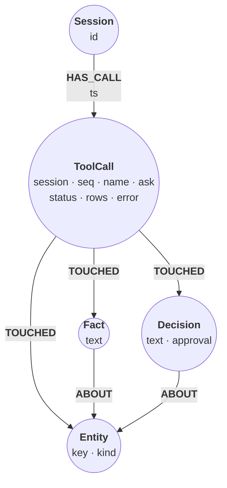
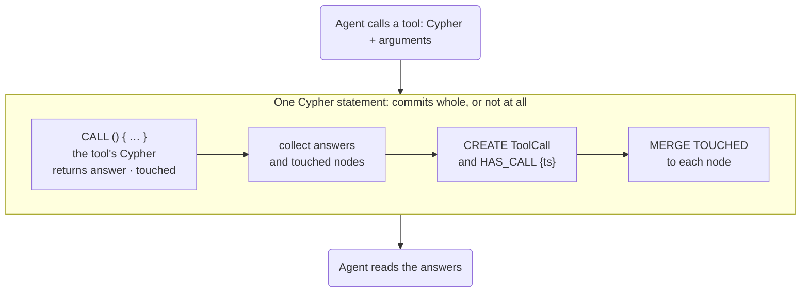

# Tool-call provenance for an agent

*A memory agent reads and writes its graph through two tools. Every call it
makes becomes a `ToolCall` node in that same graph, written by the same
statement as the call itself and linked to every node the call wrote or
returned. An audit can then ask which call wrote a fact, which calls have read
it since, what the failed calls left behind, and what each tool costs.*

The agent's memory is small: entities, facts about them, and decisions. The
trace sits beside it, in the same graph:



`ask` is the user message that led to the call, `status` is `committed`,
`read`, or `rolled_back`, and `rows` is how many rows the call returned to
the agent. The agent has two tools, `remember` and `recall`. Each takes a
Cypher statement and its arguments, both written by an LLM. The steps below
replay the twelve calls of one session, `s1`, with the arguments the model
sent. Two of those calls fail, on purpose.

## Set up the schema

Two constraints keep the memory tidy: one node per entity key and one per
fact text. The other four protect the trace:

- `call_key`, a NODE KEY on `(session, seq)`: every `ToolCall` has both, and
  no two share them. A retried call cannot be recorded twice, nor a call
  without a sequence number (a UNIQUE constraint would allow that).
- `has_call_ts` and `has_call_ts_nn`: every `HAS_CALL` edge carries an
  integer `ts` (epoch milliseconds), so sorting by time is exact.
- `session_id`: one `Session` node per id, the anchor every call hangs from.

```cypher cell=schema
CREATE CONSTRAINT entity_key IF NOT EXISTS FOR (e:Entity) REQUIRE e.key IS UNIQUE;
CREATE CONSTRAINT fact_text IF NOT EXISTS FOR (f:Fact) REQUIRE f.text IS UNIQUE;
CREATE CONSTRAINT session_id IF NOT EXISTS FOR (s:Session) REQUIRE s.id IS UNIQUE;
CREATE CONSTRAINT call_key IF NOT EXISTS
  FOR (c:ToolCall) REQUIRE (c.session, c.seq) IS NODE KEY;
CREATE CONSTRAINT has_call_ts IF NOT EXISTS
  FOR ()-[h:HAS_CALL]-() REQUIRE h.ts IS :: INTEGER;
CREATE CONSTRAINT has_call_ts_nn IF NOT EXISTS
  FOR ()-[h:HAS_CALL]-() REQUIRE h.ts IS NOT NULL;
CREATE (:Session {id: 's1'})
```

```table
(no rows) · nodes created: 1, properties set: 1, labels added: 1, constraints added: 6
```

```cypher cell=constraints
SHOW CONSTRAINTS YIELD name, type, labelsOrTypes, properties
RETURN name, type, labelsOrTypes AS on, properties
ORDER BY name
```

```table
| name             | type                              | on           | properties         |
|------------------|-----------------------------------|--------------|--------------------|
| "call_key"       | "NODE_KEY"                        | ["ToolCall"] | ["session", "seq"] |
| "entity_key"     | "NODE_PROPERTY_UNIQUENESS"        | ["Entity"]   | ["key"]            |
| "fact_text"      | "NODE_PROPERTY_UNIQUENESS"        | ["Fact"]     | ["text"]           |
| "has_call_ts"    | "RELATIONSHIP_PROPERTY_TYPE"      | ["HAS_CALL"] | ["ts"]             |
| "has_call_ts_nn" | "RELATIONSHIP_PROPERTY_EXISTENCE" | ["HAS_CALL"] | ["ts"]             |
| "session_id"     | "NODE_PROPERTY_UNIQUENESS"        | ["Session"]  | ["id"]             |
6 rows
```

## Trace a call in the same statement

The first call is the model's `remember` for "We run a billing service." Its
Cypher creates one entity. To trace it, the step wraps that Cypher in
`CALL () { … }` and appends the tracer. Only the Cypher's `RETURN` is
adapted: it returns `answer`, the row the agent sees, and `touched`, the
nodes the call wrote or read. Then, in the same statement, the tracer:

1. collects the answers and the touched nodes, so it runs once per call even
   when the call returns no rows;
2. creates the `ToolCall`, hung from the session by a `HAS_CALL` edge with
   the call's timestamp;
3. links it to each touched node: `reduce` flattens the lists and drops nulls
   (an `OPTIONAL MATCH` can return some), and `MERGE` makes one `TOUCHED`
   edge per node;
4. hands the answers back to the agent.



Because the write and its audit row are one statement, they commit together
or not at all. A `ToolCall` with `status: 'committed'` exists only if the
write it describes committed. The call's parameters hold the tool arguments
next to a `call` map, which is what the tracer knows about the call:

```json data=call-1
{"call": {"session": "s1", "seq": 1, "ts": 1772442060000, "tool": "remember",
          "ask": "We run a billing service."},
 "key": "billing service", "kind": "service"}
```

```cypher cell=call-1 params=call-1
CALL () {
  CREATE (e:Entity {key: $key, kind: $kind})
  RETURN {entity: e.key} AS answer, [e] AS touched
}
WITH collect(answer) AS answers, collect(touched) AS touched
MATCH (s:Session {id: $call.session})
CREATE (s)-[:HAS_CALL {ts: $call.ts}]->
       (c:ToolCall {session: $call.session, seq: $call.seq, name: $call.tool,
                    ask: $call.ask, status: 'committed', rows: size(answers)})
FOREACH (n IN reduce(ns = [], t IN touched | ns + [x IN t WHERE x IS NOT NULL]) |
         MERGE (c)-[:TOUCHED]->(n))
WITH answers
UNWIND answers AS answer
RETURN answer
```

```table
| answer                      |
|-----------------------------|
| {entity: "billing service"} |
1 row · nodes created: 2, relationships created: 2, properties set: 9, labels added: 2
```

The counters show both halves: the entity, and the `ToolCall` with its two
edges. Every other call has the same shape: only the Cypher inside `CALL` and
the arguments change, and a read records `status: 'read'`.

## Remember, then recall

"Orders live in Postgres." creates a fact about the orders service, and the
service itself, which is new:

```json data=call-2
{"call": {"session": "s1", "seq": 2, "ts": 1772442120000, "tool": "remember",
          "ask": "Orders live in Postgres."},
 "entity": "orders service", "kind": "service", "text": "Postgres for orders"}
```

```cypher cell=call-2 params=call-2
CALL () {
  MERGE (e:Entity {key: $entity}) ON CREATE SET e.kind = $kind
  CREATE (f:Fact {text: $text})-[:ABOUT]->(e)
  RETURN {entity: e.key, fact: f.text} AS answer, [e, f] AS touched
}
WITH collect(answer) AS answers, collect(touched) AS touched
MATCH (s:Session {id: $call.session})
CREATE (s)-[:HAS_CALL {ts: $call.ts}]->
       (c:ToolCall {session: $call.session, seq: $call.seq, name: $call.tool,
                    ask: $call.ask, status: 'committed', rows: size(answers)})
FOREACH (n IN reduce(ns = [], t IN touched | ns + [x IN t WHERE x IS NOT NULL]) |
         MERGE (c)-[:TOUCHED]->(n))
WITH answers
UNWIND answers AS answer
RETURN answer
```

```table
| answer                                                  |
|---------------------------------------------------------|
| {entity: "orders service", fact: "Postgres for orders"} |
1 row · nodes created: 3, relationships created: 4, properties set: 10, labels added: 3
```

The agent then asks about a service it has never heard of. The recall finds
nothing, so the agent gets no rows, but the call is still recorded, with
`rows: 0` and no `TOUCHED` edges:

```json data=call-3
{"call": {"session": "s1", "seq": 3, "ts": 1772442180000, "tool": "recall",
          "ask": "What do we know about the payments service?"},
 "key": "payments service"}
```

```cypher cell=call-3 params=call-3
CALL () {
  MATCH (e:Entity {key: $key})<-[:ABOUT]-(x:Fact|Decision)
  RETURN {kind: labels(x)[0], text: x.text} AS answer, [e, x] AS touched
  ORDER BY answer.kind, answer.text
}
WITH collect(answer) AS answers, collect(touched) AS touched
MATCH (s:Session {id: $call.session})
CREATE (s)-[:HAS_CALL {ts: $call.ts}]->
       (c:ToolCall {session: $call.session, seq: $call.seq, name: $call.tool,
                    ask: $call.ask, status: 'read', rows: size(answers)})
FOREACH (n IN reduce(ns = [], t IN touched | ns + [x IN t WHERE x IS NOT NULL]) |
         MERGE (c)-[:TOUCHED]->(n))
WITH answers
UNWIND answers AS answer
RETURN answer
```

```table
| answer |
|--------|
0 rows · nodes created: 1, relationships created: 1, properties set: 7, labels added: 1
```

The same recall for the orders service returns the fact, and the call touches
both the fact and the service:

```json data=call-4
{"call": {"session": "s1", "seq": 4, "ts": 1772442240000, "tool": "recall",
          "ask": "Which database do orders use?"},
 "key": "orders service"}
```

```cypher cell=call-4 params=call-4
CALL () {
  MATCH (e:Entity {key: $key})<-[:ABOUT]-(x:Fact|Decision)
  RETURN {kind: labels(x)[0], text: x.text} AS answer, [e, x] AS touched
  ORDER BY answer.kind, answer.text
}
WITH collect(answer) AS answers, collect(touched) AS touched
MATCH (s:Session {id: $call.session})
CREATE (s)-[:HAS_CALL {ts: $call.ts}]->
       (c:ToolCall {session: $call.session, seq: $call.seq, name: $call.tool,
                    ask: $call.ask, status: 'read', rows: size(answers)})
FOREACH (n IN reduce(ns = [], t IN touched | ns + [x IN t WHERE x IS NOT NULL]) |
         MERGE (c)-[:TOUCHED]->(n))
WITH answers
UNWIND answers AS answer
RETURN answer
```

```table
| answer                                      |
|---------------------------------------------|
| {kind: "Fact", text: "Postgres for orders"} |
1 row · nodes created: 1, relationships created: 3, properties set: 7, labels added: 1
```

## Two calls that fail

Call 5 records a decision nobody has reviewed yet. The model computes the
approval as `100 * $agree / $reviewers` with zero reviewers. The two `MERGE`s
for `kafka` and `OrderPlaced` run first, then the division fails:

```json data=call-5
{"call": {"session": "s1", "seq": 5, "ts": 1772442300000, "tool": "remember",
          "ask": "Decision: the orders service publishes OrderPlaced events to Kafka and billing consumes them. Nobody has reviewed it yet."},
 "topic": "kafka", "event": "OrderPlaced", "producer": "orders service",
 "consumer": "billing service", "text": "Publish OrderPlaced events to Kafka",
 "agree": 0, "reviewers": 0}
```

```cypher cell=call-5 params=call-5 expect=error
CALL () {
  MERGE (k:Entity {key: $topic}) ON CREATE SET k.kind = 'technology'
  MERGE (ev:Entity {key: $event}) ON CREATE SET ev.kind = 'event'
  WITH k, ev
  MATCH (o:Entity {key: $producer}), (b:Entity {key: $consumer})
  CREATE (d:Decision {text: $text, approval: 100 * $agree / $reviewers})
  CREATE (d)-[:ABOUT]->(o), (d)-[:ABOUT]->(b), (d)-[:ABOUT]->(k), (d)-[:ABOUT]->(ev)
  RETURN {decision: d.text, approval: d.approval} AS answer, [d, k, ev, o, b] AS touched
}
WITH collect(answer) AS answers, collect(touched) AS touched
MATCH (s:Session {id: $call.session})
CREATE (s)-[:HAS_CALL {ts: $call.ts}]->
       (c:ToolCall {session: $call.session, seq: $call.seq, name: $call.tool,
                    ask: $call.ask, status: 'committed', rows: size(answers)})
FOREACH (n IN reduce(ns = [], t IN touched | ns + [x IN t WHERE x IS NOT NULL]) |
         MERGE (c)-[:TOUCHED]->(n))
WITH answers
UNWIND answers AS answer
RETURN answer
```

```table
error: type error: / by zero
```

A failed statement leaves nothing behind: not the two entities it merged, and
not its audit row. The tracer catches the error and records the call on its
own, as `rolled_back`, with the error text and no `TOUCHED` edges. The census
in the same step shows the memory is as it was before call 5.

```json data=failed-5
{"call": {"session": "s1", "seq": 5, "ts": 1772442300000, "tool": "remember",
          "ask": "Decision: the orders service publishes OrderPlaced events to Kafka and billing consumes them. Nobody has reviewed it yet."},
 "error": "type error: / by zero"}
```

```cypher cell=failed-5 params=failed-5
MATCH (s:Session {id: $call.session})
CREATE (s)-[:HAS_CALL {ts: $call.ts}]->
       (c:ToolCall {session: $call.session, seq: $call.seq, name: $call.tool,
                    ask: $call.ask, status: 'rolled_back', rows: 0, error: $error})
RETURN c.seq AS seq, c.status AS status, COUNT { (:Entity) } AS entities,
       COUNT { (:Fact) } AS facts, COUNT { (:Decision) } AS decisions
```

```table
| seq | status        | entities | facts | decisions |
|-----|---------------|----------|-------|-----------|
| 5   | "rolled_back" | 2        | 1     | 0         |
1 row · nodes created: 1, relationships created: 1, properties set: 8, labels added: 1
```

Call 6 creates the billing service again. The `entity_key` uniqueness
constraint refuses it, and the tracer records the call as `rolled_back`, as
it did call 5. Both steps are collapsed below; the census is unchanged.

```json data=call-6
{"call": {"session": "s1", "seq": 6, "ts": 1772442360000, "tool": "remember",
          "ask": "Note that billing is one of our services."},
 "key": "billing service", "kind": "service"}
```

```cypher cell=call-6 setup params=call-6 expect=error
CALL () {
  CREATE (e:Entity {key: $key, kind: $kind})
  RETURN {entity: e.key} AS answer, [e] AS touched
}
WITH collect(answer) AS answers, collect(touched) AS touched
MATCH (s:Session {id: $call.session})
CREATE (s)-[:HAS_CALL {ts: $call.ts}]->
       (c:ToolCall {session: $call.session, seq: $call.seq, name: $call.tool,
                    ask: $call.ask, status: 'committed', rows: size(answers)})
FOREACH (n IN reduce(ns = [], t IN touched | ns + [x IN t WHERE x IS NOT NULL]) |
         MERGE (c)-[:TOUCHED]->(n))
WITH answers
UNWIND answers AS answer
RETURN answer
```

```table
error: semantic error: ConstraintValidationFailed: `entity_key` uniqueness
```

```json data=failed-6
{"call": {"session": "s1", "seq": 6, "ts": 1772442360000, "tool": "remember",
          "ask": "Note that billing is one of our services."},
 "error": "semantic error: ConstraintValidationFailed: `entity_key` uniqueness"}
```

```cypher cell=failed-6 setup params=failed-6
MATCH (s:Session {id: $call.session})
CREATE (s)-[:HAS_CALL {ts: $call.ts}]->
       (c:ToolCall {session: $call.session, seq: $call.seq, name: $call.tool,
                    ask: $call.ask, status: 'rolled_back', rows: 0, error: $error})
RETURN c.seq AS seq, c.status AS status, COUNT { (:Entity) } AS entities,
       COUNT { (:Fact) } AS facts, COUNT { (:Decision) } AS decisions
```

```table
| seq | status        | entities | facts | decisions |
|-----|---------------|----------|-------|-----------|
| 6   | "rolled_back" | 2        | 1     | 0         |
1 row · nodes created: 1, relationships created: 1, properties set: 8, labels added: 1
```

## The rest of the session

Call 7 sends the decision again, now with two of three reviewers in favour.
It merges the two new entities, creates the decision, and touches five nodes.
`$agree` and `$reviewers` are integers, so the approval is 66, not 66.67:

```json data=call-7
{"call": {"session": "s1", "seq": 7, "ts": 1772442420000, "tool": "remember",
          "ask": "Same decision as before: OrderPlaced events go to Kafka, billing consumes them. Two of three reviewers agreed."},
 "topic": "kafka", "event": "OrderPlaced", "producer": "orders service",
 "consumer": "billing service", "text": "Publish OrderPlaced events to Kafka",
 "agree": 2, "reviewers": 3}
```

```cypher cell=call-7 params=call-7
CALL () {
  MERGE (k:Entity {key: $topic}) ON CREATE SET k.kind = 'technology'
  MERGE (ev:Entity {key: $event}) ON CREATE SET ev.kind = 'event'
  WITH k, ev
  MATCH (o:Entity {key: $producer}), (b:Entity {key: $consumer})
  CREATE (d:Decision {text: $text, approval: 100 * $agree / $reviewers})
  CREATE (d)-[:ABOUT]->(o), (d)-[:ABOUT]->(b), (d)-[:ABOUT]->(k), (d)-[:ABOUT]->(ev)
  RETURN {decision: d.text, approval: d.approval} AS answer, [d, k, ev, o, b] AS touched
}
WITH collect(answer) AS answers, collect(touched) AS touched
MATCH (s:Session {id: $call.session})
CREATE (s)-[:HAS_CALL {ts: $call.ts}]->
       (c:ToolCall {session: $call.session, seq: $call.seq, name: $call.tool,
                    ask: $call.ask, status: 'committed', rows: size(answers)})
FOREACH (n IN reduce(ns = [], t IN touched | ns + [x IN t WHERE x IS NOT NULL]) |
         MERGE (c)-[:TOUCHED]->(n))
WITH answers
UNWIND answers AS answer
RETURN answer
```

```table
| answer                                                          |
|-----------------------------------------------------------------|
| {approval: 66, decision: "Publish OrderPlaced events to Kafka"} |
1 row · nodes created: 4, relationships created: 10, properties set: 13, labels added: 4
```

Five more recalls follow, traced the same way, as one collapsed step with a
statement per call. A step's statements share its parameters, so each call's
names carry its number (`$call8`, `$key8`). What each call returned:

- Call 8, the orders service again: the Kafka decision and the Postgres fact.
- Call 9, facts mentioning "Postgres": the one fact.
- Call 10 walks from `kafka` through the decision to the other entities it is
  about, and returns what else is known about them: the Postgres fact. It
  touches only what it returns, not the decision or `kafka`.
- Call 11, every service with what is known about each: three rows.
- Call 12 dumps everything: the decision once per entity it is about, and the
  fact. A step records its last statement's result, so these are the rows.

```json data=calls-8-12
{"call8": {"session": "s1", "seq": 8, "ts": 1772442480000, "tool": "recall",
           "ask": "What do we know about the orders service now?"},
 "key8": "orders service",
 "call9": {"session": "s1", "seq": 9, "ts": 1772442540000, "tool": "recall",
           "ask": "Where did anyone mention Postgres?"},
 "term9": "Postgres",
 "call10": {"session": "s1", "seq": 10, "ts": 1772442600000, "tool": "recall",
            "ask": "What else do we know about the things the Kafka decision affects?"},
 "key10": "kafka",
 "call11": {"session": "s1", "seq": 11, "ts": 1772442660000, "tool": "recall",
            "ask": "List our services and what we know about each."},
 "kind11": "service",
 "call12": {"session": "s1", "seq": 12, "ts": 1772442720000, "tool": "recall",
            "ask": "Dump everything you remember."}}
```

```cypher cell=calls-8-12 setup params=calls-8-12
CALL () {
  MATCH (e:Entity {key: $key8})<-[:ABOUT]-(x:Fact|Decision)
  RETURN {kind: labels(x)[0], text: x.text} AS answer, [e, x] AS touched
  ORDER BY answer.kind, answer.text
}
WITH collect(answer) AS answers, collect(touched) AS touched
MATCH (s:Session {id: $call8.session})
CREATE (s)-[:HAS_CALL {ts: $call8.ts}]->
       (c:ToolCall {session: $call8.session, seq: $call8.seq, name: $call8.tool,
                    ask: $call8.ask, status: 'read', rows: size(answers)})
FOREACH (n IN reduce(ns = [], t IN touched | ns + [x IN t WHERE x IS NOT NULL]) |
         MERGE (c)-[:TOUCHED]->(n))
WITH answers
UNWIND answers AS answer
RETURN answer;

CALL () {
  MATCH (f:Fact) WHERE f.text CONTAINS $term9
  MATCH (f)-[:ABOUT]->(e:Entity)
  RETURN {text: f.text, entity: e.key} AS answer, [f, e] AS touched
  ORDER BY answer.entity
}
WITH collect(answer) AS answers, collect(touched) AS touched
MATCH (s:Session {id: $call9.session})
CREATE (s)-[:HAS_CALL {ts: $call9.ts}]->
       (c:ToolCall {session: $call9.session, seq: $call9.seq, name: $call9.tool,
                    ask: $call9.ask, status: 'read', rows: size(answers)})
FOREACH (n IN reduce(ns = [], t IN touched | ns + [x IN t WHERE x IS NOT NULL]) |
         MERGE (c)-[:TOUCHED]->(n))
WITH answers
UNWIND answers AS answer
RETURN answer;

CALL () {
  MATCH (k:Entity {key: $key10})<-[:ABOUT]-(d:Decision)-[:ABOUT]->(o:Entity)
        <-[:ABOUT]-(y)
  WHERE o <> k AND y <> d
  RETURN DISTINCT {entity: o.key, kind: labels(y)[0], text: y.text} AS answer,
                  [o, y] AS touched
  ORDER BY answer.entity, answer.text
}
WITH collect(answer) AS answers, collect(touched) AS touched
MATCH (s:Session {id: $call10.session})
CREATE (s)-[:HAS_CALL {ts: $call10.ts}]->
       (c:ToolCall {session: $call10.session, seq: $call10.seq, name: $call10.tool,
                    ask: $call10.ask, status: 'read', rows: size(answers)})
FOREACH (n IN reduce(ns = [], t IN touched | ns + [x IN t WHERE x IS NOT NULL]) |
         MERGE (c)-[:TOUCHED]->(n))
WITH answers
UNWIND answers AS answer
RETURN answer;

CALL () {
  MATCH (e:Entity {kind: $kind11})
  OPTIONAL MATCH (e)<-[:ABOUT]-(x:Fact|Decision)
  RETURN {entity: e.key, kind: labels(x)[0], text: x.text} AS answer, [e, x] AS touched
  ORDER BY answer.entity, answer.text
}
WITH collect(answer) AS answers, collect(touched) AS touched
MATCH (s:Session {id: $call11.session})
CREATE (s)-[:HAS_CALL {ts: $call11.ts}]->
       (c:ToolCall {session: $call11.session, seq: $call11.seq, name: $call11.tool,
                    ask: $call11.ask, status: 'read', rows: size(answers)})
FOREACH (n IN reduce(ns = [], t IN touched | ns + [x IN t WHERE x IS NOT NULL]) |
         MERGE (c)-[:TOUCHED]->(n))
WITH answers
UNWIND answers AS answer
RETURN answer;

CALL () {
  MATCH (x:Fact|Decision)-[:ABOUT]->(e:Entity)
  RETURN {kind: labels(x)[0], text: x.text, entity: e.key} AS answer, [x, e] AS touched
  ORDER BY answer.kind, answer.text, answer.entity
}
WITH collect(answer) AS answers, collect(touched) AS touched
MATCH (s:Session {id: $call12.session})
CREATE (s)-[:HAS_CALL {ts: $call12.ts}]->
       (c:ToolCall {session: $call12.session, seq: $call12.seq, name: $call12.tool,
                    ask: $call12.ask, status: 'read', rows: size(answers)})
FOREACH (n IN reduce(ns = [], t IN touched | ns + [x IN t WHERE x IS NOT NULL]) |
         MERGE (c)-[:TOUCHED]->(n))
WITH answers
UNWIND answers AS answer
RETURN answer
```

```table
| answer                                                                                     |
|--------------------------------------------------------------------------------------------|
| {entity: "OrderPlaced", kind: "Decision", text: "Publish OrderPlaced events to Kafka"}     |
| {entity: "billing service", kind: "Decision", text: "Publish OrderPlaced events to Kafka"} |
| {entity: "kafka", kind: "Decision", text: "Publish OrderPlaced events to Kafka"}           |
| {entity: "orders service", kind: "Decision", text: "Publish OrderPlaced events to Kafka"}  |
| {entity: "orders service", kind: "Fact", text: "Postgres for orders"}                      |
5 rows · nodes created: 5, relationships created: 22, properties set: 35, labels added: 5
```

## The trace refuses bad audit rows

A runtime that loses the acknowledgement of call 7 retries it: the same
Cypher, the same arguments, the same `(session, seq)`. The decision has no
natural key, so nothing in the memory would stop a second copy. The audit
row stops it. The NODE KEY rejects the second `ToolCall`, and because the
write and the audit row are one statement, the second decision goes with it:

```cypher cell=replay-7 params=call-7 expect=error
CALL () {
  MERGE (k:Entity {key: $topic}) ON CREATE SET k.kind = 'technology'
  MERGE (ev:Entity {key: $event}) ON CREATE SET ev.kind = 'event'
  WITH k, ev
  MATCH (o:Entity {key: $producer}), (b:Entity {key: $consumer})
  CREATE (d:Decision {text: $text, approval: 100 * $agree / $reviewers})
  CREATE (d)-[:ABOUT]->(o), (d)-[:ABOUT]->(b), (d)-[:ABOUT]->(k), (d)-[:ABOUT]->(ev)
  RETURN {decision: d.text, approval: d.approval} AS answer, [d, k, ev, o, b] AS touched
}
WITH collect(answer) AS answers, collect(touched) AS touched
MATCH (s:Session {id: $call.session})
CREATE (s)-[:HAS_CALL {ts: $call.ts}]->
       (c:ToolCall {session: $call.session, seq: $call.seq, name: $call.tool,
                    ask: $call.ask, status: 'committed', rows: size(answers)})
FOREACH (n IN reduce(ns = [], t IN touched | ns + [x IN t WHERE x IS NOT NULL]) |
         MERGE (c)-[:TOUCHED]->(n))
WITH answers
UNWIND answers AS answer
RETURN answer
```

```table
error: semantic error: ConstraintValidationFailed: `call_key` uniqueness
```

The other half of the NODE KEY: a `ToolCall` without a `seq` is refused too.

```cypher cell=no-seq expect=error
MATCH (s:Session {id: 's1'})
CREATE (s)-[:HAS_CALL {ts: 1772442780000}]->
       (:ToolCall {session: 's1', name: 'recall', status: 'read', rows: 0})
```

```table
error: semantic error: ConstraintValidationFailed: `call_key` requires properties
```

And a timestamp that is not an integer, here a `datetime`:

```cypher cell=datetime-ts expect=error
MATCH (s:Session {id: 's1'})
CREATE (s)-[:HAS_CALL {ts: datetime('2026-03-02T09:13:00Z')}]->
       (:ToolCall {session: 's1', seq: 13, name: 'recall', status: 'read', rows: 0})
```

```table
error: semantic error: ConstraintValidationFailed: `has_call_ts` property type
```

None of the three left anything behind: the audits below still count twelve
calls, four entities, and one decision.

## Audit: what happened in the session

From here on everything is a read. First, each tool's calls: the rows they
returned to the agent, the nodes they touched, and how they ended.

```cypher cell=per-tool
MATCH (c:ToolCall)
RETURN c.name AS tool, count(*) AS calls, sum(c.rows) AS rows,
       sum(COUNT { (c)-[:TOUCHED]->() }) AS touched,
       count(CASE c.status WHEN 'read' THEN 1 END) AS read,
       count(CASE c.status WHEN 'committed' THEN 1 END) AS committed,
       count(CASE c.status WHEN 'rolled_back' THEN 1 END) AS rolled_back
ORDER BY tool
```

```table
| tool       | calls | rows | touched | read | committed | rolled_back |
|------------|-------|------|---------|------|-----------|-------------|
| "recall"   | 7     | 13   | 19      | 7    | 0         | 0           |
| "remember" | 5     | 3    | 8       | 0    | 3         | 2           |
2 rows
```

The rolled-back calls touched nothing:

```cypher cell=rolled-back
MATCH (c:ToolCall {status: 'rolled_back'})
RETURN c.seq AS seq, c.name AS tool, COUNT { (c)-[:TOUCHED]->() } AS touched,
       c.error AS error
ORDER BY seq
```

```table
| seq | tool       | touched | error                                                                 |
|-----|------------|---------|-----------------------------------------------------------------------|
| 5   | "remember" | 0       | "type error: / by zero"                                               |
| 6   | "remember" | 0       | "semantic error: ConstraintValidationFailed: `entity_key` uniqueness" |
2 rows
```

The latest calls of the session, newest first, with the labels each one
touched. The anchor is one unique `Session` and `ts` is an integer, so
`ORDER BY h.ts DESC LIMIT $n` is exact.

```json data=latest
{"session": "s1", "n": 5}
```

```cypher cell=latest params=latest
MATCH (s:Session {id: $session})-[h:HAS_CALL]->(c:ToolCall)
RETURN c.seq AS seq, c.name AS tool, c.status AS status,
       toString(datetime.fromEpochMillis(h.ts)) AS at,
       COLLECT { MATCH (c)-[:TOUCHED]->(n)
                 RETURN labels(n)[0] AS label ORDER BY label } AS touched
ORDER BY h.ts DESC
LIMIT $n
```

```table
| seq | tool     | status | at                     | touched                                                      |
|-----|----------|--------|------------------------|--------------------------------------------------------------|
| 12  | "recall" | "read" | "2026-03-02T09:12:00Z" | ["Decision", "Entity", "Entity", "Entity", "Entity", "Fact"] |
| 11  | "recall" | "read" | "2026-03-02T09:11:00Z" | ["Decision", "Entity", "Entity", "Fact"]                     |
| 10  | "recall" | "read" | "2026-03-02T09:10:00Z" | ["Entity", "Fact"]                                           |
| 9   | "recall" | "read" | "2026-03-02T09:09:00Z" | ["Entity", "Fact"]                                           |
| 8   | "recall" | "read" | "2026-03-02T09:08:00Z" | ["Decision", "Entity", "Fact"]                               |
5 rows
```

What call 7 touched, as a graph. Open the graph view:

```cypher cell=call-7-touched
MATCH path = (:Session {id: 's1'})-[:HAS_CALL]->(c:ToolCall {session: 's1', seq: 7})
             -[:TOUCHED]->(n)
WITH path, n
ORDER BY labels(n)[0], coalesce(n.key, n.text)
RETURN path
```

```gram
// 5 rows
(n0:Session {id: "s1"})-[r18:HAS_CALL {ts: 1772442420000}]->(n17:ToolCall {ask: "Same decision as before: OrderPlaced events go to Kafka, billing consumes them. Two of three reviewers agreed.", name: "remember", rows: 1, seq: 7, session: "s1", status: "committed"})-[r19:TOUCHED]->(n16:Decision {approval: 66, text: "Publish OrderPlaced events to Kafka"})
(n0)-[r18]->(n17)-[r21:TOUCHED]->(n15:Entity {key: "OrderPlaced", kind: "event"})
(n0)-[r18]->(n17)-[r23:TOUCHED]->(n1:Entity {key: "billing service", kind: "service"})
(n0)-[r18]->(n17)-[r20:TOUCHED]->(n14:Entity {key: "kafka", kind: "technology"})
(n0)-[r18]->(n17)-[r22:TOUCHED]->(n3:Entity {key: "orders service", kind: "service"})
```

## Audit: the lineage of one fact

Every call that touched the fact "Postgres for orders", in order. The fact
sits at the centre of the graph view, with the calls around it:

```json data=fact
{"text": "Postgres for orders"}
```

```cypher cell=lineage params=fact
MATCH path = (:Session)-[:HAS_CALL]->(c:ToolCall)-[:TOUCHED]->(:Fact {text: $text})
WITH path, c
ORDER BY c.seq
RETURN path
```

```gram
// 7 rows
(n0:Session {id: "s1"})-[r3:HAS_CALL {ts: 1772442120000}]->(n5:ToolCall {ask: "Orders live in Postgres.", name: "remember", rows: 1, seq: 2, session: "s1", status: "committed"})-[r5:TOUCHED]->(n4:Fact {text: "Postgres for orders"})
(n0)-[r7:HAS_CALL {ts: 1772442240000}]->(n7:ToolCall {ask: "Which database do orders use?", name: "recall", rows: 1, seq: 4, session: "s1", status: "read"})-[r9:TOUCHED]->(n4)
(n0)-[r24:HAS_CALL {ts: 1772442480000}]->(n18:ToolCall {ask: "What do we know about the orders service now?", name: "recall", rows: 2, seq: 8, session: "s1", status: "read"})-[r27:TOUCHED]->(n4)
(n0)-[r28:HAS_CALL {ts: 1772442540000}]->(n19:ToolCall {ask: "Where did anyone mention Postgres?", name: "recall", rows: 1, seq: 9, session: "s1", status: "read"})-[r29:TOUCHED]->(n4)
(n0)-[r31:HAS_CALL {ts: 1772442600000}]->(n20:ToolCall {ask: "What else do we know about the things the Kafka decision affects?", name: "recall", rows: 1, seq: 10, session: "s1", status: "read"})-[r33:TOUCHED]->(n4)
(n0)-[r34:HAS_CALL {ts: 1772442660000}]->(n21:ToolCall {ask: "List our services and what we know about each.", name: "recall", rows: 3, seq: 11, session: "s1", status: "read"})-[r38:TOUCHED]->(n4)
(n0)-[r39:HAS_CALL {ts: 1772442720000}]->(n22:ToolCall {ask: "Dump everything you remember.", name: "recall", rows: 5, seq: 12, session: "s1", status: "read"})-[r45:TOUCHED]->(n4)
```

The same answer as one row. No call can touch a node before it exists, so the
first committed call to touch the fact is the one that wrote it. The reads
after it are the ones that have seen the fact since.

```cypher cell=wrote-it params=fact
MATCH (f:Fact {text: $text})<-[:TOUCHED]-(w:ToolCall {status: 'committed'})
WITH f, w
ORDER BY w.seq
LIMIT 1
RETURN w.seq AS wrote, w.name AS tool, w.ask AS ask,
       COLLECT { MATCH (f)<-[:TOUCHED]-(r:ToolCall {status: 'read'})
                 WHERE r.seq > w.seq
                 RETURN r.seq AS seq ORDER BY seq } AS read_since
```

```table
| wrote | tool       | ask                        | read_since            |
|-------|------------|----------------------------|-----------------------|
| 2     | "remember" | "Orders live in Postgres." | [4, 8, 9, 10, 11, 12] |
1 row
```

## Audit: every memory node

For each node in the memory: the committed calls that touched it, and how many
reads have returned it.

```cypher cell=per-node
MATCH (n:Entity|Fact|Decision)
RETURN labels(n)[0] AS label, coalesce(n.key, n.text) AS name,
       COLLECT { MATCH (n)<-[:TOUCHED]-(c:ToolCall {status: 'committed'})
                 RETURN c.seq AS seq ORDER BY seq } AS committed,
       COUNT { (n)<-[:TOUCHED]-(:ToolCall {status: 'read'}) } AS reads
ORDER BY label, name
```

```table
| label      | name                                  | committed | reads |
|------------|---------------------------------------|-----------|-------|
| "Decision" | "Publish OrderPlaced events to Kafka" | [7]       | 3     |
| "Entity"   | "OrderPlaced"                         | [7]       | 1     |
| "Entity"   | "billing service"                     | [1, 7]    | 2     |
| "Entity"   | "kafka"                               | [7]       | 1     |
| "Entity"   | "orders service"                      | [2, 7]    | 6     |
| "Fact"     | "Postgres for orders"                 | [2]       | 6     |
6 rows
```

`TOUCHED` does not say whether a call created a node or only matched it: the
billing service shows `[1, 7]` because call 1 created it and call 7 linked the
decision to it.

## What the program adds

The companion program runs the same session from Python, with a tracer that
wraps any Cypher the model sends. It classifies each statement as a read or a
write with `EXPLAIN`, times reads under `PROFILE` (this page leaves timings
out: they change on every run), runs writes in an explicit transaction that
records the call with `cursor.stats` and rolls back on any error, and stores
each call's Cypher and arguments on its `ToolCall` as JSON strings. It links
`TOUCHED` edges by `elementId`, then reopens the file in a new process for the
audit and exports the cost table to Polars through Arrow.
