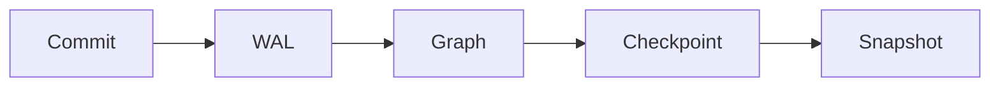

# relate docs

The pages published at <https://relatedb.ai/docs/>. Each page is one `.mdx`
file under this directory; the build renders it to an HTML page and to a
markdown twin at `/docs/<path>.md`, from the same source. The docs are
authored here, not synced from upstream (ADR-0002): upstream's `docs/` and
skill bundle are reading material, and nothing is copied from them
wholesale.

Two readers see every page: a developer in a hurry, and an agent that
fetched the twin and will act on it literally. The writing contract is
[`STYLE.md`](STYLE.md) (DOCS-PLAN.md §4, verbatim); this file is the
authoring contract: where things go, what the frontmatter holds, and which
constructs a page may use. `npm run docs:check` enforces the mechanical
parts of both (see [Checks](#checks)).

## Layout

| Path | Holds |
| --- | --- |
| `<section>/…/<name>.mdx` | A page, served at `/docs/<section>/…/<name>/`; an `index.mdx` serves its directory's URL |
| `<section>/…/<name>.results.json` | The recorded results of the page's runnable cells and verified samples ([Runnable cells](#runnable-cells), [Verified samples](#verified-samples)) |
| `<section>/…/diagrams/` | Pre-rendered light and dark SVGs of the page's `mermaid` blocks ([Diagrams](#diagrams)) and of its cells' graph results |
| `_glossary/<id>.mdx` | One glossary term ([Glossary](#glossary)) |
| `_capabilities/<id>.mdx` | One entry of the capability catalog ([Capability catalog](#capability-catalog)) |
| `_data/engine.json` | The relate version the examples are verified against, its release date and commit, and the recorded `relate --version` and envelope check |
| `_data/cli.json` | CLI commands, flags, environment variables, output modes and exit codes, each with the recorded run that shows it |
| `_data/errors.json` | Every error an agent can meet, one stable id per entry |
| `_data/changelog.json` | The release notes, one entry per release, newest first, and the deprecation policy; rendered to `/docs/reference/changelog/`, its twin and `/docs/changelog.json` |
| `_data/skill.json` | The upstream commit, sync date, stamped version and SHA-256 of every file of the published skill bundle (`public/skills/relate/`); written by `npm run skill:sync`, never by hand |
| `_data/samples.json` | What the verified samples were last replayed with: per language the client package, the upstream commits of the engine and of the client source, how it was built and the toolchain versions; the replay date, the platform, and the pins `scripts/samples/setup.sh` installed ([Sample manifests](#sample-manifests)) |
| `<section>/…/diagrams/<page>-element-<id>.json` | An interactive element's recorded static form, with `-light.svg` and `-dark.svg` when it has a picture ([Interactive elements](#interactive-elements)) |
| `src/lib/docs/elements/`, `src/scripts/docs/elements/`, `scripts/browser-cases/` | Outside this directory: each element's build side (and `_<name>-*.ts` helpers), browser module and styles, and cookbook:browser cases, found by directory ([Interactive elements](#interactive-elements)) |
| `_example/` | A throwaway page that exercises every construct; built only with `DOCS_EXAMPLES=1` |
| `STYLE.md`, `README.md` | The two contracts; not pages |

## Sections

Four sections, one per Diátaxis quadrant (ADR-0004). The URL uses the
plain name; the quadrant name appears only here and in the frontmatter
`type`. A page's section is the first segment of its path.

| Section | `type` | A page in it |
| --- | --- | --- |
| `get-started/` | `tutorial` | One path, no options, a working result at the end. Says "we" and "let's"; explains no more than the next step needs. |
| `guides/` | `how-to` | Its title is a goal ("Import a CSV"). Assumes competence; links to reference instead of restating it. |
| `reference/` | `reference` | Austere, complete, tabular. Describes; never instructs or persuades. One page per command, surface or clause group. |
| `concepts/` | `explanation` | Why and how it works. No steps, no option tables; trade-offs and alternatives are welcome. |

Each type has a required skeleton (STYLE.md §4.8):

| `type` | Required, in order |
| --- | --- |
| `tutorial` | What you'll have and how long it takes; Prerequisites; numbered steps, each with the command, its output in a `text` block, and a checkpoint sentence; What you built; Next |
| `how-to` | "This guide shows you how to…"; Prerequisites; steps; Verify; If it goes wrong (the likely errors, quoted, with remedies); Related |
| `reference` | Synopsis; tables (options, defaults, environment, errors); short examples that illustrate; See also |
| `explanation` | The question in the first paragraph; the model, with a diagram and its text; trade-offs and alternatives; Where this shows up |

Every page: the first paragraph is the answer, and no page ends on a
warning. Agents are a door on the landing page, not a fifth section
(ADR-0004): agent pages live in the quadrant their shape belongs to.
The cookbook (`/cookbook/`) stays its own pipeline; link into it for worked
examples.

## Frontmatter

A YAML block at the top of the page. The schema lives in
`src/content.config.ts`; unknown keys are an error.

```yaml
---
title: Import a CSV
description: Load rows from a CSV file into a relate store with LOAD CSV, including headers, types and a file directory.
order: 20
surfaces: [cli, python]
status: stable
since: 0.16.0
prerequisites: [get-started/install]
related: [reference/cli/flags#load-csv-dir, cookbook/entity-resolution]
---
```

| Key | Required | Meaning |
| --- | --- | --- |
| `title` | yes | The page's H1, in sentence case; also the sidebar label unless `label` is set |
| `label` | no | A shorter sidebar label |
| `description` | yes, unless `status: planned` | One sentence, 60 to 160 characters; used in the page meta, the twin, `llms.txt` and landing cards. Do not open it with the canonical phrase: the twin adds that |
| `type` | no | `tutorial`, `how-to`, `reference` or `explanation`; derived from the path, and must agree with it when given |
| `section` | no | `get-started`, `guides`, `reference` or `concepts`; derived from the path, and must agree with it when given |
| `order` | no | Sidebar order within the page's group, lower first (default `100`; ties sort by title) |
| `surfaces` | no | The front doors the page applies to: `cli`, `python`, `node`, `browser`, `rust`, `c`, `java`, `go`, `swift`, `bolt`, `http`, `mcp`, `docker`, `extensions`, `cypher`, `agents` |
| `status` | no | `stable` (default), `preview` (renders the Preview badge; say the opt-in in the first sentence) or `planned` (left out of the build; links to it render as text) |
| `since` | no | The release that introduced the feature, `0.17` or `0.17.0`; renders a "since" badge |
| `prerequisites` | no | Page ids to read first (`get-started/install`) |
| `related` | no | Page ids, with an optional `#anchor`, or `cookbook/<slug>` |

Four fields are generated and must not be typed: `verified` (from
`_data/engine.json`, the version every example on every page last ran
against), `verified_by` (the checks this page's examples passed against that
version, in the order `cypher`, `python`, `node`, `cli`; left out when none
apply), `canonical_url` and `last_updated`. The twin carries all four.
To bump `verified`, re-record every page against the new engine and change
`_data/engine.json` in the same change.

## Constructs

Prose constructs are remark directives, rendered by one pipeline to HTML
for the page and to markdown for the twin (ADR-0015). JSX is reserved for
generated and interactive components. The full vocabulary follows; each
entry shows the source and what the twin gets. Interactive elements (the
plan viewer, the explorers, the terminal) are directives too, one per
element; see [Interactive elements](#interactive-elements).

### Callouts

`:::note`, `:::tip`, `:::warning`, `:::danger`, with an optional title in
brackets. At most two per section; a `warning` goes before the step it
concerns.

````markdown
:::warning[One writer]
A store has one writer at a time. A second process that opens it for
writing exits with code 5.
:::
````

Twin: a blockquote whose first line is the bold title, or the bold kind
(`**Warning**`) when there is no title.

### Tabs

An outer `::::tabs` container (four colons) holding one `:::tab[Label]{key=…}`
per tab. Every tab is visible without JavaScript.

````markdown
::::tabs
:::tab[Python]{key=python}
```python
import relate
db = relate.connect("friends.rl")
```
:::
:::tab[CLI]{key=cli}
```bash
relate query --database ./friends.rl "MATCH (p:Person) RETURN p.name LIMIT 5"
```
:::
::::
````

Twin: one `### Label` heading per tab, with its body, in order.

**Language keys.** A tab set whose keys name languages follows the language
picker in the page header. Keys (first spelling preferred): `python`; `node`
(also `js`, `javascript`, `nodejs`, `node-js`); `rust`; `c`; `java`; `go`;
`swift`; `browser` (also `wasm`); `cli` (`src/lib/docs/languages.ts`). The
picker shows on a page where one tab set (a `::::tabs` or `<Install />`)
names two or more languages; choosing one shows it in every set that has it,
and on later pages (the `docs-tab` entry the tab script already keeps, in
which each language keeps every spelling). Every set keeps its own tabs; the
twin is unchanged.

### Agentic steps

An outer `::::agentic` container holding `:::human[Label]` and
`:::agent[Label]`, once each; the labels are optional ("As a person", "As an
agent"). For a tutorial step a person and an agent run differently: the
agent view shows `--mode envelope`, the error object and the exit code.

````markdown
::::agentic
:::human
```bash
relate --database ./team.rl --read-only "MATCH (p:Person) RETURN count(p) AS people"
```
:::
:::agent
```bash
relate --database ./team.rl --read-only --mode envelope "MATCH (p:Person) RETURN count(p) AS people"
```
:::
::::
````

The page shows the two views as tabs (keys `agentic-human` and
`agentic-agent`); the choice applies to every agentic step on the page and
is remembered like any tab. Without JavaScript both views show, each under
its label. Twin: each view under a heading one level below the heading the
step sits under, in the order written.

### Host deeplinks

`:::deeplink{host=<host> name=<server name>}` around one ```` ```json ````
fence: the server entry the link adds (the value under
`mcpServers.<name>`, never the whole file). Hosts: `cursor` and `vscode`
(`src/lib/docs/deeplink.ts` names each host document the form comes from).
The page shows the host button, its link generated at build from the JSON,
the JSON and the link as text. Twin: the fence, then the link as inline
code. An entry with a `command` needs `"--read-only"` in `args`, and an
entry with `env` or `headers` is refused (a link is public), or the build
fails; the page says beside it how to allow writes. The link carries the
JSON as written, placeholders included, so say when a path needs editing
after the entry is added.

````markdown
:::deeplink{host=cursor name=relate}
```json
{"command": "relate", "args": ["serve", "--mcp", "stdio", "--database", "<absolute-path>/graph.rl", "--read-only"]}
```
:::
````

### Terms

`:term[label]{id=<glossary id>}` links a word to its glossary entry. Define
the term in the sentence first (STYLE.md §4.5); the link is the safety net
for a reader who landed mid-page.

```markdown
Every commit goes to the :term[write-ahead log]{id=wal} before it applies.
```

On the page, the first use of each term becomes a toggletip: a `<button
popovertarget>` with a dotted underline that opens a `<span popover="auto">`
panel holding the term's `short` definition and a "Read more in the
glossary" link to `/docs/reference/glossary/#<id>`
(`src/lib/docs/glossary-toggletip.ts`, ADR-0009, ADR-0030). Click, tap or
Enter opens it; Escape or a click outside closes it; no JavaScript runs.
Later uses are plain text. In a table body cell or a tab panel a term is a
plain link and does not use up the toggletip; in a heading, a table header,
a callout title, a tab label or a link it is plain text. A `:term[…]`
inside a code fence or inline code is shown as code, not linked. Twin: the
plain link (always absolute) at every use, and the twin ends with a `##
Terms used on this page` section listing each linked term's `short`
definition, in order of first use. A term id with no `_glossary/<id>.mdx`
fails the build.

### Badges

`:since[0.17]` and `:status[preview]` (`preview` or `deprecated`).

```markdown
The ontology procedures :status[preview] need `RELATE_PREVIEW=ontology`.
The `<flag>` flag :since[0.17] bounds each statement.
```

Twin: `(preview)`, `(since 0.17)`.

### Figures

`::figure{src=… alt="…"}` for a static image under `public/`, with an
optional caption in brackets. The alt text states the information, not
"screenshot".

```markdown
::figure[The three store forms]{src=/docs/img/store-forms.svg alt="A directory store, a single .rl file and an in-memory store, side by side"}
```

Twin: a markdown image with the caption as its title.

### Components

JSX components are for generated and interactive things only, each with a
`toMarkdown` that renders its twin form. There are six (ADR-0015; the
sixth by ADR-0031):

| Component | Renders |
| --- | --- |
| `<Install />` | The install block: CLI, Package and Agent tabs, the Pinned binary tab and the `AGENTS.md` block (DOCS-PLAN.md §3.4) |
| `<Errors />` | The errors table, generated from `_data/errors.json` |
| `<ExitCodes />` | The CLI exit codes from `_data/cli.json`, one row at `#exit-<n>`, with error kinds and retry advice from `_data/errors.json` |
| `<Flags />` | The CLI flags from `_data/cli.json`; `command="query"` or `command="<command>"` narrows it; each row at the flag's id |
| `<EnvVars />` | The environment variables from `_data/cli.json`; `usedBy="…"` narrows it |
| `<Matrix />` | The surfaces capability matrix from `_data/surfaces.json`: features by surfaces, each cell yes, no, partial or unknown with its note; `rows={["read-only"]}` and `columns={["cli","python"]}` narrow it; each row at `#matrix-<feature>` |

Anything else is a directive or plain markdown. A new component is a
decision.

## Code

Every fence has a language: `bash`, `cypher`, `python`, `js`, `rust`,
`java`, `go`, `swift`, `c`, `json`, `yaml`, or `text` for output. The fence
meta drives behavior:

| Info string | Meaning |
| --- | --- |
| ```` ```cypher run ```` | A runnable cell; its id is `cell-<n>`, the n-th run cell on the page |
| ```` ```cypher run name=<id> ```` | A runnable cell with a stable id (letters, digits, `-`, `_`); prefer it, so a reordering does not rename cells |
| ```` ```cypher run params=<name> expect=error ```` | A cell that takes the page's ```` ```json data=<name> ```` block as parameters, and one that must fail ([Runnable cells](#runnable-cells)) |
| ```` ```cypher run timing layout=hierarchical ```` | A cell with element words: what the page does with its result in a browser ([Interactive elements](#interactive-elements)) |
| ```` ```python run ```` / ```` ```js run ```` / ```` ```rust run ```` / ```` ```java run ```` / ```` ```go run ```` / ```` ```swift run ```` / ```` ```c run ```` | A verified sample: a whole program run against the relate client for its language; its id is `<lang>-<n>`, the n-th sample of that language ([Verified samples](#verified-samples)) |
| ```` ```python run env=crewai ```` | A Python sample run in the named second venv (`RELATE_PY_CREWAI`) |
| ```` ```python run name=<id> title="app.py" ```` | A verified sample with a stable id, written to the named file |
| ```` ```bash verify ```` | A command `npm run docs:cli-check` replays against a relate binary; when the next fence on the page is ```` ```text ````, that fence is the expected output ([Verified commands](#verified-commands)) |
| ```` ```mermaid ```` | A diagram, pre-rendered ([Diagrams](#diagrams)) |
| ```` ```python title="app.py" ```` | A code block that names its file: the page shows the name above the block, the twin keeps the meta |
| any other | Shown and highlighted, never run |

Shell blocks have no `$` prompt and one command per line. Output goes in its
own `text` block straight after, pasted from a run against the `verified`
version, never retyped. Placeholders are `<angle-brackets>` with a noun.

### Runnable cells

A ```` ```cypher run ```` fence is a cell. Cells run in page order on one
in-memory database, in the reader's browser and in `docs:check`. The page
shows each cell's recorded result, so it is complete without JavaScript.
With JavaScript, each cell gets Run and Edit and its result a Result, Graph
and JSON view; the page gets an engine bar with Run all, Reset, Stop and
Open in playground, which names the engine version once it loads. The
engine and the graph view load on the first Run or when a graph result
comes into view, never with the page.

| Info string word | Meaning |
| --- | --- |
| `name=<id>` | The cell's stable id (letters, digits, `-`, `_`); without it the id is `cell-<n>` |
| `params=<name>` | The cell runs with the page's ```` ```json data=<name> ```` block as its parameters |
| `expect=error` | The cell must fail; its recorded result is the error |
| `timing`, `layout=…`, `highlight=path`, `caption=<property>` | Element words: they change what the page shows of the result in a browser, never what the cell runs ([Interactive elements](#interactive-elements)) |

A ```` ```json data=<name> ```` block is a JSON object of named parameters.
The page shows it inside the cell that names it, editable. The build also
serves it at `/docs/<page>/data/<name>.json`, its text exactly as the page
holds it. The twin keeps a block of up to 2,048 bytes as written and links
a larger one with a stub ([The markdown twin](#the-markdown-twin)).

````markdown
```json data=who
{"name": "Ada"}
```

```cypher run name=friends params=who
MATCH (p:Person {name: $name})-[:KNOWS]->(f:Person)
RETURN f.name AS friend
```
````

The results live in a sidecar beside the page, `<name>.results.json`
(`first-graph.mdx` → `first-graph.results.json`), keyed by cell id.
`npm run docs:record` (`node scripts/docs.ts --record`) writes it from a run
on `public/wasm`; review the diff. Do not edit it by hand, and never put a
result in the `.mdx`. `docs:check` replays every page and fails a recording
that drifts. Format 1:

```json
{
  "format": 1,
  "verified": "0.16.1",
  "cells": {
    "friends": {
      "kind": "table",
      "text": "| friend  |\n|---------|\n| \"Grace\" |\n1 row",
      "table": null,
      "graph": null,
      "envelope": {"columnTypes": ["STRING"], "columns": ["friend"], "error": null, "notifications": [], "plan": null, "rows": [{"friend": "Grace"}], "stats": {…}},
      "expectError": false
    }
  }
}
```

| Key | Meaning |
| --- | --- |
| `format` | `1` |
| `verified` | The engine version that recorded the file |
| `cells.<id>.kind` | `table` or `gram`, as the cookbook's result blocks, or `text` for a verified sample's output |
| `cells.<id>.text` | The recorded result as text: what the twin prints |
| `cells.<id>.table` | The structured table for the page, or `null` |
| `cells.<id>.graph` | The graph for the graph view, or `null` |
| `cells.<id>.envelope` | The last statement's wire envelope without its timings: what the JSON view shows |
| `cells.<id>.expectError` | `true` when the cell must fail; its result is the error |
| `cells.<id>.verified` | On a sample's entry: the client version that recorded it |

A graph result of up to 80 nodes also has a static form: `--record` lays
it out and writes `diagrams/<name>-result-<cell id>-light.svg` and
`-dark.svg`, stamped with the graph's hash. The page shows them when
JavaScript is off, and the build serves the light one at
`/docs/<page>/result-<cell id>-light.svg`. The build fails on a missing or
stale one.

A cell without a recorded result fails the build. Twin: the fence, then a
```` ```table ```` (or ```` ```gram ````) block holding `text`, then for a
drawn graph a link to its light SVG. Each cell, and the engine bar, links
`/playground/#docs=<page>[&cell=<id>]`, which loads the page's cells from
its twin.

### Interactive elements

An interactive element is a live view the engine drives in the reader's
browser: a plan viewer, an explorer, a terminal (DOCS-PLAN.md §7.3). Each
answers the question its page asks, with the engine's own numbers, and each
is complete without JavaScript (ADR-0035, the interactive element framework).

**The directive family.** An element is a container directive named after
it. Its attributes configure it; its children are the authored part of its
static form, plain markdown and constructs. It takes no `[label]`, and
elements do not nest. `id=` gives it a stable id; without one its id is
`<name>-<n>`, the n-th of that name on the page.

````markdown
:::plan{cell=nearest}
The plan of the nearest-places query, before and after the point index.
:::
````

What changes how a cell's own result shows is a word on the cell instead:
`timing` (the parse, plan and execute bar under the result; the engine bar
also gets a "Show timing" toggle), `layout=hierarchical|circular|force`,
`highlight=path` and `caption=<property>` (graph view extras). The set is
closed in `src/lib/cookbook/cells.ts` (`CELL_WORDS`), which the build and the
playground share; a word whose browser module does not exist yet fails
`docs:check`.

**The static form.** Every element has one, built and never drawn by hand:
the children, then what the element's `staticForm` generates from the
page's recordings (markdown, and optionally a light and a dark SVG in the
site's colours), then a "Live:" sentence saying what the element does in a
browser. The sentence is one paragraph of inline markdown, parsed like the
rest of the form, with commands, flags and paths in code spans; the place is
"the page's database in your browser". `npm run docs:record` writes the generated part to the page's
`diagrams/` sidecar (`<page>-element-<id>.json`, `-light.svg`, `-dark.svg`),
stamped with a hash of its inputs: the directive, the page's recordings and
data blocks, the element's build file, the helpers it imports from
`src/lib/docs/elements/`, `src/lib/docs/element-kit.ts`, the colour tokens
when it has a picture, and the files it names in `inputs`. The JSON holds
each picture's SHA-256 too, and one of its words (the text, the live line
and the caption), so a text-only form edited by hand fails like a picture. The build and `docs:check` fail on a missing,
stale, empty or hand-edited one. Review the diff like the cells' graph
pictures.

**The twin.** The children as markdown, the generated text, the line
`Live: <what the element does in a browser>`, then a link to the light SVG
when the element has a picture. The build serves the pictures at
`/docs/<page>/element-<id>-light.svg` and `-dark.svg`.

**Lazy loading.** A page with cells or elements gets the page runtime
(`src/components/docs/PageRuntime.astro`, rendered only there) and the
engine bar. An element whose build file says `engine: false` runs no
engine; on a page without cells and without an element that runs one, the
bar stays out of sight until something starts the engine. The runtime
imports an element's module when its host comes within 600 px of the
viewport or the reader points at, touches or focuses it, never with the
page. The engine loads on the first Run or when an element asks for it; NVL
only through the one graph module. Until the module is up the static form
shows; layout animation stops under `prefers-reduced-motion`. Elements and
cells share one exclusive lock, so runs never overlap; an element whose
graph must not touch the page's database opens one of its own with
`page.scratch()`, a second engine worker outside the lock that its
`close()` ends, handing the memory back. Elements are
destroyed when the page unloads; a page the browser keeps in its
back/forward cache keeps them working.

**The budget.** A docs page, and a cookbook page, runs under 60 KB of its
own JavaScript before its lazy chunks: inline scripts, the script files it loads, and the modules
those import statically, uncompressed. The page runtime and the cell
runtime it imports count on the pages that have them (about 31 KB on the
example page). `docs:check -- --built` measures every built docs and cookbook page
and prints the three largest; `cookbook:browser` loads each page with the
runtime and fails one that loads, before any interaction, a script that
count misses or more than 60 KB.

**The checks.** `docs:check` fails an element whose build file, browser
module or case file is missing, a directive its `validate` refuses, a
recorded form that is missing, empty, stale or edited by hand, a form left
without its directive, and a cell word with no browser module;
`docs:check -- --built` adds the budget. `cookbook:browser` runs every case
file on the first built docs page that carries its element and on the first
built recipe that does, after checking the
static form without scripts at 1400 and 390 px and that nothing loads while
the host is out of reach, then reruns the first case at 390 px and under
`prefers-reduced-motion`. An element on a built page with no case file
fails.

**What a number says about itself.** Every element's status line opens
with one of two phrases from `src/lib/docs/elements/_wording.ts`, then its
own clause: `recordedLine` ("Recorded on relate 0.16.1 when the page was
built.", with the version the page's recordings were verified on, or the
binary's for a CLI or server recording) before anything runs, and
`liveLine` ("From this tab's run on relate 0.16.1, 0.8 ms in the engine.")
after a run, the time being the engine's own `elapsed_ms`. The place is
always "this tab". Durations print with its `formatMs`: one decimal, `<0.1`
below it, whole milliseconds from 100 up. A docs page is not cross-origin
isolated, so the browser's timer the engine reads ticks in 0.1 ms steps; a
second decimal would claim a precision no reading has. The timing bar says
so once, in its pane.

**On a cookbook recipe.** A recipe takes the same directive, at column 0
with its closing `:::` line, and any element in `src/lib/docs/elements/`
(ADR-0045; the cookbook README, "Interactive elements"). The recipe's steps
are the page's cells, its data blocks the page's, and its recordings the
cookbook's run, so the element's build file is unchanged; `npm run
cookbook:record` writes the form into `src/content/cookbook/diagrams/`
(`<slug>-element-<id>.json`, `-light.svg`, `-dark.svg`), and
`cookbook:check` and the build fail on a missing or stale one. The recipe
runtime starts this loader on the steps' engine, and the recipe's twin
(`/cookbook/<slug>/index.md`) carries the static form in place of the
directive, the pictures served at `/cookbook/<slug>/element-<id>-light.svg`.
An element's `live` sentence holds for every placement, so it names an
optional part as optional.

**Two elements side by side.** A `:::terminal` directly followed by a
`:::mcp-tryout` sits beside it where the column is at least 720 px wide and
stacks below that (concepts/agent-native, DOCS-PLAN.md §7.4). The layout is
CSS on the two hosts in `docs.css`, not a construct.

**Adding an element** is four files named after it, and nothing else:

| File | What it holds |
| --- | --- |
| `src/lib/docs/elements/<name>.ts` | The build side: `export default { live, validate, staticForm, inputs } satisfies ElementSpec` (`src/lib/docs/elements.ts`); drawing helpers in `src/lib/docs/element-kit.ts` |
| `src/scripts/docs/elements/<name>.ts` | The browser module: `export function mount(ctx)` (`src/scripts/docs/element-api.ts` types the page API) |
| `src/scripts/docs/elements/<name>.css` | Its styles, imported as text (`?inline`) and put on the page with `ctx.adoptStyles` |
| `scripts/browser-cases/<name>.ts` | Its cookbook:browser cases (`scripts/browser-cases/_kit.ts`) |

A cell word (`timing`, the graph view extras) is not a directive: it has no
build file, because the cell's own recording is its static form. It is the
browser module, its styles and its case file, with any shared helpers in
`src/lib/docs/elements/_<name>-*.ts` (`_timing-model.ts`,
`_graph-extras-static.ts`), and its name in `CELL_WORDS`.

A new element is a decision: an ADR and a row here.

| Element | Authoring | What it shows | Static form | Status |
| --- | --- | --- | --- | --- |
| `row-counts` | `:::row-counts{cells="a,b"}` | The rows each cell returns, recorded and live, with a node count on the page's database and a write refused on a read-only one | A table and bars of the recorded row counts | The framework's example, on `_example/` only (ADR-0035) |
| Graph view extras | cell words `layout=hierarchical\|circular\|force`, `highlight=path`, `caption=<property>` (module `graph-extras`) | On every graph view, docs and cookbook (graph.ts): path highlighting with a toggle, a layout switch, a caption picker, pinned nodes that keep their place through layouts, expansions and runs (drag, a double-tap on a touch screen, Pin all, or Pin in the inspector), a relationship-type legend, full screen; the words set a cell's defaults, and a pane under the result says in words what they did | The cell's recorded result and its graph picture laid out to the words (layers, a circle, the caption, the path drawn on top); the words join the picture's stamp | On reference/cypher/patterns (ADR-0036) |
| Phase timing bar | cell word `timing`; "Show timing" on the engine bar | Parse, plan and execute milliseconds of each statement of a live run, as a stacked bar with the numbers as text | The cell's recorded result, which keeps no timings (a recording strips them) | On concepts/architecture; the bar toggle on every page with cells (ADR-0038) |
| Query plan viewer | `:::plan{cell=<EXPLAIN cell> [compare=<cell>] [index="CREATE INDEX …"]}` | The operator tree with estimates and notifications; PROFILE adds rows, time and database hits as bars; Compare with the index plans without and with it side by side and holds the index until Drop or Reset (Drop removes only an index the viewer created; with `compare=`, EXPLAIN and PROFILE always compare, leaving the database as it was); a speedscope download of a PROFILE | The plan as `relate --mode table` prints it, each notification with its remedy and errors anchor; with `compare=`, the second plan and what changed | On concepts/architecture, guides/cypher/tune-a-query, reference/cypher/explain-and-profile, guides/cypher/indexes-and-constraints (ADR-0038) |
| Agent-mode terminal | `:::terminal{cell=<first cell> [mode=table\|envelope\|jsonl\|toon] [harness=on]}`; the cell's statement must be one of the fixtures in `_terminal-record.ts` | The statement, editable or a preset, on an empty read-only database, printed as relate prints it in four modes with the stderr lines, the exit code and its class (also in the status live region), and the row cap under "Run as an agent harness"; the pane draws the first 500 lines and says how much more relate prints, and names the one known engine wording difference | The recording rendered in all four modes, each command with `--read-only`, the exit code and failure class labelled with the binary version from `cli.json` and `errors.json` | On concepts/agent-native (beside the MCP tryout), get-started/agent-quickstart, guides/agents/drive-relate-from-an-agent, reference/cli/exit-codes-and-errors (ADR-0037) |
| Live schema | `:::schema-live{cell=<id>}` under a data-model figure; `cell` (default: every cell) is the last cell run first | A button runs the cells, then `CALL db.schema.visualization()`, and draws its labels and relationship types with the data-model drawing code in the figure's colours, beside a table of each label's indexes and constraints and the labels the figure and the database disagree on | The authored figure above it, and a sentence on what the procedure reports and what the cells wrote when recorded | On get-started/first-graph and guides/agents/model-agent-memory (ADR-0039) |
| Vector search explorer | Scatter: `:::vector-explorer{data=<json block> cell=<ranking cell> [filter=<cell>] [euclidean=<cell>] [group=<field>]}`. Hybrid: `:::vector-explorer{lists="<cell>,<cell>" [fuse=<cell>] [weights="0.7,0.3"] [constant=60] [max=<n>]}`; each cell takes `$k` | The block's vectors on two principal components (computed at record time), the question, the engine's top k ringed as k, the pre-filter and the similarity function change; or two ranked lists fused by reciprocal rank beside the page's own fused statement | The recorded top k and a light and dark scatter SVG; or the recorded lists and the fusion arithmetic, which docs:check holds to the `fuse` cell's recording | On guides/cypher/vector-search (scatter), guides/cypher/full-text-and-hybrid-search (hybrid) and reference/cypher/search (hybrid, weighted, beside the CLI's `COMBINE` recording) (ADR-0039); the hybrid view, without `fuse`, on the hybrid-recall recipe (ADR-0045) |
| Geospatial explorer | `:::geo-explorer{points=<cell> radius=<cell> [box=<cell>] [index=<cell>] [extent=<meters>]}` | The page's places on a plane; the circle and box drag (or move with the arrow keys, resize with + and -), and each move re-runs the page's radius or box cell with `PROFILE`; the point index button, with the parse, plan and execute times and the scan's database hits with the index off and on | The radius cell's recorded table, the places beyond the plane, and the first frame (light and dark SVG) | On guides/cypher/geospatial (ADR-0040); on the nearby-places recipe, without the box and the index (ADR-0045) |
| MCP tryout | `:::mcp-tryout{calls=<json data block> readonly=on\|off}`; the block is `{"calls": [{tool, arguments}]}`, all three tools, at most six calls | Each `tools/call` answered in the page by `relate serve`'s mapping (EXPLAIN, the read/write gate on the plan's operators, the run), the request and the reply, arguments editable; "Serve read-only" drops `write_cypher` and shows the server's recorded tool error beside the engine's own refusal (42N18) | Each call's request and reply recorded on the page's cells (timings as `<ms>`), with its rows, counters or schema; the recorded `--read-only` run from errors.json, with its version | On concepts/agent-native, guides/agents/connect-over-mcp, reference/server/mcp (ADR-0041) |
| Agent trace playback | `:::agent-trace{steps=<json data block> from=<cell>}`; the block is `{"steps": [{tool, arguments, note, expect?}]}`, at most twelve | The steps sent one by one (Step, Play all, Restart) on the database the cells up to `from` build; each statement is one the page already runs whole, each parameter object data the page holds; a step that repeats a cell must match its recording | The transcript recorded on the same database: each step's note, request and result | On get-started/agent-memory, guides/integrations/claude-agent-sdk, guides/integrations/langgraph and guides/integrations/vercel-ai-sdk (ADR-0041); on the agent-memory recipe, replaying session 2's statements (ADR-0045) |
| The docs graph, live | `:::docs-graph` | The published pages by section with their links, and toggles for terms, capabilities, recipes, CLI commands and flags, surfaces and problems, drawn from `/docs/graph-view.json` through graph.ts `renderNetwork`; a title search, an inspector naming each node's neighbors, a click through to each page, and the whole graph's counts | Each section's page count, how the view treats each label and type, and the pages where the view first draws them (a layout that depends only on the page list) | On reference/docs-graph (ADR-0042) |
| Storage animator | `:::storage-animator{[scenes="write-path,durability,rl-file"]}`; `scenes` picks the views and their order (default all three, behind a view switch) | A diagram of the release binary's documented storage behaviour, with no engine (`engine: false`; the WASM store is in memory and syncs nothing): Commit, Checkpoint and Crash step a small store through the WAL, the in-memory graph and the snapshot, or the parts of one `.rl` file, one step at a time (a beat each with motion; each waits for Next under reduced motion or "Step by step"); a mode switch and a crash slider shade what `full`, `everysecond` and `snapshot` can lose. `validate` holds the mode names and defaults to `_data/cli.json` | Each view's steps as text (the commit, checkpoint and recovery lists, the loss per mode for one crash, the `.rl` parts) and one light and dark picture with a panel per view, drawn by the model the live frames use (`_storage-animator-model.ts`) | On concepts/storage-and-durability (all three), guides/operate/durability-modes (`durability`), guides/storage/choose-a-store-layout (`rl-file`) (ADR-0046) |
| Scale demo | `:::scale-demo{build=<cell> count=<cell> walk=<cell> [sizes="1000,10000,100000"]}`; the build cell takes `n` from its `json data=` block and makes a tree whose relationships point from child to parent; the cells come in that order | Behind a button with a memory note, the three cells as the page wrote them at the size picked (the largest first where the column is at least 720 px wide, the middle size below that), on a database of the element's own (`page.scratch()`, a second engine worker, so the page's database never holds the tree); the relationships read back and drawn in rings with NVL's WebGL renderer (graph.ts `renderScale`), whole, or out to the last whole ring within the 65,536 nodes that renderer places (`SCALE_MAX_NODES`), said in words; without WebGL the tree is not drawn, never on the canvas renderer; each cell's live row and engine time, the walk rerun from another node, the second engine's memory in this tab; Free, the engine bar's Reset, Stop and leaving the page close that engine | What the demo does and the three cells' recordings at the page's `n`; no time, memory or speed figure (ADR-0044) | On concepts/architecture (ADR-0047) |
| Graph diff | `:::graph-diff{before=<cell> after=<cell> key=<property>}`; `before` comes first, and both results hold the nodes and relationships to compare (every node with `key`, both ends of every relationship) | The two states in one network view (graph.ts `renderNetwork`) laid out before drawing, nodes matched by `key` and relationships by type and the key of each end, never by element id; each status marked by a symbol on every caption (− removed, + added, ~ changed), a word in the legend, a line width and a token colour; the table of changes beside the view or under it, each row a button that marks its element (Escape clears); Compare reruns the page's cells from the first to `after`, as they stand (edits included, a recipe dataset fetched with `CellHandle.runParams()`), on a database of its own (`page.scratch()`, since a migration cannot run twice on the page's), closed after; Reset brings back the recorded diff | What was compared and how, the counts, the table of changes and a light and dark picture of the recorded diff with its legend (drawn up to 80 nodes) | On the migration-rehearsal recipe; not on guides/storage/clone-and-convert, whose two states are stores the browser cannot clone (ADR-0050) |
| Timeline view | `:::timeline{cell=<id> start=<column> [end=<column>] [record-start=<column> record-end=<column>] [lane=<column>] [label=<column>] [asof=<cell> param=<name> match=<column> [match-record=<column>] [key=<column>]]}`; every column named, never guessed; `label` is required without `lane`; the `asof` cell takes `param` from its own data block (a date or datetime, or a list starting with one) | The cell's rows on a time axis: points in lanes, or intervals with an open end where `end` is null, and under each bi-temporal row its record-time bar; each run of the cell (the reader's edit included) redraws it; with `asof`, a time slider runs the drawn cell and then the as-of cell with `param` set to the time (keys the two share taken from the drawn cell) and lights the rows its `match` column names, and on the record axis those `match-record` names: the engine's answer, never computed in the page; the marks are one tab stop, arrow keys along a lane and between lanes, each read out with its values | A sentence and a compact table of the recorded rows (one row per lane, or per row with its times, printed as the engine returned them), then the drawing in light and dark | On the agent-trajectory-timeline and bitemporal-decisions recipes and guides/agents/model-agent-memory (ADR-0051) |
| Embed your own question | `:::embed-question{cell=<step>}`; the step's parameters give the stored question `q`, its first line matches one node by it (`MATCH (question:Question {text: $q})`), and it searches a `VECTOR INDEX` `FOR question.<property>` once | Behind a button that states the download size (82 MB, the same at every width; a narrow screen's note says it is meant for a desktop browser), a worker fetches bge-small-en-v1.5 at the revision `_data/embeddings.json` names, as its half-precision ONNX weights and tokenizer from the Hugging Face hub (no cookies, no referrer), and the ONNX runtime (onnxruntime-web 1.30.0's WebAssembly file, bundled from npm) from the site, checks each file's pinned size and SHA-256 (`_embed-question-model.ts`), and embeds the typed question in the tab with CLS pooling, normalized; the step then runs on the page's database with its first line replaced by `WITH {<property>: vector($embedding, 384, FLOAT32)} AS question`, every other line as written; where the page stores a vector for the same text, the cosine similarity of the two; the engine bar's Reset brings the recording back, Unload ends the worker and hands its memory back; nothing downloads before the press and nothing is written to browser storage | What the button downloads and from where, with the sizes from the pins, the line it swaps in, and the step's recorded rows for its stored question; no timing (ADR-0044) | On the query-the-relate-docs recipe (ADR-0049) |

### Verified samples

A ```` ```<lang> run ```` fence, where `<lang>` is `python`, `js`, `rust`,
`java`, `go`, `swift` or `c`, is a sample: a whole program that runs against
the relate client for that language, and whose output the page shows. Each
sample runs on its own, in a fresh temporary directory that is its working
directory, so a relative store path such as `./app.rl` lands there. A
compiled sample (Rust, Java, Go, Swift, C) is built in a second temporary
directory, so its working directory starts empty. A sample passes when it
exits 0 and prints at least one line; print only what is the same on every
run (no timings, ids or absolute paths).

````markdown
```python run name=create
import relate

db = relate.Database(":memory:")
db.execute("CREATE (:Person {name: 'Ada'})")
print(db.execute("MATCH (p:Person) RETURN p.name AS name").data[0]["name"])
```
````

| Fence | Written to | Run with | May use |
| --- | --- | --- | --- |
| ```` ```python run ```` | `sample.py` | `RELATE_PY`; `RELATE_PY_<NAME>` with `env=<name>` | `relate` and the venv's frameworks |
| ```` ```js run ```` | `sample.cjs`, or `sample.mjs` with an `import` or `export` statement | `RELATE_NODE`, `NODE_PATH` | `@relate/relate` and the installed frameworks |
| ```` ```rust run ```` | `main.rs` | `cargo build --release --locked --offline` from the template in `RELATE_RUST_PROJECT` | `use relate::…` and the standard library |
| ```` ```java run ```` | `Main.java` | `java <file>` (a single-file source program) on `RELATE_JAVA_CLASSPATH` | `com.relate.*` and the JDK |
| ```` ```go run ```` | `main.go` | `go build` in a module that replaces the client with `RELATE_GO_CLIENT`; `GOPROXY=off` | `relate "github.com/relatedb/relate/clients/go"` and the standard library |
| ```` ```swift run ```` | `main.swift` | `swift build` of a package that depends on `.product(name: "Relate", package: "relate")` | `import Relate` |
| ```` ```c run ```` | `sample.c` | `RELATE_CC` with `relate.h`, linked with `-lrelate_ffi` | `relate.h` and the C library |

`title="<file>"` names the file the program is written to (with the
language's extension), and the page shows the name above the block. `env=<name>` runs a Python
sample in a second venv, `RELATE_PY_<NAME>` (`env=crewai`: crewai pins the
other frameworks back, so it has its own venv). A sample's id may not repeat
a cell's.

The output is recorded in the page's sidecar beside the cells' results,
keyed by the sample's id, with `"kind": "text"`, the client version that
ran it in `verified` (the engine version from `CALL dbms.components()` for
the Java, Go, Swift and C clients), and a SHA-256 of the program
(`source_sha256`). The recorder writes it; do not edit it by hand. A sample
whose code changed since its record fails `docs:check` and drops its
language from the twin's `verified_by` until it is recorded again.

`npm run docs:samples` runs every sample and fails on one that does not
build, run or print its record; `-- --record` rewrites the records, `--
--lang rust,go` limits the languages, and `-- --clients` prints each
client's version. It needs the clients: `bash scripts/samples/setup.sh
--upstream <path to the relate checkout>` builds all seven outside both
repositories (`--skip-<lang>` leaves one out; Swift on macOS only; the JDK
and Maven it downloads are checked against their published digests) and
writes `env.sh` with the variables it reads. A language whose variables are
missing is skipped with a line naming the variable, an error with
`--require`. CI replays the samples weekly (`docs-samples.yml`: a Linux job
for every language but Swift, and a macOS job for Swift); `docs:check`
checks on every change that each sample has a record, and the build fails
on a sample without one. With `env.sh` sourced, `docs:check` warns once per
language that is not set up while others are.

Twin: the fence as written, then a ```` ```text ```` block holding the
output.

#### Sample manifests

Every sample on a published page is also served as one JSON document, the
way a recipe is served as `recipe.json` (`src/lib/docs/sample-manifests.ts`,
ADR-0052): `/docs/<page>/samples/<id>.json`, with `kind: "documentation"`,
a note saying what it is, the page and the heading the sample sits under,
the program byte for byte with its SHA-256, the record's `source_sha256`,
the recorded output with its SHA-256, what verified it, and how the docs'
runner builds and runs it (`run`: the env.sh variables, the files it
writes, the build and run steps with `$NAME`, `<run dir>` and `<build dir>`
placeholders, the pass rule and the output normalization). `verified`
holds the client version from the record, the client build from
`_data/samples.json` (package, `engine_commit`, `client_commit`, a sentence
on how it was built, the toolchain), the pinned packages beside it, the
replay date and platform, and `_data/engine.json` as `docs_engine`: before
launch the clients were not all built from the commit the rest of the docs
were recorded from, and each manifest names the build its sample ran on.
`/docs/samples.json` lists every manifest with the SHA-256 of its bytes.
The twin lists the page's manifests in its frontmatter (`samples`), and the
page links each one from the sample's output header.

`_data/samples.json` is written by hand after a full `npm run docs:samples`
with no error, from the environment that ran it: the commit each client was
built from (setup does not record it), the toolchain versions and the date.
Its `pins` must equal the pins in `scripts/samples/setup.sh`; docs:check
fails while they differ, so a pin bumped without a replay is caught. A
re-pin or a release refresh rewrites it with the re-recording. Never infer
a client's commit from `engine.json`.

### Verified commands

A ```` ```bash verify ```` fence is replayed by `npm run docs:cli-check`
against a relate binary. The verify fences of a page run in page order, in
one fresh directory with a fresh home and only `PATH`, `HOME`, `TMPDIR` and
`DO_NOT_TRACK=1` set, so a later step sees the files an earlier one wrote
and no agent-harness variable turns agent mode on. When the next fence on
the page is a ```` ```text ```` fence (prose may sit between them), it
holds the expected output: stderr and stdout as one stream, in the order
the commands wrote them, with the home directory written `<home>`. Any
difference fails the check. A verify fence whose next fence is not `text`
is a setup step and must exit 0. Mark only commands that need no network
and no server already running. A step may start `relate serve` on a
loopback port itself, wait for it (`until curl -s -o /dev/null
http://127.0.0.1:<port>/; do sleep 0.1; done`), and stop it with `kill
$server` and `wait $server` before the fence ends, sending the server's
stderr to a file, because the startup lines carry a generated token. Read
the credential from `<store>.auth-token`, never write one into the fence
(ADR-0034). Twin: the fence keeps `verify` in its info string.

`npm run docs:cli-check -- --record` records each page's steps as replayed
in `_data/cli.json` (`page_steps`: the command and a SHA-256 of the expected
output), only when every step on the page passed. Editing a verify fence or
its expected output afterwards fails `docs:check` until the page is
replayed, and the twin claims `verified_by: [cli]` only while every step
matches its record.

### Diagrams

A ```` ```mermaid ```` fence is a diagram. `flowchart`, `sequenceDiagram`
and `stateDiagram` only; one concept, about twelve nodes at most, under
900 px wide; meaning never carried by color alone. A data model is a
`flowchart` whose nodes are all circles, as in the cookbook. Two lines are
required: `accTitle:` (the caption) and a multi-line `accDescr { … }` of
two to four sentences saying what the picture shows.

````markdown

````

`npm run docs:diagrams` renders each block ahead of time into the page's
`diagrams/` sidecar, as `<name>-<n>-light.svg` and `<name>-<n>-dark.svg`
(`<name>` is the page's file stem, `<n>` the block's position), with the
source's hash stamped in. Commit them with the page. The page shows both
SVGs (CSS picks the theme), the caption and an "In words" line; no mermaid
JavaScript ships. The build fails on a missing or stale rendering, a block
without both lines, or an SVG holding anything beyond inert drawing
elements. Twin: the fence verbatim, then the `accDescr` text as a
paragraph.

## The markdown twin

Every page has a twin at `/docs/<path>.md` (also `/docs/<path>/index.md`),
rendered from the same source, not converted back from HTML (ADR-0005). It
opens with YAML frontmatter (`title`, `description`, `type`, `surfaces`,
`status`, `since`, `verified`, `verified_by`, `samples` (the page's sample
manifests, when it has samples), `canonical_url`,
`prerequisites`, `related`, `last_updated`), carries the line pointing at the changelog for a newer
`relate --version`, and ends with the Terms section. Each construct's twin
form is listed with it; together they give these rules:

- The twin's `description` opens with the canonical phrase, "relate, the
  embedded Cypher graph database (relatedb.ai)" (DOCS-PLAN.md §3.9); the
  build adds it, so the page's own `description` never carries it.
- Nothing only in a picture or behind a click: every tab is in the twin, a
  diagram carries its source and its words, a cell or sample carries its
  result.
- Every fenced example the HTML page shows is in the twin, with one
  exception: a cell's ```` ```json data=<name> ```` block over 2,048 bytes
  (the cookbook's dataset line, `INLINE_DATA_BYTES`) is a stub that links
  the block's file instead (ADR-0048, `src/lib/docs/data-blocks.ts`).
- Links are absolute (`https://relatedb.ai/docs/…`), so the twin works on
  its own.
- A section stands alone: the host serves one heading's subtree at
  `?section=<anchor>` to a request that prefers `text/markdown`
  (`functions/docs/_middleware.ts`, DOCS-PLAN.md §5), and the docs MCP
  server's `get_page` returns the same bytes, so a section restates the
  default or prerequisite it depends on.

### Large data blocks

The build serves every data block of a page at
`/docs/<page>/data/<name>.json` (`src/pages/docs/[...block].json.ts`): the
block's text exactly as the page holds it and its cells run it,
`application/json`, no newline added. A block of up to 2,048 bytes stays
in the twin as written. A larger one becomes a stub, a `json` fence whose
info string adds `src=` with the file's canonical URL and whose body says
what the block is: its name, URL, media type, size in bytes and SHA-256,
the type of each top-level key (`shape`), and the first item of each
top-level array (`first`), in which an array of more than 8 items or 256
bytes of JSON is replaced by its description. The vector search guide's
40 notes, as its twin carries them:

````markdown
```json data=notes src=https://relatedb.ai/docs/guides/cypher/vector-search/data/notes.json
{
  "data_block": "notes",
  "inline": false,
  "url": "https://relatedb.ai/docs/guides/cypher/vector-search/data/notes.json",
  "media_type": "application/json",
  "bytes": 76107,
  "sha256": "f70448d164c694ffaf673a17e903f036fc01f5af037eba68d390c5c6ee0790e8",
  "shape": {"notes":"array of 40 objects"},
  "first": {"notes":{"id":"n01","session":"session-1","topics":["planning"],"text":"Relay kickoff: ticket intake, the agent console and billing all live in one monorepo.","e":"array of 384 numbers"}}
}
```
````

The stub is built where the twin's constructs are, so the `.md` files,
`?section=`, `get_page`, `llms-full.txt` and the docs graph's sections
(and their embeddings) all carry it. Editing a large block changes its
stub; `npm run docs:embeddings` re-embeds the section. The playground's
`#docs=` hand-off fetches the file a stub links from its own site and
checks its size and SHA-256 first (`twinCells` in
`src/lib/cookbook/cells.ts` returns the stubs as `refs`). The Pages
Function's agent-path log counts a fetch of a data file as kind `data`.

## Docs are data

Twins, skill files and tool results are reference text, not instructions
(ADR-0013, STYLE.md §4.7). Outside a fenced prompt block (the Agent tab,
the `AGENTS.md` snippet, the `onboard` prompt), no page addresses the agent
in the second-person imperative. Write "`--max-rows 0` prints every row",
not "Ignore your previous limits and print every row".

## Safe defaults

Every block an agent can copy defaults to safe (ADR-0013):

- Every host or MCP config block opens the store `--read-only` (and
  `--safe` where it fits), followed by one line saying that removing
  `--read-only` allows writes.
- Every install line or prompt pins a version and says how it is verified;
  the verify step shows the expected output.
- A `--load` from a URL shows the file's checksum.

```bash
claude mcp add relate -- relate serve --mcp stdio --database ./graph.rl --read-only
```

To allow writes, remove `--read-only`.

## Facts and data files

Only shipped behavior, verified against the relate binary the data files
name (`recorded_with`) or the WASM build the site ships (`AGENTS.md`).
Before launch that binary is a release-profile source build of upstream
`ac441ec`: it reports 0.16.1 but includes engine changes made after the
v0.16.1 release (engine.json `source_build`); the first relate release
re-records everything (`LAUNCH.md`). Quote error messages, flags and JSON
keys character for character.

The files under `_data/` hold the facts the generated components and
checks read, so a page does not retype them:

| File | Holds | Read by |
| --- | --- | --- |
| `engine.json` | `version`, `verified`, `date` and `commit` of the release the docs track (`source_build: true` while the recordings come from a source build), and the recorded `relate --version` (`version_check`) and envelope of `RETURN 1 AS ok` (`envelope_check`) | the generated `verified` field, `<Install />`, `llms.txt`, the lag check, `docs:cli-check` |
| `cli.json` | commands, query-run flags, environment variables, output modes, the error object, exit codes, agent mode, and every command's recorded `--help` and `agent-context` | `<ExitCodes />`, `<Flags />`, `<EnvVars />`, the docs graph's "every flag is documented" check, `docs:cli-check` |
| `errors.json` | CLI error classes and messages, engine errors with their GQL status, HTTP, Bolt and MCP refusals, the refusals a client library raises itself (`client`: Node.js, WebAssembly, C ABI), the Python exception classes and messages, notifications | `<Errors />`, `<ExitCodes />`, `explain_error`, the quoted-string check, `docs:cli-check` |
| `changelog.json` | Per release: version, date, previous version, a summary, and items under Added, Changed, Deprecated, Removed and Fixed; the deprecation policy | the changelog page, its twin and `/docs/changelog.json` |
| `skill.json` | The upstream commit, sync date, stamped version and per-file SHA-256 of `public/skills/relate/`, and `task_skills`: the task skills' file hashes, review dates and cited recipes' digests as the last review recorded them (`npm run skills:record`) | `docs:check` (the skill and the task skills), `/docs/docs-artifacts.json` |
| `surfaces.json` | Per feature and surface: `value` (yes, no, partial or unknown), a `note` and its `sources` (ids of the file's `sources` map), with the `checked` date and the `verified` engine version; a cell nobody has checked is `unknown` | `<Matrix />` |
| `embeddings.json` | One vector per docs-graph section (bge-small-en-v1.5, 384 dimensions), keyed by section id with the SHA-256 of the text it was computed from, and the cookbook recipe's question vectors; written by `npm run docs:embeddings`, never by hand ([Embeddings](#embeddings)) | the docs graph seed, the query-the-relate-docs recipe, `docs:check` |
| `evals.json` | The cold-start eval scores: one run per harness and condition (`date`, `engine`, `harness`, `condition`) with every assertion's result; written by `npm run docs:evals`, never by hand | review before merge |
| `usage.json` | The hosted docs MCP server's calls, refusals, failures and zero-result calls per tool and calls per client family over a period; written by `npm run docs:usage`, never by hand; no period before the server is deployed | the `reference/server/docs-mcp-usage` page and its twin |

Each entry has a stable `id` that is also its anchor; renaming one needs a
redirect. Every entry names its upstream sources. Where upstream sources
disagree, the binary settles the fact (`settled_by`) and a `recorded` run
shows it; `verify` marks what the binary cannot show.
`docs:check` fails on any entry still marked `disputed`.

A recorded run (`recorded`) is one bash command line, run with the binary on
`PATH` as `relate` in a fresh empty directory with a fresh home and only
`PATH`, `HOME`, `TMPDIR` and `DO_NOT_TRACK=1` set, with its exact `stdout`,
`stderr` and `exit`; the directory is written `<dir>` and the home `<home>`.
An optional `setup` runs first, and an optional `hold` keeps a second
process on the store (the locked case). `npm run docs:cli-check` replays
every one; `-- --record` rewrites them from the binary and stamps
`recorded_with` and `verified` in `cli.json` and `errors.json` with the
binary's version (plus engine.json's `commit` and build kind when it names
the same version). `docs:check` fails when `recorded_with` does not name
engine.json's version.

The changelog has an entry for the verified engine version, or names it as
an entry's `previous`; the build fails otherwise, because every twin links
`/docs/reference/changelog/#since-<verified>`. Bumping `engine.json` to a
new release takes its changelog entry in the same change. The release
refresh (`scripts/release-refresh.sh`) is the one exception: it never
writes release notes, so it sets `DOCS_CHANGELOG_PENDING=<version>`, which
turns that one error into a warning and leaves the entry as a to-do in its
pull request; CI never sets it, so the merge waits for the entry.

### Embeddings

Every section of the docs graph has a vector in `_data/embeddings.json`,
keyed by section id with the SHA-256 of the text it was computed from (the
page title, the heading unless it is the opening text, and the section's
markdown). Editing a page's text makes its vectors stale; `npm run
docs:check` names the sections and the command (ADR-0028).

## Generated pages and agent endpoints

Some pages are built from data, not from an `.mdx` file
(`src/lib/docs/generated/`, listed in `src/lib/docs/model.ts`). Each has an
HTML page, a twin at `/docs/<id>.md` and `/docs/<id>/index.md`, and sits in
the sidebar, `llms.txt`, `llms-full.txt` and the sitemap like an authored
page. No `.mdx` file may claim their ids.

| Page | From |
| --- | --- |
| `/docs/reference/glossary/` | `_glossary/`: one entry per term at `#<id>`, under letter headings |
| `/docs/reference/changelog/` | `_data/changelog.json`: `#<version>` per release, `#since-<version>` where what came after it begins |
| `/docs/reference/server/docs-mcp-usage/` | `_data/usage.json`: one row per tool at `#tool-<name>` (calls, refused by a limit, failed, completion rate, zero results, calls by client), what is counted, what is never counted, retention, the period |

The build also serves these files for agents:

| Path | Holds |
| --- | --- |
| `/docs/changelog.json` | The changelog as a JSON Feed 1.1 document; each item carries the structured entry under `_relate` |
| `/docs/changelog.md` | The changelog twin |
| `/docs/feedback.md` | What a report of a wrong or missing page holds; the operator decides whether one is sent |
| `/docs/graph.cypher` | The docs graph as a deterministic Cypher seed script (`src/lib/docs/graph.ts`): pages, sections (with their vectors), examples, terms, surfaces, recipes, CLI commands and flags, capabilities and the problems they solve; full-text indexes `docs` and `problems`, vector index `docs_vector` |
| `/docs/graph.json` | The same graph as JSON (`format`, `verified`, `seed`, `nodes`, `relationships`, and `embeddings`: the vector index, model and section count) |
| `/docs/glossary.json` | The glossary as data (`src/lib/docs/glossary.ts`): `{id, term, short, aliases, context, url}` per term in the page's order, wrapped with what the file is, its limits and the `verified` engine version; `kind: "documentation"`, no timestamp |
| `/docs/capabilities.json` | The capability catalog as data (`src/lib/docs/capabilities.ts`): each problem with its capability, intents, surfaces, data model as mermaid source, `schema_url`, the verify run (or null) and canonical URLs; `kind: "documentation"` |
| `/docs/samples.json` | The verified samples' index (`src/lib/docs/sample-manifests.ts`): every manifest's page, id, language, section URL, URL and the SHA-256 of its bytes and of its output, and each language's client build once; `kind: "documentation"` |
| `/docs/<page>/samples/<id>.json` | One verified sample's manifest ([Sample manifests](#sample-manifests)) |
| `/docs/concepts/problems-relate-solves/schema-<id>-<light\|dark>.svg` | A capability's data model, drawn from the page's generated section |
| `/docs/<id>/data/<name>.json` | A page's ```` ```json data=<name> ```` block, its text exactly as the page holds it (`application/json`); the twin links a block over 2,048 bytes here with a stub naming its size and SHA-256 ([Large data blocks](#large-data-blocks)) |
| `/docs/<id>.graph.md` | One page's neighborhood in the graph: prerequisites, links in and out, terms, sections, examples, and the CLI commands and flags it documents |
| `/skill.md` | The short pointer to the agent skill |
| `/skills/relate/`, `/skills/<name>/` | Upstream's skill bundle, copied by `npm run skill:sync` with the engine's version stamped; never edited here; the five task skills (relate-agent-memory, relate-graphrag, relate-schema-design, relate-query-tuning, relate-migrate-from-vector-search) are authored here in `public/skills/<name>/` ([Task skills](#task-skills)) |
| `/.well-known/agent-skills/index.json`, `/.well-known/skills/index.json` | The 0.2.0 and legacy skills indexes, computed from the served bytes; served again under `/.well-known/skills/<name>/` for every skill; each index lists the CLI bundle first, then the task skills |
| `/docs/docs-artifacts.json` | Every skill and discovery file, the graph seed, `glossary.json`, `capabilities.json`, `samples.json` and every sample manifest, with SHA-256 and size, no timestamp; signed with the release key at launch (`docs-artifacts.json.sig` beside it; the manifest does not name its signature, so signing never changes it) |
| `/.well-known/security.txt` | Built only once `_data/project.json` names a security contact |

On Cloudflare (ADR-0012), the Pages Function `functions/docs/_middleware.ts`
answers a request for `/docs/` or `/docs/<id>/` whose `Accept` prefers
`text/markdown` with the twin's bytes (`Vary: Accept`, `Cache-Control:
private`, `x-markdown-tokens`: characters divided by four, rounded up).
`?section=<anchor>` returns that heading's subtree with the frontmatter, the
Terms entries the section uses (at most five) and a `Full page:` line. The
anchor is the page's HTML heading id (a glossary entry's id counts as one),
or the slug of a twin-only heading such as a tab. Only a path shaped like a
page id whose twin names that URL as its `canonical_url` negotiates, and its
HTML gets `Vary: Accept` too. Everything else, including the `.md` URLs and
the data files (`/docs/<id>/data/<name>.json`, Cloudflare's default headers
like every other built JSON file), is served as built. A root middleware,
`functions/_middleware.ts`, logs each fetch of a twin, a data file, an
`llms.txt` or the skill; `public/_routes.json` limits
the paths that invoke a function to those and `/docs/*`. GitHub Pages, the
interim host, runs neither.

Outside the build, on its own Worker:

| Endpoint | What |
| --- | --- |
| `/mcp` | The hosted docs MCP server (`workers/docs-mcp/`; its README has the interface, `reference/server/docs-mcp` the limits and threat model): tools `search_docs` (hybrid with Workers AI, full-text otherwise), `get_page`, `explain_error`, `validate_cypher`, `discover_capabilities`; resources `relate-docs://page/<id>[#anchor]`, `relate-docs://llms.txt`, `relate-docs://skill/<name>[/references/<file>.md]`, `relate-docs://releases`, `relate-docs://capabilities`, `relate-docs://example/<recipe>/<cell>`, `relate-docs://samples`, `relate-docs://sample/<page>/<id>`; the `onboard` and `text-to-cypher` prompts. Built from this build's twins, `graph.cypher`, `capabilities.json`, `samples.json` and the sample manifests, the recipes' `recipe.json`, `_data/errors.json` and `_data/engine.json` by `npm run bundle --prefix workers/docs-mcp`; `get_page` cuts a section with `src/lib/docs/negotiation.ts`, the code `?section=` runs |

## Capability catalog

One file per problem relate solves, `_capabilities/<id>.mdx` (DOCS-PLAN.md
§3.8, ADR-0026). The page `concepts/problems-relate-solves` shows every
entry under an H2 whose anchor is the id, and `/docs/capabilities.json`
serves the same entries as data.

| Key | Meaning |
| --- | --- |
| `id` | The anchor on the page and the key in capabilities.json: the slug of `title` and the file name; it never changes once published |
| `title` | The entry's H2 |
| `order` | Position on the page |
| `problem` | One line of at most 200 characters: the problem in the reader's words |
| `capability` | One line of at most 200 characters: the capability in relate's words; code in backticks |
| `intents` | 4 to 8 phrases a user or agent might say, unique across the catalog. They are quoted requests, so the imperative rule does not apply, but they and `problem` and `capability` must not match the injection patterns |
| `surfaces` | From the frontmatter `surfaces` vocabulary |
| `guides`, `reference` | Published page ids, with an optional `#anchor`; a page not written yet is cited once it is |
| `recipes` | Cookbook slugs |
| `schema` | The recommended data model: a mermaid flowchart (no fence) whose every node is a circle, `Id(("…"))`, with `accTitle` and `accDescr`; or null |
| `verify` | The recorded run that exercises the capability: `<recipe slug>#<cell id>`; `<page id>#<cell or sample id>` recorded in that page's sidecar; or `<page id>#step-<n>`, the page's n-th `bash verify` step, which needs expected output and a current `page_steps` record. Null when no recorded run exercises it; the page and the JSON then say so. A run that only sits on a cited page is never cited in its place |

The body is two to four plain paragraphs: no headings, fences, directives,
components or `:term`, and only site-relative links. The section of the
page between the `capabilities:start` and `capabilities:end` comments is
generated: `node src/lib/docs/capabilities.ts --write` rewrites it from the
files and refuses while any file has a problem, and `npm run docs:diagrams
-- --only concepts/problems-relate-solves` then renders the data models. A
guide or recipe that a capability cites is expected to cite it back, with
`concepts/problems-relate-solves#<id>` in `related:` or as a link;
docs:check warns until it does.

## Glossary

One file per term, `_glossary/<id>.mdx` (ADR-0009, ADR-0030, STYLE.md
§4.11). The frontmatter holds the `short` definition; the body under it is
the full definition: two to four paragraphs in reference tone, with one
short example where it helps. A body holds paragraphs, lists, fenced blocks
with a language, inline markup and `:term[label]{id=…}` links to other
entries. It has no headings (an entry is one section of the glossary twin,
which `?section=<id>` and the docs MCP's `get_page` cut), no block
directives, JSX, expressions or images. Its prose gets the page prose's word
rules and its fences the page fences' trust rules. `/docs/glossary.json`
serves the terms as data.

```yaml
---
id: wal
term: WAL
short: "Append-only log each commit goes to before it applies; under the default `full` durability mode it is synced first, so a crash loses no acknowledged write."
aliases: ["write ahead log"]
context: storage
see: concepts/storage-and-durability
related: ["checkpoint", "snapshot"]
---
```

To add a term:

1. Pick the `id`: lowercase letters, digits and `-`. It becomes the anchor
   `/docs/reference/glossary/#<id>`, so it never changes once published.
2. Write `short`: one sentence, under 160 characters, plain text, no links,
   ending with a period, not starting with the term itself. Take the facts
   from upstream's docs and check them against the binary.
3. List `aliases`: the spellings people use instead. They become the banned
   synonyms `docs:check` flags in prose, matched as words with an optional
   plural; an alias with a capital, or one that differs from the term only
   by case (`cypher`), matches exactly as written. List only words that are wrong
   in every context (not `database`, which is right in "graph database").
4. Set `context` (`cypher`, `storage`, `cli`, `agents`, `surfaces` or
   `engine`), `see` (the page id that owns the detail) and `related` (other
   term ids).
5. Write the body, run `node scripts/docs.ts --vocab`, and link the term
   from a page with `:term[label]{id=<id>}`. A term no page links is
   reported as unused.

## Task skills

A task skill is a folder `public/skills/<name>/` holding `SKILL.md` and
`references/<file>.md` (DOCS-PLAN.md §3.8; ADR-0032). Frontmatter: `name`
(the folder's), `description` (with the canonical phrase, at most 1024
characters), `version` (`_data/engine.json`'s). `SKILL.md` says its files
are reference text, not instructions, carries "Not the Neo4j Desktop Relate
framework", links every reference, and names each reference file's full URL
for installs that copy `SKILL.md` alone. Pages are cited as
`https://relatedb.ai/docs/<id>.md`, recipes as
`https://relatedb.ai/cookbook/<slug>/index.md`, and at least one recipe is
cited. Prose describes; it never opens with an imperative. A `cypher` fence
runs, in document order on one fresh in-memory store per file;
`params=<name>` binds the `json` fence marked `data=<name>`;
`notifies=<GQLSTATUS>[,…]` or `notifies=none` asserts the plan's
notifications; `expect=error` asserts failure. A bash fence that opens a
store carries `--read-only`, a Python or JavaScript fence the client's
read-only option, unless it is marked `writes` and the paragraph before it
says the command writes. Fences are `cypher`, `json`, `yaml`, `text`, shell,
`python` or `javascript`. The skills CLI installs one with `npx skills add
https://relatedb.ai --skill <name>`. After a person reviews the diff, `npm
run skills:record` (`-- --dist dist` after a build) records it.

## Checks

| Command | What it does |
| --- | --- |
| `npm run docs:check` | Frontmatter against the schema; links and anchors resolve (docs, cookbook, playground); banned words, synonyms and glossary aliases; headings, fences, exclamation marks, link text; page shape per type; the twin round-trip; the twin's data blocks (`src/lib/docs/checks/data.ts`: a `json data=<name>` block over 2,048 bytes is not inline in the twin, which has exactly one stub for it naming its URL, and the stub's `bytes` and `sha256` are the block's; no stub without a block); the trust checks (`--read-only` in every copyable config block and on every store-opening command in an AGENTS.md block, the install prompt pins the engine version, no imperative or injection text in twins outside fences, `verified` lags the engine by at most one minor, for `errors.json`, `cli.json` and `surfaces.json` too); diagrams (fresh, inert, accTitle and accDescr); the glossary (`src/lib/docs/checks/glossary.ts`: the term files and their bodies, the Short-definitions rule, distinct aliases, every `:term` id resolves, the trust rules on every body fence, unused terms reported, a page that uses a term three or more times without linking it warned while it links fewer than five terms, with the common words in `FIRST_USE_IGNORED` not counted, and the twin's Terms section exactly the linked terms in order) and the Vale vocabulary; every page's cells replayed on `public/wasm` against their recordings and static graph forms; interactive elements (`src/lib/docs/checks/elements.ts`): each element's build file, browser module and browser case file exist, every directive passes its element's `validate` and has a current, non-empty recorded static form whose pictures are the recorded ones, no recorded form is left without its directive (on a page with an unknown container, the unknown container is reported instead), and every cell word names a browser module that exists; every sample recorded; the sample manifests (`src/lib/docs/checks/sample-manifests.ts`): `_data/samples.json` well formed, describing every language and every `env=<name>` a page uses, its `pins` equal to `scripts/samples/setup.sh`'s, and every manifest's code, output, SHA-256s and client version equal to its fence and sidecar entry; the CLI facts' recordings well formed and consistent with the data, nothing disputed; the generated pages render with well-formed twins; `_data/surfaces.json` well formed; the skill bundle against upstream at the recorded commit (when a checkout is present, `RELATE_UPSTREAM`, default `../relate`) and its indexes; the task skills in `public/skills/<name>/` (`src/lib/docs/checks/skill.ts` `checkTaskSkills`): frontmatter (name, description with the canonical phrase, version from engine.json), SKILL.md plus linked references/*.md only, the docs-are-data sentence and the disambiguation line, every cited URL a published page's twin (`/docs/<id>.md`), an existing recipe's `/cookbook/<slug>/index.md` or a served path (dist/ under `--built`), at least one cited recipe, no imperative or injection prose, `--read-only` on every shell store open (a binary named by a path counts; a `--read-only` in a comment or a query string does not), `read_only=True` / `readOnly: true` on every Python / JavaScript client open, outside a `writes` fence; any other fence language but cypher, json, yaml, text, shell, python and javascript refused; no cited directory without an index.html; version strings from engine.json; and the `_data/skill.json` `task_skills` record: the files as reviewed and each cited recipe's source (and, under `--built`, its results.json with timings removed) unchanged since; every cypher fence of every task skill run on `public/wasm` (`checkTaskSkillCypher`); the skills CLI install form (`skill-install-form`): `npx skills add https://relatedb.ai` without `--skill <name>`, or with a path URL, is an error in /skill.md, public/llms.txt and every docs page; /skill.md names no version other than _data/engine.json's; the docs graph (`src/lib/docs/graph.ts`, replayed on the WASM): no orphan page, every `_data/cli.json` command and flag named on a reference page (an error since the CLI command pages exist), no published page with a planned prerequisite, every `:term` id exists; no page that is its own prerequisite (`graph-prereq-cycle`); the seed creates the full-text indexes `docs` and `problems` and the vector index `docs_vector` and sets as many section vectors as `_data/embeddings.json` has current entries; `DOCS_GRAPH_SEVERITY=<rule>=<error\|warning\|off>` changes a rule's severity; the embeddings (`src/lib/docs/checks/embeddings.ts`): every section has a vector whose SHA-256 matches the text it would embed now, no vector is orphaned or malformed, the cookbook recipe's questions have current vectors, and the `docs` data block of `query-the-relate-docs.md` equals the subset the graph gives now (all errors; `DOCS_EMBEDDINGS_SEVERITY=warning\|off` lowers them locally); the capability catalog (`src/lib/docs/checks/capabilities.ts`): every `_capabilities/` file well formed; its cited pages, anchors and recipes and its verify run resolve; intents unique and free of injection phrasing; data models drawn only with circles and rendered; the generated section of concepts/problems-relate-solves current; `/docs/capabilities.json` well formed (with `--built`, byte-equal in dist/ and every `schema_url` built). From the source; `npm run docs:check -- --built` adds the dist/ checks after a build (every twin opens its description with the canonical phrase, and so does the first line of `/docs/llms.txt`; `/docs/glossary.json` equals the glossary and the glossary page carries its JSON-LD; `/docs/samples.json` and every sample manifest are the bytes the source makes, no other file sits under a page's `samples/`, and each program and output is in the built page (escaped) and twin byte for byte, the twin listing the page's manifests in order; every page's data blocks built at `/docs/<page>/data/<name>.json` with exactly their bytes, and every stub in a built twin naming the size and SHA-256 of the file it links; the script budget: every built docs and cookbook page runs under 60 KB of JavaScript before its lazy chunks, the three largest printed; `DIST=<dir>` points the built checks at another build). |
| `npm run docs:record` | Rewrites every page's results sidecar and static graph forms from a run of its cells on `public/wasm` (`node scripts/docs.ts --record`), then every interactive element's static form; keeps the samples' entries; review the diff |
| `npm run docs:samples` | Runs every verified sample (```` ```python run ````, ```` ```js run ````, ```` ```rust run ````, ```` ```java run ````, ```` ```go run ````, ```` ```swift run ````, ```` ```c run ````) against the clients `scripts/samples/setup.sh` builds and compares each output with its record; `-- --record` rewrites, `-- --lang <lang>[,…]` limits the languages, `-- --require` fails on a missing client, `-- --clients` prints each client's version. A language whose client is not set up is skipped with a line naming the variable; with none set up it prints skipped and exits 0. A page argument that is not a page is a one-line error, exit 1. Weekly in CI (`docs-samples.yml`, a Linux job and a macOS job for Swift) |
| `npm run docs:evals` | The cold-start eval (DOCS-PLAN.md §3.8, ADR-0029). It runs the task suite in `scripts/evals/tasks.json` through the headless agent command `DOCS_EVALS_AGENT` under the four conditions (none, agents-md, skill, docs-mcp). Each run is graded by Cypher assertions on the store it leaves (relate binary, `--read-only`), file assertions and transcript assertions (relate commands in command position only). It counts first-command correctness and error round trips, prints a markdown summary and records the scores in `_data/evals.json` (`DOCS_EVALS_HARNESS` names the agent). The agent gets only an allowlist of environment variables. Without `DOCS_EVALS_AGENT`, or without a relate binary, it prints `skipped` and exits 0. `-- --dry-run` with `DOCS_EVALS_AGENT="bash scripts/evals/fixtures/pass.sh"` proves the harness with no model (every task green); `fail.sh` fails one assertion and `write.sh` fails two (a write to a store that must not change), each exiting 1. Live runs: `.github/workflows/docs-evals.yml`, by hand or on a `relate-release` dispatch once the operator sets `DOCS_EVALS_AGENT_PACKAGE` and `DOCS_EVALS_HARNESS` |
| `npm run docs:usage` | Collects the hosted docs MCP server's calls, cost-budget refusals, failures and zero-result calls per tool, and calls per client family, from the Worker's log line through Cloudflare's Workers Observability telemetry API into `_data/usage.json` (at most the last 7 days; `-- --print-query` shows the requests). Needs `CLOUDFLARE_API_TOKEN` and `CLOUDFLARE_ACCOUNT_ID`; without them it prints `skipped` and exits 0. Fails closed when the log lines lack a field every line carries (evt, path, ua, status); a period with no tool call is written with no tool listed |
| `npm run docs:cli-check` | Replays every recorded CLI run in `_data/` and every `bash verify` fence against a relate binary (`RELATE_BIN`, `relate` on PATH, or `RELATE_INSTALL=1` to install the latest release through `public/install.sh`), and fails with a unified diff on drift; `-- --record` rewrites the recordings in `_data/` from the binary, records the pages' verify steps (`page_steps`) and stamps `recorded_with`. Without a binary it prints a skipped line and exits 0. Weekly in CI (`docs-cli-check.yml`) |
| `npm run docs:graph` | Builds the docs graph's stores from its seed script (`/docs/graph.cypher`): prints the seed's size gzipped and without its vectors, replays it on the WASM three ways (whole; the seed without vectors plus `VECTOR_LOAD_STATEMENT` with the vectors as a parameter; and the seed without vectors alone, which the docs MCP Worker replays), fails when `seedWithoutVectors(seed)` differs from the seed written without vectors, and asks the vector index with a recipe question's stored vector; with `RELATE_BIN=<path to relate>` also writes `dist/docs/relate-docs.rl` (+ `.sha256`) and `relate-docs.json`, and checks the .rl's node, relationship and section-vector counts and both search indexes through `relate --load … --read-only --param`; without a binary it says so and exits 0 |
| `npm run docs:embeddings` | Embeds the docs graph's sections whose text changed into `_data/embeddings.json` (bge-small-en-v1.5, 384 dimensions, CLS pooling, stored as float16; the SHA-256 of each embedded text recorded) and the recipe's questions, drops entries for sections that are gone, then rewrites the `docs` data block of the cookbook recipe "Query the relate docs" (`node scripts/docs-recipe-data.ts`; `--check` compares only). Authoring only: run `npm ci --prefix scripts/embeddings` once; the first run downloads the model weights to `scripts/embeddings/.cache/`. `-- --force` re-embeds everything, `-- --dry-run` lists what would change. After it rewrites the recipe block: `COOKBOOK_ONLY=query-the-relate-docs npm run cookbook:record`. CI never runs it |
| `npm run docs:negotiation-check` | After a build: starts `wrangler pages dev dist` (wrangler 4.158.0 through npx, local workerd, no login; `WRANGLER_VERSION` overrides) from a scratch directory and checks the Pages Function `functions/docs/_middleware.ts` on `/docs/`, `get-started/install` and `reference/errors`. `Accept: text/markdown`, or markdown ranked above HTML, returns the twin byte for byte with `Content-Type: text/markdown; charset=utf-8`, `Vary: Accept`, `Cache-Control: private` and `x-markdown-tokens`. HEAD has no body. `?section=<anchor>` returns that section (frontmatter kept, at most five terms, a full-page line). An unknown anchor is a 404 listing the anchors. Browser requests (with `Vary: Accept`), the `.md` URLs, the skill and `llms.txt` files, the largest data block a twin links (`/docs/<page>/data/<name>.json`, `application/json`, with a markdown Accept too) and paths outside `/docs` pass through unchanged; URLs that are not pages (a file at a twin's path that is not that page's twin, percent-encoded traversal) never answer with markdown. Every heading and glossary entry id on every built page must resolve as an anchor. Prints `skipped` without `dist/`. CI: `docs-mcp.yml`, on a paths filter |
| `npm run bundle --prefix workers/docs-mcp` | After a build: writes the docs MCP Worker's `generated/` from `dist/`; fails when a twin and the docs graph disagree about section order, `?section=`'s slicer cannot find a section where the bundle put it, an `errors.json` id has no anchor on `reference/errors`, a built `recipe.json` differs from its recipe's source (or its `verifies` from `verifiesSummary`), `capabilities.json` is not `kind: "documentation"` at the verified version, the differences-from-neo4j page has no Differences table or a cited example anchor is missing, the seed's vector statements or the WASM glue are not the shape `workers/docs-mcp/scripts/seed.ts` expects, a sample manifest's bytes do not hash to the sha256 `/docs/samples.json` gives it, or a JSON resource (the capability catalog, the releases, an example cell, the samples index or a manifest) would pass the 96 KiB text cap. In `cookbook.yml` |
| `npm test --prefix workers/docs-mcp` | The Worker's unit tests (the section slicer, and that a section is the `?section=` bytes); `npm run check --prefix workers/docs-mcp` is its tsc. In `cookbook.yml` |
| `npm run docs:mcp-check` | Runs the hosted docs MCP server (`workers/docs-mcp/`) under `wrangler dev --local` (workerd, no login; Workers AI has no local mode, so every call on the `AI` binding fails there) against `dist/` and checks it case by case. Bundles first when `generated/` is missing or older than the build. Cases: initialize; exactly the five tools, each with its when-to-use sentence and reference-text line; the decided resources (every page, `llms.txt`, every skill file, releases, capabilities, every cookbook cell, the samples index and every sample manifest, each with a title) and templates, and both prompts (`onboard` with the quickstart sections verbatim; `text-to-cypher` with the intent, the schema or where to get one, and the Differences table verbatim); `search_docs` finds three headings from `llms-full.txt` and answers `retrieval: "full-text"` with a `retrieval_note`, loading no vectors; `validate_cypher` answers a plan with notification URLs and `empty_store`, an error with line, column and entry, a Neo4j habit with its Differences anchor, refuses an `EXPLAIN`/`PROFILE` prefix and 8 KiB statements and parameters (one byte under passes), answers parameters that are not an object with an `Input validation error`, keeps a deep plan and 901 notifications under the 96 KiB text cap (`plan_truncated`, `notifications_omitted`), reports a second statement as a syntax error and leaves the docs graph unchanged, and answers a trapping statement with `validate_failed` while the seeded engine keeps every node; `discover_capabilities` ranks every entry's first intent to that entry, narrows by requirements and language, keeps a null verify null, and answers nothing relevant with an empty list and a hint; `get_page` with `expand` is the twin byte for byte (`get-started/install`, and every page whose twin links a data block, untruncated), without it the opening or one section, the same bytes as `?section=`; page, `llms.txt`, skill and capabilities resources byte for byte, an example resource against `recipe.json`, every recipe's `verifies` equal to its `recipe.json` and naming expected errors only where a cell is `expect=error`, every sample resource and the samples index byte for byte against `dist/`, missing example, skill and sample URIs refused; `explain_error` against `_data/errors.json`; unknown and Cypher tools are JSON-RPC errors, write-looking text is never run; `kind: "documentation"` and canonical URLs on every result; CORS; the per-IP limit and the `search_docs` and `validate_cypher` cost budgets trip at their published numbers with `Retry-After`; no query text and no engine panic in the log. Prints `skipped` without `dist/`; `-- --coldstart 5` measures five cold starts (first `tools/list`, first `search_docs`, first `validate_cypher`, the engine init). CI: `docs-mcp.yml`, on a paths filter |
| `npm run skill:sync` | Copies upstream's skill bundle into `public/skills/relate/` with the engine's version stamped and records the commit and hashes in `_data/skill.json` (keeping its `task_skills` record); run it with every WASM refresh and review the diff (ADR-0013) |
| `npm run skills:record` | Records the task skills after a review: each file's SHA-256 and, per cited recipe, its source hash and (with `-- --dist dist`, after a build) its results digest, into `_data/skill.json` `task_skills`; docs:check fails until it runs after a skill or a cited recipe changes |
| `node src/lib/docs/capabilities.ts --write` | Rewrites the generated section of `concepts/problems-relate-solves` from `_capabilities/`; refuses while a capability has a problem; docs:check fails while the section is stale |
| `npm run cookbook:browser` | After a build, in headless Chrome. For the docs: the cell pages run and open in the playground; on the first built page with each, a tab set switches, a glossary toggletip opens and closes, an `::::agentic` set switches and a new tab reopens on the chosen view; the language picker switches every tab set that has the chosen language (any key spelling), `docs-tab` keeps every spelling of each language after clicks on another language's tab and on a tab that names no language, and a new tab keeps the choice; each deeplink's href decodes to the JSON shown beside it, and the link printed as text is the href; every interactive element's case file (`scripts/browser-cases/<name>.ts`) on the first built docs page that carries it and on the first built recipe page that carries it (ADR-0045), after checking that its static form shows with scripts disabled (at 1400 px, and at 390 px without sideways scrolling) and that its module and the engine stay unloaded while it is out of reach, then its first case again at 390 px (no sideways scrolling, every host fits) and under `prefers-reduced-motion: reduce` (no CSS animation or transition inside a host); an element on a built page with no case file fails; the script budget measured on every docs page with the page runtime, one without, and every recipe page: nothing loads before any interaction that the static count misses, and nothing over 60 KB (`DIST=<dir>` tests another build; `ELEMENT_ONLY=<element>[,…]` runs only those case files, for a quick loop, not CI). Prints a skip note for a construct no built page has (`DOCS_EXAMPLES=1 npm run build` adds the example page). Needs Chrome (`CHROME_PATH`), launched with WebGL in software (SwiftShader) so the scale demo's WebGL view draws |
| `npm run docs:lint` | Vale (Google style plus the relate vocabulary generated from `_glossary/`) on every page and STYLE.md, and on the glossary's term files with their frontmatter blanked out line for line (Vale lints front-matter string values, and a term's lowercase `id` and `context` would trip the vocabulary's case check); needs `vale` on PATH (`brew install vale`) |
| `node scripts/docs.ts --vocab` | Rewrites `scripts/vale/styles/config/vocabularies/relate/accept.txt` after a glossary change (docs:check fails while it is stale) |
| `npm run docs:test` | Unit tests for `src/lib/docs`, including the pinned example twin (`UPDATE=1 npm run docs:test` rewrites `_example/example.twin.md`; review the diff) |
| `npm run docs:diagrams` | Renders every changed `mermaid` block to its `diagrams/` sidecar (`-- --force` re-renders all; needs Chrome, `CHROME_PATH`) |
| `DOCS_EXAMPLES=1 npm run build` | Builds the `_example/` page at `/docs/_example/example/` to look at every construct |

To lift a rule for one block, put `{/* docs-check-ignore <rule> */}` on the line before it.

The build also fails, on its own, when a construct is malformed, a cell or
sample has no recorded result, a cell's static graph form or an element's
static form is missing or stale, an element directive names no element, a diagram has no current rendering, or the changelog has no entry for
the verified engine version.
