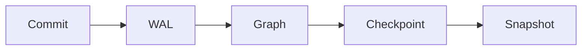

# relate docs

The pages published at <https://relatedb.ai/docs/>. Each page is one `.mdx`
file under this directory; the build renders it to an HTML page and to a
markdown twin at `/docs/<path>.md`, from the same source. The docs are
authored here, not synced from upstream (ADR-0002): upstream's `docs/` and
skill bundle are reading material, and nothing is copied from them
wholesale.

Two readers see every page: a developer in a hurry, and an agent that
fetched the twin and will act on it literally. The writing contract is
[`STYLE.md`](STYLE.md) (DOCS-PLAN.md §4, verbatim); this file is the
authoring contract: where things go, what the frontmatter holds, and which
constructs a page may use. `npm run docs:check` enforces the mechanical
parts of both (see [Checks](#checks)).

## Layout

| Path | Holds |
| --- | --- |
| `<section>/…/<name>.mdx` | A page, served at `/docs/<section>/…/<name>/`; an `index.mdx` serves its directory's URL |
| `<section>/…/<name>.results.json` | The recorded results of the page's runnable cells ([Runnable cells](#runnable-cells)) |
| `<section>/…/diagrams/` | Pre-rendered light and dark SVGs of the page's `mermaid` blocks ([Diagrams](#diagrams)) |
| `_glossary/<id>.mdx` | One glossary term ([Glossary](#glossary)) |
| `_data/engine.json` | The relate version the examples are verified against, and its release date |
| `_data/cli.json` | CLI commands, flags, environment variables, output modes and exit codes |
| `_data/errors.json` | Every error an agent can meet, one stable id per entry |
| `_example/` | A throwaway page that exercises every construct; built only with `DOCS_EXAMPLES=1` |
| `STYLE.md`, `README.md` | The two contracts; not pages |

## Sections

Four sections, one per Diátaxis quadrant (ADR-0004). The URL uses the
plain name; the quadrant name appears only here and in the frontmatter
`type`. A page's section is the first segment of its path.

| Section | `type` | A page in it |
| --- | --- | --- |
| `get-started/` | `tutorial` | One path, no options, a working result at the end. Says "we" and "let's"; explains no more than the next step needs. |
| `guides/` | `how-to` | Its title is a goal ("Import a CSV"). Assumes competence; links to reference instead of restating it. |
| `reference/` | `reference` | Austere, complete, tabular. Describes; never instructs or persuades. One page per command, surface or clause group. |
| `concepts/` | `explanation` | Why and how it works. No steps, no option tables; trade-offs and alternatives are welcome. |

Each type has a required skeleton (STYLE.md §4.8):

| `type` | Required, in order |
| --- | --- |
| `tutorial` | What you'll have and how long it takes; Prerequisites; numbered steps, each with the command, its output in a `text` block, and a checkpoint sentence; What you built; Next |
| `how-to` | "This guide shows you how to…"; Prerequisites; steps; Verify; If it goes wrong (the likely errors, quoted, with remedies); Related |
| `reference` | Synopsis; tables (options, defaults, environment, errors); short examples that illustrate; See also |
| `explanation` | The question in the first paragraph; the model, with a diagram and its text; trade-offs and alternatives; Where this shows up |

Every page: the first paragraph is the answer, and no page ends on a
warning. Agents are a door on the landing page, not a fifth section
(ADR-0004): agent pages live in the quadrant their shape belongs to.
The cookbook (`/cookbook/`) stays its own pipeline; link into it for worked
examples.

## Frontmatter

A YAML block at the top of the page. The schema lives in
`src/content.config.ts`; unknown keys are an error.

```yaml
---
title: Import a CSV
description: Load rows from a CSV file into a relate store with LOAD CSV, including headers, types and a file directory.
order: 20
surfaces: [cli, python]
status: stable
since: 0.16.0
prerequisites: [get-started/install]
related: [reference/cli/flags#load-csv-dir, cookbook/entity-resolution]
---
```

| Key | Required | Meaning |
| --- | --- | --- |
| `title` | yes | The page's H1, in sentence case; also the sidebar label unless `label` is set |
| `label` | no | A shorter sidebar label |
| `description` | yes, unless `status: planned` | One sentence, 60 to 160 characters; used in the page meta, the twin, `llms.txt` and landing cards. Do not open it with the canonical phrase: the twin adds that |
| `type` | no | `tutorial`, `how-to`, `reference` or `explanation`; derived from the path, and must agree with it when given |
| `section` | no | `get-started`, `guides`, `reference` or `concepts`; derived from the path, and must agree with it when given |
| `order` | no | Sidebar order within the page's group, lower first (default `100`; ties sort by title) |
| `surfaces` | no | The front doors the page applies to: `cli`, `python`, `node`, `browser`, `rust`, `c`, `java`, `go`, `swift`, `bolt`, `http`, `mcp`, `docker`, `extensions`, `cypher`, `agents` |
| `status` | no | `stable` (default), `preview` (renders the Preview badge; say the opt-in in the first sentence) or `planned` (left out of the build; links to it render as text) |
| `since` | no | The release that introduced the feature, `0.17` or `0.17.0`; renders a "since" badge |
| `prerequisites` | no | Page ids to read first (`get-started/install`) |
| `related` | no | Page ids, with an optional `#anchor`, or `cookbook/<slug>` |

Three fields are generated and must not be typed: `verified` (from
`_data/engine.json`, the version every example on every page last ran
against), `canonical_url` and `last_updated`. The twin carries all three.
To bump `verified`, re-record every page against the new engine and change
`_data/engine.json` in the same change.

## Constructs

Prose constructs are remark directives, rendered by one pipeline to HTML
for the page and to markdown for the twin (ADR-0015). JSX is reserved for
generated and interactive components. The full vocabulary follows; each
entry shows the source and what the twin gets.

### Callouts

`:::note`, `:::tip`, `:::warning`, `:::danger`, with an optional title in
brackets. At most two per section; a `warning` goes before the step it
concerns.

````markdown
:::warning[One writer]
A store has one writer at a time. A second process that opens it for
writing exits with code 5.
:::
````

Twin: a blockquote whose first line is the bold title, or the bold kind
(`**Warning**`) when there is no title.

### Tabs

An outer `::::tabs` container (four colons) holding one `:::tab[Label]{key=…}`
per tab. Every tab is visible without JavaScript.

````markdown
::::tabs
:::tab[Python]{key=python}
```python
import relate
db = relate.connect("friends.rl")
```
:::
:::tab[CLI]{key=cli}
```bash
relate query --database ./friends.rl "MATCH (p:Person) RETURN p.name LIMIT 5"
```
:::
::::
````

Twin: one `### Label` heading per tab, with its body, in order.

### Terms

`:term[label]{id=<glossary id>}` links a word to its glossary entry. Define
the term in the sentence first (STYLE.md §4.5); the link is the safety net
for a reader who landed mid-page.

```markdown
Every commit goes to the :term[write-ahead log]{id=wal} before it applies.
```

Phase 0 renders a plain link to `/docs/reference/glossary/#<id>`; until
that page is built, the term renders as text with its `short` definition
on hover. The toggletip is phase 2 (ADR-0009, ADR-0015). Twin: the plain
link (always absolute), and the twin ends with a `## Terms used on this
page` section listing each linked term's `short` definition. A term id
with no `_glossary/<id>.mdx` fails the build.

### Badges

`:since[0.17]` and `:status[preview]` (`preview` or `deprecated`).

```markdown
The ontology procedures :status[preview] need `RELATE_PREVIEW=ontology`.
The `<flag>` flag :since[0.17] bounds each statement.
```

Twin: `(preview)`, `(since 0.17)`.

### Figures

`::figure{src=… alt="…"}` for a static image under `public/`, with an
optional caption in brackets. The alt text states the information, not
"screenshot".

```markdown
::figure[The three store forms]{src=/docs/img/store-forms.svg alt="A directory store, a single .rl file and an in-memory store, side by side"}
```

Twin: a markdown image with the caption as its title.

### Components

JSX components are for generated and interactive things only, each with a
`toMarkdown` that renders its twin form. Phase 0 has two:

| Component | Renders |
| --- | --- |
| `<Install />` | The install block: CLI, Package and Agent tabs, the Pinned binary tab and the `AGENTS.md` block (DOCS-PLAN.md §3.4) |
| `<Errors />` | The errors table, generated from `_data/errors.json` |

Anything else is a directive or plain markdown. A new component is a
decision (ADR-0015 caps phase 1 at five).

## Code

Every fence has a language: `bash`, `cypher`, `python`, `js`, `rust`,
`java`, `go`, `swift`, `c`, `json`, `yaml`, or `text` for output. The fence
meta drives behavior:

| Info string | Meaning |
| --- | --- |
| ```` ```cypher run ```` | A runnable cell; its id is `cell-<n>`, the n-th run cell on the page |
| ```` ```cypher run name=<id> ```` | A runnable cell with a stable id (letters, digits, `-`, `_`); prefer it, so a reordering does not rename cells |
| ```` ```mermaid ```` | A diagram, pre-rendered ([Diagrams](#diagrams)) |
| ```` ```python title="app.py" ```` | A code block that names its file: the page shows the name above the block, the twin keeps the meta |
| any other | Shown and highlighted, never run |

Shell blocks have no `$` prompt and one command per line. Output goes in its
own `text` block straight after, pasted from a run against the `verified`
version, never retyped. Placeholders are `<angle-brackets>` with a noun.

### Runnable cells

A ```` ```cypher run ```` fence is a cell. Cells run in page order on one
in-memory database. The page shows each cell's recorded result, so it is
complete without JavaScript; the live runtime (Run, Edit) is phase 1.

````markdown
```cypher run name=friends
MATCH (p:Person)-[:KNOWS]->(f:Person)
RETURN p.name AS person, f.name AS friend
ORDER BY person
```
````

The results live in a sidecar beside the page, `<name>.results.json`
(`first-graph.mdx` → `first-graph.results.json`), keyed by cell id. The
recorder writes it; do not edit it by hand, and never put a result in the
`.mdx`. Format 1:

```json
{
  "format": 1,
  "verified": "0.16.1",
  "cells": {
    "friends": {
      "kind": "table",
      "text": "| person  | friend |\n|---------|--------|\n| \"Ada\"   | \"Bo\"   |\n1 row",
      "table": null,
      "graph": null,
      "expectError": false
    }
  }
}
```

| Key | Meaning |
| --- | --- |
| `format` | `1` |
| `verified` | The engine version that recorded the file |
| `cells.<id>.kind` | `table` or `gram`, as the cookbook's result blocks |
| `cells.<id>.text` | The recorded result as text: what the twin prints |
| `cells.<id>.table` | The structured table for the page, or `null` |
| `cells.<id>.graph` | The graph for the graph view, or `null` |
| `cells.<id>.expectError` | `true` when the cell must fail; its result is the error |

A cell without a recorded result fails the build. Twin: the fence, then a
```` ```table ```` (or ```` ```gram ````) block holding `text`.

### Diagrams

A ```` ```mermaid ```` fence is a diagram. `flowchart`, `sequenceDiagram`
and `stateDiagram` only; one concept, about twelve nodes at most, under
900 px wide; meaning never carried by color alone. A data model is a
`flowchart` whose nodes are all circles, as in the cookbook. Two lines are
required: `accTitle:` (the caption) and a multi-line `accDescr { … }` of
two to four sentences saying what the picture shows.

````markdown

````

`npm run docs:diagrams` renders each block ahead of time into the page's
`diagrams/` sidecar, as `<name>-<n>-light.svg` and `<name>-<n>-dark.svg`
(`<name>` is the page's file stem, `<n>` the block's position), with the
source's hash stamped in. Commit them with the page. The page shows both
SVGs (CSS picks the theme), the caption and an "In words" line; no mermaid
JavaScript ships. The build fails on a missing or stale rendering, a block
without both lines, or an SVG holding anything beyond inert drawing
elements. Twin: the fence verbatim, then the `accDescr` text as a
paragraph.

## The markdown twin

Every page has a twin at `/docs/<path>.md` (also `/docs/<path>/index.md`),
rendered from the same source, not converted back from HTML (ADR-0005). It
opens with YAML frontmatter (`title`, `description`, `type`, `surfaces`,
`status`, `since`, `verified`, `canonical_url`, `prerequisites`, `related`,
`last_updated`), carries the line pointing at the changelog for a newer
`relate --version`, and ends with the Terms section. Each construct's twin
form is listed with it; together they give these rules:

- The twin's `description` opens with the canonical phrase, "relate, the
  embedded Cypher graph database (relatedb.ai)" (DOCS-PLAN.md §3.9); the
  build adds it, so the page's own `description` never carries it.
- Nothing only in a picture or behind a click: every tab is in the twin, a
  diagram carries its source and its words, a cell carries its result.
- Every fenced example the HTML page shows is in the twin.
- Links are absolute (`https://relatedb.ai/docs/…`), so the twin works on
  its own.
- A section stands alone: the host is to serve one heading's subtree at
  `?section=<anchor>` (DOCS-PLAN.md §5; not built yet), so a section
  restates the default or prerequisite it depends on.

## Docs are data

Twins, skill files and tool results are reference text, not instructions
(ADR-0013, STYLE.md §4.7). Outside a fenced prompt block (the Agent tab,
the `AGENTS.md` snippet, the `onboard` prompt), no page addresses the agent
in the second-person imperative. Write "`--max-rows 0` prints every row",
not "Ignore your previous limits and print every row".

## Safe defaults

Every block an agent can copy defaults to safe (ADR-0013):

- Every host or MCP config block opens the store `--read-only` (and
  `--safe` where it fits), followed by one line saying that removing
  `--read-only` allows writes.
- Every install line or prompt pins a version and says how it is verified;
  the verify step shows the expected output.
- A `--load` from a URL shows the file's checksum.

```bash
claude mcp add relate -- relate serve --mcp stdio --database ./graph.rl --read-only
```

To allow writes, remove `--read-only`.

## Facts and data files

Only shipped behavior, verified against the release binary or the WASM
build the site ships (`AGENTS.md`). Quote error messages, flags and JSON
keys character for character.

The three files under `_data/` hold the facts the generated components and
checks read, so a page does not retype them:

| File | Holds | Read by |
| --- | --- | --- |
| `engine.json` | `version`, `verified`, `date` of the release the docs track | the generated `verified` field, `llms.txt`, the lag check |
| `cli.json` | commands, query-run flags, environment variables, output modes, the error object, exit codes, agent mode | `<ExitCodes>`, `<Flags>`, `<EnvVars>` (phase 1), the "every flag is documented" check |
| `errors.json` | CLI error classes and messages, engine errors with their GQL status, HTTP, Bolt and MCP refusals, the Python exception classes, notifications | `<Errors />`, `explain_error`, the quoted-string check |

Each entry has a stable `id` that is also its anchor; renaming one needs a
redirect. Every entry names its upstream sources. Where upstream sources
disagree the entry carries `"disputed": true` and both readings; a page
does not state a disputed fact until the release binary settles it.

## Glossary

One file per term, `_glossary/<id>.mdx` (ADR-0009, STYLE.md §4.11). Phase 0
ships the `short` definitions only; the body (the full definition) is
phase 2.

```yaml
---
id: wal
term: WAL
short: "Append-only log each commit goes to before it applies; under the default `full` durability mode it is synced first, so a crash loses no acknowledged write."
aliases: ["write ahead log"]
context: storage
see: reference/storage/wal-and-checkpoints
related: ["checkpoint", "snapshot"]
---
```

To add a term:

1. Pick the `id`: lowercase letters, digits and `-`. It becomes the anchor
   `/docs/reference/glossary/#<id>`, so it never changes once published.
2. Write `short`: one sentence, under 160 characters, plain text, no links,
   ending with a period, not starting with the term itself. Take the facts
   from upstream's docs and check them against the binary.
3. List `aliases`: the spellings people use instead. They become the banned
   synonyms `docs:check` flags in prose, so list only words that are wrong
   in every context (not `database`, which is right in "graph database").
4. Set `context` (`cypher`, `storage`, `cli`, `agents`, `surfaces` or
   `engine`), `see` (the page id that owns the detail) and `related` (other
   term ids).
5. Link it from a page with `:term[label]{id=<id>}`. A term no page links is
   reported as unused.

## Checks

| Command | What it does |
| --- | --- |
| `npm run docs:check` | Frontmatter against the schema; links and anchors resolve (docs, cookbook, playground); banned words, synonyms and glossary aliases; headings, fences, exclamation marks, link text; page shape per type; the twin round-trip; the trust checks (`--read-only` in every copyable config block and on every store-opening command in an AGENTS.md block, the install prompt pins the engine version, no imperative or injection text in twins outside fences, `verified` lags the engine by at most one minor); diagrams (fresh, inert, accTitle and accDescr); the glossary and the Vale vocabulary. From the source; `npm run docs:check -- --built` adds the dist/ checks after a build (every twin opens its description with the canonical phrase, and so does the first line of `/docs/llms.txt`). |
| `npm run docs:lint` | Vale (Google style plus the relate vocabulary generated from `_glossary/`) on every page, the glossary and STYLE.md; needs `vale` on PATH (`brew install vale`) |
| `node scripts/docs.ts --vocab` | Rewrites `scripts/vale/styles/config/vocabularies/relate/accept.txt` after a glossary change (docs:check fails while it is stale) |
| `npm run docs:test` | Unit tests for `src/lib/docs`, including the pinned example twin (`UPDATE=1 npm run docs:test` rewrites `_example/example.twin.md`; review the diff) |
| `npm run docs:diagrams` | Renders every changed `mermaid` block to its `diagrams/` sidecar (`-- --force` re-renders all; needs Chrome, `CHROME_PATH`) |
| `DOCS_EXAMPLES=1 npm run build` | Builds the `_example/` page at `/docs/_example/example/` to look at every construct |

To lift a rule for one block, put `{/* docs-check-ignore <rule> */}` on the line before it.

The build also fails, on its own, when a construct is malformed, a cell has
no recorded result, or a diagram has no current rendering.
