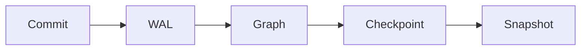

# relate docs

The pages published at <https://relatedb.ai/docs/>. Each page is one `.mdx`
file under this directory; the build renders it to an HTML page and to a
markdown twin at `/docs/<path>.md`, from the same source. The docs are
authored here, not synced from upstream (ADR-0002): upstream's `docs/` and
skill bundle are reading material, and nothing is copied from them
wholesale.

Two readers see every page: a developer in a hurry, and an agent that
fetched the twin and will act on it literally. The writing contract is
[`STYLE.md`](STYLE.md) (DOCS-PLAN.md §4, verbatim); this file is the
authoring contract: where things go, what the frontmatter holds, and which
constructs a page may use. `npm run docs:check` enforces the mechanical
parts of both (see [Checks](#checks)).

## Layout

| Path | Holds |
| --- | --- |
| `<section>/…/<name>.mdx` | A page, served at `/docs/<section>/…/<name>/`; an `index.mdx` serves its directory's URL |
| `<section>/…/<name>.results.json` | The recorded results of the page's runnable cells and verified samples ([Runnable cells](#runnable-cells), [Verified samples](#verified-samples)) |
| `<section>/…/diagrams/` | Pre-rendered light and dark SVGs of the page's `mermaid` blocks ([Diagrams](#diagrams)) and of its cells' graph results |
| `_glossary/<id>.mdx` | One glossary term ([Glossary](#glossary)) |
| `_data/engine.json` | The relate version the examples are verified against, its release date and commit, and the recorded `relate --version` and envelope check |
| `_data/cli.json` | CLI commands, flags, environment variables, output modes and exit codes, each with the recorded run that shows it |
| `_data/errors.json` | Every error an agent can meet, one stable id per entry |
| `_data/changelog.json` | The release notes, one entry per release, newest first, and the deprecation policy; rendered to `/docs/reference/changelog/`, its twin and `/docs/changelog.json` |
| `_data/skill.json` | The upstream commit, sync date, stamped version and SHA-256 of every file of the published skill bundle (`public/skills/relate/`); written by `npm run skill:sync`, never by hand |
| `_example/` | A throwaway page that exercises every construct; built only with `DOCS_EXAMPLES=1` |
| `STYLE.md`, `README.md` | The two contracts; not pages |

## Sections

Four sections, one per Diátaxis quadrant (ADR-0004). The URL uses the
plain name; the quadrant name appears only here and in the frontmatter
`type`. A page's section is the first segment of its path.

| Section | `type` | A page in it |
| --- | --- | --- |
| `get-started/` | `tutorial` | One path, no options, a working result at the end. Says "we" and "let's"; explains no more than the next step needs. |
| `guides/` | `how-to` | Its title is a goal ("Import a CSV"). Assumes competence; links to reference instead of restating it. |
| `reference/` | `reference` | Austere, complete, tabular. Describes; never instructs or persuades. One page per command, surface or clause group. |
| `concepts/` | `explanation` | Why and how it works. No steps, no option tables; trade-offs and alternatives are welcome. |

Each type has a required skeleton (STYLE.md §4.8):

| `type` | Required, in order |
| --- | --- |
| `tutorial` | What you'll have and how long it takes; Prerequisites; numbered steps, each with the command, its output in a `text` block, and a checkpoint sentence; What you built; Next |
| `how-to` | "This guide shows you how to…"; Prerequisites; steps; Verify; If it goes wrong (the likely errors, quoted, with remedies); Related |
| `reference` | Synopsis; tables (options, defaults, environment, errors); short examples that illustrate; See also |
| `explanation` | The question in the first paragraph; the model, with a diagram and its text; trade-offs and alternatives; Where this shows up |

Every page: the first paragraph is the answer, and no page ends on a
warning. Agents are a door on the landing page, not a fifth section
(ADR-0004): agent pages live in the quadrant their shape belongs to.
The cookbook (`/cookbook/`) stays its own pipeline; link into it for worked
examples.

## Frontmatter

A YAML block at the top of the page. The schema lives in
`src/content.config.ts`; unknown keys are an error.

```yaml
---
title: Import a CSV
description: Load rows from a CSV file into a relate store with LOAD CSV, including headers, types and a file directory.
order: 20
surfaces: [cli, python]
status: stable
since: 0.16.0
prerequisites: [get-started/install]
related: [reference/cli/flags#load-csv-dir, cookbook/entity-resolution]
---
```

| Key | Required | Meaning |
| --- | --- | --- |
| `title` | yes | The page's H1, in sentence case; also the sidebar label unless `label` is set |
| `label` | no | A shorter sidebar label |
| `description` | yes, unless `status: planned` | One sentence, 60 to 160 characters; used in the page meta, the twin, `llms.txt` and landing cards. Do not open it with the canonical phrase: the twin adds that |
| `type` | no | `tutorial`, `how-to`, `reference` or `explanation`; derived from the path, and must agree with it when given |
| `section` | no | `get-started`, `guides`, `reference` or `concepts`; derived from the path, and must agree with it when given |
| `order` | no | Sidebar order within the page's group, lower first (default `100`; ties sort by title) |
| `surfaces` | no | The front doors the page applies to: `cli`, `python`, `node`, `browser`, `rust`, `c`, `java`, `go`, `swift`, `bolt`, `http`, `mcp`, `docker`, `extensions`, `cypher`, `agents` |
| `status` | no | `stable` (default), `preview` (renders the Preview badge; say the opt-in in the first sentence) or `planned` (left out of the build; links to it render as text) |
| `since` | no | The release that introduced the feature, `0.17` or `0.17.0`; renders a "since" badge |
| `prerequisites` | no | Page ids to read first (`get-started/install`) |
| `related` | no | Page ids, with an optional `#anchor`, or `cookbook/<slug>` |

Four fields are generated and must not be typed: `verified` (from
`_data/engine.json`, the version every example on every page last ran
against), `verified_by` (the checks this page's examples passed against that
version, in the order `cypher`, `python`, `node`, `cli`; left out when none
apply), `canonical_url` and `last_updated`. The twin carries all four.
To bump `verified`, re-record every page against the new engine and change
`_data/engine.json` in the same change.

## Constructs

Prose constructs are remark directives, rendered by one pipeline to HTML
for the page and to markdown for the twin (ADR-0015). JSX is reserved for
generated and interactive components. The full vocabulary follows; each
entry shows the source and what the twin gets.

### Callouts

`:::note`, `:::tip`, `:::warning`, `:::danger`, with an optional title in
brackets. At most two per section; a `warning` goes before the step it
concerns.

````markdown
:::warning[One writer]
A store has one writer at a time. A second process that opens it for
writing exits with code 5.
:::
````

Twin: a blockquote whose first line is the bold title, or the bold kind
(`**Warning**`) when there is no title.

### Tabs

An outer `::::tabs` container (four colons) holding one `:::tab[Label]{key=…}`
per tab. Every tab is visible without JavaScript.

````markdown
::::tabs
:::tab[Python]{key=python}
```python
import relate
db = relate.connect("friends.rl")
```
:::
:::tab[CLI]{key=cli}
```bash
relate query --database ./friends.rl "MATCH (p:Person) RETURN p.name LIMIT 5"
```
:::
::::
````

Twin: one `### Label` heading per tab, with its body, in order.

### Terms

`:term[label]{id=<glossary id>}` links a word to its glossary entry. Define
the term in the sentence first (STYLE.md §4.5); the link is the safety net
for a reader who landed mid-page.

```markdown
Every commit goes to the :term[write-ahead log]{id=wal} before it applies.
```

A term renders as a plain link to its entry on the generated glossary page,
`/docs/reference/glossary/#<id>` ([Generated pages](#generated-pages-and-agent-endpoints)).
The toggletip is phase 2 (ADR-0009, ADR-0015). Twin: the plain
link (always absolute), and the twin ends with a `## Terms used on this
page` section listing each linked term's `short` definition. A term id
with no `_glossary/<id>.mdx` fails the build.

### Badges

`:since[0.17]` and `:status[preview]` (`preview` or `deprecated`).

```markdown
The ontology procedures :status[preview] need `RELATE_PREVIEW=ontology`.
The `<flag>` flag :since[0.17] bounds each statement.
```

Twin: `(preview)`, `(since 0.17)`.

### Figures

`::figure{src=… alt="…"}` for a static image under `public/`, with an
optional caption in brackets. The alt text states the information, not
"screenshot".

```markdown
::figure[The three store forms]{src=/docs/img/store-forms.svg alt="A directory store, a single .rl file and an in-memory store, side by side"}
```

Twin: a markdown image with the caption as its title.

### Components

JSX components are for generated and interactive things only, each with a
`toMarkdown` that renders its twin form. Phase 1 has five, the cap
(ADR-0015):

| Component | Renders |
| --- | --- |
| `<Install />` | The install block: CLI, Package and Agent tabs, the Pinned binary tab and the `AGENTS.md` block (DOCS-PLAN.md §3.4) |
| `<Errors />` | The errors table, generated from `_data/errors.json` |
| `<ExitCodes />` | The CLI exit codes from `_data/cli.json`, one row at `#exit-<n>`, with error kinds and retry advice from `_data/errors.json` |
| `<Flags />` | The CLI flags from `_data/cli.json`; `command="query"` or `command="<command>"` narrows it; each row at the flag's id |
| `<EnvVars />` | The environment variables from `_data/cli.json`; `usedBy="…"` narrows it |

Anything else is a directive or plain markdown. A new component is a
decision.

## Code

Every fence has a language: `bash`, `cypher`, `python`, `js`, `rust`,
`java`, `go`, `swift`, `c`, `json`, `yaml`, or `text` for output. The fence
meta drives behavior:

| Info string | Meaning |
| --- | --- |
| ```` ```cypher run ```` | A runnable cell; its id is `cell-<n>`, the n-th run cell on the page |
| ```` ```cypher run name=<id> ```` | A runnable cell with a stable id (letters, digits, `-`, `_`); prefer it, so a reordering does not rename cells |
| ```` ```cypher run params=<name> expect=error ```` | A cell that takes the page's ```` ```json data=<name> ```` block as parameters, and one that must fail ([Runnable cells](#runnable-cells)) |
| ```` ```python run ```` / ```` ```js run ```` | A verified sample: a whole program run against the relate client; its id is `python-<n>` / `js-<n>`, the n-th sample of that language ([Verified samples](#verified-samples)) |
| ```` ```python run name=<id> title="app.py" ```` | A verified sample with a stable id, written to the named file |
| ```` ```bash verify ```` | A command `npm run docs:cli-check` replays against a relate binary; when the next fence on the page is ```` ```text ````, that fence is the expected output ([Verified commands](#verified-commands)) |
| ```` ```mermaid ```` | A diagram, pre-rendered ([Diagrams](#diagrams)) |
| ```` ```python title="app.py" ```` | A code block that names its file: the page shows the name above the block, the twin keeps the meta |
| any other | Shown and highlighted, never run |

Shell blocks have no `$` prompt and one command per line. Output goes in its
own `text` block straight after, pasted from a run against the `verified`
version, never retyped. Placeholders are `<angle-brackets>` with a noun.

### Runnable cells

A ```` ```cypher run ```` fence is a cell. Cells run in page order on one
in-memory database, in the reader's browser and in `docs:check`. The page
shows each cell's recorded result, so it is complete without JavaScript.
With JavaScript, each cell gets Run and Edit and its result a Result, Graph
and JSON view; the page gets an engine bar with Run all, Reset, Stop and
Open in playground, which names the engine version once it loads. The
engine and the graph view load on the first Run or when a graph result
comes into view, never with the page.

| Info string word | Meaning |
| --- | --- |
| `name=<id>` | The cell's stable id (letters, digits, `-`, `_`); without it the id is `cell-<n>` |
| `params=<name>` | The cell runs with the page's ```` ```json data=<name> ```` block as its parameters |
| `expect=error` | The cell must fail; its recorded result is the error |

A ```` ```json data=<name> ```` block is a JSON object of named parameters.
The page shows it inside the cell that names it, editable; the twin keeps
the fence.

````markdown
```json data=who
{"name": "Ada"}
```

```cypher run name=friends params=who
MATCH (p:Person {name: $name})-[:KNOWS]->(f:Person)
RETURN f.name AS friend
```
````

The results live in a sidecar beside the page, `<name>.results.json`
(`first-graph.mdx` → `first-graph.results.json`), keyed by cell id.
`npm run docs:record` (`node scripts/docs.ts --record`) writes it from a run
on `public/wasm`; review the diff. Do not edit it by hand, and never put a
result in the `.mdx`. `docs:check` replays every page and fails a recording
that drifts. Format 1:

```json
{
  "format": 1,
  "verified": "0.16.1",
  "cells": {
    "friends": {
      "kind": "table",
      "text": "| friend  |\n|---------|\n| \"Grace\" |\n1 row",
      "table": null,
      "graph": null,
      "envelope": {"columnTypes": ["STRING"], "columns": ["friend"], "error": null, "notifications": [], "plan": null, "rows": [{"friend": "Grace"}], "stats": {…}},
      "expectError": false
    }
  }
}
```

| Key | Meaning |
| --- | --- |
| `format` | `1` |
| `verified` | The engine version that recorded the file |
| `cells.<id>.kind` | `table` or `gram`, as the cookbook's result blocks, or `text` for a verified sample's output |
| `cells.<id>.text` | The recorded result as text: what the twin prints |
| `cells.<id>.table` | The structured table for the page, or `null` |
| `cells.<id>.graph` | The graph for the graph view, or `null` |
| `cells.<id>.envelope` | The last statement's wire envelope without its timings: what the JSON view shows |
| `cells.<id>.expectError` | `true` when the cell must fail; its result is the error |
| `cells.<id>.verified` | On a sample's entry: the client version that recorded it |

A graph result of up to 80 nodes also has a static form: `--record` lays
it out and writes `diagrams/<name>-result-<cell id>-light.svg` and
`-dark.svg`, stamped with the graph's hash. The page shows them when
JavaScript is off, and the build serves the light one at
`/docs/<page>/result-<cell id>-light.svg`. The build fails on a missing or
stale one.

A cell without a recorded result fails the build. Twin: the fence, then a
```` ```table ```` (or ```` ```gram ````) block holding `text`, then for a
drawn graph a link to its light SVG. Each cell, and the engine bar, links
`/playground/#docs=<page>[&cell=<id>]`, which loads the page's cells from
its twin.

### Verified samples

A ```` ```python run ```` or ```` ```js run ```` fence is a sample: a whole
program that runs against the relate Python or Node.js client, and whose
output the page shows. Each sample runs on its own, in a fresh temporary
directory that is its working directory, so a relative store path such as
`./app.rl` lands there. A sample passes when it exits 0 and prints at least
one line; print only what is the same on every run (no timings, ids or
absolute paths).

````markdown
```python run name=create
import relate

db = relate.Database(":memory:")
db.execute("CREATE (:Person {name: 'Ada'})")
print(db.execute("MATCH (p:Person) RETURN p.name AS name").data[0]["name"])
```
````

The output is recorded in the page's sidecar beside the cells' results,
keyed by the sample's id, with `"kind": "text"`, the client version that
ran it in `verified`, and a SHA-256 of the program (`source_sha256`). The
recorder writes it; do not edit it by hand. A sample whose code changed
since its record fails `docs:check` and drops its language from the twin's
`verified_by` until it is recorded again.
A sample's id may not repeat a cell's. A JavaScript sample with an
`import` statement runs as an ES module, otherwise as CommonJS.
`title="<file>"` names the file the program is written to, and the page
shows the name above the block.

`npm run docs:samples` runs every sample and fails on one that does not
run or prints other than its record; `-- --record` rewrites the records.
It needs the clients: `bash scripts/samples/setup.sh --upstream <path to
the relate checkout>` builds both from the upstream checkout and writes the
variables it reads (`RELATE_PY`, `RELATE_NODE`, `NODE_PATH`, `RELATE_LIB`).
Without them it says so and exits 0. CI replays the samples weekly
(`docs-samples.yml`); `docs:check` checks on every change that each sample
has a record, and the build fails on a sample without one.

Twin: the fence as written, then a ```` ```text ```` block holding the
output.

### Verified commands

A ```` ```bash verify ```` fence is replayed by `npm run docs:cli-check`
against a relate binary. The verify fences of a page run in page order, in
one fresh directory with a fresh home and only `PATH`, `HOME`, `TMPDIR` and
`DO_NOT_TRACK=1` set, so a later step sees the files an earlier one wrote
and no agent-harness variable turns agent mode on. When the next fence on
the page is a ```` ```text ```` fence (prose may sit between them), it
holds the expected output: stderr and stdout as one stream, in the order
the commands wrote them, with the home directory written `<home>`. Any
difference fails the check. A verify fence whose next fence is not `text`
is a setup step and must exit 0. Mark only commands that need no network
and no running server. Twin: the fence keeps `verify` in its info string.

`npm run docs:cli-check -- --record` records each page's steps as replayed
in `_data/cli.json` (`page_steps`: the command and a SHA-256 of the expected
output), only when every step on the page passed. Editing a verify fence or
its expected output afterwards fails `docs:check` until the page is
replayed, and the twin claims `verified_by: [cli]` only while every step
matches its record.

### Diagrams

A ```` ```mermaid ```` fence is a diagram. `flowchart`, `sequenceDiagram`
and `stateDiagram` only; one concept, about twelve nodes at most, under
900 px wide; meaning never carried by color alone. A data model is a
`flowchart` whose nodes are all circles, as in the cookbook. Two lines are
required: `accTitle:` (the caption) and a multi-line `accDescr { … }` of
two to four sentences saying what the picture shows.

````markdown

````

`npm run docs:diagrams` renders each block ahead of time into the page's
`diagrams/` sidecar, as `<name>-<n>-light.svg` and `<name>-<n>-dark.svg`
(`<name>` is the page's file stem, `<n>` the block's position), with the
source's hash stamped in. Commit them with the page. The page shows both
SVGs (CSS picks the theme), the caption and an "In words" line; no mermaid
JavaScript ships. The build fails on a missing or stale rendering, a block
without both lines, or an SVG holding anything beyond inert drawing
elements. Twin: the fence verbatim, then the `accDescr` text as a
paragraph.

## The markdown twin

Every page has a twin at `/docs/<path>.md` (also `/docs/<path>/index.md`),
rendered from the same source, not converted back from HTML (ADR-0005). It
opens with YAML frontmatter (`title`, `description`, `type`, `surfaces`,
`status`, `since`, `verified`, `verified_by`, `canonical_url`,
`prerequisites`, `related`, `last_updated`), carries the line pointing at the changelog for a newer
`relate --version`, and ends with the Terms section. Each construct's twin
form is listed with it; together they give these rules:

- The twin's `description` opens with the canonical phrase, "relate, the
  embedded Cypher graph database (relatedb.ai)" (DOCS-PLAN.md §3.9); the
  build adds it, so the page's own `description` never carries it.
- Nothing only in a picture or behind a click: every tab is in the twin, a
  diagram carries its source and its words, a cell or sample carries its
  result.
- Every fenced example the HTML page shows is in the twin.
- Links are absolute (`https://relatedb.ai/docs/…`), so the twin works on
  its own.
- A section stands alone: the host is to serve one heading's subtree at
  `?section=<anchor>` (DOCS-PLAN.md §5; not built yet), so a section
  restates the default or prerequisite it depends on.

## Docs are data

Twins, skill files and tool results are reference text, not instructions
(ADR-0013, STYLE.md §4.7). Outside a fenced prompt block (the Agent tab,
the `AGENTS.md` snippet, the `onboard` prompt), no page addresses the agent
in the second-person imperative. Write "`--max-rows 0` prints every row",
not "Ignore your previous limits and print every row".

## Safe defaults

Every block an agent can copy defaults to safe (ADR-0013):

- Every host or MCP config block opens the store `--read-only` (and
  `--safe` where it fits), followed by one line saying that removing
  `--read-only` allows writes.
- Every install line or prompt pins a version and says how it is verified;
  the verify step shows the expected output.
- A `--load` from a URL shows the file's checksum.

```bash
claude mcp add relate -- relate serve --mcp stdio --database ./graph.rl --read-only
```

To allow writes, remove `--read-only`.

## Facts and data files

Only shipped behavior, verified against the relate binary the data files
name (`recorded_with`) or the WASM build the site ships (`AGENTS.md`).
Before launch that binary is a release-profile source build of upstream
`ac441ec`: it reports 0.16.1 but includes engine changes made after the
v0.16.1 release (engine.json `source_build`); the first relate release
re-records everything (`LAUNCH.md`). Quote error messages, flags and JSON
keys character for character.

The files under `_data/` hold the facts the generated components and
checks read, so a page does not retype them:

| File | Holds | Read by |
| --- | --- | --- |
| `engine.json` | `version`, `verified`, `date` and `commit` of the release the docs track (`source_build: true` while the recordings come from a source build), and the recorded `relate --version` (`version_check`) and envelope of `RETURN 1 AS ok` (`envelope_check`) | the generated `verified` field, `<Install />`, `llms.txt`, the lag check, `docs:cli-check` |
| `cli.json` | commands, query-run flags, environment variables, output modes, the error object, exit codes, agent mode, and every command's recorded `--help` and `agent-context` | `<ExitCodes />`, `<Flags />`, `<EnvVars />`, the docs graph's "every flag is documented" check, `docs:cli-check` |
| `errors.json` | CLI error classes and messages, engine errors with their GQL status, HTTP, Bolt and MCP refusals, the Python exception classes, notifications | `<Errors />`, `<ExitCodes />`, `explain_error`, the quoted-string check, `docs:cli-check` |
| `changelog.json` | Per release: version, date, previous version, a summary, and items under Added, Changed, Deprecated, Removed and Fixed; the deprecation policy | the changelog page, its twin and `/docs/changelog.json` |
| `skill.json` | The upstream commit, sync date, stamped version and per-file SHA-256 of `public/skills/relate/` | `docs:check` (the skill), `/docs/docs-artifacts.json` |

Each entry has a stable `id` that is also its anchor; renaming one needs a
redirect. Every entry names its upstream sources. Where upstream sources
disagree, the binary settles the fact (`settled_by`) and a `recorded` run
shows it; `verify` marks what the binary cannot show.
`docs:check` fails on any entry still marked `disputed`.

A recorded run (`recorded`) is one bash command line, run with the binary on
`PATH` as `relate` in a fresh empty directory with a fresh home and only
`PATH`, `HOME`, `TMPDIR` and `DO_NOT_TRACK=1` set, with its exact `stdout`,
`stderr` and `exit`; the directory is written `<dir>` and the home `<home>`.
An optional `setup` runs first, and an optional `hold` keeps a second
process on the store (the locked case). `npm run docs:cli-check` replays
every one; `-- --record` rewrites them from the binary and stamps
`recorded_with` and `verified` in `cli.json` and `errors.json` with the
binary's version (plus engine.json's `commit` and build kind when it names
the same version). `docs:check` fails when `recorded_with` does not name
engine.json's version.

The changelog has an entry for the verified engine version, or names it as
an entry's `previous`; the build fails otherwise, because every twin links
`/docs/reference/changelog/#since-<verified>`. Bumping `engine.json` to a
new release takes its changelog entry in the same change. The release
refresh (`scripts/release-refresh.sh`) is the one exception: it never
writes release notes, so it sets `DOCS_CHANGELOG_PENDING=<version>`, which
turns that one error into a warning and leaves the entry as a to-do in its
pull request; CI never sets it, so the merge waits for the entry.

## Generated pages and agent endpoints

Some pages are built from data, not from an `.mdx` file
(`src/lib/docs/generated/`, listed in `src/lib/docs/model.ts`). Each has an
HTML page, a twin at `/docs/<id>.md` and `/docs/<id>/index.md`, and sits in
the sidebar, `llms.txt`, `llms-full.txt` and the sitemap like an authored
page. No `.mdx` file may claim their ids.

| Page | From |
| --- | --- |
| `/docs/reference/glossary/` | `_glossary/`: one entry per term at `#<id>`, under letter headings |
| `/docs/reference/changelog/` | `_data/changelog.json`: `#<version>` per release, `#since-<version>` where what came after it begins |

The build also serves these files for agents:

| Path | Holds |
| --- | --- |
| `/docs/changelog.json` | The changelog as a JSON Feed 1.1 document; each item carries the structured entry under `_relate` |
| `/docs/changelog.md` | The changelog twin |
| `/docs/feedback.md` | What a report of a wrong or missing page holds; the operator decides whether one is sent |
| `/docs/graph.cypher` | The docs graph as a deterministic Cypher seed script (`src/lib/docs/graph.ts`): pages, sections, examples, terms, surfaces, recipes, CLI commands and flags |
| `/docs/graph.json` | The same graph as JSON (`format`, `verified`, `seed`, `nodes`, `relationships`) |
| `/docs/<id>.graph.md` | One page's neighborhood in the graph: prerequisites, links in and out, terms, sections, examples, and the CLI commands and flags it documents |
| `/skill.md` | The short pointer to the agent skill |
| `/skills/relate/` | Upstream's skill bundle, copied by `npm run skill:sync` with the engine's version stamped; never edited here |
| `/.well-known/agent-skills/index.json`, `/.well-known/skills/index.json` | The 0.2.0 and legacy skills indexes, computed from the served bytes; the legacy files are served again under `/.well-known/skills/relate/` |
| `/docs/docs-artifacts.json` | Every skill and discovery file and the graph seed, with SHA-256 and size, no timestamp; signed with the release key at launch (`docs-artifacts.json.sig` beside it; the manifest does not name its signature, so signing never changes it) |
| `/.well-known/security.txt` | Built only once `_data/project.json` names a security contact |

## Glossary

One file per term, `_glossary/<id>.mdx` (ADR-0009, STYLE.md §4.11). Phase 0
ships the `short` definitions only; the body (the full definition) is
phase 2.

```yaml
---
id: wal
term: WAL
short: "Append-only log each commit goes to before it applies; under the default `full` durability mode it is synced first, so a crash loses no acknowledged write."
aliases: ["write ahead log"]
context: storage
see: concepts/storage-and-durability
related: ["checkpoint", "snapshot"]
---
```

To add a term:

1. Pick the `id`: lowercase letters, digits and `-`. It becomes the anchor
   `/docs/reference/glossary/#<id>`, so it never changes once published.
2. Write `short`: one sentence, under 160 characters, plain text, no links,
   ending with a period, not starting with the term itself. Take the facts
   from upstream's docs and check them against the binary.
3. List `aliases`: the spellings people use instead. They become the banned
   synonyms `docs:check` flags in prose, so list only words that are wrong
   in every context (not `database`, which is right in "graph database").
4. Set `context` (`cypher`, `storage`, `cli`, `agents`, `surfaces` or
   `engine`), `see` (the page id that owns the detail) and `related` (other
   term ids).
5. Link it from a page with `:term[label]{id=<id>}`. A term no page links is
   reported as unused.

## Checks

| Command | What it does |
| --- | --- |
| `npm run docs:check` | Frontmatter against the schema; links and anchors resolve (docs, cookbook, playground); banned words, synonyms and glossary aliases; headings, fences, exclamation marks, link text; page shape per type; the twin round-trip; the trust checks (`--read-only` in every copyable config block and on every store-opening command in an AGENTS.md block, the install prompt pins the engine version, no imperative or injection text in twins outside fences, `verified` lags the engine by at most one minor); diagrams (fresh, inert, accTitle and accDescr); the glossary and the Vale vocabulary; every page's cells replayed on `public/wasm` against their recordings and static graph forms; every sample recorded; the CLI facts' recordings well formed and consistent with the data, nothing disputed; the generated pages render with well-formed twins; the skill bundle against upstream at the recorded commit (when a checkout is present, `RELATE_UPSTREAM`, default `../relate`) and its indexes; the docs graph (`src/lib/docs/graph.ts`, replayed on the WASM): no orphan page, every `_data/cli.json` command and flag named on a reference page (a warning until those pages exist), no published page with a planned prerequisite, every `:term` id exists; `DOCS_GRAPH_SEVERITY=<rule>=<error\|warning\|off>` changes a rule's severity. From the source; `npm run docs:check -- --built` adds the dist/ checks after a build (every twin opens its description with the canonical phrase, and so does the first line of `/docs/llms.txt`). |
| `npm run docs:record` | Rewrites every page's results sidecar and static graph forms from a run of its cells on `public/wasm` (`node scripts/docs.ts --record`); keeps the samples' entries; review the diff |
| `npm run docs:samples` | Runs every ```` ```python run ```` and ```` ```js run ```` sample against the clients `scripts/samples/setup.sh` builds and compares each output with its record (`-- --record` rewrites; skipped without the clients) |
| `npm run docs:cli-check` | Replays every recorded CLI run in `_data/` and every `bash verify` fence against a relate binary (`RELATE_BIN`, `relate` on PATH, or `RELATE_INSTALL=1` to install the latest release through `public/install.sh`), and fails with a unified diff on drift; `-- --record` rewrites the recordings in `_data/` from the binary, records the pages' verify steps (`page_steps`) and stamps `recorded_with`. Without a binary it prints a skipped line and exits 0. Weekly in CI (`docs-cli-check.yml`) |
| `npm run docs:graph` | Builds the docs graph's stores from its seed script (`/docs/graph.cypher`): replays it on the WASM and prints the time; with `RELATE_BIN=<path to relate>` also writes `dist/docs/relate-docs.rl` (+ `.sha256`) and `relate-docs.json`, checked with `relate --load`; without a binary it says so and exits 0 |
| `npm run skill:sync` | Copies upstream's skill bundle into `public/skills/relate/` with the engine's version stamped and records the commit and hashes in `_data/skill.json`; run it with every WASM refresh and review the diff (ADR-0013) |
| `npm run docs:lint` | Vale (Google style plus the relate vocabulary generated from `_glossary/`) on every page, the glossary and STYLE.md; needs `vale` on PATH (`brew install vale`) |
| `node scripts/docs.ts --vocab` | Rewrites `scripts/vale/styles/config/vocabularies/relate/accept.txt` after a glossary change (docs:check fails while it is stale) |
| `npm run docs:test` | Unit tests for `src/lib/docs`, including the pinned example twin (`UPDATE=1 npm run docs:test` rewrites `_example/example.twin.md`; review the diff) |
| `npm run docs:diagrams` | Renders every changed `mermaid` block to its `diagrams/` sidecar (`-- --force` re-renders all; needs Chrome, `CHROME_PATH`) |
| `DOCS_EXAMPLES=1 npm run build` | Builds the `_example/` page at `/docs/_example/example/` to look at every construct |

To lift a rule for one block, put `{/* docs-check-ignore <rule> */}` on the line before it.

The build also fails, on its own, when a construct is malformed, a cell or
sample has no recorded result, a cell's static graph form is missing or
stale, a diagram has no current rendering, or the changelog has no entry for
the verified engine version.
