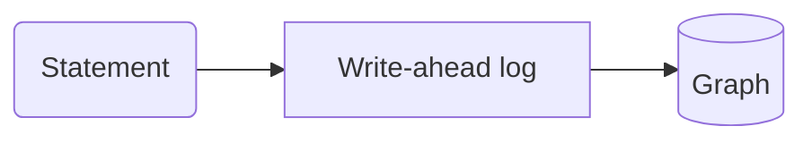

{/* An MDX comment: dropped from the twin. */}

This page opens a :term[store]{id=store} and writes through the :term[write-ahead log]{id=wal}. The second :term[store]{id=store} link adds no second entry to the terms. A colon in prose, like ratio a:b, stays text. Badges: :since[0.16] and :status[preview].

## Callouts

:::note
A note with the default title.
:::

:::warning[One writer]
Only one process writes to a store at a time.
:::

:::tip
A tip.
:::

:::danger
A danger.
:::

## Tabs

::::tabs
:::tab[Python]{key=python}
```python
import relate
db = relate.connect(":memory:")
```
:::
:::tab[Node.js]{key=node}
```javascript
const db = new Database(":memory:");
```
:::
::::

A second set spells Node.js `js`; the language picker treats both keys as one language:

::::tabs
:::tab[Python]{key=python}
```python
print(db.execute("RETURN 1 AS n").data)
```
:::
:::tab[JavaScript]{key=js}
```javascript
console.log(conn.query("RETURN 1 AS n").rows);
```
:::
::::

## An agentic step

::::agentic
:::human[At a terminal]
A table, for reading:

```bash
relate --database ./team.rl --read-only "MATCH (p:Person) RETURN count(p) AS people"
```
:::
:::agent
The envelope, for parsing; a failure prints the error object and exits non-zero:

```bash
relate --database ./team.rl --read-only --mode envelope "MATCH (p:Person) RETURN count(p) AS people"
```
:::
::::

## A host deeplink

:::deeplink{host=cursor name=relate}
```json
{
  "command": "relate",
  "args": ["serve", "--mcp", "stdio", "--database", "<absolute-path>/graph.rl", "--read-only"]
}
```
:::

:::deeplink{host=vscode name=relate}
```json title="server entry"
{
  "command": "relate",
  "args": ["serve", "--mcp", "stdio", "--database", "<absolute-path>/graph.rl", "--read-only"]
}
```
:::

To allow writes, remove `"--read-only"` from `args`.

## Code and cells

```bash
relate --version
```

```cypher run name=create
CREATE (:Person {name: 'Ada'})-[:KNOWS]->(:Person {name: 'Grace'})-[:KNOWS]->(:Person {name: 'Alan'})
```

```cypher run
MATCH (a:Person)-[:KNOWS]->(b:Person) RETURN a.name AS a, b.name AS b ORDER BY a
```

A cell can take its parameters from a `json data=<name>` block on the page:

```json data=who
{"name": "Ada"}
```

```cypher run name=ada params=who
MATCH (p:Person {name: $name}) RETURN p
```

### Graph results

```cypher run name=path
MATCH path = (:Person {name: 'Ada'})-[:KNOWS*1..2]->(:Person) RETURN path
```

```cypher run name=fails expect=error
RETURN 1 / 0
```

### An interactive element

:::row-counts{cells="create,cell-2,ada,path"}
The rows each cell returns as recorded, beside the rows it returns when your browser runs it.
:::

### Language samples

A `python run` or `js run` fence is a whole program, run against the client, with its recorded output under it:

```python run
import relate

db = relate.Database(":memory:")
db.execute("CREATE (:Person {name: 'Ada'}), (:Person {name: 'Grace'})")
result = db.execute("MATCH (p:Person) RETURN p.name AS name ORDER BY name")
for row in result.data:
    print(row["name"])
db.close()
```

```js run title="count.cjs"
const { Database } = require("@relate/relate");

const db = Database.open(":memory:");
const conn = db.connect();
conn.query("CREATE (:Person {name: 'Ada'})");
console.log(conn.query("MATCH (p:Person) RETURN count(p) AS n").rows[0].n);
```

A Python fence can name a second environment with `env=`, for a framework whose pins clash with the main one's. This sample runs beside crewai:

```python run env=crewai
import importlib.metadata

import crewai
import relate

db = relate.Database(":memory:")
db.execute("CREATE (:Person {name: 'Ada'}), (:Person {name: 'Grace'})")
result = db.execute("MATCH (p:Person) RETURN count(p) AS people")
print("crewai", importlib.metadata.version("crewai"), "imports beside relate")
print("people:", result.data[0]["people"])
db.close()
```

The compiled clients take the same fence with their language: `rust run`, `java run`, `go run`, `swift run` and `c run`. Each of these five programs builds the team graph in memory and prints how many people it holds:

```rust run title="main.rs"
use relate::Database;

const TEAM: &str = "
CREATE (ada:Person {name: 'Ada', role: 'engineer'}),
       (grace:Person {name: 'Grace', role: 'engineer'}),
       (noor:Person {name: 'Noor', role: 'maintainer'}),
       (relate:Project {name: 'relate', language: 'Rust'}),
       (tck:Project {name: 'opencypher-tck', language: 'Gherkin'}),
       (ada)-[:WORKS_ON {since: 2024}]->(relate),
       (grace)-[:WORKS_ON {since: 2023}]->(relate),
       (grace)-[:WORKS_ON {since: 2022}]->(tck),
       (noor)-[:MAINTAINS]->(relate),
       (ada)-[:KNOWS]->(grace)
";

fn main() -> relate::Result<()> {
    let db = Database::open(":memory:")?;
    let mut conn = db.connect()?;
    conn.query(TEAM)?;
    let result = conn.query("MATCH (p:Person) RETURN count(p) AS people")?;
    println!("people: {}", result.rows[0][0].as_int().expect("an integer"));
    Ok(())
}
```

```java run title="Team.java"
import com.relate.Database;

public class Team {
    static final String TEAM = """
        CREATE (ada:Person {name: 'Ada', role: 'engineer'}),
               (grace:Person {name: 'Grace', role: 'engineer'}),
               (noor:Person {name: 'Noor', role: 'maintainer'}),
               (relate:Project {name: 'relate', language: 'Rust'}),
               (tck:Project {name: 'opencypher-tck', language: 'Gherkin'}),
               (ada)-[:WORKS_ON {since: 2024}]->(relate),
               (grace)-[:WORKS_ON {since: 2023}]->(relate),
               (grace)-[:WORKS_ON {since: 2022}]->(tck),
               (noor)-[:MAINTAINS]->(relate),
               (ada)-[:KNOWS]->(grace)
        """;

    public static void main(String[] args) {
        try (var db = Database.open(":memory:"); var conn = db.connect()) {
            conn.query(TEAM);
            var result = conn.query("MATCH (p:Person) RETURN count(p) AS people");
            System.out.println("people: " + result.rows().get(0).get(0));
        }
    }
}
```

```go run title="main.go"
package main

import (
	"fmt"
	"os"

	relate "github.com/relatedb/relate/clients/go"
)

const team = `
CREATE (ada:Person {name: 'Ada', role: 'engineer'}),
       (grace:Person {name: 'Grace', role: 'engineer'}),
       (noor:Person {name: 'Noor', role: 'maintainer'}),
       (relate:Project {name: 'relate', language: 'Rust'}),
       (tck:Project {name: 'opencypher-tck', language: 'Gherkin'}),
       (ada)-[:WORKS_ON {since: 2024}]->(relate),
       (grace)-[:WORKS_ON {since: 2023}]->(relate),
       (grace)-[:WORKS_ON {since: 2022}]->(tck),
       (noor)-[:MAINTAINS]->(relate),
       (ada)-[:KNOWS]->(grace)
`

func check(err error) {
	if err != nil {
		fmt.Fprintln(os.Stderr, err)
		os.Exit(1)
	}
}

func main() {
	db, err := relate.Open(":memory:")
	check(err)
	defer db.Close()
	conn, err := db.Connect()
	check(err)
	defer conn.Close()
	_, err = conn.Query(team)
	check(err)
	res, err := conn.Query("MATCH (p:Person) RETURN count(p) AS people")
	check(err)
	fmt.Println("people:", res.Rows[0][0])
}
```

```swift run title="main.swift"
import Relate

let team = """
    CREATE (ada:Person {name: 'Ada', role: 'engineer'}),
           (grace:Person {name: 'Grace', role: 'engineer'}),
           (noor:Person {name: 'Noor', role: 'maintainer'}),
           (relate:Project {name: 'relate', language: 'Rust'}),
           (tck:Project {name: 'opencypher-tck', language: 'Gherkin'}),
           (ada)-[:WORKS_ON {since: 2024}]->(relate),
           (grace)-[:WORKS_ON {since: 2023}]->(relate),
           (grace)-[:WORKS_ON {since: 2022}]->(tck),
           (noor)-[:MAINTAINS]->(relate),
           (ada)-[:KNOWS]->(grace)
    """

let db = try Database(path: ":memory:")
let conn = try db.connect()
try conn.query(team)
let result = try conn.query("MATCH (p:Person) RETURN count(p) AS people")
print("people:", result.rows[0][0].intValue!)
```

```c run title="team.c"
#include <stdio.h>
#include "relate.h"

static const char *TEAM =
    "CREATE (ada:Person {name: 'Ada', role: 'engineer'}),\n"
    "       (grace:Person {name: 'Grace', role: 'engineer'}),\n"
    "       (noor:Person {name: 'Noor', role: 'maintainer'}),\n"
    "       (relate:Project {name: 'relate', language: 'Rust'}),\n"
    "       (tck:Project {name: 'opencypher-tck', language: 'Gherkin'}),\n"
    "       (ada)-[:WORKS_ON {since: 2024}]->(relate),\n"
    "       (grace)-[:WORKS_ON {since: 2023}]->(relate),\n"
    "       (grace)-[:WORKS_ON {since: 2022}]->(tck),\n"
    "       (noor)-[:MAINTAINS]->(relate),\n"
    "       (ada)-[:KNOWS]->(grace)\n";

/* A call that failed before a result existed: print its error and free it. */
static int fail(const char *what, char *err) {
    fprintf(stderr, "%s failed: %s\n", what, err ? err : "(no detail)");
    relate_free_string(err);
    return 1;
}

/* A statement that failed rides its result: print the error it carries. */
static int failed_statement(relate_query_result r) {
    fprintf(stderr, "statement failed: %s\n", relate_result_error_json(r));
    relate_destroy_result(r);
    return 1;
}

int main(void) {
    relate_database db = NULL;
    relate_connection conn = NULL;
    relate_query_result r = NULL;
    char *err = NULL;
    int64_t people = 0;

    if (relate_database_open(":memory:", &db, &err) != RELATE_OK) return fail("open", err);
    if (relate_connect_namespace(db, NULL, &conn, &err) != RELATE_OK) return fail("connect", err);
    if (relate_query_params(conn, TEAM, NULL, &r, &err) != RELATE_OK) return fail("create", err);
    if (relate_result_is_error(r)) return failed_statement(r);
    relate_destroy_result(r);

    if (relate_query_params(conn, "MATCH (p:Person) RETURN count(p) AS people", NULL, &r, &err) != RELATE_OK) return fail("count", err);
    if (relate_result_is_error(r)) return failed_statement(r);
    if (relate_value_int(relate_value_at(r, 0, 0), &people) != RELATE_OK) return 1;
    printf("people: %lld\n", (long long)people);

    relate_destroy_result(r);
    relate_disconnect(conn);
    relate_database_close(db);
    return 0;
}
```

## A diagram



## A figure

::figure[The logomark]{src=/favicon.svg alt="The relate logomark"}

## Components

<Install />

<Errors />

<Matrix rows={["read-only", "transactions"]} columns={["cli", "python", "browser"]} />

## Links

An existing page: [the landing](/docs/). A planned page: [import a CSV](/docs/guides/cypher/import-csv). A recipe: [entity resolution](/cookbook/entity-resolution/). The repository: [github.com/relatedb/relate](https://github.com/relatedb/relate). External: [openCypher](https://opencypher.org/).
