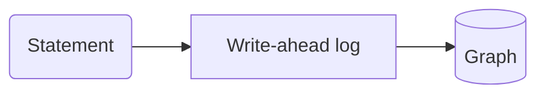

{/* An MDX comment: dropped from the twin. */}

This page opens a :term[store]{id=store} and writes through the :term[write-ahead log]{id=wal}. The second :term[store]{id=store} link adds no second entry to the terms. A colon in prose, like ratio a:b, stays text. Badges: :since[0.16] and :status[preview].

## Callouts

:::note
A note with the default title.
:::

:::warning[One writer]
Only one process writes to a store at a time.
:::

:::tip
A tip.
:::

:::danger
A danger.
:::

## Tabs

::::tabs
:::tab[Python]{key=python}
```python
import relate
db = relate.connect(":memory:")
```
:::
:::tab[Node.js]{key=node}
```javascript
const db = new Database(":memory:");
```
:::
::::

## Code and cells

```bash
relate --version
```

```cypher run name=create
CREATE (:Person {name: 'Ada'})-[:KNOWS]->(:Person {name: 'Grace'})-[:KNOWS]->(:Person {name: 'Alan'})
```

```cypher run
MATCH (a:Person)-[:KNOWS]->(b:Person) RETURN a.name AS a, b.name AS b ORDER BY a
```

A cell can take its parameters from a `json data=<name>` block on the page:

```json data=who
{"name": "Ada"}
```

```cypher run name=ada params=who
MATCH (p:Person {name: $name}) RETURN p
```

### Graph results

```cypher run name=path
MATCH path = (:Person {name: 'Ada'})-[:KNOWS*1..2]->(:Person) RETURN path
```

```cypher run name=fails expect=error
RETURN 1 / 0
```

### Language samples

A `python run` or `js run` fence is a whole program, run against the client, with its recorded output under it:

```python run
import relate

db = relate.Database(":memory:")
db.execute("CREATE (:Person {name: 'Ada'}), (:Person {name: 'Grace'})")
result = db.execute("MATCH (p:Person) RETURN p.name AS name ORDER BY name")
for row in result.data:
    print(row["name"])
db.close()
```

```js run title="count.cjs"
const { Database } = require("@relate/relate");

const db = Database.open(":memory:");
const conn = db.connect();
conn.query("CREATE (:Person {name: 'Ada'})");
console.log(conn.query("MATCH (p:Person) RETURN count(p) AS n").rows[0].n);
```

## A diagram



## A figure

::figure[The logomark]{src=/favicon.svg alt="The relate logomark"}

## Components

<Install />

<Errors />

## Links

An existing page: [the landing](/docs/). A planned page: [import a CSV](/docs/guides/cypher/import-csv). A recipe: [entity resolution](/cookbook/entity-resolution/). Not public yet: [the repository](https://github.com/relatedb/relate). External: [openCypher](https://opencypher.org/).
