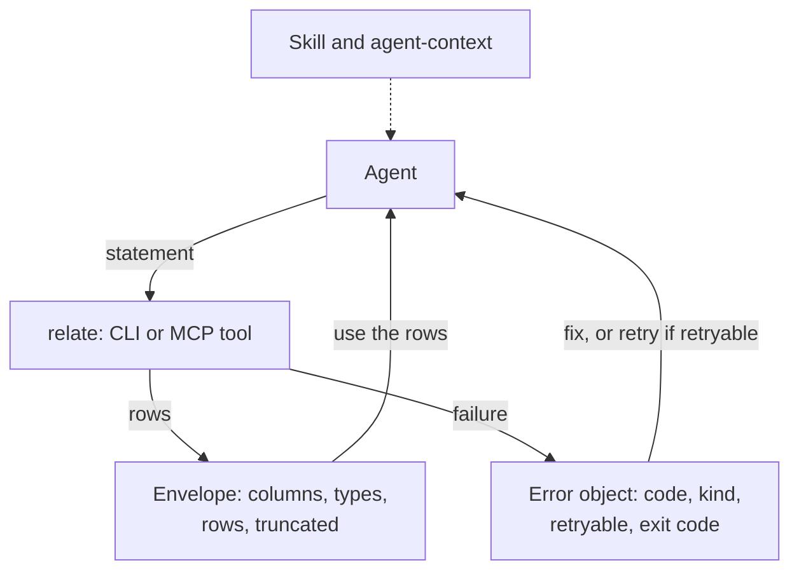

What does it mean for a database to be agent-native? An agent reads every byte a command prints, pays for each one in its context window, and decides its next step from the result alone. relate's CLI is built for that reader: it prints results in shapes a model can parse, reports failures as typed objects with stable exit codes, keeps large results from flooding the context, and notices when an :term[agent harness]{id=agent-harness} is running it. The skill and the :term[MCP]{id=mcp} surface carry the same contract to agents that never open a shell.

## The loop

An agent runs a statement, reads what comes back, and decides: use the rows, fix the statement, or retry. Each piece of the design shortens one turn of that loop.



**Shapes a model can parse.** `--mode envelope` prints one JSON object per result set. The :term[envelope]{id=envelope} keeps the column list even when there are no rows, so "no rows" never reads as "no output". `columnTypes` gives one type per column, taken from the first row, so an empty result reports `ANY`. The envelope also carries the query notifications. When stdout is piped, the default is one JSON object per row (`jsonl`).

**Typed failures.** A failed statement prints its message on stderr and exits with the :term[exit code]{id=exit-code} of its class: 6 for a statement the engine rejected, 5 for a conflict or a locked store, 7 for a timeout. In the JSON modes it also prints an error object on stdout whose `code`, `kind` and `retryable` fields an agent branches on without parsing prose. `retryable` is `true` for a write-write conflict and for a `--concurrent-logical-workspace-limit` refusal while other statements hold the workspace pool, so an agent never loops on an error that cannot succeed.

**A row cap.** One statement that returns every node of a large graph can fill a context window. Under a detected agent harness with stdout not a terminal, the CLI prints at most 100 rows per statement and says so in-band. Here the same cut is forced with `--max-rows 2`:

```bash verify
relate --mode envelope --max-rows 2 "UNWIND ['Ada', 'Grace', 'Noor'] AS name RETURN name"
```

The first line is the warning on stderr; the envelope on stdout names both counts:

```text
warning: result truncated to 2 rows (the statement returned 3); pass --max-rows 0 for all rows
{"columnTypes":["STRING"],"columns":["name"],"notifications":[],"planCache":"miss","rowCap":{"kept":2,"total":3},"rows":[{"name":"Ada"},{"name":"Grace"}],"timings":{"elapsed_ms":0.678416,"execute_ms":0.5296660000000001,"lex_parse_ms":0.023083,"lower_ms":0.032458,"parse_ms":0.098,"plan_ms":0.041625,"result_generation_ms":0.00041600000000000003,"rewrite_ms":0.007083},"truncated":true}
```

**Harness detection.** relate turns on :term[agent mode]{id=agent-mode} when it sees an agent harness's environment variable, such as `CLAUDECODE` or `CURSOR_AGENT`, and stdout is not a terminal. Agent mode sets two defaults: the 100-row cap, and TOON as the piped output: one header line, then one line per row, then the statement's timings and plan-cache outcome. The same statement, run plainly and then as Claude Code would run it; both modes close with the [timing record](/docs/reference/cli/output-modes#timings-and-the-plan-cache):

```bash verify
relate "UNWIND ['Ada', 'Grace', 'Noor'] AS name RETURN name"
CLAUDECODE=1 relate "UNWIND ['Ada', 'Grace', 'Noor'] AS name RETURN name"
```

```text
{"name":"Ada"}
{"name":"Grace"}
{"name":"Noor"}
rows[3]{name}:
  Ada
  Grace
  Noor
timings:
  {"elapsed_ms":0.38104099999999996,"execute_ms":0.222542,"lex_parse_ms":0.024708,"lower_ms":0.034208999999999996,"parse_ms":0.10475,"plan_ms":0.043292,"result_generation_ms":0.0005,"rewrite_ms":0.007500000000000001}
planCache:
  miss
```

Detection changes output only. It never gates writes and never turns on `--safe`; those stay explicit choices, because a heuristic that changed what a statement may do would make the same command mean different things in different terminals.

**Facts from the binary.** `relate agent-context` prints the commands, flags and exit codes of the binary that is installed, so the briefing cannot describe another version. The skill, relate's cheat sheet for agents, ships inside the binary, and `relate skill install` copies it into each detected agent's skills folder.

**MCP.** `relate serve --database <path> --read-only --mcp stdio` serves one store to an agent host as two tools, `read_cypher` and `get_schema`; without `--read-only` it also lists `write_cypher`. A result is one JSON object with the `rows`, `columns`, `columnTypes` and `notifications` the envelope has, plus `stats`, the `plan` and timings; it has no `truncated` or `rowCap` field. The server classifies each statement from its plan before running it, so `read_cypher` refuses a write with `Only MATCH queries are allowed for read-query`. Internal failures reach the host as `Error: internal error`, so engine detail stays out of tool-call logs.

The terminal and the tryout below run on an empty database in this page, opened by the engine the page loads. The terminal takes this statement, the one in the row-cap and harness examples:

```cypher run name=names
UNWIND ['Ada', 'Grace', 'Noor'] AS name RETURN name
```

It prints the statement as relate does in four output modes, `table`, `envelope`, `jsonl` and `toon`, with the exit code, and opens on TOON with "Run as an agent harness" on, as Claude Code runs it; its 250-row preset shows the cap. The tryout sends the MCP tools: `read_cypher` with the same statement, the same tool with a `CREATE`, which the plan check refuses before it runs, then `write_cypher` and `get_schema`. Each reply carries the plan, the notifications and the timings of its own run, and no `truncated` or `rowCap`.

```json data=mcp-calls
{"calls": [
  {"tool": "read_cypher", "arguments": {"statement": "UNWIND ['Ada', 'Grace', 'Noor'] AS name RETURN name"}},
  {"tool": "read_cypher", "arguments": {"statement": "CREATE (:Person {name: $name})", "parameters": {"name": "Ada"}}},
  {"tool": "write_cypher", "arguments": {"statement": "CREATE (:Person {name: $name})", "parameters": {"name": "Ada"}}},
  {"tool": "get_schema", "arguments": {}}
]}
```

:::terminal{cell=names mode=toon harness=on}
:::

:::mcp-tryout{calls=mcp-calls}
:::

## What it costs

| Choice | What it buys | What it costs |
| --- | --- | --- |
| Row cap under a harness | A runaway result cannot flood the context | The engine still computes the whole result; the cap bounds printing, not work. A Cypher `LIMIT` bounds the work |
| TOON as the piped default under agent mode | Fewer bytes per row than JSON | TOON is not JSON. A tool that expects one JSON object per row gets it with `--mode jsonl` (or `--no-agent-mode`), with one timing line per statement when `--timings` is set; `--mode envelope` gives one JSON object per result set |
| Detection from environment variables | No flag to remember inside a harness | A variable set for another reason turns agent mode on; `--no-agent-mode` or `RELATE_AGENT_MODE=0` turns it off. Detection is silent, so the same command prints differently inside and outside a harness unless `--mode` pins the output |
| The skill as a copy in each agent's folder | The agent reads relate's rules before its first command | A copy can fall behind the binary after an upgrade; `relate skill check` exits 1 when an installed copy differs |
| MCP classification before execution | A read tool, annotated `readOnlyHint`, that cannot change the graph or its indexes | One extra planning pass per call |

The other path was to leave agents with the human table and free-text errors, and let each harness parse them. That puts the parsing in every agent's prompt and the failures in every agent's context. relate puts it in the binary once, where it can be tested.

## Where this shows up

- [Agent mode reference](/docs/reference/cli/agent-mode): the detection variables, the defaults, and the switches.
- [Drive relate from an agent](/docs/guides/agents/drive-relate-from-an-agent): the envelope, the error object and the row cap in a working loop.
- [Keep an agent safe](/docs/guides/agents/agent-safety): `--read-only`, `--safe`, timeouts, and when to retry.
- [Connect over MCP](/docs/guides/agents/connect-over-mcp): the config block for each agent host.
- [Install the agent skill](/docs/guides/agents/install-the-skill): the agents `relate skill install` supports and where the files land.
- [Errors](/docs/reference/errors): every error with its code, kind, exit code, and whether a retry helps.
