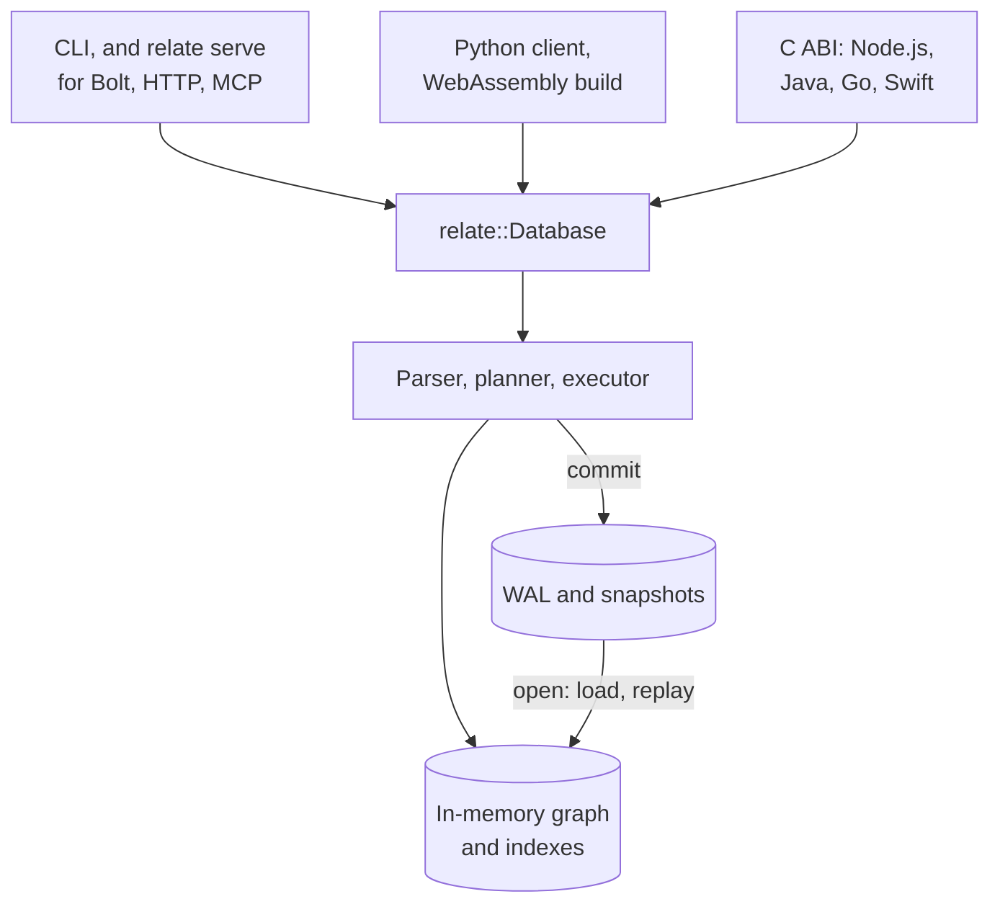

How is relate put together? It is one engine written in Rust, with every front door wrapped around it. A statement is parsed, bound against the catalog, planned, and executed against a graph held in memory; each commit goes to a write-ahead log on its way in. The CLI, the language clients, the browser build and the network servers all call the same `relate::Database`, so a statement means the same thing through each of them.

## The layers



## The crate map

The source is one Cargo workspace, split into groups by role. Engine crates depend only on other engine crates; :term[surfaces]{id=surface} depend on the engine and on each other; a boundary check in the build keeps it that way.

| Group | Crates | Role |
| --- | --- | --- |
| Engine | `relate`, `relate-parser`, `relate-front`, `relate-ir`, `relate-planner`, `relate-executor`, `relate-storage`, `relate-catalog`, `relate-core`, `relate-model`, `relate-error` and a few small helpers | The public API, the query pipeline, the live graph, and the write path |
| Surfaces | `relate-cli`, `relate-python`, `relate-ffi`, `relate-wasm`, `relate-serve`, `relate-bolt`, `relate-http`, `relate-mcp`, `relate-auth`, `relate-formatter`, `relate-arrow`, `relate-load` | Each front door, plus the output formats, Arrow conversion, served-surface auth, and the Neo4j loader they share |
| Clients | Node.js, Java, Go, and Swift packages | Thin wrappers over the C ABI that `relate-ffi` builds |
| Extensions | `relate-wire` and the first-party extensions | The protocol `relate run` speaks to extension packages |

## A statement's path

The parser turns Cypher text into a syntax tree, and a front end lowers it into the planner's own representation. Binding resolves labels, relationship types, properties and variables against the catalog without running anything, which is where an undefined variable fails; a missing parameter fails when the statement runs, not under `EXPLAIN`. The planner then produces a logical plan, and the executor runs that plan against the graph as of the statement's pinned commit.

**The in-memory graph.** Labels, relationship types and property keys are interned, so each is stored once and compared as a number. Each node keeps its relationships in lists split by type, so expanding over `[:WORKS_ON]` walks only that type's list. A change installs a new version of the node or relationship stamped with its commit, which is how readers keep a consistent view while writers work; [transactions and concurrency](/docs/concepts/transactions-and-concurrency) covers that model. Disk holds the durable copy, and queries never scan it.

**The planner.** It validates the statement, then rewrites each `MATCH`: equality predicates fold into the pattern so they can seek, and the start of each pattern and the order of comma-separated patterns come from estimates the graph keeps: label counts and index entries. Other clauses run in the order written. `EXPLAIN` shows the result without running the statement.

**Indexes.** Label lookups and the typed relationship lists come with the graph. `CREATE INDEX` adds a range index on a label and property, which equality and range predicates seek through; vector and full-text indexes serve the `SEARCH` clause, and point indexes serve spatial predicates. The planner notices a missing range index and says so. One command on `:memory:`, the default store, shows the difference and writes nothing to disk: it creates the example graph, explains a statement, adds a range index on `:Person(name)`, and explains the same statement again:

```bash verify
relate --mode table "CREATE (ada:Person {name: 'Ada', role: 'engineer'}),
       (grace:Person {name: 'Grace', role: 'engineer'}),
       (noor:Person {name: 'Noor', role: 'maintainer'}),
       (relate:Project {name: 'relate', language: 'Rust'}),
       (tck:Project {name: 'opencypher-tck', language: 'Gherkin'}),
       (ada)-[:WORKS_ON {since: 2024}]->(relate),
       (grace)-[:WORKS_ON {since: 2023}]->(relate),
       (grace)-[:WORKS_ON {since: 2022}]->(tck),
       (noor)-[:MAINTAINS]->(relate),
       (ada)-[:KNOWS]->(grace);
EXPLAIN MATCH (p:Person {name: 'Ada'})-[:WORKS_ON]->(r:Project) RETURN r.name AS project;
CREATE INDEX person_name FOR (p:Person) ON (p.name);
EXPLAIN MATCH (p:Person {name: 'Ada'})-[:WORKS_ON]->(r:Project) RETURN r.name AS project"
```

The first plan has no index to use: it starts from `:Project`, which has fewer nodes, walks back to `:Person`, and the :term[notification]{id=notification} names the index that would help. The second plan seeks Ada through the new index and estimates one row:

```text
Query: MATCH (p:Person {name: 'Ada'})-[:WORKS_ON]->(r:Project) RETURN r.name AS project
Plan:
+------------------+----+-------------------------------------+
| Operator         | Id | Details                             |
+------------------+----+-------------------------------------+
| + ProduceResults | 0  | 1 item(s)                           |
+------------------+----+-------------------------------------+
| | + Expand       | 1  | (r:Project)<-[:WORKS_ON]-(p:Person) |
+------------------+----+-------------------------------------+
Notifications:
Id 1: INFORMATION 03C91 Relate.Notification.Statement.MissingIndex: the equality predicate on name filters :Person without a range index on (:Person {name}) Remedy: CREATE INDEX relate_Person__name FOR (n:Person) ON (n.name)
Query: MATCH (p:Person {name: 'Ada'})-[:WORKS_ON]->(r:Project) RETURN r.name AS project
Plan:
+-------------------+----+------------------------------------------------------------------------------------+----------------+
| Operator          | Id | Details                                                                            | Estimated Rows |
+-------------------+----+------------------------------------------------------------------------------------+----------------+
| + ProduceResults  | 0  | 1 item(s)                                                                          | -              |
+-------------------+----+------------------------------------------------------------------------------------+----------------+
| | + NodeIndexSeek | 1  | RANGE INDEX p:Person(name) WHERE name = 'Ada', (p:Person)-[:WORKS_ON]->(r:Project) | 1              |
+-------------------+----+------------------------------------------------------------------------------------+----------------+
```

**Storage.** A commit appends physical changes to the write-ahead log (:term[WAL]{id=wal}), then applies them to the graph. A :term[checkpoint]{id=checkpoint} writes the committed graph to a snapshot in one :term[codec]{id=codec}, such as Parquet (the default) or JSON, and recycles old log segments. A virtual file system puts the same files in a directory, packs them into one `.rl` file, or keeps them in memory. [Storage and durability](/docs/concepts/storage-and-durability) explains when a commit is safe on disk.

## The surfaces around the core

The CLI links the engine into one binary. The Python client calls it in-process through a native extension module. The C ABI exposes it as a typed C interface, and the Node.js, Java, Go and Swift clients load that one library instead of each building its own binding. The WebAssembly build runs it in a browser page. `relate serve` opens one store and hosts the Bolt, HTTP Query API, and MCP servers over it, with one accept loop and one connection cap for all three.

## What the layering buys, and what it costs

One engine under every surface means one behavior to test and document: an error, a result type or a notification is the same in the CLI, in Python, and over Bolt. A fix lands everywhere at once, and the clients stay thin. The same engine crates also compile to WebAssembly, which is how the browser build exists.

The cost is in what one engine cannot be. Every surface inherits the engine's shape: one process per store, the graph in that process's memory, and the client running in the same address space as the engine, so a client process that holds a large graph holds it in its own memory. The four clients that share the C ABI also share its contract of one call at a time per connection. And the planner's rewrites cover `MATCH` patterns while other clauses run in the order written, so how a statement is written still matters; `EXPLAIN` and `PROFILE` show what it chose.

## Where this shows up

- [Tune a query](/docs/guides/cypher/tune-a-query): reading `EXPLAIN` and `PROFILE`, and acting on index notifications.
- [Transactions and concurrency](/docs/concepts/transactions-and-concurrency): versions, pinned views and conflicts in the in-memory graph.
- [Storage and durability](/docs/concepts/storage-and-durability): the write path, checkpoints, and codecs.
- [Storage formats](/docs/reference/storage/formats): what a directory store and a `.rl` file hold.
- [Where relate fits](/docs/concepts/where-relate-fits): the conditions that follow from this design.
