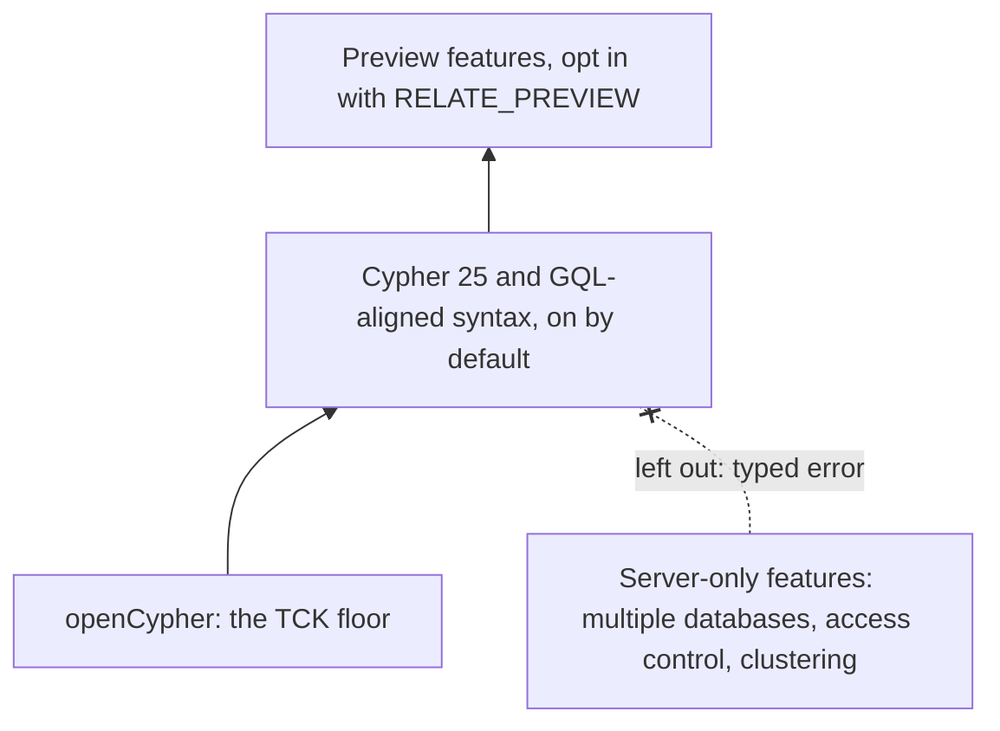

Which Cypher does relate speak? :term[openCypher]{id=opencypher} is the floor: the openCypher Technology Compatibility Kit (TCK) is the language contract. On top of it sits Neo4j's :term[Cypher 25]{id=cypher-25}, the version aligned with the ISO GQL standard, and it is the default. Newer syntax that Neo4j has accepted but not settled waits behind an opt-in, `RELATE_PREVIEW`. Where a feature only makes sense on a multi-user server, relate leaves it out and says so with a typed error.

## Three layers



The examples on this page run on the docs' example graph: three people, two projects, who works on what and who knows whom.

```cypher run name=seed
CREATE (ada:Person {name: 'Ada', role: 'engineer'}),
       (grace:Person {name: 'Grace', role: 'engineer'}),
       (noor:Person {name: 'Noor', role: 'maintainer'}),
       (relate:Project {name: 'relate', language: 'Rust'}),
       (tck:Project {name: 'opencypher-tck', language: 'Gherkin'}),
       (ada)-[:WORKS_ON {since: 2024}]->(relate),
       (grace)-[:WORKS_ON {since: 2023}]->(relate),
       (grace)-[:WORKS_ON {since: 2022}]->(tck),
       (noor)-[:MAINTAINS]->(relate),
       (ada)-[:KNOWS]->(grace)
```

## openCypher as the floor

The TCK is a suite of scenarios that pins down what each openCypher clause, expression, and error means. relate treats it as the contract: parser, planner, executor, and error classes follow its scenarios. Coverage is measured by a separate spec harness, which runs Neo4j's Cypher suites, the openCypher TCK among them, against the build of each pull request that is ready for review, and reports the result. It reports; it does not block a merge, and no current pass count is published.

Until 2026-11-05 the engine ran a pinned copy of TCK 2024.3 in its own test suite, with a short list of documented deviations. That measurement is retired, so a figure from it is history, not a current claim.

## Cypher 25 and GQL

Neo4j's Cypher 25 adds the syntax that brings Cypher toward GQL, and relate follows it. Label expressions combine labels with `&`, `|` and `!`, and `IS` can replace the colon:

```cypher run name=label-expression
MATCH (n IS Person|Project)
RETURN labels(n) AS labels, n.name AS name
ORDER BY name
```

Path selectors and quantified relationships find routes without a hop bound written by hand. The shortest route from Ada to the TCK project, over either relationship type, in either direction:

```cypher run name=shortest
MATCH p = SHORTEST 1 (:Person {name: 'Ada'})-[:KNOWS|WORKS_ON]-+(:Project {name: 'opencypher-tck'})
RETURN [n IN nodes(p) | n.name] AS route
```

`LET` binds a value without a `WITH`, and `FILTER` drops rows as a clause of its own:

```cypher run name=let-filter
MATCH (p:Person)-[w:WORKS_ON]->(r:Project)
LET years = 2026 - w.since
FILTER years >= 3
RETURN p.name AS person, r.name AS project, years
ORDER BY years DESC
```

The rest of the set includes `NEXT` to chain statements, `COUNT { }` and `COLLECT { }` subqueries, `CALL (x) { }` scope clauses, `CALL { } IN TRANSACTIONS`, dynamic labels with `$(…)`, the vector and UUID types, graph types, and the `SEARCH` clause over vector and full-text indexes. The [Cypher overview](/docs/reference/cypher/overview) lists them all.

Where the proposals, Cypher 5 and Cypher 25 disagree, relate's target is Cypher 25 as Neo4j runs it. That is also why the retired TCK pin carried deviations: a few 2024.3 scenarios expect behavior that Cypher 25 changed on purpose. A statement can still ask for a version with a `CYPHER 5` or `CYPHER 25` prefix. The default is recorded per :term[namespace]{id=namespace} in the :term[store]{id=store}, and `SHOW DATABASES` reports it:

```cypher run name=version
SHOW DATABASES YIELD name, defaultLanguage
RETURN name, defaultLanguage
```

## Preview features

A :term[preview feature]{id=preview-feature} is a Cypher feature from a Cypher Improvement Proposal (CIP) that is not yet part of the settled dialect. relate implements several, and each runs only when the `RELATE_PREVIEW` environment variable names it. Without the opt-in, the statement fails before it runs:

```cypher run name=preview expect=error
RETURN datetime('2026-01-01T12:00+01:00') IS SAME INSTANT datetime('2026-01-01T11:00Z') AS same
```

With the feature named in the environment of the process that opens the store, the same statement runs:

```bash verify
RELATE_PREVIEW=chronological-comparisons relate --mode envelope "RETURN datetime('2026-01-01T12:00+01:00') IS SAME INSTANT datetime('2026-01-01T11:00Z') AS same"
```

```text
{"columnTypes":["BOOLEAN"],"columns":["same"],"notifications":[],"rows":[{"same":true}],"truncated":false}
```

`RELATE_PREVIEW` takes a comma-separated list and is read once, when the store opens. An unknown name stops the open with an error that lists every known name, so a typo never passes silently. The names in this build are `hybrid-search`, `local-callables`, `graph-type-opt-props`, `graph-type-default-values`, `graph-type-implied-labels`, `ontology`, `obfuscated-literals`, `mixed-label-syntax`, `float16-coordinate-types`, `chronological-comparisons`, `complex-search-patterns`, `coll-zip`, `coll-has` and `gql-stddev-aliases`. Three of them, `coll-zip`, `coll-has` and `gql-stddev-aliases`, gate function names, and `ontology` gates the `db.ontology.*` procedures; the rest gate syntax. While one of the three function gates is off, a call fails as an unknown function.

The opt-in exists because a preview's shape can still change. Keeping it off by default means a statement that runs today keeps meaning the same thing when the proposal settles.

## Where relate departs from Neo4j, and why

Most departures come from relate being an embedded, single-process engine. Server features have nothing to act on: there is one user graph per store, no users or roles, and no cluster. So a store holds three fixed namespaces: `neo4j` for data, `system`, and `system_ontologies`, which is listed but not queryable. `USE` routes a statement to `neo4j` or `system`. Any other graph name fails before the statement runs:

```cypher run name=use-other expect=error
USE friends
MATCH (p:Person)
RETURN p.name AS name
```

Database administration follows Neo4j Community Edition: `SHOW DATABASES` and setting the default language work, and the other administration commands fail with `Unsupported administration command`. A few departures are safety limits: an explicit variable-length bound of more than 500 hops is refused at admission unless `--max-traversal-depth` raises it, because a deeper walk can overflow the native stack.

The [differences from Neo4j](/docs/reference/cypher/differences-from-neo4j) table lists each one with the error it produces and what to write instead.

## Trade-offs

Following Cypher 25 gives relate one target, the Cypher that current Neo4j runs, so statements and documentation written for it carry over, apart from the departures in the differences table. The cost is that relate inherits Cypher 25's deliberate breaks from older openCypher, which is why the floor is described as measured coverage rather than a single pass figure. Gating previews behind a named opt-in costs one environment variable, and buys statements whose meaning does not shift under them.

## Where this shows up

- [Cypher overview](/docs/reference/cypher/overview): the clauses, expressions, and features relate supports.
- [Differences from Neo4j](/docs/reference/cypher/differences-from-neo4j): each departure, its error, and the replacement.
- [Search](/docs/reference/cypher/search): the `SEARCH` clause and its preview forms.
- [Limitations](/docs/reference/limitations): namespaces, nesting, and traversal limits.
- [Search by vector similarity](/docs/guides/cypher/vector-search): Cypher 25's vector type and indexes in use.
