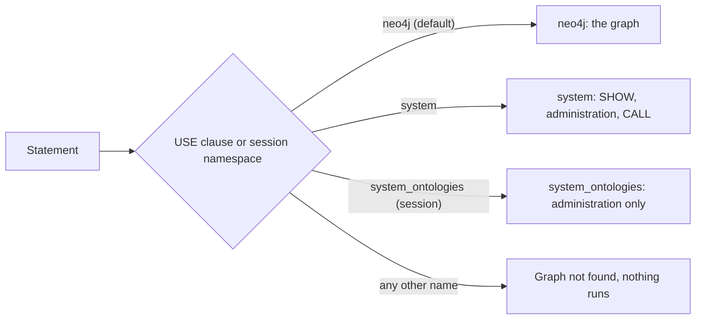

Can a relate store hold several databases, the way a Neo4j server does? No: every :term[store]{id=store} has the same three fixed :term[namespaces]{id=namespace}, `neo4j`, `system` and `system_ontologies`, and only `neo4j` holds your graph. There is no `CREATE DATABASE`. A `USE` clause or a session setting routes a statement to one of the three names, and any other name fails before the statement runs. An application that needs several graphs opens several stores, one per graph.

## Three names, one graph

A Neo4j server hosts many databases and a catalog of them, named `system`. relate runs inside your process and opens one store, so the store is the unit a graph lives in, and its catalog is fixed. It keeps the three names a Neo4j Community Edition 2026.09 server reports, so a tool built for Neo4j that lists databases or opens a `system` session finds the names it expects:

| Namespace | Holds | What runs there |
| --- | --- | --- |
| `neo4j` | The graph: every node, relationship, index, and constraint | Every statement. The default for every session and the only namespace that holds data |
| `system` | No graph data | `SHOW` commands, the supported database administration commands, and procedure calls in the shape `CALL`, `YIELD`, `RETURN` |
| `system_ontologies` | Nothing queryable; listed for compatibility | Only the database administration commands, such as `SHOW DATABASES`, from a session set to it; a `USE system_ontologies` on one fails with [`UseClauseWithAdministrationCommand`](/docs/reference/errors#engine-use-on-administration-command). Every other statement fails, reads included |

The store's :term[ontology]{id=ontology} document, where one is set, belongs to the `neo4j` graph and is read and written with the `db.ontology.*` procedures on `neo4j`, a preview feature ([Use an ontology](/docs/guides/cypher/ontology)). `system_ontologies` gives no view of it.



`SHOW DATABASES` lists the three rows on every store, with `neo4j` as the default and home namespace:

```cypher run name=show
SHOW DATABASES YIELD name, type, access, default, home
RETURN name, type, access, default, home
```

## How a statement picks its namespace

A statement runs in one namespace. Two settings choose it, and the narrower one wins:

- **The session namespace.** It is `neo4j` unless the session chose another: `--namespace` on the CLI, `namespace=` when a Python :term[client]{id=client} connects (and `set_namespace()` between transactions), or the database a Neo4j driver names in its session over Bolt. An unknown name on the CLI exits 2 before the store opens.
- **A `USE` clause.** It routes one :term[statement]{id=statement}, whatever the session namespace is.

Names match without regard to case, so `USE NEO4J` reaches `neo4j`. In `system`, a procedure call runs, and the result names the engine's components:

```cypher run name=use-system
USE system CALL dbms.components() YIELD name, versions
RETURN name, versions
```

A name the store does not have fails while the statement is planned, so nothing runs, even a `RETURN 1`:

```cypher run name=use-unknown expect=error
USE movies MATCH (n) RETURN count(n) AS n
```

The restricted namespaces refuse what they cannot answer. `system` takes no `MATCH`:

```cypher run name=match-system expect=error
USE system MATCH (n) RETURN count(n) AS n
```

and `system_ontologies` refuses every statement except the administration commands:

```cypher run name=match-ontologies expect=error
USE system_ontologies MATCH (n) RETURN count(n) AS n
```

One statement reads one graph. Two different `USE` targets in one statement, across the arms of a `UNION` or inside a `CALL` subquery, fail with `Multiple graphs in the same query not allowed here`: Neo4j allows that only on composite databases, which relate does not have.

## Why a store holds one graph

In a server, a database is the unit an operator creates, backs up, secures, and moves. In relate those jobs belong to the store, and a store is a directory or a file. Creating one is opening a new path; backing it up is `relate clone`; access control is file permissions, `--read-only`, and the credentials of `relate serve`; moving it is copying it. A second database inside the same store would add a catalog and a second set of every one of those jobs, with nothing gained over a second store.

So relate follows Neo4j Community Edition for database administration and stops there: `SHOW DATABASES`, `SHOW DEFAULT DATABASE`, `SHOW HOME DATABASE` and `ALTER DATABASE … SET DEFAULT LANGUAGE CYPHER 5` or `CYPHER 25` run, and every other database administration command, `CREATE DATABASE` included, fails with `Unsupported administration command: <statement>`.

## Several graphs in one application

An application with several graphs keeps one store per graph and opens each one. Two stores in one process are independent: each has its own `neo4j` graph, and neither sees the other. This Python program opens two in-memory stores side by side, then moves one connection's session to `system`:

```python run name=two-stores title="two_stores.py"
import relate

team = relate.connect(":memory:")
deps = relate.connect(":memory:")
team.execute("CREATE (:Person {name: 'Ada'})")
deps.execute("CREATE (:Version {key: 'NPM/route-kit@2.3.1'})")

print("team:", team.execute("MATCH (n) RETURN labels(n)[0] AS label, count(*) AS n").data())
print("deps:", deps.execute("MATCH (n) RETURN labels(n)[0] AS label, count(*) AS n").data())

team.set_namespace("system")
cur = team.execute("SHOW DATABASES YIELD name")
names = [row["name"] for row in cur.data()]
print(cur.consume().namespace, names)

try:
    relate.connect(":memory:", namespace="movies")
except relate.OperationalError as e:
    print(type(e).__name__, e)
```

A statement cannot join the two. To combine them, an application queries each and joins the rows itself, or copies one graph into the other store with `MERGE` statements; `relate clone` copies a whole store to a new path. When the graphs share people, places or keys, one store with a label per source keeps them joinable in a single statement, and that is usually the better shape.

## Trade-offs

Fixed namespaces keep the engine's catalog trivial: there is nothing to create, drop, attach or route, and every store opens the same way. Tools that expect Neo4j's `system` and `SHOW DATABASES` keep working, and a statement written with a database name fails at once with a message naming it, instead of reading the wrong graph.

The cost is that a cross-graph question is two statements. Neo4j's composite databases, `USE graph.byName(…)` and several `USE` targets in one statement have no equivalent. Where many tenants or graphs must be queried together, a server database fits better; [Where relate fits](/docs/concepts/where-relate-fits) lists that condition with the others.

## Where this shows up

- [Differences from Neo4j](/docs/reference/cypher/differences-from-neo4j): `CREATE DATABASE` and `USE` with a database name, with the errors they produce.
- [Limitations](/docs/reference/limitations): one graph per statement, and the administration commands that run.
- [CLI flags](/docs/reference/cli/flags): `--namespace`.
- [Bolt server](/docs/reference/server/bolt): how a driver's database name selects a namespace.
- [Use an ontology](/docs/guides/cypher/ontology): the document `system_ontologies` does not expose.
- [Errors](/docs/reference/errors#engine-database-not-found): `Graph not found` and the other namespace errors, with their codes.
