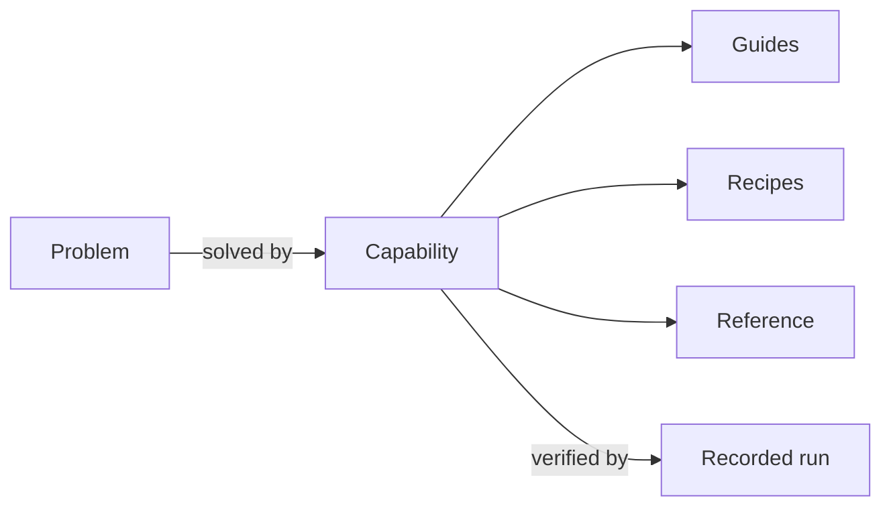
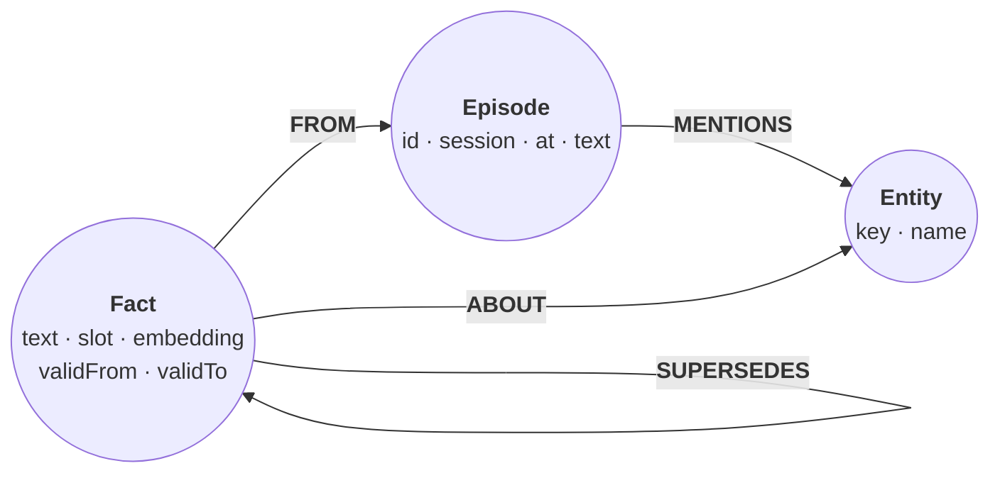
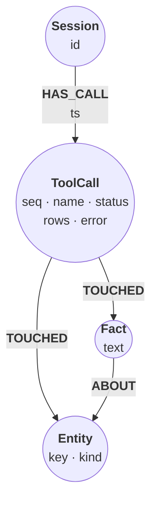
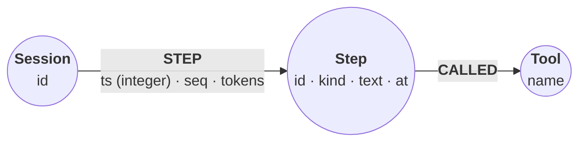
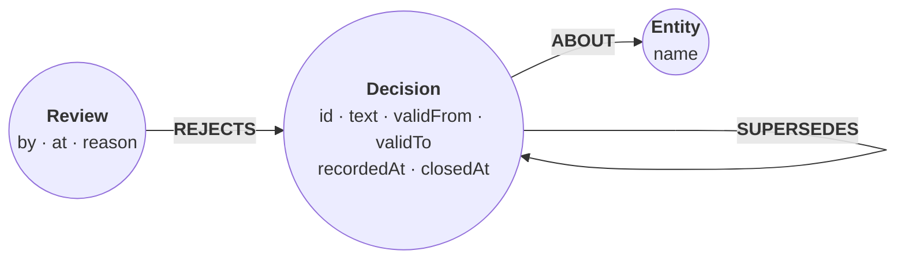
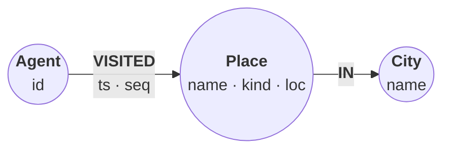
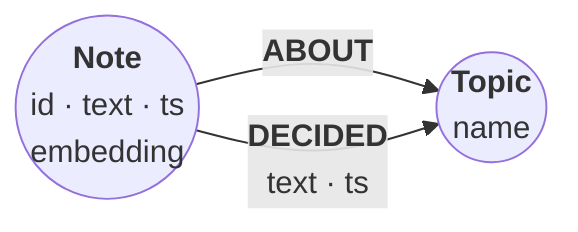
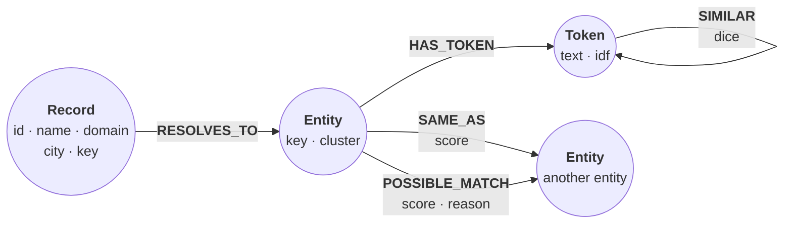
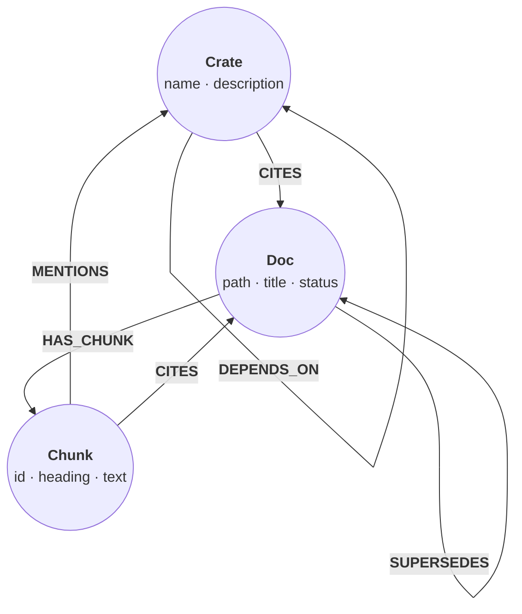
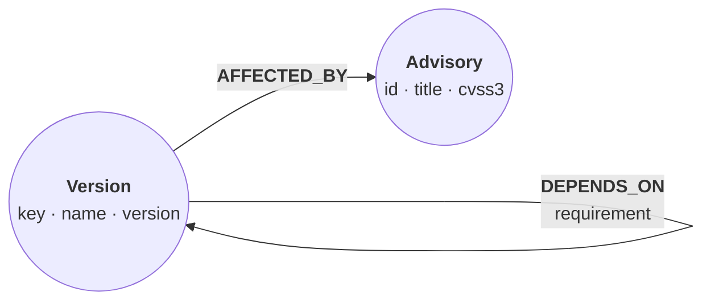

Which problems is relate the right database for? A database is best chosen by the problem at hand rather than by its feature list, so each entry on this page starts from a problem in the words people use for it, names the relate capability that solves it, links the guides, recipes and reference that cover it, and cites the recorded run that shows it working, or says that none does yet. Every entry shares relate's shape: the graph belongs to one application, agent or tool, lives on one machine, and fits in that machine's memory. [Where relate fits](/docs/concepts/where-relate-fits) lists the conditions under which another kind of database fits better.

## How an entry is built

Each entry is one heading whose anchor is the capability's id, so `/docs/concepts/problems-relate-solves#agent-memory` names the agent memory entry wherever it is cited. Under the heading, two to four paragraphs explain the problem and how relate solves it; where the problem has a data model, a diagram shows the recommended one, with :term[labels]{id=label} as circles and :term[relationship types]{id=relationship-type} as arrows; and a list gives the problem, the capability, the :term[surfaces]{id=surface} it applies to (the same names as every page's `surfaces`), the links, and the recorded run that verifies it.

A cookbook cell is replayed against its recorded result on every build of the site, and a docs cell by the docs checks on every pull request. A language sample's output is recorded from a run against its client library (Python, Node.js, Rust, Java, Go, Swift or the C ABI), and a CLI step's output from a run of the relate binary, which the CLI check repeats. An entry whose capability no recorded run exercises yet, such as one that needs a Neo4j server, says so in its list. A capability without a guide yet cites the recipe or reference pages that cover it today.

The same entries are data at [/docs/capabilities.json](/docs/capabilities.json): each with the intents an agent might phrase the problem as, its data model as mermaid source, and the canonical URL of everything it cites. The docs :term[MCP]{id=mcp} server's `discover_capabilities` tool answers from the same entries.

{/* capabilities:start: generated from src/content/docs/_capabilities by `node src/lib/docs/capabilities.ts --write`; edit the capability files, not this section */}

## Agent memory

An agent's context ends with its session. Memory that outlives the session has to live somewhere the next one can query: the people and things the agent knows about, where it learned each fact, and which facts a later message corrected. That is a graph: entities are nodes, an episode links to the entities it mentions, and a fact links to its subject and to its evidence.

relate keeps that graph in a store the agent's own process opens, a `.rl` file or a directory beside the agent, with no server to run. Uniqueness constraints and `MERGE` keep one node per entity across sessions. A correction closes the old fact and links it from the new one with `SUPERSEDES` instead of deleting it, so recall can show what is true now and what it replaced. A vector index and the `SEARCH` clause recall facts by meaning, and a property declared on the index lets the search skip closed facts before it counts its results. [Model agent memory](/docs/guides/agents/model-agent-memory) builds this model cell by cell, and the [agent memory recipe](/cookbook/agent-memory/) runs two sessions against it.

- **Problem:** Give an agent memory that survives restarts, which a later session can recall by meaning and by connection.
- **Capability:** A durable store the agent's process opens itself, with uniqueness constraints and `MERGE` for one node per entity, `SUPERSEDES` chains for corrections, and vector `SEARCH` for recall.
- **Surfaces:** `python`, `node`, `cli`, `mcp`, `agents`, `cypher`
- **Guides:** [Model agent memory](/docs/guides/agents/model-agent-memory), [Give an agent a memory](/docs/get-started/agent-memory), [Use relate with LangGraph](/docs/guides/integrations/langgraph), [Use relate with the Claude Agent SDK](/docs/guides/integrations/claude-agent-sdk), [Use relate with LangChain](/docs/guides/integrations/langchain)
- **Recipes:** [Long-term memory for an agent](/cookbook/agent-memory/)
- **Reference:** [Search](/docs/reference/cypher/search), [Storage formats](/docs/reference/storage/formats)
- **Verified by:** cell `recall` of the recipe [Long-term memory for an agent](/cookbook/agent-memory/#cell-recall), replayed against its recorded result on every build

## Tool-call provenance

When an agent's memory holds something wrong, the questions are about history: which call wrote the fact, which calls have read it since, and what the calls that failed left behind. A log kept in a separate system answers them only after a join across two stores, and only if both recorded the same identifiers.

In the [tool-call provenance recipe](/cookbook/tool-call-provenance/) the trace lives in the memory graph itself. Every call becomes a `ToolCall` node, written by the same statement as the call, and `TOUCHED` relationships link it to each node the call wrote or returned. NODE KEY and relationship property constraints refuse an audit row that repeats a sequence number or carries a timestamp of the wrong type. An audit is then a graph read: the lineage of one fact, what each tool cost, and which calls rolled back.

- **Problem:** Find out which tool call wrote a fact in an agent's memory, which calls read it since, and what failed calls left behind.
- **Capability:** Each tool call recorded as a node in the same graph, by the same statement as the call, linked to every node it wrote or returned and guarded by `NODE KEY` and relationship property constraints.
- **Surfaces:** `cypher`, `agents`
- **Guides:** [Model agent memory](/docs/guides/agents/model-agent-memory)
- **Recipes:** [Tool-call provenance for an agent](/cookbook/tool-call-provenance/)
- **Reference:** [Cypher overview](/docs/reference/cypher/overview)
- **Verified by:** cell `lineage` of the recipe [Tool-call provenance for an agent](/cookbook/tool-call-provenance/#cell-lineage), replayed against its recorded result on every build

## Agent trajectory timeline

An agent runtime that appends one step per tool call reads its timeline on every turn: the last few steps, the page before those, everything since a cutoff, and for a supervisor the newest steps across all sessions. Those reads are only as good as the sort key under them, and one runtime that copies a timestamp in another type puts every page that follows out of order.

In the [agent trajectory timeline recipe](/cookbook/agent-trajectory-timeline/) each step hangs off its session by a `STEP` relationship whose `ts` is an integer, and four constraints make that hold: one node per session, one per tool, and every `STEP` with a `ts` that is not null and is an `INTEGER`. An append that copies a datetime fails with an error instead of corrupting the order. Token counts sit on the relationship, so a budget read never touches the step nodes, and one statement migrates a timeline written with datetimes.

- **Problem:** Log every step an agent takes and read the last few, the page before them, and everything since a cutoff, in the right order every time.
- **Capability:** Steps on a timestamped relationship whose integer sort key relationship property type and existence constraints enforce, read newest first with `ORDER BY`, `LIMIT` and `SKIP`.
- **Surfaces:** `cypher`, `agents`
- **Recipes:** [Agent trajectory timeline](/cookbook/agent-trajectory-timeline/)
- **Reference:** [Cypher overview](/docs/reference/cypher/overview)
- **Verified by:** cell `latest` of the recipe [Agent trajectory timeline](/cookbook/agent-trajectory-timeline/#cell-latest), replayed against its recorded result on every build

## Bi-temporal facts

News reaches an agent late. A decision that took effect on one date is logged a week later, a reviewer rejects another, and a change is planned ahead. With one timestamp per fact, the log can say what it believes now but not what it believed then, and an audit of a past action needs exactly that.

The [bi-temporal decisions recipe](/cookbook/bitemporal-decisions/) gives every decision two intervals. Valid time, `validFrom` to `validTo`, is when the decision held in the world; record time, `recordedAt` and `closedAt`, is when the log wrote it and when it closed it. Nothing is deleted: a correction closes the old decision and links the new one with `SUPERSEDES`, and a retried session changes nothing because its writes use `MERGE`. One graph then answers "what was true on 20 January" and "what did the log believe on 20 January", and the two answers differ. [Model agent memory](/docs/guides/agents/model-agent-memory) applies the same two axes to an agent's facts.

- **Problem:** Answer both what was true on a date and what the agent believed on that date, after late corrections and rejected decisions.
- **Capability:** Two time ranges on every fact, valid time and record time, written with `datetime()` and `MERGE` so nothing is deleted, and queried with chained comparisons.
- **Surfaces:** `cypher`, `agents`
- **Guides:** [Model agent memory](/docs/guides/agents/model-agent-memory)
- **Recipes:** [Bi-temporal decisions](/cookbook/bitemporal-decisions/)
- **Reference:** [Cypher overview](/docs/reference/cypher/overview), [Types and values (`#temporal-types`)](/docs/reference/cypher/types-and-values#temporal-types)
- **Verified by:** cell `as-of` of the recipe [Bi-temporal decisions](/cookbook/bitemporal-decisions/#cell-as-of), replayed against its recorded result on every build

## Geospatial memory

A travel or field agent remembers places: the ones its users mention and the ones it visited. The useful questions about them are spatial (what is within 2 km, what is nearest, what is inside the map the user is looking at), and they often mix with the rest of memory, such as where this agent went recently near here.

relate stores a location as a point property and answers those questions in Cypher. In the [nearby places recipe](/cookbook/nearby-places/) each place's `loc` is a WGS-84 point, so `point.distance` returns metres; `point.withinBBox` answers the map-box question, and a `POINT` index serves the lookups. Visits are `VISITED` relationships with a timestamp and a sequence number, so "recently, near here" is one statement that filters by distance and orders by time. relate does not reject a distance between points in different coordinate systems, so the recipe's query checks the caller's position before it compares distances.

- **Problem:** Let an agent answer what is near here, what is nearest, what is inside this map box, and where it went recently near a place.
- **Capability:** WGS-84 points stored as properties, distances in metres with `point.distance`, map boxes with `point.withinBBox`, and a `POINT` index, in the same graph as the rest of the memory.
- **Surfaces:** `cypher`, `agents`
- **Guides:** [Geospatial queries](/docs/guides/cypher/geospatial)
- **Recipes:** [Nearby places for an agent](/cookbook/nearby-places/)
- **Reference:** [Cypher overview](/docs/reference/cypher/overview), [Functions (`#spatial-functions`)](/docs/reference/cypher/functions#spatial-functions)
- **Verified by:** cell `within` of the recipe [Nearby places for an agent](/cookbook/nearby-places/#cell-within), replayed against its recorded result on every build

## Hybrid retrieval for RAG

Vector search finds passages that mean something close to the question and misses exact names and codes; full-text search finds the words and misses paraphrases. A retrieval step for a model needs both lists, merged into one ranking, and then the context the best passage does not hold itself, such as the decision that later replaced what it says.

relate keeps the embeddings, the text and the links in one store. Embeddings come from the application's model and are stored as typed vectors; a vector index and a full-text index are both queried with the `SEARCH` clause, which can filter inside the search rather than after it. The [hybrid recall recipe](/cookbook/hybrid-recall/) fuses the two ranked lists by reciprocal rank in one statement, then hops from each recalled note to its topic and that topic's latest decision. [Search by vector similarity](/docs/guides/cypher/vector-search) covers the vector half, and the [search reference](/docs/reference/cypher/search) the index options and the hybrid form.

- **Problem:** Retrieve the passages that answer a question by meaning and by keyword at once, then follow links to the context around them.
- **Capability:** Vector and full-text indexes queried with the `SEARCH` clause, fused by reciprocal rank in one Cypher statement, with a graph hop from each hit to its related nodes.
- **Surfaces:** `cypher`, `python`, `node`, `agents`
- **Guides:** [Search by vector similarity](/docs/guides/cypher/vector-search), [Full-text and hybrid search](/docs/guides/cypher/full-text-and-hybrid-search), [Migrate from a vector store](/docs/guides/migrate/from-a-vector-store), [Use relate with LlamaIndex](/docs/guides/integrations/llamaindex)
- **Recipes:** [Hybrid recall: vector + full-text + RRF](/cookbook/hybrid-recall/), [Context graph for a codebase](/cookbook/codebase-context-graph/)
- **Reference:** [Search](/docs/reference/cypher/search)
- **Verified by:** cell `fuse-vector` of the recipe [Hybrid recall: vector + full-text + RRF](/cookbook/hybrid-recall/#cell-fuse-vector), replayed against its recorded result on every build

## Entity resolution

A CRM export and a billing export name the same customers differently: one in capitals with a suffix, one with a typo. Matching them row by row in application code means a fuzzy-matching library, a pairwise loop and thresholds tuned by eye, and the evidence for each merge is gone once the loop ends.

The [entity resolution recipe](/cookbook/entity-resolution/) does the matching inside the store, in Cypher. Each row becomes a `Record` that resolves to an `Entity` per normalized name; the words of the names become `Token` nodes weighted by rarity, and `SIMILAR` links words that look like typos of each other by bigram similarity. Strong candidate pairs become `SAME_AS` and doubtful ones `POSSIBLE_MATCH`, a queue for a person to check. On the recipe's data it resolves 396 records into 211 companies and, against the generator's ground truth, finds 216 of 218 duplicate pairs with no false merges. [Import a CSV](/docs/guides/cypher/import-csv) loads exports like these from files.

- **Problem:** Merge two messy exports that list the same customers spelled differently into one record per company, with doubtful pairs left for a person.
- **Capability:** Normalized keys, bigram similarity and IDF-weighted scores computed in Cypher over records, entities and tokens, with `SAME_AS` and `POSSIBLE_MATCH` relationships for the decisions.
- **Surfaces:** `cypher`, `cli`
- **Guides:** [Import a CSV](/docs/guides/cypher/import-csv)
- **Recipes:** [Entity resolution in pure Cypher](/cookbook/entity-resolution/)
- **Reference:** [Cypher overview](/docs/reference/cypher/overview)
- **Verified by:** cell `score` of the recipe [Entity resolution in pure Cypher](/cookbook/entity-resolution/#cell-score), replayed against its recorded result on every build

## Codebase context graph

A coding agent asks what replaced a design decision, or which modules build on the parser. The paragraph that best matches the question rarely holds the answer; the links between documents and modules do. Text search alone returns the paragraph and stops there.

The [codebase context graph recipe](/cookbook/codebase-context-graph/) loads a snapshot of a real repository, its crates and their dependencies, its README and its design records split into sections, into one graph. IDF-weighted full-text `SEARCH` picks where each question starts, and short, bounded graph hops bring in the rest: supersessions between records, dependencies between crates, and the citations that connect them. Served over MCP with `--read-only`, the same graph is a tool the agent queries while it works ([Connect over MCP](/docs/guides/agents/connect-over-mcp)).

- **Problem:** Give a coding agent answers to multi-hop questions about a codebase, such as what replaced a design decision or what builds on a module.
- **Capability:** Crates, design records and their sections as one graph, IDF-weighted full-text `SEARCH` to find where to start, and bounded quantified path patterns to follow the links.
- **Surfaces:** `cypher`, `agents`, `mcp`
- **Guides:** [Connect over MCP](/docs/guides/agents/connect-over-mcp), [Import git history with git-to-graph](/docs/guides/extensions/git-to-graph), [Import a directory tree with fs-to-graph](/docs/guides/extensions/fs-to-graph)
- **Recipes:** [Context graph for a codebase](/cookbook/codebase-context-graph/)
- **Reference:** [Search](/docs/reference/cypher/search), [Patterns (`#quantified-path-patterns`)](/docs/reference/cypher/patterns#quantified-path-patterns)
- **Verified by:** cell `storage` of the recipe [Context graph for a codebase](/cookbook/codebase-context-graph/#cell-storage), replayed against its recorded result on every build

## Dependency analysis

A lockfile lists what a project installs, not why. Whether an advisory matters depends on whether a package can reach the affected version, along which chain, and what else would disappear with the dependency that brings it in. Those are path questions, and a flat list cannot answer them.

The [dependency blast radius recipe](/cookbook/dependency-blast-radius/) loads the resolved dependency graphs of three packages, with the advisories listed for every version, as `Version` nodes linked by `DEPENDS_ON`. Quantified path patterns find every advisory each package can reach, `SHORTEST` shows the chain, and `COUNT` and `EXISTS` subqueries measure what a dropped dependency takes with it. The last step turns the answer into a build check: a statement that returns no rows when the build may pass. [Script the CLI](/docs/guides/cli/scripting) covers running statements from a script, with output a program can parse and exit codes to branch on.

- **Problem:** Find which known advisories a package can reach and through which chain, and what goes away when a dependency is dropped.
- **Capability:** Resolved dependency graphs as nodes and relationships, quantified path patterns and `SHORTEST` for reachability and chains, and `COUNT` and `EXISTS` subqueries for blast radius.
- **Surfaces:** `cypher`, `cli`
- **Guides:** [Script the CLI](/docs/guides/cli/scripting), [Use relate in CI](/docs/guides/agents/use-in-ci)
- **Recipes:** [Dependency blast radius](/cookbook/dependency-blast-radius/)
- **Reference:** [Cypher overview](/docs/reference/cypher/overview), [Exit codes and errors](/docs/reference/cli/exit-codes-and-errors), [Patterns (`#quantified-path-patterns`)](/docs/reference/cypher/patterns#quantified-path-patterns), [Composing clauses (`#subquery-expressions`)](/docs/reference/cypher/composing-clauses#subquery-expressions)
- **Verified by:** cell `reachable` of the recipe [Dependency blast radius](/cookbook/dependency-blast-radius/#cell-reachable), replayed against its recorded result on every build

## Text-to-Cypher

A model that writes Cypher needs three things it cannot guess: the labels, relationship types and properties of this graph, the dialect this engine accepts, and a way to find out that a statement is wrong before it changes anything. Without them it writes plausible statements for a schema it imagined, often in a dialect from its training data.

relate supplies each from the engine itself. `CALL db.schema.nodeTypeProperties()` returns every label's properties and their types, and over MCP the `get_schema` tool returns the labels, properties and relationship types for the model's context. `EXPLAIN` plans a statement without running it, so a write, a procedure or a `LOAD CSV` is only planned, and the plan comes back with the planner's notifications. A store opened `--read-only` refuses any write the model produces. [Differences from Neo4j](/docs/reference/cypher/differences-from-neo4j) lists the constructs a model trained on Neo4j examples reaches for that relate does not have, with the error each produces and what to write instead.

- **Problem:** Let a model turn a question into a Cypher statement over a graph whose schema it can read, and check the statement before it runs.
- **Capability:** The schema as data from the `db.schema` procedures and the MCP `get_schema` tool, `EXPLAIN` to plan a statement without running it, and read-only opens that refuse writes.
- **Surfaces:** `cypher`, `mcp`, `cli`, `agents`
- **Guides:** [Turn questions into Cypher with an LLM](/docs/guides/agents/text-to-cypher), [Tune a query](/docs/guides/cypher/tune-a-query), [Connect over MCP](/docs/guides/agents/connect-over-mcp), [Use relate with the OpenAI Agents SDK](/docs/guides/integrations/openai-agents-sdk), [Use relate with Mastra](/docs/guides/integrations/mastra)
- **Recipes:** [Context graph for a codebase](/cookbook/codebase-context-graph/)
- **Reference:** [Differences from Neo4j](/docs/reference/cypher/differences-from-neo4j), [Cypher overview](/docs/reference/cypher/overview), [Errors](/docs/reference/errors), [Schema clauses (`#schema-procedures`)](/docs/reference/cypher/schema-clauses#schema-procedures), [Procedures (`#schema-procedures`)](/docs/reference/cypher/procedures#schema-procedures), [EXPLAIN and PROFILE](/docs/reference/cypher/explain-and-profile)
- **Verified by:** cell `schema` on [Differences from Neo4j](/docs/reference/cypher/differences-from-neo4j#cell-schema), replayed against its recorded result by the docs checks on every pull request

## Graph queries over MCP

An agent host such as Claude Code, Cursor or Codex reaches outside data through MCP servers it starts itself. A graph the agent can query that way becomes a tool it calls during a task, and a tool that can write is a tool that can damage the data it was meant to read.

`relate serve --mcp stdio --database <store> --read-only` starts a server on the host's standard input and output. Opened read-only it lists two tools, `read_cypher` and `get_schema`, takes no writer lease and leaves out `write_cypher`; `read_cypher` refuses writes and schema changes either way. Every host's configuration block in [Connect over MCP](/docs/guides/agents/connect-over-mcp) starts the same command. For several clients or a host that connects to a URL, `relate serve --mcp <port>` serves over HTTP and asks for HTTP Basic authentication by default.

- **Problem:** Give a coding agent or an agent framework a graph it can query through MCP, without letting it change the data.
- **Capability:** `relate serve --mcp stdio` on a store opened `--read-only`, which lists the `read_cypher` and `get_schema` tools and leaves out `write_cypher`.
- **Surfaces:** `mcp`, `agents`, `cli`
- **Guides:** [Connect over MCP](/docs/guides/agents/connect-over-mcp), [Serve a store over MCP](/docs/guides/serve/mcp), [Use relate with the Claude Agent SDK](/docs/guides/integrations/claude-agent-sdk), [Keep an agent safe](/docs/guides/agents/agent-safety), [Use relate with PydanticAI](/docs/guides/integrations/pydantic-ai), [Use relate with the OpenAI Agents SDK](/docs/guides/integrations/openai-agents-sdk)
- **Reference:** [MCP server](/docs/reference/server/mcp), [relate serve](/docs/reference/cli/serve), [CLI flags (`#relate-serve`)](/docs/reference/cli/flags#relate-serve), [Errors (`#mcp-read-query-only`)](/docs/reference/errors#mcp-read-query-only)
- **Verified by:** the Python sample `options` on [Use relate with the Claude Agent SDK](/docs/guides/integrations/claude-agent-sdk#register-the-server-with-the-sdk), whose output is recorded from a run against the Python client

## Embedded graph in an app

An application that needs relationships, paths or pattern queries often reaches for a graph database server: another process to deploy, configure, secure and keep running, and a network round trip on every query. For a graph that belongs to one application and fits in one machine's memory, the server is overhead.

relate is an embedded graph database: the engine runs inside the application's process, holds the whole graph in memory, and answers Cypher statements with nothing to deploy. The same engine sits behind every front door: the Python, Node.js, Rust, Java, Go and Swift clients, the C ABI and a WebAssembly build for the browser. A store is `:memory:`, a directory or a single `.rl` file, which the client opens and creates when it is missing. [Where relate fits](/docs/concepts/where-relate-fits) lists the conditions under which a server database fits better.

- **Problem:** Add a graph database to an application without running, securing or paying for a database server.
- **Capability:** The engine as a library in the application's process, through the Python, Node.js, Rust, Java, Go and Swift clients, the C ABI or the WebAssembly build.
- **Surfaces:** `python`, `node`, `browser`, `rust`, `java`, `go`, `swift`, `c`
- **Guides:** [Embed relate in a Python app](/docs/get-started/python), [Embed relate in a Node.js app](/docs/get-started/node), [Embed relate in a Rust program](/docs/get-started/rust), [Embed relate in a Java app](/docs/get-started/java), [Embed relate in a Go program](/docs/get-started/go), [Embed relate in a Swift app](/docs/get-started/swift), [Run relate in the browser](/docs/get-started/browser), [Use the Python client](/docs/guides/embed/python), [Use the Node.js client](/docs/guides/embed/node), [Use the Rust crate](/docs/guides/embed/rust), [Use the C ABI](/docs/guides/embed/c), [Use the Java client](/docs/guides/embed/java), [Use the Go client](/docs/guides/embed/go), [Use the Swift package](/docs/guides/embed/swift), [Use relate from a web page](/docs/guides/embed/browser), [Choose a store layout](/docs/guides/storage/choose-a-store-layout), [Migrate from SQLite](/docs/guides/migrate/from-sqlite), [Migrate from Kuzu](/docs/guides/migrate/from-kuzu)
- **Reference:** [API reference](/docs/reference/api), [Python API](/docs/reference/api/python), [Node.js API](/docs/reference/api/javascript), [Rust API](/docs/reference/api/rust), [C ABI](/docs/reference/api/c), [Java API](/docs/reference/api/java), [Go API](/docs/reference/api/go), [Swift API](/docs/reference/api/swift), [WebAssembly API](/docs/reference/api/wasm), [Storage formats](/docs/reference/storage/formats), [Limitations](/docs/reference/limitations)
- **Verified by:** the Python sample `program` on [Embed relate in a Python app](/docs/get-started/python#put-it-together), whose output is recorded from a run against the Python client

## Offline and sandboxed use

Agents increasingly run in sandboxes: Claude Code's sandbox, Codex, Cursor cloud agents, E2B, Vercel Sandbox, Daytona or a plain container, each limiting what a command may write and which hosts it may reach. A database that needs a server process or a network connection does not fit there.

Once relate is installed and usage metrics are off, it needs no network, so most sandboxes need egress only while the image is built. `DO_NOT_TRACK=1` sends nothing and prints no first-run notice. A store is a file in the workspace, such as `--database ./work.rl`, that can be committed with the change and opened `--read-only` for reads. The commands and flags that do reach the network, `--load` from a URL, `--fetch-params`, `pull`, `push`, `upgrade` and extension installs, each appear on the command line the agent runs. The guide [Run relate in a sandbox](/docs/guides/agents/run-in-a-sandbox) lists the hosts to allow and the setup for each harness. The step that verifies this entry shows `relate telemetry status` reporting usage metrics disabled by `DO_NOT_TRACK`; that no network is needed after installation rests on the sandbox guide and the privacy reference, not on a recorded run.

- **Problem:** Run a graph database where an agent works isolated, with no network after setup and nothing sent anywhere.
- **Capability:** A single binary that needs no network once installed with usage metrics off (`DO_NOT_TRACK=1`), stores that are files in the workspace, and network access visible on the command line.
- **Surfaces:** `cli`, `docker`, `agents`
- **Guides:** [Run relate in a sandbox](/docs/guides/agents/run-in-a-sandbox), [Keep an agent safe](/docs/guides/agents/agent-safety)
- **Reference:** [Privacy and telemetry](/docs/reference/privacy-and-telemetry), [Security](/docs/reference/security), [relate telemetry](/docs/reference/cli/telemetry), [relate upgrade](/docs/reference/cli/upgrade), [relate extension](/docs/reference/cli/extension)
- **Verified by:** the `bash verify` step 1 on [Run relate in a sandbox](/docs/guides/agents/run-in-a-sandbox#verify), whose recorded output begins `disabled (DO_NOT_TRACK)`; the CLI check replays it against a relate binary

## Single-file graph

A graph that travels, attached to an issue, shipped with an application, handed from one agent run to the next, is easier to handle as one file than as a folder of data files and logs. The file has to hold everything, including commits not yet checkpointed, so a copy is never missing its newest writes.

A store whose path ends in `.rl` is one file holding the same tree as a directory store, its write-ahead log included. relate creates it on the first writable open, and every client spells it the same way. A plain copy taken while no process has the file open is a complete backup, and `relate clone` writes a compact copy holding only the current state, since a `.rl` file keeps the most space it has needed. `--load` reads the file into an in-memory copy, which is read-only, without holding the file. One writer locks the whole file, so a reader cannot open it beside a running writer; [Choose a store layout](/docs/guides/storage/choose-a-store-layout) compares it with the directory store, which allows that.

- **Problem:** Keep a whole graph in one file that can be copied, attached, checked in or handed to another program.
- **Capability:** The `.rl` store: one file holding the snapshot and the write-ahead log, created on the first open, compacted by `relate clone`, and read into memory with `--load`.
- **Surfaces:** `cli`, `python`, `node`
- **Guides:** [Choose a store layout](/docs/guides/storage/choose-a-store-layout), [Back up and restore a store](/docs/guides/storage/backup-and-restore), [Clone and convert a store](/docs/guides/storage/clone-and-convert)
- **Reference:** [Storage formats](/docs/reference/storage/formats), [relate clone](/docs/reference/cli/clone)
- **Verified by:** the Python sample `open-layouts` on [Choose a store layout](/docs/guides/storage/choose-a-store-layout#open-a-store-from-python-or-nodejs), whose output is recorded from a run against the Python client

## Diffable memory

An agent that changes its memory during a task makes a change nobody reviews. Kept in the repository as readable text, the same memory goes through review like code: each session's writes appear in a pull request, and a bad fact is caught, reverted or corrected before it is merged.

A directory store created with `--snapshot-format json` writes its checkpoint as one readable `graph.json`, every node and relationship with its labels or type and properties, then the index and constraint catalog, so a code review can diff it. The `markdown` codec writes one note per node, with properties and outgoing relationships in YAML frontmatter. Each checkpoint also rewrites the schema as text under `.cypherlite/schema/` ([Schema as files](/docs/concepts/problems-relate-solves#schema-as-files)), and `relate clone --to-snapshot-format json` converts an existing store. Writes built on `MERGE` keep the diff to real changes: in the [bi-temporal decisions recipe](/cookbook/bitemporal-decisions/) a retried session matches every node and relationship and writes nothing.

- **Problem:** Keep an agent's memory in the repository, so each session's changes show up in a pull request as a diff a person can review.
- **Capability:** A directory store whose checkpoint writes the graph as text, one `graph.json` with the `json` codec or one note per node with `markdown`, and `MERGE` writes that replay to no change.
- **Surfaces:** `cli`, `agents`
- **Guides:** [Keep a diffable memory in the repo](/docs/guides/agents/diffable-memory), [Choose a store layout](/docs/guides/storage/choose-a-store-layout), [Open a store as an Obsidian vault](/docs/guides/storage/obsidian-vault)
- **Recipes:** [Bi-temporal decisions](/cookbook/bitemporal-decisions/)
- **Reference:** [Storage formats (`#codecs`)](/docs/reference/storage/formats#codecs), [WAL and checkpoints](/docs/reference/storage/wal-and-checkpoints)
- **Verified by:** cell `retry` of the recipe [Bi-temporal decisions](/cookbook/bitemporal-decisions/#cell-retry), replayed against its recorded result on every build

## Schema as files

The schema of a database usually lives inside it: to learn which indexes and constraints exist, an agent or a reviewer has to open the store and run a `SHOW` statement, and a schema change in a pull request is invisible next to the code that relies on it.

Every checkpoint of a durable store writes its schema as text under `.cypherlite/schema/` inside the store. `schema.cypher` holds one `CREATE INDEX` or `CREATE CONSTRAINT` statement per entry, with the graph type beside it when the store has one, so one file read answers what the schema is and a schema change shows up as an ordinary diff. The text is a copy, not the source: an open compares it with the schema the checkpoint persisted, and a hand-edited file fails the open with an error naming the file, which says that deleting the folder and reopening regenerates it. Schema changes are made with Cypher statements, and the next checkpoint rewrites the files.

- **Problem:** Let an agent or a reviewer read a store's indexes and constraints from a file instead of opening the database, and see a schema change as a text diff.
- **Capability:** A text copy of the schema under `.cypherlite/schema/`, with `schema.cypher` holding one `CREATE` statement per index and constraint, rewritten at every checkpoint and checked at every open.
- **Surfaces:** `cli`, `agents`
- **Guides:** [Choose a store layout](/docs/guides/storage/choose-a-store-layout), [Keep the schema as files](/docs/guides/storage/schema-as-files)
- **Reference:** [Storage formats](/docs/reference/storage/formats), [WAL and checkpoints](/docs/reference/storage/wal-and-checkpoints), [Schema clauses](/docs/reference/cypher/schema-clauses)
- **Verified by:** the `bash verify` step 2 on [Storage formats](/docs/reference/storage/formats#wide-column-parquet), whose recorded output begins `layout: native directory`; the CLI check replays it against a relate binary

## Fresh graph per test run

A test that shares a database with the previous run inherits its state, and a test suite that needs a database server needs that server in CI too. Each run should start from a known graph, check what it needs to, and leave nothing behind.

With no `--database`, a statement runs against an in-memory store that is gone when the process exits, and the clients open the same store as `:memory:`. A fixture kept as a `.rl` file loads with `--load` into an in-memory copy, which is read-only, so a test cannot change the fixture; `--load ./fixture.rl --database ./scratch.rl` copies it and opens the copy for writing. `--mode envelope` prints one JSON object per result, and the exit code names the class of a failure, so a CI step can branch on both ([Script the CLI](/docs/guides/cli/scripting)). The [dependency blast radius recipe](/cookbook/dependency-blast-radius/) ends with a statement that returns no rows when the build may pass.

- **Problem:** Give every test or CI run its own graph, built from a fixture and thrown away afterwards, with results a script can check.
- **Capability:** The in-memory store, the default, gone when the process exits; `--load` to read a fixture store into memory; envelope output and typed exit codes for the script that checks it.
- **Surfaces:** `cli`, `python`, `node`
- **Guides:** [Script the CLI](/docs/guides/cli/scripting), [Choose a store layout (`#start-in-memory`)](/docs/guides/storage/choose-a-store-layout#start-in-memory), [Embed relate in a Python app](/docs/get-started/python), [Use relate in CI](/docs/guides/agents/use-in-ci)
- **Recipes:** [Dependency blast radius](/cookbook/dependency-blast-radius/), [Rehearse a migration against a golden graph](/cookbook/migration-rehearsal/)
- **Reference:** [Exit codes and errors](/docs/reference/cli/exit-codes-and-errors), [CLI flags](/docs/reference/cli/flags)
- **Verified by:** cell `gate` of the recipe [Dependency blast radius](/cookbook/dependency-blast-radius/#cell-gate), replayed against its recorded result on every build

## Migration rehearsal

A migration can keep every node count right and every intended change in place and still destroy data. Counting nodes before and after misses it, and so does checking the changes the migration was written to make.

The [migration rehearsal recipe](/cookbook/migration-rehearsal/) fingerprints the graph in Cypher before the migration runs, writes down what the migration is allowed to change, and compares afterwards. A probe on each organization's relationships catches a bug that deletes 352 city links across 61 organizations, and the fingerprint puts the links back. The rehearsal belongs on a copy: `relate clone` writes one from a store, a directory store even while its writer runs ([Back up and restore a store](/docs/guides/storage/backup-and-restore)), and `--load` gives an in-memory copy to try a statement against.

- **Problem:** Check that a data migration changed only what it was meant to, before it runs on the real graph.
- **Capability:** A fingerprint of the graph taken in Cypher before the migration, probes that compare it afterwards, and `relate clone` or `--load` to run the migration on a copy.
- **Surfaces:** `cypher`, `cli`
- **Guides:** [Back up and restore a store](/docs/guides/storage/backup-and-restore), [Keep an agent safe (`#back-up-before-a-write`)](/docs/guides/agents/agent-safety#back-up-before-a-write), [Migrate from Neo4j](/docs/guides/migrate/from-neo4j)
- **Recipes:** [Rehearse a migration against a golden graph](/cookbook/migration-rehearsal/)
- **Reference:** [Cypher overview](/docs/reference/cypher/overview), [relate clone](/docs/reference/cli/clone)
- **Verified by:** cell `verdict` of the recipe [Rehearse a migration against a golden graph](/cookbook/migration-rehearsal/#cell-verdict), replayed against its recorded result on every build

## Neo4j subgraph mirror

A team with data in Neo4j or Aura often wants part of it local: for an agent to query without network access, as a test fixture, or for an experiment that must not touch the shared database. Exporting to files and importing them again needs a file format and a converter in each direction.

`relate pull` copies a subgraph over the Neo4j HTTP Query API into a local directory or `.rl` store. Every statement given with `--query` returns graph elements; the statements run in one process with one checkpoint at the end, and the credentials come from an env file named with `--from` or from `NEO4J_URI`, `NEO4J_USERNAME`, `NEO4J_PASSWORD` and `NEO4J_DATABASE`. `relate push` copies a scoped subgraph back, merging on keys from the store's constraints unless `--merge-key` names others, and `--dry-run` prints the plan without touching the remote. [Differences from Neo4j](/docs/reference/cypher/differences-from-neo4j) lists the constructs a query written for Neo4j may use that relate does not have, such as APOC, with what to write instead, and `relate serve` speaks Bolt and the HTTP Query API, so Neo4j tools can reach the local copy. Pull and push need a running Neo4j or Aura database, which the docs checks do not have; the recorded run is the push plan from `--dry-run`, which reads only the local store.

- **Problem:** Work on a slice of a Neo4j or Aura graph locally, offline or in a test, and copy changes back when they are ready.
- **Capability:** `relate pull`, which copies the graph elements a query returns from Neo4j or Aura into a local store, and `relate push`, which copies a scoped subgraph back with a `--dry-run` plan.
- **Surfaces:** `cli`, `bolt`, `http`
- **Guides:** [Pull a subgraph from Neo4j](/docs/guides/neo4j/pull-from-neo4j), [Push a subgraph to Neo4j](/docs/guides/neo4j/push-to-neo4j), [Migrate from Neo4j](/docs/guides/migrate/from-neo4j)
- **Reference:** [relate pull](/docs/reference/cli/pull), [relate push](/docs/reference/cli/push), [Differences from Neo4j](/docs/reference/cypher/differences-from-neo4j), [Where relate fits](/docs/concepts/where-relate-fits)
- **Verified by:** the `bash verify` step 3 on [Push a subgraph to Neo4j](/docs/guides/neo4j/push-to-neo4j#give-each-label-a-merge-key), whose recorded output begins `{"columnTypes":[],"columns":[],"notifications":[],"planCache":"miss","rows":[],"timings":{"elapsed_ms":1.072917000000000`; the CLI check replays it against a relate binary

## Shared store across processes

An embedded database belongs to the process that opens it, but real setups have more than one process: an application that writes the graph and an agent that reads it, or several workers reading the same data. Two writers on one set of files would corrupt it, so the database has to say who may write and what everyone else gets.

A relate store has one writer: the first process that opens it for writing owns it until it exits, and a second writable open fails with `storage locked: <path>` and exit code 5. A directory store can be opened `--read-only` beside its writer by several readers, and `--read-only=live` follows the writer's commits; a `.rl` file allows no second opener while a writer holds it. For clients that must all write, one `relate serve` process hosts the store for Bolt, HTTP Query API and MCP clients. [Share one store between two processes](/docs/guides/operate/two-processes-one-store) shows each case, and inside one process concurrent transactions that write the same data get a retryable write-write conflict ([Transactions and concurrency](/docs/concepts/transactions-and-concurrency)).

- **Problem:** Let an agent and an application, or several readers, use the same graph without corrupting it or blocking each other.
- **Capability:** One writer per store, enforced by a lock; `--read-only` opens beside the writer on a directory store; `--read-only=live` to follow its commits; or one `relate serve` process.
- **Surfaces:** `cli`, `http`, `bolt`, `mcp`
- **Guides:** [Share one store between two processes](/docs/guides/operate/two-processes-one-store), [Choose a store layout](/docs/guides/storage/choose-a-store-layout), [Open a store read-only and follow a writer](/docs/guides/storage/read-only-and-follow), [Serve the HTTP Query API](/docs/guides/serve/http-query-api), [Serve a store over Bolt](/docs/guides/serve/bolt), [Use relate with CrewAI](/docs/guides/integrations/crewai)
- **Reference:** [Storage formats](/docs/reference/storage/formats), [Exit codes and errors](/docs/reference/cli/exit-codes-and-errors), [relate serve](/docs/reference/cli/serve)
- **Verified by:** the `bash verify` step 2 on [Share one store between two processes](/docs/guides/operate/two-processes-one-store#see-what-the-second-process-gets), whose recorded output begins `Failed to open Relate: storage locked: <dir>/team.rl`; the CLI check replays it against a relate binary

{/* capabilities:end */}

## What the catalog leaves out

An entry exists only where a published page or recipe shows the capability, so the catalog is shorter than the list of things relate can do. It also leaves out the problems relate's shape does not fit: a graph larger than one machine's memory, several processes writing one :term[store]{id=store}, a service that must survive a machine failure, users and roles kept apart inside one database, and statements that join several graphs. Each of those comes from a limit, and the [limitations reference](/docs/reference/limitations) gives the error each one produces.

## Where this shows up

- [/docs/capabilities.json](/docs/capabilities.json): the entries on this page as data, with intents and canonical URLs.
- [Where relate fits](/docs/concepts/where-relate-fits): the shape every entry shares, and when to use something else.
- [Model agent memory](/docs/guides/agents/model-agent-memory): the data model the agent memory entry recommends, built cell by cell.
- [The cookbook](/cookbook/): every recipe an entry cites, runnable in the browser.
- [Limitations](/docs/reference/limitations): the limits behind the problems this page leaves out.
