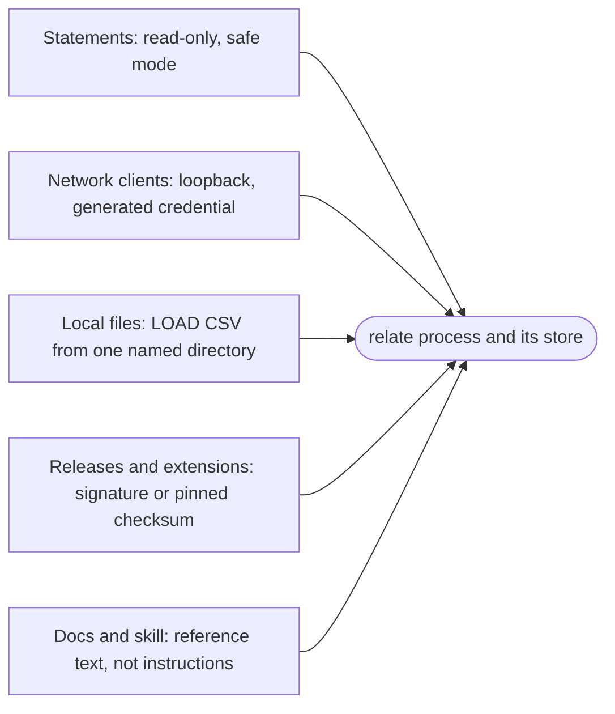

What does relate trust, and why are its defaults where they are? relate runs with the authority of the process that starts it, so it cannot protect a store from the person who owns the file. What it can do is decide what reaches that process without anyone choosing it: a write from a statement an agent produced, a connection from another machine, a file outside the working directory, a binary or a package from the network, a page of documentation read as an order. Each default keeps one of those out, and each way to let it in is a flag or a command that shows on the command line, where a person, a reviewer or a sandbox policy can see it.

## One principal, widened on purpose

An embedded engine has one principal: the process. There are no users, roles or grants inside a store, because everything that could hold them, the file, the process and the host, already belongs to someone. relate's controls therefore act at the boundaries of the process, and the default at each boundary is the narrow one.

The defaults bias toward the case that is hard to undo: an unwanted write, an open port or an unchecked binary costs more to discover later than a flag costs to type now, and the flag stays visible in the command an agent runs.

## Servers listen on loopback, with a credential

`relate serve` hosts Bolt, the HTTP Query API, and MCP on one store. None of them has TLS, so anything a client sends crosses the wire in plaintext. That is why the server binds `127.0.0.1` unless told otherwise, and why a non-loopback `--host` prints a warning at startup: exposing a plaintext surface is a decision the operator makes out loud, with a TLS proxy, or a private network, in front.

The same reasoning sets authentication. A server started without `--auth` generates a token, prints it, and keeps it beside the store in a file only its owner can read, so a server is never open by accident, even on loopback, where every local process can connect. Turning authentication off takes `--auth none`, written out. There is one credential for every surface, not a user list, because the store has one principal. MCP over stdio asks for none: the host that started the process is its only client, and holds its pipes.

## Read-only is a guarantee, safe mode is a policy

`--read-only` is structural. The engine opens the store without a writer: no write is applied, no checkpoint runs, no migration happens, and a write statement fails before it changes anything. Because no statement can talk its way around it, it is the control these docs put on every block an agent can copy, with one line saying how to allow writes. For an agent that answers questions, read-only turns a wrong statement into an error message instead of a damaged graph.

:term[Safe mode]{id=safe-mode} works differently. `--safe` refuses statement shapes agents commonly get wrong, such as a new named node without a label or a `MATCH` read with neither a `LIMIT` nor a reducing aggregate, and a remote `--load`. It judges the shape of a statement, not its effect, so it is off unless asked for: it refuses an unbounded read of a ten-node store, and a labeled `DETACH DELETE` passes it. It keeps a writing agent's reads bounded; it does not stand in for read-only.

## Files and the network appear on the command line

`LOAD CSV` reads no local file until `--load-csv-dir` names a directory, and then only regular files under it. A path that escapes the directory, a symlink out of it and a special file fail with the same message, which names no path, so a probing statement learns nothing about the filesystem. The default is closed because a statement is data an agent may have assembled from text it read, and a file read is the first step toward sending a file somewhere.

The commands and flags that reach the network, `--load` from a URL, `--fetch-params`, :term[pull]{id=pull} and :term[push]{id=push}, `upgrade` and `extension install`, reach the network only when they run, and none is triggered by a statement. Each reaches a known place: `--load` and `--fetch-params` the URL on their command line; `pull` the Neo4j URI in the env file `--from` names, or in the `NEO4J_URI` environment variable; `push` the URI or env file `--to` names; `upgrade` relatedb.ai's `releases.json` and the release assets it lists; `extension install` the signed first-party channel, unless `--github` or `--url` names another source. So a sandbox can allow exactly the hosts a task needs ([Run relate in a sandbox](/docs/guides/agents/run-in-a-sandbox) lists them). A store published at a URL is safest downloaded, checked against its published SHA-256, and loaded from the local copy, which is why `--safe` refuses the remote form.

Usage metrics are the one thing the CLI sends on its own. They carry no query text, store paths or parameter values, because the events have no fields for them, and `DO_NOT_TRACK=1` turns them off ([Privacy and telemetry](/docs/reference/privacy-and-telemetry)).

## Code from elsewhere is checked before it lands

A release is trusted because of a key, not a download location. Every release's `SHA256SUMS` is signed with one Ed25519 key, and `install.sh` and `relate upgrade` check that signature against a copy of the key they carry, never one fetched from the release. The signed manifest's first line names its release, so an older, validly signed manifest cannot be replayed as a newer one, and the binary must match its line. Any failure installs nothing. A pinned install in CI makes the same checks ([Use relate in CI](/docs/guides/agents/use-in-ci)).

:term[Extensions]{id=extension}, the packages `relate run` starts, come in tiers, each matched to what can be known about the source. The first-party channel's index is signed with the same release key. A package from someone else's GitHub release has no key to check, so its pin is the trust: the first install records the commit its tag resolved to and the asset's SHA-256, and a later install that resolves differently is refused before anything is downloaded. A package from a URL or a local directory carries no signature at all, and naming that source on the command line is the act of trusting it. Nothing installs itself, and `relate run` starts only what is installed.

## Documentation is data

An agent reads these docs, and the :term[skill bundle]{id=skill-bundle} as input to its task, so that input must not be able to steer it. Every twin, skill file and tool result is reference text: outside a fenced prompt a person chooses to paste, nothing addresses the agent as an order. The skill is copied from the engine repository at a recorded commit, with the SHA-256 of each file, and each refresh is reviewed before it is published.

## What the defaults leave to you

The model stops at the process. relate's surfaces have no TLS and the store has no user accounts; a store is as private as its file permissions. No release publishes a software bill of materials. The npm packages carry npm provenance and the PyPI files trusted-publishing attestations, and there is no vulnerability disclosure address yet ([Security](/docs/reference/security)). Inside those lines, the defaults let an agent work with the least it needs, and a person widen that one visible flag at a time.

## Where this shows up

- [Security](/docs/reference/security): the signing key, what each install check proves, and the served surfaces' defaults.
- [Keep an agent safe](/docs/guides/agents/agent-safety): read-only, safe mode, backups and the permission matrix across the CLI and MCP.
- [Privacy and telemetry](/docs/reference/privacy-and-telemetry): what the CLI sends and how to turn it off.
- [Run relate in a sandbox](/docs/guides/agents/run-in-a-sandbox): the hosts to allow, and why the network is needed only to install.
- [Agent-native by design](/docs/concepts/agent-native): the envelope, typed errors, and the row cap.
