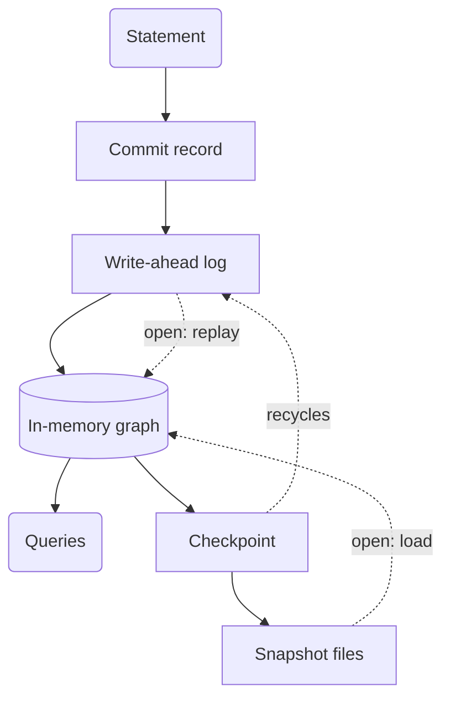

What happens to a write between the statement and the disk, and what can a crash take back? In relate, every commit takes one path: its changes are appended to the :term[store]{id=store}'s :term[write-ahead log]{id=wal} (WAL), then applied to the graph in memory, which is where every query reads. Disk is for recovery, not for answering queries. Under the default durability mode the log is synced to disk before a commit is acknowledged, so a crash loses no acknowledged write; the two relaxed modes skip that wait and accept a stated loss window instead.

## One write path

A statement collects its changes privately while it runs. At commit they become one record of physical changes: a node or relationship created or deleted, a property set or removed, or a label added or removed. The record is not Cypher text, so replaying it never re-runs a query. relate appends the record to the WAL first and applies it to the in-memory graph second; the graph in memory is never the source of a commit.

A single statement outside a transaction is one commit. An explicit transaction collects all its statements and appends one record at `COMMIT`; a rollback appends nothing. [Transactions and concurrency](/docs/concepts/transactions-and-concurrency) covers isolation and conflicts.

## The write-ahead log

The WAL is a series of segment files, `wal/NNNNNNNN.log` in a directory store (`.cypherlite/wal/` under the `markdown` codec) and the same tree inside a `.rl` file. Each record carries a checksum. One commit's record can be at most 64 MiB; a larger commit is refused before anything is written, and splitting it into smaller transactions clears it.

On open, relate loads the latest :term[snapshot]{id=snapshot} and replays every WAL record written after the snapshot's position in the log. Committed writes that never reached a snapshot survive this way. A crash can leave a final record cut short, which recovery does not count as a commit; [Recover from a crash](/docs/guides/operate/crash-and-recovery) covers what recovery does and the errors it can report.

## Checkpoints

A :term[checkpoint]{id=checkpoint} turns the log into a snapshot. It pins a position in the log, writes the committed state up to it through the store's codec, then recycles the closed WAL segments the snapshot now covers. Writers do not stop: new commits go to the next segment while the snapshot is written.

A checkpoint runs when the current segment reaches 64 MiB or 10,000 commits, every 300 seconds by default (`--checkpoint-interval-secs`, or `RELATE_CHECKPOINT_INTERVAL_SECS` for `relate serve`), and when a writable store closes cleanly. The CLI closes cleanly on every exit from a writable run, so a store last written from the CLI has its state in the snapshot. A process that keeps a store open, such as an application or `relate serve`, carries recent commits in the WAL until the next checkpoint. That is why a backup copies the WAL along with the snapshot, or uses `relate clone`.

An in-memory store has no files, so its checkpoints only recycle the WAL.

## Codecs

A :term[codec]{id=codec} is the encoding a checkpoint writes the snapshot in. `parquet`, the default, writes compact columnar files and rewrites only the id ranges that changed. `json` rewrites one readable `graph.json` every time. `markdown` writes one note per node. The WAL's format is the same under every codec.

Queries never read the snapshot files, so the codec decides size on disk, checkpoint cost and how long an open takes to load, not how fast a statement runs. A store keeps the codec it was created with; `relate clone --to-snapshot-format` makes a copy in another.

## Durability modes and their loss windows

The durability mode decides when a commit is acknowledged relative to the WAL sync. It is chosen per open with `--durability-mode` or `RELATE_DURABILITY_MODE`, and is not stored in the store.

| Mode | A commit is acknowledged | A crash can lose |
| --- | --- | --- |
| `full` (default) | After the WAL is synced to disk | No acknowledged write |
| `everysecond` | After it is applied; the WAL is synced about once per second | About the last second of acknowledged writes; slow scheduling or storage can widen the window |
| `snapshot` | Without a WAL sync | Every write since the last completed checkpoint: up to 300 seconds of writes under the default timer, fewer when the WAL fills first |

The relaxed modes exist for work that can be rebuilt: a bulk load from a file that still exists, or a scratch store an agent fills and throws away. [Choose a durability mode](/docs/guides/operate/durability-modes) covers when each fits and how to set it.

## Trade-offs against a page cache design

Many databases keep their data in files on disk and cache recently used pages in memory. Their working set can be larger than RAM, at the cost of reads that sometimes wait on disk and a cache that needs warming and tuning. relate takes the other side of that trade:

| relate's choice | What it gives | What it costs |
| --- | --- | --- |
| The whole graph in memory | Reads never wait on disk; there is no cache to size or warm | The graph and its indexes must fit in memory; there is no paging to disk |
| Disk holds a snapshot and a log | Recovery is load-then-replay, the same path as every open | An open reads the whole snapshot, so startup grows with the graph rather than with what the first query touches |
| Snapshots in open formats | `graph.json`, markdown notes and Parquet files can be read by other tools, and JSON can be diffed in review | A `json` checkpoint rewrites the whole file, so large stores favor `parquet` |
| One process owns the store | No shared cache or lock manager between processes | A second process reads a directory store with `--read-only`, or goes through `relate serve` |

The reason for this shape is the job relate is built for: an embedded graph that one application or agent owns, small enough to hold in memory, where the slow part should never be a cache miss. The disk remembers the graph; memory answers the questions.

## Where this shows up

- [Choose a store layout](/docs/guides/storage/choose-a-store-layout): in memory, a directory or a `.rl` file, and which codec.
- [Back up and restore a store](/docs/guides/storage/backup-and-restore): why a backup needs the WAL, and `relate clone`.
- [Choose a durability mode](/docs/guides/operate/durability-modes): setting `full`, `everysecond` or `snapshot`.
- [Recover from a crash](/docs/guides/operate/crash-and-recovery): WAL replay and its errors.
- [Upgrade a store](/docs/guides/operate/upgrade-a-store): how a newer release migrates a store on open.
- [Size a store and its memory](/docs/guides/operate/sizing-and-memory): the memory a graph needs.
- [Storage formats](/docs/reference/storage/formats): the files, codecs, and version markers.
- [WAL and checkpoints](/docs/reference/storage/wal-and-checkpoints): the segment and record format, checkpoint triggers, and replay.
- [Limits and sizing](/docs/reference/storage/limits-and-sizing): the 64 MiB commit record and the other limits.
