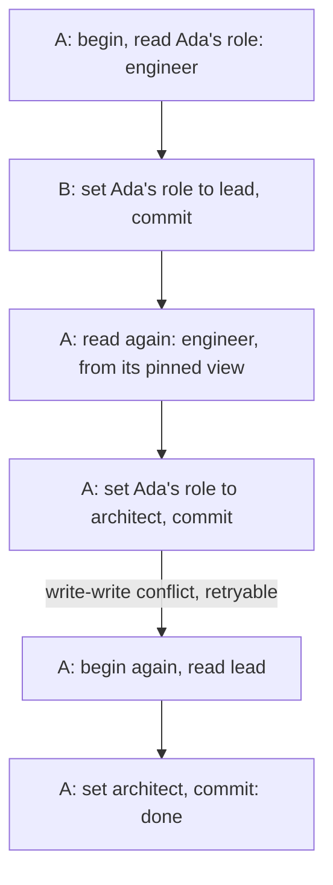

What happens when two things use a relate store at once? Inside one process, readers never block and never see a half-finished write: each statement reads the graph as of the last commit before it started. Writers run side by side but commit one at a time, and when two :term[transactions]{id=transaction} change the same node or relationship, the later commit fails with a retryable :term[write-write conflict]{id=conflict} instead of overwriting the first. Across processes, a store has one writer; other processes can read a :term[directory store]{id=directory-store} with `--read-only`.

## One process, one writer path

A persistent :term[store]{id=store} belongs to the process that opened it for writing. The engine holds the whole graph in that process's memory, so there is no shared buffer for a second process to write through. A second writable open of the same store fails at once with `storage locked: <path>` (exit code 5, not retryable until the first process exits). Several clients that need to write share the store through one process instead: the application itself, or `relate serve` hosting Bolt, HTTP, and MCP clients on one engine.

Inside that process, many statements can run at once on different threads and connections. Every commit passes through one point, the append to the write-ahead log, which puts commits in a single order.

## How a reader sees a consistent graph

relate keeps several versions of each changed node and relationship, each stamped with the commit that made it. A reader pins its starting point in the commit order and sees only versions committed by then. Nothing is copied to make that view, and readers take no lock, so a long read and a stream of writes run together. Old versions are dropped once no reader still needs them.

The starting point depends on the transaction:

| Transaction | Reads see |
| --- | --- |
| Autocommit, the default: one statement is one commit | The graph as of the last commit before the statement started |
| Explicit: `begin` … `commit` on a client, `.begin` … `.commit` in the CLI shell or a piped script ([shell dot commands](/docs/reference/cli#shell-dot-commands)) | The graph as of the last commit before `begin`, plus the transaction's own writes, until it ends |

An explicit transaction keeps its writes in a private overlay and appends them to the log once, at commit. A dropped connection, or a `.quit` with a transaction open, rolls it back. Transactions don't nest: a second `begin` fails with `already in a transaction`. After a statement fails inside one, every later statement and the commit fail with `transaction failed; rollback required` until it rolls back.

## Write-write conflicts and retry

Writers are optimistic. Each one runs against its pinned view and finds out at commit whether another transaction got there first.



This Node.js program plays the same sequence on the example graph, with two connections to one in-memory store:

```js run name=conflict title="conflict.cjs"
const { Database } = require("@relate/relate");

const db = Database.open(":memory:");
const a = db.connect();
const b = db.connect();

a.query(`CREATE (ada:Person {name: 'Ada', role: 'engineer'}),
       (grace:Person {name: 'Grace', role: 'engineer'}),
       (noor:Person {name: 'Noor', role: 'maintainer'}),
       (relate:Project {name: 'relate', language: 'Rust'}),
       (tck:Project {name: 'opencypher-tck', language: 'Gherkin'}),
       (ada)-[:WORKS_ON {since: 2024}]->(relate),
       (grace)-[:WORKS_ON {since: 2023}]->(relate),
       (grace)-[:WORKS_ON {since: 2022}]->(tck),
       (noor)-[:MAINTAINS]->(relate),
       (ada)-[:KNOWS]->(grace)`);

const roleOf = (conn) =>
  conn.query("MATCH (p:Person {name: $name}) RETURN p.role AS role", { name: "Ada" }).rows[0].role;

// A begins; its reads now come from the last commit before begin.
a.begin();
console.log(`A reads: ${roleOf(a)}`);

// B changes the same node in autocommit.
b.query("MATCH (p:Person {name: 'Ada'}) SET p.role = 'lead'");
console.log(`B commits, then reads: ${roleOf(b)}`);
console.log(`A still reads: ${roleOf(a)}`);

// A writes the node B changed; the conflict surfaces at commit.
a.query("MATCH (p:Person {name: 'Ada'}) SET p.role = 'architect'");
try {
  a.commit();
} catch (e) {
  console.log(`A's commit fails: ${e.message} (${e.code}, retryable: ${e.retryable})`);
}

// The failed transaction is gone; the retry starts from the latest commit.
a.begin();
console.log(`A's retry reads: ${roleOf(a)}`);
a.query("MATCH (p:Person {name: 'Ada'}) SET p.role = 'architect'");
a.commit();
console.log(`After the retry: ${roleOf(b)}`);
```

The engine never retries on its own. The client decides whether to run the transaction again, give up, or compensate, and the `retryable` flag tells it which errors can succeed on a second try. On the CLI a write-write conflict is the only retryable error; a syntax error, a locked store or a constraint violation is not. The CLI reports the conflict as `code` `conflict` with exit code 5 and `"retryable": true`, and the Python and Node.js clients put the same flag on the exception.

Conflict detection compares the nodes and relationships each transaction wrote. Two transactions that write different elements both commit, even when each read what the other wrote, so the engine does not detect write skew. Uniqueness and key constraints are the exception: commit also rejects the later of two transactions that introduce the same constrained value, with the same retryable conflict, and on the retry the statement reports the precise constraint violation.

## Reading from another process

`--read-only` opens a store without writing anything: no log append, no checkpoint, no migration. It comes in two freshnesses:

| Open | Sees | Works on |
| --- | --- | --- |
| `--read-only` | The store as it was when it opened; reopening picks up later commits | A directory store beside its writer; a `.rl` file only while no writer holds it; `:memory:`, where writes fail |
| `--read-only=live` | New commits as the writer appends them; a running statement keeps the view it pinned | A directory store only |

Several :term[read-only]{id=read-only} opens can share a directory store with its writer. A `.rl` file stays exclusive because the whole store is one file.

## Trade-offs

Pinned views make reads cheap and consistent: no read locks, no torn results, and a reader that started before a write never sees part of it. Optimistic commits keep writers from waiting on each other's locks. The cost moves to the client: under contention for the same nodes, some commits fail and run again, and only invariants that a uniqueness or key constraint can state are checked at commit; other read/write dependencies still commit, so the application guards them itself.

One writing process per store keeps the engine free of cross-process locking and cache coherence, and lets the graph live in one process's memory. A workload with many independent writer processes fits a client/server database better; [where relate fits](/docs/concepts/where-relate-fits) lists that condition with the others.

## Where this shows up

- [Share one store between two processes](/docs/guides/operate/two-processes-one-store): the locked error, and serving or reading a store beside its writer.
- [Keep an agent safe](/docs/guides/agents/agent-safety): exploring with `--read-only` and retrying only what is retryable.
- [Storage and durability](/docs/concepts/storage-and-durability): when a commit reaches disk under each durability mode.
- [Errors](/docs/reference/errors#cli-conflict-conflict): the conflict and locked errors with their codes and remedies.
- [Exit codes and errors](/docs/reference/cli/exit-codes-and-errors): exit code 5 and the `retryable` field.
