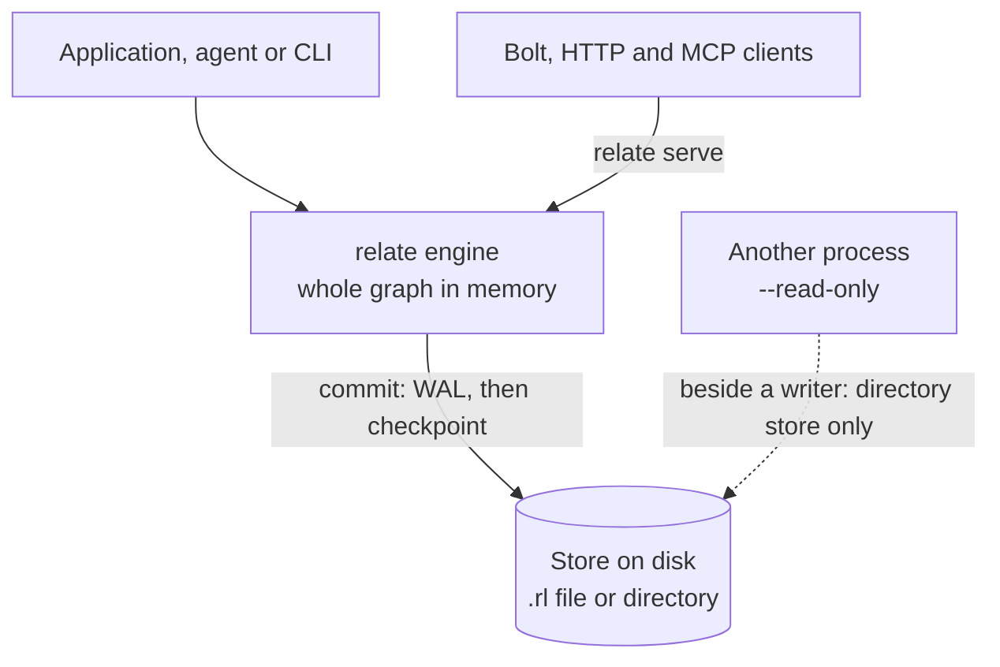

Does relate fit the job? It does when the graph belongs to one application, one agent or one tool, lives on one machine, and fits in that machine's memory. relate is an embedded graph database: the engine runs inside your process, the whole graph is held in memory, and Cypher statements run against it with nothing to deploy. When the data must be shared by many writing processes, outgrows one machine, or must stay up through a machine failure, a client/server or clustered database fits better.

Not the Neo4j Desktop Relate framework: that project publishes `@relate/cli` on npm, with a binary also named `relate` (as of 2026-11-07), and is unrelated to this one.

## The shape of the thing

A relate :term[store]{id=store} is a directory, a single `.rl` file, or `:memory:`. One process opens it and owns it. Inside that process the engine holds the whole graph in memory and answers statements from there; disk is for durability, not for scanning. Every commit goes to the write-ahead log (:term[WAL]{id=wal}) before it applies, and a checkpoint later writes the committed graph back to the store.

The same engine sits behind every front door: the `relate` CLI, the Python, Node.js, Rust, Java, Go and Swift clients, the C ABI, and a WebAssembly build for the browser. `relate serve` hosts one store in one process for Bolt, HTTP Query API and :term[MCP]{id=mcp} clients, so several clients can share a store through that one process.

## Use relate when

| Condition | What makes it work |
| --- | --- |
| The graph belongs to one application, agent, or tool on one machine | The engine runs in that process, so a statement never crosses a network |
| You want Cypher with nothing to install beyond a binary or a package | The CLI is one binary; each client package carries the engine; `:memory:` needs no files at all |
| A graph should travel as one file | A `.rl` store is one file that can be copied, attached or committed; `--load` opens one from a path or an `https` URL |
| An agent drives the database from a shell or over MCP | Envelopes, typed exit codes, a row cap under agent harnesses, the skill and the MCP :term[surface]{id=surface} ([agent-native by design](/docs/concepts/agent-native)) |
| Tests or CI need a fresh graph on every run | `:memory:` forgets everything when the process exits |
| Neo4j tools need to reach a local graph | `relate serve` speaks Bolt and the HTTP Query API; `relate pull` and `relate push` copy subgraphs from and to Neo4j or Aura |

## Use something else when

Each condition comes from a limit that is part of relate's shape, not a gap waiting for a patch. The [limitations reference](/docs/reference/limitations) is the complete list.

| Condition | The limit it comes from | Read more |
| --- | --- | --- |
| The graph outgrows one machine's memory | **RAM-resident.** The whole graph lives in memory; there is no paging, buffer pool, or spill to disk. `--logical-graph-size-limit` caps growth but does not move data to disk | [Size a store and its memory](/docs/guides/operate/sizing-and-memory) |
| Several processes must write the same store | **Single process.** A store has one owner. A second writable open fails with `storage locked: <path>` (exit code 5). Several clients can share one `relate serve` process instead | [Share one store between two processes](/docs/guides/operate/two-processes-one-store) |
| Many writers update the same nodes at once | **One writer path.** Transactions commit optimistically; when two overlap on the same data, the later one fails with `write-write conflict` and the client retries | [Transactions and concurrency](/docs/concepts/transactions-and-concurrency) |
| The service must survive a machine failure or scale across machines | **No cluster.** There is no replication, failover, or sharding | [Limitations](/docs/reference/limitations) |
| Users and roles must be kept apart inside one database | **No access control inside the store.** There are no users or roles; `relate serve` checks one basic-auth credential shared by every surface | [Security](/docs/reference/security) |
| One statement must join data from several graphs | **No cross-graph queries.** A store holds one user graph; `USE` names only the fixed :term[namespaces]{id=namespace}, and any other name fails with `Graph not found: <name>` | [Limitations](/docs/reference/limitations) |
| The job is analytics over data larger than memory | **Not out-of-core.** The engine is built for a working set in RAM, not for scanning columnar files | [Performance](/docs/reference/performance) |

For the cross-graph case, the usual answer inside relate is to keep data that a statement must join in one store, with labels to tell the parts apart, or to query each store and combine the results in application code.

## Trade-offs

The shape buys three things. Statements skip the network round trip a server needs, so a query costs the work it does. A store is a file or a folder the operating system already knows how to copy, back up, and delete. And there is no server process to configure, secure, or keep running.

The price is the list of conditions under "Use something else when". Memory bounds the graph, one process owns each store, and availability is the availability of that process. relate is pre-1.0; the [project reference](/docs/reference/project) states what that means for stability and upgrades.

## Where this shows up

- [Limitations](/docs/reference/limitations): every limit, with the error each one produces.
- [Performance](/docs/reference/performance): measured memory per element and load times.
- [Size a store and its memory](/docs/guides/operate/sizing-and-memory): estimate whether a graph fits.
- [Share one store between two processes](/docs/guides/operate/two-processes-one-store): what happens when a second process opens a store, and the ways to share one.
- [Architecture](/docs/concepts/architecture): how the engine, the planner, and the surfaces fit together.
