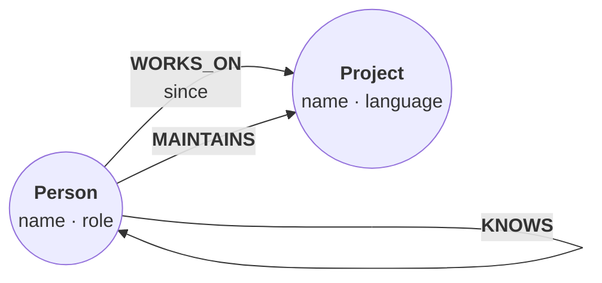

In about ten minutes, we build a graph of three people and two projects, query it, save it to a single `.rl` file, reopen it in a new process, ask relate how it plans a statement, and get the results as JSON. The first Cypher steps run right on this page; the rest run in your terminal.

## Prerequisites

- `relate` on your `PATH`: `relate --version` prints `Relate v1.0.1` on its first line. The [install page](/docs/get-started/install) takes about two minutes.
- A terminal on macOS or Linux.

## Create the graph

Every Cypher block on this page is a cell. It runs in your browser on an in-memory :term[store]{id=store}, with the same engine as the `relate` binary, and its recorded result sits under it. Press **Run** to run it yourself.

This statement creates three `Person` nodes, two `Project` nodes, and five relationships between them:

```cypher run name=seed
CREATE (ada:Person {name: 'Ada', role: 'engineer'}),
       (grace:Person {name: 'Grace', role: 'engineer'}),
       (noor:Person {name: 'Noor', role: 'maintainer'}),
       (relate:Project {name: 'relate', language: 'Rust'}),
       (tck:Project {name: 'opencypher-tck', language: 'Gherkin'}),
       (ada)-[:WORKS_ON {since: 2024}]->(relate),
       (grace)-[:WORKS_ON {since: 2023}]->(relate),
       (grace)-[:WORKS_ON {since: 2022}]->(tck),
       (noor)-[:MAINTAINS]->(relate),
       (ada)-[:KNOWS]->(grace)
```

Notice that a `CREATE` with no `RETURN` returns no rows; the counts tell you what it wrote.

The graph has two labels and three relationship types. Drawn as a model, one circle per label:



`CALL db.schema.visualization()` reports the same model from the data: one node per label and one relationship per type that connects them.

:::schema-live{cell=seed}
:::

## Query it

A `MATCH` describes a pattern, and `RETURN` picks what comes back. Who works on which project, and since when:

```cypher run name=team
MATCH (p:Person)-[w:WORKS_ON]->(proj:Project)
RETURN p.name AS person, proj.name AS project, w.since AS since
ORDER BY since
```

Grace works on both projects. Noor maintains `relate` rather than working on it, so she isn't in this result.

Values that change from run to run go in as `$parameters`. This cell binds `$name` from the JSON block in it:

```json data=who
{"name": "Grace"}
```

```cypher run name=projects params=who
MATCH (:Person {name: $name})-[:WORKS_ON]->(proj:Project)
RETURN proj.name AS project, proj.language AS language
ORDER BY project
```

Change the name to `Ada` and run it again: one project comes back.

Now let's see the whole thing. Returning paths gives the cell a graph view:

```cypher run name=graph
MATCH path = (:Person)-->()
RETURN path
```

Notice the five relationships: three `WORKS_ON`, one `MAINTAINS`, and one `KNOWS`.

## Save it to a .rl file

An in-memory store forgets everything when the process exits. That's the feature, and it's also why we now move to a file. Back in the terminal, make a new directory for the tutorial and move into it:

```bash
mkdir first-graph && cd first-graph
```

Write the same statement to a script, followed by a count:

```bash verify
cat > seed.cypher <<'EOF'
CREATE (ada:Person {name: 'Ada', role: 'engineer'}),
       (grace:Person {name: 'Grace', role: 'engineer'}),
       (noor:Person {name: 'Noor', role: 'maintainer'}),
       (relate:Project {name: 'relate', language: 'Rust'}),
       (tck:Project {name: 'opencypher-tck', language: 'Gherkin'}),
       (ada)-[:WORKS_ON {since: 2024}]->(relate),
       (grace)-[:WORKS_ON {since: 2023}]->(relate),
       (grace)-[:WORKS_ON {since: 2022}]->(tck),
       (noor)-[:MAINTAINS]->(relate),
       (ada)-[:KNOWS]->(grace);
MATCH (n) RETURN count(n) AS nodes;
EOF
```

Each statement in a script ends with `;`. Now run the script into a new store, `team.rl`. `relate query` reads the script from stdin, and `--database` names the file, which relate creates because it doesn't exist yet:

```bash verify
relate query --database ./team.rl --mode table < seed.cypher
```

```text
+-------+
| nodes |
+-------+
| 5     |
+-------+
```

`--mode table` asks for a table. relate prints one on a terminal anyway, but switches to JSON Lines (TOON with :term[agent mode]{id=agent-mode} on) when its output goes to a pipe, so passing the mode keeps your output the same as this page's.

The whole store is one file, `team.rl`, beside the script:

```bash verify
ls
```

```text
seed.cypher
team.rl
```

## Reopen it

Every `relate` command is a new process. This one opens `team.rl` again, :term[read-only]{id=read-only} with `--read-only`, so nothing can change it, and asks the question from the first query:

```bash verify
relate --database ./team.rl --read-only --mode table "MATCH (p:Person)-[w:WORKS_ON]->(proj:Project) RETURN p.name AS person, proj.name AS project, w.since AS since ORDER BY since"
```

```text
+---------+------------------+-------+
| person  | project          | since |
+---------+------------------+-------+
| "Grace" | "opencypher-tck" | 2022  |
| "Grace" | "relate"         | 2023  |
| "Ada"   | "relate"         | 2024  |
+---------+------------------+-------+
```

The same three rows: the graph survived the process. On the command line, `--param` binds a parameter. Single quotes keep the shell from reading `$name` itself:

```bash verify
relate --database ./team.rl --read-only --mode table --param name=Grace 'MATCH (:Person {name: $name})-[:WORKS_ON]->(proj:Project) RETURN proj.name AS project, proj.language AS language ORDER BY project'
```

```text
+------------------+-----------+
| project          | language  |
+------------------+-----------+
| "opencypher-tck" | "Gherkin" |
| "relate"         | "Rust"    |
+------------------+-----------+
```

## Read a query plan

`EXPLAIN` in front of a statement plans it without running it. relate prints the plan as a table, operator by operator:

```bash verify
relate --database ./team.rl --read-only --mode table "EXPLAIN MATCH (p:Person)-[:WORKS_ON]->(proj:Project {name: 'relate'}) RETURN p.name AS person ORDER BY person"
```

```text
Query: MATCH (p:Person)-[:WORKS_ON]->(proj:Project {name: 'relate'}) RETURN p.name AS person ORDER BY person
Plan:
+------------------+----+----------------------------------------+
| Operator         | Id | Details                                |
+------------------+----+----------------------------------------+
| + ProduceResults | 0  | 1 item(s), ordered                     |
+------------------+----+----------------------------------------+
| | + Expand       | 1  | (proj:Project)<-[:WORKS_ON]-(p:Person) |
+------------------+----+----------------------------------------+
Notifications:
Id 1: INFORMATION 03C91 Relate.Notification.Statement.MissingIndex: the equality predicate on name filters :Project without a range index on (:Project {name}) Remedy: CREATE INDEX relate_Project__name FOR (n:Project) ON (n.name)
```

Notice the notification on operator 1: it names the index that would make the lookup by `name` cheaper, and the statement that creates it. Two projects don't need one. Nothing ran, so the store is unchanged.

## Get JSON

Tables are for people. For a program, `--json` prints one JSON object per result: the rows in `data`, the statement's `timings` in milliseconds, and `planCache`, which says whether a cached plan served it. The object is indented on a terminal and one compact line when piped, as it is here. The timing numbers change from run to run:

```bash verify
relate --database ./team.rl --read-only --json --param name=Grace 'MATCH (:Person {name: $name})-[:WORKS_ON]->(proj:Project) RETURN proj.name AS project, proj.language AS language ORDER BY project'
```

```text
{"data":[{"language":"Gherkin","project":"opencypher-tck"},{"language":"Rust","project":"relate"}],"planCache":"miss","timings":{"elapsed_ms":0.560875,"execute_ms":0.36925,"lex_parse_ms":0.034,"lower_ms":0.048625,"parse_ms":0.121958,"plan_ms":0.060625000000000005,"result_generation_ms":0.00025,"rewrite_ms":0.0077919999999999994}}
```

`--mode envelope` prints one richer object per result, the :term[envelope]{id=envelope}, which adds the column names and their types:

```bash verify
relate --database ./team.rl --read-only --mode envelope --param name=Grace 'MATCH (:Person {name: $name})-[:WORKS_ON]->(proj:Project) RETURN proj.name AS project, proj.language AS language ORDER BY project'
```

```text
{"columnTypes":["STRING","STRING"],"columns":["project","language"],"notifications":[],"planCache":"miss","rows":[{"language":"Gherkin","project":"opencypher-tck"},{"language":"Rust","project":"relate"}],"timings":{"elapsed_ms":0.458333,"execute_ms":0.26966700000000005,"lex_parse_ms":0.034375,"lower_ms":0.044542,"parse_ms":0.11875,"plan_ms":0.06125,"result_generation_ms":0.00033299999999999996,"rewrite_ms":0.008041},"truncated":false}
```

Notice that keys inside each row are sorted, so `columns` is where the query's column order lives. An empty result still lists its columns, so "no rows" never looks like "no output":

```bash verify
relate --database ./team.rl --read-only --mode envelope --param name=Zed 'MATCH (:Person {name: $name})-[:WORKS_ON]->(proj:Project) RETURN proj.name AS project ORDER BY project'
```

```text
{"columnTypes":["ANY"],"columns":["project"],"notifications":[],"planCache":"miss","rows":[],"timings":{"elapsed_ms":0.43175,"execute_ms":0.245625,"lex_parse_ms":0.031625,"lower_ms":0.044875,"parse_ms":0.115958,"plan_ms":0.060417,"result_generation_ms":0.000292,"rewrite_ms":0.00825},"truncated":false}
```

Nobody called Zed works here yet.

## What you built

You have a graph of people and projects in one file, `team.rl`, that you created from a script, reopened read-only in a new process, and queried with parameters. You've read a plan before running a statement, and you've had the same rows as a table, a JSON array, and an envelope. On a terminal, `relate query --database ./team.rl` with no statement opens an interactive shell on the file, for when you'd rather type than script.

## Next

- [Script the CLI](/docs/guides/cli/scripting): run scripts from files, branch on exit codes, and bound statements with `--timeout`.
- [Embed relate in a Python app](/docs/get-started/python): the same graph, from a program.
- [Embed relate in a Node.js app](/docs/get-started/node): the same graph, from JavaScript.
- [CLI flags](/docs/reference/cli/flags): every flag, its default, and its environment variable.
- [Answer "what's nearby?" from memory](/cookbook/nearby-places/): a worked example on a larger graph, runnable in the browser.
