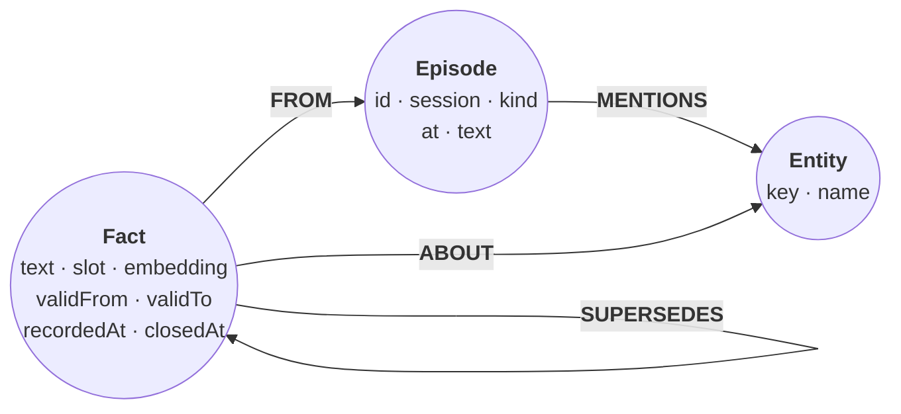

This guide shows you how to model an agent's long-term memory as a graph: the entities it knows about, the episodes it learned things in, and facts that carry two time ranges and a link to their evidence. The cells on this page run in order on one in-memory :term[store]{id=store}, so by the end the page holds a working memory you can query.

## Prerequisites

- Cypher reads and writes with parameters, as in [Your first graph](/docs/get-started/first-graph).
- Embeddings from your model for each fact and each question. The examples use 4-dimension vectors written by hand, so their results never change; a real model's vectors have hundreds of dimensions.

## The model

Three node labels and four relationship types. Nothing is ever deleted: a correction closes the old fact and links it from the new one.

| Element | Holds | Role |
| --- | --- | --- |
| `Entity` | `key`, `name`, plus its domain labels | What memory is about. `key` is unique, so every write finds the same node |
| `Episode` | `id`, `session`, `kind`, `at`, `text` | Where and when the agent learned something: a message, or a tool call and its result |
| `Fact` | `id`, `text`, `slot`, `validFrom`, `validTo`, `recordedAt`, `closedAt`, `embedding` | One statement about entities. `slot` names what it answers, and holds one current fact at a time |
| `(:Episode)-[:MENTIONS]->(:Entity)` | | The entities an episode names |
| `(:Fact)-[:FROM]->(:Episode)` | | Provenance: the evidence for the fact |
| `(:Fact)-[:ABOUT]->(:Entity)` | | What the fact describes |
| `(:Fact)-[:SUPERSEDES]->(:Fact)` | | A correction and the fact it replaced |

A fact has two time axes. Valid time, `validFrom` to `validTo`, is when it held in the world. Record time, `recordedAt` to `closedAt`, is when the agent believed it. A late correction makes them disagree, and the graph keeps both answers.



Once the cells on this page have run, the database can report its own model. `CALL db.schema.visualization()` returns one node per label, with its indexes and constraints, and one relationship per type and pair of labels:

:::schema-live
:::

## Start from the graph you have

Memory attaches to the domain graph, in this guide the shared example graph: three people and two projects.

```cypher run name=seed
CREATE (ada:Person {name: 'Ada', role: 'engineer'}),
       (grace:Person {name: 'Grace', role: 'engineer'}),
       (noor:Person {name: 'Noor', role: 'maintainer'}),
       (relate:Project {name: 'relate', language: 'Rust'}),
       (tck:Project {name: 'opencypher-tck', language: 'Gherkin'}),
       (ada)-[:WORKS_ON {since: 2024}]->(relate),
       (grace)-[:WORKS_ON {since: 2023}]->(relate),
       (grace)-[:WORKS_ON {since: 2022}]->(tck),
       (noor)-[:MAINTAINS]->(relate),
       (ada)-[:KNOWS]->(grace)
```

Every person and project becomes an entity, with a lowercase `key` that writes can match on:

```cypher run name=entities
MATCH (n) WHERE n:Person OR n:Project
SET n:Entity, n.key = toLower(n.name)
RETURN n.key AS key, labels(n) AS labels
ORDER BY key
```

## Create the schema

Uniqueness constraints keep one node per entity key, episode, and fact. A range index serves lookups by slot. The vector index serves recall by meaning; `WITH [f.closedAt]` declares the property a search may filter on inside the index, so recall can skip closed facts before it counts to `k`.

```cypher run name=schema
CREATE CONSTRAINT entity_key IF NOT EXISTS FOR (e:Entity) REQUIRE e.key IS UNIQUE;
CREATE CONSTRAINT episode_id IF NOT EXISTS FOR (ep:Episode) REQUIRE ep.id IS UNIQUE;
CREATE CONSTRAINT fact_id IF NOT EXISTS FOR (f:Fact) REQUIRE f.id IS UNIQUE;
CREATE INDEX fact_slot IF NOT EXISTS FOR (f:Fact) ON (f.slot);
CREATE VECTOR INDEX fact_embedding IF NOT EXISTS
  FOR (f:Fact) ON (f.embedding) WITH [f.closedAt]
  OPTIONS {indexConfig: {`vector.dimensions`: 4, `vector.similarity_function`: 'cosine'}}
```

## Remember a session

In session `s1` the agent hears two messages and extracts one fact from each. The extraction is your model's job; this block holds its output.

```json data=session
{
  "episodes": [
    {"id": "e1", "session": "s1", "kind": "message", "at": "2026-03-02T10:00:00Z",
     "text": "Grace does the release review for relate.", "mentions": ["grace", "relate"]},
    {"id": "e2", "session": "s1", "kind": "message", "at": "2026-03-02T10:05:00Z",
     "text": "Noor goes through new relate issues every Monday.", "mentions": ["noor", "relate"]}
  ],
  "facts": [
    {"id": "f1", "episode": "e1", "text": "Grace reviews each relate release.", "slot": "relate/release-reviewer",
     "about": ["grace", "relate"], "validFrom": "2026-01-05T00:00:00Z", "embedding": [0.9, 0.1, 0.0, 0.2]},
    {"id": "f2", "episode": "e2", "text": "Noor triages new relate issues on Mondays.", "slot": "relate/triage",
     "about": ["noor", "relate"], "validFrom": "2026-02-02T00:00:00Z", "embedding": [0.1, 0.9, 0.2, 0.0]}
  ]
}
```

The first statement writes the episodes and what they mention. The second writes each fact `FROM` its episode and `ABOUT` its entities. A fact's `recordedAt` is its episode's time. `vector(f.embedding, 4, FLOAT32)` stores a typed vector and fails the statement if an embedding has the wrong length.

```cypher run name=remember params=session
UNWIND $episodes AS e
CREATE (ep:Episode {id: e.id, session: e.session, kind: e.kind, at: datetime(e.at), text: e.text})
WITH ep, e
UNWIND e.mentions AS key
MATCH (n:Entity {key: key})
CREATE (ep)-[:MENTIONS]->(n);

UNWIND $facts AS f
MATCH (ep:Episode {id: f.episode})
CREATE (x:Fact {id: f.id, text: f.text, slot: f.slot,
                validFrom: datetime(f.validFrom), recordedAt: ep.at,
                embedding: vector(f.embedding, 4, FLOAT32)})-[:FROM]->(ep)
WITH x, f
UNWIND f.about AS key
MATCH (n:Entity {key: key})
CREATE (x)-[:ABOUT]->(n);

MATCH (x:Fact)-[:FROM]->(ep:Episode)
RETURN ep.id AS episode, x.text AS fact, x.slot AS slot
ORDER BY episode
```

## Record a correction

On 20 March, in session `s2`, a tool call reads the repository's owners file and finds that Ada took over release review on 10 March. The agent was wrong for ten days, and now it knows.

```json data=correction
{
  "episode": {"id": "e3", "session": "s2", "kind": "tool_call", "at": "2026-03-20T09:00:00Z",
              "text": "read_file CODEOWNERS: release/ @ada", "mentions": ["ada", "relate"]},
  "fact": {"id": "f3", "text": "Ada reviews each relate release.", "slot": "relate/release-reviewer",
           "about": ["ada", "relate"], "validFrom": "2026-03-10T00:00:00Z", "embedding": [0.85, 0.15, 0.05, 0.25]}
}
```

One statement writes the episode and the new fact, then closes the current fact in the same slot: its `validTo` becomes the new fact's `validFrom`, its `closedAt` the time the agent learned it.

```cypher run name=correct params=correction
WITH $episode AS e, $fact AS f
CREATE (ep:Episode {id: e.id, session: e.session, kind: e.kind, at: datetime(e.at), text: e.text})
CREATE (new:Fact {id: f.id, text: f.text, slot: f.slot,
                  validFrom: datetime(f.validFrom), recordedAt: ep.at,
                  embedding: vector(f.embedding, 4, FLOAT32)})-[:FROM]->(ep)
WITH ep, new, e, f
CALL (ep, e) { UNWIND e.mentions AS key MATCH (n:Entity {key: key}) CREATE (ep)-[:MENTIONS]->(n) }
CALL (new, f) { UNWIND f.about AS key MATCH (n:Entity {key: key}) CREATE (new)-[:ABOUT]->(n) }
MATCH (old:Fact {slot: new.slot}) WHERE old <> new AND old.closedAt IS NULL
SET old.validTo = new.validFrom, old.closedAt = new.recordedAt
CREATE (new)-[:SUPERSEDES]->(old)
RETURN new.text AS current, old.text AS replaced, old.validTo AS validTo, old.closedAt AS closedAt
```

## Recall

A recall takes the question's embedding, finds the nearest current facts, and brings back what each is about, the episode it came from, and what it replaced. The question is "Who reviews relate releases?".

```json data=question
{"vector": [0.88, 0.12, 0.02, 0.22], "k": 2}
```

```cypher run name=recall params=question
MATCH (f:Fact)
SEARCH f IN (VECTOR INDEX fact_embedding FOR $vector WHERE f.closedAt IS NULL LIMIT $k) SCORE AS score
MATCH (f)-[:FROM]->(ep:Episode)
RETURN f.text AS memory, round(score, 4) AS score,
       COLLECT { MATCH (f)-[:ABOUT]->(e:Entity) RETURN e.name ORDER BY e.name } AS about,
       ep.kind AS learnedFrom, ep.text AS evidence,
       COLLECT { MATCH (f)-[:SUPERSEDES]->(old:Fact) RETURN old.text } AS replaced
ORDER BY score DESC
```

Grace's fact is the nearest by meaning, and it does not come back: the filter inside the search drops closed facts before the `LIMIT`. The answer names the tool call it rests on, so an agent can quote its evidence.

## Ask what the agent believed

The two time axes answer two questions about 15 March: who reviewed releases then, as the agent knows now, and who the agent thought did, at the time.

```json data=asof
{"slot": "relate/release-reviewer", "on": "2026-03-15T00:00:00Z"}
```

```cypher run name=asof params=asof
MATCH (f:Fact {slot: $slot})
WITH datetime($on) AS t, collect(f) AS facts
RETURN [x IN facts WHERE x.validFrom <= t AND (x.validTo IS NULL OR t < x.validTo) | x.text] AS trueOn,
       [x IN facts WHERE x.recordedAt <= t AND (x.closedAt IS NULL OR t < x.closedAt) | x.text] AS believedOn
```

The answers differ, and both are right. That is the audit trail for "why did the agent ask Grace on 15 March?".

The slot's two facts, with their four times, show why on both axes. Ada's fact holds from 10 March, but the agent wrote it only on 20 March, and until then it still believed Grace's:

```cypher run name=slot-facts params=asof
MATCH (f:Fact {slot: $slot})
RETURN f.text AS fact, f.validFrom AS validFrom, f.validTo AS validTo,
       f.recordedAt AS recordedAt, f.closedAt AS closedAt
ORDER BY f.recordedAt
```

:::timeline{cell=slot-facts label=fact start=validFrom end=validTo record-start=recordedAt record-end=closedAt asof=asof param=on match=trueOn match-record=believedOn}
:::

## Serve it to the agent

Recall needs only reads, so an agent that recalls gets the memory store over MCP opened read-only, and only the process that writes memory holds it writable:

```bash
relate serve --mcp stdio --database ./memory.rl --read-only
```

To allow writes, remove `--read-only`. Opened read-only, the server lists `read_cypher` and `get_schema`; the recall statement runs through `read_cypher` with `vector` and `k` as its `parameters`. [Connect over MCP](/docs/guides/agents/connect-over-mcp) has the block for each host.

## Verify

Each slot holds at most one current fact. This check returns no rows while that holds:

```cypher run name=verify
MATCH (f:Fact) WHERE f.closedAt IS NULL
WITH f.slot AS slot, count(*) AS current WHERE current > 1
RETURN slot, current
```

## If it goes wrong

**A write fails with ``semantic error: ConstraintValidationFailed: `entity_key` uniqueness``.** Two writes created the same entity. Write entities with `MERGE (e:Entity {key: $key})` so a repeat finds the existing node.

**A write fails with `type error: vector() dimension does not match list`.** An embedding's length differs from the one the statement names. Make the `vector(…, <dimensions>, FLOAT32)` call and the index's `vector.dimensions` match your model.

**Recall fails with `type error: VectorIndexDimensionalityMismatch`.** The question's vector has a different length from the index. Embed the question with the same model as the facts.

**Recall returns fewer than `k` rows.** The `f.closedAt IS NULL` filter sits after `SEARCH`, so it filters the `k` rows the index already chose. Inside the search, on a property declared with `WITH [...]`, it runs before the `LIMIT`.

**Recall returns closed facts.** The search has no `WHERE f.closedAt IS NULL`. Put it inside the search's parentheses.

## Related

- [Pick up where the last session left off](/cookbook/agent-memory/): sessions, slots, and supersession on a larger extraction.
- [Know what an agent believed, and when](/cookbook/bitemporal-decisions/): valid time and record time through late corrections and a rejection.
- [Tool-call provenance](/cookbook/tool-call-provenance/): every tool call recorded in the graph it touched.
- [Hybrid recall](/cookbook/hybrid-recall/): vector and full-text search fused in one statement.
- [Search by vector similarity](/docs/guides/cypher/vector-search): vector indexes and `SEARCH` in depth.
- [Use relate with LangGraph](/docs/guides/integrations/langgraph): a reduced form of this model behind a LangGraph agent's tools.
