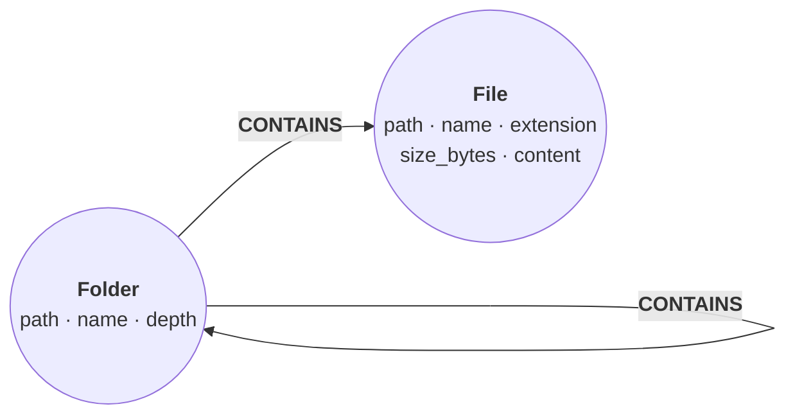

This guide shows you how to import a directory tree into a store with `fs-to-graph`, a first-party extension, and which queries to run on the graph it builds. Each folder becomes a `:Folder` node, each file a `:File` node holding its text when the text is small enough, and a `CONTAINS` :term[relationship]{id=relationship} links every folder to what is in it. A full-text index over file names and text makes the tree searchable.

## Prerequisites

- relate on your `PATH` ([Install relate](/docs/get-started/install)).
- `fs-to-graph` installed. It is on the first-party channel, and it is a self-contained binary that needs no other runtime ([Install and run an extension](/docs/guides/extensions/install-and-run)):

```bash
relate extension install fs-to-graph
```

## Import a directory

The examples import this tree, `team/`. It holds a dotfile, a 3-byte binary file, and a build folder:

```text
team
team/.env
team/README.md
team/docs
team/docs/roadmap.md
team/logo.bin
team/src
team/src/main.rs
team/target
team/target/debug
team/target/debug/out.txt
```

The run writes into the store named by `-d`, a new `tree.rl` in this example. `--ignore-patterns target/` leaves out the build folder:

```bash
relate run fs-to-graph team --ignore-patterns target/ -d ./tree.rl
```

```text
imported 3 folders, 4 files (6 CONTAINS edges) into the store — search it with:
  MATCH (f:File) SEARCH f IN (FULLTEXT INDEX file_content FOR 'term' LIMIT 10) RETURN f.path, f.name;
```

Three folders are `team`, `team/docs`, and `team/src`. Four files are the README, the roadmap, `main.rs`, and `logo.bin`; `.env` is a dotfile, so the walk skipped it.

The flags come from the extension's manifest, plus relate's own `-d`:

| Flag | Default | Meaning |
| --- | --- | --- |
| `DIR` | the current directory | The folder to import |
| `--max-content-bytes N` | `65536` | Store a file's text only when the whole file is at most N bytes; `0` stores no text |
| `--include-hidden` | off | Also import entries whose name starts with `.` |
| `--ignore-patterns VALUE` | none | Skip every file or folder with exactly this name; a trailing `/` matches folders only. Repeatable; no wildcards |
| `-d`, `--database PATH` | `:memory:` | The store to import into; relate opens it, not the extension |

With `--include-hidden` and no ignore pattern, the same tree imports as 5 folders, 6 files, and 10 `CONTAINS` relationships.

## The graph it builds



| Element | Properties |
| --- | --- |
| `:Folder` | `path`, `name` (the last path component), `depth` (`0` for the imported folder) |
| `:File` | `path`, `name`, `extension` (empty when there is none), `size_bytes`, `content` |
| `CONTAINS` | None; from a folder to each folder and file directly inside it |
| `file_content` | A :term[full-text index]{id=full-text-index} on `:File` over `name` and `content` |

A few rules decide what lands:

- `path` is the folder you passed, joined with each name under it. `team` gives `team/docs/roadmap.md`; an omitted `DIR` gives absolute paths. `path` is the key that `git-to-graph` joins on, so import both with the same `DIR`.
- `content` is present only when the whole file fits in `--max-content-bytes` and its first 8 KiB hold no zero byte and are valid UTF-8. When bytes after the first 8 KiB are not valid UTF-8, `content` holds the text up to the first invalid byte. For other files the :term[property]{id=property} is absent, not null.
- Symbolic links are never followed, and sockets, FIFOs, and device files are skipped.
- Every :term[node]{id=node} is merged on `path`, so importing the same tree again leaves the counts unchanged. A file deleted since the last run keeps its node; import into a new store to drop it.
- The whole import is one transaction. A failure rolls it back, and the store holds nothing from that run.

## Query the graph

The cells in this section run in your browser. The first writes the graph the run built for `team/`, with the same keys and values, so the queries return what they return on `tree.rl`:

```cypher run name=seed
CREATE (team:Folder {path: 'team', name: 'team', depth: 0}),
       (docs:Folder {path: 'team/docs', name: 'docs', depth: 1}),
       (src:Folder {path: 'team/src', name: 'src', depth: 1}),
       (readme:File {path: 'team/README.md', name: 'README.md', extension: 'md', size_bytes: 43,
                     content: '# team\nAda, Grace and Noor work on relate.\n'}),
       (roadmap:File {path: 'team/docs/roadmap.md', name: 'roadmap.md', extension: 'md', size_bytes: 47,
                      content: 'The planner rewrite lands in the next release.\n'}),
       (main:File {path: 'team/src/main.rs', name: 'main.rs', extension: 'rs', size_bytes: 37,
                   content: 'fn main() {\n    println!("hello");\n}\n'}),
       (logo:File {path: 'team/logo.bin', name: 'logo.bin', extension: 'bin', size_bytes: 3}),
       (team)-[:CONTAINS]->(readme), (team)-[:CONTAINS]->(docs),
       (team)-[:CONTAINS]->(logo), (team)-[:CONTAINS]->(src),
       (docs)-[:CONTAINS]->(roadmap), (src)-[:CONTAINS]->(main)
```

```cypher run name=index
CREATE FULLTEXT INDEX file_content IF NOT EXISTS FOR (f:File) ON EACH [f.name, f.content]
```

The tree as a graph:

```cypher run name=tree
MATCH (folder:Folder)-[c:CONTAINS]->(child)
RETURN folder, c, child
```

Find files by a word in their name or text with the :term[`SEARCH` clause]{id=search}. This is the starter query the run prints, with a term filled in:

```cypher run name=search
MATCH (f:File)
SEARCH f IN (FULLTEXT INDEX file_content FOR 'planner' LIMIT 10)
RETURN f.path AS file
```

Count files and bytes by extension:

```cypher run name=by-extension
MATCH (f:File)
RETURN f.extension AS extension, count(*) AS files, sum(f.size_bytes) AS bytes
ORDER BY files DESC, extension
```

List every file under a folder, at any depth, with how many levels down it sits:

```cypher run name=under-folder
MATCH p = (:Folder {path: 'team'})-[:CONTAINS*]->(f:File)
RETURN f.path AS file, length(p) AS levels
ORDER BY file
```

Find the files whose text was not stored, because they are binary or larger than `--max-content-bytes`:

```cypher run name=no-content
MATCH (f:File)
WHERE f.content IS NULL
RETURN f.path AS file, f.size_bytes AS bytes
```

On a code checkout, `fs-to-graph` and `git-to-graph` together give one store with the files and their history; [Import git history with git-to-graph](/docs/guides/extensions/git-to-graph) shows the joined queries.

## Verify

Count the nodes by label, opening the store read-only:

```bash
relate --database ./tree.rl --read-only --mode table "MATCH (n) RETURN labels(n)[0] AS label, count(*) AS nodes ORDER BY label"
```

```text
+----------+-------+
| label    | nodes |
+----------+-------+
| "File"   | 4     |
| "Folder" | 3     |
+----------+-------+
```

The counts match the run's summary line: 4 files and 3 folders.

## If it goes wrong

**`Error: This statement tried to commit a single WAL record of at least 64 MB. This is a safety limit protecting against memory exhaustion — the per-record WAL payload cap is 64 MB; commit the data in smaller transactions.`** (exit code 1). The import is one transaction, and the file text it writes went past the 64 MB limit on one write-ahead log record. Nothing from the run is committed. Store less text with a lower `--max-content-bytes` (or `0`), or leave out large folders with `--ignore-patterns`.

**`Error: the extension child exited with 1: not a directory: team/README.md`** (exit code 1). `DIR` must be a folder.

**`Error: the extension child exited with 1: invalid --ignore-patterns value: '/' is empty`** (exit code 1). A pattern is a file or folder name, optionally followed by `/`.

**`Error: no installed action 'fs-to-graph' — first-party extension available: relate extension install fs-to-graph`** (exit code 2). Install the extension first; `relate run` fetches nothing.

## Related

- [Import git history with git-to-graph](/docs/guides/extensions/git-to-graph): commits, authors, and co-changing files, joined to this graph on `path`.
- [Install and run an extension](/docs/guides/extensions/install-and-run): trust tiers, `list`, `remove`.
- [`SEARCH` reference](/docs/reference/cypher/search): full-text search options and scoring.
- [Codebase context graph](/docs/concepts/problems-relate-solves#codebase-context-graph): the problem this graph serves.
- [Answer codebase questions text search can't](/cookbook/codebase-context-graph/): a worked recipe over a repository's records.
