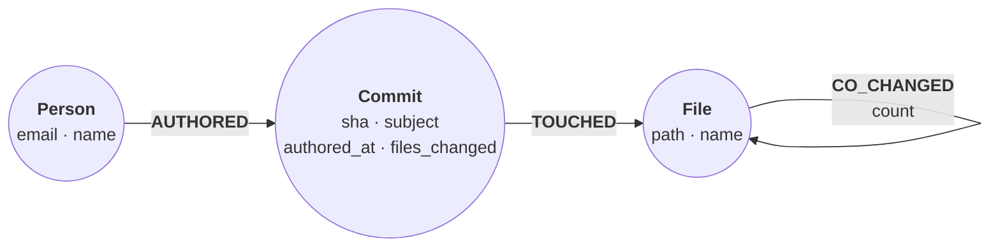

This guide shows you how to import a git repository's history into a :term[store]{id=store} with `git-to-graph`, a first-party extension, and which queries to run on it. Each author becomes a `:Person`, each commit a `:Commit`, and each path a commit touched a `:File`. A `CO_CHANGED` relationship between two files counts the commits that changed both, which is what answers "what else changes when this file does".

## Prerequisites

- relate on your `PATH` ([Install relate](/docs/get-started/install)).
- `git` on your `PATH`. The extension reads the history with `git log`.
- `git-to-graph` installed. It is on the first-party channel, and it is a self-contained binary ([Install and run an extension](/docs/guides/extensions/install-and-run)):

```bash
relate extension install git-to-graph
```

## Import a repository

The examples import `planner/`, a repository with five commits by three people. Grace committed once as `Grace@Example.com`:

| Commit | Author | Subject | Files |
| --- | --- | --- | --- |
| `a6beb54` | Ada | Start the planner | `README.md`, `src/main.rs` |
| `e39b224` | Grace | Add the plan module | `src/main.rs`, `src/plan.rs` |
| `328e70d` | Ada | Fix the cost estimate | `docs/costs.md`, `src/plan.rs` |
| `4d13800` | Grace | Call the planner from main | `src/main.rs`, `src/plan.rs` |
| `6e62425` | Noor | Fix README wording | `README.md` |

The run writes into the store named by `-d`, a new `code.rl` in this example:

```bash
relate run git-to-graph planner -d ./code.rl
```

{/* docs-check-ignore trust-pin */}
```text
imported 5 commits, 3 people, 4 files (9 TOUCHED, 3 CO_CHANGED edges) into the store — try:
  MATCH (a:File)-[r:CO_CHANGED]->(b:File) RETURN a.path AS file, b.path AS co_changed, r.count AS times ORDER BY times DESC LIMIT 10;
  MATCH (p:Person)-[:AUTHORED]->(c:Commit) RETURN p.name AS person, count(c) AS commits ORDER BY commits DESC LIMIT 10;
  MATCH (c:Commit) SEARCH c IN (FULLTEXT INDEX commit_subject FOR 'fix' LIMIT 10) RETURN c.sha AS sha, c.subject AS subject, c.authored_at AS authored_at;
  See references/run-git-to-graph.md for more questions; run `relate skill install` to add it to your agent.
```

The last line points at the question catalog in relate's skill, published at [`/skills/relate/references/run-git-to-graph.md`](/skills/relate/references/run-git-to-graph.md): 30 queries for coupling, hotspots, ownership, reviewers, and time.

The flags come from the extension's manifest, plus relate's own `-d`:

| Flag | Default | Meaning |
| --- | --- | --- |
| `DIR` | the current directory | The checkout to read; the history is `HEAD`'s |
| `--max-commits N` | `0` | Read at most N commits, newest first; `0` reads every commit |
| `--since VALUE` | empty | Pass `--since=VALUE` to `git log`, a lower bound on the committer date; empty means no bound |
| `--max-changeset N` | `50` | A commit that touched more than N files adds no `CO_CHANGED` pair; accepts 1 to 1000 |
| `-d`, `--database PATH` | `:memory:` | The store to import into; relate opens it, not the extension |

## The graph it builds



Each :term[label]{id=label} and :term[relationship type]{id=relationship-type} carries these properties:

| Element | Properties |
| --- | --- |
| `:Person` | `email` (lowercased; the key), `name` (from that person's newest imported commit) |
| `:Commit` | `sha` (the key), `subject`, `authored_at` (a datetime, the author date), `files_changed` |
| `:File` | `path` (the key), `name` |
| `AUTHORED` | None; from a person to each commit they wrote |
| `TOUCHED` | None; from a commit to each file it changed |
| `CO_CHANGED` | `count`: the imported commits that changed both files; from the alphabetically smaller `path` to the larger |

The extension creates four indexes. Range indexes `file_path`, `commit_sha`, and `person_email` are created before the first write, and the :term[full-text index]{id=full-text-index} `commit_subject` on `Commit.subject` after the last.

These rules shape the graph:

- Merge commits are left out, and only `HEAD`'s history is read: branches, tags, and the commit graph itself are not imported.
- A `:File` is every path a commit touched, including files deleted since. `path` is `DIR` joined with the path git prints, so `planner` gives `planner/src/main.rs`, the same key `fs-to-graph` writes for the same `DIR`.
- Each batch of rows commits on its own. A failed run can leave its earlier batches committed; running the same command again completes the import, because every write is a `MERGE` and `count` is overwritten, never added to.
- A narrower run, with `--since` or `--max-commits`, overwrites only the pairs it recounts. Import into a new store when the window changes.
- An import refuses before it writes anything when `git log` prints more than 134217728 bytes (128 MiB), or when it would write more than 5000000 `CO_CHANGED` pairs.

## Query the graph

The cells in this section run in your browser. The first two write the graph and the indexes the run built for `planner/`, so the queries return what they return on `code.rl`:

```cypher run name=seed
CREATE (ada:Person {email: 'ada@example.com', name: 'Ada'}),
       (grace:Person {email: 'grace@example.com', name: 'Grace'}),
       (noor:Person {email: 'noor@example.com', name: 'Noor'}),
       (c1:Commit {sha: 'a6beb5489a80657274dbb570b5c077d83d4539ae', subject: 'Start the planner',
                   authored_at: datetime('2026-10-01T09:00:00Z'), files_changed: 2}),
       (c2:Commit {sha: 'e39b224583a535bbc3dc4b7bec3378847e1eae13', subject: 'Add the plan module',
                   authored_at: datetime('2026-10-02T10:30:00Z'), files_changed: 2}),
       (c3:Commit {sha: '328e70d49ae4b6636117d5651f41cb941048440b', subject: 'Fix the cost estimate',
                   authored_at: datetime('2026-10-05T14:00:00Z'), files_changed: 2}),
       (c4:Commit {sha: '4d13800354bd0a903f41a4382e0a7c11f56f67a5', subject: 'Call the planner from main',
                   authored_at: datetime('2026-10-07T16:45:00Z'), files_changed: 2}),
       (c5:Commit {sha: '6e624258e2f4529895c014fe049ba7bf147d7530', subject: 'Fix README wording',
                   authored_at: datetime('2026-10-09T08:15:00Z'), files_changed: 1}),
       (readme:File {path: 'planner/README.md', name: 'README.md'}),
       (costs:File {path: 'planner/docs/costs.md', name: 'costs.md'}),
       (main:File {path: 'planner/src/main.rs', name: 'main.rs'}),
       (plan:File {path: 'planner/src/plan.rs', name: 'plan.rs'}),
       (ada)-[:AUTHORED]->(c1), (grace)-[:AUTHORED]->(c2), (ada)-[:AUTHORED]->(c3),
       (grace)-[:AUTHORED]->(c4), (noor)-[:AUTHORED]->(c5),
       (c1)-[:TOUCHED]->(readme), (c1)-[:TOUCHED]->(main),
       (c2)-[:TOUCHED]->(main), (c2)-[:TOUCHED]->(plan),
       (c3)-[:TOUCHED]->(costs), (c3)-[:TOUCHED]->(plan),
       (c4)-[:TOUCHED]->(main), (c4)-[:TOUCHED]->(plan),
       (c5)-[:TOUCHED]->(readme),
       (readme)-[:CO_CHANGED {count: 1}]->(main),
       (main)-[:CO_CHANGED {count: 2}]->(plan),
       (costs)-[:CO_CHANGED {count: 1}]->(plan)
```

```cypher run name=indexes
CREATE INDEX file_path IF NOT EXISTS FOR (f:File) ON (f.path);
CREATE INDEX commit_sha IF NOT EXISTS FOR (c:Commit) ON (c.sha);
CREATE INDEX person_email IF NOT EXISTS FOR (p:Person) ON (p.email);
CREATE FULLTEXT INDEX commit_subject IF NOT EXISTS FOR (c:Commit) ON EACH [c.subject]
```

Which files change together most often. `CO_CHANGED` points one way only, so this pattern returns each pair once:

```cypher run name=co-changed
MATCH (a:File)-[r:CO_CHANGED]->(b:File)
RETURN a.path AS file, b.path AS co_changed, r.count AS times
ORDER BY times DESC, file
LIMIT 10
```

What changes alongside one file. The file is a :term[parameter]{id=parameter}, and the undirected pattern finds its partners on either side:

```json data=file
{"path": "planner/src/plan.rs"}
```

```cypher run name=alongside params=file
MATCH (:File {path: $path})-[r:CO_CHANGED]-(other:File)
RETURN other.path AS coupled, r.count AS times
ORDER BY times DESC, coupled
```

Which files change most often:

```cypher run name=hotspots
MATCH (c:Commit)-[:TOUCHED]->(f:File)
RETURN f.path AS file, count(c) AS commits
ORDER BY commits DESC, file
LIMIT 10
```

Who has changed one file the most, the first person to ask about it:

```cypher run name=owners params=file
MATCH (p:Person)-[:AUTHORED]->(:Commit)-[:TOUCHED]->(:File {path: $path})
RETURN p.name AS person, count(*) AS commits
ORDER BY commits DESC, person
```

Which files only one person has changed:

```cypher run name=single-author
MATCH (p:Person)-[:AUTHORED]->(:Commit)-[:TOUCHED]->(f:File)
WITH f, collect(DISTINCT p.name) AS authors
WHERE size(authors) = 1
RETURN f.path AS file, authors[0] AS author
ORDER BY file
```

Which commits mention a word in their subject, with the full-text index:

```cypher run name=fixes
MATCH (c:Commit)
SEARCH c IN (FULLTEXT INDEX commit_subject FOR 'fix' LIMIT 10)
RETURN c.subject AS subject, c.authored_at AS authored_at
ORDER BY authored_at
```

## Join it with the files on disk

`fs-to-graph` writes the same `:File` keys for the same `DIR`, so importing both into one store adds folders and file text to the history:

```bash
relate run fs-to-graph planner -d ./code.rl
```

```text
imported 3 folders, 4 files (6 CONTAINS edges) into the store — search it with:
  MATCH (f:File) SEARCH f IN (FULLTEXT INDEX file_content FOR 'term' LIMIT 10) RETURN f.path, f.name;
```

The store still holds 4 `:File` nodes, now with `extension`, `size_bytes`, and `content` as well. One query can then use both: which folders collect the most changes.

```bash
relate --database ./code.rl --read-only --mode table "MATCH (folder:Folder)-[:CONTAINS]->(f:File)<-[:TOUCHED]-(c:Commit) RETURN folder.path AS folder, count(DISTINCT f) AS files, count(c) AS changes ORDER BY changes DESC, folder"
```

```text
+----------------+-------+---------+
| folder         | files | changes |
+----------------+-------+---------+
| "planner/src"  | 2     | 6       |
| "planner"      | 1     | 2       |
| "planner/docs" | 1     | 1       |
+----------------+-------+---------+
```

The [codebase context graph recipe](/cookbook/codebase-context-graph/) goes further on a real repository. It searches design records and their sections, then follows citations and crate dependencies hop by hop.

## Verify

Right after the `git-to-graph` run, count the relationships by type, opening the store read-only:

```bash
relate --database ./code.rl --read-only --mode table "MATCH ()-[r]->() RETURN type(r) AS type, count(*) AS relationships ORDER BY type"
```

```text
+--------------+---------------+
| type         | relationships |
+--------------+---------------+
| "AUTHORED"   | 5             |
| "CO_CHANGED" | 3             |
| "TOUCHED"    | 9             |
+--------------+---------------+
```

The counts match the run's summary: one `AUTHORED` per commit, 9 `TOUCHED`, and 3 `CO_CHANGED`.

## If it goes wrong

**`Error: the extension child exited with 1: fatal: not a git repository (or any of the parent directories): .git`** (exit code 1). `DIR` is not inside a git checkout. The text after the colon is git's own message.

**`Error: the extension child exited with 1: invalid --max-changeset: '2000' is above the maximum 1000`** (exit code 1). Pass a value from 1 to 1000.

**`git log output exceeds the 134217728-byte import limit (128 MiB); pass --max-commits or --since to read a smaller window`** (exit code 1, after `Error: the extension child exited with 1:`). The history is larger than one import reads. Import a window with `--max-commits` or `--since`, into a new store.

**`git was not found on PATH; install git and retry`** (exit code 1, after the same prefix). The extension could not start `git`.

**`Error: no installed action 'git-to-graph' — first-party extension available: relate extension install git-to-graph`** (exit code 2). Install the extension first; `relate run` fetches nothing.

## Related

- [Import a directory tree with fs-to-graph](/docs/guides/extensions/fs-to-graph): folders, files, and their text, joined to this graph on `path`.
- [Context graph for a codebase](/cookbook/codebase-context-graph/): a worked recipe over a repository's records and dependencies.
- [Codebase context graph](/docs/concepts/problems-relate-solves#codebase-context-graph): the problem this graph serves.
- [Install and run an extension](/docs/guides/extensions/install-and-run): trust tiers, `list`, `remove`.
- [`SEARCH` reference](/docs/reference/cypher/search): full-text search options and scoring.
