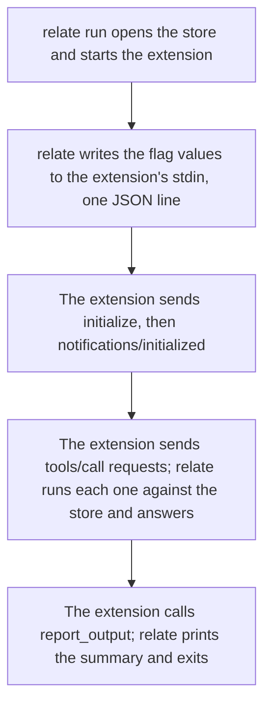

This guide shows you how to write an :term[extension]{id=extension}: a package that `relate run <name>` starts, which reads some source and writes what it finds into a store that relate owns. You scaffold a Python package, change its manifest and its `walk()` function so it counts the words in a folder of notes, check it, install it, run it, and query the result. It takes about 15 minutes.

An extension is a client of the Model Context Protocol (:term[MCP]{id=mcp}). relate starts it as a child process, writes its flag values to its stdin as one JSON line, and then answers its tool calls. The extension never sees the store path: the host opens the store, frames the writes, and owns the exit code.



## Prerequisites

- relate on your `PATH`: `relate --version` prints its version ([Install relate](/docs/get-started/install)).
- `python3` on your `PATH`. The Python template uses only the standard library, so there is nothing to install.

`relate extension init` writes the same package in four languages. Each needs its own runtime:

| `--lang` | Executable | Runtime |
| --- | --- | --- |
| `py` (default) | `<name>.py` | `python3` |
| `sh` | `<name>.sh` | `bash` |
| `ts` | `<name>.ts` | Node.js 22.18 or later, which runs TypeScript by stripping the types |
| `rust` | `Cargo.toml` and `src/main.rs`, built to `<name>` | A Rust toolchain. The generated `Cargo.toml` takes `relate-wire`, `serde` and `serde_json` from the relate workspace, so outside an upstream checkout, point each one at a path or a version before `cargo build` |

## Scaffold the package

```bash verify
relate extension init word-count
```

```text
created py extension 'word-count' in <dir>/word-count
  extension.json  the manifest (mount name, MCP revision, flag table)
  word-count.py   the executable: generated glue plus your walk()
  README.md       the quickstart for this package

next:
  relate extension install word-count --from <dir>/word-count
  relate run word-count -d ./store
```

The path in the output is your working directory. `init` always creates a new directory and refuses one that exists, so it never overwrites your files.

```bash verify
ls word-count
```

```text
README.md
extension.json
word-count.py
```

The package that relate installs is two files: `extension.json` and the executable. `README.md` stays behind.

## Write the manifest

The scaffold's manifest declares one sample flag, `--name`:

```bash verify
cat word-count/extension.json
```

```text
{
  "kind": "command",
  "name": "word-count",
  "version": "0.1.0",
  "protocol": "2025-06-18",
  "flags": [
    {"kind": "string", "name": "name", "default": "there"}
  ],
  "commit": "per-batch",
  "executable": "word-count.py"
}
```

Replace it with a manifest that takes a folder and a minimum word length. `relate run` parses its command line against this table, so the extension gets every flag already resolved to its value or its default.

```bash verify
cat > word-count/extension.json <<'EOF'
{
  "kind": "command",
  "name": "word-count",
  "version": "0.1.0",
  "protocol": "2025-06-18",
  "flags": [
    {"kind": "integer", "name": "min-length", "default": 4}
  ],
  "positional": {"name": "DIR"},
  "commit": "whole-import",
  "executable": "word-count.py"
}
EOF
```

| Field | Required | Meaning |
| --- | --- | --- |
| `kind` | yes | `command`, the only kind |
| `name` | yes | The name in `relate run <name>`; it must match the name you install it under, and it cannot be a relate command word such as `query` |
| `version` | yes | The package's own version, shown by `relate extension list` |
| `protocol` | yes | The MCP revision; it must be `2025-06-18`, the one this relate serves |
| `flags` | yes, may be empty | One entry per flag: `string`, `integer`, `boolean` (bare, sets `true`) or `repeatable`, each with a `default` of its kind; `database` and `db` are reserved for the host |
| `positional` | no | At most one positional argument, such as `{"name": "DIR"}`; it reaches the extension under that exact key |
| `commit` | yes | `whole-import`: one :term[transaction]{id=transaction} for the whole run, rolled back on any failure. `per-batch`: each writing call commits on its own |
| `requires-fresh-store` | no | `true` refuses a store that already holds nodes, before the extension starts; default `false` |
| `hidden` | no | `true` keeps it out of listings; default `false` |
| `executable` | yes | The file relate starts, relative to the package directory; a path that leaves the directory is refused |

The manifest is decoded strictly: an unknown field or a default of the wrong kind fails the load and names the value.

## Write the walk

Everything in `word-count.py` before `walk()` is generated glue: it reads the flag values, runs the MCP handshake, and sends `tools/call` requests. Replace the sample constants and `walk()` with this code, which writes one `:File` node per Markdown file, one `:Word` node per word, and a `MENTIONS` relationship with the count:

```bash verify
cat > walk.py <<'EOF'
WRITE = """UNWIND $rows AS row
MERGE (f:File {path: row.file})
MERGE (w:Word {text: row.word})
MERGE (f)-[m:MENTIONS]->(w)
SET m.count = row.count"""

READ = """MATCH (f:File)-[m:MENTIONS]->(w:Word)
RETURN count(DISTINCT f) AS files, count(DISTINCT w) AS words"""


def walk(client: Client, envelope: dict[str, Any]) -> None:
    """Count the words in every Markdown file under DIR."""
    import re
    from collections import Counter
    from pathlib import Path

    root = Path(envelope.get("DIR", "."))
    min_length = envelope["min-length"]
    rows = []
    for path in sorted(root.rglob("*.md")):
        words = re.findall(r"[a-z]+", path.read_text().lower())
        counts = Counter(w for w in words if len(w) >= min_length)
        for word, count in sorted(counts.items()):
            rows.append({"file": path.relative_to(root).as_posix(), "word": word, "count": count})
    chunk = client.caps.get("maxRowsPerStatement", 1000)
    for start in range(0, len(rows), chunk):
        batch = rows[start:start + chunk]
        client.call("write_cypher", {"statement": WRITE, "parameters": {"rows": batch}})
    found = client.call("read_cypher", {"statement": READ})["rows"][0]
    client.call(
        "report_output",
        {
            "text": f"{NAME}: {found['files']} files, {found['words']} distinct words",
            "starters": [
                "MATCH (:File)-[m:MENTIONS]->(w:Word) "
                "RETURN w.text AS word, sum(m.count) AS uses ORDER BY uses DESC, word LIMIT 5"
            ],
        },
    )
EOF
python3 - <<'EOF'
from pathlib import Path
exe = Path("word-count/word-count.py")
src = exe.read_text()
start, end = src.index('WRITE = """'), src.index("def main(")
exe.write_text(src[:start] + Path("walk.py").read_text() + "\n\n" + src[end:])
EOF
```

The `python3` step splices `walk.py` into the executable in place of the sample, from `WRITE = """` up to `def main(`; pasting the code into the file by hand does the same.

Three things in the walk matter for every extension:

- The rows travel as the `$rows` :term[statement]{id=statement} parameter, never spliced into the Cypher text.
- `write_cypher` takes at most 1000 rows per call. The handshake publishes the cap as `maxRowsPerStatement`, so the walk sizes its chunks from it.
- The last call is `report_output`. Its `text` is the summary line relate prints, and each `starters` entry prints indented under it.

The extension can call five tools: `write_cypher`, `read_cypher` (reads only), `update_schema` (index and constraint statements only), `batch_cypher` (several statements in one transaction), and `report_output`.

## Check the package

`relate extension check` runs the package through the stages a run needs. It opens no store and relate fetches nothing, but it does start the package's executable:

```bash verify
relate extension check ./word-count
```

```text
manifest: ok (word-count 0.1.0, protocol 2025-06-18)
executable: ok (word-count.py)
spawn: ok
initialize: ok (MCP 2025-06-18, server relate 0.16.1)
notifications/initialized: ok
tools/list: ok (the shared tool table: 5 tools; the extension calls 'write_cypher')
pin: not from a GitHub source (unmarked)
```

It stops at the first stage that fails. It exits 2 for a problem in the manifest or the files, 1 for a problem when the extension runs, and 0 when the package would mount. The walk itself does not run.

## Install and run it

Make a folder of notes to count:

```bash verify
mkdir notes
printf 'Ada fixed the planner bug.\nGrace reviewed the planner change and the parser change.\n' > notes/standup.md
printf 'The parser tests pass.\nNoor wants planner examples before the release.\n' > notes/retro.md
```

Install the package from its directory. `install` copies the manifest and the executable, so run it again after every edit:

```bash verify
relate extension install word-count --from ./word-count
```

```text
installed local extension word-count 0.1.0 from ./word-count
```

Run it into a new :term[single-file store]{id=single-file-store}. The run writes to the store named by `-d`; with no `-d` it imports into an in-memory store:

```bash verify
relate run word-count notes -d ./words.rl
```

```text
word-count: 2 files, 13 distinct words
  MATCH (:File)-[m:MENTIONS]->(w:Word) RETURN w.text AS word, sum(m.count) AS uses ORDER BY uses DESC, word LIMIT 5
```

`notes` is the `DIR` positional, and `--min-length` takes its default of 4. With `-d`, the run exits after the summary.

## Verify

Open the store read-only and ask for the most used words:

```bash verify
relate --database ./words.rl --read-only --mode table "MATCH (:File)-[m:MENTIONS]->(w:Word) RETURN w.text AS word, sum(m.count) AS uses ORDER BY uses DESC, word LIMIT 3"
```

```text
+-----------+------+
| word      | uses |
+-----------+------+
| "planner" | 3    |
| "change"  | 2    |
| "parser"  | 2    |
+-----------+------+
```

A flag from the manifest works like any other flag. `--min-length 7` keeps only the longer words:

```bash verify
relate run word-count notes --min-length 7 -d ./long.rl
```

```text
word-count: 2 files, 4 distinct words
  MATCH (:File)-[m:MENTIONS]->(w:Word) RETURN w.text AS word, sum(m.count) AS uses ORDER BY uses DESC, word LIMIT 5
```

Running the same import again leaves the counts as they are, because every write is a `MERGE`.

## If it goes wrong

**`executable: failed: the extension executable ./word-count/word-count.py is not executable`** (exit code 2). The file lost its execute bit, which a copy or an archive can do. Run `chmod +x word-count/word-count.py` and check again.

**`manifest: failed: extension 'word-count' declares protocol '<revision>'; this host speaks '2025-06-18'`** (exit code 2). Set `protocol` to `2025-06-18`.

**`Error: the extension child exited with 1: <message>`** (exit code 1). The extension failed, and `<message>` is what it wrote to stderr; the generated glue writes its own failures there too. Under `whole-import`, nothing from the run is committed.

**`Error: invalid --min-length: 'five' is not an integer`** or **`Error: unexpected argument to run word-count: --min-lenght`** (exit code 2). The command line does not match the manifest's flag table. relate prints the action's usage line and, for a misspelled flag, a `Did you mean` line. `relate run word-count --help` lists the flags.

**`Error: the extension wrote no MCP request within 10s`** (exit code 1). The executable started but never sent `initialize`. After that first request, relate waits as long as the walk takes.

**A run still behaves like the old code.** `relate run` starts the installed copy, not your working directory. Run `relate extension install word-count --from ./word-count` again.

## Related

- [Install and run an extension](/docs/guides/extensions/install-and-run): the trust tiers, `list`, `remove`, and where packages live.
- [`relate extension`](/docs/reference/cli/extension): every action and flag.
- [`relate run`](/docs/reference/cli/run): the run command and its exit codes.
- [Import a directory tree with fs-to-graph](/docs/guides/extensions/fs-to-graph): a first-party extension that walks a directory tree.
- [Security and trust](/docs/concepts/security-and-trust): why relate runs only installed packages and never fetches on `run`.
