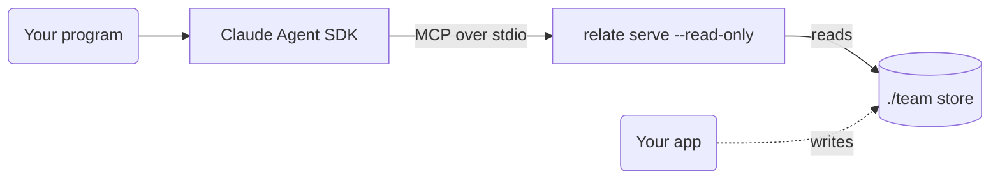

This guide shows you how to give an agent built with the Claude Agent SDK read access to a relate graph. relate serves a :term[store]{id=store} over :term[MCP]{id=mcp} on stdio with `--read-only`. The SDK starts that server as a child process, and the agent queries the graph through relate's `read_cypher` tool. Every step before the model call runs without a Claude credential, so you can check what the agent gets before it makes one.



## Prerequisites

- relate on your `PATH` ([Install relate](/docs/get-started/install)).
- The Claude Agent SDK: `pip install claude-agent-sdk` (Python 3.10 or later) or `npm install @anthropic-ai/claude-agent-sdk` (Node.js 18.14 or later). The SDK programs in [Register the server with the SDK](#register-the-server-with-the-sdk) were checked against `claude-agent-sdk` 0.2.179 and `@anthropic-ai/claude-agent-sdk` 0.3.319, as of 2026-11-07. The SDK changes faster than relate, so its own documentation wins if a name differs.
- A Claude credential for the model call, such as `ANTHROPIC_API_KEY` in the environment. Only the agent program in [Register the server with the SDK](#register-the-server-with-the-sdk) needs it.

## Create the store

The agent reads `./team`, a :term[directory store]{id=directory-store} holding the small team graph the Get started pages use. A directory store lets your app keep writing while a :term[read-only]{id=read-only} server reads it; a single-file `.rl` store that a writer holds refuses the read-only open. Plain `--read-only` serves the store as it was when the server started, so the agent sees later writes only after the server restarts. `--read-only=live` follows the writer's commits on a directory store; it refuses a `.rl` store and `:memory:`.

Write the seed script:

```bash verify
cat > team.cypher <<'EOF'
CREATE (ada:Person {name: 'Ada', role: 'engineer'}),
       (grace:Person {name: 'Grace', role: 'engineer'}),
       (noor:Person {name: 'Noor', role: 'maintainer'}),
       (relate:Project {name: 'relate', language: 'Rust'}),
       (tck:Project {name: 'opencypher-tck', language: 'Gherkin'}),
       (ada)-[:WORKS_ON {since: 2024}]->(relate),
       (grace)-[:WORKS_ON {since: 2023}]->(relate),
       (grace)-[:WORKS_ON {since: 2022}]->(tck),
       (noor)-[:MAINTAINS]->(relate),
       (ada)-[:KNOWS]->(grace);
EOF
```

Run it into the store. This step writes, so it opens `./team` without `--read-only`:

```bash verify
relate query --database ./team --mode envelope < team.cypher
```

```text
{"columnTypes":[],"columns":[],"notifications":[],"rows":[],"truncated":false}
```

The `CREATE` returns no rows; the store now holds three people and two projects.

## Check the tools the agent sees

`relate serve --mcp stdio` speaks MCP's JSON-RPC on stdin and stdout, one message per line, until stdin closes. It is the command the SDK starts. Send it the opening messages an MCP host sends:

```bash verify
printf '%s\n' \
  '{"jsonrpc":"2.0","id":1,"method":"initialize","params":{"protocolVersion":"2024-11-05","capabilities":{},"clientInfo":{"name":"check","version":"0"}}}' \
  '{"jsonrpc":"2.0","id":2,"method":"tools/list","params":{}}' \
  | relate serve --mcp stdio --database ./team --read-only 2>/dev/null
```

```text
{"jsonrpc":"2.0","id":1,"result":{"capabilities":{"tools":{}},"protocolVersion":"2024-11-05","serverInfo":{"name":"relate-mcp","version":"0.16.1"}}}
{"jsonrpc":"2.0","id":2,"result":{"tools":[{"annotations":{"destructiveHint":false,"idempotentHint":true,"openWorldHint":false,"readOnlyHint":true,"title":"Read Cypher"},"description":"Execute one read-only Cypher statement. Returns the result's rows. Write and schema (DDL) statements are rejected.","inputSchema":{"properties":{"parameters":{"default":{},"description":"The statement's parameters; a `rows` array feeds `$rows`.","type":"object"},"statement":{"description":"The Cypher statement.","type":"string"}},"required":["statement"],"type":"object"},"name":"read_cypher"},{"annotations":{"destructiveHint":false,"idempotentHint":true,"openWorldHint":false,"readOnlyHint":true,"title":"Get Schema"},"description":"Get the schema of the graph store: node labels with their property keys and inferred types, and the relationship types between them. `sample_size` bounds how many nodes and relationships are examined per label (larger is slower but more accurate; -1 examines all).","inputSchema":{"properties":{"sample_size":{"description":"The sample size used to infer the graph schema. Larger samples are slower, but more accurate. Smaller samples are faster, but might miss information. -1 samples the whole graph.","type":"integer"}},"type":"object"},"name":"get_schema"}]}}
```

Opened with `--read-only`, the server lists two tools, `read_cypher` and `get_schema`, both annotated `readOnlyHint: true`. `write_cypher` is not listed at all. The startup banner goes to stderr, which `2>/dev/null` drops, so stdout carries nothing but JSON-RPC.

## Call the query tool

An agent's query is a `tools/call` request for `read_cypher`, with a statement and its parameters. The response also carries timings that change on every run, so this check keeps only the rows:

```bash verify
printf '%s\n' \
  '{"jsonrpc":"2.0","id":3,"method":"tools/call","params":{"name":"read_cypher","arguments":{"statement":"MATCH (p:Person)-[w:WORKS_ON]->(:Project {name: $project}) RETURN p.name AS name, w.since AS since ORDER BY since","parameters":{"project":"relate"}}}}' \
  | relate serve --mcp stdio --database ./team --read-only 2>/dev/null \
  | grep -o '\\"rows\\":\[[^]]*\]'
```

```text
\"rows\":[{\"name\":\"Grace\",\"since\":2023},{\"name\":\"Ada\",\"since\":2024}]
```

Two people work on `relate`: Grace since 2023 and Ada since 2024. The whole response also carries the columns, column types, statistics, notifications, the plan, and timings.

A write sent to the same tool comes back as a tool error, with `isError: true`, and the store is unchanged:

```bash verify
printf '%s\n' \
  '{"jsonrpc":"2.0","id":4,"method":"tools/call","params":{"name":"read_cypher","arguments":{"statement":"MATCH (p:Person {name: $name}) DETACH DELETE p","parameters":{"name":"Ada"}}}}' \
  | relate serve --mcp stdio --database ./team --read-only 2>/dev/null
```

```text
{"jsonrpc":"2.0","id":4,"result":{"content":[{"text":"Only MATCH queries are allowed for read-query","type":"text"}],"isError":true}}
```

## Register the server with the SDK

The SDK starts each stdio entry of its MCP server map as a child process. It names that server's tools `mcp__<server>__<tool>`, so relate's tools arrive as `mcp__relate__read_cypher` and `mcp__relate__get_schema`.

Build the options first. Constructing them makes no model call and needs no credential. The Python SDK raises `TypeError` on an option name it doesn't know, so this program checks every name before the agent runs:

```python run name=options title="options.py"
from claude_agent_sdk import ClaudeAgentOptions

options = ClaudeAgentOptions(
    mcp_servers={
        "relate": {
            "type": "stdio",
            "command": "relate",
            "args": ["serve", "--mcp", "stdio", "--database", "./team", "--read-only"],
        }
    },
    tools=[],
    allowed_tools=["mcp__relate__get_schema", "mcp__relate__read_cypher"],
    permission_mode="dontAsk",
    strict_mcp_config=True,
)

if __name__ == "__main__":
    print(" ".join([options.mcp_servers["relate"]["command"], *options.mcp_servers["relate"]["args"]]))
    print(options.allowed_tools)
    print(options.tools, options.permission_mode, options.strict_mcp_config)
```

The agent program uses the same options and makes the model call, so it needs the credential from the prerequisites. The Python version imports them from `options.py`:

::::tabs
:::tab[Python]{key=python}
```python title="agent.py"
import asyncio

from claude_agent_sdk import ResultMessage, query

from options import options


async def main() -> None:
    async for message in query(prompt="Who works on the relate project, and since when?", options=options):
        if isinstance(message, ResultMessage):
            print(message.result)


asyncio.run(main())
```
:::
:::tab[Node.js]{key=node}
```js title="agent.mjs"
import { query } from "@anthropic-ai/claude-agent-sdk";

const options = {
  mcpServers: {
    relate: {
      type: "stdio",
      command: "relate",
      args: ["serve", "--mcp", "stdio", "--database", "./team", "--read-only"],
    },
  },
  tools: [],
  allowedTools: ["mcp__relate__get_schema", "mcp__relate__read_cypher"],
  permissionMode: "dontAsk",
  strictMcpConfig: true,
};

for await (const message of query({ prompt: "Who works on the relate project, and since when?", options })) {
  if (message.type === "result" && message.subtype === "success") console.log(message.result);
}
```
:::
::::

To allow writes, remove `--read-only`; the server then also lists `write_cypher`, which the SDK names `mcp__relate__write_cypher`.

The other options keep the agent to relate's two tools:

| Python option | Node.js option | Effect |
| --- | --- | --- |
| `tools=[]` | `tools: []` | Turns off the SDK's built-in tools (shell, file reads and edits), so relate's tools are the only ones |
| `allowed_tools` | `allowedTools` | Pre-approves the listed tools, so they run without a permission prompt |
| `permission_mode="dontAsk"` | `permissionMode: "dontAsk"` | Denies a call to any tool that is not pre-approved, instead of prompting |
| `strict_mcp_config=True` | `strictMcpConfig: true` | Ignores MCP servers configured elsewhere, such as a project `.mcp.json` |

Each query the agent makes is the `tools/call` request from [Call the query tool](#call-the-query-tool), so the rows it reads are the rows that check printed.

:::tip[Bound the agent's reads]
`--safe` on the same `relate serve` command refuses a read with no `LIMIT` and no aggregate, so an exploratory `MATCH (n) RETURN n` can't pull the whole graph into the model's context. The refusal comes back as a tool error that says to add `LIMIT <n>`.
:::

## Verify

The agent's calls leave the store as it was. A read-only count from the CLI shows all three people, Ada included, after the refused delete:

```bash verify
relate --database ./team --read-only --mode envelope "MATCH (p:Person) RETURN count(p) AS people"
```

```text
{"columnTypes":["INTEGER"],"columns":["people"],"notifications":[],"rows":[{"people":3}],"truncated":false}
```

## If it goes wrong

| Message | Cause | Remedy |
| --- | --- | --- |
| `Only MATCH queries are allowed for read-query` (a tool error) | The agent sent a write or a schema statement to `read_cypher` | Expected on a read-only server. To let the agent write, serve the store without `--read-only` and add `mcp__relate__write_cypher` to the allowed tools. |
| `Error: semantic error: ParameterMissing: Expected parameter(s): name` (a tool error) | The statement uses `$name`, and the call's `parameters` has no `name` | Pass every `$parameter` in the call's `parameters` object. |
| `Error: Failed to open Relate: storage error: read-only open requires an existing database at <path>` on the server's stderr, exit code 1 | `--database` names a store that doesn't exist; a read-only open never creates one | Create the store first, or fix the path. A relative path resolves against the directory the server starts in, so an absolute path avoids surprises. |
| `Error: Failed to open Relate: storage locked: <path>` on the server's stderr, exit code 1 | `--database` names a single-file `.rl` store that another process holds for writing | Serve a directory store, which allows a read-only open beside a writer, or stop the writer first. |
| The agent's answers miss recent writes (no error) | Plain `--read-only` serves the store as it was when the server started | Serve a directory store with `--read-only=live`, or restart the server. |

The [errors reference](/docs/reference/errors) lists every MCP refusal, with its JSON-RPC code where it has one.

## Related

- [Connect over MCP](/docs/guides/agents/connect-over-mcp): the same server for Claude Code, Cursor, and other agent hosts.
- [Keep an agent safe](/docs/guides/agents/agent-safety): read-only opens, safe mode, backups, and the permission matrix.
- [CLI reference](/docs/reference/cli): `relate serve` and every other command, with their flags.
- [Agent memory](/cookbook/agent-memory/): a worked example of a graph an agent writes to and recalls from.
