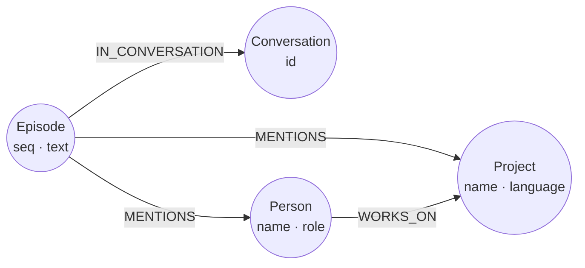

This guide shows you how to give a LangGraph graph long-term memory in a relate :term[store]{id=store}, from Python. LangGraph's checkpointer keeps each conversation's state; relate keeps what should outlive the conversation, as a graph of episodes linked to the people and projects they mention. Two LangChain tools wrap the relate client, and two nodes call them: one writes an episode, the other recalls what memory holds. relate is reached through those tools, not as LangGraph's `BaseStore` or as its checkpointer. A `BaseStore` gets items by namespace and key, while the tools let recall follow the graph's relationships.

## Prerequisites

- Python 3.10 or later, with the relate client and LangGraph: `pip install relate-db langgraph`. The package is `relate-db`; the import is `import relate`. The LangGraph code on this page was checked against `langgraph` 1.2.20 and `langchain-core` 1.7.6, as of 2026-11-07.
- No model and no credential. The nodes call the tools directly, so the program runs offline; [Hand the tools to a model](#hand-the-tools-to-a-model) shows where a model fits.

## Lay out the memory graph

Memory attaches to the small team graph the Get started pages use. Each turn becomes an `Episode` node in a `Conversation`, one per LangGraph thread id. The episode `MENTIONS` the people and projects it names, so recall can follow the team graph's own relationships to facts no episode stated.

This is a reduced form of the model in [Model agent memory](/docs/guides/agents/model-agent-memory): the thread id sits on a `Conversation` node instead of in `Episode.session`, an episode's `seq` takes the place of its `id` and `at`, and the team graph's `Person` and `Project` nodes stand in for `Entity`. Facts, their two time axes and supersession are left out; that guide adds them for an agent that has to track what is currently true.



## Write the program

The program opens `./memory.rl`, a single-file store, for writing, and seeds the team graph on its first run. It defines the `remember` and `recall` tools and a two-node graph, then runs two turns in two conversations and prints what memory holds about `relate`. The `finally` closes the store even when a node raises. The last lines read the episodes back on a new read-only connection:

```python run name=memory-graph title="memory_graph.py"
from concurrent.futures import ThreadPoolExecutor
from typing import TypedDict

import relate
from langchain_core.runnables import RunnableConfig
from langchain_core.tools import tool
from langgraph.checkpoint.memory import InMemorySaver
from langgraph.graph import END, START, StateGraph

TEAM = """
CREATE (ada:Person {name: 'Ada', role: 'engineer'}),
       (grace:Person {name: 'Grace', role: 'engineer'}),
       (noor:Person {name: 'Noor', role: 'maintainer'}),
       (relate:Project {name: 'relate', language: 'Rust'}),
       (tck:Project {name: 'opencypher-tck', language: 'Gherkin'}),
       (ada)-[:WORKS_ON {since: 2024}]->(relate),
       (grace)-[:WORKS_ON {since: 2023}]->(relate),
       (grace)-[:WORKS_ON {since: 2022}]->(tck),
       (noor)-[:MAINTAINS]->(relate),
       (ada)-[:KNOWS]->(grace)
"""


class Memory:
    """A relate store that one dedicated thread opens and runs every statement on."""

    def __init__(self, path: str):
        self._thread = ThreadPoolExecutor(max_workers=1)
        self._conn = self._thread.submit(relate.connect, path).result()

    def run(self, statement: str, params: dict | None = None) -> list[dict]:
        def execute():
            return [dict(row) for row in self._conn.execute(statement, params or {}).fetchall()]
        return self._thread.submit(execute).result()

    def close(self) -> None:
        self._thread.submit(self._conn.close).result()
        self._thread.shutdown()


# Writable on purpose: the graph's nodes write episodes.
memory = Memory("./memory.rl")
if memory.run("MATCH (p:Person) RETURN count(p) AS n")[0]["n"] == 0:
    memory.run(TEAM)


@tool
def remember(conversation: str, text: str, mentions: list[str]) -> int:
    """Store one episode and link it to the people and projects it names."""
    rows = memory.run(
        """
        MERGE (c:Conversation {id: $conversation})
        WITH c
        OPTIONAL MATCH (earlier:Episode)
        WITH c, count(earlier) AS seen
        CREATE (e:Episode {seq: seen + 1, text: $text})-[:IN_CONVERSATION]->(c)
        WITH e
        UNWIND $mentions AS name
        MATCH (x {name: name})
        MERGE (e)-[:MENTIONS]->(x)
        RETURN count(x) AS linked
        """,
        {"conversation": conversation, "text": text, "mentions": mentions},
    )
    return rows[0]["linked"] if rows else 0


@tool
def recall(name: str) -> list[str]:
    """Return what memory holds about a person or project, oldest episode first."""
    episodes = memory.run(
        """
        MATCH (x {name: $name})<-[:MENTIONS]-(e:Episode)-[:IN_CONVERSATION]->(c:Conversation)
        RETURN c.id AS conversation, e.text AS text
        ORDER BY e.seq
        """,
        {"name": name},
    )
    people = memory.run(
        """
        MATCH (x {name: $name})<-[w:WORKS_ON]-(p:Person)
        RETURN p.name AS person, w.since AS since
        ORDER BY since
        """,
        {"name": name},
    )
    return [f"[{r['conversation']}] {r['text']}" for r in episodes] + [
        f"{r['person']} has worked on {name} since {r['since']}" for r in people
    ]


class State(TypedDict):
    message: str
    mentions: list[str]
    subject: str
    context: list[str]


def write_episode(state: State, config: RunnableConfig) -> dict:
    remember.invoke({
        "conversation": config["configurable"]["thread_id"],
        "text": state["message"],
        "mentions": state["mentions"],
    })
    return {}


def recall_context(state: State) -> dict:
    return {"context": recall.invoke({"name": state["subject"]})}


builder = StateGraph(State)
builder.add_node("write_episode", write_episode)
builder.add_node("recall_context", recall_context)
builder.add_edge(START, "write_episode")
builder.add_edge("write_episode", "recall_context")
builder.add_edge("recall_context", END)
graph = builder.compile(checkpointer=InMemorySaver())

try:
    graph.invoke(
        {"message": "Ada fixed the CSV import bug in relate.", "mentions": ["Ada", "relate"], "subject": "relate"},
        {"configurable": {"thread_id": "standup-monday"}},
    )
    state = graph.invoke(
        {"message": "Grace will review the relate release notes.", "mentions": ["Grace", "relate"], "subject": "relate"},
        {"configurable": {"thread_id": "standup-tuesday"}},
    )
    for line in state["context"]:
        print(line)
finally:
    memory.close()

# Check: the episodes outlive the program's connection.
reader = relate.connect("./memory.rl", read_only=True)
episodes = reader.execute(
    "MATCH (e:Episode)-[:IN_CONVERSATION]->(c:Conversation) RETURN c.id AS conversation, e.seq AS seq ORDER BY seq"
).fetchall()
print(f"{len(episodes)} episodes:", ", ".join(f"{row['seq']} in {row['conversation']}" for row in episodes))
reader.close()
```

The second turn recalls both episodes, though each came from a different conversation. The two lines after them come from the team graph, not from any episode. The parts that matter:

- **One thread owns the connection.** A relate connection is thread-affine: only the thread that opened it may use it. LangGraph runs a `ToolNode`'s calls on worker threads, and under `ainvoke` it runs synchronous nodes there too. So `Memory` opens the store on a dedicated thread and sends every statement there. The same tools then work under `invoke`, `ainvoke` and `ToolNode`.
- **`remember`** merges one `Conversation` per LangGraph thread id, numbers the episode, and links it to every node whose `name` it mentions. Every value goes in as a `$parameter`.
- **`recall`** reads the episodes that mention a subject, oldest first, then follows `WORKS_ON` to who works on it.
- **The mentions are given, not extracted.** In a real agent a model picks them out of the message; in this program they're fixed, so the run is the same every time.

## Hand the tools to a model

`remember` and `recall` are LangChain tools, so a chat model can call them itself. Bind them to the model with its `bind_tools` method and run the calls with LangGraph's `ToolNode`:

```python
from langgraph.prebuilt import ToolNode

tools = [remember, recall]
model_with_tools = model.bind_tools(tools)  # model: any LangChain chat model
tool_node = ToolNode(tools)
```

`ToolNode` runs each call on a worker thread, which `Memory` already allows for.

## Verify

The program's last line already reads the episodes back on a read-only connection. The same check from the CLI, read-only, in the directory the program ran in:

```bash
relate --database ./memory.rl --read-only --mode table "MATCH (e:Episode)-[:IN_CONVERSATION]->(c:Conversation) RETURN c.id AS conversation, e.seq AS seq, e.text AS episode ORDER BY seq"
```

```text
+-------------------+-----+-----------------------------------------------+
| conversation      | seq | episode                                       |
+-------------------+-----+-----------------------------------------------+
| "standup-monday"  | 1   | "Ada fixed the CSV import bug in relate."     |
| "standup-tuesday" | 2   | "Grace will review the relate release notes." |
+-------------------+-----+-----------------------------------------------+
```

Two episodes, one per conversation, in the order they were written. A second run of the program adds two more, numbered 3 and 4.

## If it goes wrong

| Message | Cause | Remedy |
| --- | --- | --- |
| `Relate connection used from a thread other than the one that opened it: connections are thread-affine (DB-API threadsafety = 1). Create the connection on the thread that uses it.` (`relate.ProgrammingError`) | A connection opened on one thread was used from another, such as a `ToolNode` call or a node under `ainvoke` | Route every statement through one owning thread, as `Memory` does. |
| `storage locked: <path>` (`relate.OperationalError`) | A second process, or a second writable connection, opened `./memory.rl` while the program holds it | Keep one writer per store. To read while the program runs, use a directory store (`Memory("./memory")`) and open it read-only beside the writer. |
| `semantic error: ParameterMissing: Expected parameter(s): name` (`relate.ProgrammingError`) | A tool ran a statement without one of its `$parameters` | Pass every parameter the statement names in the `params` dict. |

The [errors reference](/docs/reference/errors) lists the Python exception class for each engine error.

## Related

- [Embed relate in a Python app](/docs/get-started/python): the client's connections, parameters, transactions, and errors.
- [Model agent memory](/docs/guides/agents/model-agent-memory): choosing labels and relationships for what an agent remembers.
- [Agent memory](/cookbook/agent-memory/): a fuller memory graph, with facts and decisions that supersede older ones.
