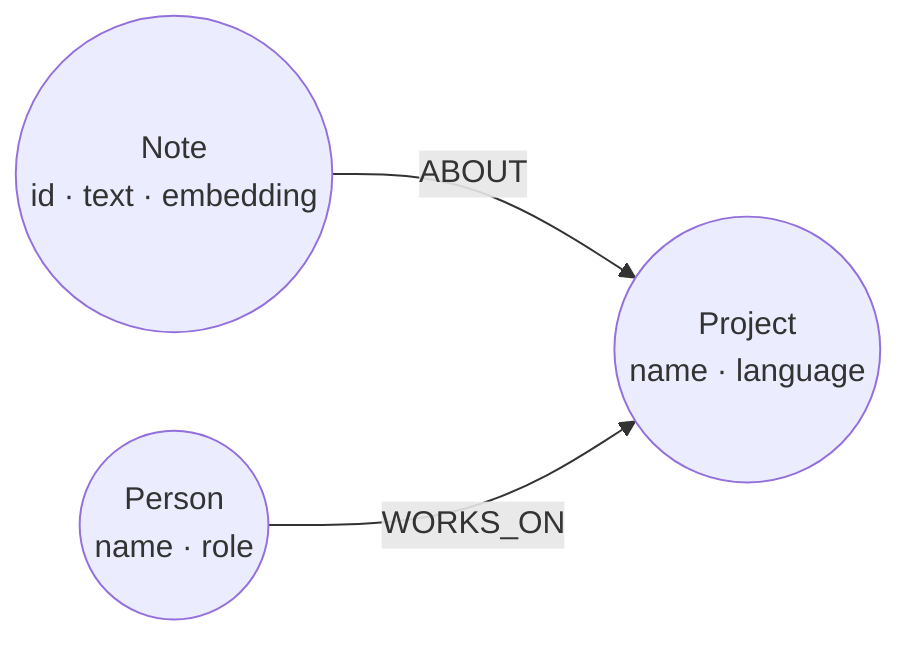

This guide shows you how to put a relate :term[store]{id=store} behind a LlamaIndex retriever. Notes live in the store as :term[nodes]{id=node} with their embeddings as vector :term[properties]{id=property}, a :term[vector index]{id=vector-index} finds the nearest notes to a question, and the retriever follows each hit to the project it's about and the people who work on it. The retriever opens the store read-only on every call. The whole program runs without a model or a credential, LlamaIndex's query engine included.

## Prerequisites

- Python 3.10 or later, with the relate client and LlamaIndex's core package: `pip install relate-db llama-index-core`. The package is `relate-db`; the import is `import relate`. The LlamaIndex code on this page was checked against `llama-index-core` 0.14.25, as of 2026-11-08, and uses nothing outside that package.
- An embedding model for your own data: any LlamaIndex embedding model, which is a `BaseEmbedding`. The program's `KeywordEmbedding` stands in for one so the page runs offline.
- For [Answer with a model](#answer-with-a-model) only: a LlamaIndex LLM (large language model) from its integration package, with that provider's credential.
- relate on your `PATH` for [Verify](#verify) ([Install relate](/docs/get-started/install)).

## Lay out the notes

The notes attach to the small team graph the Get started pages use. Each `Note` node holds its text and its embedding and is `ABOUT` one `Project`; the team graph's `WORKS_ON` relationships say who works on that project. The vector index `note_embedding` covers the `embedding` property of every `Note`.



## Write the retriever

The program opens `./notes`, a directory store, for writing in a setup block that stands in for your ingestion step: it writes the team graph, embeds four notes with the embedding model, stores each vector with `vector(…, FLOAT32)`, and creates the index. `NotesRetriever` reads the store on its own read-only connections. The last lines retrieve for two questions, then run the same retriever inside LlamaIndex's query engine:

```python run name=notes-retriever title="notes_retriever.py"
import re

import relate
from llama_index.core.embeddings import BaseEmbedding
from llama_index.core.llms import MockLLM
from llama_index.core.query_engine import RetrieverQueryEngine
from llama_index.core.retrievers import BaseRetriever
from llama_index.core.schema import NodeWithScore, QueryBundle, TextNode

TEAM = """
CREATE (ada:Person {name: 'Ada', role: 'engineer'}),
       (grace:Person {name: 'Grace', role: 'engineer'}),
       (noor:Person {name: 'Noor', role: 'maintainer'}),
       (relate:Project {name: 'relate', language: 'Rust'}),
       (tck:Project {name: 'opencypher-tck', language: 'Gherkin'}),
       (ada)-[:WORKS_ON {since: 2024}]->(relate),
       (grace)-[:WORKS_ON {since: 2023}]->(relate),
       (grace)-[:WORKS_ON {since: 2022}]->(tck),
       (noor)-[:MAINTAINS]->(relate),
       (ada)-[:KNOWS]->(grace)
"""

NOTES = [
    {"id": "n1", "project": "relate", "text": "Ada fixed the CSV import bug."},
    {"id": "n2", "project": "relate", "text": "Grace will review the release notes."},
    {"id": "n3", "project": "opencypher-tck", "text": "Grace added test scenarios for CSV headers."},
    {"id": "n4", "project": "relate", "text": "Noor tagged the release candidate."},
]

VOCABULARY = ["csv", "import", "release", "notes", "test", "scenarios"]
DIMENSIONS = len(VOCABULARY) + 1


class KeywordEmbedding(BaseEmbedding):
    """Stands in for an embedding model: counts vocabulary words, plus a constant so no vector is zero."""

    def _embed(self, text: str) -> list[float]:
        words = re.findall(r"[a-z]+", text.lower())
        return [float(words.count(w)) for w in VOCABULARY] + [0.5]

    def _get_text_embedding(self, text: str) -> list[float]:
        return self._embed(text)

    def _get_query_embedding(self, query: str) -> list[float]:
        return self._embed(query)

    async def _aget_query_embedding(self, query: str) -> list[float]:
        return self._embed(query)


RECALL = """
MATCH (n:Note)
SEARCH n IN (VECTOR INDEX note_embedding FOR $vector LIMIT $k) SCORE AS score
MATCH (n)-[:ABOUT]->(p:Project)
OPTIONAL MATCH (person:Person)-[:WORKS_ON]->(p)
RETURN n.id AS id, n.text AS text, p.name AS project, collect(person.name) AS people, score
ORDER BY score DESC, id
"""


class NotesRetriever(BaseRetriever):
    """Retrieves notes from a relate store by vector search, with each note's project and its people."""

    def __init__(self, store: str, embed_model: BaseEmbedding, top_k: int = 2):
        super().__init__()
        self._store = store
        self._embed_model = embed_model
        self._top_k = top_k

    def _retrieve(self, query_bundle: QueryBundle) -> list[NodeWithScore]:
        vector = self._embed_model.get_query_embedding(query_bundle.query_str)
        # Read-only: the engine refuses every write on this connection.
        with relate.connect(self._store, read_only=True) as conn:
            rows = conn.execute(RECALL, {"vector": vector, "k": self._top_k}).fetchall()
        return [
            NodeWithScore(
                node=TextNode(id_=r["id"], text=r["text"], metadata={"project": r["project"], "people": sorted(r["people"])}),
                score=r["score"],
            )
            for r in rows
        ]


embed_model = KeywordEmbedding()

# Setup: the app that owns ./notes writes the team graph, the notes and their embeddings, on a writable connection.
with relate.connect("./notes") as owner:
    if owner.execute("MATCH (n:Note) RETURN count(n) AS n").single()["n"] == 0:
        owner.execute(TEAM)
        embeddings = embed_model.get_text_embedding_batch([note["text"] for note in NOTES])
        owner.execute(
            """
            UNWIND $notes AS note
            MATCH (p:Project {name: note.project})
            CREATE (n:Note {id: note.id, text: note.text, embedding: vector(note.embedding, $dimensions, FLOAT32)})-[:ABOUT]->(p)
            """,
            {"notes": [dict(note, embedding=e) for note, e in zip(NOTES, embeddings)], "dimensions": DIMENSIONS},
        )
        owner.execute(
            "CREATE VECTOR INDEX note_embedding IF NOT EXISTS FOR (n:Note) ON (n.embedding) "
            f"OPTIONS {{indexConfig: {{`vector.dimensions`: {DIMENSIONS}, `vector.similarity_function`: 'cosine'}}}}"
        )

retriever = NotesRetriever("./notes", embed_model)

# Check: retrieve for two questions, without a model.
for question in ["Where is the release?", "Who worked on CSV import?"]:
    print(question)
    for hit in retriever.retrieve(question):
        print(f"  {hit.score:.4f} {hit.node.node_id} [{hit.node.metadata['project']}; {', '.join(hit.node.metadata['people'])}] {hit.node.get_content()}")

# Check: the same retriever behind LlamaIndex's query engine; MockLLM answers without a model.
engine = RetrieverQueryEngine.from_args(retriever, llm=MockLLM())
response = engine.query("Where is the release?")
print("query engine sources:", ", ".join(hit.node.node_id for hit in response.source_nodes))
```

Each hit carries its similarity score, the note, its project, and the people on that project. The score is cosine similarity rescaled to 0 to 1, higher is closer, so `1.0000` is a note whose words match the question's exactly. The query engine retrieves the same two notes for the same question. The parts that matter:

- **One statement per retrieval.** `RECALL` runs the vector :term[search]{id=search} with the `SEARCH` clause and walks from each hit to its project and that project's people, so the node LlamaIndex gets back already holds the graph context in its `metadata`.
- **The embedding model sets the dimensions.** The index's `vector.dimensions` and every stored vector must have the model's length. `vector(…, $dimensions, FLOAT32)` refuses a list of another length when it is stored, instead of leaving a note the index skips.
- **A connection per call.** A relate connection belongs to the thread that opened it, and a read-only connection sees the store as it was when it opened. Opening inside `_retrieve` keeps the open and the statement on the thread that runs the retrieval, and each retrieval sees every note committed before it.
- **`MockLLM`** is LlamaIndex's own stand-in for an LLM, in the core package, so the check proves the retriever plugs into `RetrieverQueryEngine` without a model call.

To rank by keywords as well as meaning, add a full-text index and fuse the two result lists by reciprocal rank in the same statement; [Hybrid recall](/cookbook/hybrid-recall/) builds that fused statement.

## Answer with a model

Replace the query-engine check at the end of `notes_retriever.py` with a real LLM. `llm` is any LlamaIndex LLM, which comes from that provider's integration package and needs its credential:

```python
engine = RetrieverQueryEngine.from_args(retriever, llm=llm)  # llm: any LlamaIndex LLM
print(engine.query("Where is the release?"))
```

For an agent that decides when to look things up, wrap the retriever as a tool instead and give it to the agent:

```python
from llama_index.core.agent.workflow import FunctionAgent
from llama_index.core.tools import RetrieverTool

notes_tool = RetrieverTool.from_defaults(
    retriever,
    name="team_notes",
    description="Find notes about the team's projects, with each note's project and the people who work on it.",
)
agent = FunctionAgent(tools=[notes_tool], llm=llm)
```

## Verify

The setup block wrote four notes with their embeddings. Check them from the CLI, read-only, in the directory the program ran in:

```bash
relate --database ./notes --read-only --mode table "MATCH (n:Note)-[:ABOUT]->(p:Project) RETURN n.id AS id, p.name AS project, valueType(n.embedding) AS embedding ORDER BY id"
```

```text
+------+------------------+----------------------------------------+
| id   | project          | embedding                              |
+------+------------------+----------------------------------------+
| "n1" | "relate"         | "VECTOR<FLOAT32 NOT NULL>(7) NOT NULL" |
| "n2" | "relate"         | "VECTOR<FLOAT32 NOT NULL>(7) NOT NULL" |
| "n3" | "opencypher-tck" | "VECTOR<FLOAT32 NOT NULL>(7) NOT NULL" |
| "n4" | "relate"         | "VECTOR<FLOAT32 NOT NULL>(7) NOT NULL" |
+------+------------------+----------------------------------------+
```

Every embedding is a typed vector of 7 coordinates, the stand-in model's length. Then check that the index serves them:

```bash
relate --database ./notes --read-only --mode table "SHOW INDEXES YIELD name, type, labelsOrTypes, properties, state WHERE type = 'VECTOR' RETURN name, type, labelsOrTypes, properties, state"
```

```text
+------------------+----------+---------------+---------------+----------+
| name             | type     | labelsOrTypes | properties    | state    |
+------------------+----------+---------------+---------------+----------+
| "note_embedding" | "VECTOR" | ["Note"]      | ["embedding"] | "ONLINE" |
+------------------+----------+---------------+---------------+----------+
```

An `ONLINE` index on `Note.embedding` and two hits per question mean the retriever's search runs on the index.

## If it goes wrong

| Message | Cause | Remedy |
| --- | --- | --- |
| `type error: VectorIndexDimensionalityMismatch` (`relate.DataError`, `gql_status` `22G03`) | The question's embedding has a different length from the index's `vector.dimensions`, usually because the embedding model changed | Embed questions with the model that embedded the notes. After a model change, re-embed the notes and recreate the index with the new length. |
| `type error: vector() dimension does not match list` (`relate.DataError`, `gql_status` `22G03`) | The ingestion step stored an embedding whose length isn't `$dimensions` | Set the dimensions from the embedding model's output length, as `DIMENSIONS` does. |
| `storage error: read-only open requires an existing database at <path>` (`relate.OperationalError`) | The retriever's store path names a directory that holds no store; a read-only open never creates one | Run the ingestion step first, or fix the path. |
| `storage locked: <path>` (`relate.OperationalError`) | The store is a single-file `.rl` store that the ingestion step holds for writing, and a read-only open refuses it | Keep the notes in a directory store, as `./notes` is, so retrieval runs beside ingestion. |

[Search by vector similarity](/docs/guides/cypher/vector-search#if-it-goes-wrong) lists the other `SEARCH` mistakes and their messages.

## Related

- [Search by vector similarity](/docs/guides/cypher/vector-search): typed vectors, vector indexes and the `SEARCH` clause, step by step.
- [Hybrid recall](/cookbook/hybrid-recall/): vector and full-text search fused in one statement, with a graph hop to the latest decision.
- [Search](/docs/reference/cypher/search): index options, every `SEARCH` form, and the similarity functions.
- [Hybrid retrieval for RAG](/docs/concepts/problems-relate-solves#hybrid-retrieval-for-rag): the problem this page solves, with the other pages that solve it.
- [Embed relate in a Python app](/docs/get-started/python): the client's connections, parameters, transactions, and errors.
