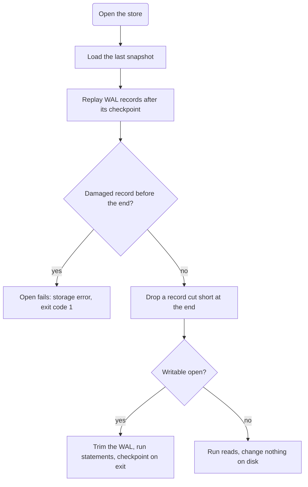

This guide shows you how to bring a store back after the process that had it open crashed, was killed, or lost power. Usually there is nothing to repair. The next open loads the store's last :term[snapshot]{id=snapshot} and replays the :term[WAL]{id=wal} on top of it, so under the default `full` :term[durability mode]{id=durability-mode} every write that was acknowledged comes back.

## Prerequisites

- `relate` on your `PATH` ([Install relate](/docs/get-started/install)).
- The crashed process is gone. A process that exits, however it exits, releases its lock on the store.
- A backup made with `relate clone`, for the one case replay can't fix ([Back up and restore a store](/docs/guides/storage/backup-and-restore)).

## What an open does after a crash



A crash in the middle of writing a WAL record leaves a torn tail: the last record is cut short. That record's commit was never acknowledged under `full` durability, because a commit returns only after its record is synced. relate drops the torn record and prints nothing about it. A writable open also removes it from the file; a read-only open leaves it in place and ignores it.

## Rehearse a crash

These steps crash a session on a scratch copy of the shared example graph, then recover it. On a store that crashed for real, start at [Check the store without opening it](#check-the-store-without-opening-it).

Create the example graph as `team.rl`:

```bash verify
cat > team.cypher <<'EOF'
CREATE (ada:Person {name: 'Ada', role: 'engineer'}),
       (grace:Person {name: 'Grace', role: 'engineer'}),
       (noor:Person {name: 'Noor', role: 'maintainer'}),
       (relate:Project {name: 'relate', language: 'Rust'}),
       (tck:Project {name: 'opencypher-tck', language: 'Gherkin'}),
       (ada)-[:WORKS_ON {since: 2024}]->(relate),
       (grace)-[:WORKS_ON {since: 2023}]->(relate),
       (grace)-[:WORKS_ON {since: 2022}]->(tck),
       (noor)-[:MAINTAINS]->(relate),
       (ada)-[:KNOWS]->(grace);
EOF
relate query --database ./team.rl < team.cypher
```

Now run a script whose first statement commits one new relationship, Noor maintaining `opencypher-tck`, and whose second statement takes minutes. One second in, `kill -9` ends the process before it can checkpoint:

```bash verify
cat > work.cypher <<'EOF'
MATCH (noor:Person {name: 'Noor'}), (tck:Project {name: 'opencypher-tck'}) CREATE (noor)-[:MAINTAINS]->(tck);
UNWIND range(1, 100000) AS a RETURN sum(reduce(s = 0, x IN range(1, 10000) | s + x)) AS total;
EOF
relate query --database ./team.rl < work.cypher > /dev/null &
sleep 1
kill -9 $!
wait $! 2>/dev/null
echo "exit=$?"
```

```text
exit=137
```

Exit code 137 is the shell's report of a process ended by signal 9. The new relationship is committed in the WAL, but no :term[checkpoint]{id=checkpoint} has written it to the snapshot.

## Check the store without opening it

`relate info` reads a store's metadata cold: no open, no lock, no replay. It can run beside a writer and changes nothing.

```bash verify
relate info --database ./team.rl
```

```text
layout: .rl bundle
superblock version: 1
codec: parquet
format version: 3
checkpoint LSN: 1
commit timestamp: 1
total bytes: 36864
wal segments past checkpoint: 1
nodes (at checkpoint LSN 1): 5
relationships (at checkpoint LSN 1): 5
indexes: 0
constraints: 0
```

The counts are the snapshot's, taken at the last checkpoint: 5 relationships, without the new one. The log sequence number (LSN) numbers each commit. `wal segments past checkpoint` counts the WAL files that may hold commits newer than the snapshot; replay applies them.

## Look at what recovery restores

A :term[read-only]{id=read-only} open loads the snapshot and replays the WAL in memory, then writes nothing: no trim, no checkpoint. Use it to see what the store holds before anything changes on disk:

```bash verify
relate --database ./team.rl --read-only --mode envelope "MATCH (p:Person)-[:MAINTAINS]->(project:Project) RETURN p.name AS person, project.name AS project ORDER BY project"
```

```text
{"columnTypes":["STRING","STRING"],"columns":["person","project"],"notifications":[],"planCache":"miss","rows":[{"person":"Noor","project":"opencypher-tck"},{"person":"Noor","project":"relate"}],"timings":{"elapsed_ms":0.408,"execute_ms":0.22716699999999998,"lex_parse_ms":0.033,"lower_ms":0.043084000000000004,"parse_ms":0.112125,"plan_ms":0.060000000000000005,"result_generation_ms":0.00025,"rewrite_ms":0.007917},"truncated":false}
```

The relationship the crashed session committed is there. Replay restored it.

## Open the store once for writing

A writable open replays the WAL the same way, trims a torn tail if there is one, and writes a checkpoint when it exits. This step opens `team.rl` for writing on purpose, to finish the recovery; the statement itself only reads:

```bash verify
relate --database ./team.rl --mode envelope "MATCH ()-[m:MAINTAINS]->() RETURN count(m) AS maintains"
```

```text
{"columnTypes":["INTEGER"],"columns":["maintains"],"notifications":[],"planCache":"miss","rows":[{"maintains":2}],"timings":{"elapsed_ms":0.352291,"execute_ms":0.18625,"lex_parse_ms":0.03025,"lower_ms":0.041916999999999996,"parse_ms":0.104875,"plan_ms":0.052666,"result_generation_ms":0.000209,"rewrite_ms":0.008167},"truncated":false}
```

A checkpoint writes the committed graph to a fresh snapshot, so the next open replays less WAL; a read-only open never checkpoints. It is not a backup: it overwrites the store's own snapshot, and a copy you can restore from comes from `relate clone`. The other points at which a checkpoint runs are in [WAL and checkpoints](/docs/reference/storage/wal-and-checkpoints#when-a-checkpoint-runs).

## Verify

The snapshot now holds the recovered relationship:

```bash verify
relate info --database ./team.rl
```

```text
layout: .rl bundle
superblock version: 1
codec: parquet
format version: 3
checkpoint LSN: 2
commit timestamp: 2
total bytes: 45056
wal segments past checkpoint: 1
nodes (at checkpoint LSN 2): 5
relationships (at checkpoint LSN 2): 6
indexes: 0
constraints: 0
```

The checkpoint moved from LSN 1 to LSN 2, and the snapshot counts 6 relationships.

## If it goes wrong

- **`Failed to open Relate: storage error: WAL checksum mismatch`, exit code 1.** A WAL record before the end of the log is damaged. A crash leaves damage only at the end, which replay drops, so this comes from damage to the file itself. Replay stops at the record instead of skipping it, and a retry, a `--read-only` open and `relate clone` all fail the same way. Keep the damaged store for a report, and restore your latest backup ([Back up and restore a store](/docs/guides/storage/backup-and-restore), [storage errors](/docs/reference/errors#cli-fatal-error-storage)).
- **A storage error whose message contains `may have been written by a newer Relate`.** A WAL record parses as valid but this binary can't decode it, so a newer relate wrote it. Open the store with that newer release ([Upgrade a store](/docs/guides/operate/upgrade-a-store)).
- **`Failed to open Relate: storage locked: <path>`, exit code 5.** A process still holds the store: the crashed process didn't exit, or something restarted it. Find it and stop it ([Share one store between two processes](/docs/guides/operate/two-processes-one-store)).
- **Recent writes are missing after recovery.** The store ran under `everysecond` or `snapshot` durability, which acknowledge writes before they are safe on disk. The `full` mode keeps every acknowledged write ([Choose a durability mode](/docs/guides/operate/durability-modes)).

## Related

- [Choose a durability mode](/docs/guides/operate/durability-modes): what each mode can lose in a crash.
- [Back up and restore a store](/docs/guides/storage/backup-and-restore): the copy to restore when replay can't help.
- [Errors: storage errors](/docs/reference/errors#cli-fatal-error-storage): the storage error entry with its recorded forms.
- [Storage and durability](/docs/concepts/storage-and-durability): the write path, the WAL, and checkpoints.
