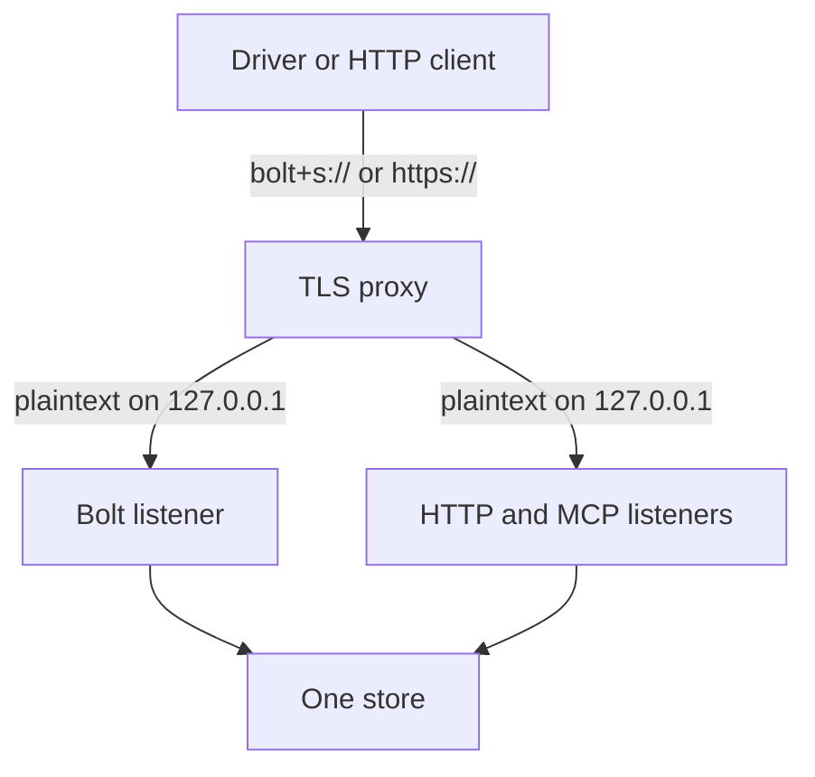

This guide shows you how to control who can reach a store that `relate serve` hosts. The server checks one HTTP Basic credential on every port it listens on: a generated token by default, or a `user:password` you set. It binds `127.0.0.1` by default and has no TLS of its own; to encrypt traffic, a TLS-terminating proxy goes in front.

## Prerequisites

- relate on your `PATH`: `relate --version` prints its version ([Install relate](/docs/get-started/install)).
- `curl`, for the checks.
- A :term[store]{id=store} to serve. `graph.rl` in the examples holds the shared example graph; [Serve the HTTP Query API](/docs/guides/serve/http-query-api#create-a-store-to-serve) shows the command that creates it.

## Know what each surface checks

One credential covers every listener of one `relate serve` process. What each :term[surface]{id=surface} does with it:

| Surface | Credential | Without a valid one | TLS | Browser origins |
| --- | --- | --- | --- | --- |
| :term[HTTP Query API]{id=http-query-api} (`--http <port>`) | `Authorization: Basic` on every route except `GET /` | `401`, code `42NFF`, with `WWW-Authenticate: Basic realm="relate"` | None | Loopback, `https://browser.neo4j.io` and `https://console.neo4j.io`; `--origin <url>` replaces the list |
| :term[MCP]{id=mcp} over HTTP (`--mcp <port>`) | `Authorization: Basic` on every request | `401` with the same challenge | None | Loopback only, fixed |
| MCP on stdio (`--mcp stdio`) | None: the host started the process | Not applicable | Not applicable | Not applicable |
| :term[Bolt]{id=bolt} (`--bolt <port>`) | The driver's basic auth token, in `LOGON` at Bolt 5.4 or `HELLO` at Bolt 4.4 | `Neo.ClientError.Security.Unauthorized`, then the connection closes | None | WebSocket upgrades: loopback, `https://browser.neo4j.io` and `https://console.neo4j.io`, or loopback only with `--auth none`; `--ws-allow-origin <url>` replaces the list |

A failed credential waits 1 second before the server answers, on every surface. There is one credential, not users or roles: whoever holds it can do anything the open mode allows, so a server that only needs to answer reads opens the store `--read-only`.

## Use the generated token

With no `--auth` flag and no `RELATE_AUTH` variable, `relate serve` generates a token for the user `relate` at startup:

```bash
relate serve --http 7474 --database ./graph.rl --read-only
```

To allow writes, remove `--read-only`.

On stderr, relate prints `auth: generated token for user relate: <token>` and `auth: persisted at ./graph.rl.auth-token (reused on restart)`. The token file sits beside the store, never inside it, with mode `0600`, and holds one line, `relate:<token>`. A restart reuses it and prints `auth: basic (token reused from ./graph.rl.auth-token)`. A `:memory:` store gets a new token on every start and no file; its startup line says so: `auth: connect with auth=(relate, <token>) — :memory: generates a fresh token every start`.

A client reads the credential from the file:

```bash
curl -s -u "$(cat graph.rl.auth-token)" -H 'Content-Type: application/json' \
  -d '{"statement": "RETURN 1 AS ok"}' http://127.0.0.1:7474/db/neo4j/query/v2
```

```text
{"data":{"fields":["ok"],"values":[[1]]},"bookmarks":[]}
```

The token never appears on a command line, so the process list does not show it. Anyone who can read the token file can connect, which is why relate creates it readable by its owner only.

## Set your own credential

Set `RELATE_AUTH` in the server's environment to a `user:password` of your choice:

```bash
RELATE_AUTH=<user>:<password> relate serve --http 7474 --database ./graph.rl --read-only
```

To allow writes, remove `--read-only`.

The startup line reads `auth: basic (from RELATE_AUTH)`. `--auth <user>:<password>` does the same and wins over the variable, and its startup line reads `auth: basic (from --auth)`; on a shared machine the variable is the better place, because the process list shows a flag's value to every user. Neither writes a token file.

The value must hold a colon with something on both sides:

| Value | Result |
| --- | --- |
| `--auth ada` | Exit code 1: `Error: --auth: expected user:password or 'none'` |
| `RELATE_AUTH=ada` | Exit code 1: `Error: RELATE_AUTH: expected user:password or 'none'` |
| `RELATE_AUTH=:<password>` | Exit code 1: `Error: RELATE_AUTH: expected user:password with both sides non-empty` |
| `--auth` with no value | Exit code 2: `Error: --auth requires USER:PASSWORD or none` |

A malformed value never falls back to no authentication.

## Turn authentication off on loopback

`--auth none` (or `RELATE_AUTH=none`) checks no credential on any surface. The startup line reads `auth: none (no credentials checked — publish ports only on trusted networks)`, and the Bolt WebSocket origins narrow to loopback. It fits a server on `127.0.0.1` that only local processes reach, or one behind a proxy that does its own authentication. A Bolt driver then connects with `auth=None`, and an HTTP client sends no `Authorization` header.

## Keep the loopback default

`--host` sets the bind address for every surface, and its default is `127.0.0.1`, so nothing outside the machine can connect. Any other value, such as `--host 0.0.0.0`, exposes the surfaces in plaintext: the credential and every result travel unencrypted. relate starts anyway and prints a warning first, beginning `serve: WARNING: --host 0.0.0.0 exposes the PLAINTEXT HTTP/MCP/Bolt surfaces to the network — serve has no TLS`. A container is the usual exception, because it must bind all interfaces to be reachable ([Run relate serve in a container](/docs/guides/serve/docker)).

## Put TLS in front

`relate serve` has no TLS and no certificate flags. To encrypt traffic, run a TLS-terminating proxy on the same machine: it holds the certificate, accepts encrypted connections, and forwards plaintext to the server's loopback port.



| Client | Connects to the proxy with |
| --- | --- |
| A Neo4j driver, certificate from a trusted authority | `bolt+s://<host>:<port>` |
| A Neo4j driver, self-signed certificate | `bolt+ssc://<host>:<port>` |
| An HTTP Query API or MCP client | `https://<host>:<port>` |

What the proxy needs:

- One TLS listener per relate listener, each forwarding to the matching port on `127.0.0.1`.
- For Bolt, termination at the TCP level: Bolt is not HTTP, so the proxy decrypts the stream and passes the bytes through unchanged.
- For the HTTP Query API and MCP, TCP-level termination works the same way. An HTTP reverse proxy, not run for this page, has to pass the `Authorization` and `Content-Type` headers through, because the server answers `401` or `415` without them.
- The server left on `--host 127.0.0.1`, so the plaintext hop never leaves the machine.

This page gives no configuration for a named proxy, because none was run for it. The setup was checked with a small TCP proxy written for the test, which terminated TLS with a self-signed certificate and forwarded to the loopback ports: the Neo4j Python driver 5.28.2 connected with `bolt+ssc://`, and `curl` with `https://` and the certificate as its CA. The proxy keeps the certificate; relate never reads it, so a new certificate needs only a proxy reload.

## Verify

This step writes a one-node `graph.rl`, then starts the server read-only on port 8842 and stops it, which generates the token. It shows the token file's mode and user, starts the server again, and sends one request with the credential and one with a wrong password. Last, it shows the second start's authentication line and a malformed `--auth`:

```bash verify
relate --database ./graph.rl "CREATE (:Person {name: 'Ada', role: 'engineer'})" > /dev/null
relate serve --http 8842 --database ./graph.rl --read-only 2> first.log &
server=$!
until curl -s -o /dev/null http://127.0.0.1:8842/; do sleep 0.1; done
kill $server
wait $server
ls -l graph.rl.auth-token | cut -c1-10
cut -d: -f1 graph.rl.auth-token
relate serve --http 8842 --database ./graph.rl --read-only 2> second.log &
server=$!
until curl -s -o /dev/null http://127.0.0.1:8842/; do sleep 0.1; done
curl -s -o /dev/null -w '%{http_code}\n' -u "$(cat graph.rl.auth-token)" \
  -H 'Content-Type: application/json' -d '{"statement": "RETURN 1 AS ok"}' \
  http://127.0.0.1:8842/db/neo4j/query/v2
curl -s -o /dev/null -w '%{http_code}\n' -u relate:wrong \
  -H 'Content-Type: application/json' -d '{"statement": "RETURN 1 AS ok"}' \
  http://127.0.0.1:8842/db/neo4j/query/v2
kill $server
wait $server
grep '^auth:' second.log
relate serve --http 8842 --database ./graph.rl --read-only --auth ada
echo "exit=$?"
```

```text
-rw-------
relate
200
401
auth: basic (token reused from ./graph.rl.auth-token)
Error: --auth: expected user:password or 'none'
exit=1
```

The token file is readable by its owner only and names the user `relate`. The token got `200`, the wrong password `401`, the second start reused the token, and the malformed credential stopped the server before it listened.

## If it goes wrong

**HTTP answers `401` with `authentication required`.** The request carries no credential, or not the server's. With a generated token, send `-u "$(cat <store>.auth-token)"`; a `:memory:` store's token is only in its startup line and changes on every start.

**A Bolt driver raises `Neo.ClientError.Security.Unauthorized` with `The client is unauthorized due to authentication failure.`** The driver's user or password does not match. Split the token file's line at its first colon: the user is `relate`, the password is the token.

**`relate serve` exits 2 with an error that begins `Error: serve --mcp stdio skips auth`.** The stdio transport has no authentication, so `--auth` with only `--mcp stdio` is a usage error. Drop `--auth`, or serve a port listener beside stdio, such as `--http <port>`, which then uses the credential.

**`relate serve` exits 1 with `Error: --auth: expected user:password or 'none'`.** The value has no colon. Pass `<user>:<password>`, or `none`.

## Related

- [Security](/docs/reference/security#served-surfaces): the served surfaces' defaults in one table.
- [`relate serve`](/docs/reference/cli/serve): `--auth`, `--host`, `--origin`, `--ws-allow-origin` and the connection limits.
- [Serve the HTTP Query API](/docs/guides/serve/http-query-api), [Serve a store over Bolt](/docs/guides/serve/bolt) and [Serve a store over MCP](/docs/guides/serve/mcp): each surface with the credential in use.
- [Run relate serve in a container](/docs/guides/serve/docker): the container's bind address and where its token goes.
