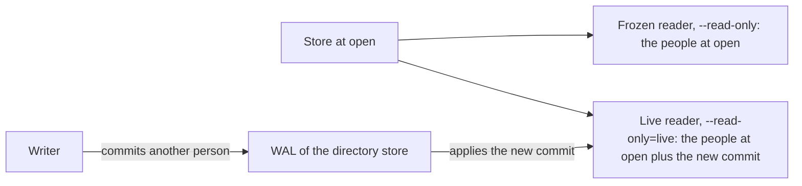

This guide shows you how to open a relate store so that nothing can change it, and how to keep a second process reading while a writer commits. `--read-only` opens a frozen view of the store as it was at open. `--read-only=live` opens a :term[directory store]{id=directory-store} read-only and follows the writer's commits as they land. Neither writes, checkpoints or migrates the store, and every write statement on either fails with exit code 6.

## Prerequisites

- relate on your `PATH` ([Install relate](/docs/get-started/install)).
- A store that already exists: a read-only open never creates one. To follow along, create the shared example graph as a directory store, `team`:

```bash verify
cat > team.cypher <<'EOF'
CREATE (ada:Person {name: 'Ada', role: 'engineer'}),
       (grace:Person {name: 'Grace', role: 'engineer'}),
       (noor:Person {name: 'Noor', role: 'maintainer'}),
       (relate:Project {name: 'relate', language: 'Rust'}),
       (tck:Project {name: 'opencypher-tck', language: 'Gherkin'}),
       (ada)-[:WORKS_ON {since: 2024}]->(relate),
       (grace)-[:WORKS_ON {since: 2023}]->(relate),
       (grace)-[:WORKS_ON {since: 2022}]->(tck),
       (noor)-[:MAINTAINS]->(relate),
       (ada)-[:KNOWS]->(grace);
EOF
relate query --database ./team < team.cypher
```

## Choose a freshness

`--read-only` takes an optional freshness, attached with `=`:

| Flag | What a statement sees | Works on |
| --- | --- | --- |
| `--read-only` (same as `--read-only=snapshot`) | The store as it was when the process opened it; later commits stay invisible until the process opens the store again | A directory store, beside its writer; a `.rl` file, only while no writer holds it; `:memory:` |
| `--read-only=live` | The writer's commits as they reach the store's :term[write-ahead log]{id=wal} (WAL), applied in the background | A directory store only |

A :term[read-only]{id=read-only} open takes no writer lock, so on a directory store it runs beside the one process that writes. A `.rl` file is one file its writer locks whole, so a read-only open of it fails with exit code 5 while a writer holds it ([Share one store between two processes](/docs/guides/operate/two-processes-one-store)).

## Open a store read-only

Add `--read-only` to any statement run. The store must exist:

```bash verify
relate --database ./team --read-only --mode envelope "MATCH (p:Person) RETURN p.name AS name ORDER BY name"
```

```text
{"columnTypes":["STRING"],"columns":["name"],"notifications":[],"rows":[{"name":"Ada"},{"name":"Grace"},{"name":"Noor"}],"truncated":false}
```

A write on a read-only open fails before it changes anything. The first line is stderr, the second the error object on stdout:

```bash verify
relate --database ./team --read-only --mode envelope "CREATE (:Person {name: 'Ines', role: 'engineer'})"
echo "exit=$?"
```

```text
semantic error: WriteOnReadOnlyAccessDatabase: No write operations are allowed on this database. The database is in read-only mode on this Neo4j instance.
{"error":{"code":"validation_error","exit_code":6,"kind":"semantic","message":"semantic error: WriteOnReadOnlyAccessDatabase: No write operations are allowed on this database. The database is in read-only mode on this Neo4j instance.","retryable":false}}
exit=6
```

The error code is `validation_error` and `retryable` is `false`: the same statement fails the same way on every read-only open. The [write on a read-only store](/docs/reference/errors#engine-write-on-read-only) entry has the details. A read-only open also never checkpoints, so opening a backup or a store written by an older release read-only leaves its files as they were.

## Read beside a writer

A frozen reader keeps the view it opened with. Here a reader opens `team` and waits 2 seconds before it counts. In the meantime a second process adds Ines and exits:

```bash verify
# the reader opens team now and runs its statement after 2 seconds
{ sleep 2; echo "MATCH (p:Person) RETURN count(p) AS people;"; } | relate query --database ./team --read-only --mode envelope &
sleep 1
relate --database ./team --mode envelope "CREATE (:Person {name: 'Ines', role: 'engineer'})"
wait
```

The first line is the writer's empty result, the second the reader's count:

```text
{"columnTypes":[],"columns":[],"notifications":[],"rows":[],"truncated":false}
{"columnTypes":["INTEGER"],"columns":["people"],"notifications":[],"rows":[{"people":3}],"truncated":false}
```

The reader counts 3 people although the store now holds 4: Ines committed after the reader opened. A one-shot run opens, reads and exits, so it sees the latest commit each time. A long-running reader opened with `--read-only` sees it only after it opens the store again.

## Follow a writer's commits

`--read-only=live` turns the same reader into a follower. It opens like a frozen reader, then applies each complete commit that reaches the WAL. The same steps, with Jun as the new person:

```bash verify
# the follower opens team now and runs its statement after 2 seconds
{ sleep 2; echo "MATCH (p:Person) RETURN count(p) AS people;"; } | relate query --database ./team --read-only=live --mode envelope &
sleep 1
relate --database ./team --mode envelope "CREATE (:Person {name: 'Jun', role: 'engineer'})"
wait
```

```text
{"columnTypes":[],"columns":[],"notifications":[],"rows":[],"truncated":false}
{"columnTypes":["INTEGER"],"columns":["people"],"notifications":[],"rows":[{"people":5}],"truncated":false}
```

The follower counts 5: Ines from the step before and Jun, who committed after it opened. A :term[live read-only]{id=live-read-only} open has these rules:

- A statement reads one consistent view: one that is already running keeps the view it started with, and the next statement sees the commits applied since.
- When the writer's checkpoint recycles WAL the follower has not applied yet, the follower loads the current snapshot and the WAL that remains, then keeps following.
- The follower never writes, checkpoints or trims the WAL, and it does not hold back the writer's checkpoints.

Following pays off in a process that stays up and answers many statements, such as a server. `relate serve --database ./team --read-only=live --http <port>` answers HTTP statements from `team` while another process writes it; [Share one store between two processes](/docs/guides/operate/two-processes-one-store#follow-the-writers-commits) walks through that setup.



## Follow only a directory store

Only a directory store has a WAL folder another process can tail. A `.rl` file keeps its WAL inside the one file, so `--read-only=live` refuses it, and `:memory:` has nothing to follow. Make a `.rl` copy and try:

```bash verify
relate clone ./team ./team.rl
relate --database ./team.rl --read-only=live --mode envelope "RETURN 1 AS ok"
echo "exit=$?"
```

```text
Failed to open Relate: semantic error: live freshness (WAL follow) is only supported for native directory databases
{"error":{"code":"fatal_error","exit_code":1,"kind":"semantic","message":"semantic error: live freshness (WAL follow) is only supported for native directory databases","retryable":false}}
exit=1
```

To follow a store that lives in a :term[single-file store]{id=single-file-store}, copy it into a directory with `relate clone ./team.rl ./team-dir` and have the writer use the directory ([Clone and convert a store](/docs/guides/storage/clone-and-convert)).

## Open read-only from Python

The Python client takes `read_only=True` on `relate.connect()`; it opens a frozen view, like `--read-only`, and a write raises `relate.OperationalError` with the same message. This program writes from one connection and reads from a read-only one on the same directory store:

```python run name=python-reader title="reader.py"
import relate

writer = relate.connect("./team")
writer.execute("CREATE (:Person {name: 'Ada', role: 'engineer'}), (:Person {name: 'Grace', role: 'engineer'})")

reader = relate.connect("./team", read_only=True)
count = "MATCH (p:Person) RETURN count(p) AS people"
print("reader at open:", reader.execute(count).fetchone()["people"])

writer.execute("CREATE (:Person {name: 'Noor', role: 'maintainer'})")
print("writer after a commit:", writer.execute(count).fetchone()["people"])
print("reader after the commit:", reader.execute(count).fetchone()["people"])

try:
    reader.execute("CREATE (:Person {name: 'Ines'})")
except relate.OperationalError as err:
    print(type(err).__name__, err.kind, err.retryable)

reader.close()
writer.close()
```

The Node.js client opens a frozen view with `Database.open(path, { readOnly: true })`. Following a writer is a CLI open: `--read-only=live` on a statement run, `relate query` or `relate serve`.

## Verify

A read-only open of the store shows every committed write, and the files are unchanged by it. After the steps on this page `team` holds 5 people:

```bash verify
relate --database ./team --read-only --mode envelope "MATCH (p:Person) RETURN count(p) AS people"
```

```text
{"columnTypes":["INTEGER"],"columns":["people"],"notifications":[],"rows":[{"people":5}],"truncated":false}
```

## If it goes wrong

- **`semantic error: WriteOnReadOnlyAccessDatabase: No write operations are allowed on this database. The database is in read-only mode on this Neo4j instance.`, exit code 6.** A statement that writes ran on a read-only open. Send the write to the process that owns the store, or open without `--read-only` when the write is intended.
- **`Failed to open Relate: storage error: read-only open requires an existing database at <path>`, exit code 1.** Nothing at that directory path is a store, and a read-only open never creates one. Check the path. For a missing `.rl` path the message is `storage error: database not found: <path>`.
- **`Failed to open Relate: storage locked: <path>`, exit code 5, on a `.rl` store.** A writer holds the file, and a `.rl` file can't be read beside it. Wait for the writer to exit. To read beside a writer next time, move the store to a directory with `relate clone` once the writer has exited ([storage locked](/docs/reference/errors#cli-conflict-locked)).
- **`Failed to open Relate: semantic error: live freshness (WAL follow) is only supported for native directory databases`, exit code 1.** `--read-only=live` was given a `.rl` file or `:memory:`. Follow a directory store, or use `--read-only`.
- **`Error: --read-only takes its value attached: --read-only=live`, exit code 2.** The freshness was passed as a separate word. Write `--read-only=live`.

## Related

- [Share one store between two processes](/docs/guides/operate/two-processes-one-store): the lock a second process meets, and serving one store to several clients.
- [`--read-only`](/docs/reference/cli/flags#read-only) in the flags reference.
- [Choose a store layout](/docs/guides/storage/choose-a-store-layout): which layout allows a reader beside its writer.
- [Transactions and concurrency](/docs/concepts/transactions-and-concurrency): one writer, many readers, and what a statement's view is.
- [Shared store across processes](/docs/concepts/problems-relate-solves#shared-store-across-processes) in the capability catalog.
